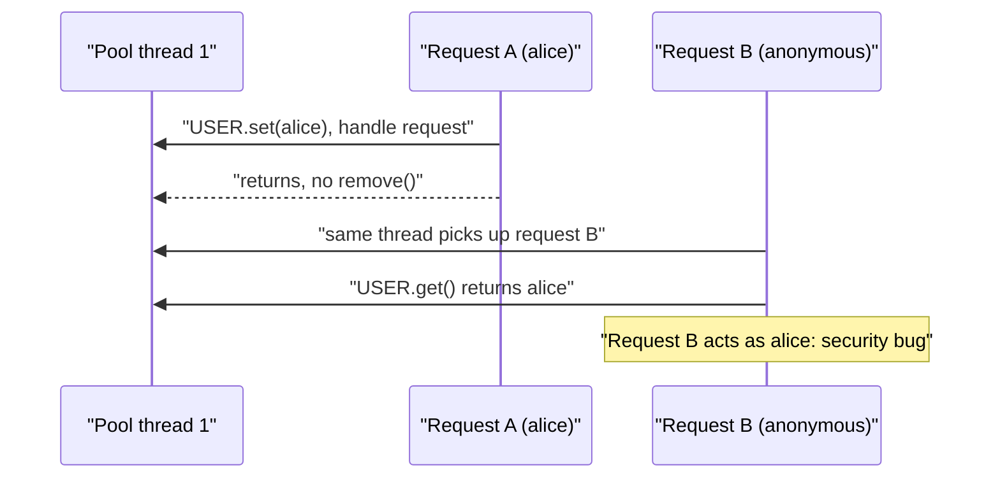
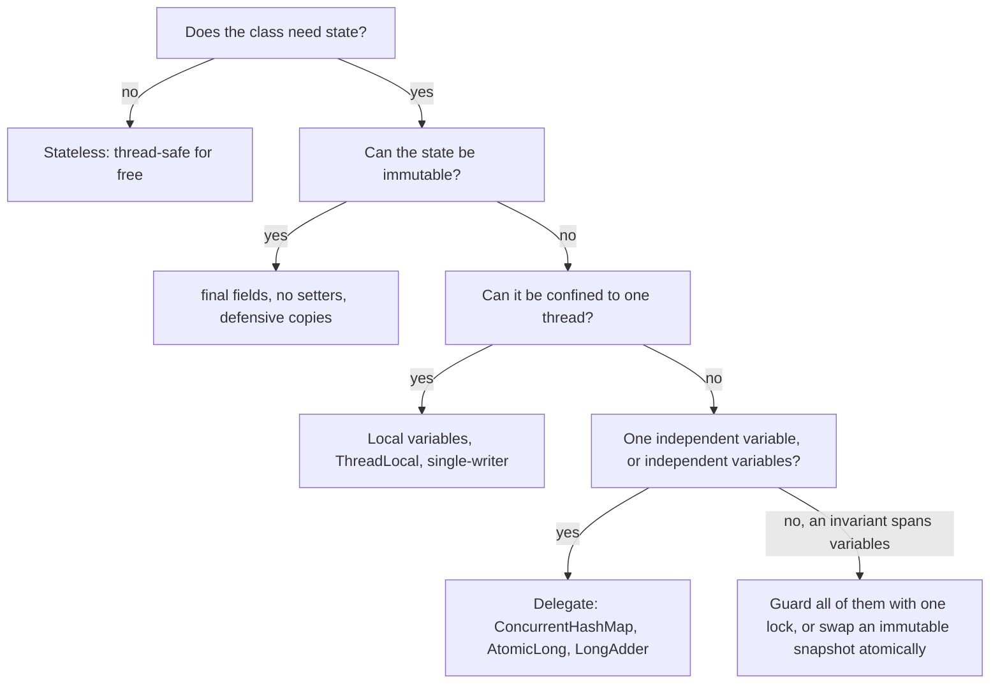

@@ 3 | TOPIC | ThreadLocal and Its Leaks | Per-thread variables, ThreadLocalMap internals, leaks in thread pools, context propagation in Spring | SHOULD
# ThreadLocal and Its Leaks

**Level: Advanced | Phase 16 | Priority: SHOULD | Since: Java 1.2 (ThreadLocal, InheritableThreadLocal), Java 8 (ThreadLocal.withInitial)**

> **30-second interview answer:** A `ThreadLocal<T>` gives each thread its own independent copy of a variable: the value is stored in a map inside the `Thread` object, keyed by the `ThreadLocal`. Frameworks use it to carry request context without passing parameters: Spring's `SecurityContextHolder`, `RequestContextHolder`, transaction synchronization and SLF4J's MDC. The danger is thread pools: threads live forever, so a value you forget to `remove()` leaks into the next task (wrong user, wrong tenant) and holds memory, and in app servers it can pin a whole class loader. Always `remove()` in `finally`, and propagate context explicitly to other threads.

## 1. Concept in Simple Words
### Analogy
Lockers assigned to staff in a hotel.

| Hotel | ThreadLocal |
|---|---|
| Each staff member has a personal locker with their own things | Each thread has its own value |
| The locker label ("uniform locker") is the same for everyone | The `ThreadLocal` object is shared; the values are per thread |
| The lockers are inside each staff member's room, not a central hall | Values live in `Thread.threadLocals`, a map inside the thread |
| Temporary staff hand back the locker key when they quit | Thread dies, its map is garbage collected |
| Permanent staff (pool threads) never quit; a guest's lost bag left in the locker is found by the next shift | Missing `remove()` leaks state into the next task |
| A new hire gets a photocopy of their manager's locker contents on day one | `InheritableThreadLocal` copies at thread creation |

### What it is
- **ThreadLocal:** `get()`, `set(value)`, `remove()`, and `ThreadLocal.withInitial(supplier)` for a lazily created initial value per thread.
- **Thread confinement:** an object only one thread can reach is thread-safe without locks; `ThreadLocal` is a way to confine an object to a thread.
- **InheritableThreadLocal:** the child thread gets a copy of the parent's value *when the child thread is created*. Useless with pools (threads are created once, long before the task).
- **Context propagation:** copying context values (MDC, security, tracing) from the submitting thread to the thread that runs the task, then cleaning up.
- **Typical uses:** per-thread non-thread-safe helpers (legacy `SimpleDateFormat`, `Random` before `ThreadLocalRandom`), request context, transaction-bound resources (Spring binds the JDBC connection to the thread inside `@Transactional`).

### Why it exists
Passing context (current user, tenant, transaction, correlation id) through every method parameter is noisy and breaks third-party interfaces. Sharing one non-thread-safe object needs locking. Per-thread storage solves both: each thread has its own copy, so there is no contention and no parameter plumbing. It fits the thread-per-request model that servlet containers use.

## 2. How It Works
```text
ThreadLocal<String> USER   (one shared object, acts as a key)

Thread T1 object                              Thread T2 object
  threadLocals: ThreadLocalMap                  threadLocals: ThreadLocalMap
   Entry[] table                                 Entry[] table
   [ WeakRef(USER) -> "alice" ]                  [ WeakRef(USER) -> "bob" ]
   [ WeakRef(TX)   -> Connection#4 ]

USER.get() on T1  ->  Thread.currentThread().threadLocals.get(USER)  ->  "alice"
```

- The map lives **in the Thread**, not in the `ThreadLocal`. That is why a value is visible only to its thread and why it lives as long as the thread.
- **Keys are weak references** to the `ThreadLocal`; **values are strong references.** If your code drops the last reference to a `ThreadLocal` (for example, the class that declared it is unloaded), the key is collected but the value stays reachable from the thread until the map happens to clean up "stale entries" during a later `get`, `set` or `remove`. On a long-lived pool thread that may never happen.
- **Class loader leak:** in an application server, a pool thread owned by the server holds a value whose class came from your web app. That value references its class, the class references its class loader, and the class loader references every class of the app. Redeploy the app and the old one can never be collected: `OutOfMemoryError: Metaspace` after a few redeploys.
- **Hash scheme:** `ThreadLocalMap` uses open addressing with a fixed hash increment (`0x61c88647`, the golden ratio) to spread entries.



**Spring uses ThreadLocals everywhere:**

| Spring holder | Holds | Cleared by |
|---|---|---|
| `SecurityContextHolder` | Authenticated user | `SecurityContextHolderFilter` at the end of the request |
| `RequestContextHolder` | Current `HttpServletRequest` attributes | `RequestContextFilter` or `DispatcherServlet` |
| `TransactionSynchronizationManager` | Connection or session bound to the transaction | Transaction manager on commit or rollback |
| `LocaleContextHolder` | Current locale | `DispatcherServlet` |
| SLF4J `MDC` | Log context such as request id | Your filter, in `finally` |

Because they are thread-bound, they are **empty** in `@Async` methods, `CompletableFuture.supplyAsync` tasks and other pool threads unless you propagate them (Spring's `TaskDecorator`, `DelegatingSecurityContextExecutor`, or Micrometer context propagation).

## 3. Code Example
### Code
```java
import java.util.concurrent.Callable;
import java.util.concurrent.ExecutorService;
import java.util.concurrent.Executors;
import java.util.concurrent.Future;

public class ThreadLocalDemo {

    static final ThreadLocal<String> CURRENT_USER = new ThreadLocal<>();
    static final ThreadLocal<StringBuilder> BUFFER = ThreadLocal.withInitial(StringBuilder::new);
    static final InheritableThreadLocal<String> TENANT = new InheritableThreadLocal<>();

    // BAD: sets the value and never removes it
    static String leakyHandler(String user) {
        if (user != null) CURRENT_USER.set(user);
        return "handled as " + CURRENT_USER.get();
    }

    // GOOD: scope the value to the request with try/finally
    static String safeHandler(String user) {
        if (user != null) CURRENT_USER.set(user);
        try {
            return "handled as " + CURRENT_USER.get();
        } finally {
            CURRENT_USER.remove();
        }
    }

    // Propagation: capture context on the submitting thread, restore it in the worker
    static <T> Callable<T> withContext(Callable<T> task) {
        String captured = CURRENT_USER.get();
        return () -> {
            String previous = CURRENT_USER.get();
            CURRENT_USER.set(captured);
            try {
                return task.call();
            } finally {
                if (previous == null) CURRENT_USER.remove(); else CURRENT_USER.set(previous);
            }
        };
    }

    public static void main(String[] args) throws Exception {
        ExecutorService pool = Executors.newSingleThreadExecutor();   // one reused thread, like a server pool

        // 1. The leak
        System.out.println(pool.submit(() -> leakyHandler("alice")).get());
        System.out.println(pool.submit(() -> leakyHandler(null)).get());     // anonymous request
        pool.submit(() -> CURRENT_USER.remove()).get();                       // reset for the next demo

        // 2. The fix
        System.out.println(pool.submit(() -> safeHandler("alice")).get());
        System.out.println(pool.submit(() -> safeHandler(null)).get());

        // 3. Context does not cross threads by itself
        CURRENT_USER.set("bob");
        Future<String> plain = pool.submit(() -> "plain task sees " + CURRENT_USER.get());
        Future<String> wrapped = pool.submit(withContext(() -> "wrapped task sees " + CURRENT_USER.get()));
        System.out.println(plain.get());
        System.out.println(wrapped.get());
        System.out.println("worker after wrapped task: " + pool.submit(() -> String.valueOf(CURRENT_USER.get())).get());
        CURRENT_USER.remove();

        // 4. withInitial: one buffer per thread, reused across tasks on that thread
        pool.submit(() -> BUFFER.get().append("a")).get();
        System.out.println("buffer on worker: " + pool.submit(() -> BUFFER.get().append("b").toString()).get());
        System.out.println("buffer on main: '" + BUFFER.get() + "'");

        // 5. InheritableThreadLocal copies only at thread creation
        TENANT.set("acme");
        Thread child = new Thread(() -> System.out.println("new child thread tenant: " + TENANT.get()));
        child.start();
        child.join();
        System.out.println("existing pool thread tenant: " + pool.submit(() -> String.valueOf(TENANT.get())).get());

        pool.shutdown();
    }
}
```

### Walkthrough
- **Leak:** the single pool thread runs the "alice" request, which sets `CURRENT_USER` and never removes it. The next, anonymous request runs on the same thread and reads "alice". In a real server this is a cross-user data leak.
- **Fix:** `safeHandler` removes the value in `finally`, so the next request on that thread sees `null`.
- **Propagation:** main sets "bob", but the plain task runs on the worker thread and sees `null`. `withContext` captures the value when the task is *created* on main and installs it around the call on the worker, then restores the worker's previous state. Spring's `TaskDecorator` is exactly this pattern.
- **withInitial:** the worker's buffer survives between tasks ("ab"): useful for caching per-thread helpers, dangerous if the content is request-specific. Main has its own empty buffer.
- **InheritableThreadLocal:** a thread created after `TENANT.set` copies "acme"; the pool thread was created earlier, so it sees `null`. This is why inheritable thread locals do not solve propagation for executors.

### Output
```text
handled as alice
handled as alice
handled as alice
handled as null
plain task sees null
wrapped task sees bob
worker after wrapped task: null
buffer on worker: ab
buffer on main: ''
new child thread tenant: acme
existing pool thread tenant: null
```

### Compare
| Leaky pattern | Safe pattern |
|---|---|
| `CONTEXT.set(x); doWork();` | `CONTEXT.set(x); try { doWork(); } finally { CONTEXT.remove(); }` |
| `InheritableThreadLocal` to reach pool threads | Capture and restore with a decorator (`TaskDecorator`) |
| `ThreadLocal<SimpleDateFormat>` | A shared immutable `DateTimeFormatter` |
| Request context in `ThreadLocal` on Java 25 virtual threads | `ScopedValue` bound around the request |

## 4. Interview Questions
**Basic**
1. **What is a ThreadLocal?**
   A variable whose value is separate for every thread: each thread that calls `get()` sees the value it set itself. It is used to confine non-thread-safe objects to a thread and to carry context implicitly through a call chain.
2. **Where is the value actually stored?**
   In a `ThreadLocalMap` field of the `Thread` object. The `ThreadLocal` instance is only the key. That is why values die with the thread and why they leak when threads are reused.
3. **Name ThreadLocal uses inside Spring.**
   `SecurityContextHolder` (default strategy), `RequestContextHolder`, `LocaleContextHolder`, and `TransactionSynchronizationManager`, which binds the connection or `EntityManager` to the thread for the duration of a `@Transactional` method. Logging MDC is also thread-local.

**Follow-up**
4. **How exactly does a ThreadLocal leak memory?**
   Entries have weak keys but strong values. In a pool the thread never dies, so a value that was never removed stays reachable. If the `ThreadLocal` itself becomes unreachable, the key is cleared but the value remains until a later map operation expunges stale entries, which may never happen. In app servers the value can keep the web app's class loader alive, leaking all its classes on redeploy.
5. **Why are keys weak references if values still leak?**
   Weak keys at least let the `ThreadLocal` object be collected and allow the map to detect stale entries (null key) and clean them during `get`, `set` and `remove`. Making values weak would let a value disappear while the thread still needs it. The design reduces leaks but cannot eliminate them; only `remove()` does.
6. **Why is `SecurityContextHolder` empty inside an `@Async` method?**
   The `@Async` method runs on a different thread from the task executor, and thread locals do not follow. Fix with `DelegatingSecurityContextAsyncTaskExecutor`, a `TaskDecorator` that copies the context, or by passing the needed data as parameters. `MODE_INHERITABLETHREADLOCAL` only helps for newly created threads, not pools.

**Tricky / scenario**
7. **In production, logs from one request occasionally contain another request's `requestId`. What is the likely cause?**
   An MDC value set in a filter or interceptor is not cleared in `finally`, or an async task copies MDC but never restores it, so a pool thread carries the previous request's MDC into the next. Fix: `MDC.put` and `MDC.remove` (or `MDC.clear`) in try/finally in the filter, and a `TaskDecorator` that sets and then restores the MDC map around each task.
8. **After several hot redeploys on Tomcat, the app fails with `OutOfMemoryError: Metaspace`. Tomcat logs warn "created a ThreadLocal ... but failed to remove it". Explain.**
   A library or your code stored an object from the web app in a `ThreadLocal` on a Tomcat worker thread. The worker survives the redeploy, keeping the value, its class, and therefore the old web app class loader with all its classes. Each redeploy adds another dead class loader. Fix by removing the values (in filters or `ServletContextListener.contextDestroyed`) and upgrading the offending library.
9. **With virtual threads, is ThreadLocal still a leak risk?**
   Less from pooling, because virtual threads are created per task and discarded, so values die with the thread. The new risks are memory (a heavy per-thread cache multiplied by a million threads) and losing reuse (a cache that never hits). You can still leak if someone pools virtual threads. For request context, scoped values (final in Java 25) are the intended replacement.

**What the interviewer is really testing:** whether you understand where thread-local data lives, how it interacts with pools and async code, and whether you have seen (or can prevent) the classic production bugs: wrong user, wrong log context, class loader leaks.

## 5. Pitfalls & Best Practices
### Common mistakes
| Mistake | What goes wrong | Fix |
|---|---|---|
| No `remove()` in pooled threads | Data leaks into next task, memory retained | `try { } finally { tl.remove(); }` |
| Relying on ThreadLocal context in `@Async` or `CompletableFuture` | Context missing, NPEs, wrong tenant | Propagate with `TaskDecorator` or pass parameters |
| `InheritableThreadLocal` with pools | Stale or missing values, copied once at creation | Explicit capture and restore |
| Large objects cached per thread | Memory multiplied by thread count | Bounded shared pools or immutable shared objects |
| Non-static ThreadLocal field per instance | Many ThreadLocals, hard to clean, more leaks | Declare `private static final` |

### Best practices
- Declare thread locals `private static final` and wrap them in a small holder class with `set`, `get`, `clear` methods.
- Set and clear in the same method, ideally in one filter or interceptor at the edge of the request.
- Use a `TaskDecorator` on every Spring executor to propagate MDC and security context and to clean up afterwards.
- Prefer immutable, thread-safe objects (`DateTimeFormatter`, `ThreadLocalRandom`) over per-thread caches.
- On Java 25, use `ScopedValue` for new request-context code.

### Compare with
| Mechanism | Scope | Inherited by new threads | Cleanup |
|---|---|---|---|
| Method parameter | Explicit call chain | Yes, you pass it | Automatic |
| `ThreadLocal` | Thread lifetime | No | Manual `remove()` |
| `InheritableThreadLocal` | Thread lifetime, copied at child creation | Yes, once | Manual |
| `ScopedValue` (Java 25) | Binding extent | Structured subtasks | Automatic |
| Spring request scope bean | HTTP request | No | Automatic at request end |

## 6. Hands-on Exercise
OrderHub sends order confirmation emails with `@Async`. Logs from the async method lack the `requestId` MDC value and `SecurityContextHolder` is empty there. Add a `RequestIdFilter` that puts a request id in MDC and clears it, and configure the async executor with a `TaskDecorator` that copies MDC and the security context into the task and restores the previous state afterwards.

Acceptance criteria:
- Every log line from `NotificationService.sendConfirmation` shows the same `requestId` as the controller log line.
- `SecurityContextHolder.getContext().getAuthentication()` is the caller inside the async method.
- No MDC value survives on the pool thread after the task.

<details><summary>Solution</summary>

```java
// web/RequestIdFilter.java
package com.orderhub.web;

import jakarta.servlet.FilterChain;
import jakarta.servlet.ServletException;
import jakarta.servlet.http.HttpServletRequest;
import jakarta.servlet.http.HttpServletResponse;
import java.io.IOException;
import java.util.UUID;
import org.slf4j.MDC;
import org.springframework.core.Ordered;
import org.springframework.core.annotation.Order;
import org.springframework.stereotype.Component;
import org.springframework.web.filter.OncePerRequestFilter;

@Component
@Order(Ordered.HIGHEST_PRECEDENCE)
public class RequestIdFilter extends OncePerRequestFilter {
    @Override
    protected void doFilterInternal(HttpServletRequest request, HttpServletResponse response, FilterChain chain)
            throws ServletException, IOException {
        String requestId = request.getHeader("X-Request-Id") != null
                ? request.getHeader("X-Request-Id") : UUID.randomUUID().toString();
        MDC.put("requestId", requestId);
        response.setHeader("X-Request-Id", requestId);
        try {
            chain.doFilter(request, response);
        } finally {
            MDC.remove("requestId");          // never leave it on the Tomcat thread
        }
    }
}
```

```java
// config/AsyncConfig.java
package com.orderhub.config;

import java.util.Map;
import org.slf4j.MDC;
import org.springframework.context.annotation.Bean;
import org.springframework.context.annotation.Configuration;
import org.springframework.core.task.TaskDecorator;
import org.springframework.scheduling.annotation.EnableAsync;
import org.springframework.scheduling.concurrent.ThreadPoolTaskExecutor;
import org.springframework.security.core.context.SecurityContext;
import org.springframework.security.core.context.SecurityContextHolder;

@Configuration
@EnableAsync
public class AsyncConfig {

    @Bean
    public TaskDecorator contextCopyingDecorator() {
        return task -> {
            // runs on the SUBMITTING thread: capture
            Map<String, String> mdc = MDC.getCopyOfContextMap();
            SecurityContext security = SecurityContextHolder.getContext();
            return () -> {
                // runs on the WORKER thread: install, run, restore
                Map<String, String> previousMdc = MDC.getCopyOfContextMap();
                SecurityContext previousSecurity = SecurityContextHolder.getContext();
                if (mdc != null) MDC.setContextMap(mdc); else MDC.clear();
                SecurityContextHolder.setContext(security);
                try {
                    task.run();
                } finally {
                    if (previousMdc != null) MDC.setContextMap(previousMdc); else MDC.clear();
                    SecurityContextHolder.setContext(previousSecurity);
                }
            };
        };
    }

    @Bean(name = "taskExecutor")
    public ThreadPoolTaskExecutor taskExecutor(TaskDecorator contextCopyingDecorator) {
        ThreadPoolTaskExecutor executor = new ThreadPoolTaskExecutor();
        executor.setCorePoolSize(4);
        executor.setMaxPoolSize(8);
        executor.setQueueCapacity(500);
        executor.setThreadNamePrefix("orderhub-async-");
        executor.setTaskDecorator(contextCopyingDecorator);
        executor.initialize();
        return executor;
    }
}
```

```java
// notification/NotificationService.java
package com.orderhub.notification;

import org.slf4j.Logger;
import org.slf4j.LoggerFactory;
import org.springframework.scheduling.annotation.Async;
import org.springframework.security.core.Authentication;
import org.springframework.security.core.context.SecurityContextHolder;
import org.springframework.stereotype.Service;

@Service
public class NotificationService {
    private static final Logger log = LoggerFactory.getLogger(NotificationService.class);

    @Async("taskExecutor")
    public void sendConfirmation(long orderId) {
        Authentication auth = SecurityContextHolder.getContext().getAuthentication();
        log.info("sending confirmation for order {} on behalf of {}", orderId, auth == null ? "nobody" : auth.getName());
    }
}
```

```yaml
# application.yml: show the MDC value in every log line
logging:
  pattern:
    level: "%5p [%X{requestId}]"
```

Log output:
```text
 INFO [7f3c2a10-5b1e-4c55-9a07-2f6f2d8f1c11] 1234 --- [nio-8080-exec-3] c.o.order.OrderController     : order 1001 created
 INFO [7f3c2a10-5b1e-4c55-9a07-2f6f2d8f1c11] 1234 --- [orderhub-async-1] c.o.n.NotificationService     : sending confirmation for order 1001 on behalf of alice
```
The decorator's outer lambda runs at submission time on the request thread (capture); the inner `Runnable` runs on the pool thread and restores the previous state in `finally`, so no context leaks into the next task. If you enable virtual threads, Boot's `SimpleAsyncTaskExecutor` also accepts a `TaskDecorator` bean.
</details>

## 7. Recall
Q: Where does a `ThreadLocal` store its per-thread values?
A: In a `ThreadLocalMap` inside each `Thread` object, keyed by the `ThreadLocal` instance.

Q: Why do `ThreadLocal` values leak in thread pools?
A: Pool threads never die, values are strongly referenced from the thread's map, and without `remove()` they stay and are seen by the next task.

Q: Why is `InheritableThreadLocal` not a solution for passing context to executor tasks?
A: It copies values only when a thread is created, and pool threads are created long before the tasks run.

Q: Name three Spring components that rely on `ThreadLocal`.
A: `SecurityContextHolder`, `RequestContextHolder` and `TransactionSynchronizationManager` (also `LocaleContextHolder` and MDC).

Q: How do you propagate MDC and security context to Spring `@Async` methods?
A: Configure the executor with a `TaskDecorator` that captures the context on submission and installs and then restores it around the task.

Q: What is the correct usage pattern for setting a `ThreadLocal` in request handling?
A: Set it, run the work in `try`, and call `remove()` in `finally`.

**Related:** [[Virtual Threads]] · [[Structured Concurrency and Scoped Values]] · [[Logging with SLF4J, Logback and MDC]] · [[Memory Leaks and OutOfMemoryError]]

@@ 3 | TOPIC | Designing Thread-Safe Classes | Statelessness, immutability, confinement, guarded state, delegation, safe publication and invariants across variables | MUST
# Designing Thread-Safe Classes

**Level: Advanced | Phase 16 | Priority: MUST | Since: Java 1.0 (memory model formalized in Java 5, JSR 133)**

> **30-second interview answer:** A class is thread-safe if it behaves correctly when used from many threads with no extra synchronization by the caller. I design for it in this order: no shared state (stateless), no mutable state (immutable, `final` fields), state confined to one thread, delegation to thread-safe building blocks (`ConcurrentHashMap`, atomics), and only then locking, where every variable involved in an invariant is guarded by the same lock, compound actions (check-then-act, read-modify-write) are atomic, `this` never escapes the constructor, and objects are safely published. Then I document the policy.

## 1. Concept in Simple Words
### Analogy
A shared office kitchen.

| Office kitchen | Thread-safe design |
|---|---|
| Vending machine that keeps no memory of you | Stateless class |
| Printed menu on the wall: nobody can edit it | Immutable object |
| Your own lunchbox at your desk | Thread confinement (local variables, `ThreadLocal`) |
| A sealed coffee machine that handles its own queue | Delegation to a thread-safe component |
| One key for the fridge AND the shopping list, because "milk in fridge" and "milk on list" must stay consistent | One lock guards all variables in an invariant |
| "Check the fridge has milk, then take it" must be one action, or someone takes it in between | Atomic compound actions |
| A notice pinned up before it is finished being written | Unsafe publication, `this` escaping the constructor |
| The kitchen rules posted on the door | Documenting the thread-safety policy |

### What it is
- **Thread-safe:** correct under any interleaving of calls from multiple threads, without caller-side locking.
- **Invariant:** a condition that must always hold, possibly across several fields (`lower <= upper`, `count == items.size()`).
- **Race condition:** correctness depends on timing. Two kinds: *check-then-act* (`if (!map.containsKey(k)) map.put(k, v)`) and *read-modify-write* (`count++`).
- **Guarded by:** the lock that must be held to access a variable. All variables in one invariant must be guarded by the same lock.
- **Confinement:** only one thread can reach the object (stack confinement: local variables; thread confinement: `ThreadLocal`, actor or event-loop style).
- **Safe publication:** making a reference and the object's fully constructed state visible to other threads together. Safe ways: static initializer, `final` field, `volatile` field or `AtomicReference`, a field guarded by a lock, or putting it into a thread-safe collection.
- **Escape:** publishing an object before its constructor finishes (registering `this` as a listener in the constructor, starting a thread in the constructor).
- **Delegation:** a class with a single thread-safe state variable can delegate safety to it; a class with several *independent* thread-safe variables can too, but not if they participate in a shared invariant.

### Why it exists
Locks sprinkled until tests pass produce classes that deadlock, scale badly or still race. Most concurrency bugs come from shared mutable state: if state is not shared or not mutable, there is nothing to get wrong. The Java Memory Model (JSR 133, Java 5) defines what visibility guarantees `final`, `volatile` and locks give, so you can reason about safety instead of hoping. Spring makes this daily work: singleton beans are shared by every request thread, so every service, controller and component must be thread-safe.

## 2. How It Works
**The decision ladder** (stop at the first rung that works):



**Why delegation fails across invariants:**
```text
NumberRange with AtomicInteger lower = 0, upper = 10. Invariant: lower <= upper

Thread A: setLower(5)                 Thread B: setUpper(4)
  check 5 <= upper.get() (10)  ok
                                        check 4 >= lower.get() (0)  ok
  lower.set(5)
                                        upper.set(4)
Result: lower = 5, upper = 4   -> invariant broken, although each field is atomic
```
Each operation on each field is atomic, but the check and the set across *two* fields are not. Fix: guard both with one lock, or hold both values in one immutable object and replace it with `compareAndSet`.

**Safe publication and `final`:**
```text
Thread A: holder = new Config(url, timeout)     (no synchronization)
Thread B: if (holder != null) holder.url()      may see url == null if fields are NOT final!

JMM rule: writes to final fields in a constructor are visible to any thread that obtains
a reference to the object after the constructor finishes (and `this` did not escape).
Non-final fields have no such guarantee without volatile, a lock, or a safe handoff.
```

**Spring beans:** a singleton `@Service` is one instance shared by all request threads. Fields should be `final` dependencies (other beans, configuration) set in the constructor. Per-request data belongs in method parameters and local variables (stack confinement). Mutable shared state (counters, caches) must use concurrent structures.

## 3. Code Example
### Code
```java
import java.util.Map;
import java.util.concurrent.ConcurrentHashMap;
import java.util.concurrent.ExecutorService;
import java.util.concurrent.Executors;
import java.util.concurrent.atomic.AtomicReference;
import java.util.concurrent.atomic.LongAdder;

public class ThreadSafeDesignDemo {

    // 1. BROKEN: each field is atomic, but the invariant spans both
    static class BrokenRange {
        private final java.util.concurrent.atomic.AtomicInteger lower = new java.util.concurrent.atomic.AtomicInteger(0);
        private final java.util.concurrent.atomic.AtomicInteger upper = new java.util.concurrent.atomic.AtomicInteger(10);

        boolean canSetLower(int v) { return v <= upper.get(); }   // check
        void doSetLower(int v) { lower.set(v); }                   // act
        boolean canSetUpper(int v) { return v >= lower.get(); }
        void doSetUpper(int v) { upper.set(v); }
        String show() { return "[" + lower.get() + ", " + upper.get() + "]"; }
    }

    // 2. FIXED: immutable snapshot swapped atomically, invariant checked inside the CAS loop
    record Range(int lower, int upper) {
        Range {
            if (lower > upper) throw new IllegalArgumentException("lower > upper: " + lower + " > " + upper);
        }
    }

    static class SafeRange {
        private final AtomicReference<Range> range = new AtomicReference<>(new Range(0, 10));

        void setLower(int v) {
            while (true) {
                Range current = range.get();
                Range next = new Range(v, current.upper());          // validates the invariant
                if (range.compareAndSet(current, next)) return;      // retry if someone changed it
            }
        }

        void setUpper(int v) {
            while (true) {
                Range current = range.get();
                Range next = new Range(current.lower(), v);
                if (range.compareAndSet(current, next)) return;
            }
        }

        Range get() { return range.get(); }
    }

    // 3. Delegation to thread-safe components: independent state only
    static class PageViewCounter {
        private final Map<String, LongAdder> views = new ConcurrentHashMap<>();

        void record(String page) {
            views.computeIfAbsent(page, p -> new LongAdder()).increment();   // atomic per key
        }

        long viewsOf(String page) {
            LongAdder adder = views.get(page);
            return adder == null ? 0 : adder.sum();
        }
    }

    // 4. Guarded state: several fields, one lock, invariant total == sum of items
    static class Cart {
        private final Map<String, Integer> quantities = new java.util.HashMap<>();   // guarded by this
        private int totalItems;                                                    // guarded by this

        synchronized void add(String sku, int qty) {
            quantities.merge(sku, qty, Integer::sum);
            totalItems += qty;
        }

        synchronized boolean removeIfPresent(String sku) {     // check-then-act made atomic
            Integer qty = quantities.remove(sku);
            if (qty == null) return false;
            totalItems -= qty;
            return true;
        }

        synchronized String snapshot() { return quantities.size() + " skus, " + totalItems + " items"; }
    }

    public static void main(String[] args) throws Exception {
        // Replay the bad interleaving deterministically
        BrokenRange broken = new BrokenRange();
        boolean aOk = broken.canSetLower(5);     // thread A checks
        boolean bOk = broken.canSetUpper(4);     // thread B checks
        if (aOk) broken.doSetLower(5);           // thread A acts
        if (bOk) broken.doSetUpper(4);           // thread B acts
        System.out.println("broken range after interleaving: " + broken.show());

        SafeRange safe = new SafeRange();
        safe.setLower(5);
        try {
            safe.setUpper(4);
        } catch (IllegalArgumentException e) {
            System.out.println("safe range rejected: " + e.getMessage());
        }
        System.out.println("safe range: " + safe.get());

        PageViewCounter counter = new PageViewCounter();
        Cart cart = new Cart();
        try (ExecutorService pool = Executors.newFixedThreadPool(8)) {
            for (int t = 0; t < 8; t++) {
                pool.submit(() -> {
                    for (int i = 0; i < 10_000; i++) {
                        counter.record(i % 2 == 0 ? "/home" : "/orders");
                        cart.add("sku-" + (i % 5), 1);
                    }
                });
            }
        }
        System.out.println("/home=" + counter.viewsOf("/home") + " /orders=" + counter.viewsOf("/orders"));
        System.out.println("cart: " + cart.snapshot());
        System.out.println("removed sku-0: " + cart.removeIfPresent("sku-0") + ", again: " + cart.removeIfPresent("sku-0"));
        System.out.println("cart: " + cart.snapshot());
    }
}
```

### Walkthrough
- **BrokenRange:** the check and the act are separate steps over two atomic fields. Replaying the interleaving from the diagram leaves `[5, 4]`, which violates `lower <= upper`. Under real threads this happens rarely, which is exactly why such bugs survive testing.
- **SafeRange:** the two numbers live in one immutable `Range` record whose compact constructor enforces the invariant. Updates build a new `Range` from the current snapshot and install it with `compareAndSet`; if another thread won the race, the loop retries with the fresh snapshot. Readers always see a consistent pair.
- **PageViewCounter:** pages are independent, so delegating to `ConcurrentHashMap` plus `LongAdder` is enough. `computeIfAbsent` is atomic, so two threads cannot create two adders for the same page. 8 threads x 10,000 events split evenly gives 40,000 per page.
- **Cart:** two fields share an invariant, so both are guarded by the same intrinsic lock (`synchronized` methods use `this`). `removeIfPresent` turns check-then-act into one atomic operation. 80,000 items over 5 SKUs; removing sku-0 subtracts its 16,000.
- **try-with-resources executor:** `close()` waits for tasks, so the results printed after the block are complete and visible (task completion happens-before the return from `close`).

### Output
```text
broken range after interleaving: [5, 4]
safe range rejected: lower > upper: 5 > 4
safe range: Range[lower=5, upper=10]
/home=40000 /orders=40000
cart: 5 skus, 80000 items
removed sku-0: true, again: false
cart: 4 skus, 64000 items
```

### Compare
| Strategy | Cost | Use when |
|---|---|---|
| Stateless | None | Services that only transform inputs |
| Immutable | Allocation on change | Value objects, configuration, snapshots |
| Confinement | None | Per-request data, local computation |
| Delegation | Low | Independent counters, maps, flags |
| Immutable snapshot + CAS | Allocation and retries | Small multi-field state, read-heavy |
| One lock over all invariant fields | Contention | Larger multi-field state, complex updates |

## 4. Interview Questions
**Basic**
1. **What does thread-safe mean?**
   A class is thread-safe if it keeps its invariants and gives correct results no matter how calls from multiple threads interleave, without requiring callers to add synchronization. Thread-safety is a property of the class's specification and implementation together.
2. **What are the main strategies to make a class thread-safe?**
   Avoid shared state (stateless), avoid mutability (immutable objects with `final` fields), confine state to one thread, delegate to thread-safe classes for independent state, and use locks so that every invariant's variables are guarded by one lock and compound actions are atomic.
3. **Why are immutable objects always thread-safe?**
   Their state cannot change after construction, so there is nothing to race on, and the JMM guarantees that properly constructed objects' `final` fields are visible to every thread without synchronization. They can be shared and cached freely.

**Follow-up**
4. **If every field of a class is an `AtomicInteger`, is the class thread-safe?**
   Only if the fields are independent. When an invariant relates two fields (lower bound and upper bound, balance and transaction count), separate atomic updates allow interleavings that break it. Group related values into one immutable object in an `AtomicReference`, or guard them all with one lock.
5. **What is safe publication and why is `final` important?**
   Safe publication makes both the reference and the object's constructed state visible to other threads. Publishing through a `volatile` field, a lock, a static initializer or a concurrent collection is safe. `final` fields get a special guarantee: once the constructor finishes without `this` escaping, any thread that sees the reference sees the final fields' values, even through a data race.
6. **How can `this` escape during construction and why is it dangerous?**
   By registering `this` as a listener, starting a thread, or storing it in a static field inside the constructor. Another thread may then call methods on a half-constructed object and see default values even in `final` fields. Use a private constructor plus a static factory that constructs fully, then registers or starts.

**Tricky / scenario**
7. **A Spring `@Service` stores the current order in an instance field during `process()` and sometimes processes the wrong order under load. Why?**
   The service is a singleton shared by all request threads, so the field is shared mutable state: thread B overwrites it while thread A is still using it. Fix by keeping per-request data in local variables and parameters (stack confinement); service fields should be `final` injected dependencies only. Changing the scope to prototype hides the problem but does not fix the design.
8. **Is `Collections.synchronizedList(list)` enough to make "add if absent" safe?**
   No. Each method is synchronized, but `if (!list.contains(x)) list.add(x)` is two calls; another thread can add `x` between them. You must hold the list's lock across both (`synchronized (list) { ... }`) or use a structure with an atomic operation such as a concurrent set (`ConcurrentHashMap.newKeySet().add(x)`).
9. **Design a thread-safe in-memory rate counter for "requests per user in the last minute" for a service with very high traffic.**
   Use a `ConcurrentHashMap<String, Window>` where `Window` is per user and either an immutable snapshot replaced by `compute` (atomic per key) or a small object guarded by its own lock (lock striping by key, no global lock). Use `LongAdder` for hot global counters. Evict idle users periodically, and avoid holding locks while doing I/O. This keeps contention per user instead of global.
10. **How do you document thread-safety?**
   State the policy in the class Javadoc ("thread-safe", "not thread-safe; confine to one thread", "conditionally thread-safe: iterate while holding the lock") and mark guarded fields with comments or annotations like `@GuardedBy("this")` (from JCIP or Error Prone). Callers cannot see your locking strategy from the outside.

**What the interviewer is really testing:** whether you design safety in from the start, reason about invariants and visibility rather than adding `synchronized` randomly, and can apply it to Spring singleton beans.

## 5. Pitfalls & Best Practices
### Common mistakes
| Mistake | What goes wrong | Fix |
|---|---|---|
| Mutable instance fields in singleton Spring beans | Requests overwrite each other's data | Locals and parameters; only `final` dependencies as fields |
| Separate atomics for variables in one invariant | Invariant broken under interleavings | Immutable snapshot in `AtomicReference` or one lock |
| Check-then-act on a thread-safe collection | Duplicates, lost updates | Atomic methods: `putIfAbsent`, `computeIfAbsent`, `merge` |
| Returning internal mutable collections from a locked class | Callers mutate without the lock | Return copies or unmodifiable snapshots |
| Starting threads or registering listeners in the constructor | `this` escapes, half-built object seen | Static factory that publishes after construction |
| Locking on a publicly reachable object | Outside code can take your lock and deadlock you | Private final lock object |

### Best practices
- Make fields `private final` by default; add mutability only with a reason and a guard.
- Prefer immutable value objects (records) and swap whole snapshots.
- Keep critical sections small and never call unknown code (callbacks, listeners) while holding a lock.
- Use concurrent collections' atomic methods instead of external locking.
- Write the thread-safety policy in the Javadoc and test with concurrency stress tests (JCStress for low-level code, many-thread tests with `CountDownLatch` starts for services).

### Compare with
| Tool | Atomic scope | Typical use |
|---|---|---|
| `volatile` | Visibility of single reads and writes, no compound atomicity | Flags, published references |
| Atomic classes | Single variable read-modify-write | Counters, CAS state machines |
| `AtomicReference` + immutable object | Multi-field snapshot | Small related state |
| `synchronized` or `ReentrantLock` | Arbitrary block of code | Complex invariants |
| Concurrent collections | Per-operation, per-key atomic methods | Shared maps, queues, sets |

## 6. Hands-on Exercise
OrderHub generates human-readable order numbers like `OH-20261124-000042` (date plus a daily sequence that restarts every day). The current `OrderNumberGenerator` bean uses a `LocalDate lastDate` field and an `int sequence` field and occasionally produces duplicates. Rewrite it as a thread-safe Spring bean with an injectable `Clock`.

Acceptance criteria:
- 16 threads generating 1,000 numbers each produce 16,000 unique numbers.
- When the date changes, the sequence restarts at 1, atomically with the date (no number from a new day with an old sequence).
- No `synchronized` on the whole bean; use an immutable state record and `AtomicReference`.

<details><summary>Solution</summary>

```java
// order/OrderNumberGenerator.java
package com.orderhub.order;

import java.time.Clock;
import java.time.LocalDate;
import java.time.format.DateTimeFormatter;
import java.util.concurrent.atomic.AtomicReference;
import org.springframework.stereotype.Component;

@Component
public class OrderNumberGenerator {

    private record State(LocalDate date, long sequence) { }   // immutable snapshot: date + sequence together

    private static final DateTimeFormatter DAY = DateTimeFormatter.BASIC_ISO_DATE;   // immutable, thread-safe
    private final Clock clock;
    private final AtomicReference<State> state;

    public OrderNumberGenerator(Clock clock) {
        this.clock = clock;
        this.state = new AtomicReference<>(new State(LocalDate.now(clock), 0));
    }

    public String next() {
        LocalDate today = LocalDate.now(clock);
        State updated = state.updateAndGet(current ->
                current.date().equals(today)
                        ? new State(today, current.sequence() + 1)    // same day: increment
                        : new State(today, 1));                        // new day: restart
        return "OH-%s-%06d".formatted(DAY.format(updated.date()), updated.sequence());
    }
}
```

```java
// config/ClockConfig.java
package com.orderhub.config;

import java.time.Clock;
import org.springframework.context.annotation.Bean;
import org.springframework.context.annotation.Configuration;

@Configuration
public class ClockConfig {
    @Bean
    public Clock clock() { return Clock.systemDefaultZone(); }
}
```

```java
// test/OrderNumberGeneratorTest.java
package com.orderhub.order;

import static org.assertj.core.api.Assertions.assertThat;

import java.time.Clock;
import java.time.Instant;
import java.time.ZoneOffset;
import java.util.Set;
import java.util.concurrent.ConcurrentHashMap;
import java.util.concurrent.CountDownLatch;
import java.util.concurrent.ExecutorService;
import java.util.concurrent.Executors;
import org.junit.jupiter.api.Test;
import org.springframework.util.Assert;

class OrderNumberGeneratorTest {

    @Test
    void sixteenThreadsProduceUniqueNumbers() throws Exception {
        Clock fixed = Clock.fixed(Instant.parse("2026-11-24T10:00:00Z"), ZoneOffset.UTC);
        OrderNumberGenerator generator = new OrderNumberGenerator(fixed);
        Set<String> numbers = ConcurrentHashMap.newKeySet();
        CountDownLatch start = new CountDownLatch(1);
        try (ExecutorService pool = Executors.newFixedThreadPool(16)) {
            for (int t = 0; t < 16; t++) {
                pool.submit(() -> {
                    start.await();
                    for (int i = 0; i < 1_000; i++) numbers.add(generator.next());
                    return null;
                });
            }
            start.countDown();
        }
        Assert.isTrue(!numbers.isEmpty(), "generated numbers");
        assertThat(numbers).hasSize(16_000).contains("OH-20261124-016000");
    }
}
```
`updateAndGet` runs the function in a CAS loop, so the date and sequence always change together; the function must be side-effect free because it may run more than once under contention. The `DateTimeFormatter` is immutable and shared, replacing the classic non-thread-safe `SimpleDateFormat` field. Injecting `Clock` makes the day rollover testable.
</details>

## 7. Recall
Q: What makes a class thread-safe?
A: It stays correct and keeps its invariants under any interleaving of calls from multiple threads, with no extra synchronization by callers.

Q: Why can a class whose fields are all atomic still be unsafe?
A: If an invariant spans several fields, separate atomic updates can interleave and break it; related values need one lock or one atomically swapped immutable object.

Q: What guarantee do `final` fields give for publication?
A: Once the constructor completes without `this` escaping, any thread that sees the object reference also sees the correctly initialized final fields.

Q: Why must Spring singleton beans be thread-safe?
A: One instance is shared by all request threads, so mutable instance fields become shared state; per-request data must stay in locals and parameters.

Q: What are the two classic race condition shapes?
A: Check-then-act (`if absent then put`) and read-modify-write (`count++`).

Q: In what order should you consider thread-safety strategies?
A: Stateless, immutable, confined, delegated to thread-safe components, and only then explicit locking.

**Related:** [[Immutable Class Design]] · [[Race Conditions and synchronized]] · [[Atomic Classes and CAS]] · [[Java Memory Model and Happens-Before]]
