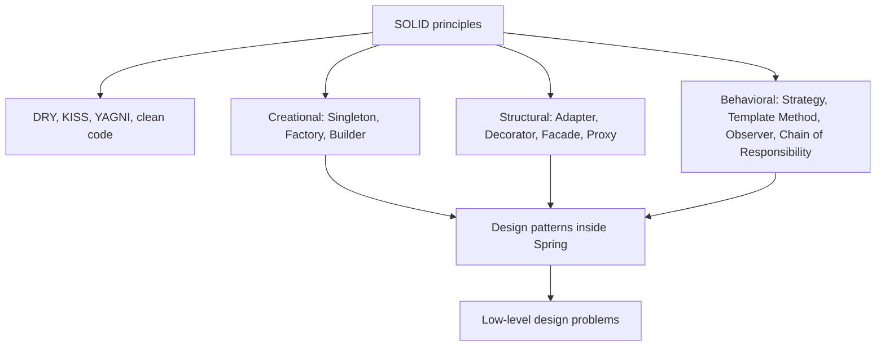
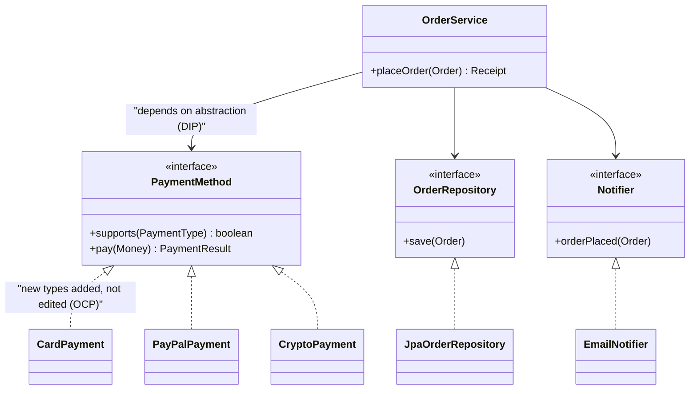
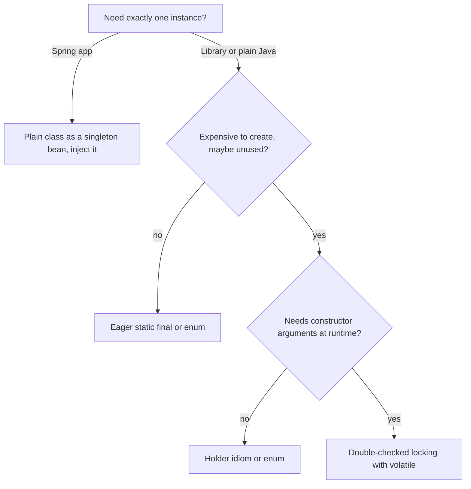

@@ 1 | MODULE | Phase 17 — Design Principles and Patterns (Advanced) | SOLID and clean code principles, the GoF patterns interviewers ask about, how Spring uses them, and low-level design problems | MUST
# Phase 17: Design Principles and Patterns (Advanced)

This phase covers the principles that keep code changeable (SOLID, DRY, KISS, YAGNI, clean code) and the design patterns that come up in Java interviews: Singleton, Factory and Abstract Factory, Builder, Adapter, Decorator, Facade, Proxy, Strategy, Template Method, Observer and Chain of Responsibility. Every pattern is shown in modern Java 21 (records, sealed interfaces, lambdas, enums), with where it appears in the JDK and in Spring. The phase ends with low-level design (LLD) problems such as a parking lot, vending machine, rate limiter and LRU cache, which are now a standard round in senior interviews.

Interviewers care because patterns are a shared vocabulary ("put a decorator around the client", "this is a strategy keyed by payment type") and because LLD rounds test whether you can turn vague requirements into small, testable classes with clear responsibilities. The trap is pattern worship: senior candidates explain *when not to* use a pattern as convincingly as when to use it.



**Prerequisites:** Phase 2 (interfaces, abstract classes, [[Composition vs Inheritance]], [[Immutable Class Design]]), Phase 7 ([[Lambdas and Functional Interfaces]]), Phase 10 ([[IoC and Dependency Injection]]) and Phase 16 ([[Designing Thread-Safe Classes]]).

**The 5 questions from this phase that come up most often**
1. Explain SOLID with an example of each principle, especially Open/Closed and Dependency Inversion.
2. How do you write a thread-safe Singleton, and why is an enum the safest?
3. Which design patterns does Spring use internally? Name at least five with examples.
4. Decorator vs Proxy vs Adapter: what is the difference?
5. Design a parking lot (or vending machine, or rate limiter): classes, relationships and key methods.

@@ 2 | MODULE | Principles | SOLID and the everyday clean code principles that patterns are built on | MUST
# Principles

**Shared analogy: a well-organized workshop.** Each tool does one job (Single Responsibility). You add new attachments to the drill instead of rebuilding it (Open/Closed). Any battery of the right standard fits any drill (Liskov). The drill does not come with a built-in lawnmower handle you never use (Interface Segregation). Tools plug into a standard socket, not straight into the power plant (Dependency Inversion). And the workshop rules: one place for each tool (DRY), the simplest tool that works (KISS), and do not buy a lathe "in case we need it one day" (YAGNI). Patterns are the proven workshop setups built on these rules.

@@ 3 | TOPIC | SOLID Principles | Single responsibility, open-closed, Liskov substitution, interface segregation and dependency inversion with Java examples | MUST
# SOLID Principles

**Level: Advanced | Phase 17 | Priority: MUST | Since: principles collected by Robert C. Martin around 2000, acronym by Michael Feathers; Liskov principle 1987, Open-Closed by Bertrand Meyer 1988**

> **30-second interview answer:** SOLID is five object-oriented design principles that keep code easy to change. **S**ingle Responsibility: a class has one reason to change. **O**pen/Closed: add behaviour by adding code (new implementations), not by editing working code. **L**iskov Substitution: a subtype must be usable anywhere its supertype is, without surprises. **I**nterface Segregation: many small, client-specific interfaces beat one fat one. **D**ependency Inversion: high-level policy depends on abstractions, and details implement them; Spring's dependency injection is how we apply it daily.

## 1. Concept in Simple Words
### Analogy
A well-run restaurant.

| Restaurant | SOLID |
|---|---|
| The chef cooks, the cashier takes money, the waiter serves; a new tax rule changes only the cashier's job | Single Responsibility |
| Adding a dessert menu means printing a new menu card, not rebuilding the kitchen | Open/Closed |
| Any qualified substitute chef can cover a shift and the dishes still taste right | Liskov Substitution |
| The waiter's handheld shows only ordering buttons, not the accounting screens | Interface Segregation |
| The kitchen orders "milk, 2 litres" from any supplier that meets the spec, not from one named farm | Dependency Inversion |

### What it is
- **SRP (Single Responsibility Principle):** a module should have one reason to change, meaning it serves one actor (one group of stakeholders). It is about cohesion, not "one method per class".
- **OCP (Open/Closed Principle):** software entities should be open for extension and closed for modification. In Java: depend on an interface and add new implementations, instead of growing `if/else` or `switch` chains over types.
- **LSP (Liskov Substitution Principle):** if `S` is a subtype of `T`, code written against `T` must work with `S`. Subtypes must not strengthen preconditions, weaken postconditions, or break invariants (the classic violation: `Square extends Rectangle`).
- **ISP (Interface Segregation Principle):** clients should not be forced to depend on methods they do not use. Split fat interfaces into role interfaces.
- **DIP (Dependency Inversion Principle):** high-level modules should not depend on low-level modules; both depend on abstractions, and the abstraction is owned by the high-level side. Dependency *injection* is a technique to supply the implementation; dependency *inversion* is the design rule.

### Why it exists
Software that is easy to write once but hard to change rots: every new feature touches many classes, every fix breaks something else, and tests need the database and the network. SOLID came out of decades of experience with that rot. The principles reduce coupling (how much classes know about each other) and increase cohesion (how closely a class's parts belong together), so changes stay local and code is testable with fakes.

## 2. How It Works
**Before:** one class does everything and switches on type.
```text
OrderService
  + placeOrder(order)
      validate fields               <- changes when validation rules change
      if type == CARD   -> card API <- changes when a payment method is added
      if type == PAYPAL -> PayPal API
      INSERT INTO orders ...        <- changes when the schema changes
      send SMTP email               <- changes when notification channel changes
```

**After:** responsibilities split, depending on abstractions.


**How each principle shows up in a Spring codebase:**

| Principle | Typical Spring application |
|---|---|
| SRP | Controller (HTTP), service (business rules), repository (persistence), mapper (DTO conversion) |
| OCP | Inject `List<PaymentMethod>`; a new `@Component` implementation needs no edits elsewhere |
| LSP | Every `PaymentMethod` honours the same contract: same exceptions, no "unsupported" surprises |
| ISP | `CrudRepository` vs `Repository` plus only the query methods you need; small `*Port` interfaces |
| DIP | Service depends on `OrderRepository` interface; Spring injects the JPA implementation |

**LSP, the subtle one:**
```text
Rectangle contract: setWidth(w) changes width only; area == width * height
Square extends Rectangle: setWidth(w) also sets height to keep it square

client: r.setWidth(5); r.setHeight(4); assert r.area() == 20
         Rectangle -> 20 (ok)     Square -> 16 (broken)
```
The square is a rectangle in geometry, but not a behavioural subtype of a *mutable* rectangle. Fixes: make shapes immutable, or have both implement a `Shape` interface with `area()` without inheritance between them.

## 3. Code Example
### Code
```java
import java.math.BigDecimal;
import java.util.ArrayList;
import java.util.List;
import java.util.Map;
import java.util.concurrent.ConcurrentHashMap;

public class SolidDemo {

    // ---------- Domain ----------
    enum PaymentType { CARD, PAYPAL, CRYPTO }
    record Order(String id, String email, BigDecimal amount, PaymentType paymentType) { }
    record PaymentResult(boolean success, String reference) { }

    // ---------- ISP: small role interfaces instead of one fat "OrderGateway" ----------
    interface OrderRepository { void save(Order order); }
    interface Notifier { void orderPlaced(Order order); }

    // ---------- OCP + LSP: every implementation honours the same contract ----------
    interface PaymentMethod {
        PaymentType type();
        PaymentResult pay(Order order);   // contract: never returns null, throws only PaymentException
    }

    static class PaymentException extends RuntimeException {
        PaymentException(String msg) { super(msg); }
    }

    static class CardPayment implements PaymentMethod {
        public PaymentType type() { return PaymentType.CARD; }
        public PaymentResult pay(Order o) { return new PaymentResult(true, "card-" + o.id()); }
    }

    static class PayPalPayment implements PaymentMethod {
        public PaymentType type() { return PaymentType.PAYPAL; }
        public PaymentResult pay(Order o) { return new PaymentResult(true, "pp-" + o.id()); }
    }

    // Added later: NO existing class was modified (OCP)
    static class CryptoPayment implements PaymentMethod {
        public PaymentType type() { return PaymentType.CRYPTO; }
        public PaymentResult pay(Order o) {
            if (o.amount().compareTo(new BigDecimal("1000")) > 0) throw new PaymentException("crypto limit exceeded");
            return new PaymentResult(true, "btc-" + o.id());
        }
    }

    // ---------- SRP: validation has its own reason to change ----------
    static class OrderValidator {
        void validate(Order o) {
            if (o.amount().signum() <= 0) throw new IllegalArgumentException("amount must be positive");
            if (!o.email().contains("@")) throw new IllegalArgumentException("invalid email");
        }
    }

    // ---------- DIP: high-level policy depends only on abstractions ----------
    static class OrderService {
        private final OrderValidator validator;
        private final Map<PaymentType, PaymentMethod> payments = new ConcurrentHashMap<>();
        private final OrderRepository repository;
        private final Notifier notifier;

        OrderService(OrderValidator validator, List<PaymentMethod> methods, OrderRepository repository, Notifier notifier) {
            this.validator = validator;
            methods.forEach(m -> payments.put(m.type(), m));   // registry instead of switch
            this.repository = repository;
            this.notifier = notifier;
        }

        String place(Order order) {
            validator.validate(order);
            PaymentMethod method = payments.get(order.paymentType());
            if (method == null) throw new IllegalStateException("no payment method for " + order.paymentType());
            PaymentResult result = method.pay(order);
            repository.save(order);
            notifier.orderPlaced(order);
            return result.reference();
        }
    }

    public static void main(String[] args) {
        List<String> saved = new ArrayList<>();
        List<String> sent = new ArrayList<>();
        OrderRepository inMemoryRepo = o -> saved.add(o.id());          // test doubles are trivial thanks to DIP
        Notifier fakeNotifier = o -> sent.add(o.email());

        OrderService service = new OrderService(new OrderValidator(),
                List.of(new CardPayment(), new PayPalPayment(), new CryptoPayment()),
                inMemoryRepo, fakeNotifier);

        System.out.println(service.place(new Order("o1", "a@x.com", new BigDecimal("25.00"), PaymentType.CARD)));
        System.out.println(service.place(new Order("o2", "b@x.com", new BigDecimal("40.00"), PaymentType.PAYPAL)));
        System.out.println(service.place(new Order("o3", "c@x.com", new BigDecimal("99.00"), PaymentType.CRYPTO)));
        try {
            service.place(new Order("o4", "d@x.com", new BigDecimal("5000"), PaymentType.CRYPTO));
        } catch (PaymentException e) {
            System.out.println("payment failed: " + e.getMessage());
        }
        try {
            service.place(new Order("o5", "not-an-email", BigDecimal.TEN, PaymentType.CARD));
        } catch (IllegalArgumentException e) {
            System.out.println("rejected: " + e.getMessage());
        }
        System.out.println("saved=" + saved + " notified=" + sent);
    }
}
```

### Walkthrough
- **SRP:** `OrderValidator` changes when validation rules change; `OrderService` changes when the ordering workflow changes; repositories and notifiers change with infrastructure. Each class has one reason to change.
- **OCP:** `CryptoPayment` was added without touching `OrderService`: the service builds a `Map<PaymentType, PaymentMethod>` from whatever implementations it receives. In Spring you would inject `List<PaymentMethod>` and annotate each implementation with `@Component`.
- **LSP:** every `PaymentMethod` follows the same contract: returns a non-null result, signals failure with `PaymentException`. `CryptoPayment` adds a limit but expresses it through the agreed exception, so callers handle it like any other payment failure.
- **ISP:** `OrderRepository` and `Notifier` each have one method. They are functional interfaces, so the test doubles in `main` are lambdas.
- **DIP:** `OrderService` (high-level policy) knows only interfaces it owns. Concrete classes are chosen at the composition root (`main` here, the Spring container in real apps).

### Output
```text
card-o1
pp-o2
btc-o3
payment failed: crypto limit exceeded
rejected: invalid email
saved=[o1, o2, o3] notified=[a@x.com, b@x.com, c@x.com]
```

### Compare
| Violation | What it looks like | SOLID version |
|---|---|---|
| SRP | `OrderService` validates, pays, writes SQL, sends SMTP | Separate validator, payment, repository, notifier |
| OCP | `switch (type) { case CARD: ... case PAYPAL: ... }` edited for each new type | Interface + implementations + registry |
| LSP | `ReadOnlyList.add()` throws `UnsupportedOperationException` | Separate read-only and mutable interfaces |
| ISP | `Worker` interface with `work()` and `eat()`; robots implement `eat()` as no-op | `Workable` and `Feedable` interfaces |
| DIP | `new MySqlOrderRepository()` inside the service | Constructor-injected `OrderRepository` interface |

## 4. Interview Questions
**Basic**
1. **What does SOLID stand for?**
   Single Responsibility, Open/Closed, Liskov Substitution, Interface Segregation and Dependency Inversion. Together they aim for high cohesion and low coupling, so code can change in one place without rippling through the system.
2. **Explain the Single Responsibility Principle with an example.**
   A class should have one reason to change, meaning it answers to one actor. An `Invoice` class that calculates totals (finance), formats a PDF (presentation) and saves to the database (persistence) changes for three different reasons; split it into a calculator, a renderer and a repository. It is about reasons to change, not about having one method.
3. **What is the difference between dependency inversion and dependency injection?**
   Dependency inversion is a design principle: high-level code depends on abstractions it owns, and low-level details implement them. Dependency injection is a technique for supplying the concrete implementation from outside (constructor, setter). Spring is a DI container that makes applying DIP convenient, but you can inject concrete classes and still violate DIP.

**Follow-up**
4. **Why is `Square extends Rectangle` a Liskov violation?**
   Code written for a mutable `Rectangle` expects `setWidth` to leave the height unchanged. A `Square` must change both to stay square, so `setWidth(5); setHeight(4)` gives area 16 instead of 20, breaking the client's expectations. Subtyping must preserve behaviour, not just the "is-a" relationship from the real world. Immutable shapes or a common `Shape` interface fix it.
5. **How do you apply Open/Closed in a Spring Boot application?**
   Define an interface for the varying behaviour (payment method, discount rule, notification channel), implement each variant as a `@Component`, and inject `List<Interface>` or `Map<String, Interface>` into the service, which picks an implementation by key. Adding a variant is a new class; no existing class changes. Conditional beans and profiles extend this to configuration.
6. **Can following SOLID make code worse?**
   Yes, when applied mechanically: interfaces with a single implementation and no test benefit, dozens of one-method classes, and indirection that hides a simple flow. The principles are tools for managing change; apply them where change is likely or already happening, and keep the rest simple (YAGNI).

**Tricky / scenario**
7. **A teammate's `ReportService` has a 400-line `switch` over report types, and every sprint someone adds a case. What do you propose?**
   Replace the switch with polymorphism: a `ReportGenerator` interface with `supports(type)` and `generate(request)`, one implementation per report type, and a registry built from injected implementations. New reports become new classes, tests target one generator at a time, and merge conflicts in the giant method disappear. If the switch is over a closed, stable set, a sealed interface with pattern matching is also acceptable.
8. **Your `UserRepository` interface has 40 methods, and most services use 3. What problems does that cause and what do you do?**
   Every client depends on methods it does not use, test doubles must implement all 40, and changing a rarely used method recompiles and retests everything. Split it into role interfaces (`UserLookup`, `UserRegistration`, `UserAdmin`), each used by the clients that need it; one class can still implement several. This is Interface Segregation.
9. **Where does Spring itself follow SOLID?**
   `HandlerMapping`, `HandlerAdapter`, `ViewResolver` and `HttpMessageConverter` are small interfaces with many implementations (ISP, OCP). `JdbcTemplate` depends on `DataSource`, not on a specific pool (DIP). `PlatformTransactionManager` lets `@Transactional` work with JPA, JDBC or JTA implementations interchangeably (LSP and DIP).

**What the interviewer is really testing:** whether you can recognize violations in real code and refactor them with judgement, rather than reciting five definitions.

## 5. Pitfalls & Best Practices
### Common mistakes
| Mistake | What goes wrong | Fix |
|---|---|---|
| Interpreting SRP as "one method per class" | Explosion of tiny classes, scattered logic | Group by reason to change (actor), not by method count |
| An interface for every class "for SOLID" | Indirection with no benefit | Introduce interfaces at real seams: variation points, infrastructure, test boundaries |
| Subclass throws `UnsupportedOperationException` | LSP violation, runtime surprises | Split interfaces or use composition |
| High-level service imports infrastructure classes | Hard to test, vendor lock-in | Service owns the port interface; adapters implement it |
| Type switches spread across many classes | Every new type touches many files | Polymorphism or a sealed hierarchy with exhaustive switch in one place |

### Best practices
- Apply OCP where variation is real (payment types, pricing rules); keep stable code simple.
- Keep interfaces small and named after the client's role (`OrderLookup`), not the implementation (`OrderDaoImpl`).
- Use constructor injection so dependencies are explicit; a constructor with eight parameters is an SRP smell.
- Prefer composition over inheritance; use inheritance only for true behavioural subtypes.
- Use sealed interfaces (Java 17) when the set of variants is closed and you want exhaustive `switch` checks.

### Compare with
| Principle | Main benefit | Pattern that applies it |
|---|---|---|
| SRP | Local changes | Facade, separate services |
| OCP | Add features without editing | Strategy, Decorator, Chain of Responsibility |
| LSP | Safe polymorphism | Template Method done right, contracts |
| ISP | Lean dependencies | Role interfaces, Adapter |
| DIP | Testability, swappable infrastructure | Dependency injection, Factory, ports and adapters |

## 6. Hands-on Exercise
OrderHub's `ShippingCostCalculator` has a method with `if (country.equals("DE")) ... else if (country.equals("US")) ... else if ...` and also writes an audit line to a file. Refactor it in Spring Boot following SOLID: one `ShippingRule` interface, one bean per region, a calculator that picks the rule, and auditing moved behind an `AuditLog` interface.

Acceptance criteria:
- Adding a new region (for example `JP`) requires only a new `@Component`.
- `ShippingCostCalculator` has no `if` on country codes and no file I/O.
- A unit test can construct the calculator with plain lambdas or fakes, no Spring context.

<details><summary>Solution</summary>

```java
// shipping/ShippingRule.java
package com.orderhub.shipping;

import java.math.BigDecimal;
import java.util.Set;

public interface ShippingRule {
    Set<String> countries();
    BigDecimal cost(BigDecimal orderTotal, int weightGrams);
}
```

```java
// shipping/rules/EuShippingRule.java
package com.orderhub.shipping.rules;

import com.orderhub.shipping.ShippingRule;
import java.math.BigDecimal;
import java.util.Set;
import org.springframework.stereotype.Component;

@Component
public class EuShippingRule implements ShippingRule {
    public Set<String> countries() { return Set.of("DE", "FR", "NL"); }

    public BigDecimal cost(BigDecimal total, int grams) {
        if (total.compareTo(new BigDecimal("50")) >= 0) return BigDecimal.ZERO;     // free over 50
        return new BigDecimal("4.90");
    }
}
```

```java
// shipping/rules/UsShippingRule.java
package com.orderhub.shipping.rules;

import com.orderhub.shipping.ShippingRule;
import java.math.BigDecimal;
import java.util.Set;
import org.springframework.stereotype.Component;

@Component
public class UsShippingRule implements ShippingRule {
    public Set<String> countries() { return Set.of("US"); }

    public BigDecimal cost(BigDecimal total, int grams) {
        return new BigDecimal("7.50").add(BigDecimal.valueOf(grams / 1000).multiply(new BigDecimal("1.20")));
    }
}
```

```java
// shipping/AuditLog.java
package com.orderhub.shipping;

public interface AuditLog {
    void record(String event);
}
```

```java
// shipping/ShippingCostCalculator.java
package com.orderhub.shipping;

import java.math.BigDecimal;
import java.util.HashMap;
import java.util.List;
import java.util.Map;
import org.springframework.stereotype.Service;

@Service
public class ShippingCostCalculator {
    private final Map<String, ShippingRule> rulesByCountry = new HashMap<>();
    private final AuditLog audit;

    public ShippingCostCalculator(List<ShippingRule> rules, AuditLog audit) {
        for (ShippingRule rule : rules) {
            for (String country : rule.countries()) {
                ShippingRule previous = rulesByCountry.put(country, rule);
                if (previous != null) throw new IllegalStateException("two rules for " + country);
            }
        }
        this.audit = audit;
    }

    public BigDecimal cost(String country, BigDecimal orderTotal, int weightGrams) {
        ShippingRule rule = rulesByCountry.get(country);
        if (rule == null) throw new IllegalArgumentException("we do not ship to " + country);
        BigDecimal cost = rule.cost(orderTotal, weightGrams);
        audit.record("shipping " + country + " total=" + orderTotal + " cost=" + cost);
        return cost;
    }
}
```

```java
// shipping/Slf4jAuditLog.java
package com.orderhub.shipping;

import org.slf4j.Logger;
import org.slf4j.LoggerFactory;
import org.springframework.stereotype.Component;

@Component
public class Slf4jAuditLog implements AuditLog {
    private static final Logger log = LoggerFactory.getLogger("AUDIT");
    public void record(String event) { log.info(event); }
}
```

```java
// test/ShippingCostCalculatorTest.java (OrderHub test, uses spring-boot-starter-test from org.springframework.boot: JUnit 5 + AssertJ)
package com.orderhub.shipping;

import static org.assertj.core.api.Assertions.assertThat;

import com.orderhub.shipping.rules.EuShippingRule;
import com.orderhub.shipping.rules.UsShippingRule;
import java.math.BigDecimal;
import java.util.ArrayList;
import java.util.List;
import org.junit.jupiter.api.Test;

class ShippingCostCalculatorTest {
    @Test
    void picksRuleByCountryWithoutSpring() {
        List<String> events = new ArrayList<>();
        var calc = new ShippingCostCalculator(List.of(new EuShippingRule(), new UsShippingRule()), events::add);

        assertThat(calc.cost("DE", new BigDecimal("60"), 500)).isEqualByComparingTo("0");
        assertThat(calc.cost("US", new BigDecimal("20"), 2500)).isEqualByComparingTo("9.90");
        assertThat(events).hasSize(2);
    }
}
```
SRP: rules compute costs, the calculator selects and orchestrates, the audit log handles output. OCP: a `JpShippingRule` `@Component` is picked up automatically through `List<ShippingRule>`. DIP: the calculator depends on `ShippingRule` and `AuditLog` abstractions it owns, so the test needs no Spring context; `events::add` is an `AuditLog`.
</details>

## 7. Recall
Q: What does each letter of SOLID stand for?
A: Single Responsibility, Open/Closed, Liskov Substitution, Interface Segregation, Dependency Inversion.

Q: What does "one reason to change" mean in the Single Responsibility Principle?
A: A class should serve one actor or concern, so only changes requested by that concern require editing it.

Q: How is the Open/Closed Principle usually applied in Spring?
A: An interface with one `@Component` per variant, injected as a `List` or `Map` into a service that selects by key, so new variants need no edits.

Q: Why is `Square extends Rectangle` a classic Liskov Substitution violation?
A: Setting the width of a square also changes its height, which breaks the behaviour clients expect from a mutable rectangle.

Q: What is the difference between Dependency Inversion and Dependency Injection?
A: Inversion is the principle that high-level code depends on abstractions it owns; injection is the technique of supplying implementations from outside.

Q: What is the Interface Segregation Principle?
A: Clients should not depend on methods they do not use, so fat interfaces should be split into small role interfaces.

**Related:** [[DRY, KISS, YAGNI and Clean Code]] · [[Strategy, Template Method and Observer]] · [[IoC and Dependency Injection]] · [[Composition vs Inheritance]]

@@ 3 | TOPIC | DRY, KISS, YAGNI and Clean Code | Duplication of knowledge, simplicity, building only what is needed, naming, small functions and code smells | SHOULD
# DRY, KISS, YAGNI and Clean Code

**Level: Advanced | Phase 17 | Priority: SHOULD | Since: DRY from The Pragmatic Programmer (1999), KISS from US Navy engineering (1960s), YAGNI from Extreme Programming (late 1990s), Clean Code by Robert C. Martin (2008)**

> **30-second interview answer:** DRY (Don't Repeat Yourself) means every piece of *knowledge* (a business rule, a constant, a schema) has one authoritative place; it is about knowledge, not about similar-looking lines. KISS (Keep It Simple) means choosing the simplest design that solves today's problem. YAGNI (You Aren't Gonna Need It) means not building features or abstractions for imagined future needs. Clean code is code another developer can read and change safely: intention-revealing names, small focused functions, no surprises, tests, and no dead or clever code. The principles pull against each other, and judgement is choosing the balance.

## 1. Concept in Simple Words
### Analogy
Running a family kitchen.

| Kitchen | Principle |
|---|---|
| The family recipe is written once in the recipe book; every cook uses that page | DRY: one source of truth |
| Two dishes both use salt, but that does not mean they share one recipe | Similar code is not always duplicated knowledge |
| Making pasta with a pot and water, not a molecular gastronomy lab | KISS |
| Not buying a 12-seat dining table "in case we have a big party someday" | YAGNI |
| Labelled jars, clean counters, tools back in place after use | Clean code |
| Mystery jar with no label at the back of the fridge | Unclear name, dead code |

### What it is
- **DRY:** "Every piece of knowledge must have a single, unambiguous, authoritative representation within a system." Duplicated knowledge means a rule change must be made in several places, and one will be forgotten.
- **Accidental duplication:** two pieces of code look alike today but represent different knowledge that will evolve separately (shipping fee vs return fee). Merging them couples unrelated rules. The "rule of three": wait for the third occurrence before abstracting.
- **KISS:** prefer straightforward solutions; complexity must justify itself with a real requirement.
- **YAGNI:** implement what is needed now. Speculative generality (plugins, config flags, generic frameworks for one use) costs time to build, to test and to understand, and the future often differs from the guess.
- **Clean code practices:** meaningful names, functions that do one thing at one level of abstraction, few parameters, no side effects hidden behind innocent names, command-query separation, early returns instead of deep nesting, comments explaining *why* not *what*, consistent formatting, tests.
- **Code smells:** surface signs of design problems: long method, large class, long parameter list, duplicated code, feature envy (a method using another class's data more than its own), primitive obsession (using `String` for email, money and ids), shotgun surgery (one change touches many classes), magic numbers, dead code.
- **Boy Scout Rule:** leave the code a little cleaner than you found it.

### Why it exists
Code is read far more often than it is written; most of the cost of software is maintenance. Duplicated rules produce inconsistent behaviour, over-engineered designs slow every change, and unclear code causes bugs during modification. These principles are compressed experience about what keeps maintenance cheap.

## 2. How It Works
**Tension map: the principles balance each other.**

```mermaid
flowchart LR
    DRY["DRY: remove duplicated knowledge"] -->|"overdone"| ABS["Premature abstraction, coupling of unrelated code"]
    KISS["KISS: simplest design"] -->|"overdone"| COPY["Copy-paste, no structure"]
    YAGNI["YAGNI: build only what is needed"] -->|"overdone"| RIGID["Ignoring known upcoming change"]
    ABS -->|"balanced by"| YAGNI
    COPY -->|"balanced by"| DRY
    RIGID -->|"balanced by"| SOLIDN["SOLID at real variation points"]
```


**Refactoring workflow (how clean code happens in practice):**
```text
1. Make sure tests cover the behaviour (write characterization tests if missing)
2. Small, behaviour-preserving steps, run tests after each:
     Rename variable/method       -> names reveal intent
     Extract method               -> one level of abstraction per function
     Replace magic number         -> named constant or config property
     Introduce parameter object   -> long parameter lists become records
     Replace conditional with polymorphism (only if variants grow)
     Replace primitive with value object (Email, Money, OrderId)
3. Commit; repeat. Never mix refactoring and behaviour change in one commit.
```

**DRY in a Spring codebase:**

| Knowledge | Single source |
|---|---|
| Validation rules for a request | Bean Validation annotations on the DTO, not repeated in controller and service |
| Configuration values | `@ConfigurationProperties` class, not `@Value("${...}")` strings scattered around |
| Error response format | One `@RestControllerAdvice` producing `ProblemDetail` |
| Database schema | Flyway migrations, not hand-edited DDL plus `ddl-auto` |
| API contract | OpenAPI generated from code, or code generated from the spec, not both maintained by hand |

## 3. Code Example
### Code
```java
import java.math.BigDecimal;
import java.math.RoundingMode;
import java.util.List;

public class CleanCodeDemo {

    // ---------------- BEFORE: smells everywhere ----------------
    static class Proc {
        // magic numbers, cryptic names, flag argument, duplicated tax rule, deep nesting
        static double calc(List<double[]> l, String c, boolean f) {
            double t = 0;
            for (double[] x : l) {
                if (x != null) {
                    if (x[1] > 0) {
                        t += x[0] * x[1];
                    }
                }
            }
            if (c.equals("DE")) {
                t = t + t * 0.19;
            } else {
                if (c.equals("FR")) {
                    t = t + t * 0.20;
                }
            }
            if (f) {
                if (t > 100) t = t - t * 0.05;
            }
            return Math.round(t * 100) / 100.0;
        }
    }

    // ---------------- AFTER: names, value objects, one place per rule ----------------
    record OrderLine(String sku, BigDecimal unitPrice, int quantity) {
        OrderLine {
            if (quantity <= 0) throw new IllegalArgumentException("quantity must be positive");
        }
        BigDecimal subtotal() { return unitPrice.multiply(BigDecimal.valueOf(quantity)); }
    }

    enum Country {
        DE(new BigDecimal("0.19")), FR(new BigDecimal("0.20")), US(BigDecimal.ZERO);

        private final BigDecimal vatRate;      // the VAT rule lives in exactly one place (DRY)
        Country(BigDecimal vatRate) { this.vatRate = vatRate; }
        BigDecimal addVat(BigDecimal net) { return net.add(net.multiply(vatRate)); }
    }

    static final class LoyaltyDiscount {
        private static final BigDecimal THRESHOLD = new BigDecimal("100");
        private static final BigDecimal RATE = new BigDecimal("0.05");

        static BigDecimal apply(BigDecimal amount) {
            if (amount.compareTo(THRESHOLD) <= 0) return amount;       // early return, no nesting
            return amount.subtract(amount.multiply(RATE));
        }
    }

    static BigDecimal orderTotal(List<OrderLine> lines, Country country, boolean loyalCustomer) {
        BigDecimal net = lines.stream().map(OrderLine::subtotal).reduce(BigDecimal.ZERO, BigDecimal::add);
        BigDecimal gross = country.addVat(net);
        BigDecimal payable = loyalCustomer ? LoyaltyDiscount.apply(gross) : gross;
        return payable.setScale(2, RoundingMode.HALF_UP);
    }

    public static void main(String[] args) {
        double old = Proc.calc(List.of(new double[]{40.0, 2}, new double[]{9.99, 3}), "DE", true);
        System.out.println("before refactoring: " + old);

        List<OrderLine> lines = List.of(
                new OrderLine("BOOK", new BigDecimal("40.00"), 2),
                new OrderLine("PEN", new BigDecimal("9.99"), 3));
        System.out.println("after refactoring:  " + orderTotal(lines, Country.DE, true));
        System.out.println("not loyal, FR:      " + orderTotal(lines, Country.FR, false));
        System.out.println("US, no VAT:         " + orderTotal(lines, Country.US, false));
    }
}
```

### Walkthrough
- **Before:** `calc(l, c, f)` hides meaning: what is `x[1]`? what does `f` switch on? VAT percentages are magic numbers inside nested `if`s, `double` is used for money, and the flag argument means the method does two things.
- **Value objects:** `OrderLine` replaces `double[]` (primitive obsession) and validates itself. `subtotal()` puts the calculation next to the data (no feature envy).
- **DRY:** the VAT rate per country lives in the `Country` enum; any other code that needs VAT calls `addVat` instead of repeating 0.19.
- **Names and early return:** `LoyaltyDiscount.apply` names the business concept; constants name the magic numbers.
- **Behaviour preserved:** both versions print 124.32 for the same input. Refactoring changes structure, not behaviour; tests (or this comparison) prove it.
- **YAGNI:** no plugin system for tax rules, no config file for VAT, no strategy interface for discounts. If a second discount type arrives, *then* introduce a `Discount` interface.

### Output
```text
before refactoring: 124.32
after refactoring:  124.32
not loyal, FR:      131.96
US, no VAT:         109.97
```

### Compare
| Over-engineered (violates KISS and YAGNI) | Clean and simple |
|---|---|
| `DiscountStrategyFactoryProvider` with XML config for one discount | A method `LoyaltyDiscount.apply` |
| Generic `BaseService<T, ID, DTO, MAPPER>` for 3 services | Three small explicit services |
| Merging `shippingFee()` and `returnFee()` because they look alike | Two methods that evolve independently |
| Comment `// increment i` | Comment `// retry because the partner API returns 503 during deploys` |

## 4. Interview Questions
**Basic**
1. **What is DRY really about?**
   Knowledge, not text. Each business rule, constant or schema should have one authoritative representation, so changing the rule means changing one place. Two code fragments that look the same but encode different rules are not DRY violations, and merging them creates harmful coupling.
2. **What is YAGNI and why does it matter?**
   "You aren't gonna need it": do not build features, extension points or configuration for speculated future needs. Speculative code costs time now, adds complexity everyone must understand, and is frequently wrong when the real requirement arrives. Build for today with clean code that is easy to change later.
3. **What makes code "clean"?**
   Another developer can read it quickly and change it safely: intention-revealing names, small functions doing one thing, consistent abstraction levels, no hidden side effects, no duplication of knowledge, no dead code, meaningful errors, and tests that document behaviour.

**Follow-up**
4. **How do DRY and YAGNI conflict, and how do you decide?**
   DRY pushes you to abstract shared code; YAGNI warns against abstractions you do not need yet. Use the rule of three: tolerate duplication until the third occurrence shows the true shared concept, and abstract only duplicated *knowledge*. A wrong abstraction is more expensive than duplication, because every caller depends on it.
5. **Name five code smells and the refactoring for each.**
   Long method (extract method), long parameter list (introduce a parameter object or record), primitive obsession (value objects like `Email`, `Money`), feature envy (move method to the class whose data it uses), and switch on type repeated in many places (replace conditional with polymorphism or a sealed hierarchy). Magic numbers become named constants.
6. **When are comments good?**
   When they explain *why*: a business reason, a non-obvious constraint, a workaround with a ticket link, or public API contracts in Javadoc. Comments that restate *what* the code does usually mean the names are poor and go stale as code changes.

**Tricky / scenario**
7. **A code review comment says "DRY this up" about two 10-line methods computing shipping and return fees that are identical today. What do you reply?**
   Ask whether they represent the same business rule. Shipping fees and return fees are owned by different policies and are likely to diverge (free returns promotions, carrier contracts). Merging them would force one change to affect both or require flags. Keep them separate, possibly sharing a small helper for genuinely common arithmetic.
8. **You join a team where everything is generic: `AbstractBaseCrudService<E, D, ID, M extends Mapper<E, D>>`. Adding a field takes a day. How do you improve it?**
   That is a speculative framework violating KISS and YAGNI. Don't rewrite everything: for new features, write simple explicit services; when touching an old one, inline the abstraction for that service (with tests) and remove generic layers once unused. Measure success by change lead time, and agree the direction with the team rather than refactoring alone.
9. **How do you keep code clean under deadline pressure?**
   Keep refactoring small and continuous (Boy Scout Rule), separate refactoring commits from behaviour changes, rely on tests so cleanup is cheap, and write down deliberate shortcuts as tech-debt tickets with a reason. The fastest way to go fast is to keep the code in a state where changes are safe.

**What the interviewer is really testing:** judgement: whether you know these principles as trade-offs, can spot smells in real code, and can push back on both copy-paste and over-engineering.

## 5. Pitfalls & Best Practices
### Common mistakes
| Mistake | What goes wrong | Fix |
|---|---|---|
| Abstracting code that only looks similar | Unrelated rules coupled, flags appear | Abstract duplicated knowledge only; rule of three |
| Building extension points nobody asked for | Complexity, slower changes | YAGNI: add when the second real case arrives |
| `double` and `String` for domain values | Rounding bugs, invalid states | Value objects and `BigDecimal` for money |
| Comments describing what the code does | Noise, stale comments | Better names; comment why |
| Large refactoring mixed into a feature PR | Hard review, hidden behaviour changes | Separate small refactoring commits with tests |

### Best practices
- Name things after the domain (`invoiceDueDate`, not `d2`), and rename freely: IDEs make it safe.
- Keep functions short enough to see at once and at one level of abstraction.
- Use records and enums for domain concepts; validate in constructors.
- Configure static analysis (Sonar, Error Prone, Checkstyle) to catch smells automatically, but treat rules as guidance.
- Follow the Boy Scout Rule on every change you make.

### Compare with
| Principle | Guards against | Overuse leads to |
|---|---|---|
| DRY | Inconsistent rules, shotgun surgery | Wrong abstractions, coupling |
| KISS | Accidental complexity | Under-structured code |
| YAGNI | Speculative generality | Ignoring known requirements |
| SOLID | Rigid, tangled designs | Interface and class explosion |
| Clean code | Unreadable, risky code | Bikeshedding over style |

## 6. Hands-on Exercise
Refactor this OrderHub method (plain Java) without changing behaviour. Remove the magic numbers, the flag argument, the nesting and the duplicated "is weekend" logic, and replace the primitives with a record. Prove behaviour is unchanged by printing old and new results for the same inputs.

```java
static String st(int s, int d, boolean x) {
    if (s == 1) {
        if (d == 6 || d == 7) return x ? "PAID_WEEKEND_EXPRESS" : "PAID_WEEKEND";
        return x ? "PAID_EXPRESS" : "PAID";
    } else if (s == 2) {
        if (d == 6 || d == 7) return "SHIPPED_WEEKEND";
        return "SHIPPED";
    }
    return "NEW";
}
```

Acceptance criteria:
- An `enum OrderStatus` and a record `Fulfilment(OrderStatus status, DayOfWeek day, boolean express)`.
- One place decides "weekend".
- Old and new produce identical labels for all statuses, all seven days, express on and off.

<details><summary>Solution</summary>

```java
import java.time.DayOfWeek;

public class StatusLabelRefactor {

    // Old code, kept only to prove behaviour is preserved
    static String st(int s, int d, boolean x) {
        if (s == 1) {
            if (d == 6 || d == 7) return x ? "PAID_WEEKEND_EXPRESS" : "PAID_WEEKEND";
            return x ? "PAID_EXPRESS" : "PAID";
        } else if (s == 2) {
            if (d == 6 || d == 7) return "SHIPPED_WEEKEND";
            return "SHIPPED";
        }
        return "NEW";
    }

    enum OrderStatus { NEW, PAID, SHIPPED }

    record Fulfilment(OrderStatus status, DayOfWeek day, boolean express) {
        boolean onWeekend() {                                    // single source of the weekend rule
            return day == DayOfWeek.SATURDAY || day == DayOfWeek.SUNDAY;
        }

        String label() {
            return switch (status) {
                case NEW -> "NEW";
                case PAID -> "PAID" + weekendSuffix() + (express ? "_EXPRESS" : "");
                case SHIPPED -> "SHIPPED" + weekendSuffix();      // express is irrelevant once shipped
            };
        }

        private String weekendSuffix() { return onWeekend() ? "_WEEKEND" : ""; }
    }

    public static void main(String[] args) {
        int checked = 0;
        for (int s = 0; s <= 2; s++) {
            for (DayOfWeek day : DayOfWeek.values()) {
                for (boolean express : new boolean[]{false, true}) {
                    String oldLabel = st(s, day.getValue(), express);
                    String newLabel = new Fulfilment(OrderStatus.values()[s], day, express).label();
                    if (!oldLabel.equals(newLabel)) throw new AssertionError(oldLabel + " vs " + newLabel);
                    checked++;
                }
            }
        }
        System.out.println("identical for " + checked + " combinations");
        System.out.println(new Fulfilment(OrderStatus.PAID, DayOfWeek.SUNDAY, true).label());
    }
}
```
Output:
```text
identical for 42 combinations
PAID_WEEKEND_EXPRESS
```
The magic numbers 1, 2, 6, 7 became `OrderStatus` and `DayOfWeek`; the weekend rule exists once; the exhaustive `switch` over an enum makes a forgotten status a compile error once you add one. The old method stays only in the test harness that proves equivalence (a characterization test).
</details>

## 7. Recall
Q: What does the DRY principle say must not be duplicated?
A: Knowledge: each business rule, constant or schema should have one authoritative representation, not merely each similar-looking line.

Q: What is accidental duplication?
A: Code that looks identical today but represents different knowledge that will change independently, so it should not be merged.

Q: What does YAGNI warn against?
A: Building features, abstractions or configuration for speculated future needs instead of current requirements.

Q: What is the rule of three in refactoring?
A: Tolerate duplication until a third occurrence reveals the real shared concept, then abstract it.

Q: Name four common code smells.
A: Long method, long parameter list, primitive obsession and feature envy (also magic numbers, duplicated code, shotgun surgery).

Q: What should code comments explain according to clean code?
A: Why something is done, such as business reasons and non-obvious constraints, not what the code does.

**Related:** [[SOLID Principles]] · [[Encapsulation]] · [[Records]] · [[Practice — Coding drill: Low-level design problems]]

@@ 2 | MODULE | Patterns | The GoF patterns that interviews ask about, in modern Java, with JDK and Spring examples | MUST
# Patterns

**Shared analogy: solutions in a building's architecture.** Architects do not invent a new staircase for every house; they reuse named solutions (spiral staircase, open-plan kitchen) and adapt them. Creational patterns are how rooms get built (one central boiler: Singleton; a builder assembling a custom kitchen step by step: Builder; a factory producing doors to spec: Factory). Structural patterns are how parts connect (a plug adapter, a decorative frame around a window, a reception desk that hides the back office, a security guard standing in front of a door). Behavioral patterns are how the occupants work together (interchangeable routines, a fixed daily schedule with personal steps, a notice board, a chain of approvals). The names matter as much as the solutions: they let a team discuss a design in a sentence.

@@ 3 | TOPIC | Singleton Variants | Eager, lazy, synchronized, double-checked locking, holder idiom, enum singleton, breaking singletons and Spring singleton scope | MUST
# Singleton Variants

**Level: Advanced | Phase 17 | Priority: MUST | Since: GoF 1994; enum singleton recommended since Java 5 (Effective Java); holder idiom correct since Java 5 memory model**

> **30-second interview answer:** A Singleton ensures a class has exactly one instance and provides a global access point. In Java the safe options are an eager `static final` field, the lazy initialization-on-demand holder idiom, double-checked locking with a `volatile` field, or a single-element `enum`, which Joshua Bloch recommends because the JVM guarantees one instance even against reflection and serialization. In real applications I rarely hand-write singletons: Spring beans are singletons per container by default, injected rather than looked up globally, which keeps code testable.

## 1. Concept in Simple Words
### Analogy
A country's president or a building's main electricity meter.

| Real world | Singleton |
|---|---|
| There is exactly one president at a time | One instance per class loader |
| Everyone reaches the office through the same official address | Global access point `getInstance()` |
| The office is set up on inauguration day, or only when first needed | Eager vs lazy initialization |
| Two people trying to be sworn in at once must not both succeed | Thread-safe creation |
| A forged appointment letter tries to create a second president | Reflection or deserialization attack |
| The constitution itself guarantees exactly one | `enum` singleton (JVM guarantee) |
| A company with one CEO per subsidiary | Spring singleton: one per container, not per JVM |

### What it is
- **Intent:** one instance, controlled creation, global access.
- **Ingredients:** a private constructor (no `new` from outside), a static reference, a static accessor.
- **Variants:**
  1. *Eager:* `private static final X INSTANCE = new X();` created when the class initializes.
  2. *Lazy synchronized:* `static synchronized X getInstance()` simple but locks on every call.
  3. *Double-checked locking (DCL):* lazy, locks only on first creation; needs `volatile`.
  4. *Holder idiom:* a nested static class holds the instance, created on first access thanks to lazy class initialization.
  5. *Enum:* `enum X { INSTANCE; }` serialization-safe and reflection-proof.
- **Spring singleton scope:** one bean instance per `ApplicationContext` per bean definition. Not the GoF pattern: the class can have public constructors and several instances (two bean definitions, or `new` in a test).

### Why it exists
Some things must be unique: a configuration registry, a connection pool, a metrics registry, an in-process cache. Creating several would waste resources or cause inconsistency. The pattern controls creation. Its downside, global state, hidden dependencies and hard-to-test code, is why modern Java uses dependency injection to *manage* single instances instead of global `getInstance()` calls.

## 2. How It Works
**Why the naive lazy version is broken:**
```text
static X instance;
static X getInstance() { if (instance == null) instance = new X(); return instance; }

Thread A: instance == null ? yes ---------------- new X() #1 -> instance = #1
Thread B:        instance == null ? yes --- new X() #2 -> instance = #2
Two instances created, and callers may hold different ones.
```

**Why DCL needs `volatile`:**
```text
instance = new X();   is really three steps:
  1. allocate memory
  2. run constructor (write fields)
  3. publish reference to 'instance'

Without volatile, the JIT/CPU may reorder to 1 -> 3 -> 2.
Thread B sees instance != null (step 3 done) and uses an object whose fields are not yet written.
volatile forbids that reordering: the write to 'instance' happens-after the constructor.
```

**Holder idiom works because of class initialization rules:** the JVM initializes a class on first active use, and class initialization runs under a lock with a happens-before guarantee. `Holder` is not touched until `getInstance()` is called, so creation is lazy and thread-safe with zero synchronization on later calls.

**Breaking singletons and defences:**

| Attack | How | Defence |
|---|---|---|
| Reflection | `ctor.setAccessible(true); ctor.newInstance()` | Throw from constructor if instance exists, or use enum (reflection cannot instantiate enums) |
| Serialization | `readObject` creates a new object | `readResolve()` returning `INSTANCE`, or enum |
| Cloning | `clone()` if `Cloneable` | Do not implement `Cloneable`, or throw |
| Multiple class loaders | Each loader has its own static fields | Load from a shared parent loader |



## 3. Code Example
### Code
```java
import java.io.ByteArrayInputStream;
import java.io.ByteArrayOutputStream;
import java.io.ObjectInputStream;
import java.io.ObjectOutputStream;
import java.io.Serializable;
import java.lang.reflect.Constructor;
import java.util.concurrent.ConcurrentHashMap;
import java.util.concurrent.ExecutorService;
import java.util.concurrent.Executors;
import java.util.concurrent.atomic.AtomicInteger;

public class SingletonDemo {

    // 1. Eager: simplest; created when the class is initialized
    static final class EagerRegistry {
        private static final EagerRegistry INSTANCE = new EagerRegistry();
        private EagerRegistry() { }
        static EagerRegistry getInstance() { return INSTANCE; }
    }

    // 2. Double-checked locking: lazy, cheap after creation, volatile is mandatory
    static final class DclConfig {
        static final AtomicInteger CREATED = new AtomicInteger();
        private static volatile DclConfig instance;
        private DclConfig() { CREATED.incrementAndGet(); }

        static DclConfig getInstance() {
            DclConfig local = instance;
            if (local == null) {
                synchronized (DclConfig.class) {
                    local = instance;
                    if (local == null) instance = local = new DclConfig();
                }
            }
            return local;
        }
    }

    // 3. Holder idiom: lazy and lock-free, guarded against reflection, serialization-safe
    static final class IdGenerator implements Serializable {
        private final AtomicInteger next = new AtomicInteger();
        private static boolean created;

        private IdGenerator() {
            synchronized (IdGenerator.class) {
                if (created) throw new IllegalStateException("singleton already created");
                created = true;
            }
        }

        private static final class Holder { static final IdGenerator INSTANCE = new IdGenerator(); }
        static IdGenerator getInstance() { return Holder.INSTANCE; }
        int nextId() { return next.incrementAndGet(); }

        private Object readResolve() { return getInstance(); }   // deserialization returns the real one
    }

    // 4. Enum: the JVM guarantees one instance; reflection and serialization cannot break it
    enum FeatureFlags {
        INSTANCE;
        private final ConcurrentHashMap<String, Boolean> flags = new ConcurrentHashMap<>();
        void enable(String name) { flags.put(name, true); }
        boolean isEnabled(String name) { return flags.getOrDefault(name, false); }
    }

    static Object roundTrip(Object o) throws Exception {
        ByteArrayOutputStream bytes = new ByteArrayOutputStream();
        try (ObjectOutputStream out = new ObjectOutputStream(bytes)) { out.writeObject(o); }
        try (ObjectInputStream in = new ObjectInputStream(new ByteArrayInputStream(bytes.toByteArray()))) {
            return in.readObject();
        }
    }

    public static void main(String[] args) throws Exception {
        System.out.println("eager same: " + (EagerRegistry.getInstance() == EagerRegistry.getInstance()));

        try (ExecutorService pool = Executors.newFixedThreadPool(16)) {
            for (int i = 0; i < 1_000; i++) pool.submit(DclConfig::getInstance);
        }
        System.out.println("DCL instances created under 16 threads: " + DclConfig.CREATED.get());

        IdGenerator gen = IdGenerator.getInstance();
        gen.nextId();
        gen.nextId();
        System.out.println("holder same after deserialization: " + (roundTrip(gen) == gen));

        Constructor<IdGenerator> ctor = IdGenerator.class.getDeclaredConstructor();
        ctor.setAccessible(true);
        try {
            ctor.newInstance();
        } catch (java.lang.reflect.InvocationTargetException e) {
            System.out.println("reflection blocked: " + e.getCause().getMessage());
        }

        FeatureFlags.INSTANCE.enable("new-checkout");
        System.out.println("enum same after deserialization: " + (roundTrip(FeatureFlags.INSTANCE) == FeatureFlags.INSTANCE));
        try {
            Constructor<FeatureFlags> enumCtor = FeatureFlags.class.getDeclaredConstructor(String.class, int.class);
            enumCtor.setAccessible(true);
            enumCtor.newInstance("SECOND", 1);
        } catch (IllegalArgumentException e) {
            System.out.println("enum reflection blocked: " + e.getMessage());
        }
        System.out.println("flag new-checkout enabled: " + FeatureFlags.INSTANCE.isEnabled("new-checkout"));
    }
}
```

### Walkthrough
- **Eager:** the instance is created during class initialization, which the JVM makes thread-safe. Good when creation is cheap or always needed.
- **DCL:** the first `null` check avoids locking once the instance exists; the second check inside `synchronized` prevents two threads that both saw `null` from creating two instances. Copying to `local` means only one volatile read on the fast path. 16 threads calling 1,000 times create exactly one instance.
- **Holder:** `Holder` is initialized on the first `getInstance()` call. The constructor's `created` flag makes a reflective second construction fail. `readResolve` replaces the deserialized copy with the real instance, so `roundTrip(gen) == gen`.
- **Enum:** serialization of enums writes only the name and resolves it back to the existing constant. `Constructor.newInstance` refuses enum types with `IllegalArgumentException: Cannot reflectively create enum objects`.

### Output
```text
eager same: true
DCL instances created under 16 threads: 1
holder same after deserialization: true
reflection blocked: singleton already created
enum same after deserialization: true
enum reflection blocked: Cannot reflectively create enum objects
flag new-checkout enabled: true
```

### Compare
| Variant | Lazy | Thread-safe | Reflection-safe | Serialization-safe | Notes |
|---|---|---|---|---|---|
| Eager `static final` | No | Yes | No (unless guarded) | No (needs `readResolve`) | Simplest |
| `synchronized` accessor | Yes | Yes | No | No | Lock on every call |
| Double-checked locking | Yes | Yes, with `volatile` | No | No | Allows runtime arguments |
| Holder idiom | Yes | Yes | No (unless guarded) | No (needs `readResolve`) | Best lazy plain-class option |
| Enum | No (class init) | Yes | Yes | Yes | Cannot extend a class |
| Spring singleton bean | Configurable (`@Lazy`) | Creation yes; state is your job | Not applicable | Not applicable | Testable, injectable |

## 4. Interview Questions
**Basic**
1. **What is the Singleton pattern?**
   A creational pattern ensuring a class has only one instance and providing a global access point to it. It uses a private constructor, a static field holding the instance, and a static accessor. Typical uses: configuration, registries, pools, caches.
2. **How do you make a singleton thread-safe?**
   Use eager initialization in a `static final` field, the holder idiom, an enum, or double-checked locking with a `volatile` field. A plain lazy `if (instance == null)` check is broken because two threads can both create an instance.
3. **Why is the enum singleton considered the best approach?**
   The JVM guarantees enum constants are instantiated exactly once, serialization resolves them by name to the existing constant, and reflection cannot create enum instances. It is concise and robust. Its limits: it cannot extend another class and is always created at class initialization.

**Follow-up**
4. **Why must the field be `volatile` in double-checked locking?**
   Object creation and publication of the reference can be reordered, so another thread could see a non-null reference to an object whose constructor writes are not yet visible. `volatile` establishes a happens-before edge between the constructor completing and any read that sees the reference. Before Java 5's memory model, DCL was broken even with `volatile`.
5. **How can a singleton be broken and how do you prevent it?**
   Reflection can call the private constructor (guard with a flag that throws, or use an enum); deserialization creates a new instance (add `readResolve`, or use an enum); cloning (do not implement `Cloneable`); and separate class loaders each get their own instance. The enum handles the first three automatically.
6. **What is the difference between a GoF Singleton and a Spring singleton bean?**
   A GoF singleton is one per class loader and enforced by the class itself. A Spring singleton is one instance per bean definition per `ApplicationContext`, enforced by the container; the class is ordinary, can be instantiated in tests, and can have several beans of the same type. Spring's version avoids global state because consumers receive it by injection.

**Tricky / scenario**
7. **Why is Singleton often called an anti-pattern?**
   Global access hides dependencies (you cannot see from a constructor that a class uses `Config.getInstance()`), makes unit tests hard (you cannot substitute a fake, and state leaks between tests), and couples code to one concrete class. It also tends to accumulate mutable global state with concurrency issues. Dependency injection keeps the single instance but removes the global lookup.
8. **A Spring singleton `@Service` has a `private int counter` incremented per request, and the count is wrong under load. Explain.**
   Singleton scope means one shared instance for all request threads, so `counter++` is a race (read-modify-write). Spring does not make bean state thread-safe. Use `AtomicInteger` or `LongAdder`, move state out of the bean, or better, keep services stateless.
9. **You have two class loaders in an app server and your singleton cache has two instances. Why, and is it a bug?**
   Static fields belong to a class, and a class is identified by its name plus its defining class loader, so each web app (or plugin) that loads the class gets its own copy. It is usually intended isolation. If truly one instance per JVM is required, the class must be loaded by a common parent loader.

**What the interviewer is really testing:** memory-model knowledge (why DCL needs `volatile`), awareness of the ways singletons break, and the senior view that dependency injection beats global singletons in application code.

## 5. Pitfalls & Best Practices
### Common mistakes
| Mistake | What goes wrong | Fix |
|---|---|---|
| Lazy check without synchronization | Two instances under concurrency | Holder idiom, enum, or DCL with `volatile` |
| DCL without `volatile` | Partially constructed object visible | Declare the field `volatile` |
| Serializable singleton without `readResolve` | Deserialization creates a second instance | Add `readResolve` or use enum |
| Mutable state in a singleton without synchronization | Races, corrupted data | Make it immutable or use concurrent structures |
| Calling `getInstance()` deep inside business code | Hidden dependency, untestable | Inject the instance through the constructor |

### Best practices
- In Spring applications, write plain classes and let the container manage singleton scope; never hand-roll `getInstance()` for beans.
- Outside containers, prefer enum or the holder idiom; use DCL only when creation needs runtime parameters.
- Keep singletons stateless or immutable where possible.
- If a singleton must be global, give it an interface so tests can substitute it.

### Compare with
| Option | One instance per | Testability |
|---|---|---|
| GoF Singleton | Class loader | Poor, global state |
| Enum singleton | Class loader | Poor, cannot mock easily |
| Spring singleton bean | Application context | Good, injectable and replaceable |
| Static utility class | No instance (stateless functions) | Fine for pure functions, poor for behaviour that needs substituting |
| Monostate (static fields, many instances) | Shared state, many objects | Poor, surprising |

## 6. Hands-on Exercise
Create an enum singleton `AppClock` that wraps a `java.time.Clock` (default `Clock.systemUTC()`), exposes `now()` returning `Instant`, and allows tests to replace the clock with `useFixed(Instant)` and `reset()`. Then explain in a comment why, in Spring OrderHub, you would instead define a `Clock` bean and inject it.

Acceptance criteria:
- Thread-safe replacement of the clock (`volatile`).
- `useFixed` makes `now()` return the fixed instant; `reset` restores the system clock.
- Demonstrates the testability drawback of global state in a comment.

<details><summary>Solution</summary>

```java
import java.time.Clock;
import java.time.Instant;
import java.time.ZoneOffset;

public enum AppClock {
    INSTANCE;

    private volatile Clock clock = Clock.systemUTC();   // volatile: replacement visible to all threads

    public Instant now() { return clock.instant(); }

    public void useFixed(Instant instant) { clock = Clock.fixed(instant, ZoneOffset.UTC); }

    public void reset() { clock = Clock.systemUTC(); }

    // Drawback: this is global mutable state. Two tests running in parallel that call
    // useFixed() with different instants interfere with each other, and forgetting reset()
    // leaks a fixed time into later tests. In Spring OrderHub, declare
    //   @Bean Clock clock() { return Clock.systemUTC(); }
    // and inject Clock into services; each test builds its service with Clock.fixed(...)
    // and nothing global is shared.

    public static void main(String[] args) {
        Instant fixed = Instant.parse("2026-01-01T00:00:00Z");
        AppClock.INSTANCE.useFixed(fixed);
        System.out.println("fixed now: " + AppClock.INSTANCE.now());
        AppClock.INSTANCE.reset();
        System.out.println("after reset is later than fixed: " + AppClock.INSTANCE.now().isAfter(fixed));
    }
}
```
Output:
```text
fixed now: 2026-01-01T00:00:00Z
after reset is later than fixed: true
```
The enum gives a robust single instance; the `volatile` field makes clock swaps visible across threads. The comment captures why injection of a `Clock` bean is the better design in application code.
</details>

## 7. Recall
Q: What are the safe ways to implement a thread-safe Singleton in Java?
A: Eager `static final` field, initialization-on-demand holder idiom, enum singleton, or double-checked locking with a `volatile` field.

Q: Why does double-checked locking require the instance field to be `volatile`?
A: Without it, the reference can be published before the constructor's writes are visible, so another thread may use a half-built object.

Q: Why is the enum singleton resistant to reflection and serialization attacks?
A: Reflection cannot instantiate enum types, and enum deserialization resolves the constant by name to the existing instance.

Q: How does the holder idiom achieve lazy thread-safe initialization?
A: The nested holder class is initialized only on first access, and JVM class initialization is thread-safe with a happens-before guarantee.

Q: How does a Spring singleton bean differ from a GoF Singleton?
A: Spring guarantees one instance per bean definition per application context and injects it; the class itself is ordinary and testable, not globally enforced.

Q: What method protects a serializable singleton from duplication on deserialization?
A: `readResolve()`, returning the existing instance.

**Related:** [[Bean Scopes]] · [[Enums]] · [[Java Memory Model and Happens-Before]] · [[Factory and Abstract Factory]]
