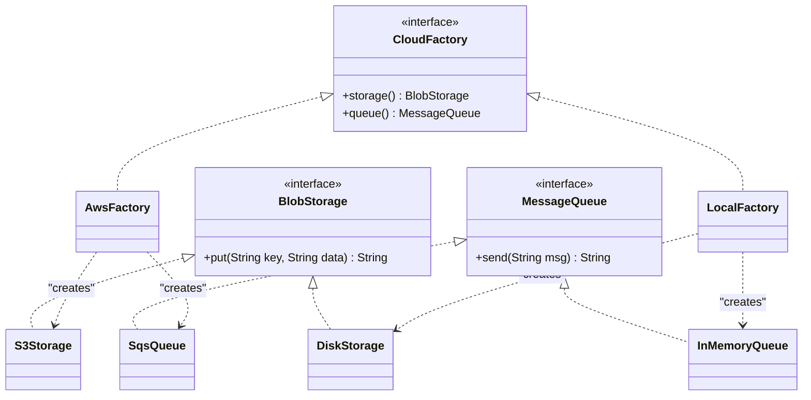
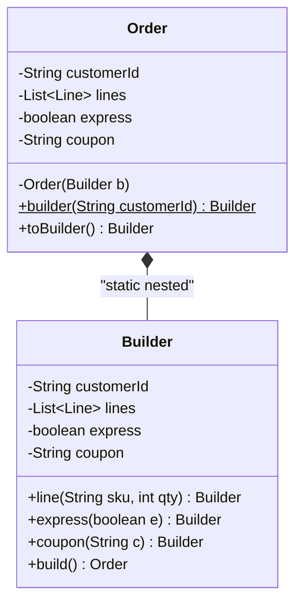

@@ 3 | TOPIC | Factory and Abstract Factory | Static factory methods, Factory Method, Abstract Factory for families of objects, JDK and Spring examples | MUST
# Factory and Abstract Factory

**Level: Advanced | Phase 17 | Priority: MUST | Since: GoF 1994 (Factory Method, Abstract Factory); static factory methods popularized by Effective Java (2001)**

> **30-second interview answer:** Factories move object creation out of the code that uses the objects, so callers depend on an interface rather than on `new ConcreteClass()`. A *static factory method* (`List.of`, `Optional.of`) is a named method that returns an instance, possibly cached or of a subtype. The *Factory Method* pattern lets a subclass decide which product to create. The *Abstract Factory* creates whole families of related objects that must be used together (AWS storage plus AWS queue, or local versions of both). In Spring, the container itself is the ultimate factory (`BeanFactory`), and `FactoryBean` or `@Bean` methods are factories you write.

## 1. Concept in Simple Words
### Analogy
Ordering furniture.

| Furniture shopping | Factory patterns |
|---|---|
| You say "a chair, please" at the counter and get one without seeing the workshop | Simple / static factory |
| Each branch of the store makes "a chair" in its own local style (Scandinavian branch, Victorian branch) | Factory Method: subclass decides the product |
| You buy a matching set: Victorian chair, Victorian table, Victorian sofa, never mixed | Abstract Factory: families of related products |
| The catalogue number "C-100" instead of building instructions | Creating by key or type without knowing the class |
| The warehouse hands out the same display chair to everyone who only wants to look | Factory returning cached instances |

### What it is
- **Static factory method:** a static method that returns an instance: `Integer.valueOf(42)`, `List.of(1, 2)`, `Path.of("a")`, `LocalDate.of(2026, 1, 1)`. Advantages over constructors: names (`ofPattern`, `withZone`), may return cached instances, may return a subtype or a hidden implementation, and can return different types depending on arguments.
- **Simple factory:** a class with a method that creates objects based on a parameter (a type, a key). Not a GoF pattern, but the most common in practice.
- **Factory Method (GoF):** an abstract creator declares `createProduct()`; concrete creators override it. The creator's other methods use the product through its interface.
- **Abstract Factory (GoF):** an interface with several creation methods (`createStorage()`, `createQueue()`), one implementation per family. Guarantees products from the same family are used together.
- **Product:** the interface of what is created.

### Why it exists
`new` hard-codes a concrete class. Code full of `new StripeClient(...)` and `new SmtpSender(...)` cannot switch implementations per environment, per customer or per test without being edited, and construction logic (configuration, caching, validation) gets duplicated wherever objects are created. Factories centralize the decision of *which* class and *how* to build it, supporting the Open/Closed and Dependency Inversion principles.

## 2. How It Works


**Factory Method flow:**
```text
abstract class ReportExporter {                  // creator
    final String export(data) {                  // uses the product
        Formatter f = createFormatter();         // factory method: subclass decides
        return f.header() + f.rows(data);
    }
    protected abstract Formatter createFormatter();
}
CsvExporter  -> createFormatter() returns CsvFormatter
JsonExporter -> createFormatter() returns JsonFormatter
```

**Factories in the JDK and Spring:**

| Where | Example | Kind |
|---|---|---|
| JDK | `List.of`, `Map.of`, `Optional.of`, `Integer.valueOf` | Static factory (cached or hidden types) |
| JDK | `Executors.newFixedThreadPool`, `Executors.newVirtualThreadPerTaskExecutor` | Static factory returning interface |
| JDK | `NumberFormat.getInstance(locale)`, `Calendar.getInstance()` | Factory choosing subtype by locale |
| JDK | `DocumentBuilderFactory.newInstance()` | Abstract factory with pluggable providers |
| Spring | `BeanFactory.getBean(...)` | The container as factory |
| Spring | `FactoryBean<T>` (`LocalContainerEntityManagerFactoryBean`) | Factory for complex beans |
| Spring | `@Bean` methods | Factory methods |
| Spring | `Map<String, PaymentGateway>` injection | Bean-name keyed factory without code |

## 3. Code Example
### Code
```java
import java.util.List;
import java.util.Map;
import java.util.function.Supplier;

public class FactoryDemo {

    // ---------------- 1. Simple factory with a sealed product hierarchy ----------------
    sealed interface Notification permits EmailNotification, SmsNotification, PushNotification {
        String send(String to, String text);
    }
    record EmailNotification() implements Notification {
        public String send(String to, String text) { return "EMAIL to " + to + ": " + text; }
    }
    record SmsNotification() implements Notification {
        public String send(String to, String text) { return "SMS to " + to + ": " + text.substring(0, Math.min(text.length(), 19)); }
    }
    record PushNotification() implements Notification {
        public String send(String to, String text) { return "PUSH to device " + to + ": " + text; }
    }

    enum Channel { EMAIL, SMS, PUSH }

    static final class NotificationFactory {
        // Registry: key -> constructor. Adding a channel = one map entry.
        private static final Map<Channel, Supplier<Notification>> REGISTRY = Map.of(
                Channel.EMAIL, EmailNotification::new,
                Channel.SMS, SmsNotification::new,
                Channel.PUSH, PushNotification::new);

        static Notification create(Channel channel) {
            Supplier<Notification> supplier = REGISTRY.get(channel);
            if (supplier == null) throw new IllegalArgumentException("unknown channel " + channel);
            return supplier.get();
        }
    }

    // ---------------- 2. Factory Method ----------------
    interface Formatter {
        String header();
        String row(String name, int qty);
    }

    static abstract class ReportExporter {
        final String export(Map<String, Integer> stock) {
            Formatter f = createFormatter();                 // the factory method
            StringBuilder sb = new StringBuilder(f.header());
            stock.forEach((name, qty) -> sb.append(f.row(name, qty)));
            return sb.toString();
        }
        protected abstract Formatter createFormatter();
    }

    static final class CsvExporter extends ReportExporter {
        protected Formatter createFormatter() {
            return new Formatter() {
                public String header() { return "name,qty\n"; }
                public String row(String n, int q) { return n + "," + q + "\n"; }
            };
        }
    }

    static final class MarkdownExporter extends ReportExporter {
        protected Formatter createFormatter() {
            return new Formatter() {
                public String header() { return "- stock report\n"; }
                public String row(String n, int q) { return "  - " + n + ": " + q + "\n"; }
            };
        }
    }

    // ---------------- 3. Abstract Factory: families that must match ----------------
    interface BlobStorage { String put(String key, String data); }
    interface MessageQueue { String send(String message); }

    interface CloudFactory {
        BlobStorage storage();
        MessageQueue queue();
    }

    static final class AwsFactory implements CloudFactory {
        public BlobStorage storage() { return (k, d) -> "s3://orderhub/" + k + " (" + d.length() + " bytes)"; }
        public MessageQueue queue() { return m -> "SQS message-id for '" + m + "'"; }
    }

    static final class LocalFactory implements CloudFactory {
        public BlobStorage storage() { return (k, d) -> "/tmp/orderhub/" + k + " (" + d.length() + " bytes)"; }
        public MessageQueue queue() { return m -> "in-memory queue accepted '" + m + "'"; }
    }

    // Client code depends only on the abstract factory
    static void archiveInvoice(CloudFactory cloud, String invoiceId) {
        BlobStorage storage = cloud.storage();
        MessageQueue queue = cloud.queue();
        System.out.println(storage.put("invoices/" + invoiceId + ".pdf", "PDF-CONTENT"));
        System.out.println(queue.send("invoice-archived:" + invoiceId));
    }

    static CloudFactory forEnvironment(String env) {
        return switch (env) {
            case "prod" -> new AwsFactory();
            case "dev", "test" -> new LocalFactory();
            default -> throw new IllegalArgumentException("unknown env " + env);
        };
    }

    public static void main(String[] args) {
        for (Channel c : List.of(Channel.EMAIL, Channel.SMS, Channel.PUSH)) {
            System.out.println(NotificationFactory.create(c).send("alice", "Your order 1001 has shipped"));
        }

        Map<String, Integer> stock = new java.util.LinkedHashMap<>();
        stock.put("book", 12);
        stock.put("pen", 40);
        System.out.print(new CsvExporter().export(stock));
        System.out.print(new MarkdownExporter().export(stock));

        archiveInvoice(forEnvironment("prod"), "INV-7");
        archiveInvoice(forEnvironment("dev"), "INV-8");

        // Static factories in the JDK can return cached instances
        System.out.println("Integer.valueOf(100) cached: " + (Integer.valueOf(100) == Integer.valueOf(100)));
        System.out.println("List.of() type hidden: " + List.of(1, 2).getClass().getSimpleName().startsWith("List"));
    }
}
```

### Walkthrough
- **Simple factory:** `NotificationFactory.create` maps an enum key to a constructor reference. Callers depend on the sealed `Notification` interface only. The registry replaces a `switch` that would need editing for every new channel (the sealed interface still forces you to list permitted types, which is a deliberate trade-off for exhaustiveness).
- **Factory Method:** `ReportExporter.export` is fixed algorithm code that needs "some formatter"; subclasses override `createFormatter` to pick it. This is often combined with Template Method (next topics).
- **Abstract Factory:** `archiveInvoice` asks the factory for both storage and queue, so it can never mix S3 storage with an in-memory queue. Choosing the family happens once, in `forEnvironment`, which in Spring would be profile-based configuration.
- **JDK static factories:** `Integer.valueOf(100)` returns a cached instance (values -128 to 127), and `List.of` returns an internal immutable class (`ListN` or `List12`) you never name.

### Output
```text
EMAIL to alice: Your order 1001 has shipped
SMS to alice: Your order 1001 has
PUSH to device alice: Your order 1001 has shipped
name,qty
book,12
pen,40
- stock report
  - book: 12
  - pen: 40
s3://orderhub/invoices/INV-7.pdf (11 bytes)
SQS message-id for 'invoice-archived:INV-7'
/tmp/orderhub/invoices/INV-8.pdf (11 bytes)
in-memory queue accepted 'invoice-archived:INV-8'
Integer.valueOf(100) cached: true
List.of() type hidden: true
```

### Compare
| Without a factory | With a factory |
|---|---|
| `if (type.equals("SMS")) n = new SmsNotification(); else if ...` repeated in several services | `NotificationFactory.create(channel)` in one place |
| `new S3Storage()` and `new InMemoryQueue()` mixed by mistake | Abstract factory guarantees a consistent family |
| Tests must use the real class | Tests pass a fake factory or product |

## 4. Interview Questions
**Basic**
1. **What is the Factory pattern and why use it?**
   It encapsulates object creation behind a method or class so callers depend on an abstraction instead of concrete classes. It centralizes the logic for choosing and configuring implementations, supports adding new types without changing callers, and makes testing with substitutes easy.
2. **Factory Method vs Abstract Factory?**
   Factory Method is one method, overridden by subclasses, that creates one product; it uses inheritance. Abstract Factory is an object with several creation methods producing a family of related products; it uses composition, and you swap the whole factory to switch families.
3. **What are the advantages of static factory methods over constructors?**
   They have descriptive names, can return cached instances (`Boolean.valueOf`), can return any subtype including non-public ones (`List.of`), and can vary the returned type by input. The downsides: classes without public constructors cannot be subclassed, and factories are harder to find in docs than constructors.

**Follow-up**
4. **How does Spring act as a factory?**
   The `BeanFactory`/`ApplicationContext` creates, configures and wires every bean from bean definitions; `@Bean` methods are factory methods; `FactoryBean<T>` lets you write a factory whose `getObject()` result becomes the bean (asking for `&name` returns the factory itself). You can also inject `Map<String, Interface>` to get all implementations keyed by bean name, a factory without code.
5. **How do you avoid a giant `switch` inside a factory?**
   Use a registry: a `Map<Key, Supplier<Product>>` built at startup, filled by each implementation registering itself, or in Spring by injecting `List<Product>` where each product declares its key. New products add entries rather than editing a switch. A switch over a sealed type is acceptable when the set is closed and you want exhaustiveness checking.
6. **When is a factory overkill?**
   When there is one implementation and no realistic variation, or when construction is trivial. Wrapping `new ArrayList<>()` in a factory adds indirection without value; dependency injection already covers swapping implementations in most application code.

**Tricky / scenario**
7. **OrderHub must support Stripe for EU customers and Adyen for US customers, chosen per request. How do you design creation?**
   Define a `PaymentGateway` interface with `provider()` and `charge()`, implement `StripeGateway` and `AdyenGateway` as Spring beans, and build a `PaymentGatewayResolver` that maps region to gateway from an injected `List<PaymentGateway>` plus configuration (`orderhub.payments.region-providers.EU=stripe`). The service asks the resolver per request. Adding a provider is a new bean and a config entry.
8. **Abstract Factory has a known weakness. What is it?**
   Adding a new *kind* of product (for example, `cache()` next to `storage()` and `queue()`) changes the factory interface and every concrete factory. Adding a new *family* is easy; adding a product type is not. If product types change often, a different structure (separate factories or DI configuration per product) may fit better.
9. **What does `Calendar.getInstance()` return, and what pattern is it?**
   A concrete subclass chosen by the default locale and time zone, usually `GregorianCalendar`, but a Buddhist or Japanese imperial calendar for some locales. It is a static factory (a simple factory) hiding which subtype you get, and an example of why returning an interface or abstract type gives flexibility.

**What the interviewer is really testing:** whether you can distinguish the variants, connect them to Spring's container and JDK APIs, and design extensible creation without switch statements.

## 5. Pitfalls & Best Practices
### Common mistakes
| Mistake | What goes wrong | Fix |
|---|---|---|
| Factory with a growing `switch` over strings | Edit for every new type, typo bugs | Enum or sealed keys, registry map, or DI-built registry |
| Factory that returns `null` for unknown keys | NPE far from the cause | Throw `IllegalArgumentException` with the key |
| Factories for everything | Indirection, harder navigation | Use only at real variation points |
| Mixing products from different families | Inconsistent behaviour (prod storage with test queue) | Abstract Factory or one configuration per environment |
| Static factory hiding expensive creation each call | Performance surprises | Cache, or name it `newX` to signal creation |

### Best practices
- Follow JDK naming: `of`, `from`, `valueOf`, `getInstance` (may be shared), `newInstance` or `newX` (always new), `create`.
- In Spring, let the container be the factory; use `@Bean` methods for third-party classes and `FactoryBean` only for complex framework integration.
- Return interfaces from factories.
- Validate inputs in the factory and fail with a clear message.

### Compare with
| Pattern | Creates | Variation by |
|---|---|---|
| Static factory method | One object | Arguments |
| Simple factory | One object of several types | Key or type parameter |
| Factory Method | One product | Subclass |
| Abstract Factory | Family of products | Factory object |
| Builder | One complex object step by step | Configuration of parts |
| Dependency injection | Whole object graph | Container configuration |

## 6. Hands-on Exercise
OrderHub needs region-specific payment gateways. Create a `PaymentGateway` interface with `String provider()` and `PaymentReceipt charge(long orderId, BigDecimal amount)`, two Spring beans (`stripe`, `adyen`), and a `PaymentGatewayFactory` that returns the right gateway for a region using configuration properties.

Acceptance criteria:
- `application.yml` maps regions to providers (`EU: stripe`, `US: adyen`).
- The factory validates at startup that every configured provider exists.
- `forRegion("APAC")` throws `IllegalArgumentException` with a clear message.

<details><summary>Solution</summary>

```yaml
# application.yml
orderhub:
  payments:
    region-providers:
      EU: stripe
      US: adyen
```

```java
// payment/PaymentGateway.java
package com.orderhub.payment;

import java.math.BigDecimal;

public interface PaymentGateway {
    record PaymentReceipt(String provider, long orderId, BigDecimal amount, String reference) { }

    String provider();
    PaymentReceipt charge(long orderId, BigDecimal amount);
}
```

```java
// payment/gateways/StripeGateway.java
package com.orderhub.payment.gateways;

import com.orderhub.payment.PaymentGateway;
import java.math.BigDecimal;
import java.util.UUID;
import org.springframework.stereotype.Component;

@Component
public class StripeGateway implements PaymentGateway {
    public String provider() { return "stripe"; }

    public PaymentReceipt charge(long orderId, BigDecimal amount) {
        return new PaymentReceipt(provider(), orderId, amount, "ch_" + UUID.randomUUID());
    }
}
```

```java
// payment/gateways/AdyenGateway.java
package com.orderhub.payment.gateways;

import com.orderhub.payment.PaymentGateway;
import java.math.BigDecimal;
import java.util.UUID;
import org.springframework.stereotype.Component;

@Component
public class AdyenGateway implements PaymentGateway {
    public String provider() { return "adyen"; }

    public PaymentReceipt charge(long orderId, BigDecimal amount) {
        return new PaymentReceipt(provider(), orderId, amount, "psp_" + UUID.randomUUID());
    }
}
```

```java
// payment/PaymentProperties.java
package com.orderhub.payment;

import java.util.Map;
import org.springframework.boot.context.properties.ConfigurationProperties;

@ConfigurationProperties(prefix = "orderhub.payments")
public record PaymentProperties(Map<String, String> regionProviders) { }
```

```java
// payment/PaymentGatewayFactory.java
package com.orderhub.payment;

import java.util.List;
import java.util.Map;
import java.util.function.Function;
import java.util.stream.Collectors;
import org.springframework.boot.context.properties.EnableConfigurationProperties;
import org.springframework.stereotype.Component;

@Component
@EnableConfigurationProperties(PaymentProperties.class)
public class PaymentGatewayFactory {
    private final Map<String, PaymentGateway> byRegion;

    public PaymentGatewayFactory(List<PaymentGateway> gateways, PaymentProperties props) {
        Map<String, PaymentGateway> byProvider = gateways.stream()
                .collect(Collectors.toMap(PaymentGateway::provider, Function.identity()));
        this.byRegion = props.regionProviders().entrySet().stream()
                .collect(Collectors.toUnmodifiableMap(Map.Entry::getKey, e -> {
                    PaymentGateway g = byProvider.get(e.getValue());
                    if (g == null) {
                        throw new IllegalStateException("Region " + e.getKey() + " uses unknown provider " + e.getValue());
                    }
                    return g;
                }));
    }

    public PaymentGateway forRegion(String region) {
        PaymentGateway gateway = byRegion.get(region);
        if (gateway == null) {
            throw new IllegalArgumentException("No payment provider configured for region " + region + "; known: " + byRegion.keySet());
        }
        return gateway;
    }
}
```

```java
// payment/CheckoutService.java (usage)
package com.orderhub.payment;

import java.math.BigDecimal;
import org.springframework.stereotype.Service;

@Service
public class CheckoutService {
    private final PaymentGatewayFactory gateways;

    public CheckoutService(PaymentGatewayFactory gateways) { this.gateways = gateways; }

    public PaymentGateway.PaymentReceipt pay(long orderId, String region, BigDecimal amount) {
        return gateways.forRegion(region).charge(orderId, amount);
    }
}
```
A misconfigured provider fails the application at startup (fail fast) instead of at the first payment. Adding a provider means one new `@Component` and one line of YAML; no existing class changes.
</details>

## 7. Recall
Q: What problem do factory patterns solve?
A: They move object creation out of client code so clients depend on abstractions, and the choice and configuration of concrete classes lives in one place.

Q: What is the difference between Factory Method and Abstract Factory?
A: Factory Method is one overridable method creating one product via inheritance; Abstract Factory is an object creating a family of related products via composition.

Q: Give three JDK examples of static factory methods.
A: `List.of`, `Integer.valueOf`, `Executors.newFixedThreadPool` (also `Optional.of`, `Path.of`, `LocalDate.of`).

Q: What is a Spring `FactoryBean`?
A: A bean whose `getObject()` result is exposed as the bean, used for complex creation; requesting `&beanName` returns the factory itself.

Q: How can you avoid a growing switch statement inside a factory?
A: Use a registry map from key to supplier, or in Spring inject all implementations and index them by a key they declare.

Q: What is the main weakness of Abstract Factory?
A: Adding a new product type requires changing the factory interface and every concrete factory.

**Related:** [[Builder]] · [[Strategy, Template Method and Observer]] · [[@Configuration and @Bean]] · [[Design Patterns Inside Spring]]

@@ 3 | TOPIC | Builder | Building complex immutable objects step by step, validation in build, telescoping constructors, Lombok, records and step builders | MUST
# Builder

**Level: Advanced | Phase 17 | Priority: MUST | Since: GoF 1994; static nested builder popularized by Effective Java (2001); records Java 16**

> **30-second interview answer:** Builder constructs a complex object step by step through a fluent API, then creates it in one `build()` call that validates everything. It solves telescoping constructors (many overloaded constructors with long, confusing parameter lists) and lets the final object be immutable. In Java the usual form is a static nested `Builder` class with a private constructor on the target. JDK examples: `StringBuilder`, `HttpRequest.newBuilder()`, `Stream.builder()`; Spring examples: `UriComponentsBuilder`, `RestClient.builder()`, `ResponseEntity.ok().header(...)`. Lombok's `@Builder` generates one.

## 1. Concept in Simple Words
### Analogy
Ordering a custom sandwich.

| Sandwich counter | Builder |
|---|---|
| You say each choice in any order: bread, then cheese, extra pickles, no onions | Fluent setter-like methods |
| Things you do not mention come with sensible defaults | Default values in the builder |
| You must at least choose the bread | Required parameters (constructor of the builder) |
| The sandwich maker checks "no meat on a vegan sandwich" before wrapping | Validation in `build()` |
| Once wrapped, the sandwich does not change | Immutable result |
| The menu says "Number 5 with: bread, cheese, tomato, ham, mustard, pickles, ..." in one breath | Telescoping constructor |

### What it is
- **Telescoping constructor anti-pattern:** `new Pizza(30, true, false, true, false, null, 2)`: positional parameters, easy to swap two booleans, many overloads.
- **JavaBeans style:** no-arg constructor plus setters: readable, but the object is mutable and can be used half-configured (inconsistent state).
- **Builder:** a separate mutable object collects parameters; `build()` validates and creates an immutable target. Target constructor is private and takes the builder.
- **Required vs optional:** required values go in the builder's constructor or factory (`Order.builder(customerId)`); optional ones are fluent methods with defaults.
- **Step builder:** a variant using interfaces to force a call order at compile time (`from()` then `to()` then optional steps then `build()`).
- **Records and builders:** records have canonical constructors; for records with many optional components, add a static nested builder or a `with`-style copy method. (Derived record creation, `with` expressions, is a JDK proposal not final as of Java 25.)
- **Lombok `@Builder`:** generates the builder; `toBuilder = true` adds a copy-and-modify builder.

### Why it exists
Objects with many fields, several optional, need a creation API that is readable, prevents invalid combinations and yields immutable results. Constructors with ten parameters are unreadable and error-prone; setters allow partially initialized, mutable objects. The Builder separates the messy construction process from the clean, immutable representation.

## 2. How It Works
```text
Client                       Order.Builder (mutable, single-threaded)         Order (immutable)
  Order.builder("cust-7") --> customerId = "cust-7"
     .line("BOOK", 2)     --> lines += BOOK x2
     .line("PEN", 3)      --> lines += PEN x3
     .express(true)       --> express = true
     .coupon("WELCOME10") --> coupon = "WELCOME10"
     .build()             --> validate(): lines not empty, coupon format ok
                              new Order(this) ----------------------------> final fields,
                                                                             List.copyOf(lines)
```



**Key rules:**
1. The target's constructor is private; the only way in is `build()`.
2. `build()` copies mutable inputs (`List.copyOf`) so later builder changes cannot affect the built object.
3. Validation that spans fields happens in `build()` (or the target's constructor), never in individual setters only.
4. Builders are not thread-safe and are meant to be used by one thread, then discarded; the built object is safe to share.

**Builders in the JDK and Spring:**

| API | Example |
|---|---|
| `StringBuilder` | `new StringBuilder().append("a").append(1).toString()` |
| `java.net.http.HttpRequest` | `HttpRequest.newBuilder(uri).header("Accept", "application/json").GET().build()` |
| `Stream.builder()` | `Stream.<String>builder().add("a").add("b").build()` |
| `Locale.Builder` | `new Locale.Builder().setLanguage("en").setRegion("GB").build()` |
| Spring `UriComponentsBuilder` | `UriComponentsBuilder.fromPath("/orders/{id}").queryParam("expand", "lines").buildAndExpand(7)` |
| Spring `ResponseEntity` | `ResponseEntity.created(uri).header("X-Request-Id", id).body(dto)` |
| Spring `RestClient.builder()` | `RestClient.builder().baseUrl(url).defaultHeader(...).build()` |
| Spring Security | `http.authorizeHttpRequests(...).oauth2ResourceServer(...)` (lambda DSL builder) |

## 3. Code Example
### Code
```java
import java.math.BigDecimal;
import java.util.ArrayList;
import java.util.List;
import java.util.Objects;

public class BuilderDemo {

    record Line(String sku, int quantity, BigDecimal unitPrice) {
        Line {
            if (quantity <= 0) throw new IllegalArgumentException("quantity must be positive for " + sku);
        }
    }

    // ---------------- Classic static nested builder ----------------
    static final class Order {
        private final String customerId;
        private final List<Line> lines;
        private final boolean express;
        private final String coupon;          // optional, may be null
        private final String deliveryNote;    // optional, default ""

        private Order(Builder b) {
            this.customerId = b.customerId;
            this.lines = List.copyOf(b.lines);   // defensive copy: immutable snapshot
            this.express = b.express;
            this.coupon = b.coupon;
            this.deliveryNote = b.deliveryNote;
        }

        static Builder builder(String customerId) { return new Builder(customerId); }

        Builder toBuilder() {                    // copy-and-modify
            Builder b = new Builder(customerId).express(express).deliveryNote(deliveryNote);
            if (coupon != null) b.coupon(coupon);
            lines.forEach(l -> b.line(l.sku(), l.quantity(), l.unitPrice()));
            return b;
        }

        BigDecimal total() {
            BigDecimal sum = lines.stream()
                    .map(l -> l.unitPrice().multiply(BigDecimal.valueOf(l.quantity())))
                    .reduce(BigDecimal.ZERO, BigDecimal::add);
            if (express) sum = sum.add(new BigDecimal("9.99"));
            if ("WELCOME10".equals(coupon)) sum = sum.subtract(new BigDecimal("10"));
            return sum;
        }

        @Override public String toString() {
            return "Order[customer=" + customerId + ", lines=" + lines.size() + ", express=" + express
                    + ", coupon=" + coupon + ", note='" + deliveryNote + "', total=" + total() + "]";
        }

        static final class Builder {
            private final String customerId;              // required
            private final List<Line> lines = new ArrayList<>();
            private boolean express;                      // default false
            private String coupon;
            private String deliveryNote = "";             // default

            private Builder(String customerId) {
                this.customerId = Objects.requireNonNull(customerId, "customerId");
            }

            Builder line(String sku, int quantity, BigDecimal unitPrice) {
                lines.add(new Line(sku, quantity, unitPrice));
                return this;
            }
            Builder express(boolean express) { this.express = express; return this; }
            Builder coupon(String coupon) { this.coupon = coupon; return this; }
            Builder deliveryNote(String note) { this.deliveryNote = note; return this; }

            Order build() {
                // cross-field validation happens here, once
                if (lines.isEmpty()) throw new IllegalStateException("an order needs at least one line");
                if (coupon != null && !coupon.matches("[A-Z]+\\d+")) throw new IllegalStateException("bad coupon " + coupon);
                if (express && deliveryNote.length() > 50) throw new IllegalStateException("express notes max 50 chars");
                return new Order(this);
            }
        }
    }

    // ---------------- Step builder: compile-time required order ----------------
    record Transfer(String from, String to, BigDecimal amount, String reference) {
        interface FromStep { ToStep from(String account); }
        interface ToStep { AmountStep to(String account); }
        interface AmountStep { OptionalStep amount(BigDecimal amount); }
        interface OptionalStep {
            OptionalStep reference(String ref);
            Transfer build();
        }

        static FromStep builder() { return new Steps(); }

        private static final class Steps implements FromStep, ToStep, AmountStep, OptionalStep {
            private String from, to, reference = "none";
            private BigDecimal amount;
            public ToStep from(String a) { this.from = a; return this; }
            public AmountStep to(String a) { this.to = a; return this; }
            public OptionalStep amount(BigDecimal a) { this.amount = a; return this; }
            public OptionalStep reference(String r) { this.reference = r; return this; }
            public Transfer build() { return new Transfer(from, to, amount, reference); }
        }
    }

    public static void main(String[] args) {
        Order order = Order.builder("cust-7")
                .line("BOOK", 2, new BigDecimal("12.50"))
                .line("PEN", 3, new BigDecimal("1.50"))
                .express(true)
                .coupon("WELCOME10")
                .build();
        System.out.println(order);

        Order cheaper = order.toBuilder().express(false).deliveryNote("leave at door").build();
        System.out.println(cheaper);

        try {
            Order.builder("cust-8").coupon("WELCOME10").build();
        } catch (IllegalStateException e) {
            System.out.println("rejected: " + e.getMessage());
        }

        Transfer t = Transfer.builder().from("DE01").to("FR02").amount(new BigDecimal("250.00")).reference("INV-7").build();
        System.out.println(t);
        // Transfer.builder().to("FR02")   -> does not compile: FromStep has no to() method
    }
}
```

### Walkthrough
- **Required parameter in the builder factory:** `Order.builder("cust-7")` makes it impossible to forget the customer; `requireNonNull` rejects `null` immediately.
- **Fluent optional parameters:** each method returns `this`, so calls chain; unspecified values keep defaults (`express = false`, `deliveryNote = ""`).
- **Validation in `build()`:** rules that involve several fields (at least one line, coupon format, express note length) are checked once, before the object exists. An invalid `Order` can never be observed.
- **Immutability:** fields are `final`, the line list is copied with `List.copyOf`, and there are no setters. The built `Order` is safe to share across threads.
- **toBuilder:** copies an existing order into a new builder, so "same order without express" is one line, a pattern also generated by Lombok's `@Builder(toBuilder = true)`.
- **Step builder:** each step returns the interface for the next step, so the compiler enforces `from`, `to`, `amount` before `build()`. Useful when required parameters are many; heavier to write.

### Output
```text
Order[customer=cust-7, lines=2, express=true, coupon=WELCOME10, note='', total=29.49]
Order[customer=cust-7, lines=2, express=false, coupon=WELCOME10, note='leave at door', total=19.50]
rejected: an order needs at least one line
Transfer[from=DE01, to=FR02, amount=250.00, reference=INV-7]
```

### Compare
| Telescoping constructor | JavaBeans setters | Builder |
|---|---|---|
| `new Order("c7", lines, true, "WELCOME10", "")` | `o = new Order(); o.setExpress(true); ...` | `Order.builder("c7").express(true).coupon(...).build()` |
| Positional, easy to swap arguments | Readable, but mutable and possibly half-built | Readable, validated, immutable |
| Overload per combination | Validation impossible across fields at construction | Validation once in `build()` |

## 4. Interview Questions
**Basic**
1. **What problem does the Builder pattern solve?**
   Creating objects with many parameters, especially optional ones, without telescoping constructors or mutable setters. It gives a readable, named, fluent API, applies defaults, validates combinations in `build()`, and produces an immutable object.
2. **How do you implement a Builder in Java?**
   Make the target's constructor private and accepting the builder; add a static nested `Builder` class with fields mirroring the target, fluent methods returning `this`, required parameters in its constructor, and a `build()` method that validates and calls the private constructor. Copy mutable collections when building.
3. **Name builders in the JDK and Spring.**
   JDK: `StringBuilder`, `HttpRequest.newBuilder()`, `HttpClient.newBuilder()`, `Stream.builder()`, `Locale.Builder`. Spring: `UriComponentsBuilder`, `ResponseEntity.BodyBuilder`, `RestClient.builder()`, `WebClient.builder()`, `MockMvcRequestBuilders`, and Spring Security's `HttpSecurity` DSL.

**Follow-up**
4. **Where should validation go: setter methods or `build()`?**
   Single-field checks (null, range) can fail fast in the fluent methods, but cross-field rules must go in `build()` (or the target constructor) because only then is the full configuration known. Putting the final validation in the target's constructor protects even objects created by other paths.
5. **Is a builder thread-safe? Is the built object?**
   Builders are normally not thread-safe: they are mutable and meant to be used by one thread, then thrown away. The built object, with final fields and copied collections, is immutable and therefore safe to share. Do not store builders in shared fields.
6. **What does Lombok's `@Builder` generate and what are the pitfalls?**
   A static `builder()` method, a nested builder class with a fluent method per field, and `build()` calling an all-args constructor. Pitfalls: no validation unless you add it in the constructor, default field values are ignored unless annotated `@Builder.Default`, and on JPA entities it fights with the required no-arg constructor. Many teams prefer records plus explicit builders for core domain types.

**Tricky / scenario**
7. **A record has 12 components, 9 of them optional. Callers write `new SearchCriteria(null, null, "books", null, ...)`. What do you do?**
   Add a static nested builder to the record (or a `static SearchCriteria.Builder builder()`) so callers name only what they set, and keep the canonical constructor for validation. Alternatively split it into smaller value objects (price range, date range, paging). Twelve components often signal the type is doing too much.
8. **Builder vs Abstract Factory?**
   Abstract Factory creates *families* of related objects in one call each and hides which concrete classes are used. Builder creates *one* complex object through many steps and focuses on how it is configured. They can combine: a factory can return pre-configured builders.
9. **Why might a step builder be worth its extra code?**
   When an object has several required parameters that are easy to forget or confuse, and runtime validation is too late (for example in a public SDK). The step interfaces make the compiler enforce the order and presence of required calls, and IDE autocomplete guides users. For internal code with two required parameters, a normal builder with constructor arguments is enough.

**What the interviewer is really testing:** whether you can write a correct, immutable builder with validation and defensive copies, and know when a builder is better than constructors, records or Lombok.

## 5. Pitfalls & Best Practices
### Common mistakes
| Mistake | What goes wrong | Fix |
|---|---|---|
| No validation in `build()` | Invalid objects created | Validate cross-field rules in `build()` or the target constructor |
| Passing the builder's list directly to the target | Later builder changes mutate the "immutable" object | `List.copyOf` in the target constructor |
| Public constructor on the target as well | Builder bypassed, invariants skipped | Private constructor, builder as the only entry |
| Lombok `@Builder` with field initializers | Defaults silently become null or zero | `@Builder.Default` or explicit builder |
| Builder for a 2-field class | Ceremony without value | Constructor, record or static factory |

### Best practices
- Use builders when there are four or more parameters or several optional ones.
- Put required parameters in `builder(...)` arguments; give optional ones sensible defaults.
- Make the result immutable and the builder disposable.
- Offer `toBuilder()` for copy-with-change semantics.
- In tests, use builders (test data builders) to create objects with only the fields relevant to each test.

### Compare with
| Technique | Readability | Immutability | Validation |
|---|---|---|---|
| Constructor | Poor with many params | Yes | Yes |
| Record canonical constructor | Poor with many optional params | Yes | Yes (compact constructor) |
| JavaBeans setters | Good | No | Weak |
| Builder | Good | Yes | Yes, in `build()` |
| Lombok `@Builder` | Good | Yes if fields final | Only if added to constructor |

## 6. Hands-on Exercise
OrderHub's product search needs an `OrderSearchCriteria` with optional status, customer id, created-from and created-to dates, minimum total, page (default 0), size (default 20, max 100) and sort (default `createdAt,desc`). Write it as an immutable class with a builder and validation, plus a `toQueryString()` method used by an admin client.

Acceptance criteria:
- `OrderSearchCriteria.builder().status("PAID").size(50).build()` works; unset values are absent from the query string.
- `from` after `to` or size above 100 throws `IllegalStateException` in `build()`.
- The object is immutable.

<details><summary>Solution</summary>

```java
import java.math.BigDecimal;
import java.time.LocalDate;
import java.util.LinkedHashMap;
import java.util.Map;
import java.util.Optional;
import java.util.stream.Collectors;

public final class OrderSearchCriteria {
    private final String status;
    private final Long customerId;
    private final LocalDate createdFrom;
    private final LocalDate createdTo;
    private final BigDecimal minTotal;
    private final int page;
    private final int size;
    private final String sort;

    private OrderSearchCriteria(Builder b) {
        this.status = b.status;
        this.customerId = b.customerId;
        this.createdFrom = b.createdFrom;
        this.createdTo = b.createdTo;
        this.minTotal = b.minTotal;
        this.page = b.page;
        this.size = b.size;
        this.sort = b.sort;
    }

    public static Builder builder() { return new Builder(); }

    public Optional<String> status() { return Optional.ofNullable(status); }

    public String toQueryString() {
        Map<String, Object> params = new LinkedHashMap<>();
        if (status != null) params.put("status", status);
        if (customerId != null) params.put("customerId", customerId);
        if (createdFrom != null) params.put("from", createdFrom);
        if (createdTo != null) params.put("to", createdTo);
        if (minTotal != null) params.put("minTotal", minTotal.toPlainString());
        params.put("page", page);
        params.put("size", size);
        params.put("sort", sort);
        return params.entrySet().stream().map(e -> e.getKey() + "=" + e.getValue()).collect(Collectors.joining("&"));
    }

    public static final class Builder {
        private String status;
        private Long customerId;
        private LocalDate createdFrom;
        private LocalDate createdTo;
        private BigDecimal minTotal;
        private int page = 0;
        private int size = 20;
        private String sort = "createdAt,desc";

        private Builder() { }

        public Builder status(String status) { this.status = status; return this; }
        public Builder customerId(long id) { this.customerId = id; return this; }
        public Builder createdBetween(LocalDate from, LocalDate to) { this.createdFrom = from; this.createdTo = to; return this; }
        public Builder minTotal(BigDecimal min) { this.minTotal = min; return this; }
        public Builder page(int page) { this.page = page; return this; }
        public Builder size(int size) { this.size = size; return this; }
        public Builder sort(String sort) { this.sort = sort; return this; }

        public OrderSearchCriteria build() {
            if (page < 0) throw new IllegalStateException("page must be >= 0");
            if (size < 1 || size > 100) throw new IllegalStateException("size must be between 1 and 100");
            if (createdFrom != null && createdTo != null && createdFrom.isAfter(createdTo)) {
                throw new IllegalStateException("from " + createdFrom + " is after to " + createdTo);
            }
            if (minTotal != null && minTotal.signum() < 0) throw new IllegalStateException("minTotal must be >= 0");
            return new OrderSearchCriteria(this);
        }
    }

    public static void main(String[] args) {
        System.out.println(OrderSearchCriteria.builder().status("PAID").size(50).build().toQueryString());
        System.out.println(OrderSearchCriteria.builder()
                .customerId(7)
                .createdBetween(LocalDate.of(2026, 1, 1), LocalDate.of(2026, 3, 31))
                .minTotal(new BigDecimal("100.00"))
                .build().toQueryString());
        try {
            OrderSearchCriteria.builder().createdBetween(LocalDate.of(2026, 5, 1), LocalDate.of(2026, 1, 1)).build();
        } catch (IllegalStateException e) {
            System.out.println("rejected: " + e.getMessage());
        }
        try {
            OrderSearchCriteria.builder().size(500).build();
        } catch (IllegalStateException e) {
            System.out.println("rejected: " + e.getMessage());
        }
    }
}
```
Output:
```text
status=PAID&page=0&size=50&sort=createdAt,desc
customerId=7&from=2026-01-01&to=2026-03-31&minTotal=100.00&page=0&size=20&sort=createdAt,desc
rejected: from 2026-05-01 is after to 2026-01-01
rejected: size must be between 1 and 100
```
Defaults live in the builder, cross-field checks in `build()`, and the target has only final fields and getters, so a criteria object can be cached or shared safely.
</details>

## 7. Recall
Q: What problem does the Builder pattern solve?
A: Readable creation of objects with many, often optional, parameters without telescoping constructors or mutable setters, ending in a validated immutable object.

Q: Where should cross-field validation live in a Builder?
A: In `build()` (or the target's private constructor), when the complete configuration is known.

Q: Why should the target constructor copy collections from the builder?
A: So later changes to the builder's mutable list cannot alter the supposedly immutable built object.

Q: What is a step builder?
A: A builder whose methods return different interfaces so the compiler enforces that required steps are called in order before `build()`.

Q: Name two builders in Spring.
A: `UriComponentsBuilder` and `RestClient.builder()` (also `ResponseEntity.ok()` body builders and `MockMvcRequestBuilders`).

Q: What is the classic Lombok `@Builder` pitfall with field defaults?
A: Field initializers are ignored by the generated builder unless the field is annotated `@Builder.Default`.

**Related:** [[Immutable Class Design]] · [[Records]] · [[Factory and Abstract Factory]] · [[Lombok: Uses and Risks]]
