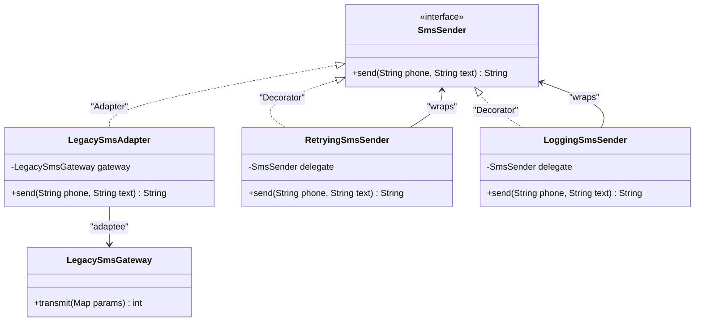
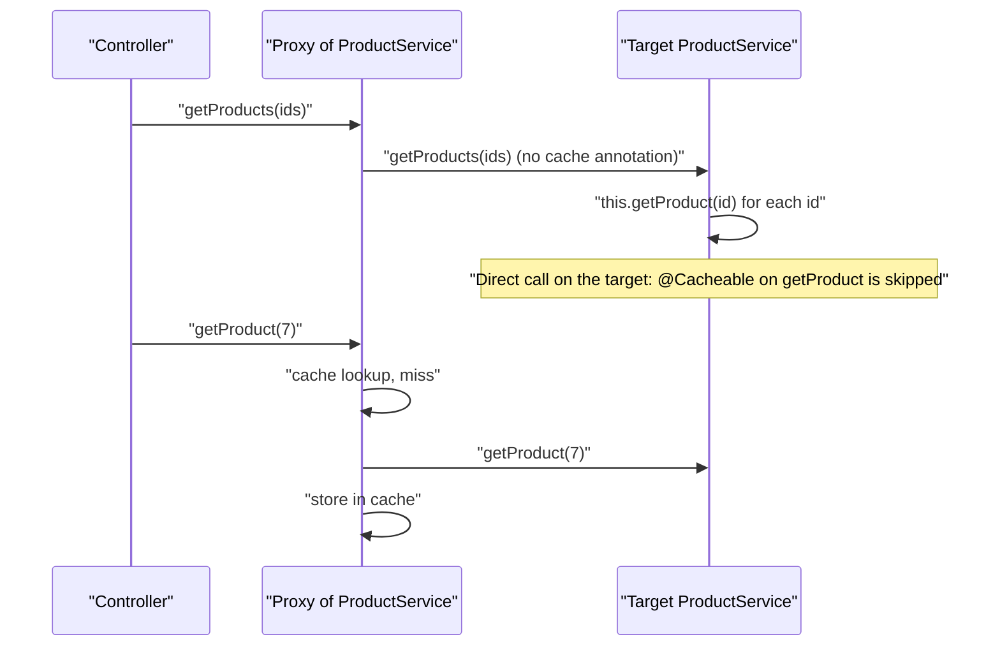

@@ 3 | TOPIC | Adapter, Decorator and Facade | Converting interfaces, adding behaviour by wrapping, and simplifying subsystems, with java.io and Spring examples | SHOULD
# Adapter, Decorator and Facade

**Level: Advanced | Phase 17 | Priority: SHOULD | Since: GoF 1994 (all three structural patterns)**

> **30-second interview answer:** All three wrap other objects but for different reasons. An **Adapter** converts one interface into another that clients expect, so incompatible classes work together (a legacy SMS SDK behind our `SmsSender` interface; `InputStreamReader` adapts bytes to characters). A **Decorator** implements the same interface as the object it wraps and adds behaviour before or after delegating, and decorators can be stacked (`BufferedInputStream` around `FileInputStream`; retry around logging around an HTTP client). A **Facade** offers one simple interface over a complex subsystem (a `CheckoutFacade` coordinating inventory, payment and shipping; SLF4J over logging frameworks).

## 1. Concept in Simple Words
### Analogy
Travelling abroad with electronics, and a hotel concierge.

| Travel | Pattern |
|---|---|
| A plug adapter lets your UK charger fit a European socket; it changes the shape, not the power | Adapter: converts interface |
| A surge protector plugged between charger and socket: same plug shape on both ends, adds protection | Decorator: same interface, extra behaviour |
| Surge protector plus timer plus power meter, stacked | Stacked decorators |
| The hotel concierge books taxi, restaurant and theatre with one request | Facade: simple front for a complex subsystem |
| You can still call the restaurant directly if you want | Facade does not hide the subsystem completely |

### What it is
- **Adapter (wrapper):** a class implementing the *target* interface (what the client wants) and holding an *adaptee* (the incompatible class), translating calls, parameters, units and exceptions. Object adapter uses composition (preferred); class adapter uses inheritance.
- **Decorator:** a class implementing the *same* interface as its component, holding a reference to a component, adding behaviour around delegated calls. Because decorators and the real object share the type, they can be combined in any order at runtime. An alternative to subclass explosion (`LoggingRetryingCachingClient`).
- **Facade:** a class providing a higher-level, simplified API over several subsystem classes. It reduces coupling between clients and subsystem details; it does not add new behaviour of its own beyond orchestration.

### Why it exists
- **Adapter:** you often cannot change third-party or legacy code, but your design depends on your own interfaces (DIP). An adapter keeps vendor types out of your domain, so switching vendors touches one class.
- **Decorator:** cross-cutting concerns (logging, retry, caching, metrics, encryption) would otherwise be copied into every implementation or require a subclass per combination. Decoration composes them.
- **Facade:** clients that must call five subsystem classes in the right order duplicate orchestration and break when the subsystem changes. A facade puts that knowledge in one place.

## 2. How It Works


**Decorator call flow (stacked):**
```text
client.send()
  -> LoggingSmsSender.send      log "sending"
       -> RetryingSmsSender.send   attempt 1 fails, attempt 2...
            -> LegacySmsAdapter.send   convert args to Map, call transmit(), map status code
                 -> LegacySmsGateway.transmit
            <- "MSG-200"
       <- "MSG-200"
  <- log "sent", return
```

**java.io is the textbook decorator stack:**
```text
new BufferedReader(                 // decorator: buffering, readLine()
    new InputStreamReader(          // ADAPTER: bytes -> chars (InputStream to Reader)
        new GZIPInputStream(        // decorator: decompression
            new FileInputStream("orders.csv.gz"))))   // concrete component
```

**Facade:**
```text
CheckoutFacade.checkout(cart)
   -> InventoryService.reserve(items)
   -> PricingService.total(cart)
   -> PaymentService.charge(customer, total)
   -> ShippingService.schedule(order)
   -> on payment failure: InventoryService.release(items)
```

**In Spring:** `HandlerAdapter` adapts many controller styles to `DispatcherServlet`; `TransactionAwareDataSourceProxy`, `BeanPostProcessor`-created proxies and `ServerHttpRequestDecorator` are decorators; `JdbcTemplate`, `RestClient` and `JavaMailSender` are facades over verbose APIs. SLF4J is a facade over Logback or Log4j 2.

## 3. Code Example
### Code
```java
import java.util.ArrayList;
import java.util.HashMap;
import java.util.List;
import java.util.Map;

public class StructuralPatternsDemo {

    // ---------------- Target interface our code depends on ----------------
    interface SmsSender {
        String send(String phone, String text);   // returns a message id, throws SmsException on failure
    }

    static class SmsException extends RuntimeException {
        SmsException(String msg) { super(msg); }
    }

    // ---------------- Legacy third-party class we cannot change ----------------
    static class LegacySmsGateway {
        private int calls;
        // returns HTTP-like status codes, takes an untyped map, phone without '+'
        int transmit(Map<String, String> params) {
            calls++;
            if (calls == 1) return 503;            // first call fails: flaky vendor
            return params.get("msisdn").startsWith("+") ? 400 : 200;
        }
    }

    // ---------------- ADAPTER: legacy API -> our interface ----------------
    static class LegacySmsAdapter implements SmsSender {
        private final LegacySmsGateway gateway;
        private int sequence;

        LegacySmsAdapter(LegacySmsGateway gateway) { this.gateway = gateway; }

        @Override
        public String send(String phone, String text) {
            Map<String, String> params = new HashMap<>();
            params.put("msisdn", phone.replace("+", ""));   // convert format
            params.put("body", text);
            int status = gateway.transmit(params);
            if (status != 200) throw new SmsException("vendor status " + status);  // convert error model
            return "MSG-" + (++sequence);
        }
    }

    // ---------------- DECORATORS: same interface, added behaviour ----------------
    static class RetryingSmsSender implements SmsSender {
        private final SmsSender delegate;
        private final int maxAttempts;

        RetryingSmsSender(SmsSender delegate, int maxAttempts) { this.delegate = delegate; this.maxAttempts = maxAttempts; }

        @Override
        public String send(String phone, String text) {
            SmsException last = null;
            for (int attempt = 1; attempt <= maxAttempts; attempt++) {
                try {
                    return delegate.send(phone, text);
                } catch (SmsException e) {
                    last = e;
                    System.out.println("  retry: attempt " + attempt + " failed (" + e.getMessage() + ")");
                }
            }
            throw last;
        }
    }

    static class LoggingSmsSender implements SmsSender {
        private final SmsSender delegate;
        LoggingSmsSender(SmsSender delegate) { this.delegate = delegate; }

        @Override
        public String send(String phone, String text) {
            System.out.println("log: sending to " + phone.substring(0, 4) + "****");
            String id = delegate.send(phone, text);
            System.out.println("log: sent " + id);
            return id;
        }
    }

    // ---------------- FACADE: one call over several subsystems ----------------
    static class InventoryService {
        final List<String> reserved = new ArrayList<>();
        void reserve(String sku) { reserved.add(sku); }
        void release(String sku) { reserved.remove(sku); }
    }
    static class PaymentService {
        String charge(String customer, int cents) {
            if (cents > 100_000) throw new IllegalStateException("card declined");
            return "PAY-" + cents;
        }
    }
    static class ShippingService {
        String schedule(String sku) { return "SHIP-" + sku; }
    }

    static class CheckoutFacade {
        private final InventoryService inventory;
        private final PaymentService payment;
        private final ShippingService shipping;
        private final SmsSender sms;

        CheckoutFacade(InventoryService i, PaymentService p, ShippingService s, SmsSender sms) {
            this.inventory = i; this.payment = p; this.shipping = s; this.sms = sms;
        }

        String checkout(String customer, String phone, String sku, int cents) {
            inventory.reserve(sku);
            try {
                String paymentId = payment.charge(customer, cents);
                String shipmentId = shipping.schedule(sku);
                sms.send(phone, "Order paid: " + paymentId);
                return "OK " + paymentId + " " + shipmentId;
            } catch (IllegalStateException e) {
                inventory.release(sku);                       // compensation lives in one place
                return "FAILED: " + e.getMessage();
            }
        }
    }

    public static void main(String[] args) {
        SmsSender sms = new LoggingSmsSender(                 // outermost decorator
                new RetryingSmsSender(                        // inner decorator
                        new LegacySmsAdapter(new LegacySmsGateway()), 3));

        InventoryService inventory = new InventoryService();
        CheckoutFacade checkout = new CheckoutFacade(inventory, new PaymentService(), new ShippingService(), sms);

        System.out.println(checkout.checkout("alice", "+4915112345678", "BOOK-1", 2_500));
        System.out.println(checkout.checkout("bob", "+4915187654321", "TV-9", 250_000));
        System.out.println("reserved after checkouts: " + inventory.reserved);
    }
}
```

### Walkthrough
- **Adapter:** `LegacySmsAdapter` implements our `SmsSender`, translating the phone format, packing an untyped map, and turning status codes into our `SmsException`. No vendor type leaks into the rest of the code.
- **Decorators:** `RetryingSmsSender` and `LoggingSmsSender` implement `SmsSender` and wrap another `SmsSender`. The first vendor call returns 503, the retry decorator tries again and succeeds. Order matters: logging is outside retry, so it logs once per business send, not once per attempt.
- **Facade:** `CheckoutFacade.checkout` hides four subsystems behind one method and owns the compensation rule (release inventory if payment fails). Bob's order is declined, his TV reservation is released, and no SMS is sent.
- **Composition root:** `main` assembles the stack. In Spring, `@Bean` methods or a `BeanPostProcessor` do this wiring.

### Output
```text
log: sending to +491****
  retry: attempt 1 failed (vendor status 503)
log: sent MSG-1
OK PAY-2500 SHIP-BOOK-1
FAILED: card declined
reserved after checkouts: [BOOK-1]
```

### Compare
| Aspect | Adapter | Decorator | Facade | Proxy |
|---|---|---|---|---|
| Interface | Changes it (adaptee to target) | Same as wrapped | New, simpler | Same as wrapped |
| Purpose | Make incompatible things fit | Add behaviour, stackable | Simplify a subsystem | Control access (lazy, remote, security, transactions) |
| Wraps | One adaptee | One component | Many subsystem objects | One subject |
| JDK example | `InputStreamReader`, `Arrays.asList` | `BufferedInputStream`, `Collections.synchronizedList` | `java.net.http.HttpClient` over sockets and TLS | `java.lang.reflect.Proxy` |
| Spring example | `HandlerAdapter` | `ServerHttpRequestDecorator` | `JdbcTemplate` | `@Transactional` proxies |

## 4. Interview Questions
**Basic**
1. **What is the Adapter pattern?**
   A wrapper that converts the interface of an existing class into the interface a client expects, so they can work together without changing either. Example: adapting a vendor SDK to your own `PaymentGateway` interface, or `InputStreamReader` adapting a byte stream to a character `Reader`.
2. **What is the Decorator pattern?**
   A wrapper implementing the same interface as the object it wraps, adding behaviour before or after delegating. Because types match, decorators stack in any combination at runtime, such as buffering plus decompression in `java.io`, or retry plus logging around an HTTP client.
3. **What is a Facade?**
   A simplified interface to a complex subsystem: one object exposing high-level operations that orchestrate many lower-level ones. It reduces client coupling to subsystem details. SLF4J, `JdbcTemplate` and an application `CheckoutService` coordinating several services are facades.

**Follow-up**
4. **Decorator vs inheritance for adding behaviour?**
   Inheritance fixes behaviour at compile time and causes subclass explosion for combinations (logging + retry, retry + cache, logging + retry + cache). Decorators combine at runtime, keep each concern in one small class, and follow Open/Closed. Inheritance is simpler when there is exactly one variation and you own the class.
5. **Decorator vs Proxy: they look identical in code. What is the difference?**
   Intent. A decorator adds responsibilities and is typically composed explicitly by the client, often several layers deep. A proxy controls access to the subject (lazy loading, remote access, security, transactions, caching) and usually stands in for the subject transparently, created by infrastructure. Spring AOP proxies are proxies by intent even though they can add behaviour.
6. **Object adapter vs class adapter?**
   An object adapter holds the adaptee by composition and implements the target interface; it can adapt any subclass of the adaptee. A class adapter extends the adaptee and implements the target, which in Java works only if the target is an interface and couples you to one concrete class. Prefer object adapters.

**Tricky / scenario**
7. **OrderHub integrates two shipping carriers with completely different SDKs. How do you keep the domain clean?**
   Define a domain interface (`ShippingCarrier` with `quote`, `book`, `track`) using domain types, and write one adapter per carrier that maps domain objects to SDK calls and SDK errors to domain exceptions. Keep SDK classes inside an `infrastructure` package. Tests of the domain use a fake carrier; each adapter gets its own integration test against a stub server.
8. **You wrapped an HTTP client with logging, retry and a circuit breaker. In what order, and why?**
   Typically logging outermost, then circuit breaker, then retry, then the client, or retry outside the circuit breaker depending on policy. If retry is outside the breaker, every retry is counted by the breaker and an open breaker stops retries immediately; if inside, the breaker sees one failure per exhausted retry sequence. The order is a design decision, which is exactly why decorators (or Resilience4j's ordered aspects) make it explicit.
9. **When does a facade become a problem?**
   When it grows into a "god class" that every client depends on and that contains business logic rather than orchestration, or when clients are forbidden from using the subsystem directly even for advanced needs. Keep facades thin, split them by use case, and let advanced clients bypass them.

**What the interviewer is really testing:** whether you can tell these wrapper patterns apart by intent, recognize them in `java.io` and Spring, and use them to isolate vendors and cross-cutting concerns.

## 5. Pitfalls & Best Practices
### Common mistakes
| Mistake | What goes wrong | Fix |
|---|---|---|
| Vendor types used throughout the domain | Switching vendor touches everything | Adapter at the boundary, domain types inside |
| Adapter that leaks vendor exceptions | Callers catch vendor classes | Translate to domain exceptions |
| Decorator that does not delegate every interface method | Behaviour silently lost for some calls | Delegate all methods; consider an abstract forwarding decorator |
| Wrong decorator order | Logs per retry, caching of failures, broken metrics | Decide and document the order |
| Facade containing business rules | God class, duplicated logic | Keep orchestration only; rules in domain services |

### Best practices
- Put adapters in an infrastructure layer (ports and adapters architecture).
- Write a forwarding base class for interfaces with many methods so decorators override only what they change.
- Assemble decorator stacks in one place (Spring `@Bean` method) and test the order.
- Keep facades use-case oriented (`CheckoutFacade`, `RefundFacade`), not one per system.

### Compare with
| Pattern | Question it answers |
|---|---|
| Adapter | "How do I use this class through the interface I already have?" |
| Decorator | "How do I add behaviour without changing or subclassing the class?" |
| Facade | "How do I make this subsystem easy to use?" |
| Proxy | "How do I control access to this object?" |
| Bridge | "How do I vary abstraction and implementation independently?" |

## 6. Hands-on Exercise
OrderHub must send SMS through a legacy vendor SDK `AcmeSmsClient` (method `int push(String number, String message, String apiKey)` returning a status code). Create an `SmsSender` interface, an adapter bean, and a metrics decorator that counts successes and failures with Micrometer, wired in a Spring `@Configuration` so that services inject only `SmsSender`.

Acceptance criteria:
- No class outside `infrastructure.sms` imports `AcmeSmsClient`.
- Non-200 statuses become a domain `SmsDeliveryException`.
- Counters `orderhub.sms.sent` with tag `outcome=success` or `outcome=failure` are incremented by the decorator.

<details><summary>Solution</summary>

```java
// notification/SmsSender.java (domain port)
package com.orderhub.notification;

public interface SmsSender {
    String send(String phoneE164, String text);

    class SmsDeliveryException extends RuntimeException {
        public SmsDeliveryException(String message) { super(message); }
    }
}
```

```java
// infrastructure/sms/AcmeSmsAdapter.java (OrderHub Spring Boot module, wired by SmsConfig via org.springframework @Bean)
package com.orderhub.infrastructure.sms;

import com.acme.sms.AcmeSmsClient;
import com.orderhub.notification.SmsSender;
import java.util.UUID;

public class AcmeSmsAdapter implements SmsSender {
    private final AcmeSmsClient client;
    private final String apiKey;

    public AcmeSmsAdapter(AcmeSmsClient client, String apiKey) {
        this.client = client;
        this.apiKey = apiKey;
    }

    @Override
    public String send(String phoneE164, String text) {
        String number = phoneE164.startsWith("+") ? "00" + phoneE164.substring(1) : phoneE164;  // vendor format
        int status = client.push(number, text, apiKey);
        if (status != 200) throw new SmsDeliveryException("Acme returned status " + status);
        return "acme-" + UUID.randomUUID();
    }
}
```

```java
// infrastructure/sms/MeteredSmsSender.java (decorator, wired by SmsConfig via org.springframework @Bean)
package com.orderhub.infrastructure.sms;

import com.orderhub.notification.SmsSender;
import io.micrometer.core.instrument.MeterRegistry;

public class MeteredSmsSender implements SmsSender {
    private final SmsSender delegate;
    private final MeterRegistry registry;

    public MeteredSmsSender(SmsSender delegate, MeterRegistry registry) {
        this.delegate = delegate;
        this.registry = registry;
    }

    @Override
    public String send(String phoneE164, String text) {
        try {
            String id = delegate.send(phoneE164, text);
            registry.counter("orderhub.sms.sent", "outcome", "success").increment();
            return id;
        } catch (RuntimeException e) {
            registry.counter("orderhub.sms.sent", "outcome", "failure").increment();
            throw e;
        }
    }
}
```

```java
// infrastructure/sms/SmsConfig.java
package com.orderhub.infrastructure.sms;

import com.acme.sms.AcmeSmsClient;
import com.orderhub.notification.SmsSender;
import io.micrometer.core.instrument.MeterRegistry;
import org.springframework.beans.factory.annotation.Value;
import org.springframework.context.annotation.Bean;
import org.springframework.context.annotation.Configuration;

@Configuration
public class SmsConfig {

    @Bean
    AcmeSmsClient acmeSmsClient(@Value("${orderhub.sms.acme.url}") String url) {
        return new AcmeSmsClient(url);
    }

    @Bean
    SmsSender smsSender(AcmeSmsClient client, @Value("${orderhub.sms.acme.api-key}") String apiKey, MeterRegistry registry) {
        // the only place that knows the stack: decorator(adapter(vendor))
        return new MeteredSmsSender(new AcmeSmsAdapter(client, apiKey), registry);
    }
}
```

```yaml
# application.yml
orderhub:
  sms:
    acme:
      url: https://sms.acme.example/api
      api-key: ${ACME_SMS_API_KEY}
```

```java
// notification/OrderShippedNotifier.java (a client: knows only the port)
package com.orderhub.notification;

import org.springframework.stereotype.Service;

@Service
public class OrderShippedNotifier {
    private final SmsSender sms;

    public OrderShippedNotifier(SmsSender sms) { this.sms = sms; }

    public void notifyShipped(String phone, long orderId) {
        sms.send(phone, "Your OrderHub order " + orderId + " has shipped.");
    }
}
```
`GET /actuator/metrics/orderhub.sms.sent?tag=outcome:failure` then shows the failure count. Only `infrastructure.sms` knows the vendor; replacing Acme means a new adapter and a one-line change in `SmsConfig`.
</details>

## 7. Recall
Q: What does the Adapter pattern do?
A: It converts an existing class's interface into the interface clients expect, so incompatible classes can work together without modification.

Q: What does the Decorator pattern do?
A: It wraps an object with another implementing the same interface to add behaviour before or after delegation, and decorators can be stacked.

Q: What does the Facade pattern do?
A: It provides one simplified interface that orchestrates a complex subsystem.

Q: Which java.io class is an adapter and which are decorators?
A: `InputStreamReader` adapts a byte `InputStream` to a character `Reader`; `BufferedInputStream`, `BufferedReader` and `GZIPInputStream` are decorators.

Q: What distinguishes a Decorator from a Proxy?
A: Intent: a decorator adds responsibilities and is composed explicitly, a proxy controls access to its subject (lazy, remote, security, transactions).

Q: Why should adapters translate vendor exceptions?
A: So callers depend only on domain exceptions and the vendor can be replaced without touching them.

**Related:** [[Proxy]] · [[Composition vs Inheritance]] · [[File I/O with java.nio.file]] · [[SOLID Principles]]

@@ 3 | TOPIC | Proxy | Virtual, protection, caching and remote proxies, static vs JDK dynamic proxies, and the self-invocation trap behind Spring AOP | MUST
# Proxy

**Level: Advanced | Phase 17 | Priority: MUST | Since: GoF 1994; `java.lang.reflect.Proxy` Java 1.3; Spring AOP proxies since Spring 1.0**

> **30-second interview answer:** A Proxy is a stand-in object with the same interface as the real object (the subject) that controls access to it. Common kinds: a *virtual* proxy delays expensive creation (Hibernate lazy loading), a *protection* proxy checks permissions, a *caching* proxy returns stored results, and a *remote* proxy hides network calls. In Java you write proxies by hand (static), generate them at runtime for interfaces with `java.lang.reflect.Proxy`, or generate subclasses with CGLIB or ByteBuddy. Spring's `@Transactional`, `@Cacheable`, `@Async` and security annotations all work through proxies, which is why a method calling another annotated method on `this` bypasses the behaviour.

## 1. Concept in Simple Words
### Analogy
A celebrity's personal assistant.

| Celebrity and assistant | Proxy |
|---|---|
| You talk to the assistant exactly as you would talk to the celebrity: "book an interview" | Proxy has the same interface as the subject |
| The assistant only wakes the celebrity when a request is really worth it | Virtual proxy (lazy creation) |
| The assistant checks your press badge first | Protection proxy |
| "She already answered that question this morning; here is her answer" | Caching proxy |
| The celebrity is in another country; the assistant relays messages | Remote proxy |
| The assistant writes every request in a diary | Logging or auditing proxy |
| If the celebrity phones her own agent directly, the assistant never hears about it | Self-invocation bypasses the proxy |

### What it is
- **Subject:** the interface shared by proxy and real object.
- **Real subject:** the object doing the actual work.
- **Proxy:** holds (or knows how to obtain) the real subject and forwards calls, adding access control around them.
- **Static proxy:** a hand-written class implementing the interface.
- **JDK dynamic proxy:** `Proxy.newProxyInstance(classLoader, interfaces, invocationHandler)` creates a class at runtime implementing the given interfaces; every call goes to `InvocationHandler.invoke(proxy, method, args)`. Works only with interfaces.
- **Subclass (CGLIB/ByteBuddy) proxy:** a generated subclass overriding non-final methods; works with classes, cannot intercept `final` or `private` methods. Spring Boot uses CGLIB by default (`spring.aop.proxy-target-class=true`).
- **Self-invocation:** inside the real object, `this.otherMethod()` calls the real object directly, not the proxy, so the proxy's behaviour (transaction, cache, security) is skipped.

### Why it exists
Some objects are expensive to create, remote, sensitive or slow, and you want to control access without changing them or their callers. A proxy adds that control transparently: callers keep using the same interface. Dynamic proxies took this further: frameworks can add transactions, caching, security and retries to any bean declaratively, which is the foundation of Spring AOP and of JPA lazy loading.

## 2. How It Works
```text
Static proxy:
  client --> SecuredReportService (proxy) --check role--> RealReportService

JDK dynamic proxy:
  client --> $Proxy12 (generated class implementing ReportService)
                 every method --> InvocationHandler.invoke(proxy, method, args)
                                     before logic (cache lookup, start transaction)
                                     method.invoke(target, args)
                                     after logic (store in cache, commit)

CGLIB subclass proxy (Spring default):
  client --> OrderService$$SpringCGLIB$$0 extends OrderService
                 overrides public/protected non-final methods --> interceptor chain --> super/target
```

**The self-invocation trap:**


**JDK dynamic proxy vs CGLIB:**

| Aspect | JDK dynamic proxy | CGLIB or ByteBuddy subclass |
|---|---|---|
| Requires | An interface | A non-final class with a visible constructor |
| Can intercept | Interface methods | Non-final, non-private methods |
| Type of proxy | Implements interfaces only; cannot cast to the class | Is a subclass; can cast to the class |
| Spring usage | When `proxy-target-class=false` and an interface exists | Spring Boot default |
| Generated name | `jdk.proxy2.$Proxy12` | `OrderService$$SpringCGLIB$$0` |

**Other famous proxies:** Hibernate returns `Customer$HibernateProxy$...` for lazy `@ManyToOne` associations (a virtual proxy that loads on first access, and throws `LazyInitializationException` if the session is closed). Spring Data creates repository implementations as JDK proxies for your repository interfaces. RMI stubs and gRPC or Feign clients are remote proxies.

## 3. Code Example
### Code
```java
import java.lang.reflect.InvocationHandler;
import java.lang.reflect.InvocationTargetException;
import java.lang.reflect.Proxy;
import java.util.ArrayList;
import java.util.Arrays;
import java.util.HashMap;
import java.util.List;
import java.util.Map;
import java.util.Set;
import java.util.function.Supplier;

public class ProxyDemo {

    interface ReportService {
        String monthlyReport(String month);
        String yearlyReport(int year);
    }

    static class AccessDeniedException extends RuntimeException {
        AccessDeniedException(String msg) { super(msg); }
    }

    static class RealReportService implements ReportService {
        static int instances;

        RealReportService() {
            instances++;
            System.out.println("  (expensive init: loading templates)");
        }

        public String monthlyReport(String month) { return "report-" + month; }

        public String yearlyReport(int year) {
            return year + ":" + monthlyReport("DEC");      // self-invocation: bypasses any proxy
        }
    }

    // 1. Virtual proxy: create the real object only when first needed
    static class LazyReportService implements ReportService {
        private final Supplier<ReportService> factory;
        private ReportService real;                        // single-threaded demo; see best practices

        LazyReportService(Supplier<ReportService> factory) { this.factory = factory; }

        private ReportService real() {
            if (real == null) real = factory.get();
            return real;
        }

        public String monthlyReport(String month) { return real().monthlyReport(month); }
        public String yearlyReport(int year) { return real().yearlyReport(year); }
    }

    // 2. Protection proxy: check permissions before delegating
    static class SecuredReportService implements ReportService {
        private final ReportService target;
        private final Set<String> roles;

        SecuredReportService(ReportService target, Set<String> roles) { this.target = target; this.roles = roles; }

        public String monthlyReport(String month) { return target.monthlyReport(month); }

        public String yearlyReport(int year) {
            if (!roles.contains("FINANCE")) throw new AccessDeniedException("yearlyReport requires FINANCE");
            return target.yearlyReport(year);
        }
    }

    // 3. JDK dynamic proxy: one handler adds caching and logging to ANY interface
    @SuppressWarnings("unchecked")
    static <T> T cachingProxy(T target, Class<T> iface, List<String> log) {
        Map<String, Object> cache = new HashMap<>();
        InvocationHandler handler = (proxy, method, args) -> {
            String key = method.getName() + Arrays.toString(args);
            if (cache.containsKey(key)) {
                log.add("cache hit " + key);
                return cache.get(key);
            }
            log.add("call " + key);
            try {
                Object result = method.invoke(target, args);
                cache.put(key, result);
                return result;
            } catch (InvocationTargetException e) {
                throw e.getCause();                         // rethrow the real exception, not the reflection wrapper
            }
        };
        return (T) Proxy.newProxyInstance(iface.getClassLoader(), new Class<?>[]{iface}, handler);
    }

    public static void main(String[] args) {
        System.out.println("creating lazy proxy");
        ReportService lazy = new LazyReportService(RealReportService::new);
        System.out.println("instances so far: " + RealReportService.instances);
        System.out.println(lazy.monthlyReport("JAN"));
        System.out.println(lazy.monthlyReport("FEB"));
        System.out.println("instances so far: " + RealReportService.instances);

        ReportService secured = new SecuredReportService(lazy, Set.of("SALES"));
        System.out.println(secured.monthlyReport("MAR"));
        try {
            secured.yearlyReport(2026);
        } catch (AccessDeniedException e) {
            System.out.println("denied: " + e.getMessage());
        }

        List<String> log = new ArrayList<>();
        ReportService cached = cachingProxy(new RealReportService(), ReportService.class, log);
        cached.monthlyReport("JAN");
        cached.monthlyReport("JAN");
        System.out.println(cached.yearlyReport(2026));
        log.forEach(System.out::println);
        System.out.println("proxy class is a JDK proxy: " + Proxy.isProxyClass(cached.getClass()));
        System.out.println("proxy instanceof RealReportService: " + (cached instanceof RealReportService));
    }
}
```

### Walkthrough
- **Virtual proxy:** creating `LazyReportService` costs nothing; the expensive `RealReportService` constructor runs on the first real call and only once. Hibernate's lazy association proxies work the same way, loading the entity on first access.
- **Protection proxy:** `SecuredReportService` wraps the lazy proxy (proxies stack like decorators) and rejects `yearlyReport` for a user without the FINANCE role. Spring Security's `@PreAuthorize` does this with a generated proxy.
- **Dynamic proxy:** `cachingProxy` works for any interface. The generated class routes every call to the handler, which looks up the cache, invokes the target by reflection, and unwraps `InvocationTargetException` so callers see the original exception.
- **Self-invocation in the log:** `yearlyReport` internally calls `monthlyReport("DEC")`, but the log shows no entry for it: the call went from the target to itself, not through the proxy. This is exactly why `@Transactional` or `@Cacheable` on an internally called method does nothing.
- **Type:** the proxy implements `ReportService` but is not a `RealReportService`; casting it to the class fails. That is the JDK proxy limitation CGLIB avoids.

### Output
```text
creating lazy proxy
instances so far: 0
  (expensive init: loading templates)
report-JAN
report-FEB
instances so far: 1
report-MAR
denied: yearlyReport requires FINANCE
  (expensive init: loading templates)
2026:report-DEC
call monthlyReport[JAN]
cache hit monthlyReport[JAN]
call yearlyReport[2026]
proxy class is a JDK proxy: true
proxy instanceof RealReportService: false
```

### Compare
| Hand-written static proxy | JDK dynamic proxy | CGLIB / ByteBuddy (Spring) |
|---|---|---|
| One class per interface | One handler for any interface | One interceptor for any class |
| Compile-time checked | Reflection, checked at runtime | Bytecode generation at runtime |
| Fine for one or two special cases | Generic cross-cutting behaviour on interfaces | Cross-cutting behaviour on classes without interfaces |
| Explicit, easy to debug | Stack traces show `$Proxy` and handler frames | Stack traces show `$$SpringCGLIB$$` frames |

## 4. Interview Questions
**Basic**
1. **What is the Proxy pattern?**
   A surrogate object that implements the same interface as a real object and controls access to it: delaying creation, checking permissions, caching results, logging, or forwarding over the network. Callers cannot tell the difference, so behaviour is added transparently.
2. **What kinds of proxies are there?**
   Virtual (lazy creation, Hibernate lazy loading), protection (security checks), remote (RMI stubs, Feign clients), caching, and smart or logging proxies that add bookkeeping such as transactions or metrics. Spring AOP proxies are smart proxies that run interceptor chains.
3. **How do you create a dynamic proxy in Java?**
   Call `Proxy.newProxyInstance(classLoader, new Class<?>[]{SomeInterface.class}, handler)` with an `InvocationHandler` whose `invoke(proxy, method, args)` decides what to do, typically calling `method.invoke(target, args)` around extra logic. It only works for interfaces; for classes, use CGLIB or ByteBuddy subclassing.

**Follow-up**
4. **JDK dynamic proxy vs CGLIB: which does Spring use?**
   Spring uses a JDK proxy when the bean implements an interface and class proxying is disabled, otherwise CGLIB. Spring Boot sets `spring.aop.proxy-target-class=true` by default, so beans are CGLIB subclasses; this lets you inject the concrete class and avoids surprises when casting. CGLIB cannot proxy `final` classes or methods, and `private` methods are never intercepted.
5. **Explain the self-invocation problem.**
   Proxy-based behaviour only runs when a call goes through the proxy. When a method of the target calls another method on `this`, the call stays inside the target, so annotations like `@Transactional`, `@Cacheable` or `@Async` on the called method are ignored. Fixes: move the method to another bean, inject the bean's own proxy (`@Lazy` self-injection), use `TransactionTemplate` programmatically, or use AspectJ weaving.
6. **Proxy vs Decorator?**
   Structurally identical: same interface, wraps an object. Intent differs: a proxy controls access to the subject and usually manages its lifecycle (lazy creation, remote location), and is typically created by infrastructure; a decorator adds responsibilities and is composed explicitly, often in stacks. Many real classes are a bit of both.

**Tricky / scenario**
7. **A `@Transactional` method is `private` and nothing rolls back on error. Why?**
   Proxies can only intercept methods they can override or implement: with CGLIB, public and protected (and package-private in some cases) non-final methods; with JDK proxies, interface methods. A private method is invoked directly on the target, so no transaction interceptor runs. Make it public on a bean and call it through the proxy. Since Spring 6, protected and package-visible methods on CGLIB proxies are supported for `@Transactional`, but private never is.
8. **`LazyInitializationException: could not initialize proxy - no Session`. Explain in terms of the Proxy pattern.**
   Hibernate returned a virtual proxy for a lazily loaded association. When you first access its data, the proxy tries to load the real entity using the persistence context that created it, but the transaction and session have already closed (for example, you accessed it in the controller or during JSON serialization). Fix by fetching what you need inside the transaction (fetch join, entity graph, DTO projection), not by enabling open-session-in-view as a band-aid.
9. **Your caching dynamic proxy rethrows `UndeclaredThrowableException` instead of the service's checked exception. Why?**
   `Method.invoke` wraps exceptions in `InvocationTargetException`; if the handler rethrows that wrapper (or any checked exception not declared by the interface method), the proxy wraps it in `UndeclaredThrowableException`. Unwrap with `e.getCause()` and rethrow it, as in the example.

**What the interviewer is really testing:** whether you understand that much of Spring is proxies, can explain the self-invocation, final and private limitations from first principles, and can write a dynamic proxy.

## 5. Pitfalls & Best Practices
### Common mistakes
| Mistake | What goes wrong | Fix |
|---|---|---|
| Calling an annotated method via `this` | Transaction, cache or async behaviour skipped | Call through another bean or the proxy |
| Annotating `private` or `final` methods | Never intercepted | Public non-final methods on beans |
| Not unwrapping `InvocationTargetException` | Callers see reflection wrappers or `UndeclaredThrowableException` | Rethrow `getCause()` |
| Lazy proxy shared across threads without synchronization | Two real objects created, visibility issues | Holder idiom, `volatile` with double-checked locking, or memoizing supplier |
| Comparing proxies with `==` or `getClass()` | Equality and type checks fail | Use interfaces, `AopUtils.getTargetClass`, proper `equals` |

### Best practices
- Prefer framework proxies (Spring AOP) for cross-cutting concerns; write hand-made proxies only for special local needs.
- Keep proxied beans' public methods as the transactional or cached boundary and avoid self-calls across that boundary.
- In logs and stack traces, recognize `$$SpringCGLIB$$` and `jdk.proxy` frames as proxy layers.
- For Hibernate, design fetching per use case so virtual proxies are initialized inside transactions.

### Compare with
| Pattern | Same interface | Purpose |
|---|---|---|
| Proxy | Yes | Control access (lazy, security, remote, caching, transactions) |
| Decorator | Yes | Add responsibilities, stackable |
| Adapter | No, converts | Make an incompatible interface fit |
| Facade | No, simplifies | Hide a subsystem behind a simple API |

## 6. Hands-on Exercise
OrderHub's `ProductService.getProducts(List<Long> ids)` loops and calls `this.getProduct(id)`, which is annotated `@Cacheable("products")`. Load tests show every call hits the database. Fix it in Spring Boot so cached lookups are used, and write a test proving the repository is called once per id across two `getProducts` calls.

Acceptance criteria:
- Explain in a comment why the original code did not cache.
- Caching enabled with `@EnableCaching`; `getProducts` uses the cached path.
- The test verifies `findById` is invoked exactly once for each id.

<details><summary>Solution</summary>

```java
// product/ProductLookup.java: the cached single-product lookup in its own bean
package com.orderhub.product;

import org.springframework.cache.annotation.Cacheable;
import org.springframework.stereotype.Service;

@Service
public class ProductLookup {
    private final ProductRepository repository;

    public ProductLookup(ProductRepository repository) { this.repository = repository; }

    @Cacheable("products")
    public ProductDto getProduct(long id) {
        return repository.findById(id)
                .map(p -> new ProductDto(p.getId(), p.getName(), p.getPrice()))
                .orElseThrow(() -> new ProductNotFoundException(id));
    }
}
```

```java
// product/ProductService.java
package com.orderhub.product;

import java.util.List;
import org.springframework.stereotype.Service;

@Service
public class ProductService {
    // BEFORE: getProducts() called this.getProduct(id). 'this' is the target object, not the
    // CGLIB proxy that Spring injected into callers, so the caching interceptor never ran.
    // AFTER: the cached method lives in another bean; calls go through ProductLookup's proxy.
    private final ProductLookup lookup;

    public ProductService(ProductLookup lookup) { this.lookup = lookup; }

    public List<ProductDto> getProducts(List<Long> ids) {
        return ids.stream().map(lookup::getProduct).toList();
    }
}
```

```java
// config/CacheConfig.java
package com.orderhub.config;

import org.springframework.cache.annotation.EnableCaching;
import org.springframework.context.annotation.Configuration;

@Configuration
@EnableCaching
public class CacheConfig { }
```

```java
// test/ProductServiceCachingTest.java
package com.orderhub.product;

import static org.mockito.Mockito.times;
import static org.mockito.Mockito.verify;
import static org.mockito.Mockito.when;

import java.math.BigDecimal;
import java.util.List;
import java.util.Optional;
import org.junit.jupiter.api.Test;
import org.springframework.beans.factory.annotation.Autowired;
import org.springframework.boot.test.context.SpringBootTest;
import org.springframework.test.context.bean.override.mockito.MockitoBean;

@SpringBootTest(classes = {ProductService.class, ProductLookup.class, com.orderhub.config.CacheConfig.class})
class ProductServiceCachingTest {

    @Autowired ProductService service;
    @MockitoBean ProductRepository repository;     // Spring Framework 6.2 replacement for @MockBean

    @Test
    void secondCallIsServedFromCache() {
        when(repository.findById(1L)).thenReturn(Optional.of(new Product(1L, "Book", new BigDecimal("12.50"))));
        when(repository.findById(2L)).thenReturn(Optional.of(new Product(2L, "Pen", new BigDecimal("1.50"))));

        service.getProducts(List.of(1L, 2L));
        service.getProducts(List.of(1L, 2L));

        verify(repository, times(1)).findById(1L);
        verify(repository, times(1)).findById(2L);
    }
}
```
With `@EnableCaching` and no cache provider on the classpath, Boot uses a `ConcurrentMapCacheManager`, enough for the test. The original version made four repository calls; the fixed one makes two. Alternatives to a separate bean: inject `@Lazy ProductService self` and call `self.getProduct(id)`, which works but hides the design problem.
</details>

## 7. Recall
Q: What is the Proxy design pattern?
A: A stand-in implementing the same interface as a real object that controls access to it, for lazy creation, security, caching, logging or remote calls.

Q: What is the main limitation of JDK dynamic proxies?
A: They can only implement interfaces, so they cannot proxy classes or be cast to the target's concrete class.

Q: Why does calling an `@Transactional` or `@Cacheable` method via `this` not work in Spring?
A: The call goes directly to the target object instead of through the proxy, so the interceptor never runs.

Q: Which proxy type does Spring Boot use by default?
A: CGLIB class-based proxies (`spring.aop.proxy-target-class=true`).

Q: What kind of proxy causes Hibernate's `LazyInitializationException`?
A: A virtual (lazy-loading) proxy accessed after its session has closed.

Q: Why must a dynamic proxy handler unwrap `InvocationTargetException`?
A: Otherwise callers receive the reflection wrapper or an `UndeclaredThrowableException` instead of the original exception.

**Related:** [[JDK Dynamic Proxy vs CGLIB]] · [[How @Transactional Really Works]] · [[Adapter, Decorator and Facade]] · [[Spring AOP Concepts]]
