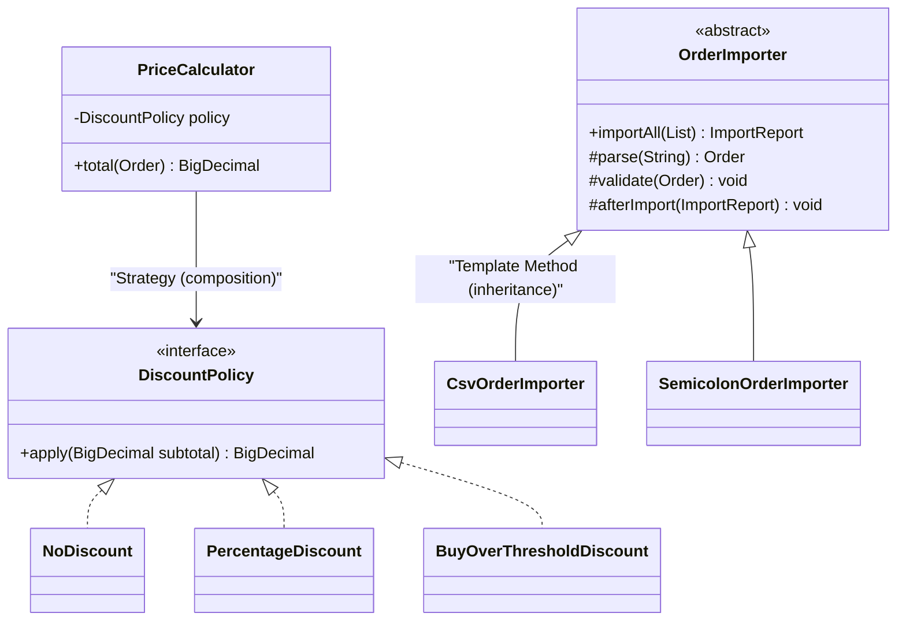
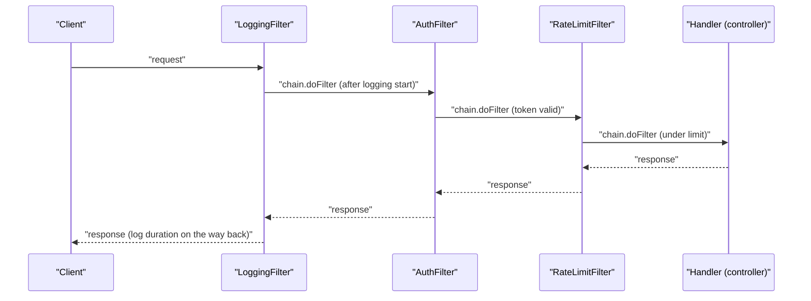

@@ 3 | TOPIC | Strategy, Template Method and Observer | Swappable algorithms, fixed skeletons with overridable steps, and publish-subscribe notifications, in modern Java and Spring | MUST
# Strategy, Template Method and Observer

**Level: Advanced | Phase 17 | Priority: MUST | Since: GoF 1994; lambdas (Java 8) made Strategy and Observer one-liners; `java.util.Observer` deprecated in Java 9**

> **30-second interview answer:** **Strategy** puts each variant of an algorithm behind a common interface so the caller can choose one at runtime (discount rules, payment methods, `Comparator`). **Template Method** fixes the skeleton of an algorithm in a base class method and lets subclasses fill in specific steps (Spring's `AbstractController`, JUnit lifecycles, `HttpServlet.service` calling `doGet`). **Observer** lets a subject notify any number of subscribers when something happens, without knowing who they are (Spring's `ApplicationEventPublisher` and `@EventListener`, GUI listeners, Kafka at system scale). Strategy and Template Method solve the same problem with composition versus inheritance; I prefer Strategy because it is easier to test and combine.

## 1. Concept in Simple Words
### Analogy
Getting to work, a cooking class, and a newspaper subscription.

| Everyday scene | Pattern |
|---|---|
| You choose how to get to work each day: bike, bus or car; the destination is the same | Strategy: interchangeable algorithms behind one interface |
| The navigation app picks the route strategy (fastest, shortest, no tolls) you selected | Context holding a strategy |
| A cooking class recipe: "prepare, cook, plate"; each student chooses their own sauce in the "cook" step | Template Method: fixed skeleton, overridable steps |
| "Optional: add garnish" | Hook method with a default |
| A newspaper prints once and every subscriber gets a copy; the paper does not know what subscribers do with it | Observer: publish-subscribe |
| You can subscribe or cancel any time | Register and unregister listeners |

### What it is
- **Strategy:** a `Strategy` interface, several implementations, and a *context* that holds one and delegates to it. In modern Java a strategy is often a functional interface implemented by lambdas or by enum constants.
- **Template Method:** an abstract class with a `final` *template method* that calls abstract *primitive operations* and optional *hooks* (methods with default behaviour). "Don't call us, we'll call you" (Hollywood principle).
- **Observer:** a *subject* keeps a list of *observers* (listeners) and notifies them of events. Push model (event carries data) or pull model (observer queries the subject). Synchronous or asynchronous delivery.
- **Related JDK pieces:** `Comparator` (strategy), `ThreadPoolExecutor.RejectedExecutionHandler` (strategy), `AbstractList` (template method: implement `get` and `size`, inherit the rest), `java.beans.PropertyChangeListener` and `java.util.concurrent.Flow` (observer). `java.util.Observable` is deprecated since Java 9.

### Why it exists
- **Strategy** removes `if/else` chains over algorithm types and makes new variants additive (Open/Closed).
- **Template Method** removes duplicated workflow code when several classes share the same steps but differ in a few.
- **Observer** decouples the code where something happens from all the reactions to it, so adding a new reaction (send email, update loyalty, write audit) does not modify the core flow.

## 2. How It Works


**Template Method skeleton:**
```text
final importAll(rows):           <- template method, final so subclasses cannot change the order
    for row in rows:
        order = parse(row)        <- abstract step: subclass decides the format
        validate(order)           <- concrete step with sensible default, can be overridden
        save(order)               <- concrete, shared
    afterImport(report)           <- hook: empty by default
```

**Observer flow (synchronous, in process):**
```text
OrderService.place(order)
   save order
   publisher.publish(new OrderPlaced(order))
        -> EmailListener.on(event)       each listener isolated: one failure
        -> LoyaltyListener.on(event)     must not stop the others
        -> AuditListener.on(event)
   return
```

**In Spring:**

| Pattern | Spring examples |
|---|---|
| Strategy | `PlatformTransactionManager`, `Resource` and `ResourceLoader`, `HandlerMapping`, `PasswordEncoder`, `CacheManager`; your own `Map<String, Strategy>` injection |
| Template Method | `JdbcTemplate`, `RestTemplate`, `TransactionTemplate` (template plus callback), `AbstractRoutingDataSource.determineCurrentLookupKey`, `OncePerRequestFilter.doFilterInternal` |
| Observer | `ApplicationEventPublisher`, `@EventListener`, `@TransactionalEventListener`, `SmartApplicationListener`, context lifecycle events (`ContextRefreshedEvent`, `ApplicationReadyEvent`) |

`JdbcTemplate` is a template method implemented with *callbacks* (`RowMapper`) instead of subclassing: the template opens the connection, prepares the statement, handles exceptions and closes resources, and you supply only the varying step. This "template plus strategy" combination is how modern Java does template methods.

## 3. Code Example
### Code
```java
import java.math.BigDecimal;
import java.math.RoundingMode;
import java.util.ArrayList;
import java.util.List;
import java.util.Map;
import java.util.concurrent.CopyOnWriteArrayList;
import java.util.function.Consumer;

public class BehavioralPatternsDemo {

    record Order(String id, String customerTier, BigDecimal subtotal) { }

    // ======================= STRATEGY =======================
    @FunctionalInterface
    interface DiscountPolicy {
        BigDecimal apply(BigDecimal subtotal);

        static DiscountPolicy none() { return s -> s; }
        static DiscountPolicy percent(int pct) {
            return s -> s.subtract(s.multiply(BigDecimal.valueOf(pct)).divide(BigDecimal.valueOf(100), 2, RoundingMode.HALF_UP));
        }
        static DiscountPolicy flatOver(BigDecimal threshold, BigDecimal off) {
            return s -> s.compareTo(threshold) >= 0 ? s.subtract(off) : s;
        }
    }

    static final class PriceCalculator {                       // the context
        private final Map<String, DiscountPolicy> policiesByTier;

        PriceCalculator(Map<String, DiscountPolicy> policiesByTier) { this.policiesByTier = policiesByTier; }

        BigDecimal total(Order o) {
            DiscountPolicy policy = policiesByTier.getOrDefault(o.customerTier(), DiscountPolicy.none());
            return policy.apply(o.subtotal()).setScale(2, RoundingMode.HALF_UP);
        }
    }

    // ======================= TEMPLATE METHOD =======================
    record ImportReport(int imported, List<String> errors) { }

    static abstract class OrderImporter {
        private final List<Order> store;

        OrderImporter(List<Order> store) { this.store = store; }

        // the template method: fixed order of steps
        public final ImportReport importAll(List<String> rows) {
            int ok = 0;
            List<String> errors = new ArrayList<>();
            for (String row : rows) {
                try {
                    Order order = parse(row);                  // abstract step
                    validate(order);                           // overridable step
                    store.add(order);                          // shared step
                    ok++;
                } catch (RuntimeException e) {
                    errors.add(row + " -> " + e.getMessage());
                }
            }
            ImportReport report = new ImportReport(ok, errors);
            afterImport(report);                               // hook
            return report;
        }

        protected abstract Order parse(String row);

        protected void validate(Order o) {
            if (o.subtotal().signum() <= 0) throw new IllegalArgumentException("subtotal must be positive");
        }

        protected void afterImport(ImportReport report) { }   // hook: no-op by default
    }

    static final class CsvOrderImporter extends OrderImporter {
        CsvOrderImporter(List<Order> store) { super(store); }

        protected Order parse(String row) {
            String[] f = row.split(",");
            return new Order(f[0].trim(), f[1].trim(), new BigDecimal(f[2].trim()));
        }
    }

    static final class SemicolonOrderImporter extends OrderImporter {
        SemicolonOrderImporter(List<Order> store) { super(store); }

        protected Order parse(String row) {
            String[] f = row.split(";");
            return new Order(f[0], f[1], new BigDecimal(f[2].replace(',', '.')));   // European decimals
        }

        @Override protected void validate(Order o) {
            super.validate(o);
            if (!o.id().startsWith("EU-")) throw new IllegalArgumentException("EU orders need EU- prefix");
        }

        @Override protected void afterImport(ImportReport r) {
            System.out.println("  [eu importer] " + r.imported() + " imported, " + r.errors().size() + " rejected");
        }
    }

    // ======================= OBSERVER =======================
    record OrderPlaced(Order order) { }

    static final class EventBus {
        private final List<Consumer<OrderPlaced>> listeners = new CopyOnWriteArrayList<>();   // safe iteration while subscribing

        Runnable subscribe(Consumer<OrderPlaced> listener) {
            listeners.add(listener);
            return () -> listeners.remove(listener);           // unsubscribe handle
        }

        void publish(OrderPlaced event) {
            for (Consumer<OrderPlaced> l : listeners) {
                try {
                    l.accept(event);
                } catch (RuntimeException e) {                 // one bad listener must not break the others
                    System.out.println("  listener failed: " + e.getMessage());
                }
            }
        }
    }

    public static void main(String[] args) {
        // Strategy
        PriceCalculator calc = new PriceCalculator(Map.of(
                "GOLD", DiscountPolicy.percent(10),
                "SILVER", DiscountPolicy.flatOver(new BigDecimal("100"), new BigDecimal("15"))));
        for (String tier : List.of("GOLD", "SILVER", "BASIC")) {
            System.out.println(tier + " pays " + calc.total(new Order("o1", tier, new BigDecimal("120.00"))));
        }

        // Template Method
        List<Order> store = new ArrayList<>();
        ImportReport csv = new CsvOrderImporter(store).importAll(List.of("A-1, GOLD, 50.00", "A-2, BASIC, -3", "A-3, SILVER, abc"));
        System.out.println("csv: imported=" + csv.imported() + " errors=" + csv.errors().size());
        ImportReport eu = new SemicolonOrderImporter(store).importAll(List.of("EU-9;GOLD;19,99", "X-1;GOLD;5,00"));
        System.out.println("eu errors: " + eu.errors());
        System.out.println("stored: " + store.stream().map(Order::id).toList());

        // Observer
        EventBus bus = new EventBus();
        bus.subscribe(e -> System.out.println("  email: confirmation for " + e.order().id()));
        Runnable cancelLoyalty = bus.subscribe(e -> System.out.println("  loyalty: +" + e.order().subtotal().intValue() + " points"));
        bus.subscribe(e -> { throw new IllegalStateException("audit service down"); });
        bus.subscribe(e -> System.out.println("  analytics: recorded " + e.order().id()));

        System.out.println("publish #1");
        bus.publish(new OrderPlaced(new Order("o-77", "GOLD", new BigDecimal("42.00"))));
        cancelLoyalty.run();
        System.out.println("publish #2 (loyalty unsubscribed)");
        bus.publish(new OrderPlaced(new Order("o-78", "BASIC", new BigDecimal("10.00"))));
    }
}
```

### Walkthrough
- **Strategy with lambdas:** `DiscountPolicy` is a functional interface; static factory methods create configured strategies (`percent(10)`). `PriceCalculator` picks a strategy by tier from a map and never contains an `if` on tiers. GOLD gets 10% off 120, SILVER gets 15 off because 120 is at least 100, BASIC falls back to `none()`.
- **Template Method:** `importAll` is `final`, so every importer runs parse, validate, save and the hook in the same order with the same error handling. `CsvOrderImporter` only implements `parse`. `SemicolonOrderImporter` overrides `parse`, extends `validate` (calling `super`) and uses the `afterImport` hook. The CSV run rejects a negative subtotal and a non-number.
- **Observer:** listeners are `Consumer<OrderPlaced>` lambdas in a `CopyOnWriteArrayList`, so subscribing during a publish is safe. `subscribe` returns a handle to unsubscribe. The failing audit listener is caught so analytics still runs; after unsubscribing, loyalty no longer receives events.

### Output
```text
GOLD pays 108.00
SILVER pays 105.00
BASIC pays 120.00
csv: imported=1 errors=2
  [eu importer] 1 imported, 1 rejected
eu errors: [X-1;GOLD;5,00 -> EU orders need EU- prefix]
stored: [A-1, EU-9]
publish #1
  email: confirmation for o-77
  loyalty: +42 points
  listener failed: audit service down
  analytics: recorded o-77
publish #2 (loyalty unsubscribed)
  email: confirmation for o-78
  listener failed: audit service down
  analytics: recorded o-78
```

### Compare
| Without the pattern | With the pattern |
|---|---|
| `if (tier == GOLD) ... else if (tier == SILVER) ...` in several services | Map of tier to `DiscountPolicy` |
| CSV and EU importers each copy the loop, error handling and saving | Shared `final` template, subclasses supply steps |
| `OrderService.place` calls email, loyalty, audit and analytics directly | `OrderService` publishes one event; listeners subscribe |

| Strategy | Template Method |
|---|---|
| Composition: context holds a strategy | Inheritance: subclass overrides steps |
| Swap at runtime | Fixed at compile time per subclass |
| Whole algorithm varies | Only some steps vary |
| Easy to test each strategy alone | Must test through the base class |

## 4. Interview Questions
**Basic**
1. **What is the Strategy pattern? Give a JDK example.**
   It defines a family of interchangeable algorithms behind one interface, and the client (context) is configured with one of them at runtime. `Comparator` is the classic JDK example: `list.sort(Comparator.comparing(Order::total))` passes a sorting strategy. Strategies replace conditional logic and make new variants additive.
2. **What is the Template Method pattern?**
   A base class defines the skeleton of an algorithm in a final method and calls abstract or hook methods that subclasses implement to customize specific steps. Examples: `HttpServlet.service` dispatching to `doGet` and `doPost`, `AbstractList` requiring only `get` and `size`, and Spring's `OncePerRequestFilter.doFilterInternal`.
3. **What is the Observer pattern?**
   A subject maintains a list of observers and notifies them of state changes or events, without knowing their concrete types. It decouples the event source from the reactions. In Spring: publish with `ApplicationEventPublisher.publishEvent(event)` and react with `@EventListener` methods.

**Follow-up**
4. **Strategy vs Template Method: when do you choose which?**
   Choose Strategy when the whole algorithm varies, when you want runtime selection, or when variants should be testable and reusable on their own; it favours composition. Choose Template Method when the overall workflow is fixed and only a few steps vary, and the variants are naturally subclasses. Modern code often combines them: a template class taking strategy callbacks, like `JdbcTemplate` with a `RowMapper`.
5. **Why was `java.util.Observable` deprecated?**
   It is a class, not an interface, so your subject had to extend it (no other base class possible); its `setChanged` and notification model is limited; it is not serializable-friendly or thread-safe in a useful way, and the event carries an untyped `Object`. Java 9 deprecated it in favour of `java.beans` listeners, `java.util.concurrent.Flow` (reactive streams) or your own typed listener interfaces.
6. **Are Spring `@EventListener` events synchronous?**
   Yes, by default listeners run synchronously in the publisher's thread and inside its transaction; an exception in a listener propagates to the publisher. Add `@Async` (with `@EnableAsync`) for asynchronous listeners, and use `@TransactionalEventListener(phase = AFTER_COMMIT)` to react only after the transaction commits, which avoids sending emails for rolled-back orders.

**Tricky / scenario**
7. **OrderHub sends a confirmation email from an `@EventListener` and customers occasionally receive emails for orders that were rolled back. Why, and how do you fix it?**
   A plain `@EventListener` runs immediately when the event is published, inside the transaction, so the email is sent before the commit and still sent if the transaction later rolls back. Use `@TransactionalEventListener(phase = TransactionPhase.AFTER_COMMIT)` so it runs only after a successful commit, and make it `@Async` if sending is slow. For guaranteed delivery across crashes, use the transactional outbox pattern.
8. **How do you pick a strategy bean by key in Spring without a switch?**
   Give each strategy implementation a key (bean name or a `key()` method), inject `Map<String, Strategy>` (Spring fills it with bean name to bean) or `List<Strategy>` and index it by `key()` in the constructor. The service looks up the strategy for the request and fails clearly if absent. New strategies are new beans.
9. **What can go wrong with the Observer pattern at scale?**
   Hidden control flow (hard to see what happens when an event fires), ordering assumptions between listeners, a slow or failing listener blocking the publisher in synchronous delivery, memory leaks from listeners never unsubscribed, and event storms or cycles where listeners publish events that trigger each other. Mitigate with clear event naming, async or outbox-based delivery for slow work, error isolation, and monitoring.

**What the interviewer is really testing:** whether you can map business variation to the right behavioural pattern, prefer composition sensibly, and understand Spring's event semantics, especially transactions and synchronicity.

## 5. Pitfalls & Best Practices
### Common mistakes
| Mistake | What goes wrong | Fix |
|---|---|---|
| Strategy selection by a `switch` copied in several places | Every new variant edits many classes | One registry map built from injected beans |
| Template method not `final` | Subclasses override the skeleton and break the order | Make the template method `final` |
| Deep template hierarchies | Fragile base class, hard to follow | Prefer strategies or callbacks; keep one level |
| Side effects in synchronous listeners before commit | Emails or messages for rolled-back data | `@TransactionalEventListener(AFTER_COMMIT)` or outbox |
| Listener exceptions propagating to the publisher | Core flow fails because of a side concern | Isolate listener failures, or make them async |

### Best practices
- Model strategies as functional interfaces when they have one method, so lambdas and method references work.
- Name strategies after the business rule (`GoldTierDiscount`), not the pattern.
- Keep events immutable (records) and named in past tense (`OrderPlaced`, `PaymentFailed`).
- Use synchronous events for in-transaction consistency, async or after-commit events for side effects, and a message broker for cross-service events.
- Prefer template-plus-callback (like `JdbcTemplate`) over inheritance-based templates in new code.

### Compare with
| Pattern | Varies | Mechanism | Spring example |
|---|---|---|---|
| Strategy | Whole algorithm | Composition | `PasswordEncoder` |
| Template Method | Some steps | Inheritance or callbacks | `JdbcTemplate` |
| Observer | Reactions to events | Subscription | `@EventListener` |
| State | Behaviour by current state | Composition, state objects | Spring Statemachine |
| Command | Requests as objects | Encapsulated actions | `Runnable` tasks in executors |

## 6. Hands-on Exercise
In OrderHub, implement tier-based discounts and order-placed reactions with Spring: (1) `DiscountPolicy` strategy beans keyed by customer tier (`GOLD`, `SILVER`, default none); (2) `OrderService.place` publishes an `OrderPlaced` event; (3) an email listener runs after commit and asynchronously; (4) a loyalty listener runs synchronously inside the transaction.

Acceptance criteria:
- No `if` or `switch` on tiers in `OrderService`.
- A rollback after publishing sends no email.
- Adding a `PLATINUM` tier is one new bean.

<details><summary>Solution</summary>

```java
// pricing/DiscountPolicy.java
package com.orderhub.pricing;

import java.math.BigDecimal;

public interface DiscountPolicy {
    String tier();
    BigDecimal apply(BigDecimal subtotal);
}
```

```java
// pricing/policies/GoldDiscount.java
package com.orderhub.pricing.policies;

import com.orderhub.pricing.DiscountPolicy;
import java.math.BigDecimal;
import java.math.RoundingMode;
import org.springframework.stereotype.Component;

@Component
public class GoldDiscount implements DiscountPolicy {
    public String tier() { return "GOLD"; }
    public BigDecimal apply(BigDecimal s) { return s.multiply(new BigDecimal("0.90")).setScale(2, RoundingMode.HALF_UP); }
}
```

```java
// pricing/policies/SilverDiscount.java
package com.orderhub.pricing.policies;

import com.orderhub.pricing.DiscountPolicy;
import java.math.BigDecimal;
import org.springframework.stereotype.Component;

@Component
public class SilverDiscount implements DiscountPolicy {
    public String tier() { return "SILVER"; }
    public BigDecimal apply(BigDecimal s) {
        return s.compareTo(new BigDecimal("100")) >= 0 ? s.subtract(new BigDecimal("15")) : s;
    }
}
```

```java
// pricing/PriceCalculator.java
package com.orderhub.pricing;

import java.math.BigDecimal;
import java.util.List;
import java.util.Map;
import java.util.function.Function;
import java.util.stream.Collectors;
import org.springframework.stereotype.Component;

@Component
public class PriceCalculator {
    private final Map<String, DiscountPolicy> byTier;

    public PriceCalculator(List<DiscountPolicy> policies) {
        this.byTier = policies.stream().collect(Collectors.toUnmodifiableMap(DiscountPolicy::tier, Function.identity()));
    }

    public BigDecimal total(String tier, BigDecimal subtotal) {
        DiscountPolicy policy = byTier.get(tier);
        return policy == null ? subtotal : policy.apply(subtotal);
    }
}
```

```java
// order/OrderService.java
package com.orderhub.order;

import com.orderhub.pricing.PriceCalculator;
import java.math.BigDecimal;
import org.springframework.context.ApplicationEventPublisher;
import org.springframework.stereotype.Service;
import org.springframework.transaction.annotation.Transactional;

@Service
public class OrderService {
    public record OrderPlaced(long orderId, String customerEmail, String tier, BigDecimal total) { }

    private final OrderRepository orders;
    private final PriceCalculator prices;
    private final ApplicationEventPublisher events;

    public OrderService(OrderRepository orders, PriceCalculator prices, ApplicationEventPublisher events) {
        this.orders = orders;
        this.prices = prices;
        this.events = events;
    }

    @Transactional
    public long place(String email, String tier, BigDecimal subtotal) {
        BigDecimal total = prices.total(tier, subtotal);                  // strategy chosen by data, no switch
        OrderEntity saved = orders.save(new OrderEntity(email, tier, total));
        events.publishEvent(new OrderPlaced(saved.getId(), email, tier, total));
        return saved.getId();
    }
}
```

```java
// order/listeners/OrderPlacedListeners.java
package com.orderhub.order.listeners;

import com.orderhub.order.OrderService.OrderPlaced;
import org.slf4j.Logger;
import org.slf4j.LoggerFactory;
import org.springframework.context.event.EventListener;
import org.springframework.scheduling.annotation.Async;
import org.springframework.stereotype.Component;
import org.springframework.transaction.event.TransactionPhase;
import org.springframework.transaction.event.TransactionalEventListener;

@Component
public class OrderPlacedListeners {
    private static final Logger log = LoggerFactory.getLogger(OrderPlacedListeners.class);
    private final LoyaltyService loyalty;
    private final EmailGateway email;

    public OrderPlacedListeners(LoyaltyService loyalty, EmailGateway email) {
        this.loyalty = loyalty;
        this.email = email;
    }

    @EventListener                                           // synchronous, same transaction: rolls back with the order
    public void addLoyaltyPoints(OrderPlaced e) {
        loyalty.addPoints(e.customerEmail(), e.total().intValue());
    }

    @Async
    @TransactionalEventListener(phase = TransactionPhase.AFTER_COMMIT)   // only after a successful commit
    public void sendConfirmation(OrderPlaced e) {
        log.info("sending confirmation for order {}", e.orderId());
        email.send(e.customerEmail(), "Order " + e.orderId() + " confirmed: " + e.total());
    }
}
```
`@EnableAsync` must be present on a configuration class. If `place` throws after publishing, the loyalty update rolls back with the order and the after-commit email listener never runs. A `PlatinumDiscount` `@Component` with `tier() = "PLATINUM"` is the only change needed for a new tier.
</details>

## 7. Recall
Q: What is the Strategy pattern?
A: A family of interchangeable algorithms behind one interface, selected by the client at runtime, as with `Comparator`.

Q: What is the Template Method pattern?
A: A base class's final method defines an algorithm's skeleton and calls abstract or hook methods that subclasses implement for specific steps.

Q: What is the key difference between Strategy and Template Method?
A: Strategy varies the whole algorithm by composition at runtime; Template Method varies some steps by inheritance at compile time.

Q: What is the Observer pattern and its Spring equivalent?
A: A subject notifies subscribed observers of events without knowing them; in Spring, `ApplicationEventPublisher` with `@EventListener` methods.

Q: When does a Spring `@TransactionalEventListener` with `AFTER_COMMIT` run?
A: Only after the publishing transaction commits successfully, so it never reacts to rolled-back changes.

Q: Why was `java.util.Observable` deprecated in Java 9?
A: It forced subjects to extend a class, used untyped events and a limited, not usefully thread-safe model.

**Related:** [[SOLID Principles]] · [[Spring Application Events]] · [[Comparable vs Comparator]] · [[Chain of Responsibility]]

@@ 3 | TOPIC | Chain of Responsibility | Passing a request along a chain of handlers, servlet and Spring Security filter chains, interceptors and ordered validation pipelines | SHOULD
# Chain of Responsibility

**Level: Advanced | Phase 17 | Priority: SHOULD | Since: GoF 1994; Servlet filters (Servlet 2.3, 2001); Spring Security filter chain since Spring Security 2**

> **30-second interview answer:** Chain of Responsibility passes a request along a chain of handlers; each handler either processes it, passes it to the next, or both, and the sender does not know which handler will finish the job. The classic form is an approval chain (agent, supervisor, manager). The form you meet every day in Java is the filter chain: servlet `Filter`s and Spring Security's `SecurityFilterChain` each do their part (logging, authentication, authorization) and call `chain.doFilter` to continue, or stop the request early. It decouples senders from receivers and lets you add, remove or reorder steps without changing the others.

## 1. Concept in Simple Words
### Analogy
Customer support escalation and airport security.

| Everyday scene | Chain of Responsibility |
|---|---|
| A refund request goes to the agent; above their limit, to the supervisor; above that, to the manager | Handlers with increasing authority |
| The customer does not know who will approve it | Sender decoupled from receiver |
| Airport: ticket check, then passport control, then security scan, then boarding gate | Filter chain: every step runs, any can stop you |
| Security finds a liquid bottle and stops you right there | A handler ends the chain early |
| A new "health declaration" desk is added between passport and security | Insert a handler without changing the others |
| The order of desks matters: no boarding before the security scan | Handler ordering |

### What it is
- **Handler:** an object with a method to handle a request and a reference to the next handler (or access to the chain).
- **Two styles:**
  1. *Pure (GoF):* exactly one handler handles the request; others pass it on. Example: approval limits, exception handler resolution.
  2. *Pipeline or filter chain:* every handler may do some work and decides whether to continue. Example: servlet filters, Spring Security filters, `HandlerInterceptor`, Netty pipelines.
- **Termination:** a handler can stop the chain (reject, respond) or reach the end; define what happens when nobody handles the request (default handler or error).
- **Spring places:** servlet `FilterChain`, Spring Security's `FilterChainProxy` with its ordered filters, `HandlerInterceptor` chains in Spring MVC, `HandlerExceptionResolver` composite, `WebFilter` chains in WebFlux, Spring Cloud Gateway filters.

### Why it exists
Without it, the sender contains a big conditional deciding who handles what (`if amount < 100 agent else if < 1000 supervisor ...`), and cross-cutting steps like logging, authentication, rate limiting and compression get tangled into business code. A chain gives each concern its own handler, makes the order explicit configuration, and lets you add a step (for example, a new tenant filter) without editing existing ones.

## 2. How It Works
**Pure chain (linked handlers):**
```text
request(refund 750) -> Agent (limit 100): no, pass -> Supervisor (limit 1000): yes, APPROVED
                                                       Manager is never asked
```

**Filter chain (index-based, like servlet FilterChain):**


Each filter wraps the rest of the chain, so code before `chain.doFilter(...)` runs on the way in and code after it on the way out, in reverse order. A filter that does not call `doFilter` ends the request (for example, returns 401).

**Spring Security in one picture:**
```text
DelegatingFilterProxy (servlet filter, bridges to Spring)
  -> FilterChainProxy
       -> SecurityFilterChain matched for /api/**:
            SecurityContextHolderFilter
            CorsFilter
            CsrfFilter
            LogoutFilter
            BearerTokenAuthenticationFilter     (JWT)
            ExceptionTranslationFilter          (turns AccessDenied into 401/403)
            AuthorizationFilter                 (checks rules, may stop the chain)
  -> DispatcherServlet
```

## 3. Code Example
### Code
```java
import java.math.BigDecimal;
import java.util.ArrayList;
import java.util.List;
import java.util.Map;

public class ChainDemo {

    // ================= 1. Pure chain: approval limits =================
    record RefundRequest(String orderId, BigDecimal amount) { }

    static abstract class Approver {
        private Approver next;

        Approver then(Approver next) {               // fluent chain building
            this.next = next;
            return next;
        }

        final String handle(RefundRequest r) {
            if (canApprove(r)) return name() + " approved " + r.amount() + " for " + r.orderId();
            if (next == null) return "nobody can approve " + r.amount() + " for " + r.orderId() + " -> escalate to finance";
            return next.handle(r);
        }

        protected abstract boolean canApprove(RefundRequest r);
        protected abstract String name();
    }

    static final class LimitApprover extends Approver {
        private final String name;
        private final BigDecimal limit;
        LimitApprover(String name, String limit) { this.name = name; this.limit = new BigDecimal(limit); }
        protected boolean canApprove(RefundRequest r) { return r.amount().compareTo(limit) <= 0; }
        protected String name() { return name; }
    }

    // ================= 2. Filter chain: every step may act or stop =================
    record Request(String path, Map<String, String> headers) { }
    record Response(int status, String body) { }

    interface Filter {
        Response doFilter(Request req, Chain chain);
    }

    interface Handler {
        Response handle(Request req);
    }

    static final class Chain {
        private final List<Filter> filters;
        private final Handler handler;
        private int index;                            // one Chain object per request

        Chain(List<Filter> filters, Handler handler) { this.filters = filters; this.handler = handler; }

        Response proceed(Request req) {
            if (index < filters.size()) return filters.get(index++).doFilter(req, this);
            return handler.handle(req);               // end of chain: the actual handler
        }
    }

    static final List<String> trace = new ArrayList<>();

    static final Filter LOGGING = (req, chain) -> {
        trace.add("log: -> " + req.path());
        Response res = chain.proceed(req);
        trace.add("log: <- " + res.status());          // runs on the way back
        return res;
    };

    static final Filter AUTH = (req, chain) -> {
        if (!"secret-token".equals(req.headers().get("Authorization"))) {
            trace.add("auth: rejected");
            return new Response(401, "unauthorized");   // stop: do not call proceed
        }
        trace.add("auth: ok");
        return chain.proceed(req);
    };

    static final Filter TENANT = (req, chain) -> {
        String tenant = req.headers().getOrDefault("X-Tenant", "default");
        trace.add("tenant: " + tenant);
        return chain.proceed(req);
    };

    static Response serve(Request req) {
        Handler controller = r -> new Response(200, "orders for " + r.path());
        return new Chain(List.of(LOGGING, AUTH, TENANT), controller).proceed(req);
    }

    public static void main(String[] args) {
        Approver chain = new LimitApprover("agent", "100");
        chain.then(new LimitApprover("supervisor", "1000"))
             .then(new LimitApprover("manager", "5000"));

        for (String amount : List.of("40", "750", "4200", "9000")) {
            System.out.println(chain.handle(new RefundRequest("o-1", new BigDecimal(amount))));
        }

        Response ok = serve(new Request("/orders", Map.of("Authorization", "secret-token", "X-Tenant", "acme")));
        System.out.println(ok + " trace=" + trace);
        trace.clear();
        Response denied = serve(new Request("/orders", Map.of()));
        System.out.println(denied + " trace=" + trace);
    }
}
```

### Walkthrough
- **Approval chain:** `then` links handlers and returns the next one, so the chain reads left to right. `handle` is `final` (a small template method): approve if within the limit, else pass on, else report that nobody could handle it. 750 skips the agent and is approved by the supervisor; 9000 falls off the end, so the "no handler" case is explicit instead of silently ignored.
- **Filter chain:** a fresh `Chain` per request holds the position (`index`). Each filter does work, then calls `chain.proceed` to continue. `LOGGING` records on the way in and on the way out, so its "after" line appears last. `AUTH` stops the chain with 401 when the token is missing, so `TENANT` and the controller never run, and logging still records the 401 on the way back.
- **Lambdas as handlers:** `Filter` is a functional interface; in Spring the equivalents are `OncePerRequestFilter` beans with `@Order` or security filters registered in a `SecurityFilterChain`.

### Output
```text
agent approved 40 for o-1
supervisor approved 750 for o-1
manager approved 4200 for o-1
nobody can approve 9000 for o-1 -> escalate to finance
Response[status=200, body=orders for /orders] trace=[log: -> /orders, auth: ok, tenant: acme, log: <- 200]
Response[status=401, body=unauthorized] trace=[log: -> /orders, auth: rejected, log: <- 401]
```

### Compare
| Hard-coded conditions | Chain of Responsibility |
|---|---|
| `if (amount <= 100) agent(); else if (amount <= 1000) supervisor(); ...` | Linked approvers, each with its own rule |
| Controller checks auth, tenant, rate limit, then does work | Filters handle cross-cutting steps before the controller |
| Adding a step edits the central method | Adding a step registers a new handler at a position |

| Pure chain | Filter / pipeline chain |
|---|---|
| One handler handles the request | Many handlers each do part of the work |
| Passing on means "not mine" | Passing on means "my part is done, continue" |
| Approval limits, exception resolvers | Servlet filters, Spring Security, interceptors |

## 4. Interview Questions
**Basic**
1. **What is the Chain of Responsibility pattern?**
   A behavioural pattern where a request travels along a chain of handlers; each one either handles it or forwards it to the next, so the sender does not need to know which object will handle it. It decouples senders from receivers and makes it easy to add or reorder handlers.
2. **Where does Java or Spring use it?**
   Servlet `Filter` and `FilterChain`, Spring Security's `FilterChainProxy` with ordered security filters, Spring MVC `HandlerInterceptor`s (`preHandle` returning false stops the chain), `HandlerExceptionResolver` composites, WebFlux `WebFilter`s, Spring Cloud Gateway filters, and logging frameworks passing events up logger hierarchies.
3. **What happens if no handler handles the request?**
   It depends on the design, and you must decide explicitly: return a default result, throw an exception, or route to a fallback handler at the end. Silently dropping the request is the classic bug.

**Follow-up**
4. **How does a servlet filter run code both before and after the controller?**
   Code before `chain.doFilter(request, response)` runs on the way in; the call itself runs the rest of the chain and the servlet; code after it runs on the way out, in reverse filter order. This is how logging filters measure duration and how response-compressing filters wrap the output.
5. **How do you control the order of filters in Spring Boot?**
   Annotate `Filter` beans with `@Order` or implement `Ordered`, or register them via `FilterRegistrationBean` with `setOrder`. Spring Security filters have a fixed relative order inside the `SecurityFilterChain`, and you insert custom ones with `addFilterBefore`, `addFilterAfter` or `addFilterAt` relative to known filters. The security chain itself sits at a configurable order among servlet filters (`spring.security.filter.order`).
6. **Chain of Responsibility vs Decorator?**
   Both wrap and forward. A decorator always forwards and adds behaviour around one object with the same interface; a chain handler may decide not to forward (handle or stop), and the chain is usually assembled as a list of independent handlers. Filter chains blend the two: filters behave like decorators around the remaining chain but can short-circuit.

**Tricky / scenario**
7. **A custom JWT filter you added runs after Spring Security's authorization filter, and every request gets 403. Why?**
   The authorization filter checks the `SecurityContext` before your filter has authenticated the user, so it sees an anonymous user and denies access. Register your filter before the authorization step with `http.addFilterBefore(jwtFilter, UsernamePasswordAuthenticationFilter.class)` (or use the built-in resource server support), and make sure it is not also registered as a plain servlet filter bean running outside the security chain.
8. **A request validation pipeline in OrderHub has 12 checks in one 300-line method. How would you restructure it?**
   Turn each check into an `OrderValidationStep` bean with `@Order`, inject `List<OrderValidationStep>` (Spring sorts by order) and run them in sequence, either stopping at the first failure or collecting all errors. Each step is testable alone, new checks are new beans, and the order is visible in one place.
9. **What are the risks of long chains?**
   Hard-to-follow control flow, performance overhead per request, ordering bugs between handlers that implicitly depend on each other, and requests silently falling off the end. Mitigate with explicit ordering constants, a terminal default handler, logging of the chain at startup (Spring Security prints its filter list with debug logging), and tests for the full chain.

**What the interviewer is really testing:** whether you recognize the pattern behind servlet filters and Spring Security, can control ordering and short-circuiting, and can apply it to validation or approval workflows.

## 5. Pitfalls & Best Practices
### Common mistakes
| Mistake | What goes wrong | Fix |
|---|---|---|
| Forgetting to call `chain.doFilter` in a filter | Every request hangs or returns empty | Always continue unless deliberately stopping, and then write a response |
| No terminal handler | Requests silently unhandled | Explicit fallback or exception at the end |
| Implicit ordering between handlers | Breaks when someone reorders | Declare order with constants, document dependencies |
| Filter bean registered twice (servlet and security chain) | Runs twice, double side effects | Disable servlet registration with `FilterRegistrationBean.setEnabled(false)` or do not make it a bean |
| Mutable state in a shared handler | Cross-request data leaks | Keep handlers stateless; per-request state in the request or chain object |

### Best practices
- Keep each handler focused on one concern and stateless.
- Make ordering explicit and test the whole chain end to end.
- Decide between "first failure stops" and "collect all failures" for validation chains.
- Use Spring's built-in chains (filters, interceptors, security) before inventing your own.

### Compare with
| Pattern | Who handles | Flow control |
|---|---|---|
| Chain of Responsibility | One or several handlers along the chain | Each handler decides to pass on |
| Decorator | Every layer | Always delegates |
| Observer | All subscribers | Broadcast, no stopping |
| Strategy | One chosen algorithm | Selected up front |
| Command | One command object | Executed by an invoker |

## 6. Hands-on Exercise
OrderHub's order creation needs a validation chain: (1) customer must not be blocked, (2) every product must exist, (3) quantities at most 50 per line, (4) total at most 10,000 unless the customer is VIP. Build it as ordered Spring beans implementing `OrderValidationStep`, run by an `OrderValidator` that collects all violations and throws one exception mapped to HTTP 422 with all messages.

Acceptance criteria:
- Steps are independent `@Component`s with `@Order`.
- A request violating rules 3 and 4 gets both messages in one response.
- Adding a step requires no change in `OrderValidator`.

<details><summary>Solution</summary>

```java
// order/validation/OrderValidationStep.java
package com.orderhub.order.validation;

import java.math.BigDecimal;
import java.util.List;
import java.util.Optional;

public interface OrderValidationStep {
    record Line(long productId, int quantity, BigDecimal unitPrice) { }
    record OrderDraft(long customerId, boolean vip, boolean blocked, List<Line> lines) {
        BigDecimal total() {
            return lines.stream().map(l -> l.unitPrice().multiply(BigDecimal.valueOf(l.quantity())))
                    .reduce(BigDecimal.ZERO, BigDecimal::add);
        }
    }

    Optional<String> check(OrderDraft draft);     // empty = passed
}
```

```java
// order/validation/steps/ValidationSteps.java
package com.orderhub.order.validation.steps;

import com.orderhub.order.validation.OrderValidationStep;
import com.orderhub.product.ProductRepository;
import java.math.BigDecimal;
import java.util.Optional;
import org.springframework.core.annotation.Order;
import org.springframework.stereotype.Component;

public final class ValidationSteps {
    private ValidationSteps() { }

    @Component @Order(10)
    public static class CustomerNotBlocked implements OrderValidationStep {
        public Optional<String> check(OrderDraft d) {
            return d.blocked() ? Optional.of("customer " + d.customerId() + " is blocked") : Optional.empty();
        }
    }

    @Component @Order(20)
    public static class ProductsExist implements OrderValidationStep {
        private final ProductRepository products;
        public ProductsExist(ProductRepository products) { this.products = products; }
        public Optional<String> check(OrderDraft d) {
            return d.lines().stream().filter(l -> !products.existsById(l.productId())).findFirst()
                    .map(l -> "product " + l.productId() + " does not exist");
        }
    }

    @Component @Order(30)
    public static class QuantityLimit implements OrderValidationStep {
        public Optional<String> check(OrderDraft d) {
            return d.lines().stream().filter(l -> l.quantity() > 50).findFirst()
                    .map(l -> "quantity " + l.quantity() + " for product " + l.productId() + " exceeds 50");
        }
    }

    @Component @Order(40)
    public static class TotalLimit implements OrderValidationStep {
        private static final BigDecimal MAX = new BigDecimal("10000");
        public Optional<String> check(OrderDraft d) {
            return !d.vip() && d.total().compareTo(MAX) > 0
                    ? Optional.of("total " + d.total() + " exceeds 10000 for non-VIP customers")
                    : Optional.empty();
        }
    }
}
```

```java
// order/validation/OrderValidator.java
package com.orderhub.order.validation;

import java.util.List;
import java.util.Optional;
import org.springframework.stereotype.Component;

@Component
public class OrderValidator {
    public static class OrderValidationException extends RuntimeException {
        private final List<String> violations;
        public OrderValidationException(List<String> violations) {
            super(String.join("; ", violations));
            this.violations = List.copyOf(violations);
        }
        public List<String> violations() { return violations; }
    }

    private final List<OrderValidationStep> steps;     // Spring injects them sorted by @Order

    public OrderValidator(List<OrderValidationStep> steps) { this.steps = steps; }

    public void validate(OrderValidationStep.OrderDraft draft) {
        List<String> violations = steps.stream()
                .map(step -> step.check(draft))
                .flatMap(Optional::stream)
                .toList();
        if (!violations.isEmpty()) throw new OrderValidationException(violations);
    }
}
```

```java
// web/ValidationErrorAdvice.java
package com.orderhub.web;

import com.orderhub.order.validation.OrderValidator.OrderValidationException;
import org.springframework.http.HttpStatus;
import org.springframework.http.ProblemDetail;
import org.springframework.web.bind.annotation.ExceptionHandler;
import org.springframework.web.bind.annotation.RestControllerAdvice;

@RestControllerAdvice
public class ValidationErrorAdvice {
    @ExceptionHandler(OrderValidationException.class)
    ProblemDetail onInvalidOrder(OrderValidationException e) {
        ProblemDetail pd = ProblemDetail.forStatusAndDetail(HttpStatus.UNPROCESSABLE_ENTITY, "Order validation failed");
        pd.setProperty("violations", e.violations());
        return pd;
    }
}
```

Response for an order with 60 units of a 200.00 product from a non-VIP customer:
```http
HTTP/1.1 422 Unprocessable Entity
Content-Type: application/problem+json

{"type":"about:blank","title":"Unprocessable Entity","status":422,"detail":"Order validation failed","instance":"/api/orders","violations":["quantity 60 for product 5 exceeds 50","total 12000.00 exceeds 10000 for non-VIP customers"]}
```
This is the "collect all" variant of the chain: every step runs and contributes. To stop at the first failure instead, use `findFirst()` on the stream. A new rule is a new `@Component` with an `@Order` value between existing ones.
</details>

## 7. Recall
Q: What is the Chain of Responsibility pattern?
A: A request passes along a chain of handlers, each of which handles it, forwards it, or both, so the sender does not know which handler deals with it.

Q: What are the two common styles of Chain of Responsibility?
A: The pure chain where one handler handles the request, and the filter or pipeline chain where many handlers each do part of the work and may stop it.

Q: How does a servlet filter stop a request?
A: By not calling `chain.doFilter` and writing a response itself, for example a 401.

Q: How do you control the order of Spring Boot filters and Spring Security filters?
A: `@Order` or `FilterRegistrationBean.setOrder` for servlet filters, and `addFilterBefore`, `addFilterAfter` or `addFilterAt` inside a `SecurityFilterChain`.

Q: In what order does code after `chain.doFilter` run across several filters?
A: In reverse order of the filters, as the response travels back out.

Q: Why must a chain define a terminal handler?
A: Otherwise requests that no handler accepts are silently dropped.

**Related:** [[Security Filter Chain Architecture]] · [[Strategy, Template Method and Observer]] · [[Adapter, Decorator and Facade]] · [[Design Patterns Inside Spring]]
