@@ 3 | TOPIC | Design Patterns Inside Spring | Where Spring uses IoC, Singleton, Factory, Proxy, Template Method, Strategy, Observer, Adapter, Decorator, Front Controller and Chain of Responsibility | MUST
# Design Patterns Inside Spring

**Level: Advanced | Phase 17 | Priority: MUST | Since: Spring Framework 1.0 (2004); patterns refined through Spring 6.2 and Boot 3.5**

> **30-second interview answer:** Spring is largely a catalogue of design patterns. The container is an IoC and Dependency Injection implementation built on Factory patterns (`BeanFactory`, `FactoryBean`, `@Bean` methods) that manages Singleton and Prototype scoped beans. Cross-cutting features (`@Transactional`, `@Cacheable`, `@Async`, method security) are Proxies. `JdbcTemplate`, `RestTemplate` and `TransactionTemplate` are Template Methods with callbacks. `PlatformTransactionManager`, `Resource` and `HandlerMapping` are Strategies. Application events are Observer. `DispatcherServlet` is a Front Controller using `HandlerAdapter`s (Adapter), and Spring Security is a Chain of Responsibility of filters.

## 1. Concept in Simple Words
### Analogy
A large hotel.

| Hotel | Spring pattern |
|---|---|
| Guests do not hire their own staff; the hotel assigns a concierge, a cleaner and a chef to each need | Inversion of Control and Dependency Injection |
| One shared reception desk for everyone | Singleton scope |
| A fresh towel for every guest | Prototype scope |
| The hotel kitchen produces any dish on the menu on request | `BeanFactory` (Factory) |
| The receptionist who stands in front of the manager and handles security, logging and appointments | Proxy (AOP) |
| Standard housekeeping routine; each room type only changes the "special items" step | Template Method (`JdbcTemplate` callbacks) |
| Choice of laundry service: in-house, external, express | Strategy (`PlatformTransactionManager` implementations) |
| PA announcement: "the pool is now open", everyone interested reacts | Observer (application events) |
| The main entrance where every guest arrives and is directed to the right department | Front Controller (`DispatcherServlet`) |
| Plug adapters in the rooms for any guest's country | Adapter (`HandlerAdapter`) |
| Security checks at the entrance, one after another | Chain of Responsibility (filter chain) |

### What it is
A map of patterns to Spring components:

| Pattern | Where in Spring |
|---|---|
| Inversion of Control, Dependency Injection | `ApplicationContext` wiring beans through constructors |
| Factory, Abstract Factory | `BeanFactory`, `FactoryBean`, `@Bean` methods, `ObjectProvider` |
| Singleton | Default bean scope (one per container), not the GoF class-level singleton |
| Prototype | `@Scope("prototype")`, a new instance per lookup |
| Builder | `UriComponentsBuilder`, `BeanDefinitionBuilder`, `RestClient.builder()`, `MockMvcRequestBuilders`, `HttpSecurity` DSL |
| Proxy | Spring AOP proxies for `@Transactional`, `@Cacheable`, `@Async`, `@PreAuthorize`; Spring Data repository proxies; `@Configuration` CGLIB enhancement; scoped proxies |
| Decorator | `BeanPostProcessor`s wrapping beans, `TransactionAwareDataSourceProxy`, `ContentCachingRequestWrapper`, `ServerHttpRequestDecorator` |
| Template Method | `JdbcTemplate`, `JdbcClient`, `RestTemplate`, `TransactionTemplate`, `JmsTemplate`, `KafkaTemplate`, `AbstractRoutingDataSource`, `OncePerRequestFilter` |
| Strategy | `PlatformTransactionManager`, `Resource`/`ResourceLoader`, `HandlerMapping`, `ViewResolver`, `HttpMessageConverter`, `PasswordEncoder`, `CacheManager`, `TaskExecutor` |
| Observer | `ApplicationEventPublisher`, `ApplicationListener`, `@EventListener`, `@TransactionalEventListener` |
| Adapter | `HandlerAdapter` (`RequestMappingHandlerAdapter`), `MessageListenerAdapter` |
| Front Controller | `DispatcherServlet`, `DispatcherHandler` (WebFlux) |
| Chain of Responsibility | Servlet filters, `FilterChainProxy` and `SecurityFilterChain`, `HandlerInterceptor`, `HandlerExceptionResolver` composite |
| Facade | `JdbcTemplate` over JDBC, `JavaMailSender`, `SpringApplication.run` |
| Model-View-Controller | Spring MVC |

### Why it exists
Spring's goal is to let you write plain objects (POJOs) and get enterprise services (transactions, security, remoting, data access) declaratively. Each service is delivered by a pattern: DI to decouple, proxies to add behaviour transparently, templates to remove boilerplate, strategies to plug in technologies. Knowing the patterns lets you predict Spring's behaviour, including its edge cases (self-invocation, scope mismatches, listener ordering), instead of memorizing them.

## 2. How It Works
**Where the patterns sit in the life of a request and a bean:**

```mermaid
flowchart TD
    subgraph Startup["Container startup"]
        BD["Bean definitions from @Component and @Bean"] --> BF["BeanFactory creates beans: Factory"]
        BF --> DI["Inject dependencies: IoC and DI"]
        DI --> BPP["BeanPostProcessors wrap beans: Proxy and Decorator"]
        BPP --> REG["Singleton registry: one instance per bean"]
        REG --> EV["ContextRefreshedEvent published: Observer"]
    end
    subgraph Request["HTTP request"]
        F["Filter chain incl. security: Chain of Responsibility"] --> DS["DispatcherServlet: Front Controller"]
        DS --> HM["HandlerMapping picks handler: Strategy"]
        HM --> HA["HandlerAdapter invokes it: Adapter"]
        HA --> PX["Controller calls service proxy: Proxy"]
        PX --> TX["TransactionInterceptor uses PlatformTransactionManager: Strategy"]
        TX --> JT["JdbcTemplate runs SQL with callbacks: Template Method"]
        JT --> PUB["Service publishes event: Observer"]
    end
```


**How the proxy gets there (step by step):**
```text
1. Context reads @Service OrderService with a @Transactional method
2. Instantiates the raw OrderService (factory step) and injects dependencies
3. AnnotationAwareAspectJAutoProxyCreator (a BeanPostProcessor) sees advisors matching the bean
4. It returns a CGLIB subclass OrderService$$SpringCGLIB$$0 wrapping the raw bean
5. The singleton registry stores the PROXY; every injection point receives the proxy
6. A call: proxy -> TransactionInterceptor -> PlatformTransactionManager.getTransaction
           -> raw bean method -> commit or rollback
```

**Template Method with callbacks (`JdbcTemplate.query`):**
```text
template (fixed):  get Connection from DataSource -> prepare statement -> set params
                   -> execute -> for each row call YOUR RowMapper -> translate SQLException
                   to DataAccessException -> close ResultSet, Statement, release Connection
callback (yours):  (rs, rowNum) -> new Product(rs.getLong("id"), rs.getString("name"))
```

**Scope mismatch, a classic interview topic:** injecting a prototype or request-scoped bean into a singleton gives the singleton one instance forever, because injection happens once. Fixes: `ObjectProvider<T>.getObject()` (a factory per call), `@Lookup` methods, or a scoped proxy (`@Scope(value = "request", proxyMode = ScopedProxyMode.TARGET_CLASS)`), which is the Proxy pattern resolving the current instance on every call.

## 3. Code Example
### Code
A small Spring Boot 3.5 application that makes the patterns visible at startup. It needs `spring-boot-starter-jdbc` and the H2 driver.

```xml
<!-- pom.xml dependencies -->
<dependency>
    <groupId>org.springframework.boot</groupId>
    <artifactId>spring-boot-starter-jdbc</artifactId>
</dependency>
<dependency>
    <groupId>com.h2database</groupId>
    <artifactId>h2</artifactId>
    <scope>runtime</scope>
</dependency>
```

```yaml
# application.yml
spring:
  datasource:
    url: jdbc:h2:mem:patterns;DB_CLOSE_DELAY=-1
  sql:
    init:
      mode: always
logging:
  level:
    root: warn
```

```sql
-- src/main/resources/schema.sql
CREATE TABLE product (id BIGINT PRIMARY KEY, name VARCHAR(100), stock INT);
INSERT INTO product VALUES (1, 'Book', 12), (2, 'Pen', 40);
```

```java
// PatternsApplication.java
package com.orderhub.patterns;

import java.util.List;
import java.util.Map;
import org.springframework.aop.support.AopUtils;
import org.springframework.beans.factory.FactoryBean;
import org.springframework.beans.factory.ObjectProvider;
import org.springframework.boot.CommandLineRunner;
import org.springframework.boot.SpringApplication;
import org.springframework.boot.autoconfigure.SpringBootApplication;
import org.springframework.context.ApplicationContext;
import org.springframework.context.ApplicationEventPublisher;
import org.springframework.context.annotation.Bean;
import org.springframework.context.annotation.Scope;
import org.springframework.context.event.EventListener;
import org.springframework.jdbc.core.JdbcTemplate;
import org.springframework.stereotype.Component;
import org.springframework.stereotype.Service;
import org.springframework.transaction.annotation.Transactional;

@SpringBootApplication
public class PatternsApplication {

    public static void main(String[] args) { SpringApplication.run(PatternsApplication.class, args); }

    // ---- Strategy: several implementations of one interface, chosen by key ----
    public interface NotificationChannel { String send(String to, String text); }

    @Component("email")
    static class EmailChannel implements NotificationChannel {
        public String send(String to, String text) { return "email to " + to + ": " + text; }
    }

    @Component("sms")
    static class SmsChannel implements NotificationChannel {
        public String send(String to, String text) { return "sms to " + to + ": " + text; }
    }

    // ---- Prototype scope: a new object per request for one ----
    @Component
    @Scope("prototype")
    static class ShoppingCart { }

    // ---- Factory: a FactoryBean whose product becomes the bean ----
    public record ExchangeRates(Map<String, Double> rates) { }

    @Component("exchangeRates")
    static class ExchangeRatesFactoryBean implements FactoryBean<ExchangeRates> {
        public ExchangeRates getObject() { return new ExchangeRates(Map.of("EUR", 1.0, "USD", 1.08)); }
        public Class<?> getObjectType() { return ExchangeRates.class; }
    }

    // ---- Observer: event + listener ----
    public record StockLow(String product, int stock) { }

    @Component
    static class StockAlerts {
        @EventListener
        void on(StockLow e) { System.out.println("observer: stock low for " + e.product() + " (" + e.stock() + ")"); }
    }

    // ---- Proxy + Template Method: @Transactional service using JdbcTemplate ----
    @Service
    static class InventoryService {
        private final JdbcTemplate jdbc;
        private final ApplicationEventPublisher events;

        InventoryService(JdbcTemplate jdbc, ApplicationEventPublisher events) { this.jdbc = jdbc; this.events = events; }

        @Transactional
        public int reserve(long productId, int qty) {
            jdbc.update("UPDATE product SET stock = stock - ? WHERE id = ?", qty, productId);
            Integer stock = jdbc.queryForObject("SELECT stock FROM product WHERE id = ?", Integer.class, productId);
            String name = jdbc.queryForObject("SELECT name FROM product WHERE id = ?", String.class, productId);
            if (stock != null && stock < 5) events.publishEvent(new StockLow(name, stock));
            return stock == null ? 0 : stock;
        }

        public List<String> names() {
            // Template Method: JdbcTemplate does connection, statement, exceptions; we supply the RowMapper
            return jdbc.query("SELECT name FROM product ORDER BY id", (rs, rowNum) -> rs.getString("name"));
        }
    }

    @Bean
    CommandLineRunner showPatterns(ApplicationContext ctx, InventoryService inventory,
                                   Map<String, NotificationChannel> channels,
                                   ObjectProvider<ShoppingCart> carts) {
        return args -> {
            System.out.println("singleton: " + (ctx.getBean(InventoryService.class) == inventory));
            System.out.println("prototype: " + (carts.getObject() == carts.getObject()));

            System.out.println("factory product: " + ctx.getBean("exchangeRates").getClass().getSimpleName());
            System.out.println("factory itself:  " + ctx.getBean("&exchangeRates").getClass().getSimpleName());

            System.out.println("proxy: " + AopUtils.isAopProxy(inventory) + " " + inventory.getClass().getSimpleName());
            System.out.println("target class: " + AopUtils.getTargetClass(inventory).getSimpleName());

            System.out.println("strategy keys: " + channels.keySet());
            System.out.println("strategy: " + channels.get("sms").send("alice", "order shipped"));

            System.out.println("template: " + inventory.names());
            System.out.println("stock after reserve: " + inventory.reserve(1, 9));
        };
    }
}
```

### Walkthrough
- **Singleton:** asking the context for `InventoryService` returns the same instance that was injected into the runner.
- **Prototype through a factory:** `ObjectProvider<ShoppingCart>` is a lazy factory; each `getObject()` creates a new prototype instance, so the two carts differ. Injecting `ShoppingCart` directly into a singleton would freeze one instance.
- **FactoryBean:** the bean named `exchangeRates` is the *product* (`ExchangeRates`); prefixing `&` returns the factory itself. Spring uses this for `LocalContainerEntityManagerFactoryBean` and many integrations.
- **Proxy:** `InventoryService` has a `@Transactional` method, so the auto-proxy creator replaced it with a CGLIB subclass; `AopUtils` reveals the generated class name and the real target class.
- **Strategy:** Spring fills `Map<String, NotificationChannel>` with bean name to bean, giving a strategy registry without code. Map order follows bean registration order.
- **Template Method:** `jdbc.query` runs the fixed JDBC workflow and calls the `RowMapper` lambda for each row.
- **Observer:** reserving 9 books drops stock from 12 to 3, so the service publishes `StockLow`, and the listener runs synchronously before `reserve` returns, inside the transaction.

### Output
```text
singleton: true
prototype: false
factory product: ExchangeRates
factory itself:  ExchangeRatesFactoryBean
proxy: true InventoryService$$SpringCGLIB$$0
target class: InventoryService
strategy keys: [email, sms]
strategy: sms to alice: order shipped
template: [Book, Pen]
observer: stock low for Book (3)
stock after reserve: 3
```

### Compare
| Without Spring (hand-written) | With Spring |
|---|---|
| `new JdbcOrderRepository(new HikariDataSource(cfg))` in every service | Container injects one configured `DataSource` and repositories |
| `try { con.setAutoCommit(false); ... con.commit(); } catch { con.rollback(); } finally { con.close(); }` around every method | `@Transactional` proxy plus `PlatformTransactionManager` strategy |
| JDBC boilerplate with `ResultSet` loops and `finally` blocks | `JdbcTemplate` with a `RowMapper` |
| Services call email, audit and analytics directly | Publish one event, listeners subscribe |

## 4. Interview Questions
**Basic**
1. **Which design patterns does Spring use? Name at least five with examples.**
   Dependency Injection and IoC (the container), Factory (`BeanFactory`, `FactoryBean`, `@Bean`), Singleton and Prototype (bean scopes), Proxy (`@Transactional`, `@Cacheable`, Spring Data repositories), Template Method (`JdbcTemplate`, `RestTemplate`, `TransactionTemplate`), Strategy (`PlatformTransactionManager`, `Resource`, `HandlerMapping`), Observer (application events), Front Controller (`DispatcherServlet`), Adapter (`HandlerAdapter`) and Chain of Responsibility (filter chains).
2. **Is a Spring singleton the same as the GoF Singleton?**
   No. GoF Singleton enforces one instance per class loader inside the class itself. A Spring singleton means one instance per bean definition per container: you can have two beans of the same class, and you can create instances with `new` in tests. Spring's approach removes global state while keeping a single shared instance.
3. **What is the Front Controller pattern in Spring MVC?**
   `DispatcherServlet` receives every request, then delegates: `HandlerMapping` finds the controller method, `HandlerAdapter` invokes it (resolving arguments, converting the body with `HttpMessageConverter`s), and the result is written as a response or rendered by a `ViewResolver`. One entry point centralizes cross-cutting request handling.

**Follow-up**
4. **How does Spring implement `@Transactional` in terms of patterns?**
   A `BeanPostProcessor` (auto-proxy creator) wraps the bean in a Proxy (CGLIB by default). The proxy runs a `TransactionInterceptor`, which uses the `PlatformTransactionManager` Strategy (JDBC, JPA or JTA implementation) to begin, commit or roll back. Inside, `JdbcTemplate` or the `EntityManager` obtains the connection bound to the current thread by the transaction manager. Self-invocation bypasses the proxy, which is why internal calls are not transactional.
5. **Explain `JdbcTemplate` as a Template Method.**
   It owns the invariant algorithm of JDBC access: obtain a connection, create and parameterize a statement, execute it, iterate results, translate `SQLException` into Spring's `DataAccessException` hierarchy, and release resources. You provide only the variable parts as callbacks (`RowMapper`, `PreparedStatementSetter`, `ResultSetExtractor`). It is a template method implemented with composition (callbacks) rather than inheritance.
6. **What is the problem with injecting a prototype bean into a singleton, and how do you fix it?**
   Injection happens once when the singleton is created, so the singleton keeps the same prototype instance forever and the prototype scope has no effect. Fix it with `ObjectProvider<T>` (call `getObject()` each time), a `@Lookup` method, or a scoped proxy that resolves the target per call.

**Tricky / scenario**
7. **A `@Configuration` class has `@Bean A a()` and `@Bean B b() { return new B(a()); }`. Why does `B` get the same `A` singleton rather than a new one?**
   `@Configuration` classes are enhanced with a CGLIB proxy (when `proxyBeanMethods = true`, the default). Calls to `a()` from inside the class go through the subclass, which checks the container and returns the existing singleton. With `@Configuration(proxyBeanMethods = false)` (common in Boot auto-configurations for startup speed) or in a `@Component` class, `a()` is a plain Java call and creates a new `A`, so you should inject `A` as a method parameter instead.
8. **An `ApplicationListener` sends an SMS on `OrderPlaced`, and a slow SMS provider now makes order creation slow. What pattern detail explains it and what do you change?**
   Spring's events are a synchronous Observer by default: listeners run in the publisher's thread before `publishEvent` returns. Make the listener `@Async` (with an executor), use `@TransactionalEventListener(AFTER_COMMIT)` so it runs only for committed orders, and for reliability move to an outbox plus message broker.
9. **Your team wants to support both PostgreSQL and MongoDB for one repository abstraction, selected per deployment. Which Spring mechanisms and patterns would you use?**
   Define a domain repository interface (Strategy and Dependency Inversion), implement one adapter per store (Adapter pattern over Spring Data `JpaRepository` and `MongoRepository`), and select the implementation with `@ConditionalOnProperty` or profiles (container acting as Abstract Factory per environment). The services depend only on the interface.

**What the interviewer is really testing:** whether you see Spring as a set of understandable mechanisms rather than magic, and can use that understanding to explain and debug real behaviour such as proxies, scopes and events.

## 5. Pitfalls & Best Practices
### Common mistakes
| Mistake | What goes wrong | Fix |
|---|---|---|
| Treating Spring singleton beans as thread-confined | Shared mutable fields race between requests | Stateless beans; per-request data in locals |
| Prototype or request bean injected directly into a singleton | One instance forever, wrong user data | `ObjectProvider`, `@Lookup` or scoped proxy |
| Self-invocation of proxied methods | Transactions, caching, async silently skipped | Call through another bean |
| Calling `@Bean` methods directly in `proxyBeanMethods = false` config | Duplicate instances, broken singletons | Inject dependencies as `@Bean` method parameters |
| Synchronous listeners doing slow I/O | Slow requests, failures propagate to publisher | `@Async`, after-commit listeners, outbox |

### Best practices
- Read Spring's behaviour through the pattern: if something is a proxy, ask "does my call go through it?"; if something is a template, ask "which callback is mine?".
- Depend on Spring's strategy interfaces (`PlatformTransactionManager`, `CacheManager`, `TaskExecutor`) rather than concrete implementations.
- Use `Map<String, Interface>` or `List<Interface>` injection for your own strategies and chains.
- Prefer constructor injection; it makes the dependency graph explicit and testable without the container.

### Compare with
| Spring component | Pattern | Your everyday use |
|---|---|---|
| `ApplicationContext` | IoC container, Factory | Constructor injection |
| `@Transactional` | Proxy + Strategy | Service methods |
| `JdbcTemplate`, `TransactionTemplate` | Template Method | Data access, programmatic transactions |
| `@EventListener` | Observer | Decoupled side effects |
| `DispatcherServlet` | Front Controller + Adapter + Strategy | Controllers |
| `SecurityFilterChain` | Chain of Responsibility | Authentication and authorization |

## 6. Hands-on Exercise
To prove you understand what Spring does for you, build a tiny container in plain Java (no Spring) that supports: registering classes; constructor injection by type; singleton scope by default; a factory for prototype beans; an auto-proxy that logs every call on beans implementing interfaces annotated with a custom `@Logged` annotation (JDK dynamic proxy); and a simple event bus that delivers events to beans implementing `Listener`.

Acceptance criteria:
- `container.get(OrderService.class)` returns the same instance twice; the service receives its `Repository` dependency through the constructor.
- Calls to a `@Logged` interface print a log line before delegating.
- Publishing an event reaches all listener beans.

<details><summary>Solution</summary>

```java
import java.lang.annotation.ElementType;
import java.lang.annotation.Retention;
import java.lang.annotation.RetentionPolicy;
import java.lang.annotation.Target;
import java.lang.reflect.Constructor;
import java.lang.reflect.InvocationTargetException;
import java.lang.reflect.Proxy;
import java.util.ArrayList;
import java.util.HashMap;
import java.util.List;
import java.util.Map;

public class MiniContainer {

    @Retention(RetentionPolicy.RUNTIME)
    @Target(ElementType.TYPE)
    @interface Logged { }

    interface Listener { void onEvent(Object event); }

    // ---- application classes ----
    @Logged
    interface Repository { String find(long id); }

    static class InMemoryRepository implements Repository {
        public String find(long id) { return "product-" + id; }
    }

    @Logged
    interface OrderService { String describe(long id); }

    static class DefaultOrderService implements OrderService {
        private final Repository repository;
        DefaultOrderService(Repository repository) { this.repository = repository; }   // constructor injection
        public String describe(long id) { return "order for " + repository.find(id); }
    }

    static class AuditListener implements Listener {
        public void onEvent(Object event) { System.out.println("audit got: " + event); }
    }

    static class MailListener implements Listener {
        public void onEvent(Object event) { System.out.println("mail got: " + event); }
    }

    // ---- the container ----
    private final Map<Class<?>, Class<?>> bindings = new HashMap<>();   // interface -> implementation
    private final Map<Class<?>, Object> singletons = new HashMap<>();   // singleton registry
    private final List<Class<?>> registrationOrder = new ArrayList<>();

    <T> void register(Class<T> type, Class<? extends T> impl) {
        bindings.put(type, impl);
        registrationOrder.add(type);
    }

    <T> T get(Class<T> type) {                                         // singleton scope
        Object existing = singletons.get(type);
        if (existing == null) {
            existing = create(type);
            singletons.put(type, existing);
        }
        return type.cast(existing);
    }

    <T> T newInstance(Class<T> type) { return type.cast(create(type)); }   // prototype "factory"

    private Object create(Class<?> type) {
        Class<?> impl = bindings.getOrDefault(type, type);
        try {
            Constructor<?> ctor = impl.getDeclaredConstructors()[0];
            Object[] deps = new Object[ctor.getParameterCount()];
            Class<?>[] paramTypes = ctor.getParameterTypes();
            for (int i = 0; i < deps.length; i++) deps[i] = get(paramTypes[i]);   // resolve by type
            ctor.setAccessible(true);
            Object bean = ctor.newInstance(deps);
            return postProcess(type, bean);                                        // like a BeanPostProcessor
        } catch (ReflectiveOperationException e) {
            throw new IllegalStateException("cannot create " + type.getSimpleName(), e);
        }
    }

    private Object postProcess(Class<?> type, Object bean) {
        if (!type.isInterface() || !type.isAnnotationPresent(Logged.class)) return bean;
        return Proxy.newProxyInstance(type.getClassLoader(), new Class<?>[]{type}, (proxy, method, args) -> {
            System.out.println("[log] " + type.getSimpleName() + "." + method.getName() + "(" + args[0] + ")");
            try {
                return method.invoke(bean, args);
            } catch (InvocationTargetException e) {
                throw e.getCause();
            }
        });
    }

    void publish(Object event) {                                          // observer
        for (Class<?> type : registrationOrder) {
            Object bean = get(type);
            if (bean instanceof Listener l) l.onEvent(event);
        }
    }

    public static void main(String[] args) {
        MiniContainer c = new MiniContainer();
        c.register(Repository.class, InMemoryRepository.class);
        c.register(OrderService.class, DefaultOrderService.class);
        c.register(AuditListener.class, AuditListener.class);
        c.register(MailListener.class, MailListener.class);

        OrderService service = c.get(OrderService.class);
        System.out.println("same singleton: " + (service == c.get(OrderService.class)));
        System.out.println(service.describe(7));
        System.out.println("prototype instances differ: " + (c.newInstance(AuditListener.class) != c.newInstance(AuditListener.class)));
        System.out.println("service is a JDK proxy: " + Proxy.isProxyClass(service.getClass()));
        c.publish("OrderPlaced(7)");
    }
}
```
Output:
```text
same singleton: true
[log] OrderService.describe(7)
[log] Repository.find(7)
order for product-7
prototype instances differ: true
service is a JDK proxy: true
audit got: OrderPlaced(7)
mail got: OrderPlaced(7)
```
In 120 lines you have the core ideas of Spring: a registry of bindings (bean definitions), constructor injection by type, a singleton registry, a prototype factory, a post-processing step that returns a proxy instead of the raw bean, and an event bus. The service receives the *proxied* repository, which is why both log lines appear, just as Spring injects proxies, not raw beans.
</details>

## 7. Recall
Q: Name five design patterns used in Spring and one example of each.
A: Factory (`BeanFactory`), Singleton (default bean scope), Proxy (`@Transactional`), Template Method (`JdbcTemplate`), Observer (`@EventListener`); also Strategy (`PlatformTransactionManager`), Front Controller (`DispatcherServlet`), Adapter (`HandlerAdapter`).

Q: Which Spring class is a Front Controller and which helper is an Adapter?
A: `DispatcherServlet` is the Front Controller; `HandlerAdapter` (such as `RequestMappingHandlerAdapter`) adapts different handler types so the dispatcher can invoke them.

Q: How does Spring turn a bean into a proxy?
A: A `BeanPostProcessor` such as the auto-proxy creator wraps the raw bean after initialization and registers the proxy, so injection points receive the proxy.

Q: What does `ctx.getBean("&name")` return for a `FactoryBean`?
A: The `FactoryBean` itself rather than the object it produces.

Q: Why does injecting a prototype bean into a singleton not give a new instance per use?
A: Injection happens once when the singleton is created; use `ObjectProvider`, `@Lookup` or a scoped proxy to get fresh instances.

Q: Which pattern does `JdbcTemplate` implement and what do you supply?
A: Template Method via callbacks; you supply the variable step, such as a `RowMapper`, while it handles connections, statements, exceptions and cleanup.

**Related:** [[Proxy]] · [[Strategy, Template Method and Observer]] · [[Bean Scopes]] · [[DispatcherServlet Request Lifecycle]]
