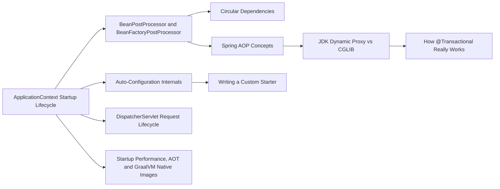
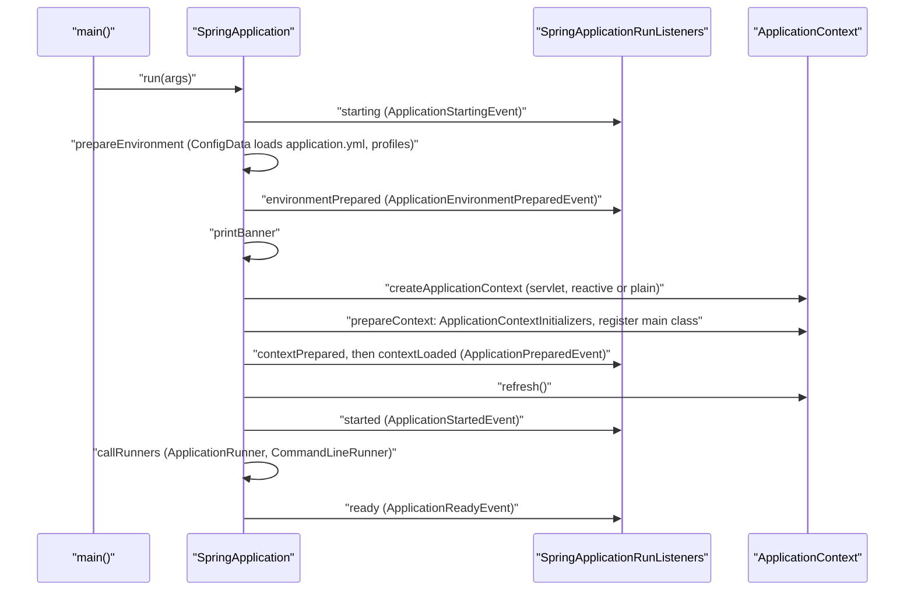
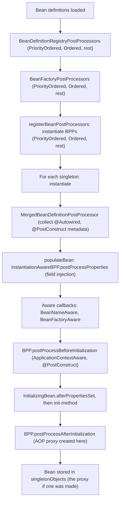

@@ 1 | MODULE | Phase 18 — Spring Internals (Advanced) | What Spring and Spring Boot really do at startup, behind annotations, in proxies and per HTTP request | MUST
# Phase 18: Spring Internals (Advanced)

Up to now you used Spring as a user: put an annotation on a class and something happens. This phase opens the hood. You will follow the container from `SpringApplication.run()` to the first HTTP request: how bean definitions are found, how post-processors change them, how proxies are built for `@Transactional`, `@Cacheable` and `@Async`, how Spring Boot decides which auto-configurations apply, and what the `DispatcherServlet` does with every request.

Senior interviews love this phase because internals questions separate people who copy annotations from people who can debug production. "Why did my `@Transactional` not roll back?", "Why is this bean null?", "Why does the app fail with a circular reference after the Boot upgrade?", "How would you write your own starter?" are all answered here. OrderHub gains a custom starter (`orderhub-audit-spring-boot-starter`) that you build from scratch.



**Prerequisites:** IoC and dependency injection, bean scopes and lifecycle callbacks (Phase 10), Spring Boot configuration and auto-configuration basics (Phase 10–11), Spring MVC controllers and exception handling (Phase 11), transactions and propagation (Phase 12), the Proxy pattern (Phase 17).

**The 5 questions from this phase that come up most often**
1. Why does calling a `@Transactional` method from another method in the same class not start a transaction?
2. How does Spring Boot auto-configuration work, and how do you see why a configuration did or did not apply?
3. What is the difference between a JDK dynamic proxy and a CGLIB proxy, and which one does Spring Boot use?
4. How does Spring resolve circular dependencies, and why does Spring Boot 2.6+ fail on them by default?
5. Walk me through what happens from the moment an HTTP request hits a Spring MVC application to the moment the JSON response leaves.

@@ 2 | MODULE | Startup | How the container boots, the extension points that change beans, and what happens when beans depend on each other in a loop | MUST
# Startup

**Shared analogy: building a car on an assembly line.** First the factory receives the blueprints (bean definitions) and may edit them before any metal is cut (`BeanFactoryPostProcessor`). Then each car is built in a fixed order of stations: chassis (constructor), parts fitted (dependency injection), inspection and add-ons (`BeanPostProcessor` before and after init), and finally the car may get a protective shell (a proxy). If car A needs a part from car B and car B needs a part from car A, the line has to hand over a half-built car early, which is exactly the circular-dependency problem.

- [[ApplicationContext Startup Lifecycle]] is the whole assembly line from `run()` to "application ready".
- [[BeanPostProcessor and BeanFactoryPostProcessor]] are the two kinds of stations where you can change blueprints or finished cars.
- [[Circular Dependencies]] shows what happens when two cars wait for each other.

@@ 3 | TOPIC | ApplicationContext Startup Lifecycle | What SpringApplication.run and AbstractApplicationContext.refresh do step by step, events, runners and where startup time goes | MUST
# ApplicationContext Startup Lifecycle

**Level: Advanced | Phase 18 | Priority: MUST | Since: Spring 1.0 (refresh), Spring Boot 1.0 (SpringApplication), Boot 2.4 (ConfigData)**

> **30-second interview answer:** `SpringApplication.run()` prepares the `Environment` (properties, profiles), creates the right `ApplicationContext` type, and calls `refresh()`. `refresh()` loads bean definitions by running `BeanFactoryPostProcessor`s (the main one, `ConfigurationClassPostProcessor`, parses `@Configuration`, `@ComponentScan` and auto-configuration), registers `BeanPostProcessor`s, starts the embedded web server, and then eagerly creates all non-lazy singletons. Finally lifecycle beans start, `ApplicationRunner`s run and `ApplicationReadyEvent` is published, which is the moment the app is really ready.

## 1. Concept in Simple Words
### Analogy
Opening a restaurant for the day.

| Restaurant opening | Spring startup |
|---|---|
| Read today's notes: which menu, which suppliers, which branch | Prepare the `Environment`: `application.yml`, profiles, env vars, command-line args |
| Choose the type of venue: dine-in or takeaway only | Create the context type: servlet web, reactive web or non-web |
| Collect every recipe card and edit some (swap an ingredient) | Load and post-process bean definitions (`BeanFactoryPostProcessor`) |
| Hire the inspectors who check each dish before it leaves the kitchen | Register `BeanPostProcessor`s |
| Unlock the front door but keep the sign on "closed" | `onRefresh()` creates the embedded Tomcat (not yet accepting traffic) |
| Cook every dish that must be ready at opening | Pre-instantiate all non-lazy singletons |
| Flip the sign to "open" and call the first regulars | Start `SmartLifecycle` beans (Tomcat connector), run runners, publish `ApplicationReadyEvent` |

### What it is
- **`ApplicationContext`:** Spring's IoC container. It extends `BeanFactory` (creates and holds beans) with events, i18n messages, resource loading and environment access.
- **Bean definition:** the blueprint of a bean (class, scope, constructor arguments, init method, lazy flag). Spring stores `BeanDefinition` objects first and creates the actual objects later.
- **`refresh()`:** the template method in `AbstractApplicationContext` that turns bean definitions into a running container. It can run only once for most context types.
- **`SpringApplication`:** Spring Boot's bootstrapper. It wraps `refresh()` with environment preparation, banner, failure analysis, events and runners.
- **Runners:** `ApplicationRunner` and `CommandLineRunner` beans called once after the context is refreshed.

### Why it exists
Plain Spring made you choose a context class, register property sources, and call `refresh()` yourself. Spring Boot standardised it into one call with predictable ordering and well-defined events, so libraries (and you) can hook in at exactly the right moment: before properties are bound, after beans exist, or once the app is ready to receive traffic.

## 2. How It Works

**Part A: `SpringApplication.run()`**



1. **Deduce the web application type** from the classpath: `DispatcherServlet` present means SERVLET, only WebFlux means REACTIVE, neither means NONE.
2. **Load `SpringApplicationRunListener`, `ApplicationContextInitializer` and `ApplicationListener` implementations** from `META-INF/spring.factories` (these are still loaded from `spring.factories`; only auto-configurations moved to `AutoConfiguration.imports`).
3. **Prepare the environment.** Property sources are added in precedence order (command-line args highest, then system properties, env vars, `application-{profile}.yml`, `application.yml`). Boot 2.4+ uses the ConfigData API via `ConfigDataEnvironmentPostProcessor`, an `EnvironmentPostProcessor`.
4. **Create the context:** `AnnotationConfigServletWebServerApplicationContext` for SERVLET.
5. **Prepare the context:** run initializers, register the main class as the first bean definition.
6. **`refresh()`** (Part B).
7. **Call runners**, then publish `ApplicationReadyEvent`. If anything throws, `FailureAnalyzer`s turn the exception into the friendly "APPLICATION FAILED TO START" report and `ApplicationFailedEvent` is published.

**Part B: `AbstractApplicationContext.refresh()` (12 steps)**

```text
refresh()
 1  prepareRefresh()                      validate required properties, set active flag
 2  obtainFreshBeanFactory()              get the DefaultListableBeanFactory
 3  prepareBeanFactory(bf)                register Environment, ApplicationContextAwareProcessor, resolvable deps
 4  postProcessBeanFactory(bf)            subclass hook (web scopes: request, session)
 5  invokeBeanFactoryPostProcessors(bf)   *** ConfigurationClassPostProcessor runs here:
                                          parses @Configuration, @ComponentScan, @Import,
                                          @Bean methods and ALL auto-configurations
                                          -> bean definitions now complete
 6  registerBeanPostProcessors(bf)        instantiate BPPs in order PriorityOrdered, Ordered, rest
 7  initMessageSource()                   i18n
 8  initApplicationEventMulticaster()     event infrastructure
 9  onRefresh()                           *** web contexts create the embedded Tomcat here
10  registerListeners()                   ApplicationListener beans, early events delivered
11  finishBeanFactoryInitialization(bf)   *** create every non-lazy singleton
                                          then SmartInitializingSingleton.afterSingletonsInstantiated()
12  finishRefresh()                       start SmartLifecycle beans (Tomcat begins accepting
                                          connections), publish ContextRefreshedEvent
```

**Part C: creating one singleton (inside step 11)** is the bean lifecycle you know from Phase 10, now with the internal names: `createBeanInstance` (constructor), `applyMergedBeanDefinitionPostProcessors` (collect `@Autowired` and `@PostConstruct` metadata), early reference exposure for circular dependencies, `populateBean` (field and setter injection), `initializeBean` (Aware callbacks, `postProcessBeforeInitialization`, `@PostConstruct` and `afterPropertiesSet`, `postProcessAfterInitialization` where proxies are created). See [[BeanPostProcessor and BeanFactoryPostProcessor]].

**Event order you can rely on**

| Event | When | Beans available? |
|---|---|---|
| `ApplicationStartingEvent` | Very first thing | No (register listener via `spring.factories` or `SpringApplication.addListeners`) |
| `ApplicationEnvironmentPreparedEvent` | Environment ready, context not created | No |
| `ApplicationContextInitializedEvent` | Context created, initializers run | No bean instances |
| `ApplicationPreparedEvent` | Definitions loaded, before refresh | No bean instances |
| `ContextRefreshedEvent` | End of `refresh()` | Yes |
| `WebServerInitializedEvent` | Embedded server started; gives the real port | Yes |
| `ApplicationStartedEvent` | After refresh, before runners | Yes |
| `AvailabilityChangeEvent` (LivenessState.CORRECT) | With started | Yes |
| `ApplicationReadyEvent` | After runners | Yes; readiness becomes ACCEPTING_TRAFFIC |
| `ApplicationFailedEvent` | Startup threw | Maybe |

## 3. Code Example
### Code
OrderHub logs every startup stage and warms a cache only when the application is really ready.

```java
// file: src/main/java/com/orderhub/startup/StartupTracer.java
package com.orderhub.startup;

import jakarta.annotation.PostConstruct;
import org.slf4j.Logger;
import org.slf4j.LoggerFactory;
import org.springframework.beans.factory.InitializingBean;
import org.springframework.beans.factory.SmartInitializingSingleton;
import org.springframework.boot.ApplicationArguments;
import org.springframework.boot.ApplicationRunner;
import org.springframework.boot.context.event.ApplicationReadyEvent;
import org.springframework.boot.context.event.ApplicationStartedEvent;
import org.springframework.boot.web.context.WebServerInitializedEvent;
import org.springframework.context.SmartLifecycle;
import org.springframework.context.event.ContextRefreshedEvent;
import org.springframework.context.event.EventListener;
import org.springframework.stereotype.Component;

@Component
public class StartupTracer implements InitializingBean, SmartInitializingSingleton,
        SmartLifecycle, ApplicationRunner {

    private static final Logger log = LoggerFactory.getLogger(StartupTracer.class);
    private volatile boolean running;

    public StartupTracer() { log.info("1 constructor"); }

    @PostConstruct
    void postConstruct() { log.info("2 @PostConstruct"); }

    @Override
    public void afterPropertiesSet() { log.info("3 afterPropertiesSet"); }

    @Override
    public void afterSingletonsInstantiated() { log.info("4 all singletons created"); }

    @Override
    public void start() { running = true; log.info("5 SmartLifecycle.start"); }
    @Override
    public void stop() { running = false; log.info("SmartLifecycle.stop"); }
    @Override
    public boolean isRunning() { return running; }

    @EventListener
    void onRefreshed(ContextRefreshedEvent e) { log.info("6 ContextRefreshedEvent"); }

    @EventListener
    void onWebServer(WebServerInitializedEvent e) {
        log.info("7 web server on port {}", e.getWebServer().getPort());
    }

    @EventListener
    void onStarted(ApplicationStartedEvent e) { log.info("8 ApplicationStartedEvent"); }

    @Override
    public void run(ApplicationArguments args) { log.info("9 ApplicationRunner"); }

    @EventListener
    void onReady(ApplicationReadyEvent e) {
        log.info("10 ApplicationReadyEvent after {} ms", e.getTimeTaken().toMillis());
    }
}
```

```java
// file: src/main/java/com/orderhub/startup/EarlyListener.java
package com.orderhub.startup;

import org.springframework.boot.context.event.ApplicationEnvironmentPreparedEvent;
import org.springframework.context.ApplicationListener;

// Not a @Component: this event fires before any bean exists.
public class EarlyListener implements ApplicationListener<ApplicationEnvironmentPreparedEvent> {
    @Override
    public void onApplicationEvent(ApplicationEnvironmentPreparedEvent event) {
        String profiles = String.join(",", event.getEnvironment().getActiveProfiles());
        System.out.println("0 environment prepared, profiles=" + profiles);
    }
}
```

```java
// file: src/main/java/com/orderhub/OrderHubApplication.java
package com.orderhub;

import com.orderhub.startup.EarlyListener;
import org.springframework.boot.SpringApplication;
import org.springframework.boot.autoconfigure.SpringBootApplication;
import org.springframework.boot.context.metrics.buffering.BufferingApplicationStartup;

@SpringBootApplication
public class OrderHubApplication {
    public static void main(String[] args) {
        SpringApplication app = new SpringApplication(OrderHubApplication.class);
        app.addListeners(new EarlyListener());                       // early events need manual registration
        app.setApplicationStartup(new BufferingApplicationStartup(2048)); // records startup steps for /actuator/startup
        app.run(args);
    }
}
```

```yaml
# file: src/main/resources/application.yml
spring:
  profiles:
    active: dev
management:
  endpoints:
    web:
      exposure:
        include: health,startup
```

### Walkthrough
- `StartupTracer` implements every hook so the log shows the real order. Steps 1–3 happen while this one bean is created inside `finishBeanFactoryInitialization`.
- `afterSingletonsInstantiated` (step 4) is the earliest safe point where every other singleton exists; use it instead of `@PostConstruct` when you need to look at other beans.
- `SmartLifecycle.start` (step 5) runs in `finishRefresh`. The embedded web server is itself started by a `SmartLifecycle` bean (`WebServerStartStopLifecycle`), which is why `WebServerInitializedEvent` arrives near this point.
- `ApplicationRunner` runs after the context is refreshed but before `ApplicationReadyEvent`. A long runner delays readiness, which on Kubernetes keeps the pod out of the load balancer.
- `EarlyListener` cannot be a `@Component`: the environment event fires before the container creates beans. Register it with `addListeners` or in `META-INF/spring.factories` under `org.springframework.context.ApplicationListener`.
- `BufferingApplicationStartup` records each step (`spring.beans.instantiate`, `spring.context.config-classes.parse` and so on) with durations, exposed at `/actuator/startup`.

### Output
```text
0 environment prepared, profiles=dev
  .   ____          _            __ _ _
 :: Spring Boot ::                (v3.5.0)
INFO  c.o.OrderHubApplication  : The following 1 profile is active: "dev"
INFO  o.s.b.w.e.tomcat.TomcatWebServer : Tomcat initialized with port 8080 (http)
INFO  c.o.startup.StartupTracer : 1 constructor
INFO  c.o.startup.StartupTracer : 2 @PostConstruct
INFO  c.o.startup.StartupTracer : 3 afterPropertiesSet
INFO  c.o.startup.StartupTracer : 4 all singletons created
INFO  c.o.startup.StartupTracer : 5 SmartLifecycle.start
INFO  o.s.b.w.e.tomcat.TomcatWebServer : Tomcat started on port 8080 (http) with context path '/'
INFO  c.o.startup.StartupTracer : 7 web server on port 8080
INFO  c.o.startup.StartupTracer : 6 ContextRefreshedEvent
INFO  c.o.OrderHubApplication  : Started OrderHubApplication in 2.41 seconds (process running for 2.7)
INFO  c.o.startup.StartupTracer : 8 ApplicationStartedEvent
INFO  c.o.startup.StartupTracer : 9 ApplicationRunner
INFO  c.o.startup.StartupTracer : 10 ApplicationReadyEvent after 2463 ms
```
Note that "Tomcat initialized" (step 9 of refresh, `onRefresh`) appears before any application bean is created, while "Tomcat started" appears only in `finishRefresh`. The numbers 5, 7 and 6 interleave because the web server lifecycle bean and `StartupTracer` share the default lifecycle phase and the web server event is published from inside the start phase, before `ContextRefreshedEvent`.

### Compare
| Hook | Runs | Use it for | Do not use it for |
|---|---|---|---|
| `@PostConstruct` | After this bean's injection | Validate own config, build internal state | Calling other beans' proxied methods (they may not be fully ready), long I/O |
| `SmartInitializingSingleton` | After all singletons exist | Scanning other beans, registries | Anything that needs the web server |
| `ContextRefreshedEvent` | End of every `refresh()` (can fire more than once with child contexts) | Legacy code | One-time work without a guard |
| `ApplicationRunner` | Once, after refresh | One-time startup tasks with access to args | Very slow work that should not block readiness |
| `ApplicationReadyEvent` | App ready | Cache warm-up, "I am up" notifications | Work that must finish before traffic arrives |

## 4. Interview Questions
**Basic**
1. **What does `SpringApplication.run()` do?**
   It deduces the application type, loads initializers and listeners, prepares the `Environment` with all property sources and profiles, creates the `ApplicationContext`, calls `refresh()`, runs `ApplicationRunner`s and `CommandLineRunner`s, and publishes lifecycle events ending with `ApplicationReadyEvent`. On failure it runs failure analyzers and publishes `ApplicationFailedEvent`.
2. **What happens inside `refresh()`?**
   The bean factory is prepared, `BeanFactoryPostProcessor`s run (including `ConfigurationClassPostProcessor`, which turns `@Configuration`, scanning and auto-configuration into bean definitions), `BeanPostProcessor`s are registered, the web server is created in `onRefresh`, all non-lazy singletons are instantiated, and finally lifecycle beans start and `ContextRefreshedEvent` is published.
3. **Where are component scanning and auto-configuration actually processed?**
   In `invokeBeanFactoryPostProcessors`, by `ConfigurationClassPostProcessor`, which is a `BeanDefinitionRegistryPostProcessor`. Auto-configurations are imported last because `AutoConfigurationImportSelector` is a `DeferredImportSelector`.

**Follow-up**
4. **Difference between `ApplicationStartedEvent` and `ApplicationReadyEvent`?**
   Started fires right after `refresh()`, before runners. Ready fires after all runners have completed. Boot also flips readiness state to ACCEPTING_TRAFFIC at ready, so Kubernetes readiness probes only succeed after runners finish.
5. **Why can't an `ApplicationListener` for `ApplicationEnvironmentPreparedEvent` be a `@Component`?**
   The event fires before the context exists and before any bean is created, so a component listener would not be registered yet. Register it programmatically with `SpringApplication.addListeners` or in `META-INF/spring.factories`.
6. **When is the embedded Tomcat created and when does it accept requests?**
   It is created in `onRefresh()` (before application singletons) so that servlet-related beans can be registered with it, but its connector starts only in `finishRefresh()` through a `SmartLifecycle` bean. So no request can reach a half-initialized context.

**Tricky / scenario**
7. **A colleague warms a 2-minute cache in `@PostConstruct`. Kubernetes keeps restarting the pod. Why, and what do you change?**
   `@PostConstruct` runs inside `refresh()`, so the server is not listening and the liveness probe fails until the timeout, causing restarts. Move the warm-up to an `ApplicationReadyEvent` listener (asynchronously if the app can serve without the cache), or keep it before readiness with a proper `startupProbe` so liveness is not checked during startup.
8. **Startup went from 4 s to 25 s after adding a library. How do you find the culprit?**
   Enable `BufferingApplicationStartup` and read `/actuator/startup` sorted by duration, or use `FlightRecorderApplicationStartup` and JFR. Also run with `--debug` to see which auto-configurations matched. Common culprits are eager connections to external systems in bean constructors, classpath scanning of huge packages, and Hibernate schema validation.
9. **Why might `ContextRefreshedEvent` run your code twice?**
   It fires for every context refresh, including child contexts (for example, a Spring Cloud bootstrap or a child context in tests) and each refresh in a refreshable context. Use `ApplicationReadyEvent` or check `event.getApplicationContext() == this.context`.

**What the interviewer is really testing:** whether you know where in startup your code runs, so you can place work correctly and debug "bean not ready" and slow-startup problems.

## 5. Pitfalls & Best Practices
### Common mistakes
| Mistake | What goes wrong | Fix |
|---|---|---|
| Heavy I/O in constructors or `@PostConstruct` | Slow startup, failed liveness probes, app fails if a remote system is down | Defer to `ApplicationReadyEvent` or make it lazy |
| Calling another bean's `@Transactional` method from `@PostConstruct` | The proxy may not be ready yet, or the transaction infrastructure is not finished | Use `SmartInitializingSingleton` or `ApplicationReadyEvent` |
| Registering early-event listeners as `@Component` | Listener never fires | `spring.factories` or `addListeners` |
| Relying on `ContextRefreshedEvent` for one-time work | Runs multiple times with child contexts | Use `ApplicationReadyEvent` |
| Long-running `CommandLineRunner` in a web app | App reports not ready for minutes | Run asynchronously or as a separate job |

### Best practices
- Keep bean construction cheap and side-effect free. Connecting to databases, brokers and remote APIs should be lazy or retried, so the app can start even if a dependency is briefly down.
- Measure startup with `/actuator/startup` before optimising; guesses are usually wrong.
- Use availability states (`LivenessState`, `ReadinessState`) and publish `AvailabilityChangeEvent` yourself when the app temporarily cannot serve traffic.
- In tests, the context is cached between test classes with the same configuration; avoid `@DirtiesContext` and per-class `@MockitoBean` variations that force new refreshes.

### Compare with
| Context type | Created when | Web server |
|---|---|---|
| `AnnotationConfigServletWebServerApplicationContext` | Spring MVC on classpath | Embedded Tomcat, Jetty or Undertow |
| `AnnotationConfigReactiveWebServerApplicationContext` | Only WebFlux on classpath | Netty by default |
| `AnnotationConfigApplicationContext` | No web stack, or `spring.main.web-application-type=none` | None |

## 6. Hands-on Exercise
In OrderHub, add a `CatalogWarmup` component that loads the 100 best-selling products into an in-memory map at startup. Acceptance criteria: the HTTP port must be open before the warm-up begins; readiness must report `REFUSING_TRAFFIC` until the warm-up finishes; the warm-up must log its duration; and it must not run twice if a child context is created.

<details><summary>Solution</summary>

```java
// file: src/main/java/com/orderhub/catalog/CatalogWarmup.java
package com.orderhub.catalog;

import java.util.Map;
import java.util.concurrent.ConcurrentHashMap;
import org.slf4j.Logger;
import org.slf4j.LoggerFactory;
import org.springframework.boot.availability.AvailabilityChangeEvent;
import org.springframework.boot.availability.ReadinessState;
import org.springframework.boot.context.event.ApplicationReadyEvent;
import org.springframework.context.ApplicationEventPublisher;
import org.springframework.context.event.EventListener;
import org.springframework.scheduling.annotation.Async;
import org.springframework.stereotype.Component;

@Component
public class CatalogWarmup {
    private static final Logger log = LoggerFactory.getLogger(CatalogWarmup.class);
    private final ProductRepository products;
    private final ApplicationEventPublisher events;
    private final Map<Long, ProductView> hot = new ConcurrentHashMap<>();

    public CatalogWarmup(ProductRepository products, ApplicationEventPublisher events) {
        this.products = products;
        this.events = events;
    }

    @Async                       // requires @EnableAsync; frees the startup thread
    @EventListener               // ApplicationReadyEvent fires once per SpringApplication
    public void warm(ApplicationReadyEvent ready) {
        AvailabilityChangeEvent.publish(events, this, ReadinessState.REFUSING_TRAFFIC);
        long start = System.nanoTime();
        products.findTop100ByOrderBySoldCountDesc()
                .forEach(p -> hot.put(p.getId(), ProductView.from(p)));
        log.info("Catalog warm-up loaded {} products in {} ms",
                hot.size(), (System.nanoTime() - start) / 1_000_000);
        AvailabilityChangeEvent.publish(events, this, ReadinessState.ACCEPTING_TRAFFIC);
    }

    public ProductView find(long id) { return hot.get(id); }
}
```

```yaml
management:
  endpoint:
    health:
      probes:
        enabled: true      # exposes /actuator/health/liveness and /readiness
```
Because `ApplicationReadyEvent` is published by `SpringApplication` once (not by each context refresh), the warm-up cannot run twice. The port is open because the event fires after `finishRefresh`.
</details>

## 7. Recall
Q: In the ApplicationContext startup lifecycle, which refresh step turns @Configuration classes and auto-configurations into bean definitions?
A: `invokeBeanFactoryPostProcessors`, where `ConfigurationClassPostProcessor` parses configuration classes, scanning, imports and auto-configurations.

Q: In the ApplicationContext startup lifecycle, when is the embedded Tomcat created and when does it start accepting connections?
A: It is created in `onRefresh()` and starts accepting connections in `finishRefresh()` via a `SmartLifecycle` bean.

Q: What is the order of ApplicationStartedEvent, ApplicationRunner and ApplicationReadyEvent in Spring Boot startup?
A: ApplicationStartedEvent, then runners, then ApplicationReadyEvent.

Q: Where should a Spring Boot app warm a slow cache so it does not block startup probes?
A: In an `ApplicationReadyEvent` listener (optionally `@Async`), not in a constructor or `@PostConstruct`.

Q: How do you find which beans make Spring Boot startup slow?
A: Use `BufferingApplicationStartup` and the `/actuator/startup` endpoint, or JFR with `FlightRecorderApplicationStartup`.

**Related:** [[BeanPostProcessor and BeanFactoryPostProcessor]] · [[Auto-Configuration Internals]] · [[Startup Performance, AOT and GraalVM Native Images]]

@@ 3 | TOPIC | BeanPostProcessor and BeanFactoryPostProcessor | The two container extension points, their order, and how Spring itself uses them for @Autowired, @PostConstruct and proxies | SHOULD
# BeanPostProcessor and BeanFactoryPostProcessor

**Level: Advanced | Phase 18 | Priority: SHOULD | Since: Spring 1.0 (BeanDefinitionRegistryPostProcessor 3.0)**

> **30-second interview answer:** A `BeanFactoryPostProcessor` runs once, before any normal bean is created, and changes bean *definitions* (the blueprints), for example resolving `${...}` placeholders or registering new definitions. A `BeanPostProcessor` runs for every bean *instance*, before and after its init callbacks, and can modify or replace the object. Most Spring "magic" is a post-processor: `@Autowired` injection, `@PostConstruct`, and every AOP proxy for `@Transactional`, `@Async` and `@Cacheable` is created in `postProcessAfterInitialization`.

## 1. Concept in Simple Words
### Analogy
A publishing house.

| Publishing house | Spring |
|---|---|
| The editor who changes the manuscript before printing (fix typos, insert the real author name) | `BeanFactoryPostProcessor` edits bean definitions |
| The editor who adds a whole new chapter to the manuscript | `BeanDefinitionRegistryPostProcessor` registers new definitions |
| The printing press | The container instantiating beans |
| The quality checker who inspects every printed book | `BeanPostProcessor.postProcessBeforeInitialization` |
| The binder who wraps the finished book in a dust jacket | `postProcessAfterInitialization` returning a proxy |
| Once printed, the manuscript is no longer edited | BFPPs cannot affect beans that already exist |

### What it is
- **`BeanFactoryPostProcessor` (BFPP):** `postProcessBeanFactory(ConfigurableListableBeanFactory)`. Works on `BeanDefinition`s. Examples: `PropertySourcesPlaceholderConfigurer` (resolves `${...}` in definitions), `ConfigurationClassPostProcessor`.
- **`BeanDefinitionRegistryPostProcessor`:** a sub-interface that runs first and can *register* definitions via `postProcessBeanDefinitionRegistry`. `ConfigurationClassPostProcessor` is one; MyBatis mapper scanning and Spring Data repository registration work this way.
- **`BeanPostProcessor` (BPP):** `postProcessBeforeInitialization(bean, name)` and `postProcessAfterInitialization(bean, name)`. Return the same bean, a modified bean, or a different object (a proxy).
- **Specialised BPPs:** `InstantiationAwareBeanPostProcessor` (before instantiation and during property population: field injection lives here), `SmartInstantiationAwareBeanPostProcessor` (choose constructors, early references for circular dependencies), `MergedBeanDefinitionPostProcessor` (inspect the definition to cache metadata), `DestructionAwareBeanPostProcessor` (`@PreDestroy`).

### Why it exists
The container needed an open/closed design: new annotations and features without changing the core bean factory. Every feature (autowiring, JSR-250 annotations, AOP, validation, scheduling) is added as a post-processor, and you can add your own the same way.

## 2. How It Works



**Spring's own post-processors and what they do**

| Post-processor | Type | Feature |
|---|---|---|
| `ConfigurationClassPostProcessor` | BeanDefinitionRegistryPostProcessor | `@Configuration`, `@ComponentScan`, `@Import`, `@Bean`, auto-config; enhances full `@Configuration` classes with CGLIB |
| `PropertySourcesPlaceholderConfigurer` | BFPP | `${...}` in `@Value` and definitions |
| `AutowiredAnnotationBeanPostProcessor` | InstantiationAware + MergedBeanDefinition BPP | `@Autowired`, `@Value`, `@Inject`, constructor selection |
| `CommonAnnotationBeanPostProcessor` | BPP | `@PostConstruct`, `@PreDestroy`, `@Resource` |
| `ApplicationContextAwareProcessor` | BPP | `ApplicationContextAware`, `EnvironmentAware` and friends |
| `AnnotationAwareAspectJAutoProxyCreator` | SmartInstantiationAware BPP | `@Aspect`, `@Transactional`, `@Cacheable` advisors: creates proxies |
| `AsyncAnnotationBeanPostProcessor` | BPP | `@Async` proxies |
| `ConfigurationPropertiesBindingPostProcessor` | BPP | binds `@ConfigurationProperties` |
| `MethodValidationPostProcessor` | BPP | `@Validated` method validation proxies |

**Ordering rules**
- Post-processors are sorted by `PriorityOrdered` first, then `Ordered`, then unordered. Inside a group, lower `getOrder()` runs first.
- **BPPs are themselves beans created early, in `registerBeanPostProcessors`.** Any bean they depend on is created before all BPPs exist, so that dependency misses some processing (for example, it gets no transactional proxy). Spring logs: `Bean 'x' of type [...] is not eligible for getting processed by all BeanPostProcessors (for example: not eligible for auto-proxying)`.
- **Declare BFPPs with a `static @Bean` method.** A non-static `@Bean` BFPP forces its `@Configuration` class to be instantiated during BFPP processing, too early for `@Autowired` and `@Value` in that class to work. Spring logs a warning for this.
- BFPPs do not get BPP processing (they run before BPPs exist), so `@Autowired` does not work inside a BFPP.

## 3. Code Example
### Code
OrderHub adds two custom extension points: a BFPP that forces all beans in the `com.orderhub.reporting` package to be lazy, and a BPP that wraps any bean annotated with a custom `@Timed` in a timing proxy.

```java
// file: src/main/java/com/orderhub/infra/LazyReportingBeansPostProcessor.java
package com.orderhub.infra;

import org.springframework.beans.factory.config.BeanDefinition;
import org.springframework.beans.factory.config.BeanFactoryPostProcessor;
import org.springframework.beans.factory.config.ConfigurableListableBeanFactory;

public class LazyReportingBeansPostProcessor implements BeanFactoryPostProcessor {
    @Override
    public void postProcessBeanFactory(ConfigurableListableBeanFactory factory) {
        for (String name : factory.getBeanDefinitionNames()) {
            BeanDefinition def = factory.getBeanDefinition(name);
            String cls = def.getBeanClassName();
            if (cls != null && cls.startsWith("com.orderhub.reporting.")) {
                def.setLazyInit(true);                     // change the blueprint, not an object
                System.out.println("BFPP: made lazy -> " + name);
            }
        }
    }
}
```

```java
// file: src/main/java/com/orderhub/infra/Timed.java
package com.orderhub.infra;

import java.lang.annotation.ElementType;
import java.lang.annotation.Retention;
import java.lang.annotation.RetentionPolicy;
import java.lang.annotation.Target;

@Target(ElementType.TYPE)
@Retention(RetentionPolicy.RUNTIME)
public @interface Timed { }
```

```java
// file: src/main/java/com/orderhub/infra/TimedBeanPostProcessor.java
package com.orderhub.infra;

import org.aopalliance.intercept.MethodInterceptor;
import org.springframework.aop.framework.ProxyFactory;
import org.springframework.beans.factory.config.BeanPostProcessor;
import org.springframework.core.Ordered;
import org.springframework.core.annotation.AnnotationUtils;

public class TimedBeanPostProcessor implements BeanPostProcessor, Ordered {

    @Override
    public Object postProcessBeforeInitialization(Object bean, String beanName) {
        return bean;                                        // nothing to do before init
    }

    @Override
    public Object postProcessAfterInitialization(Object bean, String beanName) {
        if (AnnotationUtils.findAnnotation(bean.getClass(), Timed.class) == null) {
            return bean;
        }
        ProxyFactory factory = new ProxyFactory(bean);      // same API Spring AOP uses internally
        factory.setProxyTargetClass(true);                  // CGLIB subclass
        factory.addAdvice((MethodInterceptor) invocation -> {
            long start = System.nanoTime();
            try {
                return invocation.proceed();
            } finally {
                System.out.printf("%s.%s took %d us%n", beanName,
                        invocation.getMethod().getName(), (System.nanoTime() - start) / 1000);
            }
        });
        System.out.println("BPP: wrapped " + beanName + " in a timing proxy");
        return factory.getProxy();                          // the container stores the proxy
    }

    @Override
    public int getOrder() { return Ordered.LOWEST_PRECEDENCE; }
}
```

```java
// file: src/main/java/com/orderhub/infra/InfraConfig.java
package com.orderhub.infra;

import org.springframework.context.annotation.Bean;
import org.springframework.context.annotation.Configuration;

@Configuration(proxyBeanMethods = false)
public class InfraConfig {

    @Bean
    static LazyReportingBeansPostProcessor lazyReportingBeansPostProcessor() {   // static: no early config instance
        return new LazyReportingBeansPostProcessor();
    }

    @Bean
    static TimedBeanPostProcessor timedBeanPostProcessor() {                     // static for BPPs too
        return new TimedBeanPostProcessor();
    }
}
```

```java
// file: src/main/java/com/orderhub/pricing/PriceCalculator.java
package com.orderhub.pricing;

import com.orderhub.infra.Timed;
import java.math.BigDecimal;
import org.springframework.stereotype.Service;

@Timed
@Service
public class PriceCalculator {
    public BigDecimal total(BigDecimal unit, int qty) {
        return unit.multiply(BigDecimal.valueOf(qty));
    }
}
```

```java
// file: src/main/java/com/orderhub/pricing/PricingDemo.java
package com.orderhub.pricing;

import java.math.BigDecimal;
import org.springframework.boot.CommandLineRunner;
import org.springframework.stereotype.Component;

@Component
class PricingDemo implements CommandLineRunner {
    private final PriceCalculator calc;
    PricingDemo(PriceCalculator calc) { this.calc = calc; }

    @Override
    public void run(String... args) {
        System.out.println("injected class: " + calc.getClass().getSimpleName().contains("CGLIB"));
        System.out.println("total = " + calc.total(new BigDecimal("19.99"), 3));
    }
}
```

### Walkthrough
- The BFPP iterates bean definitions and flips `lazyInit`. No reporting bean has been created yet, so the change applies to all of them. Doing the same in a BPP would be too late.
- The BPP checks each finished bean for `@Timed` and returns a proxy from `postProcessAfterInitialization`. From then on, the container stores and injects the proxy, never the raw `PriceCalculator`.
- `ProxyFactory` is the programmatic face of Spring AOP. `AnnotationAwareAspectJAutoProxyCreator` does the same thing for `@Transactional` and `@Aspect` beans.
- Both `@Bean` methods are `static`, so Spring can call them without creating `InfraConfig` first. That keeps `InfraConfig` a normal bean that gets full processing.
- `PricingDemo` proves the injected object is the CGLIB subclass and that calls go through the advice.

### Output
```text
BFPP: made lazy -> salesReportService
BFPP: made lazy -> monthlyReportJob
BPP: wrapped priceCalculator in a timing proxy
INFO  c.o.OrderHubApplication : Started OrderHubApplication in 2.38 seconds
injected class: true
priceCalculator.total took 41 us
total = 59.97
```

### Compare
| | BeanFactoryPostProcessor | BeanPostProcessor |
|---|---|---|
| Works on | `BeanDefinition` metadata | Bean instances |
| Runs | Once, before any regular bean exists | Twice per bean (before and after init) |
| Can replace the bean object | No | Yes (return a proxy) |
| Typical use | Placeholders, registering definitions, changing scope or lazy flag | Injection, validation, proxies, wrapping |
| Declaration | `static @Bean` method | `static @Bean` recommended |

## 4. Interview Questions
**Basic**
1. **What is the difference between a BeanFactoryPostProcessor and a BeanPostProcessor?**
   A BFPP changes bean definitions before any bean is instantiated; a BPP sees each bean instance before and after initialization and may replace it. BFPPs shape what will be created, BPPs shape what was created.
2. **Name three features Spring implements with BeanPostProcessors.**
   `@Autowired` and `@Value` injection (`AutowiredAnnotationBeanPostProcessor`), `@PostConstruct` and `@PreDestroy` (`CommonAnnotationBeanPostProcessor`), and AOP proxies for `@Transactional`, `@Cacheable` and aspects (`AnnotationAwareAspectJAutoProxyCreator`). `@Async` uses `AsyncAnnotationBeanPostProcessor`.
3. **In which BPP callback are AOP proxies created, and why there?**
   In `postProcessAfterInitialization`, so the target is fully injected and initialized before it is wrapped. The proxy then replaces the bean in the container. The exception is circular references, where `getEarlyBeanReference` may create the proxy earlier.

**Follow-up**
4. **Why should a BFPP `@Bean` method be static?**
   Otherwise Spring must instantiate the enclosing `@Configuration` class during the BFPP phase, before `AutowiredAnnotationBeanPostProcessor` exists, so `@Autowired` and `@Value` fields in that configuration stay null. A static method needs no instance.
5. **What does "Bean X is not eligible for getting processed by all BeanPostProcessors" mean?**
   X was created while BPPs were still being registered, usually because a BPP depends on it. X therefore misses later BPPs and, for example, gets no `@Transactional` proxy. Fix it by making the BPP depend lazily (`ObjectProvider`, `@Lazy`) or not depend on application beans at all.
6. **How do you control the order of BeanPostProcessors?**
   Implement `PriorityOrdered` or `Ordered` (or `@Order` is not honoured for BPP registration in all cases, so implement the interface). PriorityOrdered ones are registered first, then Ordered, then the rest.

**Tricky / scenario**
7. **A custom BPP returns a JDK proxy of a bean. Another bean injects the concrete class and startup fails. Why?**
   A JDK proxy implements only the interfaces, so it is not an instance of the concrete class and injection by class type fails with `BeanNotOfRequiredTypeException`. Use CGLIB (`setProxyTargetClass(true)`) or inject by interface.
8. **You add `@Autowired` to a field in your own BeanFactoryPostProcessor and it stays null. Why?**
   BFPPs run before BPPs are registered, and `@Autowired` is implemented by a BPP. Use the `ConfigurableListableBeanFactory` passed to the method, or implement `EnvironmentAware` (aware callbacks still work), instead of field injection.
9. **How does Spring Data create repository beans from interfaces with no implementation class?**
   A `BeanDefinitionRegistryPostProcessor`-style registrar (`RepositoryConfigurationDelegate` via `@EnableJpaRepositories`, auto-configured by Boot) scans for repository interfaces and registers a definition for each with `JpaRepositoryFactoryBean`, which builds a JDK proxy backed by `SimpleJpaRepository` and query methods.

**What the interviewer is really testing:** whether you can explain Spring's annotations as plain extension code, which is what lets you debug missing proxies and null injections.

## 5. Pitfalls & Best Practices
### Common mistakes
| Mistake | What goes wrong | Fix |
|---|---|---|
| Non-static `@Bean` method for a BFPP | `@Value` and `@Autowired` in that config class are null | Make the method `static` |
| BPP injecting a service bean | That service is created early and loses its proxies | Inject `ObjectProvider` or avoid dependencies |
| Heavy logic in `postProcessBeforeInitialization` for every bean | Slower startup across hundreds of beans | Filter early by type or annotation; cache metadata |
| Returning `null` from a BPP | Later processors are skipped (Spring treats null as "keep the current bean" in recent versions, which hides bugs) | Always return the bean or a replacement |
| Using a BPP to change scope or lazy flag | Too late, the bean already exists | Use a BFPP |

### Best practices
- Before writing a BPP, check for a higher-level option: an `@Aspect`, a `@Bean` decorator, or `BeanDefinitionRegistryPostProcessor` for registration.
- Cache reflection results per class (like `AutowiredAnnotationBeanPostProcessor` does) because BPPs run for every bean.
- If you create proxies, prefer extending `AbstractAdvisingBeanPostProcessor` or registering an `Advisor` so your proxy cooperates with Spring's existing proxy instead of double-wrapping.
- Keep BPPs and BFPPs in infrastructure configuration classes with `proxyBeanMethods = false`.

### Compare with
| Extension point | Phase | Granularity |
|---|---|---|
| `EnvironmentPostProcessor` | Before the context exists | Property sources |
| `ApplicationContextInitializer` | Context created, before refresh | Whole context |
| `BeanDefinitionRegistryPostProcessor` | Refresh step 5, first | Register definitions |
| `BeanFactoryPostProcessor` | Refresh step 5 | Modify definitions |
| `BeanPostProcessor` | Each bean creation | Instances |
| `SmartInitializingSingleton` | After all singletons | Whole set of beans |

## 6. Hands-on Exercise
Write a `MissingIndexWarningPostProcessor` for OrderHub: a BPP that inspects every Spring Data repository bean after initialization and logs a warning for each derived query method whose name contains `By` followed by a field listed in a configured set `orderhub.warn-unindexed-fields` (for example `email,status`). Acceptance criteria: the property is read without `@Value` in the BPP; the BPP has no dependency on application beans; it is declared with a static `@Bean` method; and it never changes the bean.

<details><summary>Solution</summary>

```java
// file: src/main/java/com/orderhub/infra/MissingIndexWarningPostProcessor.java
package com.orderhub.infra;

import java.lang.reflect.Method;
import java.util.Arrays;
import java.util.Set;
import java.util.stream.Collectors;
import org.slf4j.Logger;
import org.slf4j.LoggerFactory;
import org.springframework.beans.factory.config.BeanPostProcessor;
import org.springframework.context.EnvironmentAware;
import org.springframework.core.env.Environment;
import org.springframework.data.repository.Repository;

public class MissingIndexWarningPostProcessor implements BeanPostProcessor, EnvironmentAware {
    private static final Logger log = LoggerFactory.getLogger(MissingIndexWarningPostProcessor.class);
    private Set<String> fields = Set.of();

    @Override
    public void setEnvironment(Environment env) {           // Aware callbacks work even for BPPs
        String raw = env.getProperty("orderhub.warn-unindexed-fields", "");
        fields = Arrays.stream(raw.split(",")).map(String::strip)
                .filter(s -> !s.isEmpty()).map(String::toLowerCase).collect(Collectors.toSet());
    }

    @Override
    public Object postProcessAfterInitialization(Object bean, String beanName) {
        if (!(bean instanceof Repository<?, ?>) || fields.isEmpty()) return bean;
        for (Class<?> iface : bean.getClass().getInterfaces()) {
            if (!Repository.class.isAssignableFrom(iface)) continue;
            for (Method m : iface.getDeclaredMethods()) {
                String name = m.getName().toLowerCase();
                int by = name.indexOf("by");
                if (by < 0) continue;
                String criteria = name.substring(by + 2);
                fields.stream().filter(criteria::contains).forEach(f ->
                        log.warn("{}.{} filters on '{}': make sure it is indexed", iface.getSimpleName(), m.getName(), f));
            }
        }
        return bean;                                         // never replace the bean
    }
}
```

```java
@Bean
static MissingIndexWarningPostProcessor missingIndexWarningPostProcessor() {
    return new MissingIndexWarningPostProcessor();
}
```

```yaml
orderhub:
  warn-unindexed-fields: email,status
```
Repository beans are JDK proxies implementing the repository interface, so `getInterfaces()` on the proxy class returns `CustomerRepository` and friends.
</details>

## 7. Recall
Q: What is the core difference between a BeanFactoryPostProcessor and a BeanPostProcessor in Spring?
A: A BeanFactoryPostProcessor modifies bean definitions before beans exist; a BeanPostProcessor processes each bean instance before and after initialization and can replace it.

Q: In which BeanPostProcessor method does Spring create AOP proxies for @Transactional beans?
A: `postProcessAfterInitialization`, implemented by `AnnotationAwareAspectJAutoProxyCreator`.

Q: Why must a BeanFactoryPostProcessor @Bean method be static in Spring?
A: So the enclosing configuration class is not instantiated too early, which would leave its `@Autowired` and `@Value` members unprocessed.

Q: Which Spring post-processor parses @Configuration, @ComponentScan and auto-configurations?
A: `ConfigurationClassPostProcessor`, a `BeanDefinitionRegistryPostProcessor`.

Q: What does the Spring log "not eligible for getting processed by all BeanPostProcessors" warn about?
A: A bean was created during BPP registration (usually as a BPP dependency) and missed some processing such as auto-proxying.

**Related:** [[ApplicationContext Startup Lifecycle]] · [[Spring AOP Concepts]] · [[Circular Dependencies]] · [[Design Patterns Inside Spring]]

@@ 3 | TOPIC | Circular Dependencies | How the three-level singleton cache resolves cycles, why constructor cycles fail, why Boot 2.6+ forbids them and how to refactor | MUST
# Circular Dependencies

**Level: Advanced | Phase 18 | Priority: MUST | Since: Spring 1.0 (early references), Spring Boot 2.6 (forbidden by default)**

> **30-second interview answer:** A circular dependency is when bean A needs B and B needs A. With field or setter injection Spring can resolve it by exposing an early reference to the half-built A through its three-level singleton cache, so B gets A before A is finished. Constructor injection cycles can never be resolved and fail with `BeanCurrentlyInCreationException`. Since Spring Boot 2.6 all cycles fail by default (`spring.main.allow-circular-references=false`) because a cycle is almost always a design smell; the fix is to refactor, not to re-enable them.

## 1. Concept in Simple Words
### Analogy
Two new employees who must each sign the other's employment form.

| Office | Spring |
|---|---|
| Alice needs Bob's signature before her form is complete | Bean A depends on bean B |
| Bob needs Alice's signature | Bean B depends on bean A |
| Contracts that must be signed before the person even exists in the system | Constructor injection: impossible, both wait forever |
| HR gives Bob a "provisional Alice" badge: she exists but has not finished onboarding | Early singleton reference from the third-level cache |
| Bob finishes, then Alice finishes with Bob's signature | B completes with a reference to A, then A completes |
| The badge photo must match the final ID card | The early reference must equal the final bean (problem when a proxy is added later) |
| The manager says "you two should not depend on each other; let a team lead coordinate" | Refactor: extract a third bean or use events |

### What it is
- **Circular dependency:** a cycle in the dependency graph, direct (A to B to A) or indirect (A to B to C to A).
- **Three-level cache** in `DefaultSingletonBeanRegistry`:
  - `singletonObjects` (level 1): fully initialized singletons.
  - `earlySingletonObjects` (level 2): early references already handed out to someone.
  - `singletonFactories` (level 3): an `ObjectFactory` for each bean currently in creation, which returns the raw instance or, via `getEarlyBeanReference`, an early proxy.
- **`singletonsCurrentlyInCreation`:** a set used to detect that a bean is requested while it is still being created.
- **`BeanCurrentlyInCreationException`:** thrown when a cycle cannot be resolved.

### Why it exists
Large legacy XML applications had cycles everywhere, and Spring supported them to be pragmatic. Today the support is still in the framework but disabled by Boot, because cycles hide design problems, make initialization order fragile, and break when proxies are involved.

## 2. How It Works

**Field injection cycle (resolvable when allowed)**

```mermaid
sequenceDiagram
    participant C as "Container"
    participant A as "OrderService"
    participant B as "PaymentService"
    C->>A: "1 instantiate (constructor)"
    C->>C: "2 put ObjectFactory for A in singletonFactories (level 3)"
    C->>A: "3 populate: needs PaymentService"
    C->>B: "4 instantiate PaymentService, register its factory"
    C->>B: "5 populate: needs OrderService"
    C->>C: "6 getSingleton(A): not in level 1, in creation, call level-3 factory"
    C->>C: "7 getEarlyBeanReference(A) -> raw A or early proxy; move to level 2"
    C->>B: "8 inject early A, initialize B, B goes to level 1"
    C->>A: "9 inject B into A, initialize A"
    C->>C: "10 check: final A is same object as early A, A goes to level 1"
```

**Why constructor cycles cannot work**

```text
create A -> constructor needs B -> create B -> constructor needs A
   A is in singletonsCurrentlyInCreation but NO instance exists yet
   (the constructor has not returned), so there is nothing to expose early
   -> BeanCurrentlyInCreationException: Requested bean is currently in creation:
      Is there an unresolvable circular reference?
```

**Why the third level holds a factory and not the object**

If A will be wrapped by an AOP proxy (for `@Transactional`), B must receive the proxy, not the raw A. The factory calls `SmartInstantiationAwareBeanPostProcessor.getEarlyBeanReference`, and `AbstractAutoProxyCreator` creates the proxy early and remembers it, so it does not create a second one in `postProcessAfterInitialization`. The factory is only invoked if a cycle actually happens, so beans without cycles pay nothing.

**The `@Async` trap:** `AsyncAnnotationBeanPostProcessor` is not a `SmartInstantiationAwareBeanPostProcessor`, so it does not participate in early references. B receives raw A, then A gets wrapped by the `@Async` proxy, and the final check (step 10) finds two different objects:

```text
BeanCurrentlyInCreationException: Error creating bean with name 'orderService':
Bean with name 'orderService' has been injected into other beans [paymentService]
in its raw version as part of a circular reference, but has eventually been wrapped.
```

**Spring Boot 2.6+ behaviour:** `spring.main.allow-circular-references` defaults to false, which calls `setAllowCircularReferences(false)` on the bean factory. Even field cycles fail at startup with a diagram:

```text
***************************
APPLICATION FAILED TO START
***************************
Description:
The dependencies of some of the beans in the application context form a cycle:
┌─────┐
|  orderService (field private com.orderhub.payment.PaymentService com.orderhub.order.OrderService.paymentService)
↑     ↓
|  paymentService (field private com.orderhub.order.OrderService com.orderhub.payment.PaymentService.orderService)
└─────┘
Action:
Relying upon circular references is discouraged and they are prohibited by default. Update your application to remove the dependency cycle between beans. As a last resort, it may be possible to break the cycle automatically by setting spring.main.allow-circular-references to true.
```

## 3. Code Example
### Code
OrderHub had a real cycle: `OrderService` calls `PaymentService.charge()`, and `PaymentService` calls `OrderService.markPaid()` when the payment provider confirms. Below: the broken version, then two refactorings.

```java
// BROKEN: constructor cycle. Fails even with allow-circular-references=true.
package com.orderhub.order;

import com.orderhub.payment.PaymentService;
import org.springframework.stereotype.Service;

@Service
public class OrderService {
    private final PaymentService payments;
    public OrderService(PaymentService payments) { this.payments = payments; }

    public void checkout(long orderId) { payments.charge(orderId); }
    public void markPaid(long orderId) { System.out.println("order " + orderId + " PAID"); }
}
// and PaymentService has: public PaymentService(OrderService orders) { ... }
```

**Fix 1 (best): reverse one dependency with an event.** The payment module publishes a fact; the order module reacts. Neither needs the other at construction time.

```java
// file: src/main/java/com/orderhub/payment/PaymentConfirmed.java
package com.orderhub.payment;

public record PaymentConfirmed(long orderId, String providerRef) { }
```

```java
// file: src/main/java/com/orderhub/payment/PaymentService.java
package com.orderhub.payment;

import org.springframework.context.ApplicationEventPublisher;
import org.springframework.stereotype.Service;

@Service
public class PaymentService {
    private final ApplicationEventPublisher events;      // no dependency on OrderService

    public PaymentService(ApplicationEventPublisher events) { this.events = events; }

    public void charge(long orderId) {
        System.out.println("charging order " + orderId);
        String ref = "pay_" + orderId;                   // call to the provider omitted
        events.publishEvent(new PaymentConfirmed(orderId, ref));
    }
}
```

```java
// file: src/main/java/com/orderhub/order/OrderService.java
package com.orderhub.order;

import com.orderhub.payment.PaymentConfirmed;
import com.orderhub.payment.PaymentService;
import org.springframework.context.event.EventListener;
import org.springframework.stereotype.Service;

@Service
public class OrderService {
    private final PaymentService payments;              // one direction only

    public OrderService(PaymentService payments) { this.payments = payments; }

    public void checkout(long orderId) { payments.charge(orderId); }

    @EventListener
    void on(PaymentConfirmed event) {
        System.out.println("order " + event.orderId() + " PAID (" + event.providerRef() + ")");
    }
}
```

**Fix 2 (acceptable when an event is overkill): lazy lookup with `ObjectProvider`.**

```java
// file: src/main/java/com/orderhub/payment/RefundService.java
package com.orderhub.payment;

import com.orderhub.order.OrderService;
import org.springframework.beans.factory.ObjectProvider;
import org.springframework.stereotype.Service;

@Service
public class RefundService {
    private final ObjectProvider<OrderService> orders;   // resolved on first use, not at construction

    public RefundService(ObjectProvider<OrderService> orders) { this.orders = orders; }

    public void refund(long orderId) {
        orders.getObject().markRefunded(orderId);
    }
}
```

```yaml
# application.yml: leave the safe default; this line is shown only to document the decision
spring:
  main:
    allow-circular-references: false
```

### Walkthrough
- The broken version fails at startup because neither constructor can finish first. Spring prints the cycle diagram and stops.
- Fix 1 makes the dependency graph a tree: `OrderService` depends on `PaymentService`, and the return path is an event. Synchronous `@EventListener` runs in the same thread and transaction, so behaviour is unchanged; switch to `@TransactionalEventListener(phase = AFTER_COMMIT)` if the order update must only happen after the payment transaction commits.
- Fix 2 keeps a call in both directions but defers resolution. `ObjectProvider` (or `@Lazy`, which injects a lazy-resolution proxy) is resolved at call time when both beans exist. It is honest about the cycle but does not remove it, so treat it as a stop-gap.
- `allow-circular-references=true` would make field or setter cycles work again but not constructor cycles, and it hides the problem.

### Output
```text
POST /api/orders/42/checkout
charging order 42
order 42 PAID (pay_42)
```

### Compare
| Fix | Removes the cycle | Cost | When |
|---|---|---|---|
| Extract a third bean with the shared logic | Yes | Small refactor | Both beans use the same helper logic |
| Domain event (`ApplicationEventPublisher`) | Yes | Indirection; ordering and transaction phase to think about | "Notify the other side" relationships |
| `ObjectProvider` or `@Lazy` | No (defers) | Runtime failure if bean missing; hidden coupling | Quick fix in legacy code |
| Setter injection plus `allow-circular-references=true` | No | Fragile ordering, proxy problems | Last resort while migrating to Boot 2.6+ |

## 4. Interview Questions
**Basic**
1. **What is a circular dependency in Spring?**
   Two or more beans that depend on each other directly or through a chain, so none can be fully created first. Spring detects it when a bean is requested while it is still in `singletonsCurrentlyInCreation`.
2. **Can Spring resolve circular dependencies?**
   For singleton beans with field or setter injection, yes (when allowed), by exposing an early reference through the third-level cache. Never for constructor injection, and never for prototype beans. Spring Boot 2.6+ disables even the resolvable case by default.
3. **What are the three caches?**
   `singletonObjects` for finished beans, `earlySingletonObjects` for early references already handed out, and `singletonFactories` holding an `ObjectFactory` that creates the early reference (possibly a proxy) on demand.

**Follow-up**
4. **Why is the third level a factory instead of the raw object?**
   Because the object handed out early may need to be a proxy. The factory calls `getEarlyBeanReference`, letting the auto-proxy creator build the proxy early. It also avoids creating proxies for beans that are never part of a cycle.
5. **Why did my app break when upgrading to Spring Boot 2.6?**
   Boot 2.6 set `spring.main.allow-circular-references=false`. Field and setter cycles that silently worked now fail at startup with a cycle diagram. The intended fix is to refactor the cycle away; the property is a temporary escape hatch.
6. **How does `@Lazy` break a cycle?**
   `@Lazy` on an injection point injects a proxy that resolves the real bean on first method call. Construction completes without needing the other bean. The dependency is still there, so a missing bean fails later at runtime instead of at startup.

**Tricky / scenario**
7. **With cycles allowed, adding `@Async` to a method in one of the beans causes "injected into other beans in its raw version". Why?**
   The other bean received the early raw reference. `@Async` proxies are created by `AsyncAnnotationBeanPostProcessor`, which does not supply early proxies, so the final bean differs from the early reference and Spring refuses the inconsistency. `@Transactional` does not have this problem because its proxy creator supports early references. Break the cycle or inject with `@Lazy`.
8. **Why do constructor-injection advocates call the startup failure a feature?**
   Constructor injection makes a cycle impossible to wire, so it surfaces at startup instead of hiding. That pushes you to fix the design, typically by extracting responsibilities, which also improves testability.
9. **Two prototype beans depend on each other. What happens?**
   Spring throws `BeanCurrentlyInCreationException` because prototypes are not cached, so there is no early reference to hand out and creation would recurse forever.

**What the interviewer is really testing:** whether you understand the creation algorithm well enough to explain why cycles sometimes work, and whether you treat them as design problems to remove.

## 5. Pitfalls & Best Practices
### Common mistakes
| Mistake | What goes wrong | Fix |
|---|---|---|
| Setting `allow-circular-references=true` after the Boot upgrade and moving on | Fragile startup that breaks when someone adds `@Async` or changes injection style | Refactor the cycle |
| Switching constructors to field injection "to make it work" | Hides the cycle, loses immutability and testability | Extract a third bean or use events |
| `@Lazy` everywhere | Failures move from startup to first request | Use only as a documented stop-gap |
| Service layer beans calling each other in both directions | Cycles grow as modules grow | Define module dependency direction (orders depend on payments, not both ways) |

### Best practices
- Use constructor injection everywhere so cycles are caught at startup.
- When two services need each other, ask which one owns the decision. Move shared logic into a third component, or have one side publish an event.
- Use ArchUnit or Spring Modulith tests to enforce dependency direction between packages.
- Keep `allow-circular-references` false in production configs and in tests.

### Compare with
| Injection style | Cycle resolvable by Spring | Detected |
|---|---|---|
| Constructor | Never | Startup |
| Field or setter, singleton, cycles allowed | Yes, via early reference | Not at all (silent) |
| Field or setter, Boot 2.6+ default | No | Startup, with diagram |
| `@Lazy` or `ObjectProvider` on one side | Yes (deferred) | First call |
| Prototype beans in a cycle | Never | Startup or first `getBean` |

## 6. Hands-on Exercise
OrderHub has this indirect cycle: `InventoryService` needs `OrderService` (to count reserved quantities), `OrderService` needs `NotificationService`, and `NotificationService` needs `InventoryService` (to add stock levels to emails). Find a refactoring that removes the cycle without `@Lazy`, `ObjectProvider` or the property. Acceptance criteria: all three classes use constructor injection; the app starts with the default Boot setting; reserved quantities and stock levels are still available where needed.

<details><summary>Solution</summary>

Notice that the cycle exists because two services read data they do not own. Introduce a read-only query component and an event.

```java
// file: src/main/java/com/orderhub/inventory/StockQuery.java
package com.orderhub.inventory;

import org.springframework.jdbc.core.simple.JdbcClient;
import org.springframework.stereotype.Component;

@Component
public class StockQuery {                       // depends only on the database
    private final JdbcClient jdbc;
    public StockQuery(JdbcClient jdbc) { this.jdbc = jdbc; }

    public int available(long productId) {
        return jdbc.sql("select on_hand - reserved from stock where product_id = ?")
                .param(productId).query(Integer.class).single();
    }
}
```

```java
// file: src/main/java/com/orderhub/notification/NotificationService.java
package com.orderhub.notification;

import com.orderhub.inventory.StockQuery;
import com.orderhub.order.OrderPlaced;
import org.springframework.context.event.EventListener;
import org.springframework.stereotype.Service;

@Service
public class NotificationService {
    private final StockQuery stock;             // no longer InventoryService
    public NotificationService(StockQuery stock) { this.stock = stock; }

    @EventListener
    void on(OrderPlaced e) {
        System.out.println("email: order " + e.orderId() + ", stock left " + stock.available(e.productId()));
    }
}
```

```java
// file: src/main/java/com/orderhub/order/OrderService.java (excerpt)
package com.orderhub.order;

import org.springframework.context.ApplicationEventPublisher;
import org.springframework.stereotype.Service;

@Service
public class OrderService {
    private final ApplicationEventPublisher events;   // no direct NotificationService dependency
    public OrderService(ApplicationEventPublisher events) { this.events = events; }

    public void place(long orderId, long productId) {
        events.publishEvent(new OrderPlaced(orderId, productId));
    }
}
```
`InventoryService` reads reserved quantities from its own `stock` table (it owns that data) instead of asking `OrderService`. The graph is now: `InventoryService` to `JdbcClient`, `NotificationService` to `StockQuery`, `OrderService` to the publisher. No cycle.
</details>

## 7. Recall
Q: What are Spring's three singleton caches used to resolve circular dependencies?
A: `singletonObjects` (finished beans), `earlySingletonObjects` (early references handed out) and `singletonFactories` (factories that create early references, possibly proxies).

Q: Why can Spring never resolve a constructor-injection circular dependency?
A: No instance exists until a constructor returns, so there is no early reference to give the other bean.

Q: What changed about circular dependencies in Spring Boot 2.6?
A: `spring.main.allow-circular-references` defaults to false, so all cycles fail at startup.

Q: Why does an @Async bean in a circular dependency fail with "injected in its raw version"?
A: The async proxy is created after the raw bean was handed out early, so the final bean differs from the injected one.

Q: What is the preferred way to remove a Spring circular dependency between two services?
A: Refactor: extract shared logic into a third bean or replace one direction with a domain event.

**Related:** [[BeanPostProcessor and BeanFactoryPostProcessor]] · [[ApplicationContext Startup Lifecycle]] · [[JDK Dynamic Proxy vs CGLIB]]
