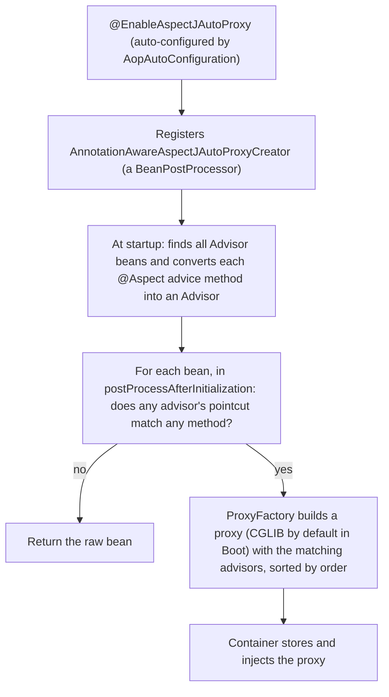
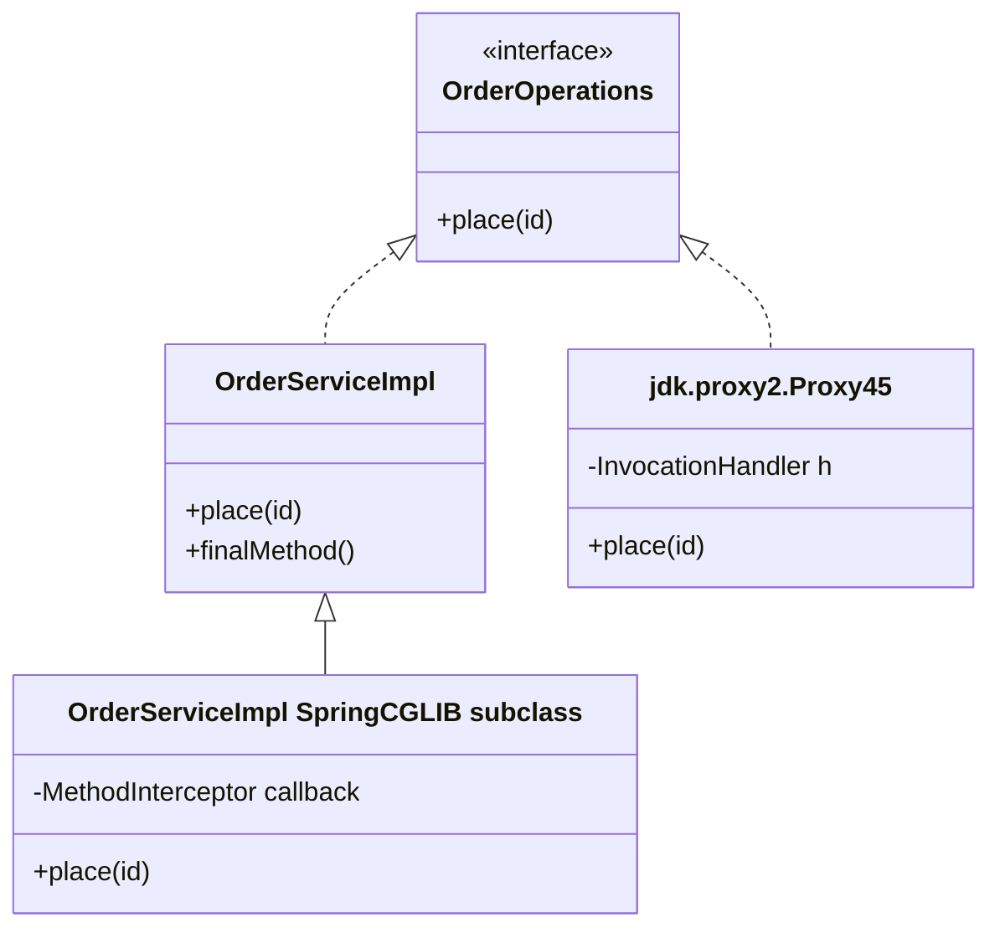

@@ 2 | MODULE | Proxies and AOP | How Spring adds behaviour around your methods with proxies, and why that explains every @Transactional surprise | MUST
# Proxies and AOP

**Shared analogy: a celebrity's personal assistant.** Callers never reach the celebrity directly; they talk to the assistant, who checks the schedule, logs the call, and then passes it through (or refuses). The assistant is the proxy, the checks are advice, and the rule "screen all calls from journalists" is a pointcut. But when the celebrity talks to themselves, no assistant is involved: that is self-invocation, the reason `@Transactional` sometimes does nothing.

- [[Spring AOP Concepts]] gives the vocabulary: aspect, advice, pointcut, join point, advisor.
- [[JDK Dynamic Proxy vs CGLIB]] explains the two ways Spring builds the assistant.
- [[How @Transactional Really Works]] follows one transactional call through the proxy, the interceptor and the transaction manager.

@@ 3 | TOPIC | Spring AOP Concepts | Aspects, advice types, pointcuts, join points and advisors, and how Spring AOP differs from AspectJ weaving | MUST
# Spring AOP Concepts

**Level: Advanced | Phase 18 | Priority: MUST | Since: Spring 1.0 (AOP Alliance), Spring 2.0 (@AspectJ annotations)**

> **30-second interview answer:** AOP (aspect-oriented programming) moves cross-cutting concerns such as logging, security, transactions and metrics out of business code into aspects. An aspect contains advice (the code to run: before, after, around) and a pointcut (the expression choosing which methods). Spring AOP applies aspects at runtime by wrapping beans in proxies, so it only intercepts public (and, with CGLIB, protected or package-visible) method calls that come from outside the bean. Full AspectJ weaves bytecode and can intercept anything, including self-calls, constructors and field access.

## 1. Concept in Simple Words
### Analogy
Airport security.

| Airport | AOP |
|---|---|
| Security screening is the same for every flight, whatever the destination | A cross-cutting concern, the same for many methods |
| The security procedure manual | The aspect |
| "Scan bags before boarding" | Before advice |
| "Count passengers after the gate closes" | After advice |
| "Check passport, let through, record exit" | Around advice wrapping the call |
| "Applies to all international flights" | Pointcut expression |
| The moment a passenger reaches the gate | Join point (a method execution) |
| The security checkpoint placed in front of gates | The proxy |
| Crew walking airside from the lounge never pass the checkpoint | Self-invocation bypasses the proxy |

### What it is
- **Cross-cutting concern:** behaviour that many classes need but that is not their main job (logging, timing, security, transactions, retries, caching).
- **Join point:** a point in program execution where an aspect can run. In Spring AOP this is always a **method execution** on a Spring bean.
- **Pointcut:** a predicate selecting join points, e.g. `execution(* com.orderhub..*Service.*(..))` or `@annotation(com.orderhub.Audited)`.
- **Advice:** the action taken at a join point. Types: `@Before`, `@AfterReturning`, `@AfterThrowing`, `@After` (finally), `@Around`.
- **Aspect:** a class (annotated `@Aspect`) that groups pointcuts and advice.
- **Advisor:** Spring's internal unit = one pointcut + one advice. `@Transactional` support is a `BeanFactoryTransactionAttributeSourceAdvisor`; each `@Aspect` advice method becomes an advisor.
- **Target:** the original bean. **Proxy:** the object Spring injects instead, which runs advice and then calls the target.
- **Weaving:** linking aspects with targets. Spring AOP weaves at runtime with proxies; AspectJ weaves at compile time or class-load time (LTW).

### Why it exists
Without AOP, each service method starts with "log, check permission, start timer, open transaction" and ends with the mirror image. The real logic is buried, and a change to the logging format means editing hundreds of methods. AOP puts that code in one place and applies it declaratively.

## 2. How It Works



**A call through the proxy** builds a chain of `MethodInterceptor`s (`ReflectiveMethodInvocation`). Each advice type is adapted to an interceptor, and `proceed()` moves to the next one; the last calls the target method by reflection.

```text
caller -> proxy.placeOrder()
            -> ExposeInvocationInterceptor
            -> AuditAspect @Around (order 1)      before part
               -> TransactionInterceptor (order LOWEST)   begin tx
                  -> target.placeOrder()          real code
               <- TransactionInterceptor           commit or rollback
            <- AuditAspect @Around                after part
          <- result
```

**Advice order inside one aspect** (Spring 5.2.7+): `@Around` (before proceed), `@Before`, the method, `@AfterReturning` or `@AfterThrowing`, `@After`, `@Around` (after proceed). Across aspects, use `@Order` on the aspect class; lower values run first on the way in and last on the way out. `@Transactional`'s advisor has `Ordered.LOWEST_PRECEDENCE` by default, so custom aspects usually run *outside* the transaction unless you change `@EnableTransactionManagement(order = ...)`.

**Pointcut designators supported by Spring AOP**

| Designator | Matches | Example |
|---|---|---|
| `execution` | Method signature | `execution(public * com.orderhub..*Service.*(..))` |
| `within` | All methods in types or packages | `within(com.orderhub.order..*)` |
| `@annotation` | Methods carrying an annotation | `@annotation(com.orderhub.audit.Audited)` |
| `@within` | Methods in classes carrying an annotation | `@within(org.springframework.stereotype.Service)` |
| `bean` (Spring only) | Bean name pattern | `bean(*Repository)` |
| `args`, `@args` | Argument types or argument annotations | `args(java.lang.Long,..)` |
| `this`, `target` | Proxy type or target type | `target(com.orderhub.order.OrderService)` |

**Spring AOP limits (all consequences of proxies):** only Spring beans; only method execution; no `private` methods; no `final` methods or classes with CGLIB; no `static` methods; no self-invocation; no constructors or field access.

## 3. Code Example
### Code
OrderHub audits important business operations with a custom `@Audited` annotation and times every service method.

```java
// file: src/main/java/com/orderhub/audit/Audited.java
package com.orderhub.audit;

import java.lang.annotation.ElementType;
import java.lang.annotation.Retention;
import java.lang.annotation.RetentionPolicy;
import java.lang.annotation.Target;

@Target(ElementType.METHOD)
@Retention(RetentionPolicy.RUNTIME)       // must be RUNTIME or the pointcut never sees it
public @interface Audited {
    String action();
}
```

```java
// file: src/main/java/com/orderhub/audit/AuditAspect.java
package com.orderhub.audit;

import java.util.Arrays;
import org.aspectj.lang.JoinPoint;
import org.aspectj.lang.ProceedingJoinPoint;
import org.aspectj.lang.annotation.AfterThrowing;
import org.aspectj.lang.annotation.Around;
import org.aspectj.lang.annotation.Aspect;
import org.aspectj.lang.annotation.Pointcut;
import org.slf4j.Logger;
import org.slf4j.LoggerFactory;
import org.springframework.core.annotation.Order;
import org.springframework.stereotype.Component;

@Aspect
@Component
@Order(1)                                   // outermost: wraps the transaction
public class AuditAspect {
    private static final Logger log = LoggerFactory.getLogger(AuditAspect.class);

    @Pointcut("within(com.orderhub..*) && execution(public * *..*Service.*(..))")
    void serviceMethods() { }

    @Around("@annotation(audited)")         // binds the annotation instance to the parameter
    public Object audit(ProceedingJoinPoint pjp, Audited audited) throws Throwable {
        String user = "alice";              // from SecurityContextHolder in the real app
        log.info("AUDIT start action={} user={} args={}", audited.action(), user,
                Arrays.toString(pjp.getArgs()));
        Object result = pjp.proceed();      // forgetting this silently skips the method
        log.info("AUDIT ok action={} result={}", audited.action(), result);
        return result;                      // forgetting this returns null to the caller
    }

    @Around("serviceMethods()")
    public Object time(ProceedingJoinPoint pjp) throws Throwable {
        long start = System.nanoTime();
        try {
            return pjp.proceed();
        } finally {
            log.info("TIME {} {} ms", pjp.getSignature().toShortString(),
                    (System.nanoTime() - start) / 1_000_000);
        }
    }

    @AfterThrowing(pointcut = "serviceMethods()", throwing = "ex")
    public void failed(JoinPoint jp, RuntimeException ex) {
        log.warn("FAILED {} -> {}", jp.getSignature().toShortString(), ex.getMessage());
    }
}
```

```java
// file: src/main/java/com/orderhub/order/OrderService.java
package com.orderhub.order;

import com.orderhub.audit.Audited;
import org.springframework.stereotype.Service;
import org.springframework.transaction.annotation.Transactional;

@Service
public class OrderService {
    private final OrderRepository orders;
    public OrderService(OrderRepository orders) { this.orders = orders; }

    @Audited(action = "ORDER_CANCEL")
    @Transactional
    public String cancel(long orderId) {
        Order order = orders.findById(orderId)
                .orElseThrow(() -> new IllegalArgumentException("order " + orderId + " not found"));
        order.cancel();
        return order.getStatus().name();
    }
}
```

```xml
<!-- pom.xml: Boot 3.5 has no separate AOP starter needed when spring-boot-starter-data-jpa is present,
     but declare it explicitly for custom aspects -->
<dependency>
    <groupId>org.springframework.boot</groupId>
    <artifactId>spring-boot-starter-aop</artifactId>
</dependency>
```

### Walkthrough
- `@Audited` has `RUNTIME` retention so the annotation is visible by reflection at runtime; with the default `CLASS` retention the pointcut would never match.
- `@Around("@annotation(audited)")` uses argument binding: the parameter name `audited` in the expression links to the method parameter, giving direct access to `action()`.
- `pjp.proceed()` continues the interceptor chain. An around advice that does not call it blocks the method; one that does not return the result makes the method appear to return `null`.
- `@Order(1)` makes the audit aspect run outside the `TransactionInterceptor`, so "AUDIT ok" is logged after commit. If you want audit records written in the same transaction, give the aspect a lower precedence than the transaction advisor.
- Two around advices on the same method are both applied; timing is listed second in the class but both come from the same aspect, so Spring orders them by advice type and then by declaration order.
- `@AfterThrowing` logs but cannot swallow the exception; use `@Around` with try/catch for that.

### Output
```http
POST /api/orders/42/cancel HTTP/1.1
```
```text
INFO  AuditAspect : AUDIT start action=ORDER_CANCEL user=alice args=[42]
INFO  AuditAspect : TIME OrderService.cancel(..) 18 ms
INFO  AuditAspect : AUDIT ok action=ORDER_CANCEL result=CANCELLED
```
```http
POST /api/orders/999/cancel HTTP/1.1
```
```text
INFO  AuditAspect : AUDIT start action=ORDER_CANCEL user=alice args=[999]
INFO  AuditAspect : TIME OrderService.cancel(..) 4 ms
WARN  AuditAspect : FAILED OrderService.cancel(..) -> order 999 not found
```

### Compare
| Without AOP | With AOP |
|---|---|
| Every service method repeats logging, timing, auditing | One aspect, applied by annotation or pointcut |
| Changing audit format touches 80 methods | Change one class |
| Easy to forget on a new method | Pointcut catches new methods automatically |
| Behaviour visible in the method body | Behaviour is invisible in the method; needs documentation and good naming |

## 4. Interview Questions
**Basic**
1. **What is AOP and what problem does it solve?**
   AOP separates cross-cutting concerns (logging, security, transactions, metrics) from business logic by putting them in aspects that are applied to many methods declaratively. It removes duplication and keeps business methods focused.
2. **Explain aspect, advice, pointcut and join point.**
   A join point is a place where extra behaviour can run (in Spring, a method execution). A pointcut is an expression selecting join points. Advice is the code that runs there (before, after, around). An aspect bundles pointcuts and advice.
3. **What advice types exist?**
   `@Before`, `@AfterReturning` (only on success, can read the result), `@AfterThrowing` (only on exception), `@After` (always, like finally) and `@Around` (wraps the call, controls whether and how it proceeds).

**Follow-up**
4. **How does Spring AOP differ from AspectJ?**
   Spring AOP uses runtime proxies, supports only method execution join points on Spring beans and cannot intercept self-calls, private or final methods. AspectJ modifies bytecode at compile or load time and supports fields, constructors, static and private methods and self-calls, at the cost of a special compiler or Java agent.
5. **How do you control the order of multiple aspects?**
   Put `@Order` on the aspect class or implement `Ordered`. Lower values have higher precedence: they run first before the method and last after it. Advice order inside one aspect is fixed by advice type.
6. **What happens if an `@Around` advice does not call `proceed()`?**
   The target method never runs, and the caller receives whatever the advice returns (null for an object return type, or a `NullPointerException` when unboxing for a primitive return type). That is sometimes intentional (caching, short-circuiting), but usually a bug.

**Tricky / scenario**
7. **Your logging aspect works for `orderService.place()` from the controller but not when `place()` calls `this.validate()`. Why?**
   The controller calls the proxy, which runs advice. Inside the target, `this.validate()` is a plain Java call on the target object and never goes through the proxy. Move `validate` to another bean, inject the proxy of the same bean (`@Lazy` self-injection), or use AspectJ weaving.
8. **An audit aspect should record the audit row only if the business transaction commits. How do you order it?**
   Either run the audit advice inside the transaction (lower precedence than the transaction advisor, so the row is part of the same transaction and rolls back with it), or keep it outside and register a `TransactionSynchronization` or publish an event handled by `@TransactionalEventListener(phase = AFTER_COMMIT)`.
9. **Does Spring Boot need `@EnableAspectJAutoProxy`?**
   No. `AopAutoConfiguration` enables it when AspectJ's `Advice` class is on the classpath and `spring.aop.auto` is true (the default). It also sets `proxyTargetClass=true`, so CGLIB proxies are used.

**What the interviewer is really testing:** whether you understand that Spring AOP is a proxy, which explains its limits, and whether you can use it for real cross-cutting concerns without breaking ordering and transactions.

## 5. Pitfalls & Best Practices
### Common mistakes
| Mistake | What goes wrong | Fix |
|---|---|---|
| Expecting advice on private methods or self-calls | Advice never runs | Call through another bean or use AspectJ |
| Annotation without `RUNTIME` retention | Pointcut never matches | `@Retention(RetentionPolicy.RUNTIME)` |
| Very broad pointcut like `execution(* *(..))` | Every bean proxied, slower startup, proxying of library beans, odd failures | Restrict with `within(com.orderhub..*)` |
| `@Around` forgets to return `proceed()`'s result | Callers get null | Always `return pjp.proceed()` |
| Business logic in aspects | Hidden behaviour, hard to test | Keep aspects for technical concerns |

### Best practices
- Prefer annotation-driven pointcuts (`@annotation(...)`) for business-relevant concerns: explicit at the use site, easy to grep.
- Always combine package restrictions with other designators to avoid proxying framework beans.
- Test aspects with a small Spring context (`@SpringBootTest(classes = {AuditAspect.class, FakeService.class})` plus `@EnableAspectJAutoProxy`) or with `AspectJProxyFactory` in a unit test.
- Think about order relative to `@Transactional`, `@Cacheable`, `@Retryable` and security every time you add an aspect.

### Compare with
| Mechanism | Scope | Good for |
|---|---|---|
| Spring AOP aspect | Spring bean method calls | Logging, metrics, auditing, custom annotations |
| AspectJ (compile or load-time weaving) | Any code | Self-invocation, domain objects, field access |
| Servlet `Filter` | HTTP requests before the `DispatcherServlet` | Security, CORS, request logging |
| `HandlerInterceptor` | Controller invocations | Per-handler checks, MDC, timing per endpoint |
| `BeanPostProcessor` returning a proxy | Bean instances | Framework-level features |

## 6. Hands-on Exercise
Add a `@RateLimited(perMinute = 5)` annotation to OrderHub and an aspect that rejects calls with `TooManyRequestsException` when a user calls the same annotated method more than `perMinute` times within one minute. Acceptance criteria: the aspect uses `@Around` with annotation binding; the counter is per user and per method; it is thread-safe; and the controller test for the 6th call returns 429 via the existing `@RestControllerAdvice`.

<details><summary>Solution</summary>

```java
// file: src/main/java/com/orderhub/ratelimit/RateLimited.java
package com.orderhub.ratelimit;

import java.lang.annotation.ElementType;
import java.lang.annotation.Retention;
import java.lang.annotation.RetentionPolicy;
import java.lang.annotation.Target;

@Target(ElementType.METHOD)
@Retention(RetentionPolicy.RUNTIME)
public @interface RateLimited {
    int perMinute();
}
```

```java
// file: src/main/java/com/orderhub/ratelimit/RateLimitAspect.java
package com.orderhub.ratelimit;

import java.time.Clock;
import java.util.concurrent.ConcurrentHashMap;
import java.util.concurrent.atomic.AtomicInteger;
import org.aspectj.lang.ProceedingJoinPoint;
import org.aspectj.lang.annotation.Around;
import org.aspectj.lang.annotation.Aspect;
import org.springframework.security.core.context.SecurityContextHolder;
import org.springframework.stereotype.Component;

@Aspect
@Component
public class RateLimitAspect {
    private final ConcurrentHashMap<String, AtomicInteger> counters = new ConcurrentHashMap<>();
    private final Clock clock;

    public RateLimitAspect(Clock clock) { this.clock = clock; }

    @Around("@annotation(limit)")
    public Object check(ProceedingJoinPoint pjp, RateLimited limit) throws Throwable {
        String user = SecurityContextHolder.getContext().getAuthentication().getName();
        long minute = clock.millis() / 60_000;               // fixed one-minute window
        String key = user + ":" + pjp.getSignature().toLongString() + ":" + minute;
        int count = counters.computeIfAbsent(key, k -> new AtomicInteger()).incrementAndGet();
        if (count > limit.perMinute()) {
            throw new TooManyRequestsException("Limit " + limit.perMinute() + "/min exceeded");
        }
        counters.keySet().removeIf(k -> !k.endsWith(":" + minute));   // drop old windows
        return pjp.proceed();
    }
}
```

```java
// in GlobalExceptionHandler (Phase 11)
@ExceptionHandler(TooManyRequestsException.class)
ProblemDetail tooMany(TooManyRequestsException ex) {
    return ProblemDetail.forStatusAndDetail(HttpStatus.TOO_MANY_REQUESTS, ex.getMessage());
}
```
This counter is per instance; with several OrderHub instances, move it to Redis (Phase 19) or use a gateway rate limiter (Phase 20).
</details>

## 7. Recall
Q: In Spring AOP, what are a join point, a pointcut and advice?
A: A join point is a method execution on a bean, a pointcut is an expression selecting join points, and advice is the code run at the selected join points.

Q: Which Spring AOP advice type can prevent the target method from running or change its result?
A: `@Around`, by not calling or by wrapping `ProceedingJoinPoint.proceed()`.

Q: Why does Spring AOP not intercept a call from one method to another in the same bean?
A: The internal call uses `this`, the raw target, not the proxy, so no advice runs.

Q: How does Spring AOP differ from AspectJ weaving?
A: Spring AOP uses runtime proxies and only intercepts external method calls on beans; AspectJ modifies bytecode and can intercept self-calls, private methods, constructors and fields.

Q: How do you control the order of custom aspects relative to @Transactional in Spring?
A: With `@Order` on the aspect; the transaction advisor defaults to lowest precedence, so ordered aspects run outside it unless you change the transaction order.

**Related:** [[JDK Dynamic Proxy vs CGLIB]] · [[How @Transactional Really Works]] · [[Proxy]] · [[BeanPostProcessor and BeanFactoryPostProcessor]]

@@ 3 | TOPIC | JDK Dynamic Proxy vs CGLIB | Interface-based versus subclass-based proxies, how each is built, which one Spring Boot uses and what each cannot intercept | MUST
# JDK Dynamic Proxy vs CGLIB

**Level: Advanced | Phase 18 | Priority: MUST | Since: JDK proxy Java 1.3, Spring Boot 2.0 (CGLIB default), Spring 6 (repackaged CGLIB in spring-core)**

> **30-second interview answer:** A JDK dynamic proxy is generated at runtime by `java.lang.reflect.Proxy`; it implements the target's interfaces and forwards every call to an `InvocationHandler`, so it only works with interfaces and can only be injected by interface type. CGLIB generates a subclass of the target class at runtime and overrides its methods to call interceptors, so it works without interfaces but cannot intercept `final` methods or proxy `final` classes. Plain Spring uses JDK proxies when an interface exists; Spring Boot sets `proxyTargetClass=true`, so it uses CGLIB for everything except Spring Data repositories and other interface-only beans.

## 1. Concept in Simple Words
### Analogy
Two ways to put a stand-in on stage for an actor.

| Theatre | Proxy |
|---|---|
| A stand-in who only knows the role's lines from the script (the "role" contract) | JDK proxy: implements the interface |
| Anyone checking "is this a person who plays Hamlet?" says yes | `proxy instanceof OrderOperations` is true |
| Anyone checking "is this specifically actor John Smith?" says no | `proxy instanceof OrderServiceImpl` is false |
| A body double trained as John himself, who copies him exactly | CGLIB: a subclass of the class |
| Lines John refuses to let anyone else say (sealed in his contract) | `final` methods cannot be overridden |
| John speaking to himself in a monologue | Self-invocation: neither stand-in is involved |

### What it is
- **JDK dynamic proxy:** `Proxy.newProxyInstance(classLoader, interfaces, handler)` creates a class (named like `jdk.proxy2.$Proxy45`) at runtime that implements the interfaces. Every method call goes to `InvocationHandler.invoke(proxy, method, args)`.
- **CGLIB (Code Generation Library):** generates bytecode for a subclass of the target class, overriding non-final methods to call a `MethodInterceptor`. Spring 6 ships a repackaged copy in `org.springframework.cglib` and uses Objenesis to create proxy instances without calling the class's constructor.
- **`proxyTargetClass`:** the switch. `false` means "use JDK proxies if the bean implements at least one interface", `true` means "always CGLIB". Spring Boot property: `spring.aop.proxy-target-class` (default `true` since Boot 2.0).
- **ByteBuddy:** another bytecode library used by Hibernate (lazy-loading proxies) and Mockito, not by Spring AOP.

### Why it exists
Spring needs to put advice around methods of objects it did not write. Java has only one built-in mechanism (interface proxies), which forced every service to have an interface. CGLIB removed that requirement. Boot switched the default to CGLIB because injecting a concrete class (very common) failed with JDK proxies in confusing ways.

## 2. How It Works



**JDK proxy call path:** `proxy.place(42)` calls generated code that does `h.invoke(this, Method place, new Object[]{42})`. Spring's handler is `JdkDynamicAopProxy`, which builds the advisor chain and finally invokes the method on the target by reflection.

**CGLIB call path:** the generated subclass overrides `place` to call `DynamicAdvisedInterceptor.intercept(...)`, which builds the same chain and calls the target. Important detail: the CGLIB proxy is a *separate object* from the target. Spring does not call `super.place()` on the proxy itself; it delegates to the target instance. That is why self-invocation inside the target is still not intercepted, and why the proxy's own fields are empty (Objenesis skipped the constructor).

```text
Spring CGLIB proxy object               Target object (your bean)
+-------------------------------+       +---------------------------+
| fields: null / default        |       | fields: injected deps     |
| place() overridden:           | ----> | place() { this.check(); } |
|   run interceptors, then call |       |   'this' = target, so     |
|   target.place()              |       |   check() is NOT advised  |
+-------------------------------+       +---------------------------+
```

**What each cannot do**

| Limitation | JDK proxy | CGLIB |
|---|---|---|
| Needs an interface | Yes | No |
| Inject by concrete class | Fails (`BeanNotOfRequiredTypeException`) | Works |
| `final` class | Fine (proxies the interface) | Cannot proxy: startup error |
| `final` method | Only interface methods exist on the proxy | Not intercepted; and if it reads fields, they are null on the proxy |
| `private` method | Not on the interface | Not intercepted |
| Package-private or protected methods | Not on the interface | Intercepted (Spring 6 `@Transactional` supports them for class-based proxies) |
| Constructor called twice | No | No since Spring 4 (Objenesis) |
| Speed | Very fast to create; calls through reflection | Slower to generate a class; call overhead similar on modern JVMs |

**Kotlin and records:** Kotlin classes are final by default (use the `kotlin-spring` all-open plugin), and records are final, so neither can be CGLIB-proxied.

## 3. Code Example
### Code
A plain Java demo of a JDK proxy (compiles and runs on its own), followed by the Spring view of both proxy types in OrderHub.

```java
import java.lang.reflect.InvocationHandler;
import java.lang.reflect.Method;
import java.lang.reflect.Proxy;
import java.util.Arrays;

public class JdkProxyDemo {

    interface OrderOperations {
        String place(long id);
        String cancel(long id);
    }

    static class OrderServiceImpl implements OrderOperations {
        @Override
        public String place(long id) {
            return "placed " + id + " / " + cancel(id);   // self-invocation: no proxy involved
        }
        @Override
        public String cancel(long id) { return "cancelled " + id; }
    }

    // The "advice": runs around every interface method
    static class LoggingHandler implements InvocationHandler {
        private final Object target;
        LoggingHandler(Object target) { this.target = target; }

        @Override
        public Object invoke(Object proxy, Method method, Object[] args) throws Throwable {
            System.out.println("before " + method.getName() + Arrays.toString(args));
            Object result = method.invoke(target, args);          // call the real object
            System.out.println("after  " + method.getName());
            return result;
        }
    }

    public static void main(String[] args) {
        OrderOperations target = new OrderServiceImpl();
        OrderOperations proxy = (OrderOperations) Proxy.newProxyInstance(
                OrderOperations.class.getClassLoader(),
                new Class<?>[] { OrderOperations.class },
                new LoggingHandler(target));

        System.out.println(proxy.place(42));
        System.out.println("is a Proxy class: " + Proxy.isProxyClass(proxy.getClass()));
        System.out.println("instanceof OrderOperations: " + (proxy instanceof OrderOperations));
        System.out.println("instanceof OrderServiceImpl: " + (proxy instanceof OrderServiceImpl));
    }
}
```

```java
// Spring view: file src/main/java/com/orderhub/infra/ProxyInspector.java
package com.orderhub.infra;

import com.orderhub.order.OrderRepository;
import com.orderhub.order.OrderService;
import org.springframework.aop.support.AopUtils;
import org.springframework.boot.ApplicationRunner;
import org.springframework.context.annotation.Bean;
import org.springframework.context.annotation.Configuration;

@Configuration(proxyBeanMethods = false)
public class ProxyInspector {

    @Bean
    ApplicationRunner inspectProxies(OrderService orderService, OrderRepository orderRepository) {
        return args -> {
            describe("orderService", orderService);       // concrete @Service with @Transactional
            describe("orderRepository", orderRepository); // Spring Data interface
        };
    }

    private static void describe(String name, Object bean) {
        System.out.println(name + " -> " + bean.getClass().getName());
        System.out.println("  aop proxy: " + AopUtils.isAopProxy(bean)
                + ", cglib: " + AopUtils.isCglibProxy(bean)
                + ", jdk: " + AopUtils.isJdkDynamicProxy(bean));
        System.out.println("  target class: " + AopUtils.getTargetClass(bean).getSimpleName());
    }
}
```

```yaml
# application.yml: the default in Spring Boot, shown explicitly
spring:
  aop:
    proxy-target-class: true    # false = JDK proxies for beans that implement an interface
```

### Walkthrough
- `Proxy.newProxyInstance` needs a class loader, the interfaces to implement and the handler. The returned object is an instance of a generated class implementing `OrderOperations`.
- `LoggingHandler.invoke` receives the `Method` object and calls it on the real target. This is exactly what Spring's `JdkDynamicAopProxy` does, with an interceptor chain in the middle.
- `place` calls `cancel` internally. The log shows "before cancel" is never printed: the inner call happens on the target, not the proxy. CGLIB behaves the same in Spring.
- The `instanceof OrderServiceImpl` check is false, which is why injecting `OrderServiceImpl` fails when Spring uses JDK proxies.
- `ProxyInspector` uses `AopUtils` to show that the service is a CGLIB proxy (Boot default) while the repository is a JDK proxy, because Spring Data builds repositories from interfaces only and has no class to subclass.

### Output
Plain Java demo:
```text
before place[42]
after  place
placed 42 / cancelled 42
is a Proxy class: true
instanceof OrderOperations: true
instanceof OrderServiceImpl: false
```
Spring view at OrderHub startup (Boot 3.5):
```text
orderService -> com.orderhub.order.OrderService$$SpringCGLIB$$0
  aop proxy: true, cglib: true, jdk: false
  target class: OrderService
orderRepository -> jdk.proxy2.$Proxy142
  aop proxy: true, cglib: false, jdk: true
  target class: SimpleJpaRepository
```

### Compare
| Question | JDK dynamic proxy | CGLIB |
|---|---|---|
| Mechanism | Implements interfaces | Subclasses the class |
| Requirement | At least one interface | Non-final class, accessible constructor not required (Objenesis) |
| Library | Built into the JDK | Repackaged in spring-core |
| Default in plain Spring (`@EnableAspectJAutoProxy`) | When an interface exists | When no interface exists |
| Default in Spring Boot | Only for interface-only beans (repositories) | Everything else |
| Class name pattern | `jdk.proxy2.$Proxy` plus a number | Target class name plus `SpringCGLIB` plus a number |

## 4. Interview Questions
**Basic**
1. **What is the difference between a JDK dynamic proxy and a CGLIB proxy?**
   A JDK proxy implements the target's interfaces and dispatches calls to an `InvocationHandler`; CGLIB creates a subclass of the target class and overrides methods. JDK needs an interface; CGLIB needs a non-final class and cannot intercept final methods.
2. **Which one does Spring Boot use by default?**
   CGLIB, because Boot's `AopAutoConfiguration` sets `proxyTargetClass=true` (`spring.aop.proxy-target-class=true`). Interface-only beans such as Spring Data repositories are still JDK proxies.
3. **What can neither proxy type intercept?**
   Private methods, static methods, and calls a bean makes to itself through `this`. CGLIB also cannot intercept final methods, and JDK proxies cannot intercept methods that are not on an interface.

**Follow-up**
4. **Why did Spring Boot switch the default to CGLIB?**
   With JDK proxies, injecting a bean by its concrete class (or calling a method not declared on the interface) fails because the proxy is not a subclass. Many applications inject concrete classes, and errors appeared only when someone added `@Transactional`. CGLIB makes the proxy type-compatible with the class.
5. **Does CGLIB call my constructor twice?**
   Not since Spring 4. Spring uses Objenesis to instantiate the proxy class without invoking constructors, so constructor side effects run only once (for the target). The proxy instance's own fields stay at default values.
6. **Why is calling a `final` method on a CGLIB proxy dangerous?**
   The final method cannot be overridden, so it runs on the proxy object itself, not on the target. The proxy's fields were never initialized, so the method sees null dependencies and may throw `NullPointerException`, and no advice runs.

**Tricky / scenario**
7. **After setting `spring.aop.proxy-target-class=false`, startup fails with "Bean named 'orderService' is expected to be of type OrderServiceImpl but was actually of type jdk.proxy2...". Why?**
   `OrderServiceImpl` implements an interface, so Spring now creates a JDK proxy. Another bean injects the concrete class, which the proxy is not. Inject the interface or restore class-based proxies.
8. **You annotate a record or a Kotlin class with `@Transactional` and startup fails with "Cannot subclass final class". What is going on?**
   CGLIB needs to subclass, and records and Kotlin classes (by default) are final. Use an interface with JDK proxies, open the Kotlin class (`kotlin-spring` plugin), or move the transactional method to a normal class.
9. **A mock created with Mockito and a Hibernate lazy entity proxy both show strange class names. Are those Spring CGLIB proxies?**
   No. Both are generated with ByteBuddy: Mockito subclasses the mocked type, and Hibernate generates a subclass of the entity that loads data on first access. The same rules apply, though: final classes and methods cannot be intercepted, which is why JPA entities should not be final.

**What the interviewer is really testing:** whether you understand proxies concretely enough to predict which calls are intercepted, which injections fail, and why final classes break Spring features.

## 5. Pitfalls & Best Practices
### Common mistakes
| Mistake | What goes wrong | Fix |
|---|---|---|
| Making a `@Service` or its methods `final` | No advice; final methods run on the empty proxy with null fields | Keep proxied classes and methods non-final |
| `@Transactional` on a `private` method | Silently ignored | Make it public or move it to another bean |
| Comparing `bean.getClass()` with the target class | Fails for proxies | Use `AopUtils.getTargetClass` or `ClassUtils.getUserClass` |
| Reading annotations with `getClass().getAnnotation` on a proxy | Annotation not found on the generated class | Use `AnnotationUtils.findAnnotation(AopUtils.getTargetClass(bean), ...)` |
| Switching to JDK proxies without checking injection points | Startup failures on concrete-class injection | Keep the Boot default unless you have a strong reason |

### Best practices
- Keep the Boot default (CGLIB) and do not create interfaces only to satisfy proxying; create them when there are multiple implementations or a module boundary.
- Never make Spring-managed service classes, JPA entities or their public methods `final`.
- Use `AopUtils` and `AopTestUtils.getTargetObject` in tests when you need the real object.
- For debugging, set a breakpoint in `CglibAopProxy.DynamicAdvisedInterceptor.intercept` or `JdkDynamicAopProxy.invoke` to see the whole advisor chain for a call.

### Compare with
| Technique | When generated | Typical users |
|---|---|---|
| JDK dynamic proxy | Runtime | Spring Data repositories, HTTP interface clients, Feign |
| CGLIB (Spring repackaged) | Runtime, or build time with Spring AOT | Spring AOP, full `@Configuration` classes |
| ByteBuddy | Runtime or build time | Hibernate lazy proxies, Mockito |
| AspectJ weaving | Compile or class-load time | Self-invocation, domain object advice |
| Hand-written proxy (decorator) | Compile time | Simple wrappers without a framework |

## 6. Hands-on Exercise
In OrderHub, write a JUnit test that proves three facts about `OrderService` (which has a `@Transactional` method): (1) the injected bean is a CGLIB proxy; (2) a `final` helper method declared on `OrderService` sees a null repository when called on the proxy; (3) unwrapping the proxy with `AopTestUtils` gives the real object whose repository is non-null. Acceptance criteria: uses `@SpringBootTest` with Testcontainers config from Phase 13; all three assertions pass; the final helper is removed (or made non-final) after the test proves the point.

<details><summary>Solution</summary>

```java
// file: src/main/java/com/orderhub/order/OrderService.java (temporary helper)
public final boolean hasRepository() {      // final: cannot be overridden by CGLIB
    return orders != null;
}
```

```java
// file: src/test/java/com/orderhub/order/OrderServiceProxyTest.java
package com.orderhub.order;

import static org.assertj.core.api.Assertions.assertThat;

import com.orderhub.TestcontainersConfig;
import org.junit.jupiter.api.Test;
import org.springframework.aop.support.AopUtils;
import org.springframework.beans.factory.annotation.Autowired;
import org.springframework.boot.test.context.SpringBootTest;
import org.springframework.context.annotation.Import;
import org.springframework.test.util.AopTestUtils;

@SpringBootTest
@Import(TestcontainersConfig.class)
class OrderServiceProxyTest {

    @Autowired
    OrderService orderService;

    @Test
    void injectedBeanIsCglibProxy() {
        assertThat(AopUtils.isCglibProxy(orderService)).isTrue();
    }

    @Test
    void finalMethodRunsOnProxyWithNullFields() {
        assertThat(orderService.hasRepository()).isFalse();   // runs on the proxy instance
    }

    @Test
    void targetHasDependencies() {
        OrderService target = AopTestUtils.getTargetObject(orderService);
        assertThat(target.hasRepository()).isTrue();
        assertThat(target).isNotSameAs(orderService);
    }
}
```
The middle test is the surprising one: the CGLIB proxy is a second object created by Objenesis, its `orders` field was never assigned, and a final method cannot be redirected to the target.
</details>

## 7. Recall
Q: How does a JDK dynamic proxy differ from a CGLIB proxy?
A: A JDK proxy implements the target's interfaces and calls an InvocationHandler; a CGLIB proxy subclasses the target class and overrides its non-final methods.

Q: Which proxy type does Spring Boot use by default, and which beans are exceptions?
A: CGLIB (`spring.aop.proxy-target-class=true`); interface-only beans such as Spring Data repositories are JDK proxies.

Q: Why does injecting a concrete class fail when Spring uses a JDK dynamic proxy?
A: The proxy only implements the interfaces, so it is not an instance of the concrete class.

Q: What happens when a final method is called on a Spring CGLIB proxy?
A: It is not intercepted and runs on the proxy object, whose fields are null because Objenesis skipped the constructor.

Q: Why can't Spring CGLIB proxies be created for Java records?
A: Records are final, and CGLIB must subclass the class.

**Related:** [[Spring AOP Concepts]] · [[How @Transactional Really Works]] · [[Proxy]] · [[Circular Dependencies]]

@@ 3 | TOPIC | How @Transactional Really Works | TransactionInterceptor, the transaction manager, thread-bound resources, rollback rules, self-invocation and the classic failure modes | MUST
# How @Transactional Really Works

**Level: Advanced | Phase 18 | Priority: MUST | Since: Spring 1.2 (annotation), Spring 6.0 (non-public methods on class proxies)**

> **30-second interview answer:** `@Transactional` works through a proxy. When a caller invokes the method on the proxy, `TransactionInterceptor` reads the transaction attributes, asks the `PlatformTransactionManager` (for JPA, `JpaTransactionManager`) to begin or join a transaction, binds the connection and `EntityManager` to the current thread via `TransactionSynchronizationManager`, calls the method, and commits, or rolls back on `RuntimeException` and `Error` (checked exceptions commit unless you set `rollbackFor`). Because it is a proxy, calls from inside the same bean, private methods, and work on other threads are not transactional.

## 1. Concept in Simple Words
### Analogy
A bank teller window with a supervisor.

| Bank | Spring transactions |
|---|---|
| You must go through the teller window to open a transaction file | Calls must go through the proxy |
| The supervisor opens a file folder for your session | The transaction manager begins a transaction |
| The folder sits on the teller's desk (only this teller sees it) | Connection bound to the current thread (`ThreadLocal`) |
| Every clerk you are sent to adds papers to the same folder | Inner `@Transactional` methods with REQUIRED join the existing transaction |
| A clerk stamps "VOID" on the folder after a problem | Inner method marks the transaction rollback-only |
| At the end, the supervisor files or shreds the folder | Commit or rollback |
| If a clerk walks to another desk (another thread), the folder does not follow | `@Async` or a new thread runs outside the transaction |
| A teller doing paperwork for themselves never visits the window | Self-invocation skips the proxy |

### What it is
- **`@Transactional`:** metadata saying "this method should run in a transaction with these attributes": `propagation`, `isolation`, `readOnly`, `timeout`, `rollbackFor`, `noRollbackFor`, `transactionManager` (also `value`) and `label`.
- **`TransactionInterceptor`:** the AOP advice (`MethodInterceptor`) that implements the behaviour; the core logic is in `TransactionAspectSupport.invokeWithinTransaction`.
- **`TransactionAttributeSource`:** reads annotations (`AnnotationTransactionAttributeSource`), considering method, class and interface levels; method wins over class.
- **`PlatformTransactionManager`:** the strategy interface (`getTransaction`, `commit`, `rollback`). Implementations: `JpaTransactionManager`, `DataSourceTransactionManager`, `JtaTransactionManager`, `KafkaTransactionManager`.
- **`TransactionSynchronizationManager`:** a set of `ThreadLocal`s holding the bound resources (connection holder, `EntityManagerHolder`), the current transaction's name, read-only flag and registered synchronizations.
- **Rollback-only:** a flag on the shared transaction that forces rollback at the end, even if the outermost method returns normally.

### Why it exists
Manual JDBC transactions (`setAutoCommit(false)`, commit in try, rollback in catch, always close in finally) were repeated in every method and leaked connections when someone forgot. Declarative transactions move that into infrastructure and let methods compose: a service calling three repositories gets one transaction without passing a connection around.

## 2. How It Works

```mermaid
sequenceDiagram
    participant C as "OrderController"
    participant P as "OrderService proxy (CGLIB)"
    participant TI as "TransactionInterceptor"
    participant TM as "JpaTransactionManager"
    participant TSM as "TransactionSynchronizationManager (ThreadLocal)"
    participant T as "OrderService target"
    C->>P: "placeOrder(cmd)"
    P->>TI: "invoke(methodInvocation)"
    TI->>TI: "getTransactionAttribute: REQUIRED, rollback on RuntimeException"
    TI->>TM: "getTransaction(attr)"
    TM->>TM: "existing tx bound? no: create EntityManager, begin, setAutoCommit(false)"
    TM->>TSM: "bindResource(emf, EntityManagerHolder); bindResource(dataSource, ConnectionHolder)"
    TI->>T: "proceed(): placeOrder(cmd)"
    T->>T: "repositories find the EntityManager via TSM, same connection"
    T-->>TI: "returns or throws"
    TI->>TM: "commit (flush, then COMMIT) or rollback if rollbackOn(ex)"
    TM->>TSM: "unbind, run afterCommit and afterCompletion synchronizations"
    TI-->>C: "result or exception"
```

**Inside `invokeWithinTransaction` (simplified from the real source)**

```java
TransactionAttribute attr = tas.getTransactionAttribute(method, targetClass);
PlatformTransactionManager tm = determineTransactionManager(attr);
TransactionInfo txInfo = createTransactionIfNecessary(tm, attr, joinpointIdentification);
Object retVal;
try {
    retVal = invocation.proceedWithInvocation();          // your method
} catch (Throwable ex) {
    completeTransactionAfterThrowing(txInfo, ex);         // rollback if attr.rollbackOn(ex), else commit
    throw ex;
} finally {
    cleanupTransactionInfo(txInfo);                       // restore outer TransactionInfo
}
commitTransactionAfterReturning(txInfo);                  // commit (or rollback if rollback-only)
return retVal;
```

**Propagation decisions inside `getTransaction`**

| Propagation | Transaction exists | No transaction |
|---|---|---|
| REQUIRED (default) | Join it | Create new |
| REQUIRES_NEW | Suspend it (unbind resources), create new on a second connection | Create new |
| NESTED | Savepoint in the existing one (JDBC savepoints; not supported by `JpaTransactionManager` with Hibernate by default) | Create new |
| SUPPORTS | Join | Run without |
| MANDATORY | Join | Throw `IllegalTransactionStateException` |
| NOT_SUPPORTED | Suspend, run without | Run without |
| NEVER | Throw | Run without |

**Rollback rules:** `DefaultTransactionAttribute.rollbackOn(ex)` returns `ex instanceof RuntimeException or Error`. Checked exceptions commit. `rollbackFor = Exception.class` changes that per method. Spring Framework 6.2 added a global switch, `@EnableTransactionManagement(rollbackOn = RollbackOn.ALL_EXCEPTIONS)`, for teams that want checked exceptions to roll back everywhere.

**Self-invocation**

```text
controller --> [proxy] --> target.placeOrder()  (transactional: proxy ran)
                               |
                               +--> this.reserveStock()   (annotated REQUIRES_NEW)
                                    plain call on target, proxy NOT involved
                                    -> runs inside placeOrder's transaction, annotation ignored
```

**The rollback-only trap (UnexpectedRollbackException)**

```text
outer() REQUIRED  ---------------------------------------------- commit? -> UnexpectedRollbackException
   try { inner() REQUIRED (joins) -> throws RuntimeException
             interceptor marks the SHARED transaction rollback-only }
   catch (RuntimeException e) { log and continue }    <- outer thinks it recovered
```
The inner interceptor cannot roll back a transaction it did not start, so it sets rollback-only. At the outer commit Spring sees the flag, rolls back and throws `UnexpectedRollbackException: Transaction silently rolled back because it has been marked as rollback-only`.

## 3. Code Example
### Code
OrderHub's checkout writes the order and records an audit row that must survive even if checkout fails.

```java
// file: src/main/java/com/orderhub/order/CheckoutService.java
package com.orderhub.order;

import com.orderhub.audit.AuditLogService;
import com.orderhub.inventory.InsufficientStockException;
import com.orderhub.inventory.StockService;
import org.springframework.stereotype.Service;
import org.springframework.transaction.annotation.Transactional;
import org.springframework.transaction.support.TransactionSynchronization;
import org.springframework.transaction.support.TransactionSynchronizationManager;

@Service
public class CheckoutService {
    private final OrderRepository orders;
    private final StockService stock;
    private final AuditLogService audit;

    public CheckoutService(OrderRepository orders, StockService stock, AuditLogService audit) {
        this.orders = orders;
        this.stock = stock;
        this.audit = audit;
    }

    @Transactional(rollbackFor = InsufficientStockException.class)   // checked exception must roll back
    public long checkout(long customerId, long productId, int qty) throws InsufficientStockException {
        System.out.println("tx active: " + TransactionSynchronizationManager.isActualTransactionActive()
                + ", name: " + TransactionSynchronizationManager.getCurrentTransactionName());

        Order order = orders.save(Order.create(customerId, productId, qty));
        audit.record("CHECKOUT_ATTEMPT order=" + order.getId());     // REQUIRES_NEW, separate bean
        stock.reserve(productId, qty);                               // joins this transaction

        TransactionSynchronizationManager.registerSynchronization(new TransactionSynchronization() {
            @Override
            public void afterCommit() {
                System.out.println("after commit: send confirmation email for " + order.getId());
            }
        });
        return order.getId();
    }

    // WRONG: self-invocation, shown for comparison
    public long checkoutTwice(long customerId, long productId, int qty) throws InsufficientStockException {
        return this.checkout(customerId, productId, qty);            // no proxy, no transaction
    }
}
```

```java
// file: src/main/java/com/orderhub/audit/AuditLogService.java
package com.orderhub.audit;

import org.springframework.jdbc.core.simple.JdbcClient;
import org.springframework.stereotype.Service;
import org.springframework.transaction.annotation.Propagation;
import org.springframework.transaction.annotation.Transactional;

@Service
public class AuditLogService {
    private final JdbcClient jdbc;
    public AuditLogService(JdbcClient jdbc) { this.jdbc = jdbc; }

    @Transactional(propagation = Propagation.REQUIRES_NEW)   // own connection, own commit
    public void record(String message) {
        jdbc.sql("insert into audit_log(message) values (?)").param(message).update();
    }
}
```

```java
// file: src/main/java/com/orderhub/inventory/StockService.java
package com.orderhub.inventory;

import org.springframework.jdbc.core.simple.JdbcClient;
import org.springframework.stereotype.Service;
import org.springframework.transaction.annotation.Propagation;
import org.springframework.transaction.annotation.Transactional;

@Service
public class StockService {
    private final JdbcClient jdbc;
    public StockService(JdbcClient jdbc) { this.jdbc = jdbc; }

    @Transactional(propagation = Propagation.MANDATORY)      // must be called inside a transaction
    public void reserve(long productId, int qty) throws InsufficientStockException {
        int updated = jdbc.sql("update stock set reserved = reserved + ? where product_id = ? and on_hand - reserved >= ?")
                .params(qty, productId, qty).update();
        if (updated == 0) throw new InsufficientStockException(productId, qty);
    }
}
```

```yaml
# application.yml: see the transaction manager's decisions
logging:
  level:
    org.springframework.orm.jpa.JpaTransactionManager: DEBUG
    org.springframework.transaction.interceptor: TRACE
spring:
  jpa:
    open-in-view: false
```

### Walkthrough
- `checkout` is called through the proxy, so `TransactionInterceptor` starts a transaction named `com.orderhub.order.CheckoutService.checkout`. The printed line proves a real transaction is active.
- `rollbackFor = InsufficientStockException.class` is needed because it is a checked exception; without it, Spring would commit the half-done order.
- `audit.record` is on a different bean, so its proxy suspends the outer transaction, opens a second connection, commits the audit row and resumes. The audit row survives the later rollback. Note this needs two pool connections at once per request.
- `stock.reserve` uses MANDATORY to document that it must never run alone. Its exception propagates through its own interceptor, which marks the shared transaction rollback-only, and then through the outer one, which rolls back.
- `registerSynchronization(... afterCommit ...)` runs code only if the commit succeeds; on rollback it is skipped. `@TransactionalEventListener` is built on the same mechanism.
- `checkoutTwice` calls `this.checkout(...)`: no proxy, so no transaction and no `rollbackFor`; each repository call auto-commits separately.

### Output
Successful checkout:
```text
DEBUG JpaTransactionManager : Creating new transaction with name [com.orderhub.order.CheckoutService.checkout]: PROPAGATION_REQUIRED,ISOLATION_DEFAULT,-com.orderhub.inventory.InsufficientStockException
tx active: true, name: com.orderhub.order.CheckoutService.checkout
DEBUG JpaTransactionManager : Suspending current transaction, creating new transaction with name [com.orderhub.audit.AuditLogService.record]
DEBUG JpaTransactionManager : Initiating transaction commit
DEBUG JpaTransactionManager : Resuming suspended transaction after completion of inner transaction
DEBUG JpaTransactionManager : Participating in existing transaction
DEBUG JpaTransactionManager : Initiating transaction commit
after commit: send confirmation email for 101
```
Out of stock:
```text
tx active: true, name: com.orderhub.order.CheckoutService.checkout
DEBUG JpaTransactionManager : Suspending current transaction, creating new transaction with name [com.orderhub.audit.AuditLogService.record]
DEBUG JpaTransactionManager : Initiating transaction commit
DEBUG JpaTransactionManager : Participating in existing transaction
DEBUG JpaTransactionManager : Participating transaction failed - marking existing transaction as rollback-only
DEBUG JpaTransactionManager : Initiating transaction rollback
```
The `orders` row is gone, the `audit_log` row `CHECKOUT_ATTEMPT order=102` remains, and no email is sent. The minus sign before the exception class in the first line is Spring's notation for "roll back on this exception".

### Compare
| Situation | Transactional? | Why |
|---|---|---|
| Controller calls `service.checkout()` (public) | Yes | Through the proxy |
| `checkout()` calls `this.helper()` annotated REQUIRES_NEW | No new transaction | Self-invocation |
| `@Transactional private void helper()` | Never | Proxies cannot override private methods |
| `@Transactional` protected or package-private method, CGLIB | Yes since Spring 6.0 | Class-based proxies support non-public methods |
| `@Transactional` method that starts `CompletableFuture.runAsync(...)` | Async part is not | Resources are bound to the original thread |
| Checked exception thrown, no `rollbackFor` | Commits | Default rule is unchecked only |
| Exception caught inside the method | Commits | The interceptor never sees it |

## 4. Interview Questions
**Basic**
1. **How does `@Transactional` work internally?**
   Spring wraps the bean in a proxy whose `TransactionInterceptor` reads the annotation, asks the `PlatformTransactionManager` to begin or join a transaction, binds the connection to the thread through `TransactionSynchronizationManager`, invokes the method, then commits or rolls back depending on the outcome and rollback rules.
2. **Which exceptions cause a rollback by default?**
   `RuntimeException` and `Error`. Checked exceptions commit the transaction unless listed in `rollbackFor`. Exceptions caught inside the method do not affect the transaction at all.
3. **Why does calling a `@Transactional` method from the same class not work?**
   The internal call goes through `this`, the target object, not through the proxy, so the interceptor never runs and the annotation's attributes are ignored. Move the method to another bean, inject the bean into itself lazily, or use `TransactionTemplate`.

**Follow-up**
4. **How do repositories find "the current transaction" without receiving it as a parameter?**
   The transaction manager binds an `EntityManagerHolder` and `ConnectionHolder` to the current thread in `TransactionSynchronizationManager`'s `ThreadLocal` maps. The shared `EntityManager` proxy injected into repositories looks up the bound one on each call.
5. **What is `UnexpectedRollbackException` and when does it happen?**
   An inner REQUIRED method throws, its interceptor marks the shared transaction rollback-only, the outer method catches the exception and returns normally, and at commit Spring finds the flag, rolls back and throws `UnexpectedRollbackException`. Fix it by letting the exception propagate, using REQUIRES_NEW for the inner work that may fail independently, or not catching.
6. **What does `readOnly = true` actually do?**
   It is a hint passed down: Spring sets the JDBC connection read-only, `JpaTransactionManager` sets Hibernate's flush mode to MANUAL and marks the session read-only, so dirty checking snapshots are skipped and nothing is flushed. Routing data sources can use it to send the query to a replica. It does not by itself forbid writes in every database.

**Tricky / scenario**
7. **A method annotated `@Transactional` sends a Kafka message and then the database commit fails. The consumer processes an order that does not exist. How do you fix it?**
   The message was sent inside the transaction but outside its atomicity. Send it after commit with `@TransactionalEventListener(phase = AFTER_COMMIT)` or a synchronization, or better use the transactional outbox pattern: insert an outbox row in the same transaction and publish it from a relay (Phase 20).
8. **In production you see connection pool exhaustion when traffic spikes, and every request calls a REQUIRES_NEW audit method. Why?**
   REQUIRES_NEW suspends the outer transaction but keeps its connection, then takes a second connection. With a pool of 10 and 10 concurrent requests holding their first connections, every request waits for a second one: a pool-level deadlock until `connectionTimeout`. Size the pool for it, avoid REQUIRES_NEW on hot paths, or write audit records after commit.
9. **`@Transactional` on an interface method, class uses CGLIB proxies. Does it work?**
   Since Spring 5 the annotation is detected on interface methods for class-based proxies too, so it works. The recommendation is still to annotate the concrete class or its methods, so that the behaviour is visible where the code lives.
10. **A `@Transactional` method calls a remote HTTP API that takes 10 seconds. What problems does this cause?**
    The database connection and any row locks are held for the full 10 seconds, starving the pool and blocking other writers. Do remote calls outside the transaction (before it, or after commit) and keep transactions short; use `TransactionTemplate` to scope only the database part.

**What the interviewer is really testing:** whether you can predict transactional behaviour from the proxy and thread-binding model, and diagnose real failures like silent commits, unexpected rollbacks and pool exhaustion.

## 5. Pitfalls & Best Practices
### Common mistakes
| Mistake | What goes wrong | Fix |
|---|---|---|
| Self-invocation of a `@Transactional` method | No transaction or wrong propagation | Call through another bean or use `TransactionTemplate` |
| Catching the exception inside the transactional method | Partial work committed | Rethrow, or call `TransactionAspectSupport.currentTransactionStatus().setRollbackOnly()` |
| Expecting checked exceptions to roll back | Silent commit | `rollbackFor = Exception.class` or the global `rollbackOn` setting |
| Remote calls or long computations inside a transaction | Pool exhaustion, lock contention | Keep transactions short; move I/O out |
| Catching an inner REQUIRED failure and continuing | `UnexpectedRollbackException` | Propagate, or use REQUIRES_NEW for independent work |
| Spawning threads or `@Async` from a transaction and expecting the same transaction | Work runs without a transaction or sees uncommitted data missing | Pass IDs and let the async work open its own transaction after commit |

### Best practices
- Put `@Transactional` on service methods that represent one business operation, not on controllers or repositories you write yourself.
- Use `@Transactional(readOnly = true)` at class level for query services and override on write methods.
- Turn on `JpaTransactionManager` DEBUG logging when behaviour surprises you; it states every create, join, suspend and rollback decision.
- Use `TransactionTemplate` for programmatic, fine-grained boundaries (for example, a loop committing every 1000 rows).
- Set `spring.jpa.open-in-view=false` so lazy loading outside transactions fails fast instead of holding connections during view rendering.

### Compare with
| Approach | Boundary | Pros | Cons |
|---|---|---|---|
| `@Transactional` | Method via proxy | Declarative, composable | Proxy limits, invisible boundaries |
| `TransactionTemplate` | Lambda | Explicit, works in self-calls and loops | More code |
| Manual `PlatformTransactionManager` | Code | Full control | Easy to leak or forget rollback |
| Plain JDBC `setAutoCommit(false)` | Code | No framework | Repetitive, not integrated with JPA |
| AspectJ mode (`@EnableTransactionManagement(mode = ASPECTJ)`) | Woven bytecode | Self-invocation and private methods work | Needs AspectJ weaver |

## 6. Hands-on Exercise
OrderHub's nightly `InvoiceService.generateAll()` loops over 5,000 orders and calls `generate(order)` on each; one bad order rolls back all invoices. Rewrite it so each invoice is generated in its own transaction, failures are logged and skipped, and the loop itself does not hold a transaction. Acceptance criteria: no self-invocation; one failed order does not affect the others; a test proves that with orders 1, 2 (bad) and 3, invoices exist for 1 and 3; the summary log prints the success and failure counts.

<details><summary>Solution</summary>

```java
// file: src/main/java/com/orderhub/invoice/InvoiceService.java
package com.orderhub.invoice;

import java.util.List;
import org.slf4j.Logger;
import org.slf4j.LoggerFactory;
import org.springframework.stereotype.Service;
import org.springframework.transaction.PlatformTransactionManager;
import org.springframework.transaction.support.TransactionTemplate;

@Service
public class InvoiceService {
    private static final Logger log = LoggerFactory.getLogger(InvoiceService.class);
    private final InvoiceGenerator generator;          // the per-order logic, no annotations needed
    private final OrderQuery orders;
    private final TransactionTemplate perOrderTx;

    public InvoiceService(InvoiceGenerator generator, OrderQuery orders, PlatformTransactionManager tm) {
        this.generator = generator;
        this.orders = orders;
        this.perOrderTx = new TransactionTemplate(tm);   // default REQUIRED: a new tx because none is active
    }

    // No @Transactional here: the loop must not hold one big transaction
    public void generateAll() {
        List<Long> ids = orders.uninvoicedOrderIds();
        int ok = 0, failed = 0;
        for (Long id : ids) {
            try {
                perOrderTx.executeWithoutResult(status -> generator.generate(id));
                ok++;
            } catch (RuntimeException e) {
                failed++;
                log.warn("Invoice for order {} failed: {}", id, e.getMessage());
            }
        }
        log.info("Invoices generated: {} ok, {} failed", ok, failed);
    }
}
```

```java
// file: src/test/java/com/orderhub/invoice/InvoiceServiceIT.java (essential part)
@Test
void badOrderDoesNotRollBackOthers() {
    invoiceService.generateAll();          // orders 1, 2 (missing price -> exception), 3 seeded by @Sql
    assertThat(invoiceRepository.findOrderIds()).containsExactlyInAnyOrder(1L, 3L);
}
```
Output:
```text
WARN  InvoiceService : Invoice for order 2 failed: order 2 has no price
INFO  InvoiceService : Invoices generated: 2 ok, 1 failed
```
`TransactionTemplate` avoids the proxy entirely, so there is no self-invocation trap, and each iteration commits or rolls back independently.
</details>

## 7. Recall
Q: Which Spring class implements the behaviour of @Transactional around a method call?
A: `TransactionInterceptor` (logic in `TransactionAspectSupport.invokeWithinTransaction`), invoked by the bean's proxy.

Q: How does a Spring repository find the current transaction's connection or EntityManager?
A: The transaction manager binds them to the current thread via `TransactionSynchronizationManager` `ThreadLocal`s.

Q: Which exceptions roll back a Spring @Transactional method by default?
A: `RuntimeException` and `Error`; checked exceptions commit unless listed in `rollbackFor`.

Q: Why does Spring throw UnexpectedRollbackException?
A: An inner participating method failed and marked the shared transaction rollback-only, but the outer method caught the exception and tried to commit.

Q: Why does @Transactional self-invocation not start a transaction?
A: The call goes through `this` on the target object, bypassing the proxy and its `TransactionInterceptor`.

Q: Why can REQUIRES_NEW cause connection pool exhaustion under load?
A: Each request holds its suspended outer connection while taking a second one, so concurrent requests can wait on each other for connections.

**Related:** [[Spring AOP Concepts]] · [[JDK Dynamic Proxy vs CGLIB]] · [[Connection Pooling with HikariCP]] · [[Distributed Transactions, Saga and Outbox]]
