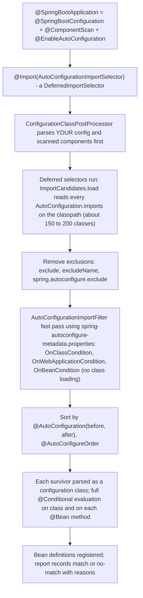
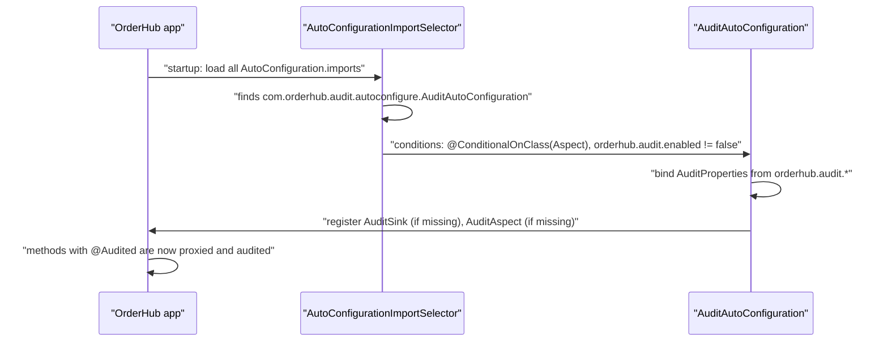

@@ 2 | MODULE | Boot internals | How Spring Boot decides what to configure, how to package your own auto-configuration, how a request flows through Spring MVC, and how to start faster | MUST
# Boot internals

**Shared analogy: a smart hotel room.** When you check in, the room looks at what you brought (the classpath) and your booking notes (properties) and configures itself: a crib appears if you have a baby, the desk lamp turns on if you have a laptop, but if you brought your own lamp, the hotel's stays in the cupboard (`@ConditionalOnMissingBean`). A starter is a "family package" you can order that brings both the items and the rules for setting them up. The front desk (the `DispatcherServlet`) routes every guest request to the right staff member. And a native image is a room fully prepared before you arrive, so you walk straight in.

- [[Auto-Configuration Internals]] is how the room decides what to set up.
- [[Writing a Custom Starter]] is how you create your own package with its rules.
- [[DispatcherServlet Request Lifecycle]] is the front desk handling each request.
- [[Startup Performance, AOT and GraalVM Native Images]] is preparing the room ahead of time.

@@ 3 | TOPIC | Auto-Configuration Internals | How @EnableAutoConfiguration loads AutoConfiguration.imports, how @Conditional annotations are evaluated and ordered, and how to debug the conditions report | MUST
# Auto-Configuration Internals

**Level: Advanced | Phase 18 | Priority: MUST | Since: Spring Boot 1.0 (spring.factories), Boot 2.7 (@AutoConfiguration and AutoConfiguration.imports), Boot 3.0 (spring.factories no longer read for auto-config)**

> **30-second interview answer:** `@SpringBootApplication` includes `@EnableAutoConfiguration`, which imports `AutoConfigurationImportSelector`. That selector reads the class names listed in `META-INF/spring/org.springframework.boot.autoconfigure.AutoConfiguration.imports` from every jar, quickly filters them using precomputed metadata (`@ConditionalOnClass` and friends), and hands the survivors to Spring as configuration classes. Because it is a `DeferredImportSelector`, auto-configuration is processed after your own configuration, so conditions like `@ConditionalOnMissingBean` see your beans and back off. You can see every decision with `--debug` or the `/actuator/conditions` endpoint.

## 1. Concept in Simple Words
### Analogy
A wedding planner with a checklist.

| Wedding planner | Auto-configuration |
|---|---|
| A thick binder with every possible service (music, catering, flowers) | All auto-configuration classes listed in `AutoConfiguration.imports` |
| "Only if there is a dance floor" | `@ConditionalOnClass(DispatcherServlet.class)` |
| "Only if the couple has not hired their own band" | `@ConditionalOnMissingBean` |
| "Only if the couple ticked 'fireworks: yes'" | `@ConditionalOnProperty` |
| The planner waits until the couple's own arrangements are known | `DeferredImportSelector`: user config first |
| Catering must be booked after the venue | `@AutoConfiguration(after = DataSourceAutoConfiguration.class)` |
| The planner's notes on what was booked and why not | The condition evaluation report |

### What it is
- **Auto-configuration class:** a `@AutoConfiguration` class (a `@Configuration(proxyBeanMethods = false)` with ordering attributes) containing `@Bean` methods guarded by conditions. Example: `DataSourceAutoConfiguration`, `JacksonAutoConfiguration`.
- **`AutoConfiguration.imports`:** a plain text file, one fully qualified class name per line, at `META-INF/spring/org.springframework.boot.autoconfigure.AutoConfiguration.imports`. Boot 2.7 introduced it; Boot 3.0 stopped reading auto-configurations from `spring.factories`.
- **`@Conditional`:** core Spring (4.0) annotation that takes a `Condition` class with `matches(ConditionContext, AnnotatedTypeMetadata)`. Spring Boot adds `@ConditionalOnClass`, `@ConditionalOnMissingClass`, `@ConditionalOnBean`, `@ConditionalOnMissingBean`, `@ConditionalOnProperty`, `@ConditionalOnResource`, `@ConditionalOnWebApplication`, `@ConditionalOnSingleCandidate`, `@ConditionalOnExpression`, `@ConditionalOnJava`, `@ConditionalOnCloudPlatform`, `@ConditionalOnThreading` (Boot 3.2, virtual threads), `@ConditionalOnBooleanProperty` (Boot 3.5).
- **Condition evaluation report:** a record of every condition outcome, printed with `debug=true` and served at `/actuator/conditions`.

### Why it exists
Before Boot, every Spring app copied the same 200 lines of configuration for a data source, transaction manager, Jackson, MVC and so on. Boot ships that configuration once, but only activates the pieces your classpath and properties ask for, and always lets your own beans win. "Opinionated defaults that back off" is the whole design.

## 2. How It Works



**Step details**
1. **Deferred:** `DeferredImportSelector` runs after all other `@Configuration` classes in the current processing round are parsed. That is what lets `@ConditionalOnMissingBean(DataSource.class)` see the `DataSource` you defined yourself.
2. **Candidate loading:** `ImportCandidates.load(AutoConfiguration.class, classLoader)` reads all files. Lines starting with `#` are comments.
3. **Fast filtering:** at build time, Boot's annotation processor (`spring-boot-autoconfigure-processor`) writes `META-INF/spring-autoconfigure-metadata.properties` containing entries like `...JacksonAutoConfiguration.ConditionalOnClass=com.fasterxml.jackson.databind.ObjectMapper`. The filter checks these strings against the classpath without loading the auto-configuration class itself, which removes most candidates cheaply.
4. **Ordering:** `@AutoConfiguration(after = ..., before = ...)` (or `@AutoConfigureAfter`, `@AutoConfigureBefore`, `@AutoConfigureOrder`) controls the order in which auto-configurations are *parsed*. Order matters for `@ConditionalOnBean`, which only sees bean definitions registered so far.
5. **Full evaluation:** for each class, `ConditionEvaluator.shouldSkip` evaluates conditions in two phases. `PARSE_CONFIGURATION` conditions (like `OnClassCondition`) decide whether the class is parsed at all. `REGISTER_BEAN` conditions (`OnBeanCondition` is a `ConfigurationCondition` with this phase) decide whether each bean definition is registered, after more definitions are known.
6. **Class-level then method-level:** a class-level condition failing skips the entire class; method-level conditions can skip individual `@Bean`s.

**How `@ConditionalOnClass` can reference a missing class:** the annotation's value is read from bytecode by ASM metadata reading (no class loading) during the filter and parse phases, so referencing `ObjectMapper.class` is safe even when Jackson is absent. That only works on the class-level annotation of a top-level or nested configuration class, which is why Boot uses nested static `@Configuration` classes for optional dependencies.

**Condition evaluation order inside one class**

| Order | What | Example |
|---|---|---|
| 1 | Class-level conditions, cheapest first (`OnClassCondition` before `OnBeanCondition`, via `@Order` on condition classes) | `@ConditionalOnClass(DataSource.class)` |
| 2 | Nested configuration classes, each with their own conditions | `DataSourceConfiguration.Hikari` |
| 3 | `@Bean` method conditions, at bean registration phase | `@ConditionalOnMissingBean` on `dataSource()` |

**Key rule:** `@ConditionalOnBean` and `@ConditionalOnMissingBean` are only reliable in auto-configuration classes (processed last, in a known order). In your own `@Configuration` they depend on scanning order and may give wrong answers.

## 3. Code Example
### Code
OrderHub inspects and overrides auto-configuration.

```java
// file: src/main/java/com/orderhub/OrderHubApplication.java
package com.orderhub;

import org.springframework.boot.SpringApplication;
import org.springframework.boot.autoconfigure.SpringBootApplication;
import org.springframework.boot.autoconfigure.task.TaskSchedulingAutoConfiguration;

@SpringBootApplication(exclude = TaskSchedulingAutoConfiguration.class)  // we do our own scheduling
public class OrderHubApplication {
    public static void main(String[] args) {
        SpringApplication.run(OrderHubApplication.class, args);
    }
}
```

```java
// file: src/main/java/com/orderhub/config/JsonConfig.java
package com.orderhub.config;

import com.fasterxml.jackson.databind.ObjectMapper;
import com.fasterxml.jackson.databind.SerializationFeature;
import org.springframework.boot.autoconfigure.jackson.Jackson2ObjectMapperBuilderCustomizer;
import org.springframework.context.annotation.Bean;
import org.springframework.context.annotation.Configuration;
import org.springframework.http.converter.json.Jackson2ObjectMapperBuilder;

@Configuration(proxyBeanMethods = false)
public class JsonConfig {

    // Option A (preferred): customise the auto-configured ObjectMapper, keep Boot's defaults
    @Bean
    Jackson2ObjectMapperBuilderCustomizer orderHubJson() {
        return builder -> builder.featuresToDisable(SerializationFeature.WRITE_DATES_AS_TIMESTAMPS);
    }

    // Option B: define your own ObjectMapper; JacksonAutoConfiguration's
    // @ConditionalOnMissingBean then backs off entirely. Uncomment to see the report change.
    // @Bean
    // ObjectMapper objectMapper(Jackson2ObjectMapperBuilder builder) {
    //     return builder.build();
    // }
}
```

A simplified copy of how Boot itself writes an auto-configuration (based on `JacksonAutoConfiguration` and `DataSourceAutoConfiguration` patterns):

```java
// Not OrderHub code: how Boot's auto-configurations are structured
package org.example.autoconfigure;

import com.fasterxml.jackson.databind.ObjectMapper;
import org.springframework.boot.autoconfigure.AutoConfiguration;
import org.springframework.boot.autoconfigure.condition.ConditionalOnClass;
import org.springframework.boot.autoconfigure.condition.ConditionalOnMissingBean;
import org.springframework.boot.autoconfigure.condition.ConditionalOnProperty;
import org.springframework.boot.autoconfigure.http.HttpMessageConvertersAutoConfiguration;
import org.springframework.boot.context.properties.EnableConfigurationProperties;
import org.springframework.context.annotation.Bean;

@AutoConfiguration(before = HttpMessageConvertersAutoConfiguration.class) // parse before the converters
@ConditionalOnClass(ObjectMapper.class)                                    // PARSE phase, read via ASM
@EnableConfigurationProperties(ExampleJsonProperties.class)
public class ExampleJsonAutoConfiguration {

    @Bean
    @ConditionalOnMissingBean                                  // REGISTER_BEAN phase: user bean wins
    @ConditionalOnProperty(prefix = "example.json", name = "enabled", havingValue = "true", matchIfMissing = true)
    ObjectMapper exampleObjectMapper(ExampleJsonProperties props) {
        ObjectMapper mapper = new ObjectMapper();
        mapper.findAndRegisterModules();
        return mapper;
    }
}
```

```text
# file: META-INF/spring/org.springframework.boot.autoconfigure.AutoConfiguration.imports (inside the jar)
org.example.autoconfigure.ExampleJsonAutoConfiguration
```

```yaml
# application.yml
debug: false                      # true prints the CONDITIONS EVALUATION REPORT at startup
spring:
  autoconfigure:
    exclude:
      - org.springframework.boot.autoconfigure.mail.MailSenderAutoConfiguration
management:
  endpoints:
    web:
      exposure:
        include: conditions,beans
```

### Walkthrough
- `exclude` on `@SpringBootApplication` and `spring.autoconfigure.exclude` both remove candidates before any condition runs. Use the property when the decision differs per environment.
- Option A uses a customizer: Boot's auto-configured `ObjectMapper` still exists with all its defaults (modules, property binding of `spring.jackson.*`), plus your tweak. Option B replaces it, so you lose `spring.jackson.*` properties unless you build from `Jackson2ObjectMapperBuilder` as shown.
- The example auto-configuration shows the canonical shape: class-level `@ConditionalOnClass` to avoid loading anything if the library is absent, bean-level `@ConditionalOnMissingBean` so user beans win, properties to switch features, and ordering relative to related auto-configs.
- The `.imports` file is the registration. Without it, the class is just an unused class in a jar (unless component scanning picks it up, which must never happen for auto-configurations).

### Output
Running with `--debug`:
```text
============================
CONDITIONS EVALUATION REPORT
============================

Positive matches:
-----------------
   DataSourceAutoConfiguration matched:
      - @ConditionalOnClass found required classes 'javax.sql.DataSource', 'org.springframework.jdbc.datasource.embedded.EmbeddedDatabaseType' (OnClassCondition)

   JacksonAutoConfiguration.JacksonObjectMapperConfiguration#jacksonObjectMapper matched:
      - @ConditionalOnMissingBean (types: com.fasterxml.jackson.databind.ObjectMapper; SearchStrategy: all) did not find any beans (OnBeanCondition)

Negative matches:
-----------------
   MongoAutoConfiguration:
      Did not match:
         - @ConditionalOnClass did not find required class 'com.mongodb.client.MongoClient' (OnClassCondition)

Exclusions:
-----------
   org.springframework.boot.autoconfigure.task.TaskSchedulingAutoConfiguration
   org.springframework.boot.autoconfigure.mail.MailSenderAutoConfiguration

Unconditional classes:
----------------------
   org.springframework.boot.autoconfigure.context.ConfigurationPropertiesAutoConfiguration
```
With Option B enabled, the Jackson entry moves to negative matches:
```text
   JacksonAutoConfiguration.JacksonObjectMapperConfiguration#jacksonObjectMapper:
      Did not match:
         - @ConditionalOnMissingBean (types: com.fasterxml.jackson.databind.ObjectMapper; SearchStrategy: all) found beans of type 'com.fasterxml.jackson.databind.ObjectMapper' objectMapper (OnBeanCondition)
```

### Compare
| Boot 2.6 and earlier | Boot 2.7 to 3.x |
|---|---|
| `META-INF/spring.factories` key `org.springframework.boot.autoconfigure.EnableAutoConfiguration=a.B,c.D` | `META-INF/spring/...AutoConfiguration.imports`, one class per line |
| `@Configuration` + `@AutoConfigureAfter` | `@AutoConfiguration(after = ...)` |
| Still read in Boot 2.7 (deprecated) | Not read for auto-config in Boot 3.0+ (still used for listeners, failure analyzers, environment post-processors) |

## 4. Interview Questions
**Basic**
1. **How does Spring Boot auto-configuration work?**
   `@EnableAutoConfiguration` imports `AutoConfigurationImportSelector`, which loads candidate classes from every `AutoConfiguration.imports` file, filters them by conditions and exclusions, orders them, and registers them as configuration classes after the user's configuration. Each auto-configuration creates beans guarded by `@Conditional` annotations, mainly "class present" and "bean missing".
2. **Where are auto-configuration classes registered in Spring Boot 3?**
   In `META-INF/spring/org.springframework.boot.autoconfigure.AutoConfiguration.imports`, one fully qualified class name per line. `spring.factories` is no longer read for auto-configuration since Boot 3.0.
3. **How do you disable a specific auto-configuration?**
   `@SpringBootApplication(exclude = X.class)`, `excludeName` for classes not on the classpath, or the `spring.autoconfigure.exclude` property. Often better: define your own bean so `@ConditionalOnMissingBean` backs off, or set the feature's property.

**Follow-up**
4. **Why are auto-configurations processed after user configuration?**
   `AutoConfigurationImportSelector` is a `DeferredImportSelector`, run after the regular configuration classes are parsed. That ordering lets `@ConditionalOnMissingBean` detect user-defined beans so Boot's defaults back off.
5. **How can `@ConditionalOnClass(SomeClass.class)` work if `SomeClass` is not on the classpath?**
   Spring reads annotation metadata from the class file with ASM instead of loading the class, so the class literal is just a name in the bytecode. Additionally, the import filter uses precomputed `spring-autoconfigure-metadata.properties` and never loads the auto-configuration class when the dependency is missing.
6. **Why should you avoid `@ConditionalOnBean` in normal `@Configuration` classes?**
   It only sees bean definitions registered so far. In user configuration, processing order depends on scanning and is not guaranteed, so the result can change between environments. In auto-configuration, order is controlled with `after` and `before`.

**Tricky / scenario**
7. **You added `spring-boot-starter-data-redis` and the app now fails to start because it cannot connect to Redis in tests. Why, and what are your options?**
   The starter puts Lettuce and Spring Data Redis on the classpath, so `RedisAutoConfiguration` and repositories auto-configuration match and create beans; something then connects eagerly (for example a health indicator or a repository init). Options: provide Redis with Testcontainers and `@ServiceConnection`, exclude the Redis auto-configurations in the test profile, or disable the specific feature via properties (`management.health.redis.enabled=false`).
8. **Your own `DataSource` bean is defined, but Boot still creates a second one and you get "expected single matching bean but found 2". How?**
   Your bean is probably not of type `DataSource` at definition level (for example a `@Bean` method returning `Object` or a `FactoryBean` whose type cannot be determined early), so `@ConditionalOnMissingBean(DataSource.class)` did not see it. Declare the most specific return type on `@Bean` methods; the conditions report shows exactly what was searched.
9. **How do you find out why a bean you expected is missing?**
   Start with `--debug` or `/actuator/conditions` and search for the auto-configuration: the report states the failed condition (missing class, property value, existing bean). `/actuator/beans` shows what exists. For property conditions, check spelling and relaxed binding.

**What the interviewer is really testing:** whether "Boot is magic" is replaced by a precise mental model you can use to debug missing or duplicate beans.

## 5. Pitfalls & Best Practices
### Common mistakes
| Mistake | What goes wrong | Fix |
|---|---|---|
| Putting auto-configurations in a package covered by component scanning | They are processed as user config: wrong order, conditions unreliable | Keep them out of scanned packages; register only via `.imports` |
| Using `@ConditionalOnBean` in user configuration | Results depend on order | Use it only in auto-configuration with explicit ordering |
| `@Bean` methods returning a broad type (`Object`) | `@ConditionalOnMissingBean` cannot match the real type | Return the specific type |
| Excluding auto-configuration instead of customising | You must rebuild everything Boot did, losing properties support | Prefer customizers and properties |
| Forgetting `.imports` after migrating from Boot 2 | Auto-configuration silently not applied | Move entries from `spring.factories` to `AutoConfiguration.imports` |

### Best practices
- When a bean behaves unexpectedly, read the auto-configuration's source; it is short and states exactly when it applies and what it reads.
- Customise with `*Customizer` beans (`Jackson2ObjectMapperBuilderCustomizer`, `WebServerFactoryCustomizer`, `RestClientCustomizer`) and properties before replacing beans.
- Use `ApplicationContextRunner` to test conditions of your own auto-configurations.
- Keep `debug=true` out of production configs; use `/actuator/conditions` (secured) instead.

### Compare with
| Mechanism | Who writes it | When processed | Backs off? |
|---|---|---|---|
| `@Configuration` in your app | You | First | Not by design |
| `@AutoConfiguration` | Library authors | After user config, ordered | Yes, via conditions |
| `@Import(SomeConfig.class)` | You | With the importing class | Only if it has conditions |
| `@Enable*` annotations | Library | When you add the annotation | No; explicit opt-in |

## 6. Hands-on Exercise
In OrderHub, prove the back-off behaviour with a test. Acceptance criteria: an `ApplicationContextRunner` test loads `JacksonAutoConfiguration`; case 1 asserts that exactly one `ObjectMapper` exists and that it has the bean name `jacksonObjectMapper`; case 2 registers a user configuration with its own `ObjectMapper` named `orderHubMapper` and asserts that only that bean exists; case 3 sets a `spring.jackson.serialization.indent-output=true` property and asserts the auto-configured mapper honours it.

<details><summary>Solution</summary>

```java
// file: src/test/java/com/orderhub/config/JacksonBackOffTest.java
package com.orderhub.config;

import static org.assertj.core.api.Assertions.assertThat;

import com.fasterxml.jackson.databind.ObjectMapper;
import com.fasterxml.jackson.databind.SerializationFeature;
import org.junit.jupiter.api.Test;
import org.springframework.boot.autoconfigure.AutoConfigurations;
import org.springframework.boot.autoconfigure.jackson.JacksonAutoConfiguration;
import org.springframework.boot.test.context.runner.ApplicationContextRunner;
import org.springframework.context.annotation.Bean;
import org.springframework.context.annotation.Configuration;

class JacksonBackOffTest {

    private final ApplicationContextRunner runner = new ApplicationContextRunner()
            .withConfiguration(AutoConfigurations.of(JacksonAutoConfiguration.class));

    @Test
    void autoConfiguredMapperByDefault() {
        runner.run(ctx -> {
            assertThat(ctx).hasSingleBean(ObjectMapper.class);
            assertThat(ctx).hasBean("jacksonObjectMapper");
        });
    }

    @Test
    void userMapperWins() {
        runner.withUserConfiguration(UserMapperConfig.class).run(ctx -> {
            assertThat(ctx).hasSingleBean(ObjectMapper.class);
            assertThat(ctx).hasBean("orderHubMapper");
            assertThat(ctx).doesNotHaveBean("jacksonObjectMapper");
        });
    }

    @Test
    void propertiesApplyToAutoConfiguredMapper() {
        runner.withPropertyValues("spring.jackson.serialization.indent-output=true").run(ctx ->
                assertThat(ctx.getBean(ObjectMapper.class)
                        .isEnabled(SerializationFeature.INDENT_OUTPUT)).isTrue());
    }

    @Configuration(proxyBeanMethods = false)
    static class UserMapperConfig {
        @Bean
        ObjectMapper orderHubMapper() { return new ObjectMapper(); }
    }
}
```
`AutoConfigurations.of(...)` applies the same ordering and deferred semantics as a real Boot app, so `withUserConfiguration` beans are seen by `@ConditionalOnMissingBean`.
</details>

## 7. Recall
Q: Which file registers auto-configuration classes in Spring Boot 3?
A: `META-INF/spring/org.springframework.boot.autoconfigure.AutoConfiguration.imports`, one class name per line.

Q: Why does Spring Boot auto-configuration back off when you define your own bean?
A: Auto-configuration is imported by a `DeferredImportSelector` after user configuration, and its beans use `@ConditionalOnMissingBean`.

Q: How does Spring Boot evaluate @ConditionalOnClass without loading a missing class?
A: It reads annotation metadata from bytecode with ASM and pre-filters with `spring-autoconfigure-metadata.properties`.

Q: How do you see why a Spring Boot auto-configuration did or did not apply?
A: Run with `--debug` (or `debug=true`) for the conditions evaluation report, or call `/actuator/conditions`.

Q: Why is @ConditionalOnBean unreliable in your own @Configuration classes?
A: It only sees bean definitions registered so far, and the processing order of user configuration is not guaranteed.

**Related:** [[Writing a Custom Starter]] · [[ApplicationContext Startup Lifecycle]] · [[BeanPostProcessor and BeanFactoryPostProcessor]]

@@ 3 | TOPIC | Writing a Custom Starter | Building an autoconfigure module and starter for OrderHub with properties, conditions, ordering, metadata and ApplicationContextRunner tests | SHOULD
# Writing a Custom Starter

**Level: Advanced | Phase 18 | Priority: SHOULD | Since: Spring Boot 1.0 (starters), Boot 2.7 (@AutoConfiguration)**

> **30-second interview answer:** A custom starter packages shared configuration so any service gets it by adding one dependency. It usually has two modules: an `-autoconfigure` module with `@AutoConfiguration` classes, `@ConfigurationProperties`, conditions and the `AutoConfiguration.imports` registration, and a `-starter` module that is an empty jar whose pom pulls in the autoconfigure module plus the libraries it needs. Every bean is guarded with `@ConditionalOnMissingBean` so applications can override it, and the conditions are tested with `ApplicationContextRunner`.

## 1. Concept in Simple Words
### Analogy
A meal kit delivery box.

| Meal kit | Starter |
|---|---|
| The box you order with one click | The `-starter` dependency |
| The ingredients inside | Transitive dependencies (libraries) |
| The recipe card that says how to combine them | The autoconfigure module |
| "If you already have rice at home, skip the rice pack" | `@ConditionalOnMissingBean` |
| "Spicy level: 1 to 5" on the card | `@ConfigurationProperties` with defaults |
| The label printed on the box listing contents | `spring-configuration-metadata.json` for IDE completion |
| Quality testing in the kit company's kitchen | `ApplicationContextRunner` tests |

### What it is
- **Starter:** a dependency descriptor, normally with no code. Official ones are named `spring-boot-starter-*`; third-party ones must be named `*-spring-boot-starter` (for example `orderhub-audit-spring-boot-starter`), never starting with `spring-boot`.
- **Autoconfigure module:** contains the auto-configuration, properties class and registration file. Spring's convention: `orderhub-audit-spring-boot-autoconfigure`. Small projects may merge both into one module.
- **`@ConfigurationProperties`:** type-safe binding of a property prefix (`orderhub.audit.*`) to a class or record.
- **`spring-boot-configuration-processor`:** annotation processor generating `META-INF/spring-configuration-metadata.json` so IDEs autocomplete and document your properties.
- **`spring-boot-autoconfigure-processor`:** generates `spring-autoconfigure-metadata.properties` so condition filtering is fast at startup.

### Why it exists
In a company with 30 services, each one copies the same audit, logging, security or client configuration, and they drift apart. A starter makes the platform team's defaults one dependency away, while still letting each service override any piece.

## 2. How It Works

```text
orderhub-audit-spring-boot-starter (pom only)
 ├── depends on orderhub-audit-spring-boot-autoconfigure
 │     ├── com/orderhub/audit/autoconfigure/AuditAutoConfiguration.class
 │     ├── com/orderhub/audit/autoconfigure/AuditProperties.class
 │     ├── com/orderhub/audit/Audited.class, AuditSink.class, LogAuditSink.class, AuditAspect.class
 │     └── META-INF/
 │          ├── spring/org.springframework.boot.autoconfigure.AutoConfiguration.imports
 │          ├── spring-configuration-metadata.json        (generated)
 │          └── spring-autoconfigure-metadata.properties  (generated)
 ├── depends on spring-boot-starter-aop
 └── (optional) jdbc for the JDBC sink: marked optional in autoconfigure, required in starter if wanted
```



**Design rules for starter authors**
1. **Never component-scan** the starter's packages. Register only through `.imports`.
2. **Every bean `@ConditionalOnMissingBean`**, so users replace pieces by defining their own.
3. **Guard optional libraries with `@ConditionalOnClass`** on a nested configuration class, and mark those dependencies `<optional>true</optional>` in the autoconfigure module.
4. **A master switch** (`orderhub.audit.enabled`, default true) using `@ConditionalOnProperty(matchIfMissing = true)` or `@ConditionalOnBooleanProperty` (Boot 3.5).
5. **Order** relative to what you depend on: `@AutoConfiguration(after = DataSourceAutoConfiguration.class)` if you use a `DataSource` bean with `@ConditionalOnBean`.
6. **Namespace properties** with your own prefix; never reuse `spring.*` or `server.*`.
7. **Use `proxyBeanMethods = false`** (default for `@AutoConfiguration`), so no CGLIB subclass of the configuration is needed.

## 3. Code Example
### Code
OrderHub's audit feature from the AOP topic becomes a reusable starter for all OrderHub services.

```xml
<!-- file: orderhub-audit-spring-boot-autoconfigure/pom.xml (essential parts) -->
<project>
    <modelVersion>4.0.0</modelVersion>
    <parent>
        <groupId>org.springframework.boot</groupId>
        <artifactId>spring-boot-starter-parent</artifactId>
        <version>3.5.0</version>
        <relativePath/>
    </parent>
    <groupId>com.orderhub</groupId>
    <artifactId>orderhub-audit-spring-boot-autoconfigure</artifactId>
    <version>1.0.0</version>

    <dependencies>
        <dependency>
            <groupId>org.springframework.boot</groupId>
            <artifactId>spring-boot-autoconfigure</artifactId>
        </dependency>
        <dependency>
            <groupId>org.springframework.boot</groupId>
            <artifactId>spring-boot-starter-aop</artifactId>
            <optional>true</optional>
        </dependency>
        <dependency>
            <groupId>org.springframework</groupId>
            <artifactId>spring-jdbc</artifactId>
            <optional>true</optional>                 <!-- JDBC sink only if the app has JDBC -->
        </dependency>
        <dependency>
            <groupId>org.springframework.boot</groupId>
            <artifactId>spring-boot-configuration-processor</artifactId>
            <optional>true</optional>
        </dependency>
        <dependency>
            <groupId>org.springframework.boot</groupId>
            <artifactId>spring-boot-autoconfigure-processor</artifactId>
            <optional>true</optional>
        </dependency>
        <dependency>
            <groupId>org.springframework.boot</groupId>
            <artifactId>spring-boot-starter-test</artifactId>
            <scope>test</scope>
        </dependency>
    </dependencies>
</project>
```

```xml
<!-- file: orderhub-audit-spring-boot-starter/pom.xml: no code, only dependencies -->
<project>
    <modelVersion>4.0.0</modelVersion>
    <groupId>com.orderhub</groupId>
    <artifactId>orderhub-audit-spring-boot-starter</artifactId>
    <version>1.0.0</version>
    <dependencies>
        <dependency>
            <groupId>com.orderhub</groupId>
            <artifactId>orderhub-audit-spring-boot-autoconfigure</artifactId>
            <version>1.0.0</version>
        </dependency>
        <dependency>
            <groupId>org.springframework.boot</groupId>
            <artifactId>spring-boot-starter-aop</artifactId>
            <version>3.5.0</version>
        </dependency>
    </dependencies>
</project>
```

```java
// file: autoconfigure/src/main/java/com/orderhub/audit/autoconfigure/AuditProperties.java
package com.orderhub.audit.autoconfigure;

import java.util.Set;
import org.springframework.boot.context.properties.ConfigurationProperties;
import org.springframework.boot.context.properties.bind.DefaultValue;

/**
 * Audit settings for OrderHub services.
 * @param enabled whether auditing is active
 * @param sink where audit events go: LOG or JDBC
 * @param maskedArguments argument names whose values are replaced with ***
 */
@ConfigurationProperties(prefix = "orderhub.audit")
public record AuditProperties(
        @DefaultValue("true") boolean enabled,
        @DefaultValue("LOG") Sink sink,
        @DefaultValue({"password", "cardNumber"}) Set<String> maskedArguments) {

    public enum Sink { LOG, JDBC }
}
```

```java
// file: autoconfigure/src/main/java/com/orderhub/audit/AuditSink.java
package com.orderhub.audit;

public interface AuditSink {
    void write(String action, String user, String details);
}
```

```java
// file: autoconfigure/src/main/java/com/orderhub/audit/LogAuditSink.java
// SLF4J arrives through spring-boot-starter-logging (org.springframework.boot)
package com.orderhub.audit;

import org.slf4j.Logger;
import org.slf4j.LoggerFactory;

public class LogAuditSink implements AuditSink {
    private static final Logger log = LoggerFactory.getLogger("AUDIT");
    @Override
    public void write(String action, String user, String details) {
        log.info("action={} user={} details={}", action, user, details);
    }
}
```

```java
// file: autoconfigure/src/main/java/com/orderhub/audit/JdbcAuditSink.java
package com.orderhub.audit;

import org.springframework.jdbc.core.simple.JdbcClient;

public class JdbcAuditSink implements AuditSink {
    private final JdbcClient jdbc;
    public JdbcAuditSink(JdbcClient jdbc) { this.jdbc = jdbc; }

    @Override
    public void write(String action, String user, String details) {
        jdbc.sql("insert into audit_log(action, username, details) values (?, ?, ?)")
            .params(action, user, details).update();
    }
}
```

```java
// file: autoconfigure/src/main/java/com/orderhub/audit/AuditAspect.java
package com.orderhub.audit;

import java.util.Set;
import java.util.StringJoiner;
import org.aspectj.lang.ProceedingJoinPoint;
import org.aspectj.lang.annotation.Around;
import org.aspectj.lang.annotation.Aspect;
import org.aspectj.lang.reflect.MethodSignature;
import org.springframework.security.core.Authentication;
import org.springframework.security.core.context.SecurityContextHolder;

@Aspect
public class AuditAspect {
    private final AuditSink sink;
    private final Set<String> masked;

    public AuditAspect(AuditSink sink, Set<String> masked) {
        this.sink = sink;
        this.masked = masked;
    }

    @Around("@annotation(audited)")
    public Object audit(ProceedingJoinPoint pjp, Audited audited) throws Throwable {
        Object result = pjp.proceed();                      // audit only successful operations
        sink.write(audited.action(), currentUser(), describe(pjp));
        return result;
    }

    private String describe(ProceedingJoinPoint pjp) {
        String[] names = ((MethodSignature) pjp.getSignature()).getParameterNames();
        Object[] values = pjp.getArgs();
        StringJoiner joiner = new StringJoiner(", ");
        for (int i = 0; i < values.length; i++) {
            String name = names == null ? "arg" + i : names[i];
            joiner.add(name + "=" + (masked.contains(name) ? "***" : values[i]));
        }
        return joiner.toString();
    }

    private static String currentUser() {
        try {
            Authentication auth = SecurityContextHolder.getContext().getAuthentication();
            return auth == null ? "anonymous" : auth.getName();
        } catch (NoClassDefFoundError e) {                  // Spring Security not on classpath
            return "anonymous";
        }
    }
}
```

```java
// file: autoconfigure/src/main/java/com/orderhub/audit/autoconfigure/AuditAutoConfiguration.java
package com.orderhub.audit.autoconfigure;

import com.orderhub.audit.AuditAspect;
import com.orderhub.audit.AuditSink;
import com.orderhub.audit.JdbcAuditSink;
import com.orderhub.audit.LogAuditSink;
import org.springframework.boot.autoconfigure.AutoConfiguration;
import org.springframework.boot.autoconfigure.condition.ConditionalOnBean;
import org.springframework.boot.autoconfigure.condition.ConditionalOnClass;
import org.springframework.boot.autoconfigure.condition.ConditionalOnMissingBean;
import org.springframework.boot.autoconfigure.condition.ConditionalOnProperty;
import org.springframework.boot.autoconfigure.jdbc.JdbcClientAutoConfiguration;
import org.springframework.boot.context.properties.EnableConfigurationProperties;
import org.springframework.context.annotation.Bean;
import org.springframework.context.annotation.Configuration;
import org.springframework.jdbc.core.simple.JdbcClient;

@AutoConfiguration(after = JdbcClientAutoConfiguration.class)     // so @ConditionalOnBean(JdbcClient) can see it
@ConditionalOnClass(name = "org.aspectj.lang.annotation.Aspect")  // AOP must be present
@ConditionalOnProperty(prefix = "orderhub.audit", name = "enabled", havingValue = "true", matchIfMissing = true)
@EnableConfigurationProperties(AuditProperties.class)
public class AuditAutoConfiguration {

    @Configuration(proxyBeanMethods = false)
    @ConditionalOnClass(JdbcClient.class)                          // nested: safe if spring-jdbc is absent
    @ConditionalOnProperty(prefix = "orderhub.audit", name = "sink", havingValue = "JDBC")
    static class JdbcSinkConfiguration {
        @Bean
        @ConditionalOnMissingBean(AuditSink.class)
        @ConditionalOnBean(JdbcClient.class)
        AuditSink jdbcAuditSink(JdbcClient jdbc) {
            return new JdbcAuditSink(jdbc);
        }
    }

    @Bean
    @ConditionalOnMissingBean(AuditSink.class)                     // fallback if no JDBC sink and no user sink
    AuditSink logAuditSink() {
        return new LogAuditSink();
    }

    @Bean
    @ConditionalOnMissingBean
    AuditAspect auditAspect(AuditSink sink, AuditProperties props) {
        return new AuditAspect(sink, props.maskedArguments());
    }
}
```

```text
# file: autoconfigure/src/main/resources/META-INF/spring/org.springframework.boot.autoconfigure.AutoConfiguration.imports
com.orderhub.audit.autoconfigure.AuditAutoConfiguration
```

```java
// file: autoconfigure/src/test/java/com/orderhub/audit/autoconfigure/AuditAutoConfigurationTest.java
package com.orderhub.audit.autoconfigure;

import static org.assertj.core.api.Assertions.assertThat;

import com.orderhub.audit.AuditAspect;
import com.orderhub.audit.AuditSink;
import com.orderhub.audit.JdbcAuditSink;
import com.orderhub.audit.LogAuditSink;
import org.junit.jupiter.api.Test;
import org.springframework.boot.autoconfigure.AutoConfigurations;
import org.springframework.boot.autoconfigure.jdbc.DataSourceAutoConfiguration;
import org.springframework.boot.autoconfigure.jdbc.JdbcClientAutoConfiguration;
import org.springframework.boot.autoconfigure.jdbc.JdbcTemplateAutoConfiguration;
import org.springframework.boot.test.context.FilteredClassLoader;
import org.springframework.boot.test.context.runner.ApplicationContextRunner;
import org.springframework.context.annotation.Bean;
import org.springframework.context.annotation.Configuration;

class AuditAutoConfigurationTest {

    private final ApplicationContextRunner runner = new ApplicationContextRunner()
            .withConfiguration(AutoConfigurations.of(AuditAutoConfiguration.class));

    @Test
    void defaultsToLogSink() {
        runner.run(ctx -> {
            assertThat(ctx).hasSingleBean(AuditAspect.class);
            assertThat(ctx).getBean(AuditSink.class).isInstanceOf(LogAuditSink.class);
        });
    }

    @Test
    void jdbcSinkWhenConfiguredAndDataSourcePresent() {
        runner.withConfiguration(AutoConfigurations.of(DataSourceAutoConfiguration.class,
                        JdbcTemplateAutoConfiguration.class, JdbcClientAutoConfiguration.class))
              .withPropertyValues("orderhub.audit.sink=JDBC",
                        "spring.datasource.url=jdbc:h2:mem:audit")
              .run(ctx -> assertThat(ctx).getBean(AuditSink.class).isInstanceOf(JdbcAuditSink.class));
    }

    @Test
    void backsOffWhenUserDefinesSink() {
        runner.withUserConfiguration(CustomSinkConfig.class)
              .run(ctx -> assertThat(ctx).getBean(AuditSink.class).isSameAs(CustomSinkConfig.SINK));
    }

    @Test
    void disabledByProperty() {
        runner.withPropertyValues("orderhub.audit.enabled=false")
              .run(ctx -> assertThat(ctx).doesNotHaveBean(AuditAspect.class));
    }

    @Test
    void absentWithoutAspectJ() {
        runner.withClassLoader(new FilteredClassLoader("org.aspectj"))
              .run(ctx -> assertThat(ctx).doesNotHaveBean(AuditAspect.class));
    }

    @Configuration(proxyBeanMethods = false)
    static class CustomSinkConfig {
        static final AuditSink SINK = (action, user, details) -> { };
        @Bean
        AuditSink customSink() { return SINK; }
    }
}
```

Using it in the OrderHub application:

```xml
<!-- OrderHub pom.xml -->
<dependency>
    <groupId>com.orderhub</groupId>
    <artifactId>orderhub-audit-spring-boot-starter</artifactId>
    <version>1.0.0</version>
</dependency>
```

```yaml
# OrderHub application.yml (IDE autocompletes these thanks to the configuration processor)
orderhub:
  audit:
    sink: JDBC
    masked-arguments: password,cardNumber,iban
```

```java
// OrderHub: any bean method can now be audited
@Audited(action = "CUSTOMER_PASSWORD_CHANGE")
@Transactional
public void changePassword(long customerId, String password) {
    customers.updatePassword(customerId, encoder.encode(password));
}
```

### Walkthrough
- **Two modules:** the autoconfigure jar has code and declares optional dependencies; the starter jar has none and pulls in what a typical user needs. Users who want only the log sink can depend on autoconfigure alone.
- **`AuditProperties` as a record** with `@DefaultValue` gives immutable, constructor-bound properties. The Javadoc on the record becomes property descriptions in the IDE thanks to the configuration processor. Relaxed binding maps `masked-arguments` to `maskedArguments`.
- **Class-level conditions:** `@ConditionalOnClass(name = ...)` uses a string so the check is safe even without AspectJ; the property switch turns the whole feature off.
- **Nested `JdbcSinkConfiguration`:** it references `JdbcClient`, which may be missing. Because it is a nested class with its own `@ConditionalOnClass`, Spring never loads its bean method signatures unless spring-jdbc is present. `after = JdbcClientAutoConfiguration.class` ensures the `JdbcClient` bean definition exists when `@ConditionalOnBean` is evaluated.
- **Fallback order:** the nested configuration is processed before the outer class's own `@Bean` methods, so when JDBC applies, `logAuditSink`'s `@ConditionalOnMissingBean` sees the JDBC sink and backs off.
- **`AuditAspect` is a plain class registered as a `@Bean`**, not a `@Component`, because starters must not rely on scanning.
- **Tests** cover the default, the configured path, back-off, the master switch and a missing library (`FilteredClassLoader` hides classes from the context).

### Output
OrderHub log after `PUT /api/customers/7/password` with `sink: LOG`:
```text
INFO  AUDIT : action=CUSTOMER_PASSWORD_CHANGE user=alice details=customerId=7, password=***
```
With `sink: JDBC`:
```sql
insert into audit_log(action, username, details) values ('CUSTOMER_PASSWORD_CHANGE', 'alice', 'customerId=7, password=***')
```
`--debug` report excerpt:
```text
   AuditAutoConfiguration matched:
      - @ConditionalOnClass found required class 'org.aspectj.lang.annotation.Aspect' (OnClassCondition)
      - @ConditionalOnProperty (orderhub.audit.enabled=true) matched (OnPropertyCondition)
   AuditAutoConfiguration.JdbcSinkConfiguration matched:
      - @ConditionalOnClass found required class 'org.springframework.jdbc.core.simple.JdbcClient' (OnClassCondition)
      - @ConditionalOnProperty (orderhub.audit.sink=JDBC) matched (OnPropertyCondition)
   AuditAutoConfiguration#logAuditSink:
      Did not match:
         - @ConditionalOnMissingBean (types: com.orderhub.audit.AuditSink; SearchStrategy: all) found beans of type 'com.orderhub.audit.AuditSink' jdbcAuditSink (OnBeanCondition)
```
Parameter names in the details require compiling with `-parameters`, which `spring-boot-starter-parent` enables by default.

### Compare
| Approach | Reuse across services | Overridable | Conditional |
|---|---|---|---|
| Copy-paste configuration | Manual, drifts | Yes | No |
| Shared library with `@Configuration` and `@ComponentScan` | Yes | Hard (duplicate beans) | No |
| Shared library with `@EnableOrderHubAudit` | Yes, explicit opt-in | Partly | Optional |
| Custom starter with auto-configuration | Yes, one dependency | Yes, via `@ConditionalOnMissingBean` | Yes |

## 4. Interview Questions
**Basic**
1. **What is a Spring Boot starter?**
   A dependency descriptor that brings a feature's libraries and its auto-configuration together, so adding one dependency enables the feature with sensible defaults. Official starters contain no code; the auto-configuration lives in a separate module.
2. **What are the steps to create a custom starter?**
   Write `@AutoConfiguration` classes with conditional beans, a `@ConfigurationProperties` class for settings, register the class in `META-INF/spring/...AutoConfiguration.imports`, add the configuration and autoconfigure processors, package it in an autoconfigure module plus a starter pom, and test with `ApplicationContextRunner`.
3. **How should a third-party starter be named?**
   `name-spring-boot-starter`, for example `orderhub-audit-spring-boot-starter`. The `spring-boot-starter-*` prefix is reserved for official Spring Boot starters.

**Follow-up**
4. **Why put every bean behind `@ConditionalOnMissingBean`?**
   So that applications can replace any part by defining their own bean of the same type, without exclusions or hacks. Without it, users get duplicate beans or must exclude the whole auto-configuration.
5. **Why use a nested configuration class for an optional dependency?**
   Bean method signatures that reference a missing class would fail when Spring introspects the configuration class. A nested static class with its own `@ConditionalOnClass` is skipped before its methods are introspected, so the outer configuration stays safe.
6. **How do you test a starter?**
   With `ApplicationContextRunner`: load the auto-configuration, add properties, user configurations or a `FilteredClassLoader`, and assert on the context. It is fast because it does not start a full application or web server.

**Tricky / scenario**
7. **Teams report that your starter's `RestClient` bean ignores their `@Primary` client and they get "two beans of type RestClient". What went wrong and how do you fix it?**
   The starter bean probably lacks `@ConditionalOnMissingBean`, or it is defined in a component-scanned configuration so conditions ran before the user's bean was known. Register the configuration only through `.imports`, add `@ConditionalOnMissingBean`, and consider exposing a customizer interface so teams can tweak instead of replace.
8. **Your starter needs a `DataSource` bean but sometimes reports "no DataSource" in the conditions report even though the app has one. Why?**
   Your auto-configuration was parsed before `DataSourceAutoConfiguration`, so `@ConditionalOnBean(DataSource.class)` saw no definition yet. Add `@AutoConfiguration(after = DataSourceAutoConfiguration.class)`.
9. **Should a starter enable its feature by default or require an `@Enable...` annotation?**
   Starters are usually on by default (adding the dependency is the opt-in) with a property to disable. An `@Enable` annotation suits features that are risky or need explicit intent. Many teams provide both: auto-configuration plus `orderhub.audit.enabled=false`.

**What the interviewer is really testing:** whether you can apply auto-configuration rules as an author, producing shared infrastructure that is safe, overridable and testable.

## 5. Pitfalls & Best Practices
### Common mistakes
| Mistake | What goes wrong | Fix |
|---|---|---|
| `@ComponentScan` or `@Component` in the starter | Beans register too early or twice, conditions misbehave | Register only via `.imports`, define beans with `@Bean` |
| Non-optional heavy dependencies in the autoconfigure module | Every user gets JDBC, Kafka and more on the classpath | Mark them optional; let the starter pull only the core |
| Reusing `spring.*` property prefixes | Collisions with Boot properties | Use your own prefix |
| No configuration processor | No IDE completion, no documentation | Add `spring-boot-configuration-processor` |
| Missing ordering for `@ConditionalOnBean` | Conditions randomly fail | `@AutoConfiguration(after = ...)` |

### Best practices
- Keep the starter small and focused: one feature per starter.
- Document every property in Javadoc (it flows into metadata) and provide sensible defaults so zero configuration works.
- Expose customizer interfaces (`AuditSinkCustomizer`) for small tweaks.
- Version the starter with the Spring Boot generation it supports and test against the next Boot milestone in CI.
- Publish a BOM if you ship several starters.

### Compare with
| Artifact | Contains code | Purpose |
|---|---|---|
| `*-spring-boot-autoconfigure` | Yes | Auto-configuration, properties, conditions |
| `*-spring-boot-starter` | No | Dependency bundle |
| BOM (`*-dependencies`) | No | Version alignment |
| Plain library | Yes | Classes without Spring wiring |

## 6. Hands-on Exercise
Extend the audit starter with a Micrometer counter: when Micrometer's `MeterRegistry` bean exists, every audited action increments a counter `orderhub.audit.events` tagged with `action`. Acceptance criteria: no hard dependency on Micrometer (optional); the counter bean is created only when a `MeterRegistry` bean exists; ordering is correct relative to the metrics auto-configuration; an `ApplicationContextRunner` test with `SimpleMeterRegistry` asserts the counter increments.

<details><summary>Solution</summary>

```java
// file: autoconfigure/src/main/java/com/orderhub/audit/MeteredAuditSink.java
// micrometer-core: optional dependency, normally brought by org.springframework.boot actuator
package com.orderhub.audit;

import io.micrometer.core.instrument.MeterRegistry;

public class MeteredAuditSink implements AuditSink {
    private final AuditSink delegate;
    private final MeterRegistry registry;

    public MeteredAuditSink(AuditSink delegate, MeterRegistry registry) {
        this.delegate = delegate;
        this.registry = registry;
    }

    @Override
    public void write(String action, String user, String details) {
        delegate.write(action, user, details);
        registry.counter("orderhub.audit.events", "action", action).increment();
    }
}
```

```java
// Added to AuditAutoConfiguration: note the 'after' attribute now lists two classes
@AutoConfiguration(after = { JdbcClientAutoConfiguration.class,
        org.springframework.boot.actuate.autoconfigure.metrics.CompositeMeterRegistryAutoConfiguration.class })
public class AuditAutoConfiguration {

    @Configuration(proxyBeanMethods = false)
    @ConditionalOnClass(name = "io.micrometer.core.instrument.MeterRegistry")
    static class MetricsConfiguration {
        @Bean
        @ConditionalOnBean(io.micrometer.core.instrument.MeterRegistry.class)
        @ConditionalOnMissingBean
        AuditAspect auditAspect(AuditSink sink, AuditProperties props,
                                io.micrometer.core.instrument.MeterRegistry registry) {
            return new AuditAspect(new MeteredAuditSink(sink, registry), props.maskedArguments());
        }
    }
    // existing beans unchanged; the outer auditAspect backs off thanks to @ConditionalOnMissingBean
}
```

```java
@Test
void countsAuditEventsWhenMeterRegistryPresent() {
    runner.withBean(SimpleMeterRegistry.class).run(ctx -> {
        AuditSink metered = new MeteredAuditSink(ctx.getBean(AuditSink.class), ctx.getBean(SimpleMeterRegistry.class));
        metered.write("ORDER_CANCEL", "alice", "orderId=1");
        assertThat(ctx.getBean(SimpleMeterRegistry.class)
                .counter("orderhub.audit.events", "action", "ORDER_CANCEL").count()).isEqualTo(1.0);
    });
}
```
Add `io.micrometer:micrometer-core` as an optional dependency of the autoconfigure module, so services without Actuator are unaffected.
</details>

## 7. Recall
Q: What two modules make up a typical custom Spring Boot starter?
A: An `-autoconfigure` module with the auto-configuration code and registration file, and a `-starter` module that only declares dependencies.

Q: How should a third-party Spring Boot starter be named?
A: `name-spring-boot-starter`, for example `orderhub-audit-spring-boot-starter`.

Q: Why must custom starter beans use @ConditionalOnMissingBean?
A: So applications can override any starter bean by defining their own without exclusions or duplicate-bean errors.

Q: Which tool tests a custom starter's conditions quickly?
A: `ApplicationContextRunner`, with properties, user configurations and `FilteredClassLoader`.

Q: What does spring-boot-configuration-processor add to a custom starter?
A: Generated `spring-configuration-metadata.json`, which gives IDE completion and documentation for the starter's properties.

**Related:** [[Auto-Configuration Internals]] · [[Spring AOP Concepts]] · [[@Value vs @ConfigurationProperties]]

