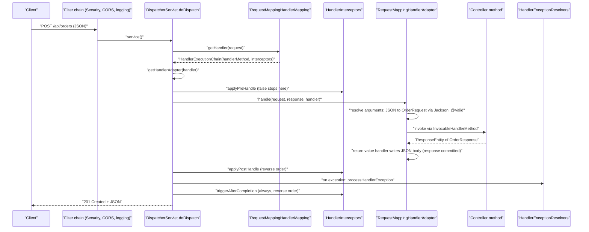
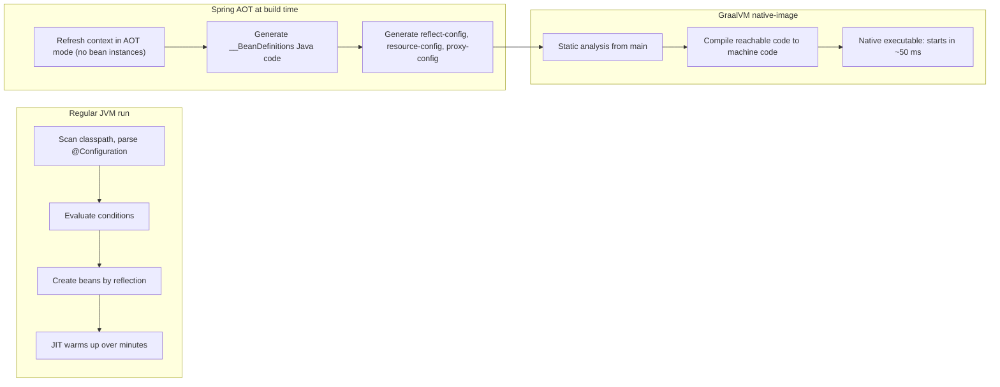

@@ 3 | TOPIC | DispatcherServlet Request Lifecycle | The full path of an HTTP request through filters, DispatcherServlet, handler mapping, interceptors, argument resolvers, message converters and exception resolvers | MUST
# DispatcherServlet Request Lifecycle

**Level: Advanced | Phase 18 | Priority: MUST | Since: Spring 2.5 (annotation controllers), Spring 3.1 (RequestMappingHandlerAdapter), Spring 6 (ProblemDetail)**

> **30-second interview answer:** A request first passes through the servlet container's filter chain (including Spring Security's `FilterChainProxy`), then reaches the `DispatcherServlet`, Spring MVC's front controller. In `doDispatch` it asks the `HandlerMapping`s for a handler (for `@RequestMapping` methods, `RequestMappingHandlerMapping`), runs interceptors' `preHandle`, invokes the handler through a `HandlerAdapter` that resolves arguments (path variables, `@RequestBody` via `HttpMessageConverter`s, validation) and writes the return value (JSON via Jackson), runs `postHandle`, resolves exceptions with `HandlerExceptionResolver`s (`@ExceptionHandler`, `@ControllerAdvice`), and finally calls `afterCompletion`.

## 1. Concept in Simple Words
### Analogy
A hospital reception.

| Hospital | Spring MVC |
|---|---|
| Security guard at the entrance checks badges | Servlet filters, Spring Security |
| The reception desk that every patient goes through | `DispatcherServlet` (front controller) |
| The directory: "cardiology is room 3B" | `HandlerMapping` finds the controller method |
| A nurse who takes vitals before and after the visit | `HandlerInterceptor` `preHandle`, `postHandle`, `afterCompletion` |
| The translator who converts the patient's words into a form the doctor reads | Argument resolvers and `HttpMessageConverter` (JSON to object) |
| The doctor | Your controller method |
| The report written in the patient's language | Return value handler and converter (object to JSON) |
| The emergency protocol when something goes wrong | `HandlerExceptionResolver` and `@ControllerAdvice` |

### What it is
- **Front controller:** one servlet receives all requests and dispatches to handlers; `DispatcherServlet` is mapped to `/` by Boot.
- **Handler:** the object that handles a request; for annotated controllers it is a `HandlerMethod` (bean plus `Method`).
- **`HandlerMapping`:** maps a request to a handler plus interceptors (`HandlerExecutionChain`). Main implementation `RequestMappingHandlerMapping`; others: `RouterFunctionMapping` (functional endpoints), `SimpleUrlHandlerMapping` (static resources).
- **`HandlerAdapter`:** knows how to invoke a type of handler. `RequestMappingHandlerAdapter` invokes `@RequestMapping` methods.
- **`HandlerMethodArgumentResolver`:** fills each parameter (`@PathVariable`, `@RequestParam`, `@RequestBody`, `Principal`, `Pageable`).
- **`HandlerMethodReturnValueHandler`:** processes the return value (`@ResponseBody` or `ResponseEntity` writes the body, a `String` in a `@Controller` is a view name).
- **`HttpMessageConverter`:** converts bodies between bytes and objects, chosen by `Content-Type` and `Accept` (`MappingJackson2HttpMessageConverter` for JSON).
- **`HandlerExceptionResolver`:** turns exceptions into responses: `ExceptionHandlerExceptionResolver` (`@ExceptionHandler`), `ResponseStatusExceptionResolver`, `DefaultHandlerExceptionResolver` (Spring's own exceptions to 4xx).

### Why it exists
In raw servlets, every URL needed its own servlet with manual parsing, JSON conversion and error handling. The front controller centralises all of that: you write a method with annotations, and Spring MVC does routing, conversion, validation, content negotiation and error mapping consistently.

## 2. How It Works



**The real `doDispatch` (condensed from Spring Framework 6.2)**

```java
protected void doDispatch(HttpServletRequest request, HttpServletResponse response) throws Exception {
    HandlerExecutionChain mappedHandler = null;
    Exception dispatchException = null;
    ModelAndView mv = null;
    try {
        processedRequest = checkMultipart(request);             // wrap multipart requests
        mappedHandler = getHandler(processedRequest);           // iterate HandlerMappings in order
        if (mappedHandler == null) { noHandlerFound(processedRequest, response); return; } // 404
        HandlerAdapter ha = getHandlerAdapter(mappedHandler.getHandler());
        if (!mappedHandler.applyPreHandle(processedRequest, response)) return;          // interceptor veto
        mv = ha.handle(processedRequest, response, mappedHandler.getHandler());          // invoke controller
        applyDefaultViewName(processedRequest, mv);
        mappedHandler.applyPostHandle(processedRequest, response, mv);
    } catch (Exception ex) {
        dispatchException = ex;
    }
    processDispatchResult(processedRequest, response, mappedHandler, mv, dispatchException); // exceptions, views, afterCompletion
}
```

**Inside `RequestMappingHandlerAdapter.handle`**
1. Create a `ServletInvocableHandlerMethod` with the argument resolvers and return value handlers (about 30 resolvers registered by default).
2. For each parameter, find the first resolver whose `supportsParameter` is true. `@RequestBody` uses `RequestResponseBodyMethodProcessor`, which picks a converter by `Content-Type` (415 if none), reads the body, applies `@Valid` (throws `MethodArgumentNotValidException` on failure, which becomes 400).
3. Invoke the method by reflection on the bean (which may be a proxy, so `@PreAuthorize` and `@Transactional` work here).
4. The return value handler for `@ResponseBody` or `ResponseEntity` picks a converter by the `Accept` header (406 if none) and writes the body. The response is now **committed**: headers and status are sent. That is why `postHandle` cannot change a JSON response; use `ResponseBodyAdvice` instead.

**Exception resolution order** (`HandlerExceptionResolverComposite`): `ExceptionHandlerExceptionResolver` (local `@ExceptionHandler` in the controller, then `@ControllerAdvice` beans by `@Order`), `ResponseStatusExceptionResolver` (`@ResponseStatus` and `ResponseStatusException`), `DefaultHandlerExceptionResolver` (for example `HttpRequestMethodNotSupportedException` to 405). If none handles it, the exception propagates to the container, which forwards to `/error`, handled by Boot's `BasicErrorController`.

**Filters vs interceptors**

```text
Tomcat thread
 └─ Filter 1 (e.g. ForwardedHeaderFilter)
     └─ DelegatingFilterProxy -> Spring Security FilterChainProxy (auth, 401/403 here)
         └─ Filter n (e.g. your RequestLoggingFilter)
             └─ DispatcherServlet
                 └─ Interceptor.preHandle -> Controller -> Interceptor.postHandle
                 └─ Interceptor.afterCompletion
```

## 3. Code Example
### Code
OrderHub adds a filter, an interceptor, a custom argument resolver and a `ResponseBodyAdvice` to see each stage in action.

```java
// file: src/main/java/com/orderhub/web/RequestIdFilter.java
package com.orderhub.web;

import jakarta.servlet.FilterChain;
import jakarta.servlet.ServletException;
import jakarta.servlet.http.HttpServletRequest;
import jakarta.servlet.http.HttpServletResponse;
import java.io.IOException;
import java.util.UUID;
import org.slf4j.MDC;
import org.springframework.core.Ordered;
import org.springframework.core.annotation.Order;
import org.springframework.stereotype.Component;
import org.springframework.web.filter.OncePerRequestFilter;

@Component
@Order(Ordered.HIGHEST_PRECEDENCE)                  // before Spring Security
public class RequestIdFilter extends OncePerRequestFilter {
    @Override
    protected void doFilterInternal(HttpServletRequest req, HttpServletResponse res, FilterChain chain)
            throws ServletException, IOException {
        String id = UUID.randomUUID().toString().substring(0, 8);
        MDC.put("requestId", id);
        res.setHeader("X-Request-Id", id);          // set before the body is written
        System.out.println("[filter] before " + req.getMethod() + " " + req.getRequestURI());
        try {
            chain.doFilter(req, res);
        } finally {
            System.out.println("[filter] after status=" + res.getStatus());
            MDC.remove("requestId");                // thread is reused by Tomcat
        }
    }
}
```

```java
// file: src/main/java/com/orderhub/web/TimingInterceptor.java
package com.orderhub.web;

import jakarta.servlet.http.HttpServletRequest;
import jakarta.servlet.http.HttpServletResponse;
import org.springframework.web.method.HandlerMethod;
import org.springframework.web.servlet.HandlerInterceptor;
import org.springframework.web.servlet.ModelAndView;

public class TimingInterceptor implements HandlerInterceptor {
    @Override
    public boolean preHandle(HttpServletRequest req, HttpServletResponse res, Object handler) {
        req.setAttribute("start", System.nanoTime());
        String name = handler instanceof HandlerMethod hm ? hm.getMethod().getName() : handler.toString();
        System.out.println("[interceptor] preHandle -> " + name);
        return true;                                 // false would stop the request here
    }

    @Override
    public void postHandle(HttpServletRequest req, HttpServletResponse res, Object handler, ModelAndView mv) {
        System.out.println("[interceptor] postHandle committed=" + res.isCommitted());
    }

    @Override
    public void afterCompletion(HttpServletRequest req, HttpServletResponse res, Object handler, Exception ex) {
        long ms = (System.nanoTime() - (long) req.getAttribute("start")) / 1_000_000;
        System.out.println("[interceptor] afterCompletion " + ms + " ms, ex=" + ex);
    }
}
```

```java
// file: src/main/java/com/orderhub/web/CurrentCustomer.java
package com.orderhub.web;

import java.lang.annotation.ElementType;
import java.lang.annotation.Retention;
import java.lang.annotation.RetentionPolicy;
import java.lang.annotation.Target;

@Target(ElementType.PARAMETER)
@Retention(RetentionPolicy.RUNTIME)
public @interface CurrentCustomer { }
```

```java
// file: src/main/java/com/orderhub/web/CurrentCustomerResolver.java
package com.orderhub.web;

import org.springframework.core.MethodParameter;
import org.springframework.security.core.context.SecurityContextHolder;
import org.springframework.web.bind.support.WebDataBinderFactory;
import org.springframework.web.context.request.NativeWebRequest;
import org.springframework.web.method.support.HandlerMethodArgumentResolver;
import org.springframework.web.method.support.ModelAndViewContainer;

public class CurrentCustomerResolver implements HandlerMethodArgumentResolver {
    @Override
    public boolean supportsParameter(MethodParameter p) {
        return p.hasParameterAnnotation(CurrentCustomer.class) && p.getParameterType() == String.class;
    }

    @Override
    public Object resolveArgument(MethodParameter p, ModelAndViewContainer mav,
                                  NativeWebRequest req, WebDataBinderFactory binders) {
        System.out.println("[resolver] resolving @CurrentCustomer");
        return SecurityContextHolder.getContext().getAuthentication().getName();
    }
}
```

```java
// file: src/main/java/com/orderhub/web/WebConfig.java
package com.orderhub.web;

import java.util.List;
import org.springframework.context.annotation.Configuration;
import org.springframework.web.method.support.HandlerMethodArgumentResolver;
import org.springframework.web.servlet.config.annotation.InterceptorRegistry;
import org.springframework.web.servlet.config.annotation.WebMvcConfigurer;

@Configuration
public class WebConfig implements WebMvcConfigurer {      // no @EnableWebMvc: keep Boot's MVC auto-config
    @Override
    public void addInterceptors(InterceptorRegistry registry) {
        registry.addInterceptor(new TimingInterceptor()).addPathPatterns("/api/**");
    }

    @Override
    public void addArgumentResolvers(List<HandlerMethodArgumentResolver> resolvers) {
        resolvers.add(new CurrentCustomerResolver());
    }
}
```

```java
// file: src/main/java/com/orderhub/web/ApiVersionAdvice.java
package com.orderhub.web;

import org.springframework.core.MethodParameter;
import org.springframework.http.MediaType;
import org.springframework.http.converter.HttpMessageConverter;
import org.springframework.http.server.ServerHttpRequest;
import org.springframework.http.server.ServerHttpResponse;
import org.springframework.web.bind.annotation.RestControllerAdvice;
import org.springframework.web.servlet.mvc.method.annotation.ResponseBodyAdvice;

@RestControllerAdvice
public class ApiVersionAdvice implements ResponseBodyAdvice<Object> {
    @Override
    public boolean supports(MethodParameter returnType, Class<? extends HttpMessageConverter<?>> converterType) {
        return true;
    }

    @Override
    public Object beforeBodyWrite(Object body, MethodParameter returnType, MediaType contentType,
                                  Class<? extends HttpMessageConverter<?>> converterType,
                                  ServerHttpRequest request, ServerHttpResponse response) {
        response.getHeaders().add("X-Api-Version", "1");  // still possible: body not written yet
        System.out.println("[advice] beforeBodyWrite with " + converterType.getSimpleName());
        return body;
    }
}
```

```java
// file: src/main/java/com/orderhub/order/OrderController.java
package com.orderhub.order;

import com.orderhub.web.CurrentCustomer;
import jakarta.validation.Valid;
import java.net.URI;
import org.springframework.http.ResponseEntity;
import org.springframework.web.bind.annotation.PostMapping;
import org.springframework.web.bind.annotation.RequestBody;
import org.springframework.web.bind.annotation.RequestMapping;
import org.springframework.web.bind.annotation.RestController;

@RestController
@RequestMapping("/api/orders")
public class OrderController {
    private final OrderService orders;
    public OrderController(OrderService orders) { this.orders = orders; }

    @PostMapping
    public ResponseEntity<OrderResponse> create(@Valid @RequestBody OrderRequest request,
                                                @CurrentCustomer String customer) {
        System.out.println("[controller] create for " + customer);
        OrderResponse created = orders.place(customer, request);
        return ResponseEntity.created(URI.create("/api/orders/" + created.id())).body(created);
    }
}
```

### Walkthrough
- `RequestIdFilter` runs before `DispatcherServlet` and wraps everything, so its "after" line comes last. `OncePerRequestFilter` avoids running twice on error dispatches and forwards.
- `TimingInterceptor` is registered through `WebMvcConfigurer`. `preHandle` sees the resolved `HandlerMethod`, which a filter cannot. `postHandle` shows the response is already committed for a `@RestController`.
- `CurrentCustomerResolver` is added to the argument resolver list; custom resolvers are consulted after the built-in ones, which is fine for a custom annotation.
- `ApiVersionAdvice` (`ResponseBodyAdvice`) runs right before the converter writes the body, the last moment to add headers or wrap the body.
- `WebConfig` deliberately avoids `@EnableWebMvc`, which would switch off Boot's `WebMvcAutoConfiguration` (Jackson converter customisation, static resources, error handling defaults).
- The controller method is invoked on the controller bean; `orders.place(...)` goes through the service's transactional proxy.

### Output
```http
POST /api/orders HTTP/1.1
Content-Type: application/json
Authorization: Bearer eyJhbGciOi...

{"productId": 7, "quantity": 2}
```
```text
[filter] before POST /api/orders
[interceptor] preHandle -> create
[resolver] resolving @CurrentCustomer
[controller] create for alice
[advice] beforeBodyWrite with MappingJackson2HttpMessageConverter
[interceptor] postHandle committed=true
[interceptor] afterCompletion 23 ms, ex=null
[filter] after status=201
```
```http
HTTP/1.1 201 Created
X-Request-Id: 3f9c2a1b
X-Api-Version: 1
Location: /api/orders/101
Content-Type: application/json

{"id":101,"customer":"alice","productId":7,"quantity":2,"status":"NEW"}
```
With an invalid body `{"productId": 7, "quantity": 0}`, argument resolution throws `MethodArgumentNotValidException` before the controller runs; the interceptor's `postHandle` is skipped, `afterCompletion` still runs, and `@RestControllerAdvice` (Phase 11) returns a `400` `ProblemDetail`.

### Compare
| Hook | Runs | Sees handler | Can change JSON body | Typical use |
|---|---|---|---|---|
| Servlet `Filter` | Around the whole servlet | No | Only by wrapping the response | Security, CORS, request IDs, compression |
| `HandlerInterceptor.preHandle` | Before controller | Yes | No | Auth checks per handler, rate limits, MDC from path |
| `RequestBodyAdvice` | Before body is read into object | Yes | Request side | Decryption, logging request bodies |
| `ResponseBodyAdvice` | Before body is written | Yes | Yes | Wrapping responses, headers |
| `HandlerInterceptor.postHandle` | After controller, before view | Yes | No (already committed) | Adding model attributes for views |
| `afterCompletion` | Always at the end | Yes | No | Timing, cleanup |

## 4. Interview Questions
**Basic**
1. **What is the `DispatcherServlet`?**
   Spring MVC's front controller: a single servlet that receives every request and delegates to handler mappings, handler adapters, view resolvers and exception resolvers. Spring Boot auto-configures and registers it at `/`.
2. **What is the role of `HandlerMapping` and `HandlerAdapter`?**
   `HandlerMapping` finds which handler (controller method) should process the request, plus interceptors. `HandlerAdapter` knows how to invoke that kind of handler, including argument resolution and return value processing. The split lets one servlet support annotated controllers, functional endpoints and legacy handlers.
3. **How does a JSON request body become a Java object?**
   `RequestResponseBodyMethodProcessor` (an argument resolver) selects an `HttpMessageConverter` that can read the `Content-Type`, usually `MappingJackson2HttpMessageConverter`, which deserializes with the auto-configured `ObjectMapper`; then `@Valid` triggers Bean Validation.

**Follow-up**
4. **Difference between a filter and an interceptor?**
   Filters belong to the servlet container and wrap the whole servlet, before Spring MVC knows the handler; they suit cross-cutting HTTP concerns like security and CORS. Interceptors belong to Spring MVC, run around the handler, and know which controller method is being called.
5. **Why can't `postHandle` modify the JSON response?**
   For `@ResponseBody` methods, the body is written and the response committed inside `HandlerAdapter.handle`, before `postHandle` runs. Use `ResponseBodyAdvice` to modify bodies or headers before writing.
6. **What happens when the controller throws an exception?**
   `doDispatch` catches it and `processDispatchResult` asks the `HandlerExceptionResolver`s in order: `@ExceptionHandler` methods (controller-local first, then `@ControllerAdvice`), `@ResponseStatus`, then Spring's default mappings. If none handles it, the container forwards to `/error` and Boot's `BasicErrorController` renders the error. `afterCompletion` runs in all cases.

**Tricky / scenario**
7. **A request returns 401 and your `@ControllerAdvice` handler for `AuthenticationException` never runs. Why?**
   Authentication happens in Spring Security's filter chain, before the `DispatcherServlet`, so MVC exception resolvers never see it. Handle it with an `AuthenticationEntryPoint` (401) or `AccessDeniedHandler` (403) in the security config. Method-security exceptions from `@PreAuthorize` do reach `@ControllerAdvice` because they are thrown inside the controller call.
8. **A client sends `Accept: application/xml` and gets 406. Why?**
   Content negotiation found no `HttpMessageConverter` that can write the return type as XML. Add `jackson-dataformat-xml` so Boot registers the XML converter, or make clients accept JSON.
9. **You added `@EnableWebMvc` to configure a converter and suddenly dates serialise differently and static files return 404. Why?**
   `@EnableWebMvc` imports `DelegatingWebMvcConfiguration`, and Boot's `WebMvcAutoConfiguration` is conditional on that bean being missing, so all Boot MVC defaults vanish, including its Jackson-configured converters and static resource handling. Remove it and use `WebMvcConfigurer` methods instead.
10. **In production the MDC request ID sometimes shows up on unrelated requests. Why?**
    Tomcat reuses threads. If a filter puts a value into MDC and does not remove it in `finally`, the next request on the same thread inherits it. Always clean up in `finally`, and for async processing propagate context explicitly.

**What the interviewer is really testing:** whether you can locate any web behaviour (auth failures, 4xx codes, headers, exceptions) at the exact stage of the request pipeline where it happens.

## 5. Pitfalls & Best Practices
### Common mistakes
| Mistake | What goes wrong | Fix |
|---|---|---|
| Adding `@EnableWebMvc` in a Boot app | Boot MVC auto-configuration switched off | Implement `WebMvcConfigurer` without it |
| Modifying the response in `postHandle` for REST | Changes ignored | Use `ResponseBodyAdvice` or a filter |
| Handling security exceptions in `@ControllerAdvice` | Never called for filter-level failures | `AuthenticationEntryPoint` and `AccessDeniedHandler` |
| Reading the request body in a filter | Controller gets an empty stream | Wrap with `ContentCachingRequestWrapper` and read after the chain |
| ThreadLocal or MDC values not cleared | Leak between requests | Clean up in `finally` or `afterCompletion` |

### Best practices
- Pick the narrowest hook: filter for raw HTTP, interceptor for handler-aware logic, advice for bodies, `@ControllerAdvice` for exceptions.
- Use `ProblemDetail` (RFC 9457) for errors (`spring.mvc.problemdetails.enabled=true` or your own advice).
- Keep controllers thin: parse, validate, delegate, map. Transactions belong in services.
- When debugging routing, set `logging.level.org.springframework.web=DEBUG` to see the mapped handler and the chosen converter for each request.

### Compare with
| Stack | Front component | Threading |
|---|---|---|
| Spring MVC | `DispatcherServlet` on a servlet container | Thread per request (virtual threads with `spring.threads.virtual.enabled=true`) |
| Spring WebFlux | `DispatcherHandler` on Netty | Event loop, non-blocking |
| Functional endpoints (MVC) | `RouterFunctionMapping` + `HandlerFunctionAdapter` | Same as MVC |
| Raw servlet | One servlet per URL | Thread per request |

## 6. Hands-on Exercise
Add an `IdempotencyInterceptor` to OrderHub for `POST /api/orders`: if the request carries `Idempotency-Key` and a response for that key was already produced within 10 minutes, return the stored status and body without calling the controller. Acceptance criteria: the controller runs once for two identical requests with the same key; the second response has the same status and JSON body and an extra header `Idempotent-Replay: true`; requests without the key behave normally; the storage is an interface so Redis can replace the in-memory map in Phase 19.

<details><summary>Solution</summary>

```java
// file: src/main/java/com/orderhub/web/IdempotencyStore.java
package com.orderhub.web;

import java.util.Optional;

public interface IdempotencyStore {
    record StoredResponse(int status, String body) { }
    Optional<StoredResponse> find(String key);
    void save(String key, StoredResponse response);
}
```

```java
// file: src/main/java/com/orderhub/web/IdempotencyInterceptor.java
package com.orderhub.web;

import jakarta.servlet.http.HttpServletRequest;
import jakarta.servlet.http.HttpServletResponse;
import java.nio.charset.StandardCharsets;
import org.springframework.http.MediaType;
import org.springframework.web.servlet.HandlerInterceptor;
import org.springframework.web.util.ContentCachingResponseWrapper;
import org.springframework.web.util.WebUtils;

public class IdempotencyInterceptor implements HandlerInterceptor {
    private final IdempotencyStore store;
    public IdempotencyInterceptor(IdempotencyStore store) { this.store = store; }

    @Override
    public boolean preHandle(HttpServletRequest req, HttpServletResponse res, Object handler) throws Exception {
        String key = req.getHeader("Idempotency-Key");
        if (key == null) return true;
        var stored = store.find(key);
        if (stored.isEmpty()) return true;
        res.setStatus(stored.get().status());
        res.setContentType(MediaType.APPLICATION_JSON_VALUE);
        res.setHeader("Idempotent-Replay", "true");
        res.getOutputStream().write(stored.get().body().getBytes(StandardCharsets.UTF_8));
        return false;                                       // controller is skipped
    }

    @Override
    public void afterCompletion(HttpServletRequest req, HttpServletResponse res, Object handler, Exception ex) {
        String key = req.getHeader("Idempotency-Key");
        var wrapper = WebUtils.getNativeResponse(res, ContentCachingResponseWrapper.class);
        if (key != null && ex == null && wrapper != null && res.getStatus() < 500
                && res.getHeader("Idempotent-Replay") == null) {
            String body = new String(wrapper.getContentAsByteArray(), StandardCharsets.UTF_8);
            store.save(key, new IdempotencyStore.StoredResponse(res.getStatus(), body));
        }
    }
}
```

```java
// file: src/main/java/com/orderhub/web/ResponseCachingFilter.java
package com.orderhub.web;

import jakarta.servlet.FilterChain;
import jakarta.servlet.ServletException;
import jakarta.servlet.http.HttpServletRequest;
import jakarta.servlet.http.HttpServletResponse;
import java.io.IOException;
import org.springframework.stereotype.Component;
import org.springframework.web.filter.OncePerRequestFilter;
import org.springframework.web.util.ContentCachingResponseWrapper;

@Component
public class ResponseCachingFilter extends OncePerRequestFilter {
    @Override
    protected boolean shouldNotFilter(HttpServletRequest req) {
        return req.getHeader("Idempotency-Key") == null;
    }

    @Override
    protected void doFilterInternal(HttpServletRequest req, HttpServletResponse res, FilterChain chain)
            throws ServletException, IOException {
        ContentCachingResponseWrapper wrapper = new ContentCachingResponseWrapper(res);
        try {
            chain.doFilter(req, wrapper);
        } finally {
            wrapper.copyBodyToResponse();                   // without this the client gets an empty body
        }
    }
}
```

```java
// file: src/main/java/com/orderhub/web/InMemoryIdempotencyStore.java
package com.orderhub.web;

import java.time.Duration;
import java.time.Instant;
import java.util.Map;
import java.util.Optional;
import java.util.concurrent.ConcurrentHashMap;
import org.springframework.stereotype.Component;

@Component
public class InMemoryIdempotencyStore implements IdempotencyStore {
    private record Entry(StoredResponse response, Instant expires) { }
    private final Map<String, Entry> entries = new ConcurrentHashMap<>();

    @Override
    public Optional<StoredResponse> find(String key) {
        Entry e = entries.get(key);
        if (e == null || e.expires().isBefore(Instant.now())) return Optional.empty();
        return Optional.of(e.response());
    }

    @Override
    public void save(String key, StoredResponse response) {
        entries.put(key, new Entry(response, Instant.now().plus(Duration.ofMinutes(10))));
    }
}
```

```java
// WebConfig addition
registry.addInterceptor(new IdempotencyInterceptor(store)).addPathPatterns("/api/orders");
```
The filter wraps the response so the body bytes can be read after the controller writes them; the interceptor decides replay in `preHandle` and records in `afterCompletion`. Two concurrent first requests with the same key can both run; Phase 19 solves that with Redis `SET NX`.
</details>

## 7. Recall
Q: In the DispatcherServlet request lifecycle, which component finds the controller method for a request?
A: A `HandlerMapping`, mainly `RequestMappingHandlerMapping`, which returns a `HandlerExecutionChain` with interceptors.

Q: Which Spring MVC component converts a JSON request body into a Java object?
A: An `HttpMessageConverter` (Jackson's `MappingJackson2HttpMessageConverter`), called by the `@RequestBody` argument resolver.

Q: Why can a HandlerInterceptor's postHandle not change a @RestController's JSON response?
A: The body is written and the response committed during `HandlerAdapter.handle`, before `postHandle`; use `ResponseBodyAdvice`.

Q: Why does @ControllerAdvice not handle Spring Security authentication failures?
A: They happen in the security filter chain before the `DispatcherServlet`, so MVC exception resolvers never see them.

Q: What does adding @EnableWebMvc do in a Spring Boot application?
A: It switches off Boot's `WebMvcAutoConfiguration`, losing its defaults such as Jackson converter setup and static resources.

**Related:** [[Global Exception Handling and ProblemDetail]] · [[Security Filter Chain Architecture]] · [[Auto-Configuration Internals]]

@@ 3 | TOPIC | Startup Performance, AOT and GraalVM Native Images | Measuring and cutting startup time with lazy init, CDS, Spring AOT, GraalVM native images and CRaC, and the trade-offs of each | NICE
# Startup Performance, AOT and GraalVM Native Images

**Level: Advanced | Phase 18 | Priority: NICE | Since: Spring Boot 3.0 (AOT and native support), Boot 3.2 (CRaC), Boot 3.3 (CDS support), Java 24 AOT cache (marked Java 25+ here)**

> **30-second interview answer:** A Spring Boot JVM app typically starts in 2 to 10 seconds because it scans the classpath, evaluates hundreds of conditions, loads thousands of classes and creates beans by reflection. You can measure the cost with `/actuator/startup`, then reduce it with lazy initialization, Class Data Sharing (CDS), or Spring AOT, which moves configuration processing to build time by generating Java code for bean definitions. Taking AOT further, GraalVM compiles the app into a native executable that starts in tens of milliseconds and uses far less memory, at the cost of long builds, a closed-world assumption (no runtime classpath surprises, fixed profiles and conditions) and lower peak throughput without profile-guided optimisation.

## 1. Concept in Simple Words
### Analogy
Opening a pop-up shop versus a prefabricated kiosk.

| Shop | Spring startup |
|---|---|
| Every morning you unpack boxes, read the floor plan, decide where shelves go | JVM startup: scan classpath, evaluate conditions, reflectively create beans |
| Only unpack a box when a customer asks for that product | Lazy initialization |
| Keep yesterday's shelf layout photo so unpacking is faster | CDS or the Java AOT cache: pre-parsed class data reused |
| The floor plan is decided at the factory and printed as step-by-step instructions | Spring AOT: generated code instead of runtime decisions |
| The whole kiosk is built at the factory and dropped in place, ready to open | GraalVM native image |
| But you cannot rearrange the kiosk once it arrives | Closed world: no runtime class generation, profiles fixed at build time |
| Freeze the shop mid-morning and thaw it tomorrow already running | CRaC checkpoint and restore |

### What it is
- **Startup time:** time from `java -jar` to `ApplicationReadyEvent`. **Time to first request** and **memory footprint (RSS)** are the related metrics that matter for scale-to-zero and serverless.
- **Lazy initialization:** `spring.main.lazy-initialization=true` makes all beans lazy, created on first use.
- **CDS (Class Data Sharing):** a JVM feature that stores parsed class metadata in an archive mapped at startup. Boot 3.3+ helps create one (`-XX:ArchiveClassesAtExit` on a training run, then `-XX:SharedArchiveFile`). Java 24 (JEP 483, marked `Java 25+` in this guide) adds the AOT cache, which also stores loaded and linked classes (`-XX:AOTCache`).
- **Spring AOT:** a build-time step (`spring-boot:process-aot`, Gradle `processAot`) that runs the application context's configuration phase at build time and writes Java source for bean definitions (`*__BeanDefinitions` classes), plus `RuntimeHints` (reflection, resources, proxies, serialization) as GraalVM config files.
- **GraalVM native image:** ahead-of-time compiler that does static analysis from `main`, includes only reachable code, initializes some classes at build time, and produces a platform-specific executable with the Substrate VM runtime.
- **Closed-world assumption:** everything that can run must be known at build time; reflection, resources, dynamic proxies and serialization need hints.
- **CRaC (Coordinated Restore at Checkpoint):** OpenJDK project (supported JDKs like Azul Zulu with CRaC) that snapshots a warmed-up JVM process and restores it in milliseconds. Boot 3.2 supports it (`-Dspring.context.checkpoint=onRefresh`).

### Why it exists
Containers, autoscaling and serverless functions start instances on demand. A 10 second start with 400 MB of memory is fine for a long-lived monolith but expensive when you scale from 0 to 50 pods during a traffic spike, or pay per millisecond on AWS Lambda. Spring had to compete with frameworks designed for fast startup (Quarkus, Micronaut), and Spring Boot 3 made AOT and native a first-class option.

## 2. How It Works



**What Spring AOT generates (for one bean)**

```java
// Generated at build time: target/spring-aot/main/sources/com/orderhub/order/OrderService__BeanDefinitions.java
import org.springframework.beans.factory.aot.BeanInstanceSupplier;
import org.springframework.beans.factory.config.BeanDefinition;
import org.springframework.beans.factory.support.RootBeanDefinition;

public class OrderService__BeanDefinitions {
  private static BeanInstanceSupplier<OrderService> getOrderServiceInstanceSupplier() {
    return BeanInstanceSupplier.<OrderService>forConstructor(OrderRepository.class, PaymentService.class)
            .withGenerator((registeredBean, args) -> new OrderService(args.get(0), args.get(1)));
  }

  public static BeanDefinition getOrderServiceBeanDefinition() {
    RootBeanDefinition beanDefinition = new RootBeanDefinition(OrderService.class);
    beanDefinition.setInstanceSupplier(getOrderServiceInstanceSupplier());
    return beanDefinition;
  }
}
```
No classpath scanning, no condition evaluation and no reflective constructor lookup at runtime: the decisions were frozen at build time. With AOT on the JVM (`-Dspring.aot.enabled=true`) you get a modest startup gain; in a native image it is mandatory.

**Typical numbers for a mid-size REST plus JPA service (indicative, measure your own)**

| Mode | Startup to ready | RSS memory at idle | Peak throughput | Build time |
|---|---|---|---|---|
| JVM, default | 3.5 s | 350 MB | 100 percent (after JIT warm-up) | 30 s |
| JVM, lazy init | 2.2 s | 300 MB | 100 percent, first requests slower | 30 s |
| JVM plus CDS (or Java AOT cache) | 2.0 s (1.5 s) | 320 MB | 100 percent | 30 s plus training run |
| JVM plus Spring AOT | 2.8 s | 330 MB | 100 percent | 45 s |
| GraalVM native image | 0.08 s | 90 MB | 60 to 90 percent (better with PGO, Oracle GraalVM) | 3 to 8 min, 6 to 10 GB RAM |
| CRaC restore | 0.05 s | similar to JVM | 100 percent, already warm | Checkpoint step in pipeline |

**Restrictions in AOT and native mode**
- Profiles, `@ConditionalOnProperty` and `@ConditionalOnClass` are evaluated at build time. Changing `spring.profiles.active` at runtime does not add or remove beans (property *values* can still change).
- No `@Profile`-based bean sets chosen at runtime, no runtime-generated classes (CGLIB proxies are generated at build time by AOT instead), no `BeanFactoryPostProcessor` that registers beans based on runtime state.
- Reflection, resources and JDK proxies used by your code or libraries need `RuntimeHints`. Spring registers hints for its own annotations; libraries publish metadata in the GraalVM Reachability Metadata Repository.
- Mockito-based tests do not run in native mode; run the JVM test suite, plus `nativeTest` for smoke tests.

## 3. Code Example
### Code
OrderHub measures its startup, then gets a native build profile and runtime hints for a class read by reflection.

```xml
<!-- pom.xml: Boot parent already defines the 'native' profile; add the GraalVM plugin -->
<build>
    <plugins>
        <plugin>
            <groupId>org.graalvm.buildtools</groupId>
            <artifactId>native-maven-plugin</artifactId>
        </plugin>
        <plugin>
            <groupId>org.springframework.boot</groupId>
            <artifactId>spring-boot-maven-plugin</artifactId>
        </plugin>
    </plugins>
</build>
```

```java
// file: src/main/java/com/orderhub/report/ReportFormatter.java
package com.orderhub.report;

// Loaded by class name from configuration, so GraalVM's static analysis cannot see it
public class ReportFormatter {
    public String format(String title, int orders) {
        return "%s: %d orders".formatted(title, orders);
    }
}
```

```java
// file: src/main/java/com/orderhub/report/ReportService.java
package com.orderhub.report;

import org.springframework.beans.factory.annotation.Value;
import org.springframework.stereotype.Service;

@Service
public class ReportService {
    private final Object formatter;

    public ReportService(@Value("${orderhub.report.formatter:com.orderhub.report.ReportFormatter}") String cls)
            throws ReflectiveOperationException {
        this.formatter = Class.forName(cls).getDeclaredConstructor().newInstance();   // reflection
    }

    public String daily(int orders) throws ReflectiveOperationException {
        return (String) formatter.getClass().getMethod("format", String.class, int.class)
                .invoke(formatter, "Daily report", orders);
    }
}
```

```java
// file: src/main/java/com/orderhub/report/ReportHints.java
package com.orderhub.report;

import org.springframework.aot.hint.MemberCategory;
import org.springframework.aot.hint.RuntimeHints;
import org.springframework.aot.hint.RuntimeHintsRegistrar;
import org.springframework.context.annotation.Configuration;
import org.springframework.context.annotation.ImportRuntimeHints;

@Configuration(proxyBeanMethods = false)
@ImportRuntimeHints(ReportHints.Registrar.class)
public class ReportHints {

    static class Registrar implements RuntimeHintsRegistrar {
        @Override
        public void registerHints(RuntimeHints hints, ClassLoader classLoader) {
            hints.reflection().registerType(ReportFormatter.class,
                    MemberCategory.INVOKE_PUBLIC_CONSTRUCTORS, MemberCategory.INVOKE_PUBLIC_METHODS);
            hints.resources().registerPattern("reports/*.txt");      // classpath resources read at runtime
        }
    }
}
```

```java
// file: src/test/java/com/orderhub/report/ReportHintsTest.java
package com.orderhub.report;

import static org.assertj.core.api.Assertions.assertThat;

import org.junit.jupiter.api.Test;
import org.springframework.aot.hint.RuntimeHints;
import org.springframework.aot.hint.predicate.RuntimeHintsPredicates;

class ReportHintsTest {
    @Test
    void registersReflectionForFormatter() {
        RuntimeHints hints = new RuntimeHints();
        new ReportHints.Registrar().registerHints(hints, getClass().getClassLoader());
        assertThat(RuntimeHintsPredicates.reflection().onType(ReportFormatter.class)).accepts(hints);
        assertThat(RuntimeHintsPredicates.resource().forResource("reports/daily.txt")).accepts(hints);
    }
}
```

```bash
# 1. Measure the JVM baseline (needs actuator and BufferingApplicationStartup, see the startup lifecycle topic)
curl -s -X POST localhost:8080/actuator/startup | jq '[.timeline.events[] | {name: .startupStep.name, ms: (.duration | sub("PT";"") )}] | sort_by(.ms) | reverse | .[0:5]'

# 2. Quick wins on the JVM: CDS training run, then run with the archive (Boot 3.3+)
java -Djarmode=tools -jar target/orderhub.jar extract --destination app
java -XX:ArchiveClassesAtExit=app/app.jsa -Dspring.context.exit=onRefresh -jar app/orderhub.jar
java -XX:SharedArchiveFile=app/app.jsa -jar app/orderhub.jar

# 3. Native executable (needs GraalVM JDK 21+ installed) or a native container image (needs only Docker)
./mvnw -Pnative native:compile
./mvnw -Pnative spring-boot:build-image
./target/orderhub

# 4. Run the test suite inside a native image
./mvnw -PnativeTest test
```

```yaml
# application.yml: lazy init for local development only (not in production)
spring:
  config:
    activate:
      on-profile: dev
  main:
    lazy-initialization: true
```

### Walkthrough
- **Measure first:** the startup endpoint lists the slowest steps; common winners are Hibernate metamodel building, Flyway migrations, eager remote clients and big component scans.
- **CDS:** the training run (`spring.context.exit=onRefresh` stops right after refresh) records loaded classes into `app.jsa`; later runs map the archive instead of parsing class files, typically 30 to 40 percent faster. The extracted layout is needed because CDS does not work with nested jars.
- **`ReportService`** loads a class by name, invisible to static analysis. On the JVM it works; in a native image without hints it fails at runtime with `ClassNotFoundException` or `NoSuchMethodException`.
- **`ReportHints`** registers the reflection and resource hints. Spring AOT collects all `RuntimeHintsRegistrar`s and writes `reflect-config.json` and `resource-config.json` under `META-INF/native-image`. `@RegisterReflectionForBinding` is a shortcut for DTOs serialised by Jackson outside of Spring MVC.
- **`ReportHintsTest`** proves the hints exist without building a native image (minutes saved per feedback loop).
- **Lazy init** is a dev-time helper: it hides wiring errors until first use and shifts latency onto the first requests, so do not use it blindly in production.

### Output
```text
JVM:     Started OrderHubApplication in 3.412 seconds (process running for 3.81)
JVM+CDS: Started OrderHubApplication in 2.107 seconds (process running for 2.36)
Native:  Started OrderHubApplication in 0.081 seconds (process running for 0.089)
```
```text
$ ps -o rss,cmd -C orderhub
  RSS CMD
92160 ./target/orderhub
```
Native run without the hints:
```text
java.lang.ClassNotFoundException: com.orderhub.report.ReportFormatter
	at org.graalvm.nativeimage.builder/com.oracle.svm.core.hub.ClassForNameSupport.forName(ClassForNameSupport.java:122)
```

### Compare
| Technique | Startup gain | Effort | Risks |
|---|---|---|---|
| Fix slow beans found in `/actuator/startup` | Varies, often the biggest | Low | None |
| Lazy initialization | 20 to 40 percent | One property | Errors at first use, slow first requests |
| CDS or Java AOT cache | 30 to 50 percent | Training run in the Dockerfile | Archive must match JDK and classpath |
| Spring AOT on JVM | 10 to 20 percent | Build step | Profiles and conditions fixed at build time |
| GraalVM native | 95 to 98 percent, plus much less memory | High: hints, long builds, native tests | Lower peak throughput, library compatibility |
| CRaC | 95 percent, already warm | Checkpoint pipeline, supported JDK | Secrets and open sockets in the snapshot must be handled |

## 4. Interview Questions
**Basic**
1. **Why does a Spring Boot application start slowly compared to a native app?**
   At startup it scans the classpath, parses configuration classes, evaluates hundreds of auto-configuration conditions, loads thousands of classes, creates beans with reflection and generates proxies, and the JIT only optimises after warm-up. All of this happens every time the JVM starts.
2. **What is Spring AOT?**
   A build-time step that runs the context's configuration phase without creating beans and generates Java code for bean definitions plus GraalVM hint files. At runtime the generated code registers beans directly, skipping scanning, condition evaluation and reflection.
3. **What is a GraalVM native image?**
   A standalone executable produced by ahead-of-time compiling the reachable parts of the application and JDK into machine code. It starts in milliseconds and uses much less memory, but needs every reflective or dynamic access declared at build time.

**Follow-up**
4. **What is the closed-world assumption, and how does it affect Spring?**
   GraalVM assumes all code that can run is known at build time. For Spring, that means bean definitions, profiles and class conditions are fixed at build time, CGLIB proxies must be generated during AOT, and reflection, resources and proxies need `RuntimeHints`.
5. **When would you choose native over JVM?**
   For scale-to-zero, serverless, CLI tools, or many small instances where startup and memory dominate cost. For long-running, high-throughput services, the JVM's JIT usually wins on peak performance and the build stays simple.
6. **How do you make a library that uses reflection work in a native image?**
   Check the GraalVM Reachability Metadata Repository (applied automatically by the native build tools), otherwise register hints with a `RuntimeHintsRegistrar` and `@ImportRuntimeHints`, or `@RegisterReflectionForBinding`. Verify with a `RuntimeHintsPredicates` unit test and the native test profile; the tracing agent (`-agentlib:native-image-agent`) can record what is accessed at runtime.

**Tricky / scenario**
7. **Your service scales from 2 to 40 pods during flash sales, and new pods take 25 seconds to become ready, so requests fail. What would you try, in order?**
   First, profile startup and fix expensive beans (remote calls, migrations at startup, big scans). Then add CDS or the Java AOT cache in the Docker image and make readiness accurate. If still too slow, consider native or CRaC. In parallel, scale earlier using predictive or scheduled autoscaling and keep a warm minimum of pods.
8. **The native image works locally but in production it activates a `prod` profile and a bean is missing. Why?**
   Profiles that control bean registration are decided at AOT build time. The image was built with the default profile, so `@Profile("prod")` beans were not included. Build with the profile set at AOT time (`spring.profiles.active` configured for `process-aot`) or replace profile-based beans with property values.
9. **Your team turned on `spring.main.lazy-initialization=true` in production to start faster; p99 latency spiked after each deploy and a missing bean only failed in production. Explain.**
   Lazy beans are created on first request, so the first users pay creation cost (and JIT is cold). Wiring errors that would fail startup now fail at first use. Use lazy init selectively with `@Lazy`, or exclude critical beans with `LazyInitializationExcludeFilter`, and warm up before readiness.

**What the interviewer is really testing:** whether you can reason about the startup cost model and choose a technique based on measured needs, not hype.

## 5. Pitfalls & Best Practices
### Common mistakes
| Mistake | What goes wrong | Fix |
|---|---|---|
| Going native without measuring | Weeks spent on hints for a service that restarts once a month | Measure, then pick the cheapest technique that meets the goal |
| Using runtime profiles to switch beans in a native image | Beans missing in production | Fix profiles at build time or use properties |
| Reflection without hints | Native runtime `ClassNotFoundException` | `RuntimeHintsRegistrar` plus predicate tests |
| Only running JVM tests for a native app | Native-only failures in production | Run `nativeTest` in CI for smoke coverage |
| Global lazy init in production | Slow first requests, late failures | Use it in dev; warm up critical beans |

### Best practices
- Track startup time and memory as CI metrics so regressions are caught when a dependency is added.
- Keep constructors and `@PostConstruct` cheap; defer remote connections.
- For containers, prefer the layered jar plus CDS (or the Java AOT cache) as the low-risk default; reserve native for workloads where it pays off.
- Build native images in CI on a machine with enough memory and cache dependencies; local developers keep the JVM for fast feedback.

### Compare with
| Option | Startup | Peak throughput | Operational complexity |
|---|---|---|---|
| JVM | Seconds | Best (JIT) | Lowest |
| JVM plus CDS or AOT cache | Faster seconds | Best | Low |
| Native image | Milliseconds | Good | Medium to high |
| CRaC | Milliseconds and warm | Best | Medium, JDK-specific |

## 6. Hands-on Exercise
Make OrderHub's Docker image start at least 30 percent faster without going native. Acceptance criteria: a multi-stage Dockerfile extracts the jar with the tools jar mode, performs a CDS training run during the build, and starts with the archive; the log of the old and new image shows the improvement; and the readiness probe only succeeds after `ApplicationReadyEvent`.

<details><summary>Solution</summary>

```text
# file: Dockerfile
FROM eclipse-temurin:21-jdk AS build
WORKDIR /workspace
COPY . .
RUN ./mvnw -q -DskipTests package
RUN java -Djarmode=tools -jar target/orderhub.jar extract --destination /app

FROM eclipse-temurin:21-jre
WORKDIR /app
COPY --from=build /app /app
# Training run: start the context and exit right after refresh, dumping the class archive
RUN java -XX:ArchiveClassesAtExit=app.jsa -Dspring.context.exit=onRefresh \
         -Dspring.profiles.active=cds-training -jar orderhub.jar || true
ENTRYPOINT ["java", "-XX:SharedArchiveFile=app.jsa", "-jar", "orderhub.jar"]
```

```yaml
# file: src/main/resources/application-cds-training.yml
# The training run must not need a real database or broker
spring:
  autoconfigure:
    exclude:
      - org.springframework.boot.autoconfigure.flyway.FlywayAutoConfiguration
  datasource:
    url: jdbc:h2:mem:training
  jpa:
    hibernate:
      ddl-auto: none
management:
  endpoint:
    health:
      probes:
        enabled: true
```

```text
old image: Started OrderHubApplication in 3.402 seconds
new image: Started OrderHubApplication in 2.088 seconds   (39 percent faster)
```
The Kubernetes readiness probe targets `/actuator/health/readiness`, which reports `ACCEPTING_TRAFFIC` only after `ApplicationReadyEvent`. Since Boot 3.3 the `spring-boot:build-image` goal can do the same with `BP_JVM_CDS_ENABLED=true` for Paketo buildpacks.
</details>

## 7. Recall
Q: What does Spring AOT generate at build time?
A: Java source code for bean definitions (`__BeanDefinitions` classes) and GraalVM hint files for reflection, resources and proxies.

Q: What is the closed-world assumption in GraalVM native images?
A: All code, classes and dynamic accesses must be known at build time; anything not declared or reachable is excluded.

Q: Why can a Spring native image not switch bean-defining profiles at runtime?
A: Profiles and conditions are evaluated at AOT build time, so the bean set is frozen in the generated code.

Q: How do you register reflection hints for a Spring Boot native image?
A: Implement `RuntimeHintsRegistrar` and import it with `@ImportRuntimeHints`, or use `@RegisterReflectionForBinding`.

Q: What is a low-risk way to speed up Spring Boot startup on the JVM without going native?
A: Class Data Sharing (or the Java AOT cache in newer JDKs) with a training run, after fixing slow beans found via `/actuator/startup`.

**Related:** [[ApplicationContext Startup Lifecycle]] · [[Auto-Configuration Internals]] · [[Docker Images for Spring Boot]] · [[Virtual Threads]]

