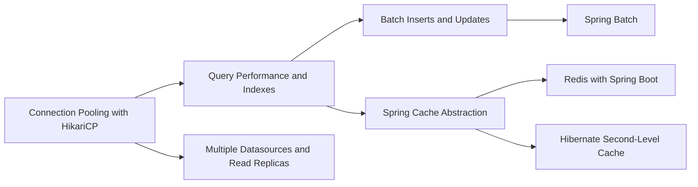
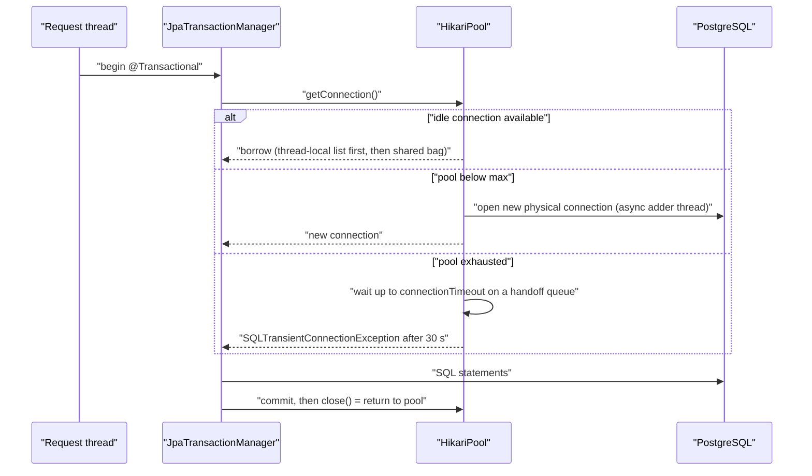
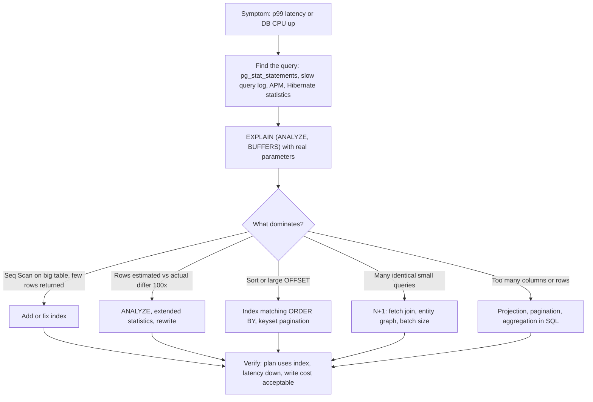

@@ 1 | MODULE | Phase 19 — Advanced Data and Caching (Advanced) | Making the data layer fast and scalable: connection pools, indexes, batching, caching with Redis, second-level cache, replicas and batch jobs | MUST
# Phase 19: Advanced Data and Caching (Advanced)

Phase 12 taught you to make the data layer *correct*: entities, relationships, transactions. This phase makes it *fast and scalable*. Most production performance incidents in Spring Boot services are data incidents: an exhausted connection pool, a missing index, an N+1 query, 50,000 single-row inserts, a cache that serves stale prices, a replica that lags behind. Senior interviews are full of these scenarios ("p99 went from 80 ms to 4 s after a release, what do you check?"), and the answers in this phase are the ones that impress: numbers, query plans and trade-offs.

OrderHub gains Redis caching for its catalog, tuned HikariCP settings, indexes driven by `EXPLAIN ANALYZE`, batched order imports, a read replica for reports and a Spring Batch job for nightly invoicing.



**Prerequisites:** Spring Data JPA, entity relationships, fetching and N+1, transactions and propagation, Flyway (Phase 12); Testcontainers (Phase 13); `@Transactional` internals and proxies (Phase 18).

**The 5 questions from this phase that come up most often**
1. How do you size a HikariCP connection pool, and what happens when it is exhausted?
2. A query is slow in production. Walk me through how you find and fix the cause.
3. How does `@Cacheable` work, and how do you keep the cache consistent with the database?
4. Why are JPA inserts with `GenerationType.IDENTITY` not batched, and how do you insert 100,000 rows quickly?
5. How would you route read-only queries to a replica, and what problems does replication lag cause?

@@ 2 | MODULE | Performance | Pooling connections, finding slow queries with plans and indexes, and writing in batches instead of one row at a time | MUST
# Performance

**Shared analogy: a busy restaurant kitchen.** Connections are the stoves: lighting a new stove for every order is slow, so you keep a fixed number lit (the pool), and if all are busy, orders wait in line. Indexes are the labelled spice rack: without labels the cook scans every jar (a sequential scan). Batching is cooking ten portions in one pot instead of ten separate pans. Every speed-up in this group reduces either waiting for a stove, searching for an ingredient, or trips back and forth.

- [[Connection Pooling with HikariCP]] keeps the stoves lit and sized right.
- [[Query Performance and Indexes]] labels the spice rack and reads the cook's notes (query plans).
- [[Batch Inserts and Updates]] cooks many portions per trip.

@@ 3 | TOPIC | Connection Pooling with HikariCP | Why pools exist, HikariCP settings and defaults, pool sizing, leak detection, exhaustion symptoms and metrics | MUST
# Connection Pooling with HikariCP

**Level: Advanced | Phase 19 | Priority: MUST | Since: HikariCP default pool in Spring Boot 2.0**

> **30-second interview answer:** Opening a database connection costs a TCP handshake, TLS, authentication and server-side process creation, often 20 to 100 ms, so applications keep a pool of open connections and borrow them per transaction. Spring Boot uses HikariCP by default with `maximumPoolSize` 10 and `connectionTimeout` 30 seconds. The pool should be small: connections are limited by the database's CPU and disks, not by your request threads, so a common starting point is about `cores * 2` on the database side divided across all app instances. When every connection is busy, threads wait up to `connectionTimeout` and then fail with "Connection is not available, request timed out", usually caused by long transactions, leaks or remote calls inside transactions rather than by a pool that is too small.

## 1. Concept in Simple Words
### Analogy
A car rental desk at an airport.

| Car rental | Connection pool |
|---|---|
| Buying a new car for every trip is absurdly slow and expensive | Opening a new physical connection per request |
| The desk owns 10 cars; customers borrow and return them | `maximumPoolSize = 10` |
| If all cars are out, the next customer waits in line | Threads block in `getConnection()` |
| After 30 seconds of waiting, the customer gives up | `connectionTimeout` then `SQLTransientConnectionException` |
| A customer who never returns the car | Connection leak |
| Cars are retired after 30 minutes and replaced with fresh ones | `maxLifetime` |
| Quick check that a parked car still starts | `keepaliveTime` and validation |
| Adding more cars than the airport has parking spaces | Pool larger than the database can serve: everything slows down |

### What it is
- **Physical connection:** a TCP session plus a server process (PostgreSQL forks one backend process per connection, each using several MB of RAM).
- **Connection pool:** keeps physical connections open and hands out a wrapper (`HikariProxyConnection`); `close()` on the wrapper returns it to the pool instead of closing the socket.
- **HikariCP:** a small, very fast JDBC pool (lock-free `ConcurrentBag` with thread-local affinity). Boot auto-configures it when `com.zaxxer:HikariCP` is on the classpath, which `spring-boot-starter-jdbc` and `spring-boot-starter-data-jpa` bring.
- **Key settings (Boot properties under `spring.datasource.hikari.*`):**

| Setting | Default | Meaning |
|---|---|---|
| `maximum-pool-size` | 10 | Max connections, idle plus in use |
| `minimum-idle` | same as max | Keep this many idle; Hikari recommends a fixed-size pool (leave unset) |
| `connection-timeout` | 30000 ms | Max wait for a connection before an exception |
| `idle-timeout` | 600000 ms | Retire idle connections above `minimum-idle` (only if min is less than max) |
| `max-lifetime` | 1800000 ms | Retire any connection after this age; set a few seconds below database or firewall limits |
| `keepalive-time` | 120000 ms in current versions (0, disabled, in older ones) | Ping idle connections so firewalls do not drop them |
| `leak-detection-threshold` | 0 (off) | Log a stack trace if a connection is held longer than this |
| `validation-timeout` | 5000 ms | Max time for a connection aliveness check |
| `auto-commit` | true | Spring's transaction manager turns it off per transaction; JPA users may set `false` plus `hibernate.connection.provider_disables_autocommit=true` to skip a round trip |
| `pool-name` | HikariPool-1 | Name in logs and metrics |

### Why it exists
Without pooling, every request opens and closes a connection: slow (tens of ms each), heavy on the database (process creation), and dangerous under load because a traffic spike becomes a connection storm that can take the database down. A pool caps concurrency at a level the database can handle and amortises connection cost to zero.

## 2. How It Works



**How long a connection is held:** from transaction begin to transaction end. Without `@Transactional`, each repository call borrows and returns separately. With Open Session in View (`spring.jpa.open-in-view=true`, the default, with a warning at startup), the `EntityManager` stays open for the whole web request, and once it has acquired a connection (for lazy loading) it keeps it until the response is written.

**Pool sizing**

```text
Little's law:  connections needed = throughput (tx per second) x average connection hold time (s)
  example: 400 tx/s x 0.015 s = 6 connections busy on average; add headroom -> 10

Database-side rule of thumb (PostgreSQL wiki / HikariCP "About Pool Sizing"):
  total connections ~ (db_cores x 2) + effective_spindle_count
  example: 8-core DB with SSD -> about 17 to 20 connections in total

Distribute across instances:
  6 app pods x pool 10 = 60 connections  -> too many for that 8-core DB
  6 app pods x pool 3  = 18 connections  -> matches
```
Bigger pools often make latency *worse*: the database context-switches between more active queries, lock contention grows, and every query slows down. Request threads (Tomcat default 200) do not need one connection each, because most request time is spent outside the database.

**Pool deadlock:** if one request needs two connections at once (REQUIRES_NEW, or a second `DataSource` call outside the transaction), N concurrent requests holding their first connection can wait forever for a second. Rule: pool size must be at least `threads x (connections per request - 1) + 1`, or avoid nested connections.

## 3. Code Example
### Code
OrderHub tunes its pool, adds leak detection in staging, and exposes pool metrics.

```yaml
# file: src/main/resources/application.yml
spring:
  datasource:
    url: jdbc:postgresql://orders-db:5432/orderhub
    username: orderhub
    password: ${DB_PASSWORD}
    hikari:
      pool-name: orderhub-pool
      maximum-pool-size: 8            # 4 pods x 8 = 32 connections for a 16-core DB
      connection-timeout: 3000        # fail fast: 3 s, not 30 s, so callers can retry or shed load
      max-lifetime: 1740000           # 29 min, below the 30 min idle limit of the cloud proxy
      keepalive-time: 60000
      leak-detection-threshold: 0     # enabled per profile below
      data-source-properties:
        reWriteBatchedInserts: true   # PostgreSQL driver option, used in the batching topic
  jpa:
    open-in-view: false               # never hold a connection while rendering the response
management:
  endpoints:
    web:
      exposure:
        include: health,metrics,prometheus
---
spring:
  config:
    activate:
      on-profile: staging
  datasource:
    hikari:
      leak-detection-threshold: 10000 # log any connection held longer than 10 s
```

```java
// file: src/main/java/com/orderhub/report/SlowReportService.java
package com.orderhub.report;

import java.math.BigDecimal;
import org.springframework.stereotype.Service;
import org.springframework.transaction.annotation.Transactional;
import org.springframework.web.client.RestClient;

@Service
public class SlowReportService {
    private final OrderStatsRepository stats;
    private final RestClient fxClient;

    public SlowReportService(OrderStatsRepository stats, RestClient.Builder builder) {
        this.stats = stats;
        this.fxClient = builder.baseUrl("https://fx.example.com").build();
    }

    // BAD: holds a pooled connection while waiting up to 2 s on a remote API
    @Transactional(readOnly = true)
    public BigDecimal revenueInEurBad() {
        BigDecimal usd = stats.totalRevenueUsd();
        BigDecimal rate = fxClient.get().uri("/rate?from=USD&to=EUR").retrieve().body(BigDecimal.class);
        return usd.multiply(rate);
    }

    // GOOD: remote call first, then a short transaction (repository call is transactional by itself)
    public BigDecimal revenueInEur() {
        BigDecimal rate = fxClient.get().uri("/rate?from=USD&to=EUR").retrieve().body(BigDecimal.class);
        return stats.totalRevenueUsd().multiply(rate);
    }
}
```

```java
// file: src/main/java/com/orderhub/infra/PoolMonitor.java
package com.orderhub.infra;

import com.zaxxer.hikari.HikariDataSource;
import com.zaxxer.hikari.HikariPoolMXBean;
import javax.sql.DataSource;
import org.slf4j.Logger;
import org.slf4j.LoggerFactory;
import org.springframework.scheduling.annotation.Scheduled;
import org.springframework.stereotype.Component;

@Component
public class PoolMonitor {
    private static final Logger log = LoggerFactory.getLogger(PoolMonitor.class);
    private final HikariPoolMXBean pool;

    public PoolMonitor(DataSource dataSource) {
        this.pool = dataSource.unwrap(HikariDataSource.class).getHikariPoolMXBean();  // throws SQLException in theory
    }

    @Scheduled(fixedRate = 30_000)             // requires @EnableScheduling
    void report() {
        if (pool.getThreadsAwaitingConnection() > 0) {
            log.warn("pool pressure: active={} idle={} total={} waiting={}",
                    pool.getActiveConnections(), pool.getIdleConnections(),
                    pool.getTotalConnections(), pool.getThreadsAwaitingConnection());
        }
    }
}
```

### Walkthrough
- `maximum-pool-size: 8` is chosen from the database side: 4 pods share a 16-core database, about 32 to 36 connections total. More pods later means a smaller per-pod pool or a proxy like PgBouncer.
- `connection-timeout: 3000` turns pool exhaustion into fast, visible errors instead of 30-second hangs that pile up Tomcat threads and cascade upstream.
- `max-lifetime` must be shorter than any network device or database idle cut-off, otherwise Hikari hands out connections that were silently killed, producing "Connection reset" errors.
- `leak-detection-threshold` in staging logs the stack trace of whoever held a connection too long; it is cheap but noisy for legitimately long batch jobs.
- `open-in-view: false` returns the connection when the service transaction ends rather than after the JSON is written.
- `revenueInEurBad` is the most common real cause of exhaustion: a remote call inside a transaction. With 8 connections and a 2-second API, the pool supports only 4 such requests per second.
- `PoolMonitor` uses Hikari's MXBean; in practice you would rely on Micrometer metrics, shown below.

### Output
Pool exhaustion under load with the bad method:
```text
WARN  c.o.infra.PoolMonitor : pool pressure: active=8 idle=0 total=8 waiting=37
ERROR o.h.engine.jdbc.spi.SqlExceptionHelper : orderhub-pool - Connection is not available, request timed out after 3001ms (total=8, active=8, idle=0, waiting=36)
ERROR o.a.c.c.C.[.[.[/].[dispatcherServlet] : Servlet.service() threw exception
org.springframework.transaction.CannotCreateTransactionException: Could not open JPA EntityManager for transaction
Caused by: java.sql.SQLTransientConnectionException: orderhub-pool - Connection is not available, request timed out after 3001ms (total=8, active=8, idle=0, waiting=36)
```
Leak detection in staging:
```text
WARN  com.zaxxer.hikari.pool.ProxyLeakTask : Connection leak detection triggered for org.postgresql.jdbc.PgConnection@5e3a8624 on thread http-nio-8080-exec-7, stack trace follows
java.lang.Exception: Apparent connection leak detected
	at com.orderhub.report.SlowReportService.revenueInEurBad(SlowReportService.java:22)
```
Metrics:
```http
GET /actuator/metrics/hikaricp.connections.pending HTTP/1.1
```
```json
{"name":"hikaricp.connections.pending","measurements":[{"statistic":"VALUE","value":36.0}],"availableTags":[{"tag":"pool","values":["orderhub-pool"]}]}
```
Useful series in Prometheus: `hikaricp_connections_active`, `hikaricp_connections_pending`, `hikaricp_connections_acquire_seconds`, `hikaricp_connections_usage_seconds` (how long connections are held), `hikaricp_connections_timeout_total`.

### Compare
| Symptom | Likely cause | Fix |
|---|---|---|
| `pending` spikes, `usage_seconds` high | Long transactions, remote calls inside transactions | Shorten transactions |
| `active` stays at max even at night | Leak (connection never closed) | Leak detection, try-with-resources, avoid manual `getConnection()` |
| `acquire_seconds` high but database idle | Pool too small for the traffic | Increase gradually, measure database CPU |
| Database CPU 100 percent, many active queries | Pool too large or slow queries | Reduce pool, fix queries |
| Random "Connection reset" after quiet periods | Firewall or proxy drops idle connections | Lower `max-lifetime`, set `keepalive-time` |

## 4. Interview Questions
**Basic**
1. **Why do we need a connection pool?**
   Creating a database connection is expensive (network round trips, authentication, a server process), and databases support a limited number. A pool keeps connections open and reuses them, making each borrow take microseconds and capping concurrent load on the database.
2. **What are HikariCP's important settings and defaults in Spring Boot?**
   `maximumPoolSize` 10, `minimumIdle` equal to max, `connectionTimeout` 30 s, `idleTimeout` 10 min, `maxLifetime` 30 min, keepalive every 2 minutes in recent versions, leak detection off. They are set under `spring.datasource.hikari.*`.
3. **What happens when the pool is exhausted?**
   Threads requesting a connection block for up to `connectionTimeout`, then get `SQLTransientConnectionException` ("Connection is not available, request timed out"), which Spring wraps in `CannotCreateTransactionException` or `CannotGetJdbcConnectionException`.

**Follow-up**
4. **How do you size the pool?**
   Start from the database's capacity (roughly twice its cores in total across all instances), divide by the number of app instances, then validate with Little's law (throughput times hold time) and load tests watching pending threads and database CPU. A pool of 10 to 20 per instance is typical; hundreds is almost always wrong.
5. **Why can a bigger pool make performance worse?**
   The database has a fixed number of cores and disk queues. More concurrent queries means more context switching, lock contention and cache thrashing, so each query takes longer and total throughput can drop. Requests queueing in the app pool is cheaper than queueing inside the database.
6. **What does Open Session in View have to do with the pool?**
   With OSIV enabled, the `EntityManager` lives for the whole request, and once lazy loading or a query acquires a connection it is held until the view or JSON is rendered. Slow serialization or slow clients then hold connections. Disabling it returns connections at the end of service transactions.

**Tricky / scenario**
7. **After a deploy, latency jumps and logs show "Connection is not available" with total=10 active=10, but database CPU is at 15 percent. What do you look for?**
   The database is not the bottleneck; connections are held while doing something else. Check `hikaricp_connections_usage_seconds`, enable leak detection, and look at the diff for remote calls or slow logic inside `@Transactional`, new REQUIRES_NEW usage (two connections per request), or OSIV with slow serialization. A thread dump shows threads waiting in `HikariPool.getConnection` and the ones holding connections.
8. **You run 30 pods with pool size 20 against a PostgreSQL that allows 500 connections, and during scale-out it fails with "too many clients". What do you change?**
   30 x 20 = 600 exceeds the limit, and Hikari's fixed-size pools open all connections at start. Lower the pool per pod based on database capacity, use `minimumIdle` smaller than max only if pods are mostly idle, or put PgBouncer (transaction pooling mode) between apps and database to multiplex many client connections onto few server connections.
9. **Does using virtual threads change pool sizing?**
   No. Virtual threads let you run thousands of concurrent requests cheaply, but the database still handles the same number of concurrent queries. The pool becomes the main concurrency limiter, so thousands of virtual threads can queue on 10 connections; set a sensible `connectionTimeout` and consider limiting concurrency upstream.

**What the interviewer is really testing:** whether you treat the pool as a capacity control for the database, can read pool metrics, and know that exhaustion is usually a hold-time problem, not a size problem.

## 5. Pitfalls & Best Practices
### Common mistakes
| Mistake | What goes wrong | Fix |
|---|---|---|
| Pool size 100 "to be safe" | Database overload, slower queries, too many clients during scale-out | Size from database capacity, divide across instances |
| Remote calls inside `@Transactional` | Connections held for seconds, exhaustion | Do I/O outside transactions |
| Leaving OSIV enabled | Connections held during rendering | `spring.jpa.open-in-view=false` |
| Default 30 s `connectionTimeout` on user-facing APIs | Threads pile up, cascading timeouts | 1 to 5 s plus circuit breakers |
| `max-lifetime` longer than firewall idle timeout | "Connection reset" errors | Lifetime a bit shorter than any network limit |

### Best practices
- Alert on `hikaricp_connections_pending` greater than zero for more than a minute and on `hikaricp_connections_timeout_total` increasing.
- Keep a fixed-size pool for services with steady traffic; it avoids connection creation during spikes.
- Account for every consumer of database connections (all pods, batch jobs, migration tools, admins) against the database limit.
- For many small services or serverless, use a server-side pooler (PgBouncer, RDS Proxy).
- Load test with production-like latency to the database; local tests with 0.2 ms latency hide hold-time problems.

### Compare with
| Pool | Notes |
|---|---|
| HikariCP | Boot default, fastest, minimal settings |
| Tomcat JDBC pool | Used if Hikari absent and Tomcat pool present; more knobs |
| Commons DBCP2 | Older, fallback in Boot's selection order |
| Oracle UCP | Oracle-specific features (RAC failover) |
| PgBouncer or RDS Proxy | Server-side pooling, complements an app pool |

## 6. Hands-on Exercise
OrderHub's order export endpoint holds a transaction while streaming a CSV of 200,000 rows to slow clients, and during month-end the pool runs dry. Redesign it. Acceptance criteria: the connection is held only while reading from the database; memory stays bounded (no loading all rows at once); the export has a timeout; and a metric shows the export's connection usage is below 5 seconds for 200,000 rows.

<details><summary>Solution</summary>

Read in keyset pages, each in its own short read-only query, and write to the response between pages.

```java
// file: src/main/java/com/orderhub/export/OrderExportController.java
package com.orderhub.export;

import jakarta.servlet.http.HttpServletResponse;
import java.io.IOException;
import java.io.PrintWriter;
import java.util.List;
import org.springframework.jdbc.core.simple.JdbcClient;
import org.springframework.web.bind.annotation.GetMapping;
import org.springframework.web.bind.annotation.RestController;

@RestController
public class OrderExportController {
    private static final int PAGE = 5_000;
    private final JdbcClient jdbc;

    public OrderExportController(JdbcClient jdbc) { this.jdbc = jdbc; }

    record Row(long id, String customer, String total, String createdAt) { }

    @GetMapping(value = "/api/orders/export", produces = "text/csv")
    public void export(HttpServletResponse response) throws IOException {
        response.setHeader("Content-Disposition", "attachment; filename=orders.csv");
        PrintWriter out = response.getWriter();
        out.println("id,customer,total,created_at");
        long lastId = 0;
        while (true) {
            // Each call borrows a connection for milliseconds and returns it (no surrounding transaction)
            List<Row> page = jdbc.sql("""
                    select id, customer_email, total::text, created_at::text
                    from orders where id > ? order by id limit ?""")
                    .params(lastId, PAGE)
                    .query((rs, n) -> new Row(rs.getLong(1), rs.getString(2), rs.getString(3), rs.getString(4)))
                    .list();
            if (page.isEmpty()) break;
            for (Row r : page) out.printf("%d,%s,%s,%s%n", r.id(), r.customer(), r.total(), r.createdAt());
            out.flush();                       // slow client blocks here, holding no connection
            lastId = page.get(page.size() - 1).id();
        }
    }
}
```

```yaml
spring:
  mvc:
    async:
      request-timeout: 120s
```
40 pages of 5,000 rows; each query takes about 30 ms using the primary key index, so total connection usage is roughly 1.2 s, visible in `hikaricp_connections_usage_seconds`. Memory holds one page at a time.
</details>

## 7. Recall
Q: What are HikariCP's default maximumPoolSize and connectionTimeout in Spring Boot?
A: 10 connections and 30 seconds.

Q: What error does HikariCP raise when the connection pool is exhausted?
A: `SQLTransientConnectionException`: "Connection is not available, request timed out after N ms (total, active, idle, waiting)".

Q: Why can a larger HikariCP pool make database performance worse?
A: More concurrent queries than the database's cores and disks can serve cause context switching and contention, slowing every query.

Q: What is the most common real cause of HikariCP pool exhaustion in Spring apps?
A: Connections held too long: remote calls or slow logic inside transactions, leaks, or Open Session in View.

Q: Which HikariCP setting logs a stack trace when a connection is held too long?
A: `leak-detection-threshold` (`spring.datasource.hikari.leak-detection-threshold`).

**Related:** [[How @Transactional Really Works]] · [[Query Performance and Indexes]] · [[Multiple Datasources and Read Replicas]] · [[Virtual Threads]]

@@ 3 | TOPIC | Query Performance and Indexes | Finding slow queries, reading EXPLAIN ANALYZE, B-tree and composite indexes, covering and partial indexes, pagination and JPA-specific fixes | MUST
# Query Performance and Indexes

**Level: Advanced | Phase 19 | Priority: MUST | Since: database fundamentals; Hibernate statistics and SQL logging in all Boot versions**

> **30-second interview answer:** First find the slow query with metrics, the slow-query log or Hibernate statistics, then run `EXPLAIN ANALYZE` to see whether the database does a sequential scan, which index it uses, and how many rows each step touches. Most fixes are an index matching the `WHERE` and `ORDER BY` columns (a composite B-tree index with equality columns first), fetching less data (projections instead of whole entities, keyset instead of offset pagination), and removing N+1 queries with fetch joins or entity graphs. Indexes speed up reads but slow down writes and use space, so add them based on real query patterns.

## 1. Concept in Simple Words
### Analogy
A library.

| Library | Database |
|---|---|
| Walking every shelf to find books by one author | Sequential scan |
| The card catalogue sorted by author | B-tree index on `author` |
| A catalogue sorted by author, then by year | Composite index `(author, year)` |
| Using that catalogue to find books from 2020 regardless of author | Cannot use it efficiently: wrong leading column |
| A catalogue card that also lists the shelf and title, so you never walk to the shelf | Covering index (index-only scan) |
| A small catalogue only for books currently on loan | Partial index `WHERE status = 'ON_LOAN'` |
| The librarian's written plan: "use catalogue A, then check 30 shelves" | `EXPLAIN` output |
| Every new book needs a card in every catalogue | Each index slows inserts and updates |

### What it is
- **Sequential scan (Seq Scan):** read every row of the table.
- **B-tree index:** a balanced sorted tree of key values pointing to rows; supports equality, ranges, sorting and prefix `LIKE 'abc%'`. Default index type in PostgreSQL and MySQL.
- **Composite index:** an index on several columns; usable for queries filtering on a *leftmost prefix* of its columns.
- **Selectivity:** fraction of rows matching a condition; indexes help most for selective conditions (few rows).
- **Covering index:** contains every column the query needs (PostgreSQL `INCLUDE (...)`), enabling an Index Only Scan.
- **Partial index:** indexes only rows matching a predicate, small and fast for hot subsets.
- **Expression index:** indexes a computed value, such as `lower(email)`.
- **`EXPLAIN ANALYZE`:** runs the query and shows the actual plan with timings and row counts; `BUFFERS` adds pages read.
- **Planner statistics:** the database's estimates of value distributions (`ANALYZE` updates them); wrong estimates cause bad plans.

### Why it exists
A query that scans 10,000 rows in development scans 50 million in production. Without indexes and plan reading, performance tuning is guessing. Interviewers want a method: measure, explain, fix, verify.

## 2. How It Works

**The method**



**Composite index rules**, for index `(customer_id, status, created_at)`:

| Query | Uses index? | Why |
|---|---|---|
| `WHERE customer_id = ?` | Yes | Leftmost prefix |
| `WHERE customer_id = ? AND status = ?` | Yes | Prefix of two |
| `WHERE customer_id = ? AND status = ? ORDER BY created_at DESC` | Yes, and no sort step | Equality columns first, then the sort column |
| `WHERE status = ?` | Not efficiently | Missing the leading column |
| `WHERE customer_id = ? AND created_at > ?` | Partly: seeks on `customer_id`, filters `created_at` inside | Skips `status` |
| `WHERE lower(email) = ?` on an index on `email` | No | Function on the column; needs expression index |

**Order the columns:** equality filters first, then range or sort columns. Put the most selective equality column first only when other queries also need it as a prefix.

**Reading a plan**

```text
Index Scan using idx_orders_customer_status_created on orders  (cost=0.56..85.12 rows=20 width=64) (actual time=0.041..0.118 rows=20 loops=1)
  Index Cond: ((customer_id = 42) AND (status = 'NEW'))
Buffers: shared hit=24
Planning Time: 0.210 ms
Execution Time: 0.152 ms
```
- `cost=start..total` is the planner's estimate in arbitrary units; `actual time` is real milliseconds per loop.
- Compare `rows=` estimated with actual: big differences mean stale statistics or correlated columns.
- `loops=` times actual time is the total for nested loops.
- `Buffers: shared hit` pages from cache, `read` pages from disk.

**Offset vs keyset pagination**

```text
OFFSET 100000 LIMIT 20  -> database reads and discards 100,000 rows: gets slower every page
WHERE (created_at, id) < (:lastCreatedAt, :lastId) ORDER BY created_at DESC, id DESC LIMIT 20
                         -> index seek straight to the position: constant time per page
```

**JPA-specific causes:** N+1 lazy loading, loading whole entities to show three fields, `findAll()` then filtering in Java, `count(*)` queries that Spring Data runs for every `Page`, and dirty checking of thousands of managed entities in long transactions.

## 3. Code Example
### Code
OrderHub's "my orders" page became slow as the `orders` table grew to 40 million rows.

```sql
-- The query Hibernate generated for: findByCustomerIdAndStatusOrderByCreatedAtDesc(customerId, status, pageable)
EXPLAIN (ANALYZE, BUFFERS)
SELECT o.id, o.status, o.total, o.created_at, o.customer_id, o.shipping_address
FROM orders o
WHERE o.customer_id = 42 AND o.status = 'SHIPPED'
ORDER BY o.created_at DESC
OFFSET 0 LIMIT 20;
```

```sql
-- file: src/main/resources/db/migration/V19_1__orders_customer_status_created_idx.sql
-- CONCURRENTLY builds without blocking writes, but cannot run inside a transaction
CREATE INDEX CONCURRENTLY IF NOT EXISTS idx_orders_customer_status_created
    ON orders (customer_id, status, created_at DESC)
    INCLUDE (total);

-- Partial index for the operations dashboard, which only ever looks at unfinished orders
CREATE INDEX CONCURRENTLY IF NOT EXISTS idx_orders_pending_created
    ON orders (created_at)
    WHERE status IN ('NEW', 'PAID');

-- Case-insensitive login lookups
CREATE UNIQUE INDEX CONCURRENTLY IF NOT EXISTS idx_customers_email_lower
    ON customers (lower(email));
```

```properties
# file: src/main/resources/db/migration/V19_1__orders_customer_status_created_idx.sql.conf
# Flyway script configuration: run this migration outside a transaction (required for CONCURRENTLY)
executeInTransaction=false
```

```java
// file: src/main/java/com/orderhub/order/OrderSummary.java
// OrderStatus is the enum from the Phase 12 Order entity; used by Spring Data JPQL constructor expressions (org.springframework.data)
package com.orderhub.order;

import java.math.BigDecimal;
import java.time.Instant;

// DTO projection: only the columns the page shows
public record OrderSummary(long id, OrderStatus status, BigDecimal total, Instant createdAt) { }
```

```java
// file: src/main/java/com/orderhub/order/OrderQueryRepository.java
package com.orderhub.order;

import java.time.Instant;
import java.util.List;
import org.springframework.data.domain.Limit;
import org.springframework.data.jpa.repository.EntityGraph;
import org.springframework.data.jpa.repository.Query;
import org.springframework.data.repository.Repository;
import org.springframework.data.repository.query.Param;

public interface OrderQueryRepository extends Repository<Order, Long> {

    // Keyset pagination with a DTO projection: constant time per page, index-only friendly
    @Query("""
           select new com.orderhub.order.OrderSummary(o.id, o.status, o.total, o.createdAt)
           from Order o
           where o.customer.id = :customerId and o.status = :status
             and (o.createdAt < :beforeCreatedAt or (o.createdAt = :beforeCreatedAt and o.id < :beforeId))
           order by o.createdAt desc, o.id desc""")
    List<OrderSummary> findPageBefore(@Param("customerId") long customerId,
                                      @Param("status") OrderStatus status,
                                      @Param("beforeCreatedAt") Instant beforeCreatedAt,
                                      @Param("beforeId") long beforeId,
                                      Limit limit);

    // Detail page: lines and products in one query instead of 1 + N + N
    @EntityGraph(attributePaths = { "lines", "lines.product" })
    @Query("select o from Order o where o.id = :id")
    Order findDetail(@Param("id") long id);
}
```

```yaml
# application-perf.yml: tools to find problems in a performance test environment
spring:
  jpa:
    properties:
      hibernate:
        generate_statistics: true
        session.events.log.LOG_QUERIES_SLOWER_THAN_MS: 50
logging:
  level:
    org.hibernate.SQL: DEBUG
    org.hibernate.orm.jdbc.bind: TRACE          # bound parameter values (Hibernate 6)
    org.hibernate.stat: DEBUG
```

### Walkthrough
- The first `EXPLAIN` shows how the original query runs; the output below has a sequential scan plus a sort over all of customer 42's history.
- The composite index puts the two equality columns first and the sort column last with `DESC`, so PostgreSQL reads exactly 20 entries in order and stops. `INCLUDE (total)` stores `total` in the index leaf pages. For a pure Index Only Scan every selected column must be in the index (add `id` to `INCLUDE` as well); without it PostgreSQL visits the table for just the 20 matching rows, which is already cheap.
- `CREATE INDEX CONCURRENTLY` avoids locking the table against writes during a build that may take minutes on 40 million rows; Flyway's script config file runs it outside a transaction.
- The partial index is tiny (only unfinished orders) and stays hot in memory.
- The expression index on `lower(email)` serves `where lower(email) = lower(?)`; a plain index on `email` would not be used for that query.
- `OrderSummary` plus a constructor expression loads 4 columns instead of the whole entity, with no persistence context overhead for managed entities.
- `findPageBefore` implements keyset pagination with Spring Data's `Limit` (Spring Data 3.2+); the tie-breaker on `id` keeps ordering stable when timestamps collide.
- `@EntityGraph` fetches lines and products in a single join query, fixing the N+1 on the detail page.
- `LOG_QUERIES_SLOWER_THAN_MS` makes Hibernate log every query slower than 50 ms with its SQL.

### Output
Before (no suitable index):
```text
Limit  (actual time=1843.551..1843.556 rows=20 loops=1)
  ->  Sort  (actual time=1843.549..1843.551 rows=20 loops=1)
        Sort Key: created_at DESC
        Sort Method: top-N heapsort  Memory: 30kB
        ->  Seq Scan on orders o  (actual time=0.019..1838.112 rows=2310 loops=1)
              Filter: ((customer_id = 42) AND ((status)::text = 'SHIPPED'::text))
              Rows Removed by Filter: 39997690
Buffers: shared hit=2048 read=410112
Execution Time: 1843.702 ms
```
After:
```text
Limit  (actual time=0.038..0.071 rows=20 loops=1)
  ->  Index Scan using idx_orders_customer_status_created on orders o  (actual time=0.037..0.068 rows=20 loops=1)
        Index Cond: ((customer_id = 42) AND ((status)::text = 'SHIPPED'::text))
Buffers: shared hit=23
Execution Time: 0.094 ms
```
Hibernate slow query log before the fix:
```text
INFO  org.hibernate.SQL_SLOW : Slow query took 1844 milliseconds [select o1_0.id,o1_0.status,o1_0.total,o1_0.created_at,o1_0.customer_id,o1_0.shipping_address from orders o1_0 where o1_0.customer_id=? and o1_0.status=? order by o1_0.created_at desc offset ? rows fetch first ? rows only]
```

### Compare
| Technique | Good for | Cost |
|---|---|---|
| Single-column B-tree | Selective equality or range on one column | Write overhead, space |
| Composite B-tree | Multi-column filters plus sort | Column order matters |
| Covering (`INCLUDE`) | Hot read queries | Larger index |
| Partial | Hot subsets (unfinished orders, active users) | Only helps queries with a matching predicate |
| Expression | Function-based lookups (`lower(email)`) | Query must use the same expression |
| GIN (PostgreSQL) | JSONB, arrays, full-text | Slower writes |
| Offset pagination | Small tables, page numbers in UI | Slower with every page |
| Keyset pagination | Infinite scroll, APIs, exports | No random page jumps |

## 4. Interview Questions
**Basic**
1. **What is an index and why does it speed up queries?**
   An index is a separate sorted data structure (usually a B-tree) mapping column values to row locations, so the database can find matching rows in about log(n) steps instead of reading the whole table. It also returns rows already sorted, avoiding sort steps.
2. **What is the leftmost prefix rule?**
   A composite index on `(a, b, c)` can be used for conditions on `a`, `a and b`, or `a, b and c`, but not efficiently for `b` or `c` alone, because the index is sorted by `a` first.
3. **What does `EXPLAIN ANALYZE` show?**
   The actual execution plan: which scans and joins are used, estimated versus actual row counts, time per step and, with `BUFFERS`, pages read from cache or disk. It runs the query, so be careful with writes (wrap in a transaction and roll back).

**Follow-up**
4. **Why not index every column?**
   Each index must be updated on every insert, update of indexed columns and delete, which slows writes, increases WAL and replication traffic, and uses memory and disk. Unused indexes also confuse planners. Index the columns real queries filter, join and sort on, and drop unused ones (`pg_stat_user_indexes`).
5. **Why does offset pagination get slower on later pages, and what is the alternative?**
   `OFFSET n` makes the database produce and discard n rows before returning the page. Keyset (seek) pagination filters past the last seen sort key (`where (created_at, id) < (?, ?)`) and uses the index to jump there directly, so every page costs the same.
6. **The database ignores your index. Why might that be?**
   The condition is not selective (the planner estimates many rows, so a sequential scan is cheaper), statistics are stale, a function or implicit type cast is applied to the column, the column order does not match the query, or a leading wildcard `LIKE '%abc'` is used. Check estimated vs actual rows and run `ANALYZE`.

**Tricky / scenario**
7. **A query is fast in staging and slow in production with the same indexes. How do you investigate?**
   Run `EXPLAIN ANALYZE` in production (or on a copy) with the real parameters: data volume and distribution differ, so the plan may differ. Look for parameter-sensitive plans (a common customer with millions of rows vs a rare one), stale statistics, bloated tables, or cache misses shown in `Buffers: read`. `pg_stat_statements` shows mean and max times across all executions.
8. **Adding an index on a 200 million row table in production: how do you do it safely?**
   Use `CREATE INDEX CONCURRENTLY` (PostgreSQL) or an online DDL tool for MySQL, run it outside a transaction (Flyway `executeInTransaction=false`), during low traffic, and check for an `INVALID` index afterwards if it fails. Monitor replication lag and disk space, since the build writes the whole index.
9. **Spring Data's `Page<T>` endpoint is slow even though the data query uses an index. Why?**
   A `Page` triggers an extra `count(*)` query, which on big tables with filters may scan millions of rows. Use `Slice<T>` or `Window<T>` (keyset scrolling, Spring Data 3.1+) when the total count is not needed, or provide a cheaper `countQuery`.
10. **An endpoint executes 301 SQL statements for 100 orders. What happened and how do you fix it?**
    N+1 lazy loading: one query for orders, then one per order for lines and one per order for customers. Fix with a fetch join or `@EntityGraph` for the needed associations, `@BatchSize` or `hibernate.default_batch_fetch_size` to load associations in groups, or a DTO projection. Assert statement counts in tests to keep it fixed.

**What the interviewer is really testing:** whether you diagnose with evidence (plans, statistics, counts) and know the trade-offs of indexes, instead of guessing.

## 5. Pitfalls & Best Practices
### Common mistakes
| Mistake | What goes wrong | Fix |
|---|---|---|
| Composite index with the range column first | Index cannot serve the equality filter and sort | Equality columns first, then range or sort |
| `where lower(email) = ?` with a plain index | Sequential scan | Expression index or a case-insensitive collation or `citext` |
| Plain `CREATE INDEX` on a busy big table | Writes blocked for minutes | `CREATE INDEX CONCURRENTLY` outside a transaction |
| Using `Page` on huge tables | Expensive count on every request | `Slice`, `Window` or keyset |
| Loading entities to display a list | Extra columns, dirty-checking overhead | DTO projections |
| Testing performance on tiny local data | Problems invisible until production | Test with production-sized data |

### Best practices
- Enable `pg_stat_statements` (or MySQL's performance schema) in every environment and review top queries by total time regularly.
- Add a test that counts SQL statements for critical endpoints (for example with Hibernate statistics or datasource-proxy).
- Review query plans as part of code review for new queries on large tables.
- Keep statistics fresh (autovacuum and autoanalyze tuned for large tables) and drop unused indexes.
- Use `@Transactional(readOnly = true)` for queries: Hibernate skips dirty checking snapshots.

### Compare with
| Fix | Where | When |
|---|---|---|
| Index | Database | Filters and sorts on large tables |
| Query rewrite or projection | Repository | Too much data fetched |
| Fetch join or entity graph | JPA mapping | N+1 |
| Caching | Application | Same data read very often, tolerates staleness |
| Denormalisation or materialised view | Schema | Expensive aggregations read often |
| Read replica | Infrastructure | Read volume too high for one node |

## 6. Hands-on Exercise
OrderHub's admin search allows filtering orders by `status` and a `created_at` range, sorted newest first, and runs `count(*)` for page numbers. On 40 million rows it takes 6 seconds. Acceptance criteria: design the index and justify the column order; replace offset pagination with keyset scrolling using Spring Data's `ScrollPosition` and `Window`; remove the count; show the expected plan.

<details><summary>Solution</summary>

Index: `status` is an equality filter, `created_at` is both range and sort, `id` is the tie-breaker.

```sql
-- file: src/main/resources/db/migration/V19_2__orders_status_created_idx.sql
CREATE INDEX CONCURRENTLY IF NOT EXISTS idx_orders_status_created_id
    ON orders (status, created_at DESC, id DESC);
```
```properties
# file: V19_2__orders_status_created_idx.sql.conf
executeInTransaction=false
```

```java
// file: src/main/java/com/orderhub/admin/AdminOrderRepository.java
package com.orderhub.admin;

import com.orderhub.order.Order;
import com.orderhub.order.OrderStatus;
import java.time.Instant;
import org.springframework.data.domain.Limit;
import org.springframework.data.domain.ScrollPosition;
import org.springframework.data.domain.Sort;
import org.springframework.data.domain.Window;
import org.springframework.data.repository.Repository;

public interface AdminOrderRepository extends Repository<Order, Long> {
    Window<OrderRow> findByStatusAndCreatedAtBetween(OrderStatus status, Instant from, Instant to,
                                                     ScrollPosition position, Sort sort, Limit limit);
}
```

```java
// file: src/main/java/com/orderhub/admin/AdminOrderService.java
package com.orderhub.admin;

import com.orderhub.order.OrderStatus;
import java.time.Instant;
import java.util.Map;
import org.springframework.data.domain.KeysetScrollPosition;
import org.springframework.data.domain.Limit;
import org.springframework.data.domain.ScrollPosition;
import org.springframework.data.domain.Sort;
import org.springframework.data.domain.Window;
import org.springframework.stereotype.Service;
import org.springframework.transaction.annotation.Transactional;

@Service
@Transactional(readOnly = true)
public class AdminOrderService {
    private final AdminOrderRepository repo;
    public AdminOrderService(AdminOrderRepository repo) { this.repo = repo; }

    public Window<OrderRow> page(OrderStatus status, Instant from, Instant to,
                                 Instant afterCreatedAt, Long afterId) {
        KeysetScrollPosition position = afterId == null
                ? ScrollPosition.keyset()
                : ScrollPosition.forward(Map.of("createdAt", afterCreatedAt, "id", afterId));
        return repo.findByStatusAndCreatedAtBetween(status, from, to, position,
                Sort.by(Sort.Order.desc("createdAt"), Sort.Order.desc("id")), Limit.of(50));
    }
}
```
`OrderRow` is an interface or record projection with `id`, `status`, `createdAt`, `total`. `Window.hasNext()` replaces the count; the API returns the last row's `createdAt` and `id` as the cursor.

Expected plan:
```text
Limit  (actual time=0.05..0.21 rows=51 loops=1)
  ->  Index Scan using idx_orders_status_created_id on orders
        Index Cond: ((status = 'PAID') AND (created_at >= '2026-10-01') AND (created_at <= '2026-10-31')
                     AND (ROW(created_at, id) < ROW('2026-10-20 10:11:00', 991233)))
Execution Time: 0.30 ms
```
Spring Data fetches 51 rows (limit plus one) to know whether there is a next window.
</details>

## 7. Recall
Q: What is the leftmost prefix rule for composite database indexes?
A: An index on (a, b, c) serves conditions on a, a and b, or a, b and c, but not efficiently on b or c alone.

Q: In what order should columns appear in a composite index serving a filter plus sort?
A: Equality-filter columns first, then the range or sort column.

Q: Why is keyset pagination faster than offset pagination for deep pages?
A: Offset reads and discards all skipped rows; keyset seeks directly past the last seen key using the index.

Q: How do you add an index to a large PostgreSQL table without blocking writes in a Flyway migration?
A: `CREATE INDEX CONCURRENTLY` in a migration configured with `executeInTransaction=false`.

Q: What is the first tool to understand why a SQL query is slow?
A: `EXPLAIN (ANALYZE, BUFFERS)` with real parameters, comparing estimated and actual rows.

**Related:** [[Connection Pooling with HikariCP]] · [[Batch Inserts and Updates]] · [[Spring Cache Abstraction]]

@@ 3 | TOPIC | Batch Inserts and Updates | JDBC batching in Hibernate, why IDENTITY breaks it, sequence pooling, flush and clear, JdbcTemplate batchUpdate, bulk updates and COPY | SHOULD
# Batch Inserts and Updates

**Level: Advanced | Phase 19 | Priority: SHOULD | Since: JDBC 2.0 batch API; Hibernate `hibernate.jdbc.batch_size`**

> **30-second interview answer:** Saving 100,000 entities with `saveAll` sends 100,000 separate INSERT round trips unless JDBC batching is enabled. Set `hibernate.jdbc.batch_size` (for example 50), `order_inserts` and `order_updates`, use `GenerationType.SEQUENCE` with a pooled allocation size, because `IDENTITY` forces Hibernate to execute each insert immediately to learn the ID and disables insert batching, and flush and clear the persistence context every batch to keep memory flat. For pure data loading, `JdbcTemplate.batchUpdate` or the database's bulk path (PostgreSQL `COPY`, `reWriteBatchedInserts`) is faster still, and set-based `UPDATE` statements beat updating entities one by one.

## 1. Concept in Simple Words
### Analogy
Posting letters.

| Post office | JDBC |
|---|---|
| Walking to the post office once per letter | One INSERT per round trip |
| Bringing a bag of 50 letters per trip | JDBC batch of 50 statements |
| Each letter needs a tracking number printed at the counter before the next can be handed over | `IDENTITY`: the ID is known only after the insert executes |
| Picking up a roll of 50 pre-printed tracking numbers in advance | Sequence with `allocationSize = 50` (pooled optimizer) |
| Emptying your bag at the counter and starting a fresh one | `flush()` then `clear()` |
| Shipping a whole pallet through the freight entrance | PostgreSQL `COPY` |
| A rule change "all letters to London get a new stamp" applied once at the sorting office | Bulk `UPDATE ... WHERE ...` |

### What it is
- **JDBC batching:** `PreparedStatement.addBatch()` collects parameter sets and `executeBatch()` sends them together, cutting network round trips.
- **`hibernate.jdbc.batch_size`:** Hibernate groups up to N identical statements into one JDBC batch at flush time.
- **`hibernate.order_inserts` and `order_updates`:** sort statements by entity type so mixed entity flushes still form batches.
- **ID generation:** `IDENTITY` (auto-increment column) vs `SEQUENCE` (database sequence) vs `TABLE` (avoid) vs `UUID`.
- **Pooled optimizer:** with `allocationSize = 50` and a sequence `INCREMENT BY 50`, Hibernate calls `nextval` once per 50 IDs.
- **Persistence context growth:** every persisted entity stays managed (with a snapshot for dirty checking) until the transaction ends or `clear()` is called.
- **`reWriteBatchedInserts=true`:** PostgreSQL JDBC driver option that rewrites a batch of single-row inserts into multi-row `INSERT ... VALUES (...), (...)` statements. MySQL's equivalent is `rewriteBatchedStatements=true`.
- **Bulk JPQL:** `@Modifying @Query("update ...")` runs one SQL statement, bypassing the persistence context.

### Why it exists
Network latency dominates small statements: at 1 ms per round trip, 100,000 inserts take 100 seconds of pure waiting even if the database does each in microseconds. Batching turns that into 2,000 round trips (or a few hundred with rewriting), typically a 10 to 50 times speed-up.

## 2. How It Works

```mermaid
sequenceDiagram
    participant S as "Service loop"
    participant PC as "Persistence context"
    participant H as "Hibernate ActionQueue"
    participant DB as "PostgreSQL"
    S->>PC: "persist(entity) x 50 (IDs from pooled sequence, no SQL yet)"
    S->>H: "flush()"
    H->>H: "sort inserts by entity (order_inserts)"
    H->>DB: "one batch: INSERT x 50 (rewritten to multi-row by driver)"
    S->>PC: "clear() - detach 50 entities, free memory"
    Note over S,DB: "repeat; commit at the end or per chunk"
```

**Why IDENTITY disables insert batching:** after `persist()`, Hibernate must put the entity in the persistence context keyed by its ID. With `IDENTITY`, the ID only exists after the database executes the INSERT, so Hibernate executes it immediately at `persist()` time, one statement at a time. With `SEQUENCE`, Hibernate gets IDs up front (cheaply with pooling) and can delay inserts until flush, where they are batched.

**Numbers (PostgreSQL, 1 ms network latency, 100,000 simple rows, indicative)**

| Approach | Round trips | Time |
|---|---|---|
| `saveAll`, IDENTITY, no batching | 100,000 | about 110 s |
| `saveAll`, SEQUENCE allocationSize 1, batch 50 | 100,000 nextval + 2,000 batches | about 105 s (the sequence calls kill it) |
| SEQUENCE allocationSize 50, batch 50, flush and clear | 2,000 + 2,000 | about 6 s |
| Plus `reWriteBatchedInserts=true` | about 2,000 (multi-row) | about 3 s |
| `JdbcTemplate.batchUpdate`, batch 1,000, rewrite on | about 100 | about 1.2 s |
| `COPY FROM STDIN` | 1 stream | about 0.4 s |

**Spring Data `saveAll` trap:** `SimpleJpaRepository.save` calls `em.merge()` when the entity is not new according to `isNew()`. With assigned IDs (for example UUIDs you set yourself), every entity looks "not new", so Hibernate runs a SELECT before each insert. Implement `Persistable<ID>` with an `isNew()` flag, or use `@Version` (a null version means new).

**Bulk updates:** `update Product p set p.price = p.price * 1.1 where p.category = :c` is one statement no matter how many rows, but the persistence context is not updated, so already-loaded entities are stale; use `@Modifying(clearAutomatically = true, flushAutomatically = true)`.

## 3. Code Example
### Code
OrderHub imports a nightly product feed of 100,000 rows and applies a category-wide price change.

```yaml
# file: src/main/resources/application.yml
spring:
  datasource:
    hikari:
      data-source-properties:
        reWriteBatchedInserts: true          # PostgreSQL driver: multi-row inserts
  jpa:
    properties:
      hibernate:
        jdbc:
          batch_size: 50
          batch_versioned_data: true         # allow batching of @Version entities (default true in Hibernate 6)
        order_inserts: true
        order_updates: true
        generate_statistics: false           # true in the perf profile to verify batching
```

```sql
-- file: src/main/resources/db/migration/V19_3__product_sequence.sql
CREATE SEQUENCE IF NOT EXISTS product_seq START WITH 1 INCREMENT BY 50;   -- must match allocationSize
```

```java
// file: src/main/java/com/orderhub/catalog/Product.java
// JPA entity: jakarta.persistence and Hibernate come with spring-boot-starter-data-jpa (org.springframework.boot)
package com.orderhub.catalog;

import jakarta.persistence.Entity;
import jakarta.persistence.GeneratedValue;
import jakarta.persistence.GenerationType;
import jakarta.persistence.Id;
import jakarta.persistence.SequenceGenerator;
import java.math.BigDecimal;

@Entity
public class Product {
    @Id
    @GeneratedValue(strategy = GenerationType.SEQUENCE, generator = "product_seq")
    @SequenceGenerator(name = "product_seq", sequenceName = "product_seq", allocationSize = 50)
    private Long id;                      // SEQUENCE + pooled optimizer: batching works

    private String sku;
    private String name;
    private String category;
    private BigDecimal price;

    protected Product() { }

    public Product(String sku, String name, String category, BigDecimal price) {
        this.sku = sku;
        this.name = name;
        this.category = category;
        this.price = price;
    }

    public Long getId() { return id; }
    public String getSku() { return sku; }
    public String getName() { return name; }
    public String getCategory() { return category; }
    public BigDecimal getPrice() { return price; }
}
```

```java
// file: src/main/java/com/orderhub/catalog/ProductImportService.java
package com.orderhub.catalog;

import jakarta.persistence.EntityManager;
import jakarta.persistence.PersistenceContext;
import java.math.BigDecimal;
import java.sql.PreparedStatement;
import java.util.List;
import org.springframework.jdbc.core.JdbcTemplate;
import org.springframework.stereotype.Service;
import org.springframework.transaction.annotation.Transactional;

@Service
public class ProductImportService {
    private static final int BATCH = 50;                    // same as hibernate.jdbc.batch_size

    @PersistenceContext
    private EntityManager em;
    private final JdbcTemplate jdbc;

    public ProductImportService(JdbcTemplate jdbc) { this.jdbc = jdbc; }

    public record FeedRow(String sku, String name, String category, BigDecimal price) { }

    // Option 1: JPA with batching, flush and clear
    @Transactional
    public int importWithJpa(List<FeedRow> rows) {
        for (int i = 0; i < rows.size(); i++) {
            FeedRow r = rows.get(i);
            em.persist(new Product(r.sku(), r.name(), r.category(), r.price()));
            if ((i + 1) % BATCH == 0) {
                em.flush();                                  // send one JDBC batch
                em.clear();                                  // detach: keep memory flat
            }
        }
        em.flush();
        em.clear();
        return rows.size();
    }

    // Option 2: plain JDBC batch, fastest without leaving SQL; IDs from the sequence in SQL
    @Transactional
    public int importWithJdbc(List<FeedRow> rows) {
        int[][] counts = jdbc.batchUpdate(
                "insert into product(id, sku, name, category, price) values (nextval('product_seq'), ?, ?, ?, ?)",
                rows, 1000,
                (PreparedStatement ps, FeedRow r) -> {
                    ps.setString(1, r.sku());
                    ps.setString(2, r.name());
                    ps.setString(3, r.category());
                    ps.setBigDecimal(4, r.price());
                });
        int total = 0;
        for (int[] batch : counts) total += batch.length;
        return total;
    }
}
```

```java
// file: src/main/java/com/orderhub/catalog/ProductRepository.java
package com.orderhub.catalog;

import java.math.BigDecimal;
import org.springframework.data.jpa.repository.JpaRepository;
import org.springframework.data.jpa.repository.Modifying;
import org.springframework.data.jpa.repository.Query;
import org.springframework.data.repository.query.Param;
import org.springframework.transaction.annotation.Transactional;

public interface ProductRepository extends JpaRepository<Product, Long> {

    // One UPDATE statement for the whole category; clears stale entities from the context
    @Transactional
    @Modifying(flushAutomatically = true, clearAutomatically = true)
    @Query("update Product p set p.price = p.price * :factor where p.category = :category")
    int reprice(@Param("category") String category, @Param("factor") BigDecimal factor);
}
```

### Walkthrough
- **Configuration:** `batch_size: 50` enables JDBC batching; `order_inserts` and `order_updates` keep statements grouped when several entity types are flushed together; `reWriteBatchedInserts` lets the PostgreSQL driver collapse each batch into multi-row inserts.
- **Sequence:** `INCREMENT BY 50` matches `allocationSize = 50`. A mismatch causes duplicate key errors or wasted ranges (Hibernate 6 validates it at startup and fails if the sequence increment differs).
- **`importWithJpa`:** `persist` assigns IDs from the in-memory pool without SQL; every 50 entities, `flush` sends one batch and `clear` detaches them so the persistence context does not grow to 100,000 entities with snapshots (which would also make each later flush slower, because dirty checking walks every managed entity).
- **One transaction for 100,000 rows** is fine for a nightly job with a quiet database, but holds locks and a connection for seconds; Spring Batch (later in this phase) commits per chunk with restartability.
- **`importWithJdbc`:** `batchUpdate(sql, list, batchSize, setter)` sends 1,000 rows per batch. No entities, no persistence context: lowest overhead.
- **`reprice`:** one set-based UPDATE; `flushAutomatically` pushes pending changes first, `clearAutomatically` evicts stale managed entities afterwards.

### Output
With `generate_statistics: true` for the JPA import:
```text
INFO  o.h.e.i.StatisticalLoggingSessionEventListener : Session Metrics {
    1203400 nanoseconds spent acquiring 1 JDBC connections;
    95115700 nanoseconds spent preparing 2001 JDBC statements;
    0 nanoseconds spent executing 0 JDBC statements;
    5402331100 nanoseconds spent executing 2000 JDBC batches;
    18233000 nanoseconds spent executing 2000 flushes (flushing a total of 100000 entities and 0 collections);
}
```
2,000 batches for 100,000 rows and 2,000 sequence calls (the remaining prepared statement). Without batching the same log would show `executing 100000 JDBC statements` and 0 batches.

PostgreSQL log with `log_statement=all` and rewriting:
```sql
insert into product (category,name,price,sku,id) values ($1,$2,$3,$4,$5),($6,$7,$8,$9,$10),($11,$12,$13,$14,$15) /* ... 50 rows per statement */
```
Repricing:
```sql
update product set price=(price*?) where category=?
-- 18234 rows updated in 1 statement
```

### Compare
| Approach | Speed | Entity features (callbacks, cascades, auditing) | Memory |
|---|---|---|---|
| `saveAll` with IDENTITY | Slowest | Yes | Grows with rows |
| JPA batch with SEQUENCE, flush and clear | Good | Yes | Flat |
| `StatelessSession` (Hibernate) | Better | No cascades or first-level cache | Flat |
| `JdbcTemplate.batchUpdate` | Very good | No | Flat |
| `COPY` (PostgreSQL `CopyManager`) | Best | No | Streaming |
| Bulk JPQL or SQL UPDATE | Best for updates | No (bypasses context, no `@Version` increment unless written) | None |

## 4. Interview Questions
**Basic**
1. **How do you enable batch inserts in Spring Data JPA?**
   Set `spring.jpa.properties.hibernate.jdbc.batch_size` (for example 50), enable `order_inserts` and `order_updates`, use `SEQUENCE` ID generation with a pooled allocation size, and flush and clear the `EntityManager` every batch.
2. **Why does `GenerationType.IDENTITY` disable insert batching?**
   The ID is generated by the database during the INSERT, and Hibernate needs the ID to manage the entity right after `persist()`. So it executes each insert immediately instead of queueing it for a batched flush.
3. **Why call `clear()` during a big import?**
   Every persisted entity stays in the persistence context with a snapshot. With 100,000 entities memory grows and every flush's dirty checking gets slower. Clearing after each flush detaches them, keeping memory and flush time constant.

**Follow-up**
4. **What does `allocationSize` do, and what goes wrong if it does not match the sequence?**
   With the pooled optimizer, Hibernate calls `nextval` once and uses the next `allocationSize` IDs from memory. The database sequence's `INCREMENT BY` must equal it; otherwise ranges overlap (duplicate keys) or Hibernate 6 fails schema validation at startup.
5. **Why can `saveAll` with manually assigned UUIDs be slow?**
   `SimpleJpaRepository.save` decides new vs existing with `isNew()`, which for non-null IDs returns false, so it calls `merge()`, which issues a SELECT per entity before inserting. Implement `Persistable` with a transient `isNew` flag or use a `@Version` field.
6. **When would you use `JdbcTemplate.batchUpdate` instead of JPA?**
   For large data loads where you do not need entity lifecycle features (cascades, callbacks, auditing listeners) and want minimum overhead, or for upserts with database-specific SQL (`insert ... on conflict do update`).

**Tricky / scenario**
7. **You enabled `batch_size` but the statistics still show 100,000 statements. List the possible causes.**
   IDENTITY generation; the property set in the wrong place (it must be under `spring.jpa.properties.hibernate.jdbc.batch_size`); entities of alternating types without `order_inserts`; a flush triggered after every entity (for example a query in the loop causing auto-flush); or a driver that does not support batching. Statistics showing `JDBC batches` is the proof.
8. **A bulk `@Modifying` update ran, but the next `findById` in the same transaction returns the old price. Why?**
   Bulk JPQL updates bypass the persistence context; the entity was already managed with the old value and `findById` returns it from the first-level cache. Use `clearAutomatically = true` or call `em.clear()` after the update.
9. **The nightly import of 5 million rows in one transaction causes replication lag and blocks autovacuum. How do you redesign it?**
   Commit in chunks (for example 5,000 rows per transaction) so locks, WAL bursts and long-running snapshots stay small, make the import restartable (track progress, idempotent upserts), and consider `COPY` into a staging table followed by one set-based merge. Spring Batch provides the chunking, restart and skip logic.

**What the interviewer is really testing:** whether you understand where time goes (round trips, ID generation, persistence context) and can pick the right tool for large writes.

## 5. Pitfalls & Best Practices
### Common mistakes
| Mistake | What goes wrong | Fix |
|---|---|---|
| IDENTITY IDs on high-volume tables | No insert batching | SEQUENCE with pooled allocation |
| `allocationSize` different from `INCREMENT BY` | Duplicate keys or startup failure | Keep them equal |
| Never clearing the persistence context | OutOfMemoryError, slowing flushes | Flush and clear every batch |
| Querying inside the import loop | Auto-flush before each query breaks batches | Load lookups up front into a map |
| Bulk update without clearing | Stale entities in the same transaction | `clearAutomatically = true` |
| Giant single transaction | Locks, replication lag, all-or-nothing reruns | Chunked commits, restartable job |

### Best practices
- Verify batching with Hibernate statistics or a datasource proxy in a test, not by assumption.
- Use set-based SQL for mass updates and deletes; avoid loading entities to change one column.
- Choose the batch size by measurement (20 to 1,000); beyond that, gains flatten while memory grows.
- For upserts, use the database's native statement (`insert ... on conflict`) via `JdbcClient` or a native query.
- Disable expensive per-entity listeners (for example auditing that queries) during imports, or use JDBC.

### Compare with
| ID strategy | Batching | Notes |
|---|---|---|
| `IDENTITY` | No for inserts | Simple, common in MySQL |
| `SEQUENCE` pooled | Yes | Best default for PostgreSQL and Oracle |
| `UUID` assigned in code | Yes, if `isNew` is handled | No database round trip; larger index, use time-ordered UUIDv7 |
| `TABLE` | Poor | Row lock contention; avoid |

## 6. Hands-on Exercise
OrderHub receives a daily CSV of 500,000 stock levels (`sku,on_hand`) and must upsert them into the `stock` table. Acceptance criteria: memory stays below 200 MB; it commits every 10,000 rows; rerunning the same file is safe (idempotent); and it finishes in under 30 seconds against a local PostgreSQL. Use `JdbcClient` or `JdbcTemplate`, not JPA.

<details><summary>Solution</summary>

```java
// file: src/main/java/com/orderhub/inventory/StockFeedImporter.java
package com.orderhub.inventory;

import java.io.BufferedReader;
import java.io.IOException;
import java.nio.charset.StandardCharsets;
import java.nio.file.Files;
import java.nio.file.Path;
import java.util.ArrayList;
import java.util.List;
import org.springframework.jdbc.core.JdbcTemplate;
import org.springframework.stereotype.Service;
import org.springframework.transaction.support.TransactionTemplate;

@Service
public class StockFeedImporter {
    private static final int CHUNK = 10_000;
    private static final String UPSERT = """
            insert into stock(sku, on_hand, updated_at) values (?, ?, now())
            on conflict (sku) do update set on_hand = excluded.on_hand, updated_at = now()""";

    private final JdbcTemplate jdbc;
    private final TransactionTemplate tx;

    public StockFeedImporter(JdbcTemplate jdbc, TransactionTemplate tx) {
        this.jdbc = jdbc;
        this.tx = tx;
    }

    record Line(String sku, int onHand) { }

    public long importFile(Path csv) throws IOException {
        long total = 0;
        try (BufferedReader reader = Files.newBufferedReader(csv, StandardCharsets.UTF_8)) {
            reader.readLine();                                   // skip header
            List<Line> chunk = new ArrayList<>(CHUNK);
            String row;
            while ((row = reader.readLine()) != null) {
                String[] parts = row.split(",", 2);
                chunk.add(new Line(parts[0].strip(), Integer.parseInt(parts[1].strip())));
                if (chunk.size() == CHUNK) { total += write(chunk); chunk.clear(); }
            }
            if (!chunk.isEmpty()) total += write(chunk);
        }
        return total;
    }

    private int write(List<Line> chunk) {
        return tx.execute(status -> {                            // one transaction per chunk
            jdbc.batchUpdate(UPSERT, chunk, 1_000, (ps, l) -> {
                ps.setString(1, l.sku());
                ps.setInt(2, l.onHand());
            });
            return chunk.size();
        });
    }
}
```
`on conflict (sku) do update` makes reruns idempotent (requires a unique constraint on `sku`). The reader streams the file, so only one chunk of 10,000 small records is in memory. With `reWriteBatchedInserts=true`, 500 batches of 1,000 rows complete in a few seconds locally.
</details>

## 7. Recall
Q: Which Hibernate property enables JDBC batching in Spring Boot?
A: `spring.jpa.properties.hibernate.jdbc.batch_size`.

Q: Why does GenerationType.IDENTITY prevent Hibernate insert batching?
A: Hibernate must execute each INSERT immediately to obtain the database-generated ID.

Q: Why must allocationSize match the sequence's INCREMENT BY in Hibernate?
A: The pooled optimizer hands out allocationSize IDs per nextval; a mismatch causes overlapping IDs or a startup validation failure.

Q: Why flush and clear the EntityManager every batch during a bulk import?
A: To send the batch and detach entities so memory and dirty-checking cost stay constant.

Q: What happens to managed entities after a @Modifying bulk JPQL update?
A: They are stale, because bulk updates bypass the persistence context; use `clearAutomatically = true`.

**Related:** [[Query Performance and Indexes]] · [[Spring Batch]] · [[Connection Pooling with HikariCP]]
