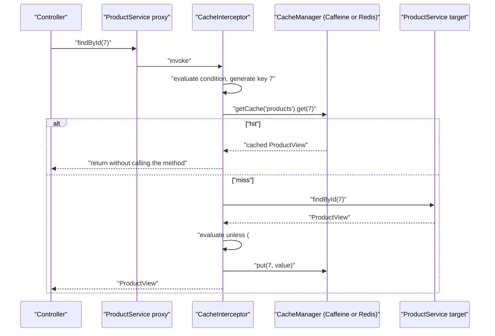
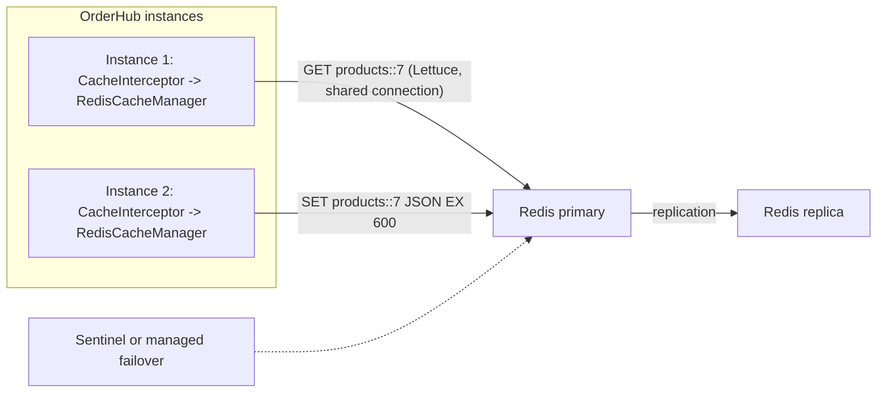

@@ 2 | MODULE | Caching | Serving repeated reads from memory: Spring's cache annotations, Redis as a shared cache, and Hibernate's entity-level cache | MUST
# Caching

**Shared analogy: a sticky note on your monitor.** Instead of looking up the Wi-Fi password in the IT portal every time (the database), you write it on a sticky note (the cache). It is instant, but when IT changes the password, your note is wrong until you replace it (invalidation) or it falls off after a week (TTL). A note on *your* monitor helps only you (a local in-memory cache); a note on the shared whiteboard helps the whole team (Redis); and a note stuck inside the IT portal's own login page is Hibernate's second-level cache, managed by the data layer itself.

- [[Spring Cache Abstraction]] is the rulebook for when to write, read and remove notes (`@Cacheable`, `@CachePut`, `@CacheEvict`).
- [[Redis with Spring Boot]] is the shared whiteboard all instances read.
- [[Hibernate Second-Level Cache]] caches entities beneath JPA, transparently.

@@ 3 | TOPIC | Spring Cache Abstraction | How @Cacheable, @CachePut and @CacheEvict work through proxies, keys, conditions, sync, providers like Caffeine, and consistency pitfalls | MUST
# Spring Cache Abstraction

**Level: Advanced | Phase 19 | Priority: MUST | Since: Spring 3.1 (cache abstraction), Spring 4.1 (JCache annotations, @CacheConfig), Spring 4.3 (sync)**

> **30-second interview answer:** Spring's cache abstraction lets you cache method results with annotations, independent of the cache technology. With `@EnableCaching`, a proxy's `CacheInterceptor` computes a key from the arguments, returns the cached value from the `CacheManager` if present, or calls the method and stores the result. `@CachePut` always runs the method and updates the entry, `@CacheEvict` removes entries. It works like `@Transactional`: proxy-based, so self-invocation is not cached. The provider is pluggable: a `ConcurrentHashMap` by default, Caffeine for local caches, Redis for shared ones. The hard part is consistency: TTLs, eviction on writes, and avoiding stampedes.

## 1. Concept in Simple Words
### Analogy
A restaurant's prepared-dish counter.

| Restaurant | Spring Cache |
|---|---|
| A waiter checks the warm counter before ordering from the kitchen | `@Cacheable`: check the cache before running the method |
| Each dish has a label (table 4, pasta, no cheese) | Cache key from the arguments |
| The kitchen always cooks a fresh dish and also puts it on the counter | `@CachePut` |
| Throwing out the pasta after the recipe changed | `@CacheEvict` |
| Dishes are discarded after 20 minutes | TTL (time to live) |
| Counter holds at most 50 dishes; the oldest unused one goes first | Size-bounded eviction (LRU or W-TinyLFU) |
| Ten waiters see the counter empty and all order the same dish at once | Cache stampede; `sync = true` lets one cook while others wait |
| The waiter only knows the counter, not whether it is a shelf or a heated cabinet | `CacheManager` abstraction over providers |

### What it is
- **`@EnableCaching`:** registers the caching infrastructure (`ProxyCachingConfiguration`, `CacheInterceptor`, an advisor). Boot's `CacheAutoConfiguration` creates a `CacheManager` only when `@EnableCaching` is present.
- **`Cache` and `CacheManager`:** Spring interfaces (`org.springframework.cache`) that providers implement: `ConcurrentMapCacheManager`, `CaffeineCacheManager`, `RedisCacheManager`, `JCacheCacheManager`.
- **`@Cacheable(cacheNames, key, condition, unless, sync)`:** read-through caching of a method result.
- **`@CachePut`:** always executes and stores the result (use the same key as the reading method).
- **`@CacheEvict(allEntries, beforeInvocation)`:** removes one key or the whole cache.
- **`@Caching`:** groups several cache annotations on one method. **`@CacheConfig`:** class-level defaults (cache names, key generator).
- **Key:** by default `SimpleKeyGenerator`: no args gives `SimpleKey.EMPTY`, one arg is the key itself, several args become a `SimpleKey` of all. SpEL keys: `key = "#id"`, `key = "#p0"`, `key = "#customer.id + ':' + #status"`.
- **`condition`** is evaluated *before* the call (decides whether caching applies at all), **`unless`** *after* (can use `#result`, decides whether to store).

### Why it exists
Caching code written by hand (`map.get`, null check, compute, `map.put`, invalidation) is repetitive and mixes infrastructure with business logic. The abstraction makes caching declarative and lets you swap a local map for Redis without touching services.

## 2. How It Works



**Execution order inside `CacheAspectSupport.execute`:**
1. `@CacheEvict(beforeInvocation = true)` evictions.
2. Look up `@Cacheable` entries; if any hit and there is no `@CachePut` on the method, return the cached value.
3. On miss, invoke the method.
4. Apply `@CachePut` and store `@Cacheable` results (subject to `unless`).
5. `@CacheEvict` (default `beforeInvocation = false`) evictions, only if the method did not throw.

**Proxy rules (same as transactions):** self-invocation is not cached; private and final methods are not intercepted; the cache proxy and the transaction proxy are the same proxy with two advisors. Order matters: if caching runs *outside* the transaction and the method puts a value that is later rolled back, the cache holds data that never committed. `TransactionAwareCacheManagerProxy` (or `RedisCacheManager.builder(...).transactionAware()`) delays puts and evictions until after commit.

**`sync = true`:** for a given key, only one thread computes the value while others wait (`Cache.get(key, Callable)`); it prevents a stampede on a hot key at expiry. Only valid with a single `@Cacheable` and no `unless`.

**Local vs distributed:** a local cache (Caffeine) is nanoseconds fast but each instance has its own copy, so an eviction on instance A does not reach instance B. A distributed cache (Redis) is shared and consistent across instances but adds a network hop (around 0.3 to 1 ms) and serialization. Two-level setups use a short-TTL local cache in front of Redis.

**Consistency strategies**

| Strategy | How | Risk |
|---|---|---|
| Cache-aside with evict on write | Read: `@Cacheable`; write: update DB then `@CacheEvict` | Race: a concurrent reader may repopulate the old value between update and evict (small window) |
| Write-through with put | Write: update DB and `@CachePut` the new value | Put of a value from a transaction that later rolls back, unless transaction-aware |
| TTL only | Entries expire | Stale for up to TTL |
| Event-driven invalidation | Publish change events (Kafka, Redis pub/sub) to evict everywhere | More moving parts |

## 3. Code Example
### Code
OrderHub caches product lookups locally with Caffeine (the Redis version follows in the next topic).

```xml
<!-- pom.xml -->
<dependency>
    <groupId>org.springframework.boot</groupId>
    <artifactId>spring-boot-starter-cache</artifactId>
</dependency>
<dependency>
    <groupId>com.github.ben-manes.caffeine</groupId>
    <artifactId>caffeine</artifactId>
</dependency>
```

```yaml
# file: src/main/resources/application.yml
spring:
  cache:
    type: caffeine
    cache-names: products,productsByCategory
    caffeine:
      spec: maximumSize=10000,expireAfterWrite=10m,recordStats   # recordStats feeds Micrometer cache metrics
```

```java
// file: src/main/java/com/orderhub/config/CacheConfig.java
package com.orderhub.config;

import org.springframework.cache.annotation.EnableCaching;
import org.springframework.context.annotation.Configuration;

@Configuration
@EnableCaching
public class CacheConfig { }
```

```java
// file: src/main/java/com/orderhub/catalog/ProductView.java
package com.orderhub.catalog;

import java.io.Serializable;
import java.math.BigDecimal;

// Cache DTOs, not JPA entities: no lazy proxies, no persistence context attached
public record ProductView(long id, String sku, String name, String category, BigDecimal price)
        implements Serializable { }
```

```java
// file: src/main/java/com/orderhub/catalog/ProductService.java
package com.orderhub.catalog;

import java.math.BigDecimal;
import java.util.List;
import org.springframework.cache.annotation.CacheConfig;
import org.springframework.cache.annotation.CacheEvict;
import org.springframework.cache.annotation.CachePut;
import org.springframework.cache.annotation.Cacheable;
import org.springframework.cache.annotation.Caching;
import org.springframework.stereotype.Service;
import org.springframework.transaction.annotation.Transactional;

@Service
@CacheConfig(cacheNames = "products")
public class ProductService {
    private final ProductRepository products;

    public ProductService(ProductRepository products) { this.products = products; }

    @Cacheable(key = "#id", unless = "#result == null", sync = false)
    @Transactional(readOnly = true)
    public ProductView findById(long id) {
        System.out.println("DB lookup for product " + id);
        return products.findById(id).map(ProductService::toView).orElse(null);
    }

    @Cacheable(cacheNames = "productsByCategory", key = "#category.toLowerCase()",
               condition = "#category.length() > 1")
    @Transactional(readOnly = true)
    public List<ProductView> byCategory(String category) {
        System.out.println("DB query for category " + category);
        return products.findByCategoryIgnoreCase(category).stream().map(ProductService::toView).toList();
    }

    @Caching(
        put = @CachePut(key = "#id"),                                 // refresh the single-product entry
        evict = @CacheEvict(cacheNames = "productsByCategory", allEntries = true)  // lists may contain it
    )
    @Transactional
    public ProductView changePrice(long id, BigDecimal newPrice) {
        Product p = products.findById(id).orElseThrow();
        p.changePrice(newPrice);
        return toView(p);
    }

    @CacheEvict(key = "#id")
    @Transactional
    public void delete(long id) {
        products.deleteById(id);
    }

    private static ProductView toView(Product p) {
        return new ProductView(p.getId(), p.getSku(), p.getName(), p.getCategory(), p.getPrice());
    }
}
```

```java
// file: src/test/java/com/orderhub/catalog/ProductServiceCacheTest.java
package com.orderhub.catalog;

import static org.assertj.core.api.Assertions.assertThat;
import static org.mockito.Mockito.times;
import static org.mockito.Mockito.verify;
import static org.mockito.Mockito.when;

import java.math.BigDecimal;
import java.util.Optional;
import org.junit.jupiter.api.Test;
import org.springframework.beans.factory.annotation.Autowired;
import org.springframework.boot.test.autoconfigure.core.AutoConfigureCache;
import org.springframework.cache.CacheManager;
import org.springframework.cache.annotation.EnableCaching;
import org.springframework.cache.concurrent.ConcurrentMapCacheManager;
import org.springframework.context.annotation.Bean;
import org.springframework.context.annotation.Configuration;
import org.springframework.context.annotation.Import;
import org.springframework.test.context.bean.override.mockito.MockitoBean;
import org.springframework.test.context.junit.jupiter.SpringJUnitConfig;

@SpringJUnitConfig
class ProductServiceCacheTest {

    @Configuration
    @EnableCaching
    @Import(ProductService.class)
    static class Config {
        @Bean
        CacheManager cacheManager() { return new ConcurrentMapCacheManager("products", "productsByCategory"); }
    }

    @MockitoBean ProductRepository repository;
    @Autowired ProductService service;

    @Test
    void secondCallIsServedFromCache() {
        when(repository.findById(7L)).thenReturn(Optional.of(
                new Product("SKU-7", "Mug", "kitchen", new BigDecimal("9.90"))));
        service.findById(7);
        service.findById(7);
        verify(repository, times(1)).findById(7L);
    }
}
```

### Walkthrough
- `spring.cache.type=caffeine` and the spec configure a size-bounded, time-expiring local cache; `recordStats` lets Actuator publish `cache.gets{result=hit or miss}` metrics.
- `@EnableCaching` is required: without it the annotations are silently ignored.
- **Cache DTOs, not entities.** A cached entity is detached, may have uninitialized lazy proxies (`LazyInitializationException` later), and may be mutated by a caller, corrupting the cached copy for everyone (with a local cache, callers share the same object).
- `findById` uses `unless = "#result == null"` so missing products are not cached (otherwise a product created later stays "missing" until TTL). Caching nulls on purpose ("negative caching") is a valid defence against floods of lookups for nonexistent IDs, with a short TTL.
- `byCategory` normalises the key with `toLowerCase()` so "Kitchen" and "kitchen" share an entry; `condition` skips caching for nonsense one-letter categories.
- `changePrice` uses `@Caching` to put the fresh view and evict all category lists, which may include the product with the old price. Evicting all entries is coarse but correct.
- The test uses a small Spring context with a real proxy, because caching cannot be tested by calling the class directly with `new`.

### Output
```text
GET /api/products/7        -> DB lookup for product 7
GET /api/products/7        -> (no log: cache hit)
GET /api/products?category=Kitchen  -> DB query for category Kitchen
GET /api/products?category=kitchen  -> (no log: same key "kitchen")
PUT /api/products/7/price {"price": 11.50}
GET /api/products/7        -> (no log: entry was refreshed by @CachePut)
GET /api/products?category=kitchen  -> DB query for category kitchen
```
```http
GET /actuator/metrics/cache.gets?tag=name:products&tag=result:hit HTTP/1.1
```
```json
{"name":"cache.gets","description":"The number of times cache lookup methods have returned a cached (hit) or uncached (miss) value.","measurements":[{"statistic":"COUNT","value":2.0}]}
```

### Compare
| Annotation | Runs method | Touches cache |
|---|---|---|
| `@Cacheable` | Only on miss | Reads, stores on miss |
| `@CachePut` | Always | Stores result |
| `@CacheEvict` | Always | Removes key or all entries (after success by default) |
| `@Caching` | Depends on content | Combines several |

| Provider | Scope | Speed | Notes |
|---|---|---|---|
| `ConcurrentMapCacheManager` (default fallback) | Local | Fastest | No TTL, no size limit: tests and demos only |
| Caffeine | Local | Nanoseconds | Size, TTL, stats, W-TinyLFU eviction |
| Redis | Shared | Sub-millisecond network hop | TTL per cache, survives restarts, needs serialization |
| JCache (Ehcache 3, Hazelcast) | Local or clustered | Varies | Standard API (JSR-107) |

## 4. Interview Questions
**Basic**
1. **How does `@Cacheable` work?**
   With `@EnableCaching`, the bean is proxied and a `CacheInterceptor` builds a key from the method arguments, checks the named cache, and returns the cached value on a hit without calling the method. On a miss it calls the method and stores the result.
2. **Difference between `@Cacheable`, `@CachePut` and `@CacheEvict`?**
   `@Cacheable` skips the method on a hit; `@CachePut` always runs the method and writes the result into the cache; `@CacheEvict` removes one entry or all entries, after the method succeeds by default.
3. **How is the cache key generated by default?**
   `SimpleKeyGenerator`: with no parameters `SimpleKey.EMPTY`, with one parameter that parameter, with several a `SimpleKey` combining all of them. Override with a SpEL `key` or a custom `KeyGenerator`.

**Follow-up**
4. **Why does `@Cacheable` not work when called from another method in the same class?**
   Like `@Transactional`, caching is implemented by a proxy, and internal calls through `this` bypass the proxy. Move the cached method to another bean or call it through the proxy.
5. **What is the difference between `condition` and `unless`?**
   `condition` is evaluated before the method runs and decides whether caching applies at all for this call. `unless` is evaluated after, can use `#result`, and vetoes storing the result (for example `unless = "#result == null"`).
6. **What is a cache stampede and how do you prevent it?**
   When a hot entry expires, many concurrent requests miss and all hit the database at once. Prevent it with `sync = true` (one loader per key per instance), early refresh (Caffeine `refreshAfterWrite`), randomised TTLs (jitter) so keys do not expire together, or a distributed lock for very expensive loads.

**Tricky / scenario**
7. **After an update, some users see the old price for up to 10 minutes on some instances only. Why?**
   The cache is local (Caffeine): the eviction ran on the instance that handled the update, while other instances keep their copies until TTL. Use a shared cache (Redis), broadcast invalidations (pub/sub or Kafka events), or accept staleness with a short TTL.
8. **A cached `Order` entity throws `LazyInitializationException` on the second request. Explain and fix.**
   The first request cached the entity with an uninitialized lazy collection; on a cache hit the entity is detached, no session exists, and touching the collection fails. Cache DTOs built inside the transaction instead of entities.
9. **The method updates the database and has `@CachePut`. The transaction rolls back but the cache shows the new value. Why?**
   The put happened when the method returned, before the transaction interceptor (or the outer transaction) rolled back. Make the cache manager transaction-aware so puts and evicts are applied after commit, or evict instead of put.

**What the interviewer is really testing:** whether you can use caching as a consistency trade-off with clear invalidation, not just sprinkle `@Cacheable` for speed.

## 5. Pitfalls & Best Practices
### Common mistakes
| Mistake | What goes wrong | Fix |
|---|---|---|
| Forgetting `@EnableCaching` | Annotations silently ignored | Add it to a configuration class |
| Caching JPA entities | Lazy loading errors, shared mutable state | Cache immutable DTOs or records |
| No TTL or size limit | Memory leak, permanent staleness | Always bound size and age |
| Local cache on a multi-instance service | Inconsistent data between instances | Shared cache or invalidation broadcast |
| Keys missing a parameter (tenant, locale) | One user sees another tenant's data | Include every input that changes the result in the key |
| Caching inside a transaction that may roll back | Cache contains uncommitted data | Transaction-aware cache manager |

### Best practices
- Decide per cache: acceptable staleness, TTL, maximum size, and the write paths that must evict.
- Monitor hit ratio, evictions and load time; a hit ratio below about 80 percent often means the cache costs more than it saves.
- Use cache names per data type and keep keys readable (`products::7`), which helps debugging in Redis.
- Put caching at the service layer on business-meaningful methods, not on repositories with many parameters.
- Warm critical caches after startup and use jittered TTLs to avoid synchronized expiry.

### Compare with
| Cache layer | Example | Pros | Cons |
|---|---|---|---|
| HTTP caching | `Cache-Control`, ETag | Clients and CDNs cache, zero server load | Only for GET, public data |
| Spring Cache on services | `@Cacheable` | Business-level, flexible | Proxy rules, invalidation by you |
| Hibernate second-level cache | Entity cache | Transparent to services | Entity-only, tuning complexity |
| Database buffer cache | PostgreSQL shared buffers | Automatic | Still a round trip and query cost |

## 6. Hands-on Exercise
OrderHub shows a "top 10 products this week" widget on every page; computing it takes 800 ms. Add caching. Acceptance criteria: only one computation runs at a time on each instance even when 200 requests arrive at expiry; the value refreshes at most every 5 minutes; an admin endpoint can force a refresh; and the widget still works if the computation throws (serve the last known value).

<details><summary>Solution</summary>

```java
// file: src/main/java/com/orderhub/catalog/TopProductsService.java
package com.orderhub.catalog;

import java.util.List;
import java.util.concurrent.atomic.AtomicReference;
import org.slf4j.Logger;
import org.slf4j.LoggerFactory;
import org.springframework.cache.annotation.CacheEvict;
import org.springframework.cache.annotation.Cacheable;
import org.springframework.stereotype.Service;

@Service
public class TopProductsService {
    private static final Logger log = LoggerFactory.getLogger(TopProductsService.class);
    private final TopProductsQuery query;
    private final AtomicReference<List<ProductView>> lastGood = new AtomicReference<>(List.of());

    public TopProductsService(TopProductsQuery query) { this.query = query; }

    @Cacheable(cacheNames = "topProducts", key = "'week'", sync = true)   // one loader per key
    public List<ProductView> topThisWeek() {
        try {
            List<ProductView> fresh = query.top10ThisWeek();   // 800 ms aggregation
            lastGood.set(fresh);
            return fresh;
        } catch (RuntimeException e) {
            log.warn("top products computation failed, serving last known value", e);
            return lastGood.get();                             // stale but available
        }
    }

    @CacheEvict(cacheNames = "topProducts", key = "'week'")
    public void refresh() { }
}
```

```yaml
spring:
  cache:
    type: caffeine
    cache-names: products,productsByCategory,topProducts
    caffeine:
      spec: maximumSize=10000,expireAfterWrite=5m
```

```java
// Admin controller excerpt
@PostMapping("/api/admin/top-products/refresh")
@PreAuthorize("hasRole('ADMIN')")
public List<ProductView> refresh() {
    topProducts.refresh();                 // evict through the proxy
    return topProducts.topThisWeek();      // recompute through the proxy
}
```
`sync = true` makes Caffeine's `get(key, loader)` block concurrent callers for the same key until the single computation finishes. A fallback value is returned (and cached for 5 minutes) when the computation fails; for a stricter design, cache failures for a shorter time with a separate cache.
</details>

## 7. Recall
Q: What does @CachePut do differently from @Cacheable in Spring?
A: `@CachePut` always executes the method and stores its result; `@Cacheable` skips the method when the key is cached.

Q: What is the default cache key for a Spring @Cacheable method with one parameter?
A: The parameter value itself (via `SimpleKeyGenerator`).

Q: Why does Spring @Cacheable not work for calls within the same class?
A: Caching is applied by a proxy, and self-invocation bypasses the proxy.

Q: What does sync = true on @Cacheable prevent?
A: A cache stampede: only one thread per key computes the value while others wait.

Q: Why should you cache DTOs instead of JPA entities with Spring Cache?
A: Cached entities are detached (lazy loading fails) and mutable shared objects can be corrupted by callers.

Q: What is the difference between condition and unless in Spring cache annotations?
A: `condition` is checked before the call to decide whether to cache at all; `unless` is checked after and can veto storing based on `#result`.

**Related:** [[Redis with Spring Boot]] · [[Hibernate Second-Level Cache]] · [[How @Transactional Really Works]] · [[Spring AOP Concepts]]

@@ 3 | TOPIC | Redis with Spring Boot | Redis data structures, Lettuce and RedisTemplate, serializers, RedisCacheManager with TTLs, distributed locks, rate limiting and Testcontainers | MUST
# Redis with Spring Boot

**Level: Advanced | Phase 19 | Priority: MUST | Since: Spring Data Redis 1.0; Lettuce default client since Spring Boot 2.0; @ServiceConnection since Boot 3.1**

> **30-second interview answer:** Redis is an in-memory key-value store with rich data structures (strings, hashes, lists, sets, sorted sets, streams) and sub-millisecond latency, used as a shared cache, session store, rate limiter, lock service and lightweight message broker. In Spring Boot, `spring-boot-starter-data-redis` auto-configures a Lettuce connection factory, `RedisTemplate` and `StringRedisTemplate`, and with `@EnableCaching` a `RedisCacheManager`, so `@Cacheable` stores values in Redis. The key decisions are serialization (JSON rather than JDK serialization), a TTL per cache, an eviction policy for when memory is full, and what happens when Redis is down.

## 1. Concept in Simple Words
### Analogy
The shared whiteboard in an office.

| Office whiteboard | Redis |
|---|---|
| Everyone in the office reads and writes the same board | One cache shared by all app instances |
| Writing is instant compared to filing paperwork in the archive | In-memory, sub-millisecond vs database |
| Sections: a list of tasks, a scoreboard, a set of names | Data structures: list, sorted set, set, hash |
| "Erase this note on Friday" written next to it | TTL (`EXPIRE`) |
| When the board is full, erase the least-used notes | `maxmemory-policy allkeys-lru` |
| Writing "Room 3 taken by Alice until 3 pm" only if empty | `SET key value NX PX 30000` (lock) |
| Notes written in a language every team can read | JSON serialization instead of Java serialization |
| A photo of the board taken every hour | RDB snapshots or AOF persistence |

### What it is
- **Redis:** single-threaded command execution (I/O threads optional since Redis 6), so each command is atomic. Data lives in RAM, optionally persisted (RDB snapshots, AOF append log). Valkey is the open-source fork with the same protocol, and works with the same Spring client.
- **Lettuce:** the default Netty-based, thread-safe client; one connection is shared by many threads. Jedis is the alternative (pool-based).
- **`RedisConnectionFactory`:** `LettuceConnectionFactory`, configured from `spring.data.redis.*` (host, port, password, ssl, cluster, sentinel, timeout).
- **`RedisTemplate<K, V>`:** the low-level API with `opsForValue()`, `opsForHash()`, `opsForList()`, `opsForSet()`, `opsForZSet()`. Default serializer is JDK serialization (binary, Java-only). **`StringRedisTemplate`** uses strings for keys and values.
- **`RedisCacheManager`:** implements Spring's `CacheManager`; keys look like `cacheName::key` by default.
- **Serializers:** `StringRedisSerializer`, `GenericJackson2JsonRedisSerializer` (stores JSON with a `@class` type property), `Jackson2JsonRedisSerializer<T>` (typed, no type info), `JdkSerializationRedisSerializer`.

### Why it exists
Once a service runs on several instances, local caches disagree and in-memory state (sessions, rate-limit counters, locks) is lost on restart or not visible to other instances. Redis gives all instances one fast shared memory with atomic operations, without the cost of database round trips and disk writes.

## 2. How It Works



**What `@Cacheable` does against Redis:** on a miss, the method runs, the value is serialized (for example to JSON), and `SET products::7 <bytes> PX 600000` is sent. On a hit, `GET products::7` returns bytes that are deserialized. `@CacheEvict(allEntries = true)` uses `SCAN` plus `DEL` (or `KEYS` in older versions: configure `BatchStrategies.scan(1000)` to avoid blocking Redis with `KEYS`).

**Core data structures and their OrderHub uses**

| Structure | Commands | Use |
|---|---|---|
| String | `GET`, `SET ... EX`, `INCR` | Cached JSON, counters, locks |
| Hash | `HSET`, `HGETALL`, `HINCRBY` | Cart: field per product, value quantity |
| List | `LPUSH`, `LRANGE`, `LTRIM` | Recently viewed products (capped list) |
| Set | `SADD`, `SISMEMBER` | Customers who already got a coupon |
| Sorted set | `ZADD`, `ZINCRBY`, `ZREVRANGE` | Best-sellers leaderboard by score |
| Stream | `XADD`, `XREADGROUP` | Lightweight event log with consumer groups |

**Distributed lock basics:** `SET lock:order:42 <uuid> NX PX 30000` acquires only if absent, with an expiry so a crashed holder does not block forever. Release must check ownership atomically (Lua script: delete only if the value equals my UUID); otherwise a slow holder whose lock expired could delete someone else's lock. For production, Redisson's `RLock` (with watchdog renewal) or Spring Integration's `RedisLockRegistry` implement this correctly. A Redis lock is an efficiency lock, not a correctness guarantee under failover; for strict correctness combine with database constraints or fencing tokens.

**Memory and eviction:** set `maxmemory` and `maxmemory-policy`. For a pure cache use `allkeys-lru` or `allkeys-lfu`; for mixed data (cache plus sessions or locks) use `volatile-lru` so only keys with a TTL are evicted. The default `noeviction` makes writes fail when memory is full.

**When Redis is down:** cache reads throw `RedisConnectionFailureException`, failing requests that could have been served from the database. Implement a `CacheErrorHandler` that logs and treats errors as misses, set short command timeouts, and protect with a circuit breaker.

## 3. Code Example
### Code
OrderHub moves its product cache to Redis with JSON values and per-cache TTLs, adds a best-seller leaderboard, an idempotency lock for checkout, and a Testcontainers test.

```xml
<!-- pom.xml -->
<dependency>
    <groupId>org.springframework.boot</groupId>
    <artifactId>spring-boot-starter-data-redis</artifactId>
</dependency>
<dependency>
    <groupId>org.springframework.boot</groupId>
    <artifactId>spring-boot-starter-cache</artifactId>
</dependency>
<dependency>
    <groupId>org.springframework.boot</groupId>
    <artifactId>spring-boot-testcontainers</artifactId>
    <scope>test</scope>
</dependency>
<dependency>
    <groupId>com.redis</groupId>
    <artifactId>testcontainers-redis</artifactId>
    <version>2.2.2</version>
    <scope>test</scope>
</dependency>
```

```yaml
# file: src/main/resources/application.yml
spring:
  data:
    redis:
      host: ${REDIS_HOST:localhost}
      port: 6379
      timeout: 500ms              # command timeout: fail fast, fall back to the database
      connect-timeout: 1s
  cache:
    type: redis
    redis:
      time-to-live: 10m           # default TTL for caches without a specific config
      key-prefix: "orderhub:"
      use-key-prefix: true
      cache-null-values: false
```

```java
// file: src/main/java/com/orderhub/config/RedisCacheConfig.java
package com.orderhub.config;

import java.time.Duration;
import org.slf4j.Logger;
import org.slf4j.LoggerFactory;
import org.springframework.boot.autoconfigure.cache.RedisCacheManagerBuilderCustomizer;
import org.springframework.cache.Cache;
import org.springframework.cache.annotation.CachingConfigurer;
import org.springframework.cache.annotation.EnableCaching;
import org.springframework.cache.interceptor.CacheErrorHandler;
import org.springframework.context.annotation.Bean;
import org.springframework.context.annotation.Configuration;
import org.springframework.data.redis.cache.RedisCacheConfiguration;
import org.springframework.data.redis.serializer.GenericJackson2JsonRedisSerializer;
import org.springframework.data.redis.serializer.RedisSerializationContext.SerializationPair;
import org.springframework.data.redis.serializer.StringRedisSerializer;

@Configuration
@EnableCaching
public class RedisCacheConfig implements CachingConfigurer {
    private static final Logger log = LoggerFactory.getLogger(RedisCacheConfig.class);

    @Bean
    RedisCacheConfiguration redisCacheConfiguration() {           // Boot uses this as the default config
        return RedisCacheConfiguration.defaultCacheConfig()
                .entryTtl(Duration.ofMinutes(10))
                .disableCachingNullValues()
                .prefixCacheNameWith("orderhub:")
                .serializeKeysWith(SerializationPair.fromSerializer(new StringRedisSerializer()))
                .serializeValuesWith(SerializationPair.fromSerializer(new GenericJackson2JsonRedisSerializer()));
    }

    @Bean
    RedisCacheManagerBuilderCustomizer perCacheTtl(RedisCacheConfiguration base) {
        return builder -> builder
                .withCacheConfiguration("products", base.entryTtl(Duration.ofMinutes(30)))
                .withCacheConfiguration("topProducts", base.entryTtl(Duration.ofMinutes(5)))
                .transactionAware();                               // puts and evicts applied after commit
    }

    @Override
    public CacheErrorHandler errorHandler() {                      // Redis down = cache miss, not an error
        return new CacheErrorHandler() {
            @Override public void handleCacheGetError(RuntimeException e, Cache cache, Object key) {
                log.warn("cache get failed {}::{}: {}", cache.getName(), key, e.getMessage());
            }
            @Override public void handleCachePutError(RuntimeException e, Cache cache, Object key, Object value) {
                log.warn("cache put failed {}::{}: {}", cache.getName(), key, e.getMessage());
            }
            @Override public void handleCacheEvictError(RuntimeException e, Cache cache, Object key) {
                log.error("cache evict failed {}::{}: stale data possible", cache.getName(), key, e);
            }
            @Override public void handleCacheClearError(RuntimeException e, Cache cache) {
                log.error("cache clear failed {}", cache.getName(), e);
            }
        };
    }
}
```

```java
// file: src/main/java/com/orderhub/catalog/BestSellerBoard.java
package com.orderhub.catalog;

import java.util.List;
import java.util.Set;
import org.springframework.data.redis.core.StringRedisTemplate;
import org.springframework.data.redis.core.ZSetOperations.TypedTuple;
import org.springframework.stereotype.Component;

@Component
public class BestSellerBoard {
    private static final String KEY = "orderhub:bestsellers:2026-W48";
    private final StringRedisTemplate redis;

    public BestSellerBoard(StringRedisTemplate redis) { this.redis = redis; }

    public void recordSale(long productId, int qty) {
        redis.opsForZSet().incrementScore(KEY, String.valueOf(productId), qty);   // ZINCRBY, atomic
    }

    public List<String> top(int n) {
        Set<TypedTuple<String>> tuples = redis.opsForZSet().reverseRangeWithScores(KEY, 0, n - 1);
        return tuples.stream().map(t -> t.getValue() + "=" + t.getScore().intValue()).toList();
    }
}
```

```java
// file: src/main/java/com/orderhub/order/CheckoutLock.java
package com.orderhub.order;

import java.time.Duration;
import java.util.List;
import java.util.UUID;
import java.util.function.Supplier;
import org.springframework.data.redis.core.StringRedisTemplate;
import org.springframework.data.redis.core.script.DefaultRedisScript;
import org.springframework.stereotype.Component;

@Component
public class CheckoutLock {
    private static final DefaultRedisScript<Long> RELEASE = new DefaultRedisScript<>(
            "if redis.call('get', KEYS[1]) == ARGV[1] then return redis.call('del', KEYS[1]) else return 0 end",
            Long.class);
    private final StringRedisTemplate redis;

    public CheckoutLock(StringRedisTemplate redis) { this.redis = redis; }

    public <T> T withLock(String idempotencyKey, Duration ttl, Supplier<T> action) {
        String key = "orderhub:lock:checkout:" + idempotencyKey;
        String token = UUID.randomUUID().toString();
        Boolean acquired = redis.opsForValue().setIfAbsent(key, token, ttl);       // SET key token NX PX ttl
        if (!Boolean.TRUE.equals(acquired)) {
            throw new DuplicateCheckoutException(idempotencyKey);
        }
        try {
            return action.get();
        } finally {
            redis.execute(RELEASE, List.of(key), token);                            // delete only my lock
        }
    }
}
```

```java
// file: src/test/java/com/orderhub/catalog/RedisCacheIT.java
package com.orderhub.catalog;

import static org.assertj.core.api.Assertions.assertThat;

import com.redis.testcontainers.RedisContainer;
import org.junit.jupiter.api.Test;
import org.springframework.beans.factory.annotation.Autowired;
import org.springframework.boot.test.context.SpringBootTest;
import org.springframework.boot.testcontainers.service.connection.ServiceConnection;
import org.springframework.data.redis.core.StringRedisTemplate;
import org.testcontainers.junit.jupiter.Container;
import org.testcontainers.junit.jupiter.Testcontainers;
import org.testcontainers.utility.DockerImageName;

@SpringBootTest
@Testcontainers
class RedisCacheIT {

    @Container
    @ServiceConnection                                   // Boot 3.1+: sets spring.data.redis.* automatically
    static RedisContainer redis = new RedisContainer(DockerImageName.parse("redis:7.4-alpine"));

    @Autowired ProductService products;
    @Autowired StringRedisTemplate template;

    @Test
    void productIsStoredAsJsonWithTtl() {
        products.findById(7);
        assertThat(template.opsForValue().get("orderhub:products::7")).contains("\"sku\":\"SKU-7\"");
        assertThat(template.getExpire("orderhub:products::7")).isBetween(1700L, 1800L);
    }
}
```

### Walkthrough
- **Properties:** `timeout: 500ms` bounds every Redis command; with the error handler, a slow or dead Redis degrades to cache misses within half a second instead of hanging requests.
- **`RedisCacheConfiguration` bean:** Boot's `RedisCacheConfiguration` auto-configuration uses your bean as the default. Keys are plain strings and values JSON, readable in `redis-cli` and by non-Java services. `GenericJackson2JsonRedisSerializer` embeds `@class` so it can deserialize the right type (a record like `ProductView` works); the type name couples the stored data to your class names, so renaming a class needs a cache flush.
- **Per-cache TTLs** via `RedisCacheManagerBuilderCustomizer`: products for 30 minutes, the expensive top list for 5 minutes. `transactionAware()` defers cache writes to after commit, closing the rollback gap from the previous topic.
- **`CacheErrorHandler`** (through `CachingConfigurer`) turns Redis failures into misses. Evict failures are logged as errors because they risk stale data.
- **`BestSellerBoard`** uses a sorted set: `ZINCRBY` is atomic, so concurrent sales from all instances are counted correctly without locks. A weekly key keeps history bounded (add `EXPIRE` for old weeks).
- **`CheckoutLock`** implements `SET NX PX` plus a Lua release script that deletes only if the stored token is ours. This closes the race noted in the DispatcherServlet idempotency exercise where two first requests with the same key could both run.
- **Test:** `@ServiceConnection` wires the container's host and port into Boot without `@DynamicPropertySource`. The key format `orderhub:products::7` comes from the prefix plus `cacheName::key`.

### Output
```text
$ redis-cli --scan --pattern 'orderhub:*'
orderhub:products::7
orderhub:topProducts::week
orderhub:bestsellers:2026-W48

$ redis-cli GET orderhub:products::7
"{\"@class\":\"com.orderhub.catalog.ProductView\",\"id\":7,\"sku\":\"SKU-7\",\"name\":\"Mug\",\"category\":\"kitchen\",\"price\":[\"java.math.BigDecimal\",9.90]}"

$ redis-cli TTL orderhub:products::7
(integer) 1793

$ redis-cli ZREVRANGE orderhub:bestsellers:2026-W48 0 2 WITHSCORES
1) "7"
2) "143"
3) "12"
4) "97"
5) "3"
6) "41"
```
Redis stopped during a request:
```text
WARN  c.o.config.RedisCacheConfig : cache get failed products::7: Unable to connect to Redis
DB lookup for product 7
WARN  c.o.config.RedisCacheConfig : cache put failed products::7: Unable to connect to Redis
```
The request still returns `200 OK` from the database.

### Compare
| Serializer | Readable | Cross-language | Type info | Notes |
|---|---|---|---|---|
| `JdkSerializationRedisSerializer` (RedisTemplate default) | No (binary) | No | Implicit | Breaks on class changes; security risk with untrusted data |
| `GenericJackson2JsonRedisSerializer` | Yes | Mostly | `@class` property | Good default for caches of many types |
| `Jackson2JsonRedisSerializer<T>` | Yes | Yes | None (fixed type) | One serializer per cache type |
| `StringRedisSerializer` | Yes | Yes | None | Keys, counters, simple values |

| Use | Redis | Alternative |
|---|---|---|
| Shared cache | Yes | Hazelcast, Memcached |
| Sessions (Spring Session) | Yes | JDBC session store |
| Rate limiting | `INCR` plus `EXPIRE`, or Lua token bucket | API gateway limiter |
| Distributed lock | Redisson, `RedisLockRegistry` | Database row lock, ZooKeeper |
| Messaging | Pub/Sub (fire and forget), Streams | Kafka for durable, high-volume events |

## 4. Interview Questions
**Basic**
1. **Why use Redis as a cache instead of a local in-memory cache?**
   A local cache is per instance, so instances disagree after updates and each must warm separately. Redis is shared by all instances, survives app restarts, offers TTLs and atomic data structures, at the cost of a network hop and serialization.
2. **How do you use Redis with Spring's cache annotations?**
   Add `spring-boot-starter-data-redis` and `spring-boot-starter-cache`, put `@EnableCaching` on a configuration, set `spring.cache.type=redis` (auto-detected otherwise) and TTLs. Boot creates a `RedisCacheManager`, and `@Cacheable` reads and writes Redis keys like `products::7`.
3. **What is the difference between `RedisTemplate` and `StringRedisTemplate`?**
   `RedisTemplate<Object, Object>` uses JDK serialization by default for keys and values, producing binary data. `StringRedisTemplate` uses UTF-8 strings for both, readable and interoperable. Configure JSON serializers on `RedisTemplate` for object values.

**Follow-up**
4. **Why avoid the default JDK serialization?**
   It is binary and Java-only, so other services and humans cannot read it; any class change can break deserialization of existing entries; and deserializing untrusted data is a known security risk. JSON is portable and debuggable.
5. **How do you configure different TTLs per cache?**
   Provide a `RedisCacheManagerBuilderCustomizer` that calls `withCacheConfiguration(name, defaultConfig.entryTtl(...))`, or build the `RedisCacheManager` yourself with a map of configurations. `spring.cache.redis.time-to-live` sets only the default.
6. **What happens to your application if Redis goes down, and how do you handle it?**
   By default cache operations throw `RedisConnectionFailureException`, failing requests. Implement a `CacheErrorHandler` that logs and treats failures as misses, use short command and connect timeouts, consider a circuit breaker, and make sure the database can handle the extra load during the outage.

**Tricky / scenario**
7. **You implemented a lock with `SETNX` and then `EXPIRE` as two commands, and occasionally a lock never releases. Why?**
   If the process dies between `SETNX` and `EXPIRE`, the key has no TTL and stays forever. Use a single atomic `SET key value NX PX ttl` (`setIfAbsent(key, value, ttl)`), and release with a Lua script checking ownership.
8. **After a deployment that renamed `ProductView` to `ProductDto`, all product pages fail with deserialization errors. Why, and how do you deploy such changes safely?**
   `GenericJackson2JsonRedisSerializer` stored the old class name in `@class`, so old entries cannot be read into the renamed type. Version cache names or key prefixes per release (`products:v2`), flush affected caches during deploy, or use a typed serializer without class names. Combine with the error handler so bad entries count as misses.
9. **Redis memory fills up, and writes start failing with "OOM command not allowed when used memory > maxmemory". What happened and what do you configure?**
   The eviction policy is `noeviction` (the default), so Redis refuses writes when full. For a cache, set `maxmemory-policy allkeys-lru` (or `allkeys-lfu`), ensure every cache key has a TTL, size `maxmemory` from the working set, and monitor `evicted_keys` and memory usage.
10. **How would you implement a per-customer rate limit of 100 requests per minute across all instances?**
    Use a Redis counter per customer and window: `INCR rate:cust:42:202611241015` then `EXPIRE` on first increment, done atomically in a Lua script or with `MULTI`. Reject when the counter exceeds 100. For smoother limits, a sliding window with a sorted set or a token bucket Lua script; at the edge, Spring Cloud Gateway's `RedisRateLimiter` implements this.

**What the interviewer is really testing:** whether you can operate Redis as production infrastructure: serialization, TTLs, memory policy, failure handling and correct atomic patterns.

## 5. Pitfalls & Best Practices
### Common mistakes
| Mistake | What goes wrong | Fix |
|---|---|---|
| Default JDK serialization | Unreadable, brittle, insecure | JSON serializers |
| No TTL on cache keys | Memory grows until eviction or OOM | Default TTL plus per-cache TTL |
| `noeviction` policy for a cache | Writes fail when memory is full | `allkeys-lru` or `volatile-lru` |
| `KEYS *` in code or `allEntries` eviction with KEYS strategy | Blocks Redis for seconds on large datasets | `SCAN`-based batch strategy |
| Lock without expiry or without owner check | Deadlocks or deleting another holder's lock | `SET NX PX` and Lua release, or Redisson |
| No timeout and no error handler | Redis outage takes the whole app down | Short timeouts, `CacheErrorHandler` |

### Best practices
- Treat Redis as a cache that may lose data unless you configured persistence and accept its trade-offs; the database stays the source of truth.
- Namespace keys (`orderhub:products::7`) and version them when the value format changes.
- Use managed Redis (ElastiCache, Azure Cache, Memorystore) with replicas and automatic failover in production; test failover behaviour with your client timeouts.
- Monitor hit ratio, latency, memory, evictions and connected clients; alert on `rejected_connections` and memory near `maxmemory`.
- Keep values small (a few KB); large values block the single command thread and the network.

### Compare with
| | Redis | Caffeine | Memcached | Hazelcast |
|---|---|---|---|---|
| Scope | Shared server | In-process | Shared server | Embedded or client-server cluster |
| Data structures | Rich | Key-value | Key-value | Maps, queues, more |
| Persistence | Optional | No | No | Optional |
| Latency | About 0.3 to 1 ms | Nanoseconds | About 0.3 to 1 ms | Microseconds to ms |
| Typical use | Shared cache, locks, rate limits, sessions | Hot local data | Simple shared cache | Clustered caching and compute |

## 6. Hands-on Exercise
Store OrderHub's shopping carts in Redis instead of the database. Acceptance criteria: one Redis hash per customer (`orderhub:cart:{customerId}`) with product ID as field and quantity as value; adding an item increments atomically; carts expire 7 days after the last change; reading returns a map of product IDs to quantities; a Testcontainers test proves concurrent adds from 20 threads produce the exact total.

<details><summary>Solution</summary>

```java
// file: src/main/java/com/orderhub/cart/CartStore.java
package com.orderhub.cart;

import java.time.Duration;
import java.util.LinkedHashMap;
import java.util.Map;
import org.springframework.data.redis.core.HashOperations;
import org.springframework.data.redis.core.StringRedisTemplate;
import org.springframework.stereotype.Component;

@Component
public class CartStore {
    private static final Duration TTL = Duration.ofDays(7);
    private final StringRedisTemplate redis;
    private final HashOperations<String, String, String> hash;

    public CartStore(StringRedisTemplate redis) {
        this.redis = redis;
        this.hash = redis.opsForHash();
    }

    private static String key(long customerId) { return "orderhub:cart:" + customerId; }

    public long add(long customerId, long productId, int qty) {
        String key = key(customerId);
        Long newQty = hash.increment(key, String.valueOf(productId), qty);   // HINCRBY: atomic
        redis.expire(key, TTL);                                              // sliding 7-day expiry
        return newQty;
    }

    public void remove(long customerId, long productId) {
        hash.delete(key(customerId), String.valueOf(productId));
    }

    public Map<Long, Integer> get(long customerId) {
        Map<Long, Integer> cart = new LinkedHashMap<>();
        hash.entries(key(customerId)).forEach((k, v) -> cart.put(Long.parseLong(k), Integer.parseInt(v)));
        return cart;
    }
}
```

```java
// file: src/test/java/com/orderhub/cart/CartStoreIT.java
package com.orderhub.cart;

import static org.assertj.core.api.Assertions.assertThat;

import com.redis.testcontainers.RedisContainer;
import java.util.concurrent.ExecutorService;
import java.util.concurrent.Executors;
import java.util.concurrent.TimeUnit;
import org.junit.jupiter.api.Test;
import org.springframework.beans.factory.annotation.Autowired;
import org.springframework.boot.test.autoconfigure.data.redis.DataRedisTest;
import org.springframework.boot.testcontainers.service.connection.ServiceConnection;
import org.springframework.context.annotation.Import;
import org.testcontainers.junit.jupiter.Container;
import org.testcontainers.junit.jupiter.Testcontainers;
import org.testcontainers.utility.DockerImageName;

@DataRedisTest
@Import(CartStore.class)
@Testcontainers
class CartStoreIT {
    @Container
    @ServiceConnection
    static RedisContainer redis = new RedisContainer(DockerImageName.parse("redis:7.4-alpine"));

    @Autowired CartStore carts;

    @Test
    void concurrentAddsAreAtomic() throws InterruptedException {
        try (ExecutorService pool = Executors.newFixedThreadPool(20)) {
            for (int i = 0; i < 20; i++) pool.submit(() -> { for (int j = 0; j < 50; j++) carts.add(1, 7, 1); });
            pool.shutdown();
            assertThat(pool.awaitTermination(30, TimeUnit.SECONDS)).isTrue();
        }
        assertThat(carts.get(1)).containsEntry(7L, 1000);
    }
}
```
`HINCRBY` executes atomically inside Redis, so 20 threads times 50 increments always give exactly 1000 without locks. The `EXPIRE` after each change implements "7 days after the last change".
</details>

## 7. Recall
Q: Which Redis client does Spring Boot use by default?
A: Lettuce, a thread-safe Netty-based client sharing connections across threads.

Q: What is the default key format of Spring's RedisCacheManager?
A: `cacheName::key` (optionally with a configured prefix), for example `products::7`.

Q: Why should Spring Boot Redis caches use JSON serializers instead of the RedisTemplate default?
A: JDK serialization is binary, Java-only, breaks on class changes and is a security risk; JSON is readable and portable.

Q: How do you acquire a safe distributed lock in Redis from Spring?
A: `setIfAbsent(key, token, ttl)` (SET NX PX) and release with a Lua script that deletes only if the token matches, or use Redisson.

Q: How do you keep a Spring Boot app working when Redis is down?
A: Short Redis timeouts plus a `CacheErrorHandler` that treats cache errors as misses (and a circuit breaker if needed).

Q: Which Redis maxmemory-policy suits a pure cache?
A: `allkeys-lru` or `allkeys-lfu`, so Redis evicts least-used keys instead of rejecting writes.

**Related:** [[Spring Cache Abstraction]] · [[Hibernate Second-Level Cache]] · [[Resilience4j: Circuit Breaker, Retry, Rate Limiter, Bulkhead]]

