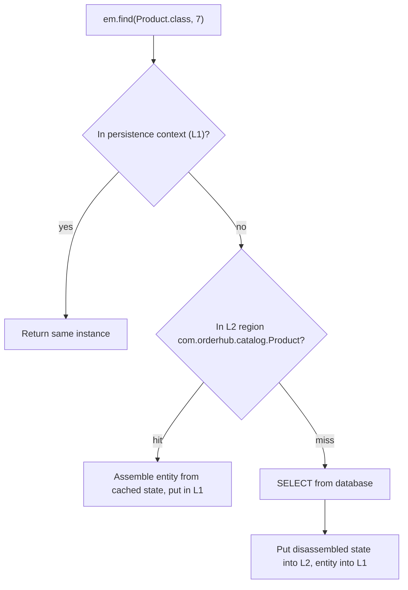
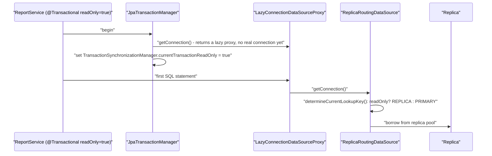

@@ 3 | TOPIC | Hibernate Second-Level Cache | Entity, collection and query caches below JPA, concurrency strategies, JCache with Ehcache, when it helps and when it hurts | NICE
# Hibernate Second-Level Cache

**Level: Advanced | Phase 19 | Priority: NICE | Since: Hibernate 2 (L2 cache), JPA 2.0 (`@Cacheable`, shared cache mode), Hibernate 6 (JCache as the standard integration)**

> **30-second interview answer:** The first-level cache is the persistence context: per `EntityManager`, per transaction, always on. The second-level cache (L2) is shared across sessions in the `EntityManagerFactory`, so an entity loaded by one request can be served to another without SQL. You enable it with a provider (JCache with Ehcache 3, Infinispan, Hazelcast), mark entities with `@Cacheable` and a concurrency strategy (`READ_ONLY`, `NONSTRICT_READ_WRITE`, `READ_WRITE`, `TRANSACTIONAL`). It shines for read-mostly reference data loaded by ID, does nothing for most JPQL queries unless the query cache is enabled, and is easily made stale by native SQL, bulk updates, or other applications writing the same tables.

## 1. Concept in Simple Words
### Analogy
A company's shared reference library vs your desk.

| Office | Hibernate caching |
|---|---|
| Papers on your desk during today's task | First-level cache (persistence context) |
| They are cleared when you finish the task | Persistence context closes at transaction end |
| The shared reference shelf everyone uses | Second-level cache, shared by all sessions |
| Reference books that never change (country codes) | `READ_ONLY` strategy |
| Books that change rarely; a stale copy for a moment is OK | `NONSTRICT_READ_WRITE` |
| Books with a "being edited" lock tag during updates | `READ_WRITE` with soft locks |
| A list "all books by author X" kept on the shelf | Query cache (stores IDs, not books) |
| Someone edits the master copy in the archive without telling the librarian | Native SQL or another app writing the table: stale cache |

### What it is
- **First-level cache (L1):** identity map inside the `EntityManager`; `find(Order.class, 42)` twice in one transaction returns the same object with one SELECT.
- **Second-level cache (L2):** a `RegionFactory`-managed cache keyed by entity type and ID, storing a *disassembled* state (field values, not object references). Regions: entity, collection, natural-ID, query results, timestamps.
- **`jakarta.persistence.Cacheable`** marks an entity as cacheable; **`org.hibernate.annotations.Cache(usage = ...)`** sets the concurrency strategy and region.
- **Shared cache mode:** `ENABLE_SELECTIVE` (default: only entities marked `@Cacheable`), `ALL`, `DISABLE_SELECTIVE`, `NONE`.
- **Collection cache:** caches the IDs of a collection's elements; the element entities must be cacheable too.
- **Query cache:** caches result ID lists for a query plus parameters; invalidated whenever *any* involved table changes (tracked by the timestamps region).
- **JCache (JSR-107):** standard Java caching API; Hibernate's `hibernate-jcache` module plugs into any JCache provider such as Ehcache 3.

### Why it exists
Many applications repeatedly load the same reference entities (products, categories, countries, tax rates) by ID across requests. Each request has a new persistence context, so L1 never helps across requests. L2 removes those repeated primary-key SELECTs without changing service code.

## 2. How It Works



**What hits the L2 cache and what does not**

| Operation | Uses L2 entity cache? |
|---|---|
| `em.find`, `findById`, `getReference` then access | Yes |
| Lazy loading a `@ManyToOne` to a cacheable entity | Yes (by ID) |
| JPQL or Criteria query (`findByCategory`) | No, always SQL (unless query cache) |
| Query cache hit | Gets IDs from cache, then entities from L2 by ID |
| Native SQL updates | Bypass and do not invalidate entity entries (Hibernate invalidates the whole region if it cannot tell) |
| JPQL bulk `update` | Evicts the affected entity region entirely |

**Concurrency strategies**

| Strategy | Writes allowed | Consistency | Use for |
|---|---|---|---|
| `READ_ONLY` | No (exception on update) | Perfect | Reference data that never changes |
| `NONSTRICT_READ_WRITE` | Yes | Brief staleness possible; cache invalidated after commit | Rarely updated data |
| `READ_WRITE` | Yes | Soft locks during updates; readers go to the database while locked | Read-mostly data that must be fresh |
| `TRANSACTIONAL` | Yes | Fully transactional (JTA, provider support needed) | Rare; XA environments |

**Clustered deployments:** with a local L2 provider (Ehcache heap), each instance has its own copy: an update on instance A invalidates only A's cache, B serves stale data until TTL. Use a clustered provider (Infinispan, Hazelcast) or short TTLs, or accept that L2 is suitable only for data that rarely changes.

## 3. Code Example
### Code
OrderHub caches `Category` (never changes at runtime) and `Product` (changes a few times a day) in L2 with Ehcache 3 via JCache.

```xml
<!-- pom.xml -->
<dependency>
    <groupId>org.hibernate.orm</groupId>
    <artifactId>hibernate-jcache</artifactId>
</dependency>
<dependency>
    <groupId>org.ehcache</groupId>
    <artifactId>ehcache</artifactId>
    <classifier>jakarta</classifier>
</dependency>
```

```yaml
# file: src/main/resources/application.yml
spring:
  jpa:
    properties:
      hibernate:
        cache:
          use_second_level_cache: true
          use_query_cache: true
          region.factory_class: jcache
        javax.cache:
          provider: org.ehcache.jsr107.EhcacheCachingProvider
          uri: classpath:ehcache.xml
          missing_cache_strategy: fail       # every region must be declared in ehcache.xml
        generate_statistics: true            # perf profile only
      jakarta.persistence.sharedCache.mode: ENABLE_SELECTIVE
```

```xml
<!-- file: src/main/resources/ehcache.xml -->
<config xmlns="http://www.ehcache.org/v3">
    <cache alias="com.orderhub.catalog.Category">
        <expiry><none/></expiry>
        <heap unit="entries">500</heap>
    </cache>
    <cache alias="com.orderhub.catalog.Product">
        <expiry><ttl unit="minutes">30</ttl></expiry>
        <heap unit="entries">20000</heap>
    </cache>
    <cache alias="com.orderhub.catalog.Category.products">
        <expiry><ttl unit="minutes">30</ttl></expiry>
        <heap unit="entries">500</heap>
    </cache>
    <cache alias="default-query-results-region">
        <expiry><ttl unit="minutes">5</ttl></expiry>
        <heap unit="entries">1000</heap>
    </cache>
    <cache alias="default-update-timestamps-region">
        <expiry><none/></expiry>
        <heap unit="entries">5000</heap>
    </cache>
</config>
```

```java
// file: src/main/java/com/orderhub/catalog/Category.java
// JPA entity: jakarta.persistence and Hibernate come with spring-boot-starter-data-jpa (org.springframework.boot)
package com.orderhub.catalog;

import jakarta.persistence.Cacheable;
import jakarta.persistence.Entity;
import jakarta.persistence.Id;
import jakarta.persistence.OneToMany;
import java.util.ArrayList;
import java.util.List;
import org.hibernate.annotations.Cache;
import org.hibernate.annotations.CacheConcurrencyStrategy;
import org.hibernate.annotations.Immutable;

@Entity
@Immutable
@Cacheable
@Cache(usage = CacheConcurrencyStrategy.READ_ONLY)                 // never updated by the app
public class Category {
    @Id
    private Long id;
    private String name;

    @OneToMany(mappedBy = "categoryRef")
    @Cache(usage = CacheConcurrencyStrategy.READ_ONLY)             // caches the product IDs
    private List<Product> products = new ArrayList<>();

    protected Category() { }
    public Long getId() { return id; }
    public String getName() { return name; }
    public List<Product> getProducts() { return products; }
}
```

```java
// file: src/main/java/com/orderhub/catalog/Product.java (cache-related parts)
// JPA entity: jakarta.persistence and Hibernate come with spring-boot-starter-data-jpa (org.springframework.boot)
package com.orderhub.catalog;

import jakarta.persistence.Cacheable;
import jakarta.persistence.Entity;
import jakarta.persistence.FetchType;
import jakarta.persistence.Id;
import jakarta.persistence.ManyToOne;
import jakarta.persistence.Version;
import java.math.BigDecimal;
import org.hibernate.annotations.Cache;
import org.hibernate.annotations.CacheConcurrencyStrategy;

@Entity
@Cacheable
@Cache(usage = CacheConcurrencyStrategy.READ_WRITE)               // soft locks keep readers consistent
public class Product {
    @Id
    private Long id;
    private String name;
    private BigDecimal price;

    @ManyToOne(fetch = FetchType.LAZY)
    private Category categoryRef;                                  // lazy load hits Category's L2 region

    @Version
    private long version;

    protected Product() { }
    public Long getId() { return id; }
    public String getName() { return name; }
    public BigDecimal getPrice() { return price; }
    public Category getCategoryRef() { return categoryRef; }
    public void changePrice(BigDecimal newPrice) { this.price = newPrice; }
}
```

```java
// file: src/main/java/com/orderhub/catalog/ProductLookupRepository.java
package com.orderhub.catalog;

import jakarta.persistence.QueryHint;
import java.util.List;
import org.hibernate.jpa.HibernateHints;
import org.springframework.data.jpa.repository.JpaRepository;
import org.springframework.data.jpa.repository.QueryHints;

public interface ProductLookupRepository extends JpaRepository<Product, Long> {

    @QueryHints(@QueryHint(name = HibernateHints.HINT_CACHEABLE, value = "true"))  // query cache opt-in
    List<Product> findByCategoryRefIdOrderByName(Long categoryId);
}
```

```java
// file: src/main/java/com/orderhub/catalog/CacheStatsRunner.java
package com.orderhub.catalog;

import jakarta.persistence.EntityManagerFactory;
import org.hibernate.SessionFactory;
import org.hibernate.stat.Statistics;
import org.springframework.boot.CommandLineRunner;
import org.springframework.stereotype.Component;
import org.springframework.transaction.support.TransactionTemplate;

@Component
class CacheStatsRunner implements CommandLineRunner {
    private final ProductLookupRepository products;
    private final TransactionTemplate tx;
    private final Statistics stats;

    CacheStatsRunner(ProductLookupRepository products, TransactionTemplate tx, EntityManagerFactory emf) {
        this.products = products;
        this.tx = tx;
        this.stats = emf.unwrap(SessionFactory.class).getStatistics();
    }

    @Override
    public void run(String... args) {
        tx.executeWithoutResult(s -> products.findById(7L));        // transaction 1: SQL, put into L2
        tx.executeWithoutResult(s -> products.findById(7L));        // transaction 2: new L1, L2 hit
        tx.executeWithoutResult(s -> products.findByCategoryRefIdOrderByName(3L));
        tx.executeWithoutResult(s -> products.findByCategoryRefIdOrderByName(3L)); // query cache hit
        System.out.printf("L2 hits=%d misses=%d puts=%d, query cache hits=%d misses=%d%n",
                stats.getSecondLevelCacheHitCount(), stats.getSecondLevelCacheMissCount(),
                stats.getSecondLevelCachePutCount(), stats.getQueryCacheHitCount(), stats.getQueryCacheMissCount());
    }
}
```

### Walkthrough
- **Dependencies:** `hibernate-jcache` is the Hibernate integration; Ehcache 3's `jakarta` classifier provides the JCache provider compatible with Jakarta namespaces.
- **Properties:** `region.factory_class: jcache` selects the JCache region factory; `missing_cache_strategy: fail` makes typos in region names a startup error instead of silently created unbounded caches. Region names default to the entity's fully qualified class name, and collections to `Entity.collectionField`.
- **`ehcache.xml`:** every region has a size bound and expiry. Category never expires (immutable), products expire after 30 minutes as a safety net against external writes.
- **`Category`** is `@Immutable` and `READ_ONLY`: zero locking overhead; any attempt to update it throws.
- **`Product`** uses `READ_WRITE`: on update Hibernate puts a soft lock on the entry; until commit, readers miss and go to the database; after commit the entry is replaced. Combined with `@Version`, stale writes are rejected.
- **The query cache** stores the list of product IDs for `(query, categoryId=3)`. Any insert, update or delete on `product` updates the timestamps region and invalidates *all* cached results for queries on that table, so it only pays off for tables that rarely change.
- **`CacheStatsRunner`** uses separate transactions to prove the L2 hit: within one transaction, the second `findById` would be an L1 hit and prove nothing.

### Output
```text
Hibernate: select p1_0.id,p1_0.category_ref_id,p1_0.name,p1_0.price,p1_0.version from product p1_0 where p1_0.id=?
Hibernate: select p1_0.id,p1_0.category_ref_id,p1_0.name,p1_0.price,p1_0.version from product p1_0 where p1_0.category_ref_id=? order by p1_0.name
L2 hits=13 misses=1 puts=13, query cache hits=1 misses=1
```
Only two SQL statements for four operations: the second `findById` is served from L2, and the second query gets its ID list from the query cache and the 12 products (category 3) from L2. The counts are 1 miss and 1 put for product 7, then 12 puts for the query's products; hits are product 7 once plus the 12 products assembled for the second query.

### Compare
| | First-level cache | Second-level cache | Spring `@Cacheable` |
|---|---|---|---|
| Scope | One `EntityManager` (transaction) | `EntityManagerFactory` (all sessions in a JVM, or cluster) | Whatever the cache manager provides |
| Enabled | Always | Opt-in per entity | Opt-in per method |
| Caches | Managed entities | Entity state by ID, collections, query IDs | Any method result (DTOs) |
| Invalidation | Transaction end | Automatic on JPA writes via Hibernate | Manual (`@CacheEvict`) |
| Sees native SQL or other apps' writes | n/a | No | No |

## 4. Interview Questions
**Basic**
1. **What is the difference between Hibernate's first- and second-level caches?**
   The first-level cache is the persistence context, scoped to one `EntityManager` (usually one transaction) and always enabled. The second-level cache is optional, shared across all sessions of the `EntityManagerFactory`, and stores entity state by ID across requests.
2. **How do you enable the second-level cache in Spring Boot?**
   Add a provider (`hibernate-jcache` plus Ehcache 3), set `hibernate.cache.use_second_level_cache=true` and `region.factory_class=jcache`, configure regions, and annotate entities with `@Cacheable` and `@Cache(usage = ...)`; the default shared cache mode caches only annotated entities.
3. **What are the cache concurrency strategies?**
   `READ_ONLY` for immutable data, `NONSTRICT_READ_WRITE` for rarely changing data that tolerates brief staleness, `READ_WRITE` with soft locks for read-mostly data that should stay consistent, and `TRANSACTIONAL` for JTA-managed fully transactional caches.

**Follow-up**
4. **Does the second-level cache speed up `findByCategory` queries?**
   Not by itself: JPQL and Criteria queries always go to the database. Only lookups by ID (`find`, lazy loads of to-one associations, collection element loads) use the entity cache. Enabling the query cache helps for repeated identical queries, but it is invalidated on any change to the involved tables.
5. **Why is the query cache often counterproductive?**
   Every write to any table in the query invalidates all cached results for that table, so for frequently updated tables the hit rate is low while the bookkeeping (timestamps region, extra lookups) adds overhead. It also caches only IDs, so a hit triggers N entity loads, which are fast only if those entities are in L2 too.
6. **What happens to the L2 cache when you run a native SQL update or a JPQL bulk update?**
   Hibernate cannot know which entries changed. For bulk JPQL it evicts the whole affected entity region; for native queries it may evict all regions unless you declare the affected entity with `addSynchronizedEntityClass`. Writes from other applications or manual SQL are invisible, so the cache serves stale data until TTL.

**Tricky / scenario**
7. **Three instances use a local Ehcache L2. A price update on instance 1 shows the new price there, but instances 2 and 3 show the old one for 30 minutes. What are your options?**
   Local L2 is per JVM. Use a clustered provider (Infinispan or Hazelcast with invalidation), shorten TTLs for mutable entities, remove mutable entities from L2 and cache DTOs in Redis with explicit eviction, or limit L2 to truly immutable reference data.
8. **You add L2 caching and memory usage of the service doubles. Why, and what do you check?**
   L2 stores disassembled state for every cached entity, plus collection and query regions. Regions without size limits grow with the data set. Check region sizes and hit ratios in Hibernate statistics, bound every region by entries or memory, and remove regions with low hit ratios.
9. **When would you prefer Spring `@Cacheable` with Redis over the Hibernate L2 cache?**
   When you want to cache computed results or DTOs (not just entities), share the cache across instances consistently, control invalidation explicitly, or cache data not loaded by ID. L2 suits transparent caching of reference entities loaded by ID inside one service.

**What the interviewer is really testing:** whether you know precisely which operations L2 accelerates and the staleness risks, so you do not enable it blindly.

## 5. Pitfalls & Best Practices
### Common mistakes
| Mistake | What goes wrong | Fix |
|---|---|---|
| Expecting L2 to cache JPQL query results | No improvement for list queries | Query cache (carefully) or service-level caching |
| Local L2 on a multi-instance service with mutable data | Stale data between instances | Clustered provider or only immutable entities |
| Unbounded regions | Memory growth | Size and TTL for every region, `missing_cache_strategy: fail` |
| Native SQL or other apps updating cached tables | Stale cache | Avoid, synchronize entity classes, or short TTLs |
| Caching collections without caching the element entity | N extra SELECTs on hit | Make element entities cacheable |

### Best practices
- Start with `READ_ONLY` for immutable reference data; it is the safest and cheapest win.
- Measure with Hibernate statistics: hit, miss and put counts per region; remove regions that do not pay off.
- Keep the query cache off unless a specific query on a rarely changing table justifies it.
- Do not rely on L2 for correctness; use `@Version` for optimistic locking on cached mutable entities.

### Compare with
| Option | Best for |
|---|---|
| Hibernate L2 `READ_ONLY` | Immutable reference entities loaded by ID |
| Hibernate L2 `READ_WRITE` | Read-mostly entities in a single instance or clustered cache |
| Spring Cache with Caffeine | Hot DTOs per instance, short TTL |
| Spring Cache with Redis | Shared DTO cache across instances with explicit eviction |
| Database tuning (indexes, buffers) | When queries, not repeated ID lookups, are the problem |

## 6. Hands-on Exercise
OrderHub loads `TaxRate` (country code to rate, about 250 rows, changed twice a year by a migration) on every order line. Enable L2 caching for it and prove the effect. Acceptance criteria: `TaxRate` is `@Immutable` and `READ_ONLY`; the region is declared with a bound; a test with Hibernate statistics shows that creating 100 order lines for 3 countries results in at most 3 `tax_rate` SELECTs; after a deployment with a new migration, the cache starts empty (no stale rates).

<details><summary>Solution</summary>

```java
// file: src/main/java/com/orderhub/tax/TaxRate.java
// JPA entity: jakarta.persistence and Hibernate come with spring-boot-starter-data-jpa (org.springframework.boot)
package com.orderhub.tax;

import jakarta.persistence.Cacheable;
import jakarta.persistence.Entity;
import jakarta.persistence.Id;
import java.math.BigDecimal;
import org.hibernate.annotations.Cache;
import org.hibernate.annotations.CacheConcurrencyStrategy;
import org.hibernate.annotations.Immutable;

@Entity
@Immutable
@Cacheable
@Cache(usage = CacheConcurrencyStrategy.READ_ONLY)
public class TaxRate {
    @Id
    private String countryCode;
    private BigDecimal rate;

    protected TaxRate() { }
    public String getCountryCode() { return countryCode; }
    public BigDecimal getRate() { return rate; }
}
```

```xml
<!-- ehcache.xml addition -->
<cache alias="com.orderhub.tax.TaxRate">
    <expiry><none/></expiry>
    <heap unit="entries">300</heap>
</cache>
```

```java
// file: src/test/java/com/orderhub/tax/TaxRateCacheIT.java
package com.orderhub.tax;

import static org.assertj.core.api.Assertions.assertThat;

import com.orderhub.TestcontainersConfig;
import jakarta.persistence.EntityManagerFactory;
import java.util.List;
import org.hibernate.SessionFactory;
import org.hibernate.stat.Statistics;
import org.junit.jupiter.api.Test;
import org.springframework.beans.factory.annotation.Autowired;
import org.springframework.boot.test.context.SpringBootTest;
import org.springframework.context.annotation.Import;
import org.springframework.transaction.support.TransactionTemplate;

@SpringBootTest(properties = "spring.jpa.properties.hibernate.generate_statistics=true")
@Import(TestcontainersConfig.class)
class TaxRateCacheIT {
    @Autowired TaxRateRepository rates;
    @Autowired TransactionTemplate tx;
    @Autowired EntityManagerFactory emf;

    @Test
    void ratesAreLoadedOncePerCountry() {
        Statistics stats = emf.unwrap(SessionFactory.class).getStatistics();
        stats.clear();
        List<String> countries = List.of("DE", "FR", "NL");
        for (int i = 0; i < 100; i++) {
            String code = countries.get(i % 3);
            tx.executeWithoutResult(s -> rates.findById(code).orElseThrow());   // new session each time
        }
        assertThat(stats.getEntityStatistics(TaxRate.class.getName()).getLoadCount()).isLessThanOrEqualTo(3);
        assertThat(stats.getSecondLevelCacheHitCount()).isGreaterThanOrEqualTo(97);
    }
}
```
The Ehcache heap cache lives inside the JVM, so every deployment (new JVM) starts with an empty cache and loads the rates written by the new migration. With a clustered or external L2 provider you would need to clear the region during deployment.
</details>

## 7. Recall
Q: What is the scope of Hibernate's second-level cache compared to the first-level cache?
A: L2 is shared across all sessions of the EntityManagerFactory; L1 is per EntityManager (persistence context).

Q: Which operations use the Hibernate second-level entity cache?
A: Lookups by ID: `find`, `findById`, and lazy loading of to-one associations or collection elements; not JPQL queries.

Q: Which Hibernate cache concurrency strategy fits immutable reference data?
A: `READ_ONLY`, ideally with `@Immutable` on the entity.

Q: Why is the Hibernate query cache often not worth enabling?
A: Any write to an involved table invalidates all cached results for it, so frequently updated tables get few hits and extra overhead.

Q: Why can a local Hibernate second-level cache serve stale data in a multi-instance deployment?
A: Each JVM has its own cache, and an update invalidates only the cache of the instance that performed it.

**Related:** [[Spring Cache Abstraction]] · [[Redis with Spring Boot]] · [[Query Performance and Indexes]]

@@ 2 | MODULE | Scale | Spreading data work across several databases and running large offline jobs safely | MUST
# Scale

**Shared analogy: a growing bakery.** At first one oven does everything. Then customers queue for bread while the oven is busy with tomorrow's wedding cake. The bakery adds a second shop counter that only sells what is already baked (a read replica: it serves reads, but the newest batch arrives a few minutes later), a separate oven for the catering business (a second datasource), and a night shift that bakes the big orders in trays of fifty with a logbook so it can resume after a power cut (Spring Batch).

- [[Multiple Datasources and Read Replicas]] splits work across databases and routes reads to replicas.
- [[Spring Batch]] runs large jobs in restartable chunks.

@@ 3 | TOPIC | Multiple Datasources and Read Replicas | Configuring two datasources with separate JPA setups, routing read-only transactions to a replica with AbstractRoutingDataSource, and handling replication lag | NICE
# Multiple Datasources and Read Replicas

**Level: Advanced | Phase 19 | Priority: NICE | Since: AbstractRoutingDataSource Spring 2.0.1, LazyConnectionDataSourceProxy Spring 1.1.4, Boot DataSourceProperties since Boot 1.x**

> **30-second interview answer:** Spring Boot auto-configures one `DataSource`; for more you define each yourself with its own `DataSourceProperties`, and for JPA its own `EntityManagerFactory` and `TransactionManager` scanning separate packages, marking one set `@Primary`. For read replicas of the *same* schema you keep one JPA setup and put an `AbstractRoutingDataSource` underneath that picks the primary or the replica per transaction, typically using `@Transactional(readOnly = true)`, wrapped in a `LazyConnectionDataSourceProxy` so the routing decision happens after the transaction's read-only flag is set. The main risk is replication lag: a user writes, then reads from a replica that has not caught up.

## 1. Concept in Simple Words
### Analogy
A library with a main building and branch libraries.

| Libraries | Datasources |
|---|---|
| The main building where new books are catalogued | Primary database (all writes) |
| Branch libraries with copies of the catalogue | Read replicas |
| Copies reach the branches a few hours later | Replication lag |
| The front desk that sends "borrow" requests to a branch and "donate" requests to the main building | `AbstractRoutingDataSource` |
| The desk decides only when you actually ask for a book, not when you walk in | `LazyConnectionDataSourceProxy` |
| A completely separate archive for company records with its own staff | A second, independent datasource with its own JPA setup |
| You donated a book and immediately asked for it at the branch: "not found" | Read-your-writes problem |

### What it is
- **Multiple independent datasources:** different databases with different schemas (orders in PostgreSQL, legacy billing in Oracle). Each needs its own connection pool, `EntityManagerFactory`, `PlatformTransactionManager` and repository package.
- **Read replica:** a copy of the primary database kept up to date by replication (PostgreSQL streaming replication, Aurora replicas, MySQL binlog replication), usually asynchronous. It accepts reads only.
- **`AbstractRoutingDataSource`:** a `DataSource` that holds a map of target datasources and calls `determineCurrentLookupKey()` each time a connection is requested.
- **`LazyConnectionDataSourceProxy`:** returns a proxy connection and fetches the real one only when the first statement runs. Spring Framework 6.1.2+ can also route read-only connections directly through its `readOnlyDataSource` property.
- **Replication lag:** the delay between a commit on the primary and its visibility on the replica; usually milliseconds, but seconds or minutes under load or long-running queries.

### Why it exists
One database node has limits. Read-heavy applications (catalogues, reports, dashboards) can offload most queries to replicas and keep the primary for writes. Large organisations also have several databases that one service must talk to. Spring Boot's single-datasource auto-configuration does not cover these cases, so you need to know how to wire them.

## 2. How It Works

**Read routing per transaction**



**Why the lazy proxy is needed:** `JpaTransactionManager.doBegin` obtains the connection *before* it sets the read-only flag in `TransactionSynchronizationManager`. Without the lazy proxy, the routing datasource would always see `readOnly = false` and send everything to the primary. The lazy proxy defers the real `getConnection()` to the first statement, after the flag is set.

**Two independent datasources with JPA**

```text
@Primary orders:   DataSourceProperties(spring.datasource.orders) -> HikariDataSource
                   -> LocalContainerEntityManagerFactoryBean(packages: com.orderhub.order)
                   -> JpaTransactionManager "transactionManager"
                   -> @EnableJpaRepositories(basePackages = com.orderhub.order, ...)
legacy billing:    DataSourceProperties(spring.datasource.billing) -> HikariDataSource
                   -> LocalContainerEntityManagerFactoryBean(packages: com.orderhub.billing)
                   -> JpaTransactionManager "billingTransactionManager"
                   -> @EnableJpaRepositories(basePackages = com.orderhub.billing, ...)
Services use @Transactional("billingTransactionManager") for billing work.
```
A transaction spans only one transaction manager. Writing to both databases atomically needs XA (JTA) or, better, a saga or outbox design.

**Handling replication lag**

| Technique | How |
|---|---|
| Route only tolerant reads | Reports, search, catalogue pages go to replicas; "my order after checkout" goes to the primary |
| Read-your-writes window | After a user writes, pin that user to the primary for N seconds (flag in session or a cookie) |
| Primary fallback | If the replica result is missing (just-created ID), retry on the primary |
| Monitor lag | Alert on `pg_last_xact_replay_timestamp()` delay or Aurora `ReplicaLag` |

## 3. Code Example
### Code
OrderHub routes read-only transactions to a PostgreSQL replica.

```yaml
# file: src/main/resources/application.yml
orderhub:
  datasource:
    primary:
      url: jdbc:postgresql://orders-db-primary:5432/orderhub
      username: orderhub
      password: ${DB_PASSWORD}
      hikari:
        pool-name: primary-pool
        maximum-pool-size: 8
    replica:
      url: jdbc:postgresql://orders-db-replica:5432/orderhub
      username: orderhub_ro
      password: ${DB_RO_PASSWORD}
      hikari:
        pool-name: replica-pool
        maximum-pool-size: 12
        read-only: true
spring:
  jpa:
    open-in-view: false
```

```java
// file: src/main/java/com/orderhub/config/DataSourceRole.java
package com.orderhub.config;

public enum DataSourceRole { PRIMARY, REPLICA }
```

```java
// file: src/main/java/com/orderhub/config/ReplicaRoutingDataSource.java
package com.orderhub.config;

import org.springframework.jdbc.datasource.lookup.AbstractRoutingDataSource;
import org.springframework.transaction.support.TransactionSynchronizationManager;

public class ReplicaRoutingDataSource extends AbstractRoutingDataSource {
    @Override
    protected Object determineCurrentLookupKey() {
        boolean readOnly = TransactionSynchronizationManager.isCurrentTransactionReadOnly();
        boolean forcePrimary = PrimaryPin.isPinned();                    // read-your-writes override
        DataSourceRole role = readOnly && !forcePrimary ? DataSourceRole.REPLICA : DataSourceRole.PRIMARY;
        System.out.println("routing -> " + role);
        return role;
    }
}
```

```java
// file: src/main/java/com/orderhub/config/PrimaryPin.java
package com.orderhub.config;

// Set by a web filter for requests from users who wrote within the last few seconds
public final class PrimaryPin {
    private static final ThreadLocal<Boolean> PINNED = ThreadLocal.withInitial(() -> false);
    private PrimaryPin() { }
    public static void pin() { PINNED.set(true); }
    public static void clear() { PINNED.remove(); }
    public static boolean isPinned() { return PINNED.get(); }
}
```

```java
// file: src/main/java/com/orderhub/config/DataSourceConfig.java
package com.orderhub.config;

import com.zaxxer.hikari.HikariDataSource;
import java.util.Map;
import javax.sql.DataSource;
import org.springframework.boot.autoconfigure.jdbc.DataSourceProperties;
import org.springframework.boot.context.properties.ConfigurationProperties;
import org.springframework.context.annotation.Bean;
import org.springframework.context.annotation.Configuration;
import org.springframework.context.annotation.Primary;
import org.springframework.jdbc.datasource.LazyConnectionDataSourceProxy;

@Configuration(proxyBeanMethods = false)
public class DataSourceConfig {

    @Bean
    @ConfigurationProperties("orderhub.datasource.primary")
    DataSourceProperties primaryProperties() { return new DataSourceProperties(); }

    @Bean
    @ConfigurationProperties("orderhub.datasource.primary.hikari")    // binds pool settings onto Hikari
    HikariDataSource primaryDataSource(DataSourceProperties primaryProperties) {
        return primaryProperties.initializeDataSourceBuilder().type(HikariDataSource.class).build();
    }

    @Bean
    @ConfigurationProperties("orderhub.datasource.replica")
    DataSourceProperties replicaProperties() { return new DataSourceProperties(); }

    @Bean
    @ConfigurationProperties("orderhub.datasource.replica.hikari")
    HikariDataSource replicaDataSource() {
        return replicaProperties().initializeDataSourceBuilder().type(HikariDataSource.class).build();
    }

    @Bean
    @Primary                                                           // the one JPA, Flyway and JdbcClient use
    DataSource dataSource(HikariDataSource primaryDataSource, HikariDataSource replicaDataSource) {
        ReplicaRoutingDataSource routing = new ReplicaRoutingDataSource();
        routing.setTargetDataSources(Map.of(
                DataSourceRole.PRIMARY, primaryDataSource,
                DataSourceRole.REPLICA, replicaDataSource));
        routing.setDefaultTargetDataSource(primaryDataSource);
        routing.afterPropertiesSet();
        return new LazyConnectionDataSourceProxy(routing);             // decide at first statement
    }
}
```

```java
// file: src/main/java/com/orderhub/report/SalesReportService.java
package com.orderhub.report;

import java.math.BigDecimal;
import java.time.LocalDate;
import org.springframework.jdbc.core.simple.JdbcClient;
import org.springframework.stereotype.Service;
import org.springframework.transaction.annotation.Transactional;

@Service
public class SalesReportService {
    private final JdbcClient jdbc;
    public SalesReportService(JdbcClient jdbc) { this.jdbc = jdbc; }

    @Transactional(readOnly = true)                                    // -> replica
    public BigDecimal revenue(LocalDate day) {
        return jdbc.sql("select coalesce(sum(total), 0) from orders where created_at::date = ?")
                .param(day).query(BigDecimal.class).single();
    }

    @Transactional                                                     // -> primary
    public void markReported(LocalDate day) {
        jdbc.sql("insert into report_log(day) values (?)").param(day).update();
    }
}
```

### Walkthrough
- **Two `DataSourceProperties` beans** bound to custom prefixes reuse Boot's URL, username and driver handling; the `@ConfigurationProperties(...hikari)` on each `HikariDataSource` bean binds pool settings like `maximum-pool-size` directly onto the Hikari object. The replica pool is bigger because most traffic is reads, and `read-only: true` makes Hikari mark connections read-only.
- **Because we define a `DataSource` bean**, Boot's `DataSourceAutoConfiguration` backs off; JPA, Flyway and `JdbcClient` auto-configuration then use our `@Primary` bean. Flyway runs DDL through it outside a read-only transaction, so migrations go to the primary.
- **`ReplicaRoutingDataSource`** reads the transaction's read-only flag from `TransactionSynchronizationManager`. The `PrimaryPin` ThreadLocal lets a filter force the primary for users who just wrote (it must be cleared in `finally`).
- **`LazyConnectionDataSourceProxy`** is essential: without it every transaction would route to the primary because the flag is set after the connection is obtained.
- **Services** express intent with `readOnly = true`. Code outside any transaction (no flag) goes to the primary, which is the safe default.
- With Spring Framework 6.1.2+, an alternative is `new LazyConnectionDataSourceProxy(primary)` plus `setReadOnlyDataSource(replica)`, which routes read-only transactions without a custom routing class.

### Output
```text
GET /api/reports/revenue?day=2026-11-24
routing -> REPLICA
200 OK  {"day":"2026-11-24","revenue":48211.90}

POST /api/reports/2026-11-24/mark
routing -> PRIMARY
204 No Content
```
Replica lag check on PostgreSQL:
```sql
SELECT now() - pg_last_xact_replay_timestamp() AS replication_delay;
--  replication_delay
-- -------------------
--  00:00:00.183
```

### Compare
| Setup | Purpose | Transactions | Complexity |
|---|---|---|---|
| Single datasource | Default | One manager | Lowest |
| Routing datasource (primary plus replicas) | Scale reads of the same schema | One JPA setup, routed per transaction | Medium |
| Two independent datasources with JPA | Different databases or schemas | Separate managers; no atomic cross-database writes | Medium to high |
| JTA or XA across datasources | Atomic writes to two databases | Global transactions | High, slow; avoid if possible |
| Database proxy (pgpool, ProxySQL, Aurora reader endpoint) | Routing outside the app | App sees one or two endpoints | Ops-side |

## 4. Interview Questions
**Basic**
1. **How do you configure two datasources in Spring Boot?**
   Define two `DataSourceProperties` and two `DataSource` beans bound to separate prefixes, mark one `@Primary`, and for JPA create an `EntityManagerFactory` and `TransactionManager` per datasource with `@EnableJpaRepositories` pointing each repository package at its factory and manager. Boot's single-datasource auto-configuration backs off once you define your own.
2. **What is a read replica and why use it?**
   A read-only copy of the primary database kept in sync by replication. It offloads read queries, increasing total read capacity and isolating heavy reports from transactional traffic.
3. **What does `AbstractRoutingDataSource` do?**
   It holds several target datasources and, each time a connection is requested, calls `determineCurrentLookupKey()` to decide which one to use, for example based on the transaction's read-only flag or a tenant ID.

**Follow-up**
4. **Why do you need `LazyConnectionDataSourceProxy` for read-only routing?**
   The transaction manager obtains the connection before it sets the read-only flag for the transaction, so a plain routing datasource would always see read-write and choose the primary. The lazy proxy delays fetching the real connection until the first statement, when the flag is available.
5. **What is replication lag and what bug does it cause?**
   The delay before a primary commit becomes visible on a replica. The typical bug is read-your-writes: a user creates an order and the redirect to "my orders" reads from the replica, which does not have it yet, so the order seems missing.
6. **Can one `@Transactional` method update both datasources atomically?**
   Not with two separate `JpaTransactionManager`s: the transaction covers one of them, and the other commits independently. Atomicity across databases requires JTA with XA resources (complex, slower) or an eventual-consistency design like a saga or transactional outbox.

**Tricky / scenario**
7. **After adding replica routing, every query still goes to the primary. What do you check?**
   Whether `LazyConnectionDataSourceProxy` wraps the routing datasource; whether the methods are actually `@Transactional(readOnly = true)` and called through the proxy (not self-invocation); whether OSIV or an outer read-write transaction already acquired a connection; and whether the JPA setup uses the routing datasource bean.
8. **Users complain that a newly placed order sometimes is not shown on the confirmation page. How do you fix it with replicas in place?**
   Route that read to the primary: mark it read-write or call it from the write transaction, pin the user to the primary for a few seconds after a write, or fall back to the primary when the replica returns nothing for a just-created ID. Also check lag monitoring for spikes.
9. **Your report queries on the replica get cancelled with "canceling statement due to conflict with recovery". Why?**
   On a PostgreSQL hot standby, long-running queries can conflict with replayed changes (for example vacuum removing rows the query still needs). Options: `hot_standby_feedback = on` (at the cost of bloat on the primary), increase `max_standby_streaming_delay`, or use a dedicated reporting replica configured for long queries.

**What the interviewer is really testing:** whether you can wire Spring's datasource abstractions correctly and reason about consistency once data lives in more than one place.

## 5. Pitfalls & Best Practices
### Common mistakes
| Mistake | What goes wrong | Fix |
|---|---|---|
| Routing datasource without a lazy proxy | Everything goes to the primary | Wrap in `LazyConnectionDataSourceProxy` |
| Two datasources without `@Primary` | Boot components fail with "expected single matching bean" | Mark one `@Primary`, qualify the other |
| Forgetting the transaction manager name for the secondary | Work runs in no transaction or the wrong one | `@Transactional("billingTransactionManager")` |
| Reading just-written data from a replica | Missing or stale data shown | Primary for read-your-writes paths |
| Flyway pointing at the routing datasource inside a read-only context | Migration fails on replica | Ensure migrations use the primary (`spring.flyway.url` or primary default) |

### Best practices
- Make the primary the default; send only explicitly read-only, staleness-tolerant work to replicas.
- Monitor replication lag and alert well before it exceeds what your read paths tolerate.
- Size replica pools separately and remember that each replica also has a connection limit.
- Prefer separate services or modules over one service talking to many unrelated databases.
- Use database-side endpoints (Aurora reader endpoint) for load balancing across several replicas.

### Compare with
| Scaling approach | Helps with |
|---|---|
| Indexes and query tuning | Slow individual queries |
| Caching | Repeated reads of the same data |
| Read replicas | Read volume, isolating reports |
| Partitioning | Huge tables, time-based data |
| Sharding | Write volume beyond one primary |

## 6. Hands-on Exercise
Implement the read-your-writes pin for OrderHub: after any successful POST, PUT or DELETE, the user's next requests for 5 seconds must be routed to the primary. Acceptance criteria: a cookie `rw-until` with an epoch-millisecond timestamp is set on successful writes; a filter pins the request to the primary when the cookie is in the future; the ThreadLocal is always cleared; an integration test shows `GET /api/orders/{id}` after `POST /api/orders` logs `routing -> PRIMARY`, while a GET without the cookie logs `routing -> REPLICA`.

<details><summary>Solution</summary>

```java
// file: src/main/java/com/orderhub/config/ReadYourWritesFilter.java
package com.orderhub.config;

import jakarta.servlet.FilterChain;
import jakarta.servlet.ServletException;
import jakarta.servlet.http.Cookie;
import jakarta.servlet.http.HttpServletRequest;
import jakarta.servlet.http.HttpServletResponse;
import java.io.IOException;
import java.util.Arrays;
import java.util.Set;
import org.springframework.stereotype.Component;
import org.springframework.web.filter.OncePerRequestFilter;

@Component
public class ReadYourWritesFilter extends OncePerRequestFilter {
    private static final Set<String> WRITES = Set.of("POST", "PUT", "PATCH", "DELETE");
    private static final long WINDOW_MS = 5_000;

    @Override
    protected void doFilterInternal(HttpServletRequest req, HttpServletResponse res, FilterChain chain)
            throws ServletException, IOException {
        long now = System.currentTimeMillis();
        long until = req.getCookies() == null ? 0 : Arrays.stream(req.getCookies())
                .filter(c -> c.getName().equals("rw-until"))
                .mapToLong(c -> parse(c.getValue())).findFirst().orElse(0);
        if (until > now) PrimaryPin.pin();
        try {
            if (WRITES.contains(req.getMethod())) {
                Cookie cookie = new Cookie("rw-until", String.valueOf(now + WINDOW_MS));
                cookie.setPath("/");
                cookie.setHttpOnly(true);
                cookie.setMaxAge(5);
                res.addCookie(cookie);              // added before the body is written
            }
            chain.doFilter(req, res);
        } finally {
            PrimaryPin.clear();                     // threads are pooled
        }
    }

    private static long parse(String v) {
        try { return Long.parseLong(v); } catch (NumberFormatException e) { return 0; }
    }
}
```

```java
// file: src/test/java/com/orderhub/config/ReadYourWritesIT.java (essential part)
@Test
void getAfterPostIsRoutedToPrimary(CapturedOutput output) throws Exception {
    MvcResult post = mvc.perform(post("/api/orders").contentType(APPLICATION_JSON)
            .content("{\"productId\":7,\"quantity\":1}")).andExpect(status().isCreated()).andReturn();
    Cookie rw = post.getResponse().getCookie("rw-until");

    mvc.perform(get(post.getResponse().getHeader("Location")).cookie(rw)).andExpect(status().isOk());
    assertThat(output.getOut()).contains("routing -> PRIMARY");

    mvc.perform(get("/api/orders/1")).andExpect(status().isOk());
    assertThat(output.getOut()).contains("routing -> REPLICA");
}
```
The cookie is set whether or not the write succeeds, which is harmless (it only pins briefly to the primary). The test class uses `@ExtendWith(OutputCaptureExtension.class)` and Testcontainers with a primary and a replica container, or two databases where the "replica" is seeded separately for the test.
</details>

## 7. Recall
Q: Which Spring class routes connections to different datasources based on a lookup key?
A: `AbstractRoutingDataSource`, via `determineCurrentLookupKey()`.

Q: Why must a read-replica routing datasource be wrapped in LazyConnectionDataSourceProxy?
A: The transaction manager gets the connection before setting the read-only flag; the lazy proxy delays routing until the first statement.

Q: How does a Spring service signal that a transaction can go to a read replica?
A: `@Transactional(readOnly = true)`, read via `TransactionSynchronizationManager.isCurrentTransactionReadOnly()`.

Q: What is the read-your-writes problem with read replicas?
A: A user reads from a replica right after writing and does not see the write because of replication lag.

Q: Can one Spring @Transactional method atomically write to two databases with separate JpaTransactionManagers?
A: No; that requires JTA with XA, or an eventual-consistency pattern like a saga or outbox.

**Related:** [[Connection Pooling with HikariCP]] · [[How @Transactional Really Works]] · [[Distributed Transactions, Saga and Outbox]]

