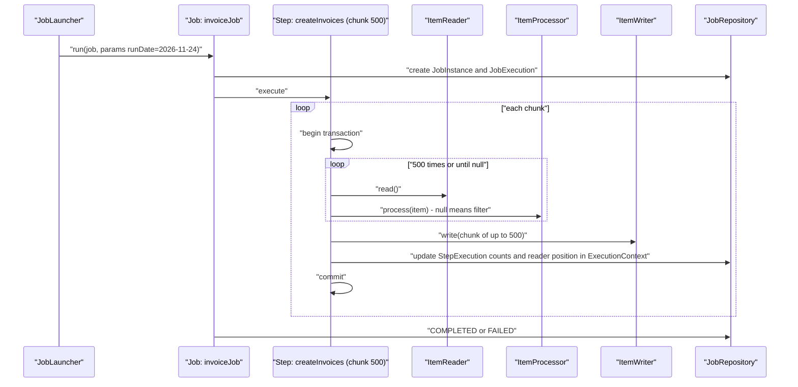

@@ 3 | TOPIC | Spring Batch | Jobs, steps, chunk-oriented processing, readers, processors and writers, JobRepository and restartability, skip and retry, partitioning and Boot 3 setup | NICE
# Spring Batch

**Level: Advanced | Phase 19 | Priority: NICE | Since: Spring Batch 1.0 (2008), Batch 5 with Boot 3 (no @EnableBatchProcessing needed), Batch 6 with Boot 4**

> **30-second interview answer:** Spring Batch is a framework for large, offline, restartable data jobs such as nightly imports, invoicing or data migrations. A `Job` is a sequence of `Step`s; the typical step is chunk-oriented: an `ItemReader` reads items one by one, an `ItemProcessor` transforms or filters them, and an `ItemWriter` writes a chunk (for example 500 items) in one transaction. Progress is stored in a `JobRepository` database, so a failed job restarts from the last committed chunk instead of from the beginning, and fault tolerance (skip bad records, retry transient errors) is declarative. In Boot 3, you define `Job` beans and Boot runs them at startup or you launch them with `JobLauncher`.

## 1. Concept in Simple Words
### Analogy
A warehouse night shift processing returns.

| Night shift | Spring Batch |
|---|---|
| The whole night's work order: "process all returns, then update stock, then email a report" | `Job` |
| Each stage of the work order | `Step` |
| Taking returns off the conveyor one by one | `ItemReader` |
| Inspecting each item: refurbish, or discard if broken | `ItemProcessor` (returning null filters it out) |
| Shelving them a full trolley at a time | `ItemWriter` with a chunk size |
| Signing the logbook after each trolley | Commit plus `JobRepository` update |
| Power cut at 3 am: the morning shift continues from the last signed trolley | Restart from the last committed chunk |
| A damaged label: set the item aside, keep going, up to 10 times | `skip` with `skipLimit` |
| The scanner fails once: try again | `retry` for transient exceptions |
| Splitting the warehouse into aisles worked by several people | Partitioning |

### What it is
- **`Job`:** a named batch process. **`JobInstance`:** a job plus its identifying `JobParameters` (for example `runDate=2026-11-24`). **`JobExecution`:** one attempt to run an instance; a failed instance can be restarted, creating a new execution.
- **`Step`:** either chunk-oriented or a `Tasklet` (a single unit of work like "delete temp files").
- **Chunk-oriented processing:** read N items, process them, write them as a list, commit; repeat until the reader returns null.
- **`ItemReader` implementations:** `FlatFileItemReader` (CSV), `JdbcCursorItemReader`, `JdbcPagingItemReader`, `JpaPagingItemReader`, `KafkaItemReader`, `JsonItemReader`.
- **`ItemWriter` implementations:** `JdbcBatchItemWriter`, `JpaItemWriter`, `FlatFileItemWriter`, `KafkaItemWriter`, `CompositeItemWriter`.
- **`JobRepository`:** stores metadata in tables `BATCH_JOB_INSTANCE`, `BATCH_JOB_EXECUTION`, `BATCH_JOB_EXECUTION_PARAMS`, `BATCH_STEP_EXECUTION`, `BATCH_JOB_EXECUTION_CONTEXT`, `BATCH_STEP_EXECUTION_CONTEXT`.
- **`ExecutionContext`:** a key-value map persisted at each commit; readers store their position in it (line number, last key) so a restart resumes.

### Why it exists
Hand-written batch loops (like `@Scheduled` methods with a for-loop) work until the first failure at row 3 million: then you must know what was processed, avoid duplicates, skip bad rows, keep memory bounded, and report what happened. Spring Batch standardises chunking, transactions, restart, skip, retry, metrics and auditing for these jobs.

## 2. How It Works



**Restart logic:** if the job fails in chunk 37, chunks 1 to 36 are committed and the reader's saved position (for example `JdbcPagingItemReader`'s last sort key) is in `BATCH_STEP_EXECUTION_CONTEXT`. Launching the job again with the *same identifying parameters* creates a new execution of the same instance; the step resumes at chunk 37. Launching with new parameters starts a new instance. A `COMPLETED` instance cannot be rerun with the same parameters (`JobInstanceAlreadyCompleteException`), which protects against processing the same day twice.

**Fault tolerance:** `.faultTolerant().skip(ValidationException.class).skipLimit(100).retry(TransientDataAccessException.class).retryLimit(3)`. When a write fails in a chunk with skips enabled, Spring Batch rolls back and re-processes the chunk item by item ("scanning") to find the bad item, then skips it. That is why writers should be idempotent.

**Reader choice:** `JdbcCursorItemReader` keeps one open cursor and connection for the whole step (fast, but long transactionally-held resources, not restartable mid-cursor in all databases without saving state); `JdbcPagingItemReader` runs a keyset query per page and is thread-safe and restartable. Readers are not thread-safe by default; with multi-threaded steps use paging readers or `SynchronizedItemStreamReader`.

**Scaling options:** multi-threaded step (`taskExecutor`), parallel steps (`split` flows), partitioning (a manager step splits the data by key ranges into partitions, each run by a worker step, locally or remotely), and remote chunking.

**Boot 3 specifics (Batch 5):** auto-configuration creates `JobRepository`, `JobLauncher` and runs all `Job` beans at startup (`spring.batch.job.enabled`, default true; with several jobs set `spring.batch.job.name`). Adding `@EnableBatchProcessing` switches Boot's batch auto-configuration off. `JobBuilder` and `StepBuilder` take the `JobRepository` explicitly; `JobBuilderFactory` and `StepBuilderFactory` were removed. Metadata tables are created with `spring.batch.jdbc.initialize-schema` (`embedded` by default, `always` or managed by Flyway in production). Boot 4 moves to Batch 6, which also offers a resourceless (in-memory) job repository by default when no database is configured for it.

## 3. Code Example
### Code
OrderHub's nightly invoicing: read shipped orders without an invoice for a date, compute the invoice, skip orders with invalid data, write invoices in chunks of 500, then mark the run in a tasklet.

```xml
<!-- pom.xml -->
<dependency>
    <groupId>org.springframework.boot</groupId>
    <artifactId>spring-boot-starter-batch</artifactId>
</dependency>
```

```yaml
# file: src/main/resources/application.yml
spring:
  batch:
    job:
      enabled: false                # we launch on a schedule, not at every startup
    jdbc:
      initialize-schema: never      # tables created by Flyway (schema-postgresql.sql from spring-batch-core)
```

```java
// file: src/main/java/com/orderhub/invoice/batch/ShippedOrder.java
package com.orderhub.invoice.batch;

import java.math.BigDecimal;

public record ShippedOrder(long id, long customerId, BigDecimal net, String country) { }
```

```java
// file: src/main/java/com/orderhub/invoice/batch/Invoice.java
package com.orderhub.invoice.batch;

import java.math.BigDecimal;
import java.time.LocalDate;

public record Invoice(long orderId, long customerId, BigDecimal net, BigDecimal tax, BigDecimal gross, LocalDate date) { }
```

```java
// file: src/main/java/com/orderhub/invoice/batch/InvoiceJobConfig.java
package com.orderhub.invoice.batch;

import java.math.BigDecimal;
import java.math.RoundingMode;
import java.time.LocalDate;
import java.util.Map;
import javax.sql.DataSource;
import org.springframework.batch.core.Job;
import org.springframework.batch.core.Step;
import org.springframework.batch.core.configuration.annotation.StepScope;
import org.springframework.batch.core.job.builder.JobBuilder;
import org.springframework.batch.core.launch.support.RunIdIncrementer;
import org.springframework.batch.core.repository.JobRepository;
import org.springframework.batch.core.step.builder.StepBuilder;
import org.springframework.batch.item.ItemProcessor;
import org.springframework.batch.item.database.JdbcBatchItemWriter;
import org.springframework.batch.item.database.JdbcPagingItemReader;
import org.springframework.batch.item.database.Order;
import org.springframework.batch.item.database.builder.JdbcBatchItemWriterBuilder;
import org.springframework.batch.item.database.builder.JdbcPagingItemReaderBuilder;
import org.springframework.batch.item.validator.ValidationException;
import org.springframework.batch.repeat.RepeatStatus;
import org.springframework.beans.factory.annotation.Value;
import org.springframework.context.annotation.Bean;
import org.springframework.context.annotation.Configuration;
import org.springframework.dao.TransientDataAccessException;
import org.springframework.jdbc.core.simple.JdbcClient;
import org.springframework.transaction.PlatformTransactionManager;

@Configuration
public class InvoiceJobConfig {

    @Bean
    @StepScope                                              // created per step execution, can read job parameters
    JdbcPagingItemReader<ShippedOrder> shippedOrdersReader(DataSource dataSource,
            @Value("#{jobParameters['runDate']}") LocalDate runDate) {
        return new JdbcPagingItemReaderBuilder<ShippedOrder>()
                .name("shippedOrdersReader")                // key prefix for its ExecutionContext state
                .dataSource(dataSource)
                .selectClause("select o.id, o.customer_id, o.net_total, c.country")
                .fromClause("from orders o join customers c on c.id = o.customer_id")
                .whereClause("where o.status = 'SHIPPED' and o.shipped_at::date = :runDate "
                        + "and not exists (select 1 from invoice i where i.order_id = o.id)")
                .parameterValues(Map.of("runDate", runDate))
                .sortKeys(Map.of("id", Order.ASCENDING))      // keyset paging: restartable
                .pageSize(500)
                .rowMapper((rs, n) -> new ShippedOrder(rs.getLong(1), rs.getLong(2), rs.getBigDecimal(3), rs.getString(4)))
                .build();
    }

    @Bean
    @StepScope
    ItemProcessor<ShippedOrder, Invoice> invoiceProcessor(@Value("#{jobParameters['runDate']}") LocalDate runDate) {
        Map<String, BigDecimal> vat = Map.of("DE", new BigDecimal("0.19"), "FR", new BigDecimal("0.20"),
                "NL", new BigDecimal("0.21"));
        return order -> {
            if (order.net().signum() == 0) return null;                    // filter: nothing to invoice
            BigDecimal rate = vat.get(order.country());
            if (rate == null) throw new ValidationException("no VAT rate for " + order.country());
            BigDecimal tax = order.net().multiply(rate).setScale(2, RoundingMode.HALF_EVEN);
            return new Invoice(order.id(), order.customerId(), order.net(), tax, order.net().add(tax), runDate);
        };
    }

    @Bean
    JdbcBatchItemWriter<Invoice> invoiceWriter(DataSource dataSource) {
        return new JdbcBatchItemWriterBuilder<Invoice>()
                .dataSource(dataSource)
                .sql("""
                     insert into invoice(order_id, customer_id, net, tax, gross, invoice_date)
                     values (:orderId, :customerId, :net, :tax, :gross, :date)
                     on conflict (order_id) do nothing""")            // idempotent on re-processing
                .beanMapped()                                          // record accessors map to :names
                .build();
    }

    @Bean
    Step createInvoicesStep(JobRepository jobRepository, PlatformTransactionManager tx,
                            JdbcPagingItemReader<ShippedOrder> shippedOrdersReader,
                            ItemProcessor<ShippedOrder, Invoice> invoiceProcessor,
                            JdbcBatchItemWriter<Invoice> invoiceWriter) {
        return new StepBuilder("createInvoices", jobRepository)
                .<ShippedOrder, Invoice>chunk(500, tx)                 // one transaction per 500 items
                .reader(shippedOrdersReader)
                .processor(invoiceProcessor)
                .writer(invoiceWriter)
                .faultTolerant()
                .skip(ValidationException.class).skipLimit(100)
                .retry(TransientDataAccessException.class).retryLimit(3)
                .build();
    }

    @Bean
    Step recordRunStep(JobRepository jobRepository, PlatformTransactionManager tx, JdbcClient jdbc) {
        return new StepBuilder("recordRun", jobRepository)
                .tasklet((contribution, chunkContext) -> {
                    Object runDate = chunkContext.getStepContext().getJobParameters().get("runDate");
                    jdbc.sql("insert into invoice_run(run_date, finished_at) values (cast(? as date), now())")
                        .param(String.valueOf(runDate)).update();
                    return RepeatStatus.FINISHED;
                }, tx)
                .build();
    }

    @Bean
    Job invoiceJob(JobRepository jobRepository, Step createInvoicesStep, Step recordRunStep) {
        return new JobBuilder("invoiceJob", jobRepository)
                .start(createInvoicesStep)
                .next(recordRunStep)
                .build();
    }
}
```

```java
// file: src/main/java/com/orderhub/invoice/batch/InvoiceJobScheduler.java
package com.orderhub.invoice.batch;

import java.time.LocalDate;
import org.springframework.batch.core.Job;
import org.springframework.batch.core.JobExecution;
import org.springframework.batch.core.JobParameters;
import org.springframework.batch.core.JobParametersBuilder;
import org.springframework.batch.core.launch.JobLauncher;
import org.springframework.scheduling.annotation.Scheduled;
import org.springframework.stereotype.Component;

@Component
public class InvoiceJobScheduler {
    private final JobLauncher launcher;
    private final Job invoiceJob;

    public InvoiceJobScheduler(JobLauncher launcher, Job invoiceJob) {
        this.launcher = launcher;
        this.invoiceJob = invoiceJob;
    }

    @Scheduled(cron = "0 30 1 * * *", zone = "Europe/Berlin")      // 01:30 every night
    public void runForYesterday() throws Exception {
        JobParameters params = new JobParametersBuilder()
                .addLocalDate("runDate", LocalDate.now().minusDays(1))   // identifying: one instance per day
                .toJobParameters();
        JobExecution execution = launcher.run(invoiceJob, params);
        System.out.println("invoiceJob " + params.getLocalDate("runDate") + " -> " + execution.getStatus());
    }
}
```

### Walkthrough
- **`spring.batch.job.enabled: false`** stops Boot from running every `Job` bean at startup, which would be surprising in a web application; the scheduler launches it instead. No `@EnableBatchProcessing`, so Boot's auto-configured `JobRepository` and `JobLauncher` are used.
- **`@StepScope` reader** is created lazily per step execution, which allows late binding of `#{jobParameters['runDate']}`. `JdbcPagingItemReader` with a sort key on `id` issues keyset queries (`where ... and id > :lastId order by id limit 500`) and saves the last key in the step's `ExecutionContext` at each commit.
- **Processor:** returning `null` filters an item (counted in `filterCount`); throwing `ValidationException` makes the item skippable because of `.skip(ValidationException.class)`.
- **Writer:** `JdbcBatchItemWriter` sends the whole chunk as a JDBC batch. `on conflict do nothing` makes it idempotent, which matters because chunks may be re-processed after a failure or during skip scanning.
- **Step:** `chunk(500, tx)` means read and process 500 items, write them, then commit together with the `JobRepository` update. Fault tolerance skips up to 100 invalid orders and retries transient database errors three times.
- **Tasklet step** runs once after the chunk step; `RepeatStatus.FINISHED` ends it.
- **Scheduler:** `runDate` is an identifying parameter, so each day is one `JobInstance`. If last night's run failed, launching again with the same date restarts it from the last committed chunk; if it completed, a second launch for the same date is refused.

### Output
```text
INFO  o.s.b.c.l.s.TaskExecutorJobLauncher : Job: [SimpleJob: [name=invoiceJob]] launched with the following parameters: [{'runDate':'{value=2026-11-24, type=class java.time.LocalDate, identifying=true}'}]
INFO  o.s.batch.core.job.SimpleStepHandler : Executing step: [createInvoices]
INFO  o.s.batch.core.step.AbstractStep : Step: [createInvoices] executed in 41s210ms
INFO  o.s.batch.core.job.SimpleStepHandler : Executing step: [recordRun]
INFO  o.s.batch.core.step.AbstractStep : Step: [recordRun] executed in 12ms
INFO  o.s.b.c.l.s.TaskExecutorJobLauncher : Job: [SimpleJob: [name=invoiceJob]] completed with the following parameters: [{'runDate':'{value=2026-11-24, type=class java.time.LocalDate, identifying=true}'}] and the following status: [COMPLETED] in 41s301ms
invoiceJob 2026-11-24 -> COMPLETED
```
Metadata after the run:
```sql
SELECT step_name, read_count, filter_count, write_count, process_skip_count, commit_count, status
FROM batch_step_execution WHERE job_execution_id = 57;
--  step_name      | read_count | filter_count | write_count | process_skip_count | commit_count | status
-- ----------------+------------+--------------+-------------+--------------------+--------------+-----------
--  createInvoices |     184212 |           31 |      184178 |                  3 |          369 | COMPLETED
--  recordRun      |          0 |            0 |           0 |                  0 |            1 | COMPLETED
```
184,212 read, 31 filtered (zero net), 3 skipped (missing VAT rate), 184,178 written in 369 commits (368 full chunks plus a partial one).

### Compare
| Approach | Restart after failure | Skip and retry | Memory | Audit trail |
|---|---|---|---|---|
| `@Scheduled` method with a loop | Manual | Manual | Your responsibility | Logs only |
| `@Scheduled` plus `TransactionTemplate` chunks | Manual position tracking | Manual | Bounded | Logs |
| Spring Batch chunk step | Built in from last commit | Declarative | Bounded by chunk size | `BATCH_*` tables, metrics |
| SQL-only (`INSERT ... SELECT`) | Rerun whole statement | No | Database side | None |
| Stream processing (Kafka Streams) | Offsets | Custom | Bounded | Topic offsets |

## 4. Interview Questions
**Basic**
1. **What is Spring Batch used for?**
   Large, non-interactive data processing: imports, exports, nightly calculations, migrations. It provides chunked transactions, restartability, skip and retry, and job metadata, so long jobs survive failures without reprocessing or losing data.
2. **Explain chunk-oriented processing.**
   A step reads items one at a time with an `ItemReader`, optionally transforms each with an `ItemProcessor`, collects them into a chunk of N, writes the chunk with an `ItemWriter`, and commits the transaction together with progress metadata. It repeats until the reader returns null.
3. **What is the difference between a `JobInstance` and a `JobExecution`?**
   A `JobInstance` is a logical run identified by job name plus identifying parameters (for example `runDate=2026-11-24`). A `JobExecution` is one attempt to run it; a failed instance can have several executions until one completes.

**Follow-up**
4. **How does Spring Batch restart a failed job from where it stopped?**
   At each chunk commit it stores step counts and the reader's state (`ExecutionContext`) in the `JobRepository` within the same transaction. Relaunching with the same identifying parameters creates a new execution of the same instance, and restartable readers reposition from the saved state.
5. **What happens when you add `@EnableBatchProcessing` in a Boot 3 application?**
   It turns off Spring Boot's batch auto-configuration (job launching at startup, schema initialization, property-based configuration), so you must configure the infrastructure yourself. In Boot 3 it is not needed; just define `Job` beans.
6. **How do skip and retry work in a fault-tolerant step?**
   Retry re-attempts an item or chunk on listed transient exceptions up to a limit. Skip lets listed exceptions be ignored for an item up to a skip limit; when a write fails, the chunk is rolled back and items are written one by one to identify the bad one. Skipped items can be logged with a `SkipListener`.

**Tricky / scenario**
7. **A job processing 10 million rows with `JpaItemWriter` slows down over time and finally runs out of memory. Why, and what do you change?**
   Possibly entities accumulate in a persistence context that is not cleared between chunks (custom writers using a shared `EntityManager`), or the reader is a non-paging JPA query loading too much. Use paging or cursor readers, `JdbcBatchItemWriter` for plain inserts, verify JDBC batching, and keep chunk sizes moderate (100 to 1000).
8. **The nightly job runs on 3 instances of the service and invoices get created three times. How do you prevent it?**
   With identifying parameters, the `JobRepository` prevents two executions of the same instance (concurrent launches fail with `JobExecutionAlreadyRunningException` thanks to database locking), as long as all instances share the same metadata database. Additionally, make the writer idempotent (unique constraint plus `on conflict do nothing`) and consider a scheduler lock (ShedLock) or running batch in a separate deployment.
9. **How would you make a 2-hour job finish in 20 minutes?**
   Measure first: often the writer lacks batching or the processor does per-item remote calls. Then parallelise: partition by ID ranges or dates with a partitioned step and a `TaskExecutor`, use thread-safe paging readers, and size the connection pool for the number of workers. Remote partitioning across instances for even larger volumes.

**What the interviewer is really testing:** whether you can design a restartable, idempotent bulk job and know what Spring Batch automates versus a hand-written loop.

## 5. Pitfalls & Best Practices
### Common mistakes
| Mistake | What goes wrong | Fix |
|---|---|---|
| Leaving `spring.batch.job.enabled=true` in a web app | Jobs run on every startup of every instance | Disable and launch explicitly |
| Adding `@EnableBatchProcessing` in Boot 3 | Boot batch auto-configuration disappears | Remove it |
| Non-idempotent writer | Duplicates after restarts or skip scanning | Unique constraints and upserts |
| Non-identifying or random parameters for daily jobs | Same day can run twice, restart impossible | Business key (date) as identifying parameter |
| Cursor reader in a multi-threaded step | Corrupted reads, not thread-safe | Paging reader or synchronized wrapper |
| Huge chunk size | Long transactions, big rollbacks, memory | 100 to 1000, measure |

### Best practices
- Keep the `JobRepository` in a durable shared database and manage its schema with Flyway.
- Make every step restartable and every writer idempotent; test restart by killing the job mid-run.
- Expose metrics (Spring Batch publishes Micrometer timers like `spring.batch.job` and `spring.batch.step`) and alert on failed executions.
- Run heavy batch jobs in a separate deployment (or Kubernetes `CronJob`) so they do not compete with user traffic for pools and CPU.
- Use a read replica for reading when the job tolerates lag, and the primary for writing.

### Compare with
| Tool | Strength |
|---|---|
| Spring Batch | Restartable chunked jobs in Java with rich readers and writers |
| `@Scheduled` plus plain code | Small, quick periodic tasks |
| Database jobs (pg_cron, stored procedures) | Pure SQL transformations near the data |
| Kafka Streams or Flink | Continuous streaming instead of nightly batches |
| Apache Spark | Distributed processing of very large datasets |

## 6. Hands-on Exercise
Add a second job to OrderHub: `stockImportJob` reading `stock-YYYY-MM-DD.csv` (`sku,on_hand`) with `FlatFileItemReader`, upserting into `stock` with `JdbcBatchItemWriter` in chunks of 1,000, skipping lines with a non-numeric quantity (up to 50) and logging each skipped line. Acceptance criteria: the file path is a job parameter; the job is restartable after a crash at line 400,000; skipped lines are logged with their line number; a test with a 10-line file containing 2 bad lines asserts `writeCount = 8` and `skipCount = 2`.

<details><summary>Solution</summary>

```java
// file: src/main/java/com/orderhub/inventory/batch/StockImportJobConfig.java
package com.orderhub.inventory.batch;

import javax.sql.DataSource;
import org.slf4j.Logger;
import org.slf4j.LoggerFactory;
import org.springframework.batch.core.Job;
import org.springframework.batch.core.SkipListener;
import org.springframework.batch.core.Step;
import org.springframework.batch.core.configuration.annotation.StepScope;
import org.springframework.batch.core.job.builder.JobBuilder;
import org.springframework.batch.core.repository.JobRepository;
import org.springframework.batch.core.step.builder.StepBuilder;
import org.springframework.batch.item.database.JdbcBatchItemWriter;
import org.springframework.batch.item.database.builder.JdbcBatchItemWriterBuilder;
import org.springframework.batch.item.file.FlatFileItemReader;
import org.springframework.batch.item.file.FlatFileParseException;
import org.springframework.batch.item.file.builder.FlatFileItemReaderBuilder;
import org.springframework.beans.factory.annotation.Value;
import org.springframework.context.annotation.Bean;
import org.springframework.context.annotation.Configuration;
import org.springframework.core.io.FileSystemResource;
import org.springframework.transaction.PlatformTransactionManager;

@Configuration
public class StockImportJobConfig {
    private static final Logger log = LoggerFactory.getLogger(StockImportJobConfig.class);

    public record StockLine(String sku, int onHand) { }

    @Bean
    @StepScope
    FlatFileItemReader<StockLine> stockReader(@Value("#{jobParameters['file']}") String file) {
        return new FlatFileItemReaderBuilder<StockLine>()
                .name("stockReader")                        // saves the current line count for restarts
                .resource(new FileSystemResource(file))
                .linesToSkip(1)
                .delimited().names("sku", "onHand")
                .fieldSetMapper(fs -> new StockLine(fs.readString("sku"), fs.readInt("onHand")))  // throws on bad int
                .build();
    }

    @Bean
    JdbcBatchItemWriter<StockLine> stockWriter(DataSource dataSource) {
        return new JdbcBatchItemWriterBuilder<StockLine>()
                .dataSource(dataSource)
                .sql("""
                     insert into stock(sku, on_hand, updated_at) values (:sku, :onHand, now())
                     on conflict (sku) do update set on_hand = excluded.on_hand, updated_at = now()""")
                .beanMapped()
                .build();
    }

    @Bean
    Step importStock(JobRepository repo, PlatformTransactionManager tx,
                     FlatFileItemReader<StockLine> stockReader, JdbcBatchItemWriter<StockLine> stockWriter) {
        return new StepBuilder("importStock", repo)
                .<StockLine, StockLine>chunk(1000, tx)
                .reader(stockReader)
                .writer(stockWriter)
                .faultTolerant()
                .skip(FlatFileParseException.class).skipLimit(50)
                .listener(new SkipListener<StockLine, StockLine>() {
                    @Override
                    public void onSkipInRead(Throwable t) {
                        if (t instanceof FlatFileParseException e) {
                            log.warn("skipped line {}: '{}'", e.getLineNumber(), e.getInput());
                        }
                    }
                })
                .build();
    }

    @Bean
    Job stockImportJob(JobRepository repo, Step importStock) {
        return new JobBuilder("stockImportJob", repo).start(importStock).build();
    }
}
```

```java
// file: src/test/java/com/orderhub/inventory/batch/StockImportJobIT.java (essential part)
@SpringBatchTest
@SpringBootTest(properties = "spring.batch.job.enabled=false")
@Import(TestcontainersConfig.class)
class StockImportJobIT {
    @Autowired JobLauncherTestUtils jobs;

    @Test
    void skipsBadLines(@TempDir Path dir) throws Exception {
        Path csv = dir.resolve("stock-2026-11-24.csv");
        Files.writeString(csv, """
                sku,on_hand
                A,1
                B,2
                C,x
                D,4
                E,5
                F,
                G,7
                H,8
                I,9
                J,10
                """);
        JobExecution exec = jobs.launchJob(new JobParametersBuilder()
                .addString("file", csv.toString()).toJobParameters());
        StepExecution step = exec.getStepExecutions().iterator().next();
        assertThat(exec.getStatus()).isEqualTo(BatchStatus.COMPLETED);
        assertThat(step.getWriteCount()).isEqualTo(8);
        assertThat(step.getSkipCount()).isEqualTo(2);
    }
}
```
Log:
```text
WARN  StockImportJobConfig : skipped line 4: 'C,x'
WARN  StockImportJobConfig : skipped line 7: 'F,'
```
The reader's `name` makes it store `stockReader.read.count` in the step `ExecutionContext` at each commit; on restart it skips that many lines. `@SpringBatchTest` with one `Job` bean in the test context autowires it into `JobLauncherTestUtils` (with two jobs, set the job explicitly).
</details>

## 7. Recall
Q: What are the three parts of a Spring Batch chunk-oriented step?
A: An `ItemReader`, an optional `ItemProcessor`, and an `ItemWriter` that writes a chunk per transaction.

Q: How does Spring Batch restart a failed job from the last committed chunk?
A: The `JobRepository` stores step progress and reader state in the `ExecutionContext` at each commit; relaunching with the same identifying parameters resumes from it.

Q: What identifies a Spring Batch JobInstance?
A: The job name plus its identifying `JobParameters`.

Q: What happens if you add @EnableBatchProcessing in a Spring Boot 3 application?
A: Boot's batch auto-configuration backs off, so you must configure the batch infrastructure yourself.

Q: Why should Spring Batch item writers be idempotent?
A: Chunks may be re-processed after failures, restarts or skip scanning, so writes must not create duplicates.

Q: In a Spring Batch ItemProcessor, what does returning null do?
A: It filters the item out: it is not passed to the writer and is counted as filtered.

**Related:** [[Batch Inserts and Updates]] · [[Multiple Datasources and Read Replicas]] · [[How @Transactional Really Works]]

@@ 3 | TOPIC | Practice — Coding drill: Data performance scenarios | Ten production-style data scenarios on pools, N+1, indexes, batching, caching, Redis and replicas with fixes in code | MUST
# Coding drill: Data performance scenarios

Ten scenarios that mirror real production incidents. For each, state the root cause aloud first, then write the fix. Interviewers care as much about how you diagnose (which metric, which log, which plan) as about the code.

## 1. Fix the N+1 on the orders list
`GET /api/orders?customerId=42` logs 1 + 2N SQL statements.

```java
// Spring snippet: org.springframework imports omitted for brevity
@Transactional(readOnly = true)
public List<OrderDto> list(long customerId) {
    return orders.findByCustomerId(customerId).stream()
        .map(o -> new OrderDto(o.getId(), o.getCustomer().getName(),
                o.getLines().stream().mapToInt(OrderLine::getQuantity).sum()))
        .toList();
}
```
Hint: two lazy associations are touched per order.

<details><summary>Solution</summary>

Each order lazily loads its customer and its lines. Fetch them up front, or project to a DTO with an aggregate:

```java
// Spring snippet: org.springframework imports omitted for brevity
public interface OrderRepository extends JpaRepository<Order, Long> {

    // Option A: entity graph for both associations (one query with joins)
    @EntityGraph(attributePaths = { "customer", "lines" })
    List<Order> findByCustomerId(long customerId);

    // Option B (better for lists): DTO projection with aggregation in SQL
    @Query("""
           select new com.orderhub.order.OrderDto(o.id, c.name, coalesce(sum(l.quantity), 0))
           from Order o join o.customer c left join o.lines l
           where c.id = :customerId
           group by o.id, c.name""")
    List<OrderDto> summaries(@Param("customerId") long customerId);
}
```
Option B returns exactly the needed columns in one query and avoids loading lines at all. Fetching a collection with an entity graph and paginating at the same time makes Hibernate paginate in memory (warning HHH90003004), another reason to prefer the projection for lists. Lock the fix in with a test asserting the statement count.
</details>

## 2. Pool exhaustion caused by a remote call
Under load: "Connection is not available, request timed out after 3000ms (total=10, active=10, idle=0, waiting=40)". Database CPU is 10 percent.

```java
// Spring snippet: org.springframework imports omitted for brevity
@Transactional
public Payment pay(long orderId) {
    Order order = orders.findById(orderId).orElseThrow();
    PaymentResult result = paymentGateway.charge(order.getTotal());   // 1-3 s HTTP call
    order.markPaid(result.reference());
    return payments.save(new Payment(orderId, result.reference()));
}
```
Hint: what does the connection do during `charge`?

<details><summary>Solution</summary>

The transaction holds a connection for the whole HTTP call; 10 connections serve at most 3 to 10 payments per second. Split the work so the remote call happens outside any transaction:

```java
// Spring snippet: org.springframework imports omitted for brevity
@Service
public class PaymentFacade {
    private final OrderQueries queries;          // read-only, short transaction
    private final PaymentGateway gateway;
    private final PaymentRecorder recorder;      // separate bean, short write transaction

    public PaymentFacade(OrderQueries queries, PaymentGateway gateway, PaymentRecorder recorder) {
        this.queries = queries;
        this.gateway = gateway;
        this.recorder = recorder;
    }

    public Payment pay(long orderId) {           // no @Transactional here
        BigDecimal total = queries.totalOf(orderId);
        PaymentResult result = gateway.charge(total);
        return recorder.record(orderId, result.reference());
    }
}

@Service
class PaymentRecorder {
    private final OrderRepository orders;
    private final PaymentRepository payments;
    PaymentRecorder(OrderRepository orders, PaymentRepository payments) { this.orders = orders; this.payments = payments; }

    @Transactional
    public Payment record(long orderId, String reference) {
        orders.findById(orderId).orElseThrow().markPaid(reference);
        return payments.save(new Payment(orderId, reference));
    }
}
```
Connection hold time drops from seconds to milliseconds. Because the charge and the record are no longer atomic, protect against a crash in between with an idempotency key at the gateway and a reconciliation job (or the outbox pattern from Phase 20).
</details>

## 3. Design the index for a query
```sql
SELECT id, total, created_at FROM orders
WHERE tenant_id = ? AND status IN ('NEW', 'PAID') AND created_at >= ?
ORDER BY created_at DESC
LIMIT 50;
```
`orders` has 80 million rows; 5 percent are NEW or PAID. Write the index and justify it.

Hint: equality first; consider a partial index.

<details><summary>Solution</summary>

```sql
CREATE INDEX CONCURRENTLY idx_orders_tenant_open_created
    ON orders (tenant_id, created_at DESC)
    INCLUDE (total)
    WHERE status IN ('NEW', 'PAID');
```
- `tenant_id` is the equality column, so it leads.
- `created_at DESC` serves both the range filter and the `ORDER BY`, so the database reads the first 50 matching entries and stops, with no sort.
- The partial predicate matches the query's `status IN (...)` exactly, so the index contains only 5 percent of rows: small, hot in memory, cheap to maintain.
- `INCLUDE (total)` lets the query be answered mostly from the index (add `id` too for a pure index-only scan).
The query must use the same status predicate for PostgreSQL to choose a partial index.
</details>

## 4. Make the import fast
Importing 200,000 customers takes 4 minutes.

```java
// Spring snippet: org.springframework imports omitted for brevity
@Entity
public class Customer {
    @Id @GeneratedValue(strategy = GenerationType.IDENTITY)
    private Long id;
    private String email;
}

@Transactional
public void importAll(List<CustomerRow> rows) {
    rows.forEach(r -> customerRepository.save(new Customer(r.email())));
}
```
Hint: three separate problems.

<details><summary>Solution</summary>

Problems: IDENTITY disables insert batching; no `batch_size` configured; the persistence context grows to 200,000 entities.

```java
// Spring snippet: org.springframework imports omitted for brevity
@Entity
public class Customer {
    @Id
    @GeneratedValue(strategy = GenerationType.SEQUENCE, generator = "customer_seq")
    @SequenceGenerator(name = "customer_seq", sequenceName = "customer_seq", allocationSize = 50)
    private Long id;
    private String email;
}

@Transactional
public void importAll(List<CustomerRow> rows) {
    for (int i = 0; i < rows.size(); i++) {
        em.persist(new Customer(rows.get(i).email()));
        if ((i + 1) % 50 == 0) { em.flush(); em.clear(); }
    }
}
```
```yaml
spring:
  jpa:
    properties:
      hibernate:
        jdbc.batch_size: 50
        order_inserts: true
  datasource:
    hikari:
      data-source-properties:
        reWriteBatchedInserts: true
```
```sql
CREATE SEQUENCE customer_seq INCREMENT BY 50;
```
Typical result: from about 4 minutes to under 10 seconds. If the table already has an identity column in production, migrate the default to the sequence or use `JdbcTemplate.batchUpdate` for imports.
</details>

## 5. Cache the product page correctly
Add caching to `findProduct(id)` so that (a) price changes are visible on all 6 instances immediately, (b) nonexistent IDs do not hammer the database, and (c) a Redis outage does not break the page.

Hint: shared cache, negative caching with a short TTL, error handler.

<details><summary>Solution</summary>

```java
// Spring snippet: org.springframework imports omitted for brevity
@Service
public class ProductPageService {
    private final ProductRepository products;
    public ProductPageService(ProductRepository products) { this.products = products; }

    @Cacheable(cacheNames = "productPage", key = "#id")
    @Transactional(readOnly = true)
    public Optional<ProductView> findProduct(long id) {           // Optional.empty() is cached too
        return products.findById(id).map(ProductView::from);
    }

    @CacheEvict(cacheNames = "productPage", key = "#id")
    @Transactional
    public void changePrice(long id, BigDecimal price) {
        products.findById(id).orElseThrow().changePrice(price);
    }
}

@Configuration
@EnableCaching
class ProductPageCacheConfig implements CachingConfigurer {
    @Bean
    RedisCacheManagerBuilderCustomizer productPageTtl() {
        return b -> b.withCacheConfiguration("productPage",
                RedisCacheConfiguration.defaultCacheConfig()
                        .entryTtl(Duration.ofMinutes(15))
                        .serializeValuesWith(SerializationPair.fromSerializer(new GenericJackson2JsonRedisSerializer())))
                .transactionAware();
    }

    @Override
    public CacheErrorHandler errorHandler() {
        return new SimpleCacheErrorHandler() {
            @Override public void handleCacheGetError(RuntimeException e, Cache c, Object k) { /* treat as miss */ }
            @Override public void handleCachePutError(RuntimeException e, Cache c, Object k, Object v) { }
        };
    }
}
```
Redis is shared, so one eviction is seen by every instance (a). Spring unwraps `Optional`: an empty result is stored as a null value, so the cache must allow nulls (the default `RedisCacheConfiguration` does); for (b) use a separate short-TTL configuration for misses if 15 minutes is too long. The error handler makes Redis failures behave like misses (c), and `transactionAware()` evicts only after the price change commits.
</details>

## 6. Replace offset pagination
The mobile app's infinite scroll uses `PageRequest.of(page, 20)` on `orders` ordered by `createdAt desc`; page 2,000 takes 3 seconds. Rewrite the repository method and the API contract.

Hint: return a cursor.

<details><summary>Solution</summary>

```java
// Spring snippet: org.springframework imports omitted for brevity
public interface OrderFeedRepository extends Repository<Order, Long> {
    @Query("""
           select new com.orderhub.order.OrderSummary(o.id, o.status, o.total, o.createdAt)
           from Order o
           where o.customer.id = :customerId
             and (o.createdAt < :cursorTime or (o.createdAt = :cursorTime and o.id < :cursorId))
           order by o.createdAt desc, o.id desc""")
    List<OrderSummary> after(@Param("customerId") long customerId, @Param("cursorTime") Instant cursorTime,
                             @Param("cursorId") long cursorId, Limit limit);
}

public record FeedPage(List<OrderSummary> items, String nextCursor) { }

public FeedPage feed(long customerId, String cursor) {
    Instant time = Instant.MAX;
    long id = Long.MAX_VALUE;
    if (cursor != null) {
        String[] parts = new String(Base64.getUrlDecoder().decode(cursor), StandardCharsets.UTF_8).split("_");
        time = Instant.parse(parts[0]);
        id = Long.parseLong(parts[1]);
    }
    List<OrderSummary> items = repo.after(customerId, time, id, Limit.of(20));
    String next = items.size() < 20 ? null : Base64.getUrlEncoder().encodeToString(
            (items.get(19).createdAt() + "_" + items.get(19).id()).getBytes(StandardCharsets.UTF_8));
    return new FeedPage(items, next);
}
```
With an index on `(customer_id, created_at DESC, id DESC)` every page is an index seek, so page 2,000 costs the same as page 1. The opaque cursor hides the implementation from clients. `Instant.MAX` is beyond what PostgreSQL timestamps can store, so in practice start from `Instant.now().plusSeconds(60)` or omit the condition on the first page.
</details>

## 7. Read your own writes with a replica
After placing an order, the confirmation page sometimes shows "order not found". Reads use `@Transactional(readOnly = true)` routed to a replica. Fix it without sending all reads to the primary.

Hint: which read must see the write?

<details><summary>Solution</summary>

```java
// Spring snippet: org.springframework imports omitted for brevity
@Service
public class OrderQueryService {
    private final OrderRepository orders;
    public OrderQueryService(OrderRepository orders) { this.orders = orders; }

    @Transactional(readOnly = true)                      // replica: tolerant reads
    public Optional<OrderView> find(long id) {
        return orders.findById(id).map(OrderView::from);
    }

    @Transactional                                       // primary: must see the latest commit
    public Optional<OrderView> findFresh(long id) {
        return orders.findById(id).map(OrderView::from);
    }

}

@Service
public class OrderConfirmationService {
    private final OrderQueryService queries;             // another bean: calls go through its proxy
    public OrderConfirmationService(OrderQueryService queries) { this.queries = queries; }

    public OrderView findWithFallback(long id) {
        return queries.find(id).or(() -> queries.findFresh(id))   // replica first, primary if lagging
                .orElseThrow(() -> new OrderNotFoundException(id));
    }
}
```
The confirmation page calls `findWithFallback`, which costs one extra primary read only in the lag case. The fallback lives in a separate bean on purpose: if it called `find` and `findFresh` on `this`, the proxy would be bypassed and both would run with no transaction attributes (so no read-only routing). For a broader fix, pin users to the primary for a few seconds after a write (see the read replicas topic).
</details>

## 8. Distributed rate limiter with Redis
Limit each API key to 100 requests per minute across all OrderHub instances. Write the Redis logic so the increment and expiry are atomic.

Hint: Lua script or `INCR` plus conditional `EXPIRE` inside one script.

<details><summary>Solution</summary>

```java
// Spring snippet: org.springframework imports omitted for brevity
@Component
public class ApiRateLimiter {
    private static final DefaultRedisScript<Long> INCR_WITH_TTL = new DefaultRedisScript<>("""
            local current = redis.call('INCR', KEYS[1])
            if current == 1 then
              redis.call('PEXPIRE', KEYS[1], ARGV[1])
            end
            return current""", Long.class);

    private final StringRedisTemplate redis;
    public ApiRateLimiter(StringRedisTemplate redis) { this.redis = redis; }

    public boolean allow(String apiKey, int limitPerMinute) {
        long window = System.currentTimeMillis() / 60_000;
        String key = "orderhub:rate:" + apiKey + ":" + window;
        Long count = redis.execute(INCR_WITH_TTL, List.of(key), "60000");
        return count != null && count <= limitPerMinute;
    }
}
```
The Lua script runs atomically inside Redis, so there is no gap where the key exists without a TTL. This is a fixed-window limiter (bursts of up to 200 across a window boundary are possible); a sliding window uses a sorted set of timestamps, and Spring Cloud Gateway's `RedisRateLimiter` implements a token bucket.
</details>

## 9. The stale entity after a bulk update
```java
// Spring snippet: org.springframework imports omitted for brevity
@Transactional
public BigDecimal applyDiscount(String category) {
    Product p = products.findById(7L).orElseThrow();       // category = "kitchen", price 10.00
    products.discountCategory(category, new BigDecimal("0.9")); // @Modifying update query
    return products.findById(7L).orElseThrow().getPrice();
}
```
It returns 10.00, but the database says 9.00. Why? Fix it.

Hint: where does the second `findById` get the entity from?

<details><summary>Solution</summary>

The bulk JPQL update runs directly in the database and bypasses the persistence context. The second `findById` returns the already managed entity from the first-level cache with the old price.

```java
// Spring snippet: org.springframework imports omitted for brevity
@Modifying(flushAutomatically = true, clearAutomatically = true)
@Query("update Product p set p.price = p.price * :factor where p.category = :category")
int discountCategory(@Param("category") String category, @Param("factor") BigDecimal factor);
```
`clearAutomatically` detaches all managed entities after the update, so the next `findById` reloads 9.00; `flushAutomatically` makes sure pending changes are written before the bulk statement. Note that clearing also discards unflushed changes of other entities if flushing is off, which is why both flags go together. If the entity is in the Hibernate second-level cache, the bulk update also evicts its region.
</details>

## 10. Restartable nightly export
Write the core of a job that exports yesterday's orders to `orders-YYYY-MM-DD.csv`, commits every 1,000 rows, and, after a crash at row 600,000, resumes without duplicating lines.

Hint: Spring Batch's file writer is restartable when it knows the position.

<details><summary>Solution</summary>

```java
// Spring snippet: org.springframework imports omitted for brevity
@Bean
@StepScope
JdbcPagingItemReader<OrderCsv> exportReader(DataSource ds, @Value("#{jobParameters['day']}") LocalDate day) {
    return new JdbcPagingItemReaderBuilder<OrderCsv>()
            .name("exportReader")
            .dataSource(ds)
            .selectClause("select id, customer_email, total, created_at")
            .fromClause("from orders")
            .whereClause("where created_at >= :from and created_at < :to")
            .parameterValues(Map.of("from", day.atStartOfDay(), "to", day.plusDays(1).atStartOfDay()))
            .sortKeys(Map.of("id", Order.ASCENDING))
            .pageSize(1000)
            .rowMapper((rs, n) -> new OrderCsv(rs.getLong(1), rs.getString(2), rs.getBigDecimal(3),
                    rs.getTimestamp(4).toInstant()))
            .build();
}

@Bean
@StepScope
FlatFileItemWriter<OrderCsv> exportWriter(@Value("#{jobParameters['day']}") LocalDate day) {
    return new FlatFileItemWriterBuilder<OrderCsv>()
            .name("exportWriter")                         // saves the file position in the ExecutionContext
            .resource(new FileSystemResource("/exports/orders-" + day + ".csv"))
            .headerCallback(w -> w.write("id,customer,total,created_at"))
            .delimited().names("id", "customer", "total", "createdAt")
            .transactional(true)                          // buffer until commit (default)
            .build();
}

@Bean
Step exportStep(JobRepository repo, PlatformTransactionManager tx,
                JdbcPagingItemReader<OrderCsv> exportReader, FlatFileItemWriter<OrderCsv> exportWriter) {
    return new StepBuilder("exportOrders", repo)
            .<OrderCsv, OrderCsv>chunk(1000, tx)
            .reader(exportReader)
            .writer(exportWriter)
            .build();
}
```
At each commit Spring Batch stores the reader's last `id` and the writer's byte position. On restart the writer truncates the file to the last committed position and the reader resumes after the last committed key, so rows 600,001 onwards are written exactly once. Launch with `day` as an identifying parameter so the restart targets the same `JobInstance`.
</details>

@@ 3 | TOPIC | Practice — Phase 19 review: Advanced Data and Caching | Cheat sheet, key code, top 10 questions and rapid-fire flashcards for data performance and caching | MUST
# Phase 19 review: Advanced Data and Caching

## Cheat sheet

| Idea | Remember |
|---|---|
| HikariCP defaults | Max 10, min idle = max, connectionTimeout 30 s, maxLifetime 30 min, leak detection off |
| Pool sizing | From database capacity (about cores x 2 total), divided across instances; small pools win |
| Exhaustion cause | Usually hold time: remote calls in transactions, OSIV, leaks, REQUIRES_NEW |
| Pool metrics | `hikaricp_connections_pending`, `_active`, `_usage_seconds`, `_timeout_total` |
| Query method | Find (pg_stat_statements, slow log), EXPLAIN ANALYZE, fix, verify |
| Composite index | Equality columns first, then range or sort; leftmost prefix rule |
| Special indexes | Covering (`INCLUDE`), partial (`WHERE`), expression (`lower(email)`) |
| Online index | `CREATE INDEX CONCURRENTLY`, Flyway `executeInTransaction=false` |
| Pagination | Keyset (seek) beats offset for deep pages; `Slice` or `Window` avoids counts |
| Batching | `hibernate.jdbc.batch_size`, `order_inserts`, SEQUENCE pooled IDs, flush and clear |
| IDENTITY | Disables insert batching |
| Bulk update | One statement; stale persistence context: `clearAutomatically` |
| Spring Cache | `@EnableCaching`; `@Cacheable`, `@CachePut`, `@CacheEvict`; proxy-based |
| Cache keys | `SimpleKeyGenerator`; SpEL `key`; `condition` before, `unless` after |
| Stampede | `sync = true`, jittered TTLs, refresh-ahead |
| Redis cache | Lettuce, JSON serializer, per-cache TTL, key `cacheName::key`, error handler |
| Redis lock | `SET key token NX PX ttl`, Lua release, or Redisson |
| Redis memory | `maxmemory-policy allkeys-lru` for caches |
| Hibernate L2 | Shared across sessions, by-ID lookups only; READ_ONLY for reference data |
| Query cache | Invalidated by any write to involved tables; rarely worth it |
| Replicas | `AbstractRoutingDataSource` + `LazyConnectionDataSourceProxy`, `readOnly = true`, mind lag |
| Two datasources | Separate EMF and TM each, `@Primary`; no atomic cross-database transaction |
| Spring Batch | Job, Step, chunk (reader, processor, writer), JobRepository, restart, skip, retry |
| Boot 3 Batch | No `@EnableBatchProcessing`; `JobBuilder(name, jobRepository)` |

### Key code snippets
```yaml
spring:
  datasource:
    hikari:
      maximum-pool-size: 8
      connection-timeout: 3000
      max-lifetime: 1740000
      data-source-properties:
        reWriteBatchedInserts: true
  jpa:
    open-in-view: false
    properties:
      hibernate:
        jdbc.batch_size: 50
        order_inserts: true
        order_updates: true
```

```java
// Keyset pagination with a DTO projection
@Query("""
       select new com.orderhub.order.OrderSummary(o.id, o.status, o.total, o.createdAt)
       from Order o where o.customer.id = :cid
         and (o.createdAt < :t or (o.createdAt = :t and o.id < :id))
       order by o.createdAt desc, o.id desc""")
List<OrderSummary> page(@Param("cid") long cid, @Param("t") Instant t, @Param("id") long id, Limit limit);
```

```java
// Batched JPA inserts
for (int i = 0; i < rows.size(); i++) {
    em.persist(toEntity(rows.get(i)));
    if ((i + 1) % 50 == 0) { em.flush(); em.clear(); }
}
```

```java
// Spring Cache with Redis
@Cacheable(cacheNames = "products", key = "#id", unless = "#result == null")
public ProductView findById(long id) { return repo.findById(id).map(ProductView::from).orElse(null); }

@Caching(put = @CachePut(cacheNames = "products", key = "#id"),
         evict = @CacheEvict(cacheNames = "productsByCategory", allEntries = true))
public ProductView changePrice(long id, BigDecimal price) { return update(id, price); }

@Bean
RedisCacheConfiguration redisCacheConfiguration() {
    return RedisCacheConfiguration.defaultCacheConfig().entryTtl(Duration.ofMinutes(10))
        .serializeValuesWith(SerializationPair.fromSerializer(new GenericJackson2JsonRedisSerializer()));
}
```

```java
// Read-replica routing (Spring snippet: org.springframework imports omitted)
public class ReplicaRoutingDataSource extends AbstractRoutingDataSource {
    @Override
    protected Object determineCurrentLookupKey() {
        return TransactionSynchronizationManager.isCurrentTransactionReadOnly() ? "replica" : "primary";
    }
}
// Wrap: new LazyConnectionDataSourceProxy(routingDataSource)
```

```java
// Spring Batch chunk step (Boot 3)
new StepBuilder("createInvoices", jobRepository)
    .<ShippedOrder, Invoice>chunk(500, transactionManager)
    .reader(reader).processor(processor).writer(writer)
    .faultTolerant().skip(ValidationException.class).skipLimit(100)
    .build();
```

## The 10 most likely interview questions

1. **How do you size a connection pool?** From database capacity divided across instances, validated with Little's law and load tests; small pools usually outperform big ones.
2. **What happens when the pool is exhausted and what usually causes it?** Threads wait `connectionTimeout`, then fail; the cause is typically long hold time (remote calls in transactions, OSIV, leaks), not pool size.
3. **How do you find and fix a slow query?** Find it with pg_stat_statements or slow logs, run `EXPLAIN ANALYZE`, add the right index or rewrite (projection, keyset), verify the new plan.
4. **How do composite indexes work?** Sorted by the first column, then the next; usable for leftmost prefixes; equality columns first, then range or sort.
5. **Why is IDENTITY bad for batching, and how do you insert fast?** Inserts execute immediately to get IDs; use pooled SEQUENCE, `batch_size`, flush and clear, or JDBC batch and COPY.
6. **How does `@Cacheable` work and what are its pitfalls?** Proxy-based read-through cache; pitfalls: self-invocation, caching entities, no TTL, local caches across instances, rollback inconsistency.
7. **How do you keep a cache consistent?** Evict or put on writes after commit, TTLs as a safety net, shared cache or invalidation events across instances.
8. **Why Redis and how is it configured in Boot?** Shared, fast, rich structures; starter plus `RedisCacheManager`, JSON serializers, per-cache TTLs, timeouts and error handler.
9. **First- vs second-level cache?** Per persistence context vs shared factory-wide; L2 helps by-ID lookups of read-mostly entities.
10. **How do you route reads to a replica and what can go wrong?** Routing datasource on the read-only flag behind a lazy proxy; replication lag breaks read-your-writes.

## Rapid-fire flashcards

Q: What is HikariCP's default maximum pool size in Spring Boot?
A: 10.

Q: Which Spring Boot property disables Open Session in View?
A: `spring.jpa.open-in-view=false`.

Q: Which PostgreSQL command shows the actual execution plan with timings?
A: `EXPLAIN (ANALYZE, BUFFERS)`.

Q: Which PostgreSQL JDBC option turns batched inserts into multi-row inserts?
A: `reWriteBatchedInserts=true`.

Q: What does @CacheEvict(allEntries = true) do?
A: Removes every entry in the named cache.

Q: What is the separator between cache name and key in RedisCacheManager keys?
A: A double colon, as in `products::7`.

Q: Which Hibernate annotation sets the second-level cache concurrency strategy?
A: `@org.hibernate.annotations.Cache(usage = ...)`.

Q: Which proxy must wrap a routing DataSource so read-only routing works?
A: `LazyConnectionDataSourceProxy`.

Q: Which Spring Batch component persists job and step progress?
A: The `JobRepository`.

Q: What does a Spring Batch ItemProcessor returning null mean?
A: The item is filtered out and not written.
