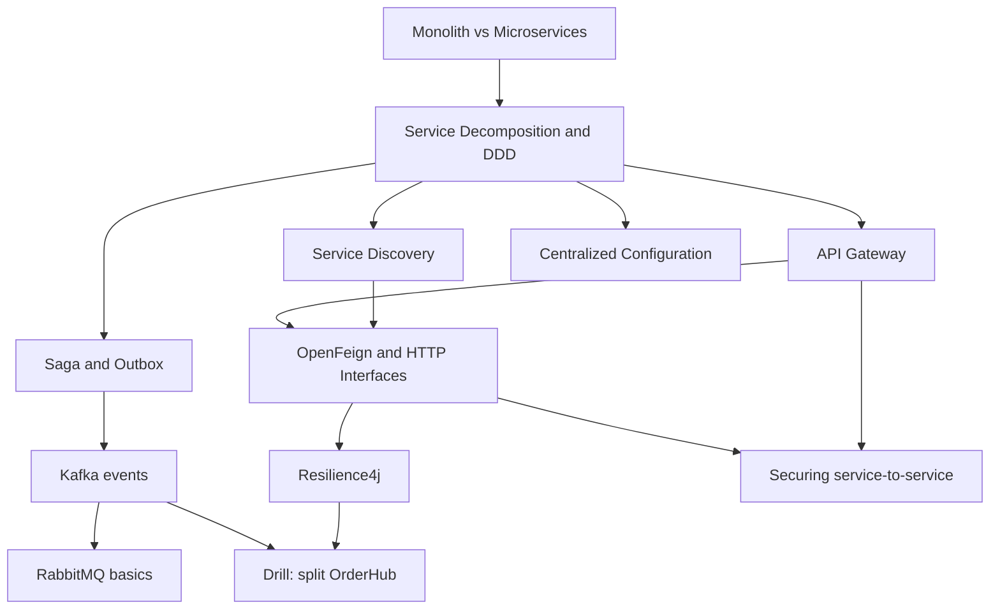
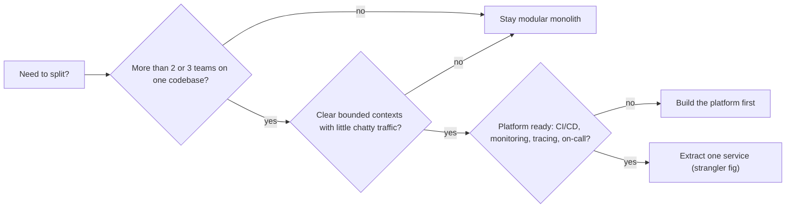
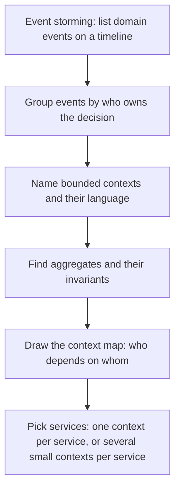

@@ 1 | MODULE | Phase 20 — Microservices with Spring Cloud (Advanced) | When to split, how to split, gateway, discovery, config, service calls, resilience, sagas, Kafka and securing it all | MUST
# Phase 20: Microservices with Spring Cloud (Advanced)

This phase takes OrderHub from one Spring Boot application to a small distributed system: an **order-service**, an **inventory-service** and a **notification-service** behind a **gateway**, registered in **Eureka**, configured from a **Config Server**, talking over HTTP (HTTP Interfaces or OpenFeign) and over **Kafka** events, protected by **Resilience4j** and secured with OAuth2 tokens. Every senior Java interview has a microservices block. Interviewers do not want buzzwords; they want to hear when you would *not* split, what happens when the network fails, how you keep data consistent without distributed transactions, and how you debug a request that crosses five services.

Versions used in this phase: Spring Boot 3.5, **Spring Cloud 2025.0.x** (release train "Northfields", the one that matches Boot 3.5), Spring Cloud Gateway 4.3, Resilience4j 2.3, Spring for Apache Kafka 3.3. Netflix Hystrix and Ribbon are long gone (removed in Spring Cloud 2020.0); if an interviewer mentions them, say "replaced by Resilience4j and Spring Cloud LoadBalancer".



The target OrderHub architecture after this phase:

```text
                         +--------------------+
   client  --HTTPS-->    |  gateway :8080     |  routes, rate limit, JWT check, correlation id
                         +---------+----------+
                                   | lb://order-service, lb://inventory-service
             +---------------------+----------------------+
             v                                            v
   +-------------------+   HTTP (reserve stock)   +----------------------+
   | order-service     | -----------------------> | inventory-service    |
   | :8081  orders DB  |   Resilience4j wrapped   | :8082  inventory DB  |
   +---------+---------+                          +----------+-----------+
             | outbox -> Kafka "order-events"                 | Kafka "inventory-events"
             v                                                v
   +----------------------------------------------------------------+
   |                         Kafka                                   |
   +-----------------------------+----------------------------------+
                                 v
                    +--------------------------+
                    | notification-service     |  email / SMS, idempotent consumer
                    | :8083                    |
                    +--------------------------+
   eureka :8761 (registry)      config-server :8888 (shared config)
```

**Prerequisites:** Phase 11 (REST APIs), Phase 12 (JPA and transactions), Phase 14 (Spring Security and JWT), Phase 18 (proxies and AOP, because Resilience4j and Feign are proxies), Phase 19 (Redis, used by the gateway rate limiter).

**The 5 questions from this phase that come up most often**
1. When would you choose microservices over a monolith, and when would you refuse?
2. How do you keep data consistent across services without a distributed transaction? (Saga plus outbox.)
3. What is a circuit breaker, what are its states, and how do you configure retries so they do not make an outage worse?
4. What does an API gateway do, and how does a service find another service's address?
5. Kafka: how do partitions, keys and consumer groups work, and how do you handle duplicates and poison messages?

@@ 2 | MODULE | Design | Deciding whether to split and where the service boundaries go | MUST
# Design

**Shared analogy: a restaurant growing up.** A small restaurant has one cook who does everything in one kitchen (a monolith): fast to start, easy to coordinate, but the cook becomes a bottleneck. A big restaurant splits into stations (grill, pastry, salads), each with its own staff, tools and fridge (services with their own data). Splitting only pays off if the stations are cut along natural lines (bounded contexts): a "grill" station works, a "things that start with the letter B" station does not. These two topics decide **whether** to split and **where** to cut, which is where most microservice projects succeed or fail.

@@ 3 | TOPIC | Monolith vs Microservices | Trade-offs, the modular monolith, when to split and the hidden costs of distribution | MUST
# Monolith vs Microservices

**Level: Advanced | Phase 20 | Priority: MUST | Since: architecture style (term popularized around 2014)**

> **30-second interview answer:** A monolith is one deployable unit containing all features; microservices are many small, independently deployable services, each owning one business capability and its own data. Microservices buy independent deployment, independent scaling and team autonomy, and they pay for it with network failures, eventual consistency, distributed debugging and much more operational work. I start with a well-structured modular monolith and extract a service only when a concrete pressure (team size, scaling profile, release cadence, fault isolation) justifies the cost.

## 1. Concept in Simple Words
### Analogy
One big department store versus a street of small specialist shops.

| Shops | Software |
|---|---|
| One department store under one roof | Monolith: one deployable, one process |
| Departments inside the store (shoes, toys) | Modules inside a modular monolith |
| A street of independent shops, each with its own owner and stockroom | Microservices, each with its own team and database |
| Walking between departments indoors: instant, never rains | In-process method call: nanoseconds, never fails on its own |
| Crossing the street between shops: traffic, rain, a shop may be closed | Network call: latency, timeouts, the other service may be down |
| Renovating one shop without closing the street | Deploying one service independently |
| A street needs roads, signs, a map and traffic lights | Gateway, discovery, config, monitoring, CI/CD per service |

### What it is
- **Monolith:** the whole application is built, tested and deployed as one artifact (one JAR) and runs as one process. It usually shares one database.
- **Modular monolith:** still one deployable, but internally split into modules with strict boundaries (each module exposes a small public API, hides its internals, and owns its tables). Spring Modulith (`spring-modulith`) can verify these boundaries in tests.
- **Microservices:** an architecture where the system is a set of services that are independently deployable, organized around business capabilities, own their data (no shared database), and communicate over the network (HTTP or messaging).
- **Distributed monolith:** the worst of both: many services that must be deployed together because they share a database or call each other synchronously in long chains.

### Why it exists
As a monolith grows to dozens of developers, everyone steps on each other: one release train, one huge test suite, one technology stack, and a bug in the reporting code can take down checkout. Microservices appeared at companies like Amazon and Netflix to let hundreds of small teams ship independently. The catch is that they move complexity from the code into the network and the operations. Without a real organizational or scaling need, that complexity is pure cost.

## 2. How It Works
The key difference is what a "call" means.

```text
MONOLITH                                   MICROSERVICES
OrderService.place()                       order-service.place()
   |  in-process call (~100 ns)               |  HTTP over network (1 to 50 ms)
   v                                          v
InventoryService.reserve()                 inventory-service /reserve
   |                                          |   can time out, be slow, be down,
   v                                          |   succeed but the response is lost
one DB transaction: order + stock          two databases: no single ACID transaction
COMMIT or ROLLBACK together                needs a saga with compensation
```

Availability multiplies along a synchronous chain. If each service is up 99.9% of the time and a request touches five services in a row, the request succeeds only 0.999 to the power 5, about 99.5% of the time: five times more downtime than one service.



**Strangler fig pattern:** extract one capability at a time. Put a gateway in front of the monolith, route one path (say `/api/notifications/**`) to the new service, keep the rest going to the monolith, and repeat. You never do a big-bang rewrite.

## 3. Code Example
### Code
A plain Java 21 program that quantifies the two hidden costs every interviewer wants you to mention: availability that multiplies across a call chain, and latency that adds up per hop.

```java
import java.util.List;

public class DistributionCost {

    record Hop(String name, double availability, double latencyMs) { }

    // Probability that ALL hops succeed when they are called one after another
    static double chainAvailability(List<Hop> hops) {
        double result = 1.0;
        for (Hop h : hops) result *= h.availability();
        return result;
    }

    static double chainLatency(List<Hop> hops) {
        return hops.stream().mapToDouble(Hop::latencyMs).sum();
    }

    public static void main(String[] args) {
        int[] chainLengths = {1, 3, 5, 10, 20};
        double minutesPerMonth = 30 * 24 * 60;          // 43,200 minutes

        System.out.println("services  availability  downtime/month");
        for (int n : chainLengths) {
            double a = Math.pow(0.999, n);              // each service: 99.9 percent
            double downtime = (1 - a) * minutesPerMonth;
            System.out.println(String.format("%8d  %11.2f%%  %10.1f min", n, a * 100, downtime));
        }

        // One checkout request in OrderHub after the split
        List<Hop> checkout = List.of(
                new Hop("gateway", 0.9995, 2.0),
                new Hop("order-service", 0.999, 15.0),
                new Hop("inventory-service", 0.999, 12.0),
                new Hop("payment-provider", 0.998, 120.0));

        System.out.println();
        System.out.println(String.format("checkout availability: %.3f%%", chainAvailability(checkout) * 100));
        System.out.println(String.format("checkout latency: %.1f ms (monolith in-process calls: about 0 ms)", chainLatency(checkout)));
    }
}
```

The same split in Spring code. In the monolith, placing an order is one local transaction:

```java
// MONOLITH: one process, one database, one transaction
package com.orderhub.order;

import org.springframework.stereotype.Service;
import org.springframework.transaction.annotation.Transactional;
import com.orderhub.inventory.InventoryService;   // another module, same JVM

@Service
public class OrderService {
    private final OrderRepository orders;
    private final InventoryService inventory;

    public OrderService(OrderRepository orders, InventoryService inventory) {
        this.orders = orders;
        this.inventory = inventory;
    }

    @Transactional                                   // order row + stock rows commit together
    public Order place(PlaceOrderCommand cmd) {
        inventory.reserve(cmd.productId(), cmd.quantity());   // throws -> whole tx rolls back
        return orders.save(Order.newOrder(cmd));
    }
}
```

After the split, the same method crosses the network and loses the shared transaction:

```java
// MICROSERVICES: order-service calls inventory-service over HTTP
package com.orderhub.order;

import org.springframework.stereotype.Service;
import org.springframework.transaction.annotation.Transactional;

@Service
public class OrderService {
    private final OrderRepository orders;
    private final InventoryClient inventory;         // HTTP client (topic: OpenFeign and HTTP Interfaces)

    public OrderService(OrderRepository orders, InventoryClient inventory) {
        this.orders = orders;
        this.inventory = inventory;
    }

    @Transactional                                   // covers ONLY the orders database
    public Order place(PlaceOrderCommand cmd) {
        // Network call: may time out AFTER inventory already reserved the stock.
        // If the save below fails, the reservation is NOT rolled back automatically.
        inventory.reserve(new ReserveRequest(cmd.productId(), cmd.quantity()));
        return orders.save(Order.newOrder(cmd));
    }
}
```

### Walkthrough
- `chainAvailability` multiplies probabilities because every hop must succeed for the request to succeed. This is why long synchronous chains are dangerous.
- The table shows how downtime grows from 43 minutes a month for one service to over 14 hours for a 20-service chain, even though every individual service meets its 99.9% target.
- `checkout` models a realistic request: the external payment provider dominates latency, and the chain availability drops below the weakest hop.
- The monolith `OrderService` relies on one `@Transactional` boundary: if `save` fails, the stock reservation in the same database rolls back too.
- In the microservice version `@Transactional` only covers the order database. A timeout does not mean the reservation failed, so you need idempotent requests, compensation (a saga) and resilience patterns. That is the whole rest of this phase.

### Output
```text
services  availability  downtime/month
       1        99.90%        43.2 min
       3        99.70%       129.5 min
       5        99.50%       215.6 min
      10        99.00%       430.1 min
      20        98.02%       855.8 min

checkout availability: 99.551%
checkout latency: 149.0 ms (monolith in-process calls: about 0 ms)
```

### Compare
| Aspect | Monolith (modular) | Microservices |
|---|---|---|
| Deployment | One artifact, one pipeline | One pipeline per service |
| Data consistency | ACID transactions | Eventual consistency, sagas |
| Calls between parts | Method calls, compile-time checked | Network calls, versioned contracts |
| Scaling | Scale the whole app | Scale hot services only |
| Failure isolation | One memory leak kills everything | A failing service can be isolated (with circuit breakers) |
| Debugging | One log, one stack trace | Distributed tracing needed |
| Team autonomy | Shared release train | Teams release independently |
| Best for | Small to medium teams, new products | Many teams, mature domain, strong platform |

## 4. Interview Questions
**Basic**
1. **What is a microservice?**
   A small service that owns one business capability and its own data, is deployed independently, and talks to others only through APIs or events. "Small" is about scope and team ownership, not lines of code.
2. **What are the advantages of microservices?**
   Independent deployment and release cadence, independent scaling of hot paths, fault isolation, freedom to pick technology per service, and smaller codebases that one team fully understands.
3. **What are the disadvantages?**
   Network latency and partial failure, no cross-service ACID transactions, harder testing and debugging, data duplication, versioned contracts, and a large platform cost (CI/CD, monitoring, tracing, service discovery, on-call per service).

**Follow-up**
4. **What is a modular monolith and why do many teams prefer it?**
   One deployable with strong internal module boundaries: each module has a public API and private internals and owns its tables. You get most of the design benefits (clear ownership, low coupling) without network costs, and extracting a module later is easy because the boundary already exists.
5. **What is a distributed monolith and how do you recognize one?**
   Services that cannot be deployed independently: they share a database schema, need coordinated releases, or call each other synchronously in long chains. Symptoms are "we must deploy services A, B and C together" and one slow service freezing everything.
6. **How would you migrate a monolith to microservices?**
   Strangler fig: put a gateway in front, pick a capability with a clear boundary and few dependencies (notifications is a classic first one), build it as a service with its own data, route its traffic to the new service, sync data during transition, then delete the old code. One capability at a time, never a rewrite.

**Tricky / scenario**
7. **A startup with five developers wants microservices "to be scalable". What do you say?**
   I would push back. Five developers cannot run ten services with on-call, tracing and pipelines without slowing feature work to a crawl. A modular monolith scales horizontally fine behind a load balancer; extract services later when a real pressure appears. Conway's law says the architecture should follow team structure, and one team means one deployable.
8. **After splitting, checkout p99 latency doubled. Why, and what do you do?**
   Every synchronous hop adds network time, serialization and its own tail latency, and tails compound (the slowest of several calls dominates). Fixes: remove chatty calls (fetch in batches, cache reference data locally), turn non-critical steps (notifications, analytics) into async events, call independent services in parallel, and set strict timeouts.
9. **Two services share one database "temporarily". What is the risk?**
   Schema changes by one team break the other, you cannot deploy or scale them independently, and nobody owns the data. It is acceptable only as a short migration step with separate schemas and a plan to split. Long-term, each service owns its data and others access it via API or events.

**What the interviewer is really testing:** whether you treat microservices as a trade-off with real costs instead of a default, and whether you can name the concrete pressures that justify splitting.

## 5. Pitfalls & Best Practices
### Common mistakes
| Mistake | What goes wrong | Fix |
|---|---|---|
| Splitting by technical layer (UI service, DB service) | Every feature touches every service | Split by business capability |
| Shared database between services | Hidden coupling, coordinated deploys | Database per service, integrate via API or events |
| Long synchronous call chains | Latency and failures multiply | Async events, parallel calls, aggregate data |
| Starting with microservices on day one | Wrong boundaries frozen into network contracts | Modular monolith first, extract later |
| No platform (tracing, central logs, CI/CD) | Cannot debug or ship | Build observability and pipelines before splitting |
| Nano-services (one per entity) | Chatty, fragile system | Services sized to a bounded context and a team |

### Best practices
- Write down the reason for each extraction (an ADR): which pressure, which metric will prove it worked.
- Keep services independently deployable: backward-compatible APIs, versioned events, consumer-driven contract tests.
- Prefer asynchronous events for anything the user does not need to wait for.
- Give every service a clear owner team, its own pipeline and its own dashboards.
- Enforce modular boundaries inside the monolith first (Spring Modulith `ApplicationModules.of(App.class).verify()` in a test).

### Compare with
| Style | Deployables | Data | When |
|---|---|---|---|
| Classic monolith | 1 | Shared schema, no boundaries | Prototypes, tiny apps |
| Modular monolith | 1 | Tables owned per module | Default for most teams |
| Microservices | Many | Database per service | Many teams, clear contexts, strong platform |
| Serverless functions | Many tiny | Managed stores | Spiky, event-driven workloads |

## 6. Hands-on Exercise
OrderHub is still one application with packages `product`, `order`, `inventory` and `notification`. Prepare it for extraction without adding any network calls:
1. Make each package a module with a public API class (for example `InventoryApi`) and keep everything else package-private.
2. Replace the direct call from `OrderService` to `NotificationService` with a Spring application event `OrderPlacedEvent`.
3. Add a test that fails if one module reaches into another module's internals.

Acceptance criteria: `OrderService` no longer imports anything from `notification`; the module test passes; placing an order still sends the notification.

<details><summary>Solution</summary>

```xml
<!-- pom.xml -->
<dependency>
    <groupId>org.springframework.modulith</groupId>
    <artifactId>spring-modulith-starter-core</artifactId>
</dependency>
<dependency>
    <groupId>org.springframework.modulith</groupId>
    <artifactId>spring-modulith-starter-test</artifactId>
    <scope>test</scope>
</dependency>
<!-- in dependencyManagement: org.springframework.modulith:spring-modulith-bom:1.4.1, type pom, scope import -->
```

```java
// order/OrderPlacedEvent.java (public: part of the order module's API)
package com.orderhub.order;

import java.math.BigDecimal;

public record OrderPlacedEvent(long orderId, long customerId, BigDecimal total) { }
```

```java
// order/OrderService.java
package com.orderhub.order;

import org.springframework.context.ApplicationEventPublisher;
import org.springframework.stereotype.Service;
import org.springframework.transaction.annotation.Transactional;

@Service
public class OrderService {
    private final OrderRepository orders;
    private final ApplicationEventPublisher events;

    public OrderService(OrderRepository orders, ApplicationEventPublisher events) {
        this.orders = orders;
        this.events = events;
    }

    @Transactional
    public Order place(PlaceOrderCommand cmd) {
        Order order = orders.save(Order.newOrder(cmd));
        events.publishEvent(new OrderPlacedEvent(order.getId(), cmd.customerId(), order.getTotal()));
        return order;
    }
}
```

```java
// notification/NotificationListener.java (package-private internals)
package com.orderhub.notification;

import com.orderhub.order.OrderPlacedEvent;
import org.springframework.modulith.events.ApplicationModuleListener;
import org.springframework.stereotype.Component;

@Component
class NotificationListener {
    private final EmailSender email;

    NotificationListener(EmailSender email) { this.email = email; }

    // Runs after the order transaction commits, asynchronously, in its own transaction
    @ApplicationModuleListener
    void on(OrderPlacedEvent event) {
        email.send(event.customerId(), "Order " + event.orderId() + " confirmed");
    }
}
```

```java
// src/test/java/com/orderhub/ModularityTest.java
package com.orderhub;

import org.junit.jupiter.api.Test;
import org.springframework.modulith.core.ApplicationModules;

class ModularityTest {
    @Test
    void modulesRespectBoundaries() {
        ApplicationModules.of(OrderHubApplication.class).verify();   // fails on illegal cross-module access
    }
}
```

The event is the seam: later, when notification becomes its own service, the same `OrderPlacedEvent` is published to Kafka instead of in-process, and `OrderService` barely changes.
</details>

## 7. Recall
Q: What is the main trade-off of microservices versus a monolith?
A: Independent deployment, scaling and team autonomy in exchange for network failures, eventual consistency, harder debugging and much higher operational cost.

Q: What is a modular monolith?
A: One deployable application split internally into modules with strict public APIs and owned data, so it can be split later cheaply.

Q: What is a distributed monolith in microservices architecture?
A: Services that share a database or must be deployed together, so they have the costs of distribution without independent deployability.

Q: Why does a chain of five 99.9% available services give lower availability?
A: Every hop must succeed, so availabilities multiply: 0.999 to the power 5 is about 99.5%, five times the downtime.

Q: What is the strangler fig pattern for migrating a monolith?
A: Route one capability at a time from the monolith to a new service behind a gateway until the old code can be deleted, instead of a big-bang rewrite.

**Related:** [[Service Decomposition and DDD Basics]] · [[API Gateway with Spring Cloud Gateway]] · [[Distributed Transactions, Saga and Outbox]]

@@ 3 | TOPIC | Service Decomposition and DDD Basics | Bounded contexts, aggregates, ubiquitous language and how to draw service boundaries | SHOULD
# Service Decomposition and DDD Basics

**Level: Advanced | Phase 20 | Priority: SHOULD | Since: Domain-Driven Design (Eric Evans, 2003)**

> **30-second interview answer:** I draw service boundaries around business capabilities using Domain-Driven Design: a bounded context is a part of the domain where each word has one precise meaning, and it is the natural candidate for a service. Inside a context, aggregates are clusters of objects that must stay consistent together and are changed in one transaction. Contexts talk through APIs or domain events and translate each other's models, so "Product" in Catalog can differ from "StockItem" in Inventory without either team breaking the other.

## 1. Concept in Simple Words
### Analogy
A hospital's departments.

| Hospital | DDD |
|---|---|
| The word "patient" means a bed and chart to a ward, an invoice to billing, a sample to the lab | The same term has different models in different bounded contexts |
| Each department has its own forms and records | Each context owns its own model and database |
| Shared jargon inside a department ("obs", "NBM") | Ubiquitous language |
| A transfer form between ward and billing | Published contract (API or domain event) |
| The receptionist who rewrites a referral into the hospital's own format | Anti-corruption layer |
| One patient chart with its medication list: always updated together | Aggregate with an aggregate root |
| "Patient discharged" announcement | Domain event |

### What it is
- **Domain:** the business area the software serves (online ordering).
- **Subdomain:** a part of it. **Core** (your competitive edge, e.g. pricing), **supporting** (needed but specific, e.g. inventory), **generic** (solved problems, e.g. email sending: buy or use a library).
- **Bounded context:** an explicit boundary inside which a model and its language are consistent. A good first guess for a service boundary.
- **Ubiquitous language:** the shared vocabulary of developers and domain experts within one context, used in code (class names, method names).
- **Entity:** an object with identity that persists over time (`Order` with id 42). **Value object:** defined only by its values and immutable (`Money`, `Address`); Java records fit perfectly.
- **Aggregate:** a cluster of entities and value objects treated as one unit for changes. The **aggregate root** (`Order`) is the only entry point; outside code never edits an `OrderLine` directly. One transaction changes one aggregate.
- **Domain event:** a record of something that happened in the domain, named in the past tense (`OrderPlaced`).
- **Context map:** how contexts relate: customer-supplier, conformist, shared kernel, or anti-corruption layer (ACL), a translation layer that protects your model from another context's model.

### Why it exists
Without explicit boundaries, one giant `Product` class grows fields for catalog, pricing, stock, shipping and tax, and every team edits it. Splitting such a system into services by entity ("product-service", "customer-service") produces chatty services that all need each other for every request. DDD gives a method to find seams where the language and the rules change, which are also the places with the least traffic across the boundary.

## 2. How It Works
Steps to decompose OrderHub:



Event storming for OrderHub gives this timeline: `ProductListed`, `PriceChanged`, `OrderPlaced`, `StockReserved` or `StockRejected`, `PaymentCaptured`, `OrderConfirmed`, `OrderShipped`, `CustomerNotified`. Grouping by owner:

```text
+-------------------+   +----------------------+   +----------------------+
| Catalog context   |   | Ordering context     |   | Inventory context    |
| Product: name,    |   | Order (root)         |   | StockItem: sku,      |
| description,      |   |  - OrderLine (sku,   |   | onHand, reserved     |
| images, price     |   |    qty, unitPrice)   |   | Reservation(orderId) |
|                   |   |  - status, total     |   |                      |
| events:           |   | events: OrderPlaced, |   | events:              |
|  PriceChanged     |   |  OrderConfirmed      |   |  StockReserved       |
+---------+---------+   +----------+-----------+   |  StockRejected       |
          | price snapshot          | OrderPlaced  +----------+-----------+
          +-----------> Ordering <--+--------------> Inventory |
                                    v                           |
                         +----------------------+               |
                         | Notification context |<--------------+
                         | (generic subdomain)  |
                         +----------------------+
```

Rules of thumb for good boundaries:
- **High cohesion inside, low traffic across:** if two candidate services need to call each other for almost every request, they belong together.
- **One aggregate per transaction:** if a business rule needs two aggregates updated atomically, either they are one aggregate or the rule can be eventually consistent.
- **Copy, do not share:** Ordering keeps a snapshot of the price at order time instead of calling Catalog every time it shows an old order.
- **Size by team:** one team can own several contexts, but one context should not be split across teams.

## 3. Code Example
### Code
A plain Java 21 program showing two bounded contexts with their own models, an aggregate root that guards invariants and records a domain event, and an anti-corruption layer translating between contexts.

```java
import java.math.BigDecimal;
import java.util.ArrayList;
import java.util.HashMap;
import java.util.List;
import java.util.Map;

public class BoundedContextsDemo {

    // ===== Ordering context =====
    record Money(BigDecimal amount) {                       // value object
        Money {
            if (amount.signum() < 0) throw new IllegalArgumentException("negative money");
        }
        Money times(int qty) { return new Money(amount.multiply(BigDecimal.valueOf(qty))); }
        Money plus(Money other) { return new Money(amount.add(other.amount)); }
        static Money zero() { return new Money(BigDecimal.ZERO); }
    }

    record OrderLine(String sku, int quantity, Money unitPrice) { }    // part of the aggregate

    record OrderPlaced(long orderId, List<OrderLine> lines, Money total) { }   // domain event

    enum OrderStatus { DRAFT, PLACED, CONFIRMED, REJECTED }

    static final class Order {                              // aggregate root
        private final long id;
        private final List<OrderLine> lines = new ArrayList<>();
        private OrderStatus status = OrderStatus.DRAFT;
        private final List<Object> pendingEvents = new ArrayList<>();
        private static final int MAX_LINES = 20;

        Order(long id) { this.id = id; }

        void addLine(String sku, int qty, Money unitPrice) {
            if (status != OrderStatus.DRAFT) throw new IllegalStateException("order is " + status);
            if (qty <= 0) throw new IllegalArgumentException("quantity must be positive");
            if (lines.size() == MAX_LINES) throw new IllegalStateException("too many lines");
            lines.add(new OrderLine(sku, qty, unitPrice));
        }

        void place() {
            if (lines.isEmpty()) throw new IllegalStateException("cannot place an empty order");
            status = OrderStatus.PLACED;
            pendingEvents.add(new OrderPlaced(id, List.copyOf(lines), total()));
        }

        void confirm() { requireStatus(OrderStatus.PLACED); status = OrderStatus.CONFIRMED; }
        void reject()  { requireStatus(OrderStatus.PLACED); status = OrderStatus.REJECTED; }

        private void requireStatus(OrderStatus expected) {
            if (status != expected) throw new IllegalStateException("expected " + expected + " but was " + status);
        }

        Money total() {
            Money sum = Money.zero();
            for (OrderLine l : lines) sum = sum.plus(l.unitPrice().times(l.quantity()));
            return sum;
        }

        List<Object> pullEvents() {                         // events leave the aggregate once
            List<Object> copy = List.copyOf(pendingEvents);
            pendingEvents.clear();
            return copy;
        }

        OrderStatus status() { return status; }
    }

    // ===== Inventory context: its own model and language =====
    record ReserveStock(String reference, Map<String, Integer> quantitiesBySku) { }

    static final class StockLedger {
        private final Map<String, Integer> available = new HashMap<>();

        void receive(String sku, int qty) { available.merge(sku, qty, Integer::sum); }

        boolean tryReserve(ReserveStock cmd) {
            for (var e : cmd.quantitiesBySku().entrySet()) {
                if (available.getOrDefault(e.getKey(), 0) < e.getValue()) return false;
            }
            cmd.quantitiesBySku().forEach((sku, qty) -> available.merge(sku, -qty, Integer::sum));
            return true;
        }

        int available(String sku) { return available.getOrDefault(sku, 0); }
    }

    // ===== Anti-corruption layer: Ordering event -> Inventory command =====
    static ReserveStock translate(OrderPlaced event) {
        Map<String, Integer> bySku = new HashMap<>();
        for (OrderLine l : event.lines()) bySku.merge(l.sku(), l.quantity(), Integer::sum);
        return new ReserveStock("order-" + event.orderId(), bySku);
    }

    public static void main(String[] args) {
        StockLedger ledger = new StockLedger();
        ledger.receive("BOOK-1", 5);
        ledger.receive("PEN-9", 1);

        Order first = new Order(42);
        first.addLine("BOOK-1", 2, new Money(new BigDecimal("12.50")));
        first.addLine("BOOK-1", 1, new Money(new BigDecimal("12.50")));
        first.place();
        handle(first, ledger);

        Order second = new Order(43);
        second.addLine("PEN-9", 3, new Money(new BigDecimal("1.20")));
        second.place();
        handle(second, ledger);

        try {
            second.addLine("BOOK-1", 1, new Money(new BigDecimal("12.50")));
        } catch (IllegalStateException e) {
            System.out.println("invariant protected: " + e.getMessage());
        }
        System.out.println("BOOK-1 left: " + ledger.available("BOOK-1") + ", PEN-9 left: " + ledger.available("PEN-9"));
    }

    static void handle(Order order, StockLedger ledger) {
        for (Object event : order.pullEvents()) {
            if (event instanceof OrderPlaced placed) {
                ReserveStock cmd = translate(placed);
                boolean ok = ledger.tryReserve(cmd);
                if (ok) order.confirm(); else order.reject();
                System.out.println(cmd.reference() + " total " + placed.total().amount()
                        + " reserve " + cmd.quantitiesBySku() + " -> " + order.status());
            }
        }
    }
}
```

### Walkthrough
- `Money` is a value object: a record with validation in its compact constructor. Two `Money` objects with the same amount are interchangeable.
- `Order` is the aggregate root. `OrderLine` objects can only be added through `addLine`, which checks status, quantity and the maximum line count. Nobody outside can put the order in an invalid state.
- `place()` records an `OrderPlaced` domain event instead of calling inventory directly. The aggregate does not know who listens; in a Spring service the events are published after the transaction commits.
- Inventory has its own language: it does not know "orders" or "lines", only a `ReserveStock` command with a reference and quantities per SKU.
- `translate` is the anti-corruption layer. It merges the two `BOOK-1` lines into one quantity of 3. If Ordering renames a field tomorrow, only this translator changes.
- Order 43 asks for 3 pens when only 1 exists, so the reservation fails and the order is rejected; afterwards `addLine` is refused because the order is no longer a draft.

### Output
```text
order-42 total 37.50 reserve {BOOK-1=3} -> CONFIRMED
order-43 total 3.60 reserve {PEN-9=3} -> REJECTED
invariant protected: order is REJECTED
BOOK-1 left: 2, PEN-9 left: 1
```

### Compare
| Decomposition by entity (anti-pattern) | Decomposition by bounded context |
|---|---|
| product-service, customer-service, order-service, line-service | catalog, ordering, inventory, notification |
| Every request calls three or four services | Most requests stay inside one service |
| One shared `Product` model for everyone | Each context has its own model of a product |
| CRUD APIs, logic leaks into callers | Behaviour APIs (`place`, `reserve`) and events |

## 4. Interview Questions
**Basic**
1. **What is a bounded context?**
   An explicit boundary inside which a domain model and its terms have one consistent meaning. "Product" in Catalog (descriptions, images) and in Inventory (SKU, quantity on hand) are different models in different contexts. A bounded context is usually the best first candidate for a microservice.
2. **What is an aggregate?**
   A cluster of domain objects that must stay consistent together, changed only through its root. The rule is one aggregate per transaction, and other aggregates are referenced by id, not by object reference.
3. **Entity vs value object?**
   An entity has identity that survives changes (`Customer` 7 stays customer 7 after changing address). A value object is defined only by its values and is immutable (`Money`, `Address`). Records are a natural fit for value objects.

**Follow-up**
4. **How do you find service boundaries in practice?**
   Run event storming with domain experts, group events by the part of the business that owns the decision, look for where language changes, and check traffic: if two candidates must talk on every request, merge them. Align the result with team ownership (Conway's law).
5. **What is an anti-corruption layer and when do you need one?**
   A translation layer between your model and another context's or legacy system's model, so foreign concepts do not leak into your code. You need it when integrating with a legacy system or a context whose model you do not control.
6. **Why should aggregates be small?**
   Large aggregates mean big transactions, lock contention and loading too much data. Small aggregates with references by id scale better, and cross-aggregate rules become eventually consistent through domain events.

**Tricky / scenario**
7. **The business says "an order must never be placed if stock is unavailable". Inventory is another service. How do you honour that?**
   Ask how strict the rule really is. Usually "pending until stock is reserved" is acceptable: the order is created as PENDING, an event triggers reservation, and the order moves to CONFIRMED or REJECTED (a saga). If it must be synchronous, call inventory to reserve first with a timeout and idempotency key, then compensate (release) if the order save fails.
8. **Your team split by entity and now order-service calls customer-service, product-service and price-service on every request. What do you do?**
   That is a sign of wrong boundaries. Short term: cache reference data or replicate it via events into order-service (a local read model). Long term: merge services that change together into one bounded context and keep only real business seams as service boundaries.
9. **Can one bounded context span multiple microservices, or one microservice contain several contexts?**
   A service may contain several small related contexts when one team owns them, which is common and fine. Splitting one context across services is a smell because its model must stay consistent, which forces distributed transactions or tight coupling.

**What the interviewer is really testing:** whether you can draw boundaries from the business domain instead of from database tables, and whether you understand consistency rules inside versus across boundaries.

## 5. Pitfalls & Best Practices
### Common mistakes
| Mistake | What goes wrong | Fix |
|---|---|---|
| One service per database table | Chatty calls, no cohesion | Service per bounded context |
| One shared domain library for all services | Every change forces all services to redeploy | Each service owns its model; share only contracts |
| Huge aggregates (customer with all orders) | Slow loads, lock contention | Small aggregates, references by id |
| Updating two aggregates in one transaction across services | Needs 2PC, fragile | Domain events and sagas |
| Leaking another context's model into yours | Their change breaks you | Anti-corruption layer, translate at the edge |

### Best practices
- Name code in the ubiquitous language: `order.place()`, not `orderDao.updateStatus(2)`.
- Model value objects as records with validation in the compact constructor.
- Publish domain events in the past tense and keep them as stable contracts (version them).
- Store snapshots of data you need from other contexts (price at order time, customer name on the invoice).
- Start with coarse services and split later; merging services is much harder than splitting modules.

### Compare with
| Context map relation | Meaning | Example |
|---|---|---|
| Customer-supplier | Downstream needs are negotiated with upstream | Ordering asks Catalog for price snapshots |
| Conformist | Downstream accepts upstream model as is | Using a payment provider's API model |
| Anti-corruption layer | Downstream translates upstream model | Inventory translating `OrderPlaced` into `ReserveStock` |
| Shared kernel | Two contexts share a small common model | A shared `Money` contract library |
| Published language | A documented exchange format | Versioned JSON or Avro event schemas |

## 6. Hands-on Exercise
Model the OrderHub Inventory context for the upcoming inventory-service:
- `StockItem` aggregate root with `sku`, `onHand`, and a list of `Reservation(orderId, quantity)`.
- `reserve(orderId, qty)`: fails with `InsufficientStockException` if `onHand - reserved < qty`; reserving twice for the same order is a no-op (idempotent).
- `release(orderId)`: removes the reservation (compensation).
- `available()` returns `onHand` minus all reserved quantities.

Acceptance criteria: invariants hold under the calls `reserve(1,3)`, `reserve(1,3)` again, `reserve(2,5)` (fails with onHand 7), `release(1)`, `reserve(2,5)` (succeeds).

<details><summary>Solution</summary>

```java
import java.util.ArrayList;
import java.util.List;

public class StockItem {
    record Reservation(long orderId, int quantity) { }

    static class InsufficientStockException extends RuntimeException {
        InsufficientStockException(String sku, int wanted, int available) {
            super("sku " + sku + ": wanted " + wanted + ", available " + available);
        }
    }

    private final String sku;
    private int onHand;
    private final List<Reservation> reservations = new ArrayList<>();

    public StockItem(String sku, int onHand) {
        if (onHand < 0) throw new IllegalArgumentException("onHand must be >= 0");
        this.sku = sku;
        this.onHand = onHand;
    }

    public void reserve(long orderId, int qty) {
        if (qty <= 0) throw new IllegalArgumentException("qty must be positive");
        boolean already = reservations.stream().anyMatch(r -> r.orderId() == orderId);
        if (already) return;                                  // idempotent: retries are safe
        if (available() < qty) throw new InsufficientStockException(sku, qty, available());
        reservations.add(new Reservation(orderId, qty));
    }

    public void release(long orderId) {
        reservations.removeIf(r -> r.orderId() == orderId);   // compensation, also idempotent
    }

    public int available() {
        return onHand - reservations.stream().mapToInt(Reservation::quantity).sum();
    }

    public static void main(String[] args) {
        StockItem book = new StockItem("BOOK-1", 7);
        book.reserve(1, 3);
        book.reserve(1, 3);                                   // duplicate message: ignored
        System.out.println("after order 1: " + book.available());
        try {
            book.reserve(2, 5);
        } catch (InsufficientStockException e) {
            System.out.println("rejected: " + e.getMessage());
        }
        book.release(1);
        book.reserve(2, 5);
        System.out.println("after release and order 2: " + book.available());
    }
}
```
Output:
```text
after order 1: 4
rejected: sku BOOK-1: wanted 5, available 4
after release and order 2: 2
```
Idempotent `reserve` and `release` matter because messages and HTTP retries can be delivered twice in a distributed system.
</details>

## 7. Recall
Q: What is a bounded context in DDD?
A: An explicit boundary inside which a model and its terms have one consistent meaning; it is the usual candidate for a microservice boundary.

Q: What is an aggregate root in DDD?
A: The single entry point of a cluster of objects that must stay consistent; all changes go through it, and one transaction changes one aggregate.

Q: What is an anti-corruption layer?
A: A translation layer that converts another context's or legacy system's model into your own, so foreign concepts do not leak into your code.

Q: Why is decomposing microservices by database entity an anti-pattern?
A: Every use case then needs several services, causing chatty calls, shared models and coordinated deployments.

Q: How should a service get data it needs from another bounded context?
A: Through an API or by keeping a local copy fed by domain events (for example a price snapshot), never by reading the other service's database.

**Related:** [[Monolith vs Microservices]] · [[Distributed Transactions, Saga and Outbox]] · [[Event-Driven Architecture with Kafka]]
