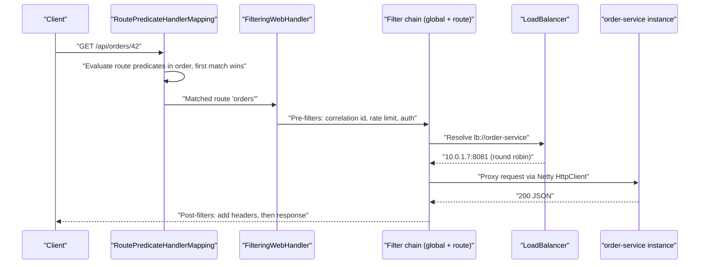
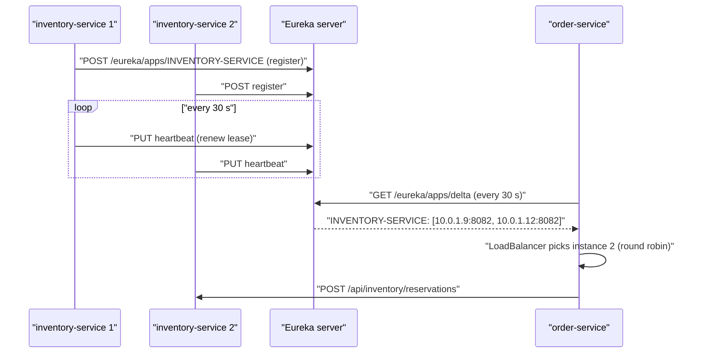

@@ 2 | MODULE | Infrastructure | Gateway, discovery, shared configuration and service-to-service HTTP calls | MUST
# Infrastructure

**Shared analogy: the infrastructure of a city.** Once the restaurant became a street of shops, the street needs a **main entrance with a security desk** (API gateway: one door for all visitors, checks badges, sends them to the right shop), a **live directory board** that shows which shops are open and at which address today (service discovery), a **city noticeboard** where shared rules are posted once instead of in every shop (centralized configuration), and a **standard way to phone another shop** with a timeout if nobody picks up (OpenFeign or HTTP Interfaces). None of these add business features; they make many small services behave like one system.

@@ 3 | TOPIC | API Gateway with Spring Cloud Gateway | One entry point for routing, rate limiting, auth, retries and fallbacks in front of services | MUST
# API Gateway with Spring Cloud Gateway

**Level: Advanced | Phase 20 | Priority: MUST | Since: Spring Cloud Gateway 2.0 (2018); new server-webflux and server-webmvc starters in Spring Cloud 2025.0**

> **30-second interview answer:** An API gateway is the single entry point in front of the services. It routes each request to the right service by path or header and applies cross-cutting concerns once: authentication, rate limiting, CORS, retries, circuit breaking, request ids and response headers. Spring Cloud Gateway does this with routes made of predicates (when to match) and filters (what to do), running on WebFlux and Netty or, since 4.1, on Spring MVC. Clients see one stable URL while services can move, scale and split behind it.

## 1. Concept in Simple Words
### Analogy
The reception desk of a large office building.

| Office building | API gateway |
|---|---|
| One front door for every visitor | One public host name for all services |
| Receptionist checks your badge | Authentication (JWT validation) at the edge |
| "Accounts is on floor 3" | Route: path predicate to a target service |
| A visitor limit per company per hour | Rate limiting per client or user |
| Receptionist stamps your visitor slip with a number | Adding a correlation id header |
| "Accounts is closed, please leave a message" | Circuit breaker fallback response |
| Tenants can move floors without changing the street address | Services move or scale without clients noticing |

### What it is
- **API gateway:** a reverse proxy specialized for APIs that sits between clients and services.
- **Route:** an id, a destination URI, a list of predicates and a list of filters.
- **Predicate:** a condition on the request: `Path=/api/orders/**`, `Method=GET`, `Header=X-Version, 2`, `Host=**.orderhub.com`, `After=<date>`, `Weight=group, 90` (canary).
- **Filter:** code that changes the request or response: `StripPrefix`, `RewritePath`, `AddRequestHeader`, `RequestRateLimiter`, `CircuitBreaker`, `Retry`, `TokenRelay`, `SecureHeaders`. A **GlobalFilter** applies to every route.
- **`lb://order-service`:** a URI scheme meaning "ask service discovery for instances of order-service and load-balance between them".
- **Backend for Frontend (BFF):** a gateway (or thin service) per client type (web, mobile) that shapes responses for that client.

Spring Cloud 2025.0 renamed the artifacts: use `spring-cloud-starter-gateway-server-webflux` (reactive, Netty) or `spring-cloud-starter-gateway-server-webmvc` (servlet, works well with virtual threads). The properties moved from `spring.cloud.gateway.routes` to `spring.cloud.gateway.server.webflux.routes`; the old names still work in 2025.0 but log deprecation warnings.

### Why it exists
Without a gateway every client must know every service's address, every service re-implements authentication, CORS and rate limiting, and any internal refactoring (splitting order-service into two) breaks clients. Exposing every service publicly also widens the attack surface. A gateway centralizes edge concerns and decouples the public API from the internal topology.

## 2. How It Works
Spring Cloud Gateway (WebFlux flavour) handles each request like this:



Behind the scenes:
- Routes are loaded by a `RouteDefinitionLocator` (from YAML, Java DSL or discovery) into `Route` objects.
- Filters are ordered by `Ordered`; "pre" logic runs before `chain.filter(exchange)`, "post" logic in the returned `Mono`'s continuation.
- `RequestRateLimiter` with `RedisRateLimiter` uses a token bucket stored in Redis via a Lua script, so all gateway instances share the same counters. It returns `429 Too Many Requests` and `X-RateLimit-Remaining` headers.
- The `CircuitBreaker` filter uses Spring Cloud CircuitBreaker with Resilience4j; on open circuit or timeout it forwards to `fallbackUri`.
- Because the WebFlux gateway runs on an event loop, never block inside a filter (no JDBC, no `RestTemplate`).

## 3. Code Example
### Code
OrderHub `gateway` module.

```xml
<!-- gateway/pom.xml -->
<parent>
    <groupId>org.springframework.boot</groupId>
    <artifactId>spring-boot-starter-parent</artifactId>
    <version>3.5.7</version>
</parent>

<properties>
    <java.version>21</java.version>
    <spring-cloud.version>2025.0.0</spring-cloud.version>
</properties>

<dependencyManagement>
    <dependencies>
        <dependency>
            <groupId>org.springframework.cloud</groupId>
            <artifactId>spring-cloud-dependencies</artifactId>
            <version>${spring-cloud.version}</version>
            <type>pom</type>
            <scope>import</scope>
        </dependency>
    </dependencies>
</dependencyManagement>

<dependencies>
    <dependency>
        <groupId>org.springframework.cloud</groupId>
        <artifactId>spring-cloud-starter-gateway-server-webflux</artifactId>
    </dependency>
    <dependency>
        <groupId>org.springframework.cloud</groupId>
        <artifactId>spring-cloud-starter-netflix-eureka-client</artifactId>
    </dependency>
    <dependency>
        <groupId>org.springframework.cloud</groupId>
        <artifactId>spring-cloud-starter-circuitbreaker-reactor-resilience4j</artifactId>
    </dependency>
    <dependency>
        <groupId>org.springframework.boot</groupId>
        <artifactId>spring-boot-starter-data-redis-reactive</artifactId>
    </dependency>
    <dependency>
        <groupId>org.springframework.boot</groupId>
        <artifactId>spring-boot-starter-actuator</artifactId>
    </dependency>
</dependencies>
```

```yaml
# gateway/src/main/resources/application.yml
server:
  port: 8080

spring:
  application:
    name: gateway
  data:
    redis:
      host: localhost
      port: 6379
  cloud:
    gateway:
      server:
        webflux:
          default-filters:
            - name: RequestRateLimiter
              args:
                redis-rate-limiter.replenishRate: 5      # tokens added per second
                redis-rate-limiter.burstCapacity: 10     # bucket size
                redis-rate-limiter.requestedTokens: 1
                key-resolver: "#{@clientKeyResolver}"
            - AddResponseHeader=X-Served-By, orderhub-gateway
          routes:
            - id: orders
              uri: lb://order-service
              predicates:
                - Path=/api/orders/**
              filters:
                - name: CircuitBreaker
                  args:
                    name: orders
                    fallbackUri: forward:/fallback/orders
                - name: Retry
                  args:
                    retries: 2
                    methods: GET                       # never blindly retry POST
                    statuses: BAD_GATEWAY,SERVICE_UNAVAILABLE
            - id: inventory
              uri: lb://inventory-service
              predicates:
                - Path=/api/inventory/**
            - id: notifications-v2-canary
              uri: lb://notification-service-v2
              predicates:
                - Path=/api/notifications/**
                - Weight=notifications, 10             # 10 percent canary
            - id: notifications-v1
              uri: lb://notification-service
              predicates:
                - Path=/api/notifications/**
                - Weight=notifications, 90

resilience4j:
  timelimiter:
    instances:
      orders:
        timeout-duration: 2s
  circuitbreaker:
    instances:
      orders:
        sliding-window-size: 20
        failure-rate-threshold: 50
        wait-duration-in-open-state: 10s

eureka:
  client:
    service-url:
      defaultZone: http://localhost:8761/eureka/

management:
  endpoints:
    web:
      exposure:
        include: health,info,gateway
```

```java
// gateway/src/main/java/com/orderhub/gateway/GatewayConfig.java
package com.orderhub.gateway;

import org.springframework.cloud.gateway.filter.ratelimit.KeyResolver;
import org.springframework.cloud.gateway.route.RouteLocator;
import org.springframework.cloud.gateway.route.builder.RouteLocatorBuilder;
import org.springframework.context.annotation.Bean;
import org.springframework.context.annotation.Configuration;
import reactor.core.publisher.Mono;

@Configuration
public class GatewayConfig {

    // Rate-limit key: the API key header, or the client IP if there is none
    @Bean
    KeyResolver clientKeyResolver() {
        return exchange -> {
            String apiKey = exchange.getRequest().getHeaders().getFirst("X-Api-Key");
            if (apiKey != null) return Mono.just("key:" + apiKey);
            var remote = exchange.getRequest().getRemoteAddress();
            return Mono.just("ip:" + (remote == null ? "unknown" : remote.getAddress().getHostAddress()));
        };
    }

    // Java DSL route: legacy path kept alive for old mobile apps
    @Bean
    RouteLocator legacyRoutes(RouteLocatorBuilder builder) {
        return builder.routes()
                .route("legacy-orders", r -> r.path("/v1/orders/**")
                        .filters(f -> f.rewritePath("/v1/orders/(?<rest>.*)", "/api/orders/${rest}")
                                       .addRequestHeader("X-Legacy-Client", "true"))
                        .uri("lb://order-service"))
                .build();
    }
}
```

```java
// gateway/src/main/java/com/orderhub/gateway/CorrelationIdFilter.java
package com.orderhub.gateway;

import java.util.UUID;
import org.springframework.cloud.gateway.filter.GatewayFilterChain;
import org.springframework.cloud.gateway.filter.GlobalFilter;
import org.springframework.core.Ordered;
import org.springframework.http.server.reactive.ServerHttpRequest;
import org.springframework.stereotype.Component;
import org.springframework.web.server.ServerWebExchange;
import reactor.core.publisher.Mono;

@Component
public class CorrelationIdFilter implements GlobalFilter, Ordered {
    static final String HEADER = "X-Correlation-Id";

    @Override
    public Mono<Void> filter(ServerWebExchange exchange, GatewayFilterChain chain) {
        String incoming = exchange.getRequest().getHeaders().getFirst(HEADER);
        String id = (incoming == null || incoming.isBlank()) ? UUID.randomUUID().toString() : incoming;

        ServerHttpRequest mutated = exchange.getRequest().mutate().header(HEADER, id).build();   // pre
        exchange.getResponse().getHeaders().add(HEADER, id);                                    // echo back
        long start = System.nanoTime();

        return chain.filter(exchange.mutate().request(mutated).build())
                .doFinally(signal -> {                                                          // post
                    long ms = (System.nanoTime() - start) / 1_000_000;
                    System.out.println(id + " " + exchange.getRequest().getPath() + " -> "
                            + exchange.getResponse().getStatusCode() + " in " + ms + " ms");
                });
    }

    @Override
    public int getOrder() { return Ordered.HIGHEST_PRECEDENCE; }   // run first
}
```

```java
// gateway/src/main/java/com/orderhub/gateway/FallbackController.java
package com.orderhub.gateway;

import org.springframework.http.HttpStatus;
import org.springframework.http.ProblemDetail;
import org.springframework.http.ResponseEntity;
import org.springframework.web.bind.annotation.RequestMapping;
import org.springframework.web.bind.annotation.RestController;
import reactor.core.publisher.Mono;

@RestController
public class FallbackController {

    @RequestMapping("/fallback/orders")
    Mono<ResponseEntity<ProblemDetail>> ordersFallback() {
        ProblemDetail pd = ProblemDetail.forStatusAndDetail(HttpStatus.SERVICE_UNAVAILABLE,
                "Orders are temporarily unavailable. Please retry in a few seconds.");
        pd.setTitle("Order service unavailable");
        return Mono.just(ResponseEntity.status(HttpStatus.SERVICE_UNAVAILABLE)
                .header("Retry-After", "10")
                .body(pd));
    }
}
```

### Walkthrough
- The BOM import pins every Spring Cloud artifact to the 2025.0 train that is tested with Boot 3.5. Never mix Spring Cloud versions by hand.
- `default-filters` apply to all routes: a Redis token bucket (5 requests per second, bursts up to 10) keyed by API key or IP, plus a response header.
- Route `orders` forwards `/api/orders/**` to whatever instances Eureka knows for `order-service`. The `CircuitBreaker` filter gives each call a 2-second time limit and opens the circuit when half of the last 20 calls fail; then it forwards to the fallback controller. `Retry` retries only GET (safe and idempotent) on 502 or 503.
- The two `Weight` routes split notification traffic 90/10 between v1 and v2: a canary release done at the gateway.
- The Java DSL route rewrites the legacy path `/v1/orders/7` to `/api/orders/7` and marks the request, showing that YAML and Java routes can coexist.
- `CorrelationIdFilter` is a `GlobalFilter` with highest precedence: it reuses or creates a correlation id, adds it to the downstream request and to the response, and logs the duration after the response completes. The code is non-blocking.
- `FallbackController` returns an RFC 9457 `ProblemDetail` with `Retry-After`, a much better client experience than a raw 500 or a hanging connection.

### Output
```http
GET http://localhost:8080/api/orders/42
X-Api-Key: web-shop

HTTP/1.1 200 OK
Content-Type: application/json
X-Correlation-Id: 3f2b8c1e-6a0d-4d7e-9a51-2b7c0e4d9f10
X-Served-By: orderhub-gateway
X-RateLimit-Remaining: 9
X-RateLimit-Burst-Capacity: 10
X-RateLimit-Replenish-Rate: 5

{"id":42,"status":"CONFIRMED","total":37.50}
```

The eleventh request inside the same second:

```http
HTTP/1.1 429 Too Many Requests
X-RateLimit-Remaining: 0
```

With order-service stopped:

```http
HTTP/1.1 503 Service Unavailable
Retry-After: 10
Content-Type: application/problem+json

{"type":"about:blank","title":"Order service unavailable","status":503,"detail":"Orders are temporarily unavailable. Please retry in a few seconds.","instance":"/fallback/orders"}
```

Gateway console:

```text
3f2b8c1e-6a0d-4d7e-9a51-2b7c0e4d9f10 /api/orders/42 -> 200 OK in 23 ms
```

### Compare
| Without a gateway | With Spring Cloud Gateway |
|---|---|
| Client knows `orders.internal:8081`, `inventory.internal:8082` | Client knows `api.orderhub.com` only |
| JWT validation copied into every service | Validated once at the edge (services still check scopes) |
| Rate limiting per instance, inconsistent | Shared Redis token bucket |
| Splitting a service breaks clients | Change a route, clients unaffected |

## 4. Interview Questions
**Basic**
1. **What is an API gateway and why use one?**
   A single entry point that routes requests to services and handles cross-cutting concerns: authentication, rate limiting, CORS, TLS termination, request ids, retries and fallbacks. It hides the internal topology so services can change without breaking clients.
2. **What are routes, predicates and filters in Spring Cloud Gateway?**
   A route is a destination plus rules. Predicates decide whether a request matches the route (path, method, header, host, weight). Filters modify the request before forwarding and the response after (rewrite path, add headers, rate limit, circuit break).
3. **What does `lb://order-service` mean?**
   The gateway asks Spring Cloud LoadBalancer, which asks service discovery, for the instances of `order-service`, then picks one (round robin by default). No hard-coded host names.

**Follow-up**
4. **How does the Redis rate limiter work?**
   It is a token bucket per key stored in Redis: tokens refill at `replenishRate` per second up to `burstCapacity`, and each request takes `requestedTokens`. A Lua script makes check-and-decrement atomic so many gateway instances share one limit. Empty bucket means `429`.
5. **WebFlux gateway vs MVC gateway: which would you pick?**
   The WebFlux one is the mature default and handles many concurrent connections with few threads, but all filters must be non-blocking. The MVC one (`server-webmvc`) is simpler to extend with ordinary blocking code and pairs well with virtual threads. For teams without reactive experience, MVC plus virtual threads is a reasonable choice.
6. **Should the gateway contain business logic?**
   No. It should do routing and edge concerns only. Business logic in the gateway couples it to every service and makes it a bottleneck for every team. Response aggregation for a specific client belongs in a BFF service.

**Tricky / scenario**
7. **The gateway validates JWTs. Can services skip security?**
   No, that is the "hard shell, soft centre" anti-pattern. Anyone who reaches the internal network (a compromised pod) could call services directly. Services should still validate the token (or a token relayed by the gateway) and check scopes, and network policies should block direct external access.
8. **You added `Retry` for all methods and now customers are charged twice. Why?**
   POST is not idempotent: the first attempt reached the service and succeeded, but the response timed out, so the gateway retried and created a second order. Retry only idempotent methods or requests carrying an idempotency key the service deduplicates.
9. **After deploying the gateway on WebFlux, throughput collapsed under load. A custom filter calls a JDBC repository. What happened?**
   Blocking calls on Netty event loop threads stall every request on that thread; with only a few event-loop threads the whole gateway freezes. Move the lookup to a reactive client or cache, or offload with `subscribeOn(Schedulers.boundedElastic())`, or switch to the MVC gateway.

**What the interviewer is really testing:** whether you know what belongs at the edge (and what does not), how the gateway finds services, and the safety rules around retries and blocking.

## 5. Pitfalls & Best Practices
### Common mistakes
| Mistake | What goes wrong | Fix |
|---|---|---|
| Blocking code in WebFlux gateway filters | Event loop starves, gateway freezes | Reactive clients or the MVC gateway |
| Retrying non-idempotent requests | Duplicate orders and payments | Retry GET only, or use idempotency keys |
| Business logic and aggregation in the gateway | Every team depends on one component | Keep gateway thin; use a BFF |
| Single gateway instance | Single point of failure | Run at least two behind a load balancer |
| In-memory rate limiting with several instances | Limit multiplied by instance count | Redis-backed limiter |
| Mixing Spring Cloud versions by hand | Startup failures, `NoSuchMethodError` | Import the `spring-cloud-dependencies` BOM |

### Best practices
- Put timeouts on every route (`spring.cloud.gateway.server.webflux.httpclient.response-timeout` plus TimeLimiter).
- Generate or propagate a correlation id (or rely on tracing headers) at the gateway.
- Expose `/actuator/gateway/routes` only internally; it reveals your topology.
- Use weight predicates or header predicates for canary and blue-green releases.
- Keep route config in the Config Server or Kubernetes ConfigMaps so it can change without rebuilding.

### Compare with
| Option | Strengths | Weaknesses |
|---|---|---|
| Spring Cloud Gateway | Java filters, Spring ecosystem, discovery integration | You run and scale it yourself |
| Nginx or Envoy | Very fast, battle-tested | Config files, custom logic in Lua or C++ |
| Kong or Apigee | Plugins, developer portal, analytics | Extra product to operate or pay for |
| Cloud gateways (AWS API Gateway) | Fully managed | Vendor lock-in, per-request cost |
| Kubernetes Ingress or Gateway API | Native in the cluster | Fewer API-level features |

## 6. Hands-on Exercise
Extend the OrderHub gateway:
1. Add a route `products` for `/api/products/**` to `lb://order-service` (products still live there) that adds header `X-Cache-Hint: 60`.
2. Add a `GlobalFilter` that rejects any request without the header `X-Api-Key` with `401` and a JSON body, except paths under `/actuator/health`.
3. Write a test with `WebTestClient` for the 401 case.

Acceptance criteria: `curl localhost:8080/api/orders/1` without key returns 401 JSON; with key it reaches order-service; `/actuator/health` works without key.

<details><summary>Solution</summary>

```yaml
# add under spring.cloud.gateway.server.webflux.routes
            - id: products
              uri: lb://order-service
              predicates:
                - Path=/api/products/**
              filters:
                - AddResponseHeader=X-Cache-Hint, 60
```

```java
package com.orderhub.gateway;

import java.nio.charset.StandardCharsets;
import org.springframework.cloud.gateway.filter.GatewayFilterChain;
import org.springframework.cloud.gateway.filter.GlobalFilter;
import org.springframework.core.Ordered;
import org.springframework.core.io.buffer.DataBuffer;
import org.springframework.http.HttpStatus;
import org.springframework.http.MediaType;
import org.springframework.stereotype.Component;
import org.springframework.web.server.ServerWebExchange;
import reactor.core.publisher.Mono;

@Component
public class ApiKeyFilter implements GlobalFilter, Ordered {

    @Override
    public Mono<Void> filter(ServerWebExchange exchange, GatewayFilterChain chain) {
        String path = exchange.getRequest().getPath().value();
        if (path.startsWith("/actuator/health")) return chain.filter(exchange);

        String key = exchange.getRequest().getHeaders().getFirst("X-Api-Key");
        if (key != null && !key.isBlank()) return chain.filter(exchange);

        var response = exchange.getResponse();
        response.setStatusCode(HttpStatus.UNAUTHORIZED);
        response.getHeaders().setContentType(MediaType.APPLICATION_JSON);
        byte[] body = "{\"error\":\"missing X-Api-Key\"}".getBytes(StandardCharsets.UTF_8);
        DataBuffer buffer = response.bufferFactory().wrap(body);
        return response.writeWith(Mono.just(buffer));        // short-circuit: chain not called
    }

    @Override
    public int getOrder() { return Ordered.HIGHEST_PRECEDENCE + 1; }   // right after correlation id
}
```

```java
package com.orderhub.gateway;

import org.junit.jupiter.api.Test;
import org.springframework.beans.factory.annotation.Autowired;
import org.springframework.boot.test.autoconfigure.web.reactive.AutoConfigureWebTestClient;
import org.springframework.boot.test.context.SpringBootTest;
import org.springframework.test.web.reactive.server.WebTestClient;

@SpringBootTest(webEnvironment = SpringBootTest.WebEnvironment.RANDOM_PORT,
        properties = {"eureka.client.enabled=false",
                      "spring.cloud.gateway.server.webflux.default-filters="})
@AutoConfigureWebTestClient
class ApiKeyFilterTest {

    @Autowired WebTestClient client;

    @Test
    void rejectsRequestWithoutApiKey() {
        client.get().uri("/api/orders/1")
              .exchange()
              .expectStatus().isUnauthorized()
              .expectBody().jsonPath("$.error").isEqualTo("missing X-Api-Key");
    }
}
```
The test disables Eureka and the Redis rate limiter so it runs without infrastructure; the filter answers before any routing happens.
</details>

## 7. Recall
Q: What are the three parts of a Spring Cloud Gateway route?
A: A destination URI, predicates that decide whether a request matches, and filters that modify the request and response.

Q: Which starter do you use for the reactive Spring Cloud Gateway in Spring Cloud 2025.0?
A: `spring-cloud-starter-gateway-server-webflux` (the MVC flavour is `spring-cloud-starter-gateway-server-webmvc`).

Q: How does the Spring Cloud Gateway Redis rate limiter decide to return 429?
A: It keeps a token bucket per key in Redis that refills at `replenishRate` up to `burstCapacity`; when the bucket is empty the request is rejected with 429.

Q: Why must Spring Cloud Gateway WebFlux filters never block?
A: They run on a few Netty event-loop threads; one blocking call stalls every request on that thread.

Q: Why should an API gateway only retry GET requests by default?
A: Non-idempotent requests like POST may have succeeded before the timeout, so a retry can create duplicates.

**Related:** [[Service Discovery]] · [[Resilience4j: Circuit Breaker, Retry, Rate Limiter, Bulkhead]] · [[Securing Service-to-Service Communication]]

@@ 3 | TOPIC | Service Discovery | Eureka registry, client-side load balancing with Spring Cloud LoadBalancer and DNS discovery on Kubernetes | MUST
# Service Discovery

**Level: Advanced | Phase 20 | Priority: MUST | Since: Netflix Eureka in Spring Cloud (2015); Spring Cloud LoadBalancer replaced Ribbon in 2020.0**

> **30-second interview answer:** Service discovery lets services find each other by name instead of hard-coded addresses, because instances come and go with scaling and deployments. Each instance registers with a registry (Eureka) and renews a lease with heartbeats; callers fetch the registry and pick an instance with client-side load balancing (Spring Cloud LoadBalancer, used by `lb://` URIs and `@LoadBalanced` clients). On Kubernetes you usually skip Eureka: a Service gives a stable DNS name and kube-proxy load-balances for you.

## 1. Concept in Simple Words
### Analogy
A taxi company's dispatch board.

| Taxi dispatch | Service discovery |
|---|---|
| Each driver radios in "car 12 is on duty at Main Street" | Instance registers host, port and status |
| Driver checks in every few minutes or is removed | Heartbeat renews the lease; expired leases are evicted |
| The dispatch board listing all cars on duty | Service registry (Eureka server) |
| The dispatcher picks the next free car | Client-side load balancer picks an instance |
| Customers call "City Taxi", not a specific driver's phone | Callers use a logical name `inventory-service` |
| Each customer keeps a printed copy of the board for a while | Client caches the registry and refreshes every 30 s |

### What it is
- **Service registry:** a database of available instances per service name. Eureka (Netflix, in Spring Cloud), Consul, ZooKeeper, or Kubernetes' own API.
- **Registration:** on startup a service tells the registry "I am `inventory-service` at 10.0.1.9:8082". **Self-registration** (the app does it, Eureka client) or **third-party registration** (the platform does it, Kubernetes).
- **Heartbeat / lease renewal:** the instance pings the registry periodically (Eureka: every 30 s); without renewals the lease expires (90 s) and the instance is evicted.
- **Client-side discovery:** the caller fetches the instance list and chooses one itself (Eureka + Spring Cloud LoadBalancer).
- **Server-side discovery:** the caller hits a stable address and an infrastructure load balancer chooses (Kubernetes Service, AWS ALB).
- **Spring Cloud LoadBalancer:** the client-side load balancer in Spring Cloud; round robin by default, random or custom available.

### Why it exists
In a cloud or container environment, instances get new IP addresses on every restart and their number changes with autoscaling. A hard-coded `http://10.0.1.9:8082` in configuration breaks on the next deployment. Discovery turns "where is it?" into a runtime lookup by name.

## 2. How It Works


Timing facts that explain production surprises:
- A new instance can take up to about a minute to receive traffic: registration, then the server's response cache (30 s), then the client's registry refresh (30 s), then the load balancer's cache.
- A killed instance (no graceful deregistration) keeps receiving traffic until its lease expires (90 s) and clients refresh. That is why callers need retries to another instance and why graceful shutdown deregisters first.
- **Self-preservation mode:** if Eureka suddenly loses many heartbeats (more than 15% below expected), it assumes a network partition and stops evicting, preferring stale entries over deleting healthy ones. You see "EMERGENCY! EUREKA MAY BE INCORRECTLY CLAIMING INSTANCES ARE UP" on the dashboard.
- Eureka favours availability over consistency (AP in CAP terms): clients keep working with their cached copy even if the Eureka server is down.

```text
Kubernetes alternative (server-side discovery)
order-service pod --> http://inventory-service:8082   (DNS name of a K8s Service)
                          |
                    kube-proxy / iptables picks a READY pod
                          |
          +---------------+---------------+
          v                               v
   inventory pod A (ready)         inventory pod B (ready)
Readiness probes decide which pods receive traffic; no Eureka client needed.
```

## 3. Code Example
### Code
Eureka server, an inventory instance that registers, and order-service calling it by name.

```xml
<!-- discovery-server/pom.xml (Spring Cloud BOM 2025.0.0 imported as in the gateway) -->
<dependency>
    <groupId>org.springframework.cloud</groupId>
    <artifactId>spring-cloud-starter-netflix-eureka-server</artifactId>
</dependency>

<!-- inventory-service/pom.xml and order-service/pom.xml -->
<dependency>
    <groupId>org.springframework.cloud</groupId>
    <artifactId>spring-cloud-starter-netflix-eureka-client</artifactId>
</dependency>
<!-- eureka-client brings spring-cloud-starter-loadbalancer transitively -->
```

```java
// discovery-server/src/main/java/com/orderhub/discovery/DiscoveryServerApplication.java
package com.orderhub.discovery;

import org.springframework.boot.SpringApplication;
import org.springframework.boot.autoconfigure.SpringBootApplication;
import org.springframework.cloud.netflix.eureka.server.EnableEurekaServer;

@SpringBootApplication
@EnableEurekaServer
public class DiscoveryServerApplication {
    public static void main(String[] args) {
        SpringApplication.run(DiscoveryServerApplication.class, args);
    }
}
```

```yaml
# discovery-server/src/main/resources/application.yml
server:
  port: 8761
spring:
  application:
    name: discovery-server
eureka:
  client:
    register-with-eureka: false   # the server does not register with itself
    fetch-registry: false
  server:
    enable-self-preservation: true
```

```yaml
# inventory-service/src/main/resources/application.yml
server:
  port: ${PORT:8082}              # start a second instance with PORT=8092
spring:
  application:
    name: inventory-service       # this IS the service id in the registry
eureka:
  client:
    service-url:
      defaultZone: http://localhost:8761/eureka/
    registry-fetch-interval-seconds: 10     # default 30; lower = faster discovery, more load
  instance:
    prefer-ip-address: true
    lease-renewal-interval-in-seconds: 10   # default 30
    lease-expiration-duration-in-seconds: 30 # default 90
```

```java
// inventory-service: an endpoint that reveals which instance answered
package com.orderhub.inventory;

import java.util.Map;
import org.springframework.beans.factory.annotation.Value;
import org.springframework.web.bind.annotation.GetMapping;
import org.springframework.web.bind.annotation.RestController;

@RestController
class WhoAmIController {
    @Value("${server.port}") int port;

    @GetMapping("/api/inventory/whoami")
    Map<String, Object> whoami() {
        return Map.of("service", "inventory-service", "port", port);
    }
}
```

```java
// order-service/src/main/java/com/orderhub/order/client/ClientConfig.java
package com.orderhub.order.client;

import org.springframework.cloud.client.loadbalancer.LoadBalanced;
import org.springframework.context.annotation.Bean;
import org.springframework.context.annotation.Configuration;
import org.springframework.web.client.RestClient;

@Configuration
class ClientConfig {

    @Bean
    @LoadBalanced                       // adds an interceptor that resolves service names
    RestClient.Builder loadBalancedRestClientBuilder() {
        return RestClient.builder();
    }
}
```

```java
// order-service/src/main/java/com/orderhub/order/client/DiscoveryDemoController.java
package com.orderhub.order.client;

import java.util.ArrayList;
import java.util.List;
import java.util.Map;
import org.springframework.cloud.client.ServiceInstance;
import org.springframework.cloud.client.discovery.DiscoveryClient;
import org.springframework.web.bind.annotation.GetMapping;
import org.springframework.web.bind.annotation.RestController;
import org.springframework.web.client.RestClient;

@RestController
class DiscoveryDemoController {
    private final DiscoveryClient discovery;
    private final RestClient inventory;

    DiscoveryDemoController(DiscoveryClient discovery, RestClient.Builder lbBuilder) {
        this.discovery = discovery;
        this.inventory = lbBuilder.baseUrl("http://inventory-service").build();  // logical name
    }

    @GetMapping("/api/debug/instances")
    List<String> instances() {
        return discovery.getInstances("inventory-service").stream()
                .map(ServiceInstance::getUri)
                .map(Object::toString)
                .toList();
    }

    @GetMapping("/api/debug/round-robin")
    List<Object> roundRobin() {
        List<Object> ports = new ArrayList<>();
        for (int i = 0; i < 4; i++) {
            Map<?, ?> body = inventory.get().uri("/api/inventory/whoami").retrieve().body(Map.class);
            ports.add(body.get("port"));
        }
        return ports;
    }
}
```

### Walkthrough
- `@EnableEurekaServer` turns a Boot app into the registry with a dashboard at `http://localhost:8761`. The server is told not to register with itself.
- `spring.application.name` is the service id. Two inventory instances with different ports register under the same id `INVENTORY-SERVICE` (Eureka upper-cases it).
- Shorter lease and fetch intervals make discovery faster in this demo; in production keep the defaults unless you measure a need, because they multiply registry traffic.
- `@LoadBalanced` on a `RestClient.Builder` makes Spring Cloud add `LoadBalancerInterceptor`: when the host part of a URL is `inventory-service`, it asks `ReactorLoadBalancer` for an instance and rewrites the URL to that instance's address.
- `DiscoveryClient` is the low-level API: `getInstances` returns the cached list. Useful for debugging, rarely needed in business code.
- The round-robin endpoint calls four times and shows requests alternating between the two instances.

### Output
inventory-service startup log:

```text
INFO  c.n.d.DiscoveryClient : DiscoveryClient_INVENTORY-SERVICE/192.168.1.20:inventory-service:8082: registering service...
INFO  c.n.d.DiscoveryClient : DiscoveryClient_INVENTORY-SERVICE/192.168.1.20:inventory-service:8082 - registration status: 204
```

```http
GET http://localhost:8081/api/debug/instances

HTTP/1.1 200 OK
["http://192.168.1.20:8082","http://192.168.1.20:8092"]
```

```http
GET http://localhost:8081/api/debug/round-robin

HTTP/1.1 200 OK
[8082,8092,8082,8092]
```

### Compare
| Hard-coded URL | Discovery by name |
|---|---|
| `inventory.url: http://10.0.1.9:8082` | `http://inventory-service` with `@LoadBalanced` |
| Breaks when the instance moves | Follows instances automatically |
| One instance, no load balancing | Round robin across all healthy instances |
| Scaling needs a config change | Scaling is automatic |

## 4. Interview Questions
**Basic**
1. **What is service discovery and why do microservices need it?**
   A mechanism for services to find each other's network locations by logical name. Instances are created, moved and destroyed constantly by scaling and deployments, so fixed addresses do not work.
2. **Client-side vs server-side discovery?**
   Client-side: the caller gets the instance list from the registry and chooses (Eureka + Spring Cloud LoadBalancer). Server-side: the caller calls a stable address and infrastructure chooses (Kubernetes Service, cloud load balancer). Client-side gives smarter routing; server-side keeps clients simpler and language-agnostic.
3. **What does `@LoadBalanced` do?**
   It marks a `RestClient.Builder`, `RestTemplate` or `WebClient.Builder` so Spring Cloud adds an interceptor that resolves service names in URLs to real instances using Spring Cloud LoadBalancer.

**Follow-up**
4. **How does Eureka know an instance is dead?**
   Instances renew their lease every 30 seconds; if no renewal arrives for 90 seconds, the server evicts the instance (unless in self-preservation mode). Graceful shutdown sends an explicit cancel so removal is immediate.
5. **What is Eureka self-preservation?**
   When renewals drop sharply, Eureka assumes the problem is the network, not the instances, and stops evicting entries. It avoids wiping the registry during a partition at the cost of possibly returning dead instances, so clients need retries.
6. **Do you need Eureka on Kubernetes?**
   Usually not. Kubernetes Services give stable DNS names and route only to pods that pass readiness probes. Spring Cloud Kubernetes can expose K8s services through `DiscoveryClient` if you want `lb://` semantics, but most teams just use the DNS name.

**Tricky / scenario**
7. **After a deployment, some requests fail for about a minute with connection refused. Why?**
   Old instances were killed before clients' cached registries noticed: Eureka server caches, client refresh intervals and LoadBalancer caches all add delay. Fix with graceful shutdown (deregister, wait, then stop), retries on another instance for idempotent calls, and readiness-based traffic shifting.
8. **The Eureka server goes down. Does order-service stop working?**
   No. Clients keep their last fetched registry and keep calling known instances. New instances will not be discovered and dead ones not removed until Eureka is back, so run at least two Eureka peers in production.
9. **A new instance of inventory gets 3x more traffic than the others right after startup and its latency spikes. What can help?**
   JIT warm-up makes a cold JVM slow; with round robin it still gets an equal share. Options: warm up before reporting ready (readiness probe after a warm-up routine), use a weighted or least-load strategy, or CDS/AOT to start faster. Also check that the cold pool (connections, caches) is not the bottleneck.

**What the interviewer is really testing:** whether you understand registration, leases and caching delays, and can explain discovery both with Eureka and on Kubernetes.

## 5. Pitfalls & Best Practices
### Common mistakes
| Mistake | What goes wrong | Fix |
|---|---|---|
| Hard-coding instance IPs | Breaks on redeploy and scaling | Logical names with discovery |
| Single Eureka server in production | No new registrations during outage | Two or three peer-replicated servers |
| Forgetting `@LoadBalanced` | `UnknownHostException: inventory-service` | Annotate the client builder bean |
| Running Eureka on Kubernetes without need | Two discovery systems disagree | Use K8s Services, drop Eureka |
| Killing instances without graceful shutdown | Traffic to dead instances for up to 90 s | Graceful shutdown and deregistration |

### Best practices
- Treat discovery data as eventually consistent: always combine with timeouts and retries to a different instance.
- Prefer `prefer-ip-address: true` in containers where host names are not resolvable.
- Expose health checks and let the registry or platform use them (Eureka can use `eureka.client.healthcheck.enabled=true` to publish actuator health).
- On Kubernetes, rely on readiness probes and Services; keep the application free of registry clients.

### Compare with
| Registry | Model | Notes |
|---|---|---|
| Eureka | AP, client-side, self-registration | Simple, Spring-native, Java-centric |
| Consul | CP (Raft), health checks, KV store | Multi-language, also does config |
| ZooKeeper | CP, ephemeral nodes | Heavy; used by older Kafka and Hadoop |
| Kubernetes Services and DNS | Platform-managed, server-side | Default on K8s, no app code |
| Service mesh (Istio, Linkerd) | Sidecar proxies | mTLS, retries, traffic shifting outside the app |

## 6. Hands-on Exercise
Add discovery to OrderHub:
1. Create `discovery-server` on port 8761.
2. Register `order-service` and two `inventory-service` instances (8082 and 8092).
3. In order-service, replace `inventory.base-url: http://localhost:8082` with discovery and add a custom load-balancer configuration for inventory that uses `RandomLoadBalancer` instead of round robin.

Acceptance criteria: the Eureka dashboard shows two inventory instances; calls from order-service hit both; stopping one instance still lets requests succeed after at most one refresh cycle.

<details><summary>Solution</summary>

```java
// order-service: random strategy only for inventory-service
package com.orderhub.order.client;

import org.springframework.cloud.client.ServiceInstance;
import org.springframework.cloud.loadbalancer.core.RandomLoadBalancer;
import org.springframework.cloud.loadbalancer.core.ReactorLoadBalancer;
import org.springframework.cloud.loadbalancer.core.ServiceInstanceListSupplier;
import org.springframework.cloud.loadbalancer.support.LoadBalancerClientFactory;
import org.springframework.context.annotation.Bean;
import org.springframework.core.env.Environment;

// NOT annotated with @Configuration: it is loaded in a child context per service
class InventoryLoadBalancerConfig {

    @Bean
    ReactorLoadBalancer<ServiceInstance> randomLoadBalancer(Environment env,
                                                            LoadBalancerClientFactory factory) {
        String serviceId = env.getProperty(LoadBalancerClientFactory.PROPERTY_NAME);
        return new RandomLoadBalancer(
                factory.getLazyProvider(serviceId, ServiceInstanceListSupplier.class), serviceId);
    }
}
```

```java
package com.orderhub.order.client;

import org.springframework.cloud.client.loadbalancer.LoadBalanced;
import org.springframework.cloud.loadbalancer.annotation.LoadBalancerClient;
import org.springframework.context.annotation.Bean;
import org.springframework.context.annotation.Configuration;
import org.springframework.web.client.RestClient;

@Configuration
@LoadBalancerClient(name = "inventory-service", configuration = InventoryLoadBalancerConfig.class)
class ClientConfig {

    @Bean
    @LoadBalanced
    RestClient.Builder loadBalancedRestClientBuilder() {
        return RestClient.builder();
    }
}
```

```yaml
# order-service application.yml
spring:
  application:
    name: order-service
  cloud:
    loadbalancer:
      retry:
        enabled: true                    # retry on another instance (needs spring-retry on classpath)
        max-retries-on-next-service-instance: 1
eureka:
  client:
    service-url:
      defaultZone: http://localhost:8761/eureka/
inventory:
  base-url: http://inventory-service     # logical name instead of host:port
```
Start inventory twice: `PORT=8082 mvn spring-boot:run` and `PORT=8092 mvn spring-boot:run`. The configuration class must not be picked up by component scanning, otherwise it would apply to every service.
</details>

## 7. Recall
Q: What is client-side service discovery?
A: The caller fetches the instance list from a registry such as Eureka and picks an instance itself with a client-side load balancer.

Q: How does Eureka detect a dead service instance?
A: Instances send heartbeats every 30 seconds; if none arrive for 90 seconds the lease expires and the instance is evicted.

Q: What does `@LoadBalanced` on a `RestClient.Builder` do?
A: It adds an interceptor that resolves logical service names in URLs to real instances via Spring Cloud LoadBalancer.

Q: What is Eureka self-preservation mode?
A: When many heartbeats are lost at once, Eureka stops evicting instances, assuming a network problem rather than mass failure.

Q: Why is Eureka usually unnecessary on Kubernetes?
A: Kubernetes Services provide stable DNS names and route only to ready pods, so discovery and load balancing are built into the platform.

**Related:** [[API Gateway with Spring Cloud Gateway]] · [[Service-to-Service Calls: OpenFeign and HTTP Interfaces]] · [[Kubernetes Basics for Spring Developers]]
