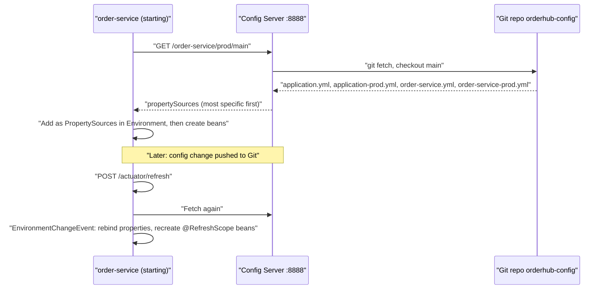
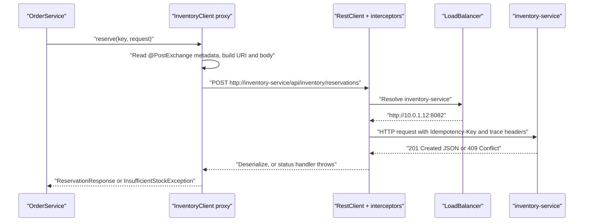

@@ 3 | TOPIC | Centralized Configuration | Spring Cloud Config Server, config import, precedence, refresh at runtime and secrets | SHOULD
# Centralized Configuration

**Level: Advanced | Phase 20 | Priority: SHOULD | Since: Spring Cloud Config 1.0 (2015); `spring.config.import` since Boot 2.4**

> **30-second interview answer:** With many services and environments, copying `application.yml` into every service is error-prone, so configuration is externalized to one place. Spring Cloud Config Server serves properties from a Git repository (or Vault, a database, the file system) per application name, profile and label, and each service pulls them at startup with `spring.config.import=configserver:`. Values can be refreshed at runtime through `@RefreshScope` and `@ConfigurationProperties` rebinding, triggered by `/actuator/refresh` or Spring Cloud Bus. Secrets go to Vault or are encrypted with `{cipher}`. On Kubernetes, ConfigMaps and Secrets are the common alternative.

## 1. Concept in Simple Words
### Analogy
A franchise headquarters' operations manual.

| Franchise | Centralized config |
|---|---|
| Head office keeps one master manual | Config Server backed by a Git repository |
| General rules for every branch | `application.yml` shared by all services |
| Extra pages for the pizza branches only | `order-service.yml` for one service |
| Holiday-season page that overrides normal hours | Profile file `order-service-prod.yml` |
| Manual editions with dates | Git labels (branch, tag, commit) |
| Branch managers pick up the manual when they open | Services fetch config at startup |
| Head office calls "new page, re-read it now" | `/actuator/busrefresh` broadcast |
| The safe code is in a sealed envelope | Encrypted `{cipher}` values or Vault |

### What it is
- **Config Server:** a Spring Boot app with `@EnableConfigServer` that exposes HTTP endpoints like `GET /{application}/{profile}/{label}` returning property sources.
- **Backends:** Git (most common, gives history, review and rollback), native file system, HashiCorp Vault, JDBC, AWS Secrets Manager and Parameter Store, Redis.
- **Config client:** any service with `spring-cloud-starter-config` and `spring.config.import: configserver:http://config:8888`.
- **Refresh scope:** `@RefreshScope` beans are lazy proxies whose target is destroyed and re-created on refresh, so they pick up new values. JavaBean-style `@ConfigurationProperties` beans are rebound in place.
- **Spring Cloud Bus:** links instances over Kafka or RabbitMQ so one `/actuator/busrefresh` call refreshes all of them.

### Why it exists
Twenty services times four environments means eighty config files. Changing a shared value (Kafka brokers, a feature flag, a timeout) by rebuilding and redeploying every service is slow and risky, and secrets end up committed in many repositories. Centralized config gives one audited source of truth, environment-specific overrides and changes without redeploys.

## 2. How It Works


**Precedence** (highest first) for `order-service` with profile `prod`:

```text
1. order-service-prod.yml      (service + profile)
2. order-service.yml           (service)
3. application-prod.yml        (all services, profile)
4. application.yml             (all services)
Remote config beats the service's own packaged application.yml by default,
but command-line args and environment variables can still override it
when spring.cloud.config.override-none or allow-override settings permit.
```

What refresh actually does: `ContextRefresher` re-reads the config sources, computes changed keys, publishes `EnvironmentChangeEvent` (which makes `ConfigurationPropertiesRebinder` rebind mutable `@ConfigurationProperties` beans), then calls `RefreshScope.refreshAll()`, which drops the cached targets of `@RefreshScope` proxies so the next method call creates a fresh bean. Beans that are not refreshable keep old values: a `DataSource` URL change still needs a restart.

## 3. Code Example
### Code
Config Server, the Git repository content, and order-service consuming and refreshing values.

```xml
<!-- config-server/pom.xml (Spring Cloud BOM 2025.0.0 imported) -->
<dependency>
    <groupId>org.springframework.cloud</groupId>
    <artifactId>spring-cloud-config-server</artifactId>
</dependency>

<!-- order-service/pom.xml -->
<dependency>
    <groupId>org.springframework.cloud</groupId>
    <artifactId>spring-cloud-starter-config</artifactId>
</dependency>
<dependency>
    <groupId>org.springframework.boot</groupId>
    <artifactId>spring-boot-starter-actuator</artifactId>
</dependency>
```

```java
// config-server/src/main/java/com/orderhub/config/ConfigServerApplication.java
package com.orderhub.config;

import org.springframework.boot.SpringApplication;
import org.springframework.boot.autoconfigure.SpringBootApplication;
import org.springframework.cloud.config.server.EnableConfigServer;

@SpringBootApplication
@EnableConfigServer
public class ConfigServerApplication {
    public static void main(String[] args) {
        SpringApplication.run(ConfigServerApplication.class, args);
    }
}
```

```yaml
# config-server/src/main/resources/application.yml
server:
  port: 8888
spring:
  application:
    name: config-server
  cloud:
    config:
      server:
        git:
          uri: https://github.com/orderhub/orderhub-config
          default-label: main
          search-paths: "{application}"     # one folder per service plus shared files at root
          clone-on-start: true              # fail at startup if Git is unreachable
          username: ${GIT_USER}
          password: ${GIT_TOKEN}
encrypt:
  key: ${CONFIG_ENCRYPT_KEY}                # symmetric key for {cipher} values
```

```yaml
# orderhub-config repo: application.yml (shared by every service)
spring:
  kafka:
    bootstrap-servers: kafka:9092
management:
  endpoints:
    web:
      exposure:
        include: health,info,refresh
```

```yaml
# orderhub-config repo: order-service/order-service.yml
orderhub:
  orders:
    max-lines-per-order: 20
    free-shipping-threshold: 50.00
  features:
    gift-wrap-enabled: false
```

```yaml
# orderhub-config repo: order-service/order-service-prod.yml
orderhub:
  orders:
    max-lines-per-order: 50
spring:
  datasource:
    password: '{cipher}AQB3f6c2b1e9d0a7c5e4f3a2b1c0d9e8f7a6b5c4d3e2f1a0b9c8d7e6f5a4b3c2'
```

```yaml
# order-service/src/main/resources/application.yml
spring:
  application:
    name: order-service                     # selects order-service*.yml in the repo
  profiles:
    active: prod
  config:
    import: "optional:configserver:http://localhost:8888"
  cloud:
    config:
      fail-fast: true                       # in prod: do not start with missing config
      retry:
        max-attempts: 6                     # needs spring-retry on the classpath
```

```java
// order-service: mutable @ConfigurationProperties are rebound on refresh
package com.orderhub.order.config;

import java.math.BigDecimal;
import org.springframework.boot.context.properties.ConfigurationProperties;
import org.springframework.stereotype.Component;

@Component
@ConfigurationProperties(prefix = "orderhub.orders")
public class OrderProperties {
    private int maxLinesPerOrder = 10;
    private BigDecimal freeShippingThreshold = new BigDecimal("100.00");

    public int getMaxLinesPerOrder() { return maxLinesPerOrder; }
    public void setMaxLinesPerOrder(int maxLinesPerOrder) { this.maxLinesPerOrder = maxLinesPerOrder; }
    public BigDecimal getFreeShippingThreshold() { return freeShippingThreshold; }
    public void setFreeShippingThreshold(BigDecimal v) { this.freeShippingThreshold = v; }
}
```

```java
// order-service: a @RefreshScope bean using @Value
package com.orderhub.order.config;

import java.util.Map;
import org.springframework.beans.factory.annotation.Value;
import org.springframework.cloud.context.config.annotation.RefreshScope;
import org.springframework.web.bind.annotation.GetMapping;
import org.springframework.web.bind.annotation.RestController;

@RestController
@RefreshScope                                         // proxy; target recreated after refresh
class FeatureController {
    private final OrderProperties orders;

    @Value("${orderhub.features.gift-wrap-enabled:false}")
    private boolean giftWrapEnabled;

    FeatureController(OrderProperties orders) { this.orders = orders; }

    @GetMapping("/api/features")
    Map<String, Object> features() {
        return Map.of("giftWrapEnabled", giftWrapEnabled,
                      "maxLinesPerOrder", orders.getMaxLinesPerOrder(),
                      "freeShippingThreshold", orders.getFreeShippingThreshold());
    }
}
```

### Walkthrough
- The Config Server clones the Git repository at startup and looks for files in the root and in a folder named after the requesting application (`search-paths: "{application}"`).
- `encrypt.key` enables `/encrypt` and `/decrypt` endpoints; values stored as `{cipher}` are decrypted by the server before they are sent (or by the client if `spring.cloud.config.server.encrypt.enabled=false`). Protect these endpoints.
- `spring.config.import` is the Boot 2.4+ way to load remote config (the old `bootstrap.yml` needs `spring-cloud-starter-bootstrap` and is legacy). `optional:` lets the service start without the server in development; `fail-fast` with retry makes production start-up strict but tolerant of a slow server.
- `OrderProperties` is a JavaBean-style properties class, so `ConfigurationPropertiesRebinder` can rebind it in place. Constructor-bound records are immutable and are not rebound; restart or put the consumer in `@RefreshScope`.
- `FeatureController` is `@RefreshScope`, so its `@Value` field is re-injected after a refresh.

### Output
What the server returns:

```http
GET http://localhost:8888/order-service/prod

HTTP/1.1 200 OK
Content-Type: application/json

{
  "name": "order-service",
  "profiles": ["prod"],
  "label": "main",
  "version": "9c1e4b7a2f",
  "propertySources": [
    {"name": "https://github.com/orderhub/orderhub-config/order-service/order-service-prod.yml",
     "source": {"orderhub.orders.max-lines-per-order": 50, "spring.datasource.password": "s3cret-db-pass"}},
    {"name": "https://github.com/orderhub/orderhub-config/order-service/order-service.yml",
     "source": {"orderhub.orders.max-lines-per-order": 20, "orderhub.orders.free-shipping-threshold": 50.00,
                "orderhub.features.gift-wrap-enabled": false}},
    {"name": "https://github.com/orderhub/orderhub-config/application.yml",
     "source": {"spring.kafka.bootstrap-servers": "kafka:9092",
                "management.endpoints.web.exposure.include": "health,info,refresh"}}
  ]
}
```

Before and after changing `gift-wrap-enabled: true` in Git and refreshing:

```http
GET http://localhost:8081/api/features
{"giftWrapEnabled":false,"maxLinesPerOrder":50,"freeShippingThreshold":50.00}

POST http://localhost:8081/actuator/refresh
HTTP/1.1 200 OK
["orderhub.features.gift-wrap-enabled"]

GET http://localhost:8081/api/features
{"giftWrapEnabled":true,"maxLinesPerOrder":50,"freeShippingThreshold":50.00}
```

### Compare
| Config baked into each JAR | Centralized config |
|---|---|
| Change means rebuild and redeploy | Change in Git, refresh or restart |
| Secrets copied into many repos | Secrets in Vault or encrypted once |
| No history of who changed a timeout | Git history, pull-request review |
| Environments drift apart | Shared base plus explicit overrides |

## 4. Interview Questions
**Basic**
1. **What is Spring Cloud Config?**
   A server and client pair for externalized configuration. The server serves properties per application, profile and label from a backend such as Git or Vault; clients load them at startup through `spring.config.import`.
2. **In which order are config files applied?**
   Service-plus-profile (`order-service-prod.yml`) beats service (`order-service.yml`), which beats shared-plus-profile (`application-prod.yml`), which beats shared (`application.yml`). Remote properties override the jar's own `application.yml`.
3. **How do you change a value without restarting?**
   Use `@RefreshScope` beans or JavaBean-style `@ConfigurationProperties`, change the value in the backend, then call `POST /actuator/refresh` on each instance, or `/actuator/busrefresh` once with Spring Cloud Bus.

**Follow-up**
4. **How does `@RefreshScope` work internally?**
   The bean is registered in a custom scope and injected as a proxy. On refresh the scope's cache is cleared; the next call through the proxy creates a new target bean with the new values. Existing references stay valid because they point to the proxy.
5. **How do you handle secrets?**
   Prefer a secrets manager (Vault via Spring Cloud Vault, AWS Secrets Manager, Kubernetes Secrets with encryption at rest). With Config Server, use `{cipher}` values with a key held only by the server. Never commit plain secrets and never expose `/decrypt` publicly.
6. **What happens if the Config Server is down when a service starts?**
   With `optional:` the service starts with local defaults, which can be dangerous in production. With `fail-fast: true` and retry, startup waits and then fails clearly. Run the Config Server highly available, or have it serve from a local clone if Git is down.

**Tricky / scenario**
7. **You refreshed the database URL but the service still talks to the old database. Why?**
   The `DataSource` (HikariCP pool) was created at startup and is not refreshable; refresh only rebinds properties and recreates refresh-scoped beans. Infrastructure like pools, Kafka consumers and caches need a restart (a rolling restart in production).
8. **After `/actuator/refresh`, half the instances show the new feature flag and half the old one. What happened?**
   `/actuator/refresh` only refreshes the instance that received it, and the load balancer sent it to one instance. Use Spring Cloud Bus (`/actuator/busrefresh`) to broadcast, or a rolling restart, or a feature-flag service designed for this.
9. **Config Server vs Kubernetes ConfigMaps: which do you choose?**
   On Kubernetes, ConfigMaps and Secrets mounted as files (`spring.config.import: configtree:/etc/config/`) or env vars are simpler and need no extra server; reloading usually means a rolling restart. Config Server adds Git history, encryption and runtime refresh across platforms. Many teams on Kubernetes skip Config Server; teams on VMs or mixed platforms use it.

**What the interviewer is really testing:** whether you know the precedence rules, what refresh can and cannot change, and how to keep secrets out of Git.

## 5. Pitfalls & Best Practices
### Common mistakes
| Mistake | What goes wrong | Fix |
|---|---|---|
| Plain-text secrets in the config repo | Leaked credentials | Vault or `{cipher}` values |
| Expecting refresh to rebuild the DataSource | Old connections stay | Rolling restart for infrastructure settings |
| Calling `/actuator/refresh` through the load balancer | Only one instance refreshed | Spring Cloud Bus or per-instance calls |
| Using `bootstrap.yml` without the bootstrap starter | Remote config silently ignored | `spring.config.import` |
| `optional:` in production | Service runs with wrong defaults | `fail-fast: true` plus retry |
| Exposing `/actuator/refresh` publicly | Anyone can trigger refreshes | Management port or security |

### Best practices
- Keep config in Git with pull-request review and a clear folder per service.
- Use profiles for environments, not separate branches per service.
- Validate properties with `@Validated` on `@ConfigurationProperties` so a bad value fails fast.
- Pin a label (tag or commit) for production so a merge to main does not change prod silently.
- Document which properties are refreshable and which need a restart.

### Compare with
| Approach | Runtime refresh | Secrets | Best fit |
|---|---|---|---|
| Spring Cloud Config Server | Yes, via refresh or bus | `{cipher}` or Vault backend | VMs, mixed platforms, Git-centric teams |
| Kubernetes ConfigMap and Secret | Usually restart | K8s Secrets (enable encryption at rest) | Kubernetes-only |
| HashiCorp Vault (Spring Cloud Vault) | Leases and rotation | First-class | Dynamic secrets, compliance |
| Cloud parameter stores (AWS, Azure) | Polling or restart | Integrated KMS | Single-cloud setups |
| Environment variables | Restart | Visible in process listings | Twelve-factor simple apps |

## 6. Hands-on Exercise
Add a `notification-service` setting `orderhub.notifications.channels` (a list: `EMAIL`, `SMS`) to the config repo, default `[EMAIL]` and `[EMAIL, SMS]` in `prod`. Bind it to a validated `NotificationProperties` class that rejects an empty list, and make it refreshable.

Acceptance criteria: in `prod` the service logs both channels at startup; changing the list in Git and calling `/actuator/refresh` changes the channels used for the next notification; an empty list makes startup fail.

<details><summary>Solution</summary>

```yaml
# orderhub-config repo: notification-service/notification-service.yml
orderhub:
  notifications:
    channels: [EMAIL]
```

```yaml
# orderhub-config repo: notification-service/notification-service-prod.yml
orderhub:
  notifications:
    channels: [EMAIL, SMS]
```

```java
package com.orderhub.notification.config;

import jakarta.validation.constraints.NotEmpty;
import java.util.ArrayList;
import java.util.List;
import org.springframework.boot.context.properties.ConfigurationProperties;
import org.springframework.stereotype.Component;
import org.springframework.validation.annotation.Validated;

@Component
@Validated
@ConfigurationProperties(prefix = "orderhub.notifications")
public class NotificationProperties {
    public enum Channel { EMAIL, SMS }

    @NotEmpty
    private List<Channel> channels = new ArrayList<>();

    public List<Channel> getChannels() { return channels; }
    public void setChannels(List<Channel> channels) { this.channels = channels; }
}
```

```java
package com.orderhub.notification;

import com.orderhub.notification.config.NotificationProperties;
import org.slf4j.Logger;
import org.slf4j.LoggerFactory;
import org.springframework.boot.context.event.ApplicationReadyEvent;
import org.springframework.context.event.EventListener;
import org.springframework.stereotype.Service;

@Service
class NotificationDispatcher {
    private static final Logger log = LoggerFactory.getLogger(NotificationDispatcher.class);
    private final NotificationProperties props;

    NotificationDispatcher(NotificationProperties props) { this.props = props; }

    @EventListener(ApplicationReadyEvent.class)
    void logChannels() { log.info("Notification channels: {}", props.getChannels()); }

    void dispatch(long customerId, String message) {
        // read on every call, so a rebind after refresh is picked up immediately
        for (NotificationProperties.Channel channel : props.getChannels()) {
            log.info("Sending via {} to customer {}: {}", channel, customerId, message);
        }
    }
}
```
Needs `spring-boot-starter-validation`. Because the dispatcher reads `props.getChannels()` on each call instead of copying the list in its constructor, the rebound values are used without `@RefreshScope`.
</details>

## 7. Recall
Q: How does a Spring Boot 3 service load configuration from Spring Cloud Config Server?
A: With `spring.config.import: configserver:http://host:8888`, optionally prefixed with `optional:`.

Q: In Spring Cloud Config, which file wins for order-service in profile prod?
A: `order-service-prod.yml`, then `order-service.yml`, then `application-prod.yml`, then `application.yml`.

Q: How does `@RefreshScope` pick up new configuration values?
A: The bean is a proxy; on refresh its cached target is discarded and the next call creates a new target with the new values.

Q: Why doesn't `/actuator/refresh` change the database connection URL?
A: The connection pool was built at startup and is not refreshable; infrastructure beans need a restart.

Q: What does Spring Cloud Bus add to Spring Cloud Config?
A: It broadcasts a refresh event over Kafka or RabbitMQ so all instances refresh from a single `/actuator/busrefresh` call.

**Related:** [[Service Discovery]] · [[Kubernetes Basics for Spring Developers]] · [[Spring Boot Actuator]]

@@ 3 | TOPIC | Service-to-Service Calls: OpenFeign and HTTP Interfaces | Declarative HTTP clients, timeouts, error decoding, load balancing and idempotency for synchronous calls | MUST
# Service-to-Service Calls: OpenFeign and HTTP Interfaces

**Level: Advanced | Phase 20 | Priority: MUST | Since: Spring Cloud OpenFeign (2016, feature-complete since 2022); HTTP Interfaces since Spring Framework 6.0, `RestClient` support since 6.1**

> **30-second interview answer:** For synchronous calls between services I write a Java interface annotated with the endpoint mappings and let a proxy implement the HTTP call. Spring Cloud OpenFeign does this with `@FeignClient`; the modern built-in option is HTTP Interfaces (`@HttpExchange`, `@GetExchange`) backed by `RestClient`, which the Spring team now recommends since OpenFeign is in maintenance mode. Either way, the important parts are not the annotations but the production concerns: connect and read timeouts, mapping error statuses to exceptions, load balancing by service name, retries only for idempotent calls, and wrapping the call with a circuit breaker.

## 1. Concept in Simple Words
### Analogy
A speed-dial button on an office phone.

| Office phone | Declarative HTTP client |
|---|---|
| Button labelled "Warehouse" | Interface method `reserve(key, request)` |
| The phone dials the number for you | Proxy builds and sends the HTTP request |
| Switchboard finds a free line at the warehouse | Load balancer picks an inventory instance |
| You hang up if nobody answers in 20 seconds | Read timeout |
| "Out of stock" answer is written on a standard form | Error decoder maps 409 to `InsufficientStockException` |
| Reference number on your request so the warehouse ignores a repeated call | Idempotency key header |

### What it is
- **Declarative client:** you declare *what* to call (an interface with method, path, headers, body); a generated proxy does *how* (serialization, HTTP, deserialization).
- **OpenFeign:** Netflix-originated library; Spring Cloud OpenFeign integrates it with Spring MVC annotations (`@GetMapping`, `@PathVariable`), Spring Cloud LoadBalancer and Spring Cloud CircuitBreaker. Enabled with `@EnableFeignClients`.
- **HTTP Interface:** Spring Framework's own declarative client. Annotations `@HttpExchange`, `@GetExchange`, `@PostExchange`, `@PutExchange`, `@DeleteExchange`, `@PatchExchange`. A `HttpServiceProxyFactory` creates the proxy over a `RestClient` (blocking) or `WebClient` (reactive). In `Boot 4` (Framework 7), `@ImportHttpServices` registers such clients without manual factory code.
- **Idempotency key:** a unique request id sent in a header; the server stores it and returns the same result for repeats, which makes retries of POST safe.

### Why it exists
Writing `restTemplate.exchange(url, HttpMethod.POST, new HttpEntity<>(body, headers), Response.class)` for every call spreads URL building, error handling and serialization across the codebase. A declarative interface is a typed contract in one place, easy to mock in tests and easy to decorate with timeouts, retries and tracing.

## 2. How It Works


Behind the annotations:
- `@EnableFeignClients` registers a `FeignClientFactoryBean` per `@FeignClient` interface. Each client gets its own child application context (named after the client) holding its `Encoder`, `Decoder`, `ErrorDecoder`, `Retryer` and `Logger.Level`.
- `HttpServiceProxyFactory` uses a JDK dynamic proxy (Phase 18). Each method call goes to `HttpServiceMethod`, which reads the annotations once and builds a `RestClient` request.
- Load balancing: Feign uses Spring Cloud LoadBalancer automatically when `name` is a service id and no `url` is set. For HTTP Interfaces, build the `RestClient` from a `@LoadBalanced` builder.
- Default timeouts are dangerous: OpenFeign's default read timeout is 60 seconds and the JDK `HttpURLConnection` default is infinite. Always configure them.

## 3. Code Example
### Code
order-service calling inventory-service, first with an HTTP Interface (recommended), then the same contract with OpenFeign.

```java
// order-service/src/main/java/com/orderhub/order/client/InventoryDtos.java
package com.orderhub.order.client;

import java.util.List;

public final class InventoryDtos {
    private InventoryDtos() { }

    public record ReserveLine(String sku, int quantity) { }
    public record ReserveRequest(long orderId, List<ReserveLine> lines) { }
    public record ReservationResponse(String reservationId, long orderId, String status) { }
    public record StockView(String sku, int available) { }

    public static class InsufficientStockException extends RuntimeException {
        public InsufficientStockException(String message) { super(message); }
    }
    public static class InventoryUnavailableException extends RuntimeException {
        public InventoryUnavailableException(String message, Throwable cause) { super(message, cause); }
    }
}
```

```java
// order-service/src/main/java/com/orderhub/order/client/InventoryClient.java
package com.orderhub.order.client;

import com.orderhub.order.client.InventoryDtos.ReservationResponse;
import com.orderhub.order.client.InventoryDtos.ReserveRequest;
import com.orderhub.order.client.InventoryDtos.StockView;
import org.springframework.web.bind.annotation.PathVariable;
import org.springframework.web.bind.annotation.RequestBody;
import org.springframework.web.bind.annotation.RequestHeader;
import org.springframework.web.service.annotation.DeleteExchange;
import org.springframework.web.service.annotation.GetExchange;
import org.springframework.web.service.annotation.HttpExchange;
import org.springframework.web.service.annotation.PostExchange;

@HttpExchange("/api/inventory")
public interface InventoryClient {

    @PostExchange("/reservations")
    ReservationResponse reserve(@RequestHeader("Idempotency-Key") String idempotencyKey,
                                @RequestBody ReserveRequest request);

    @DeleteExchange("/reservations/{orderId}")
    void release(@PathVariable long orderId);                 // compensation

    @GetExchange("/items/{sku}")
    StockView stock(@PathVariable String sku);
}
```

```java
// order-service/src/main/java/com/orderhub/order/client/InventoryClientConfig.java
package com.orderhub.order.client;

import com.orderhub.order.client.InventoryDtos.InsufficientStockException;
import java.nio.charset.StandardCharsets;
import java.time.Duration;
import org.springframework.beans.factory.annotation.Value;
import org.springframework.boot.autoconfigure.web.client.RestClientBuilderConfigurer;
import org.springframework.cloud.client.loadbalancer.LoadBalanced;
import org.springframework.context.annotation.Bean;
import org.springframework.context.annotation.Configuration;
import org.springframework.http.HttpStatus;
import org.springframework.http.client.SimpleClientHttpRequestFactory;
import org.springframework.web.client.RestClient;
import org.springframework.web.client.support.RestClientAdapter;
import org.springframework.web.service.invoker.HttpServiceProxyFactory;

@Configuration
class InventoryClientConfig {

    @Bean
    @LoadBalanced
    RestClient.Builder loadBalancedBuilder(RestClientBuilderConfigurer configurer) {
        // keeps Boot's message converters and observation (tracing) setup
        return configurer.configure(RestClient.builder());
    }

    @Bean
    InventoryClient inventoryClient(@LoadBalanced RestClient.Builder builder,
                                    @Value("${inventory.base-url}") String baseUrl) {
        SimpleClientHttpRequestFactory factory = new SimpleClientHttpRequestFactory();
        factory.setConnectTimeout(Duration.ofSeconds(1));      // TCP connect
        factory.setReadTimeout(Duration.ofSeconds(2));         // waiting for the response

        RestClient restClient = builder
                .baseUrl(baseUrl)                              // http://inventory-service
                .requestFactory(factory)
                .defaultStatusHandler(status -> status.value() == HttpStatus.CONFLICT.value(),
                        (request, response) -> {
                            String body = new String(response.getBody().readAllBytes(), StandardCharsets.UTF_8);
                            throw new InsufficientStockException(body);
                        })
                .build();

        return HttpServiceProxyFactory.builderFor(RestClientAdapter.create(restClient))
                .build()
                .createClient(InventoryClient.class);
    }
}
```

```yaml
# order-service application.yml
inventory:
  base-url: http://inventory-service
```

```java
// order-service/src/main/java/com/orderhub/order/OrderPlacementService.java
package com.orderhub.order;

import com.orderhub.order.client.InventoryClient;
import com.orderhub.order.client.InventoryDtos.ReserveLine;
import com.orderhub.order.client.InventoryDtos.ReserveRequest;
import com.orderhub.order.client.InventoryDtos.ReservationResponse;
import java.util.List;
import org.slf4j.Logger;
import org.slf4j.LoggerFactory;
import org.springframework.stereotype.Service;

@Service
public class OrderPlacementService {
    private static final Logger log = LoggerFactory.getLogger(OrderPlacementService.class);
    private final InventoryClient inventory;

    public OrderPlacementService(InventoryClient inventory) { this.inventory = inventory; }

    public ReservationResponse reserveFor(long orderId, List<ReserveLine> lines) {
        String key = "order-" + orderId;                       // same key on every retry
        ReservationResponse response = inventory.reserve(key, new ReserveRequest(orderId, lines));
        log.info("Reserved stock for order {}: {}", orderId, response.reservationId());
        return response;
    }
}
```

The same contract with Spring Cloud OpenFeign:

```xml
<dependency>
    <groupId>org.springframework.cloud</groupId>
    <artifactId>spring-cloud-starter-openfeign</artifactId>
</dependency>
```

```java
// order-service: Feign variant (put @EnableFeignClients on the application class)
package com.orderhub.order.client;

import com.orderhub.order.client.InventoryDtos.InsufficientStockException;
import com.orderhub.order.client.InventoryDtos.ReservationResponse;
import com.orderhub.order.client.InventoryDtos.ReserveRequest;
import com.orderhub.order.client.InventoryDtos.StockView;
import feign.Logger;
import feign.codec.ErrorDecoder;
import org.springframework.cloud.openfeign.FeignClient;
import org.springframework.context.annotation.Bean;
import org.springframework.web.bind.annotation.GetMapping;
import org.springframework.web.bind.annotation.PathVariable;
import org.springframework.web.bind.annotation.PostMapping;
import org.springframework.web.bind.annotation.RequestBody;
import org.springframework.web.bind.annotation.RequestHeader;

@FeignClient(name = "inventory-service", path = "/api/inventory",
             configuration = InventoryFeignClient.Config.class)
public interface InventoryFeignClient {

    @PostMapping("/reservations")
    ReservationResponse reserve(@RequestHeader("Idempotency-Key") String key,
                                @RequestBody ReserveRequest request);

    @GetMapping("/items/{sku}")
    StockView stock(@PathVariable("sku") String sku);

    class Config {                                            // not @Configuration: per-client only
        @Bean
        ErrorDecoder errorDecoder() {
            ErrorDecoder fallback = new ErrorDecoder.Default();
            return (methodKey, response) -> response.status() == 409
                    ? new InsufficientStockException("Insufficient stock (" + methodKey + ")")
                    : fallback.decode(methodKey, response);
        }

        @Bean
        Logger.Level feignLoggerLevel() { return Logger.Level.BASIC; }
    }
}
```

```yaml
spring:
  cloud:
    openfeign:
      client:
        config:
          inventory-service:
            connect-timeout: 1000     # ms
            read-timeout: 2000        # ms (default would be 60 s)
logging:
  level:
    com.orderhub.order.client.InventoryFeignClient: DEBUG   # Feign logs at DEBUG
```

### Walkthrough
- The DTO records are the contract. They live in order-service (a copy of inventory's API, not a shared library) so the two services can be released independently; consumer-driven contract tests keep them honest.
- `InventoryClient` declares three operations. Spring creates a JDK proxy that turns `reserve(key, req)` into `POST /api/inventory/reservations` with a JSON body and the `Idempotency-Key` header.
- `loadBalancedBuilder` starts from Boot's configured builder (converters, observation for tracing) and adds `@LoadBalanced`, so `http://inventory-service` is resolved through discovery.
- The request factory sets 1-second connect and 2-second read timeouts. Without them, a hung inventory instance would hold order-service threads forever.
- `defaultStatusHandler` maps 409 to a domain exception; other 4xx and 5xx statuses still raise `HttpClientErrorException` or `HttpServerErrorException`.
- The idempotency key is derived from the order id, so if Resilience4j retries after a timeout, inventory recognizes the duplicate and returns the existing reservation.
- The Feign version is equivalent: per-client `Config` (not scanned) holds the error decoder and log level; timeouts come from `spring.cloud.openfeign.client.config.<name>`.

### Output
```http
POST http://localhost:8081/api/orders
Content-Type: application/json

{"customerId":7,"lines":[{"sku":"BOOK-1","quantity":2}]}

HTTP/1.1 201 Created
{"id":42,"status":"CONFIRMED","reservationId":"res-8f31"}
```

order-service log (HTTP Interface variant):

```text
INFO  c.o.order.OrderPlacementService : Reserved stock for order 42: res-8f31
```

Feign variant with `Logger.Level.BASIC`:

```text
DEBUG c.o.o.client.InventoryFeignClient : [InventoryFeignClient#reserve] ---> POST http://inventory-service/api/inventory/reservations HTTP/1.1
DEBUG c.o.o.client.InventoryFeignClient : [InventoryFeignClient#reserve] <--- HTTP/1.1 201 (14ms)
```

When stock is insufficient, inventory answers 409 and order-service returns its own error:

```http
HTTP/1.1 409 Conflict
Content-Type: application/problem+json

{"title":"Insufficient stock","status":409,"detail":"sku BOOK-1: wanted 2, available 0"}
```

### Compare
| Option | Style | Status | Notes |
|---|---|---|---|
| `RestTemplate` | Imperative, template methods | Maintenance mode | Fine in old code, do not start new code with it |
| `RestClient` | Fluent, synchronous | Recommended (Spring 6.1+) | Great with virtual threads |
| `WebClient` | Fluent, reactive | Active | Use in WebFlux apps |
| HTTP Interface (`@HttpExchange`) | Declarative over RestClient or WebClient | Recommended | Built into Spring, no extra library |
| OpenFeign (`@FeignClient`) | Declarative, Spring MVC annotations | Feature-complete, maintenance | Common in existing codebases |

## 4. Interview Questions
**Basic**
1. **What is a declarative HTTP client?**
   You define an interface with annotated methods describing the endpoints, and a framework generates a proxy that performs the HTTP calls, serialization and error handling. It gives a typed contract instead of hand-built requests.
2. **OpenFeign vs HTTP Interfaces?**
   Both are declarative. OpenFeign is a Spring Cloud integration of a Netflix library with Spring MVC annotations and is now feature-complete. HTTP Interfaces are built into Spring Framework 6, use `@HttpExchange` annotations, run over `RestClient` or `WebClient`, and are the recommended choice for new code.
3. **How does a Feign client find the target service?**
   With `name = "inventory-service"` and no `url`, it uses Spring Cloud LoadBalancer, which asks the discovery client for instances and picks one.

**Follow-up**
4. **Why are timeouts essential on service calls?**
   Without them a slow downstream holds caller threads until the pool is exhausted, and the failure spreads up the chain (cascading failure). Set connect timeouts around 1 second and read timeouts based on the downstream's p99 latency, and keep the total under the caller's own timeout.
5. **How do you handle error responses?**
   Map them to domain exceptions in one place: a Feign `ErrorDecoder` or a `RestClient` status handler. Distinguish business errors (409 insufficient stock: do not retry) from transient errors (503, timeouts: retry with backoff, count toward the circuit breaker).
6. **How do you make a POST safe to retry?**
   Send an idempotency key (for example derived from the order id) and have the server store processed keys with their results. A repeated request returns the stored result instead of creating a second reservation.

**Tricky / scenario**
7. **Inventory had a 30-second GC pause and order-service stopped responding entirely. Why?**
   Calls to inventory had long or default timeouts (Feign defaults to 60 seconds), so all request threads blocked waiting. Fix with short timeouts, a circuit breaker to fail fast while inventory is unhealthy, and a bulkhead so inventory calls cannot consume all threads.
8. **Your Feign client config is applied to every Feign client, not just one. Why?**
   The per-client configuration class was annotated with `@Configuration` inside the component-scan path, so its beans went into the main context and became global defaults. Keep per-client config classes unannotated or outside the scanned packages.
9. **Should order-service and inventory-service share a DTO library?**
   Usually no. A shared library forces both to upgrade together and leaks internal models. Each consumer keeps its own copy of the parts of the contract it uses, and contract tests (Spring Cloud Contract, Pact) verify compatibility. A small shared library for stable event schemas can be acceptable if it is versioned carefully.

**What the interviewer is really testing:** that you treat a remote call as unreliable (timeouts, error mapping, idempotency) and know the current Spring recommendation for HTTP clients.

## 5. Pitfalls & Best Practices
### Common mistakes
| Mistake | What goes wrong | Fix |
|---|---|---|
| No timeouts configured | Thread exhaustion, cascading failure | Explicit connect and read timeouts |
| Retrying 4xx business errors | Wasted load, same result | Retry only transient errors |
| Retrying POST without idempotency | Duplicate reservations and charges | Idempotency keys |
| `@Configuration` on per-client Feign config | Applies to all clients | Unannotated config class |
| Building `RestClient.builder()` from scratch | Loses tracing and Boot converters | Use `RestClientBuilderConfigurer` or inject Boot's builder |
| Chains of synchronous calls | Latency and failure multiply | Async events for non-critical steps |

### Best practices
- One client interface per downstream service, in a `client` package, with its own DTOs.
- Wrap clients with Resilience4j (timeouts, circuit breaker, retry with backoff and jitter).
- Propagate trace context automatically by using Boot-configured builders (Micrometer observation).
- Mock the interface in unit tests; use WireMock or MockRestServiceServer in integration tests.
- Prefer HTTP Interfaces for new code; keep Feign where it already works.

### Compare with
| Communication | Coupling | Use when |
|---|---|---|
| Synchronous HTTP (HTTP Interface, Feign) | Temporal: both must be up | The caller needs the answer now (reserve stock, price check) |
| gRPC | Temporal, binary contract | High-throughput internal calls, streaming |
| Asynchronous events (Kafka) | Loose, eventual | The caller does not need to wait (notifications, analytics) |
| Request-reply over messaging | Loose, but complex | Long-running work with a reply later |

## 6. Hands-on Exercise
In order-service, add a call to inventory's `GET /api/inventory/items/{sku}` used by a new endpoint `GET /api/orders/availability?sku=BOOK-1`. Requirements: HTTP Interface client reused from this topic; a 404 from inventory becomes a `200` with `available: 0` and `known: false`; write a test with `MockRestServiceServer` that verifies the 404 handling.

Acceptance criteria: known SKU returns `{"sku":"BOOK-1","available":5,"known":true}`; unknown SKU returns `{"sku":"NOPE","available":0,"known":false}`; the test passes without inventory running.

<details><summary>Solution</summary>

```java
package com.orderhub.order;

import com.orderhub.order.client.InventoryClient;
import com.orderhub.order.client.InventoryDtos.StockView;
import org.springframework.web.bind.annotation.GetMapping;
import org.springframework.web.bind.annotation.RequestParam;
import org.springframework.web.bind.annotation.RestController;
import org.springframework.web.client.HttpClientErrorException;

@RestController
class AvailabilityController {
    record Availability(String sku, int available, boolean known) { }

    private final InventoryClient inventory;

    AvailabilityController(InventoryClient inventory) { this.inventory = inventory; }

    @GetMapping("/api/orders/availability")
    Availability availability(@RequestParam String sku) {
        try {
            StockView view = inventory.stock(sku);
            return new Availability(view.sku(), view.available(), true);
        } catch (HttpClientErrorException.NotFound e) {
            return new Availability(sku, 0, false);
        }
    }
}
```

```java
package com.orderhub.order;

import static org.assertj.core.api.Assertions.assertThat;
import static org.springframework.test.web.client.match.MockRestRequestMatchers.requestTo;
import static org.springframework.test.web.client.response.MockRestResponseCreators.withStatus;
import static org.springframework.test.web.client.response.MockRestResponseCreators.withSuccess;

import com.orderhub.order.client.InventoryClient;
import org.junit.jupiter.api.Test;
import org.springframework.http.HttpStatus;
import org.springframework.http.MediaType;
import org.springframework.test.web.client.MockRestServiceServer;
import org.springframework.web.client.RestClient;
import org.springframework.web.client.support.RestClientAdapter;
import org.springframework.web.service.invoker.HttpServiceProxyFactory;

class AvailabilityControllerTest {

    @Test
    void unknownSkuIsReportedAsZero() {
        RestClient.Builder builder = RestClient.builder().baseUrl("http://inventory-service");
        MockRestServiceServer server = MockRestServiceServer.bindTo(builder).build();
        server.expect(requestTo("http://inventory-service/api/inventory/items/NOPE"))
              .andRespond(withStatus(HttpStatus.NOT_FOUND));
        server.expect(requestTo("http://inventory-service/api/inventory/items/BOOK-1"))
              .andRespond(withSuccess("{\"sku\":\"BOOK-1\",\"available\":5}", MediaType.APPLICATION_JSON));

        InventoryClient client = HttpServiceProxyFactory
                .builderFor(RestClientAdapter.create(builder.build()))
                .build().createClient(InventoryClient.class);
        AvailabilityController controller = new AvailabilityController(client);

        assertThat(controller.availability("NOPE"))
                .isEqualTo(new AvailabilityController.Availability("NOPE", 0, false));
        assertThat(controller.availability("BOOK-1"))
                .isEqualTo(new AvailabilityController.Availability("BOOK-1", 5, true));
        server.verify();
    }
}
```
`MockRestServiceServer.bindTo(builder)` replaces the builder's request factory with a mock, so the real HTTP Interface proxy runs end to end without a network.
</details>

## 7. Recall
Q: What does Spring recommend for new declarative HTTP clients instead of OpenFeign?
A: HTTP Interfaces: interfaces annotated with `@HttpExchange` or `@GetExchange`, proxied by `HttpServiceProxyFactory` over `RestClient` or `WebClient`.

Q: What is the default read timeout risk with OpenFeign or `HttpURLConnection`?
A: Feign defaults to 60 seconds and `HttpURLConnection` to infinite, so a slow downstream can exhaust caller threads; always set timeouts.

Q: How do you map an HTTP 409 from a downstream to a domain exception with `RestClient`?
A: Register a `defaultStatusHandler` (or `onStatus`) that throws the domain exception for that status.

Q: How do you make retries of a POST service call safe?
A: Send an idempotency key that the server stores, so duplicates return the original result instead of repeating the action.

Q: How does an HTTP Interface client get load balancing by service name?
A: Build its `RestClient` from a `@LoadBalanced` `RestClient.Builder` with a base URL like `http://inventory-service`.

**Related:** [[Service Discovery]] · [[Resilience4j: Circuit Breaker, Retry, Rate Limiter, Bulkhead]] · [[Distributed Transactions, Saga and Outbox]]
