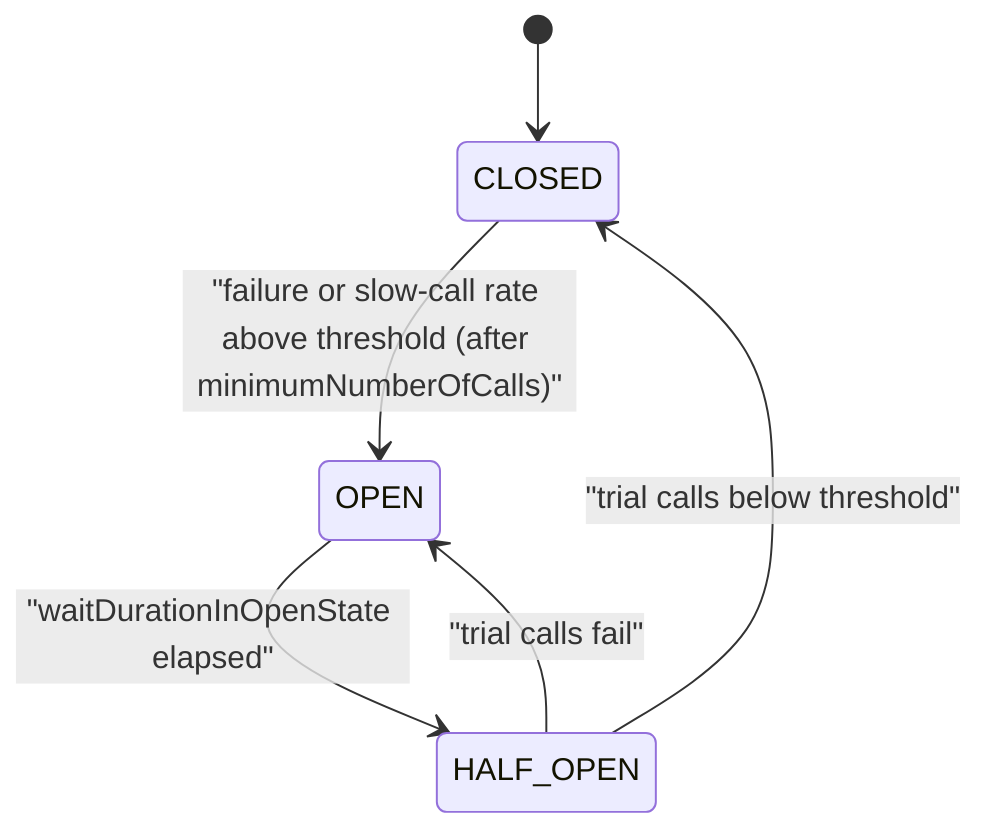
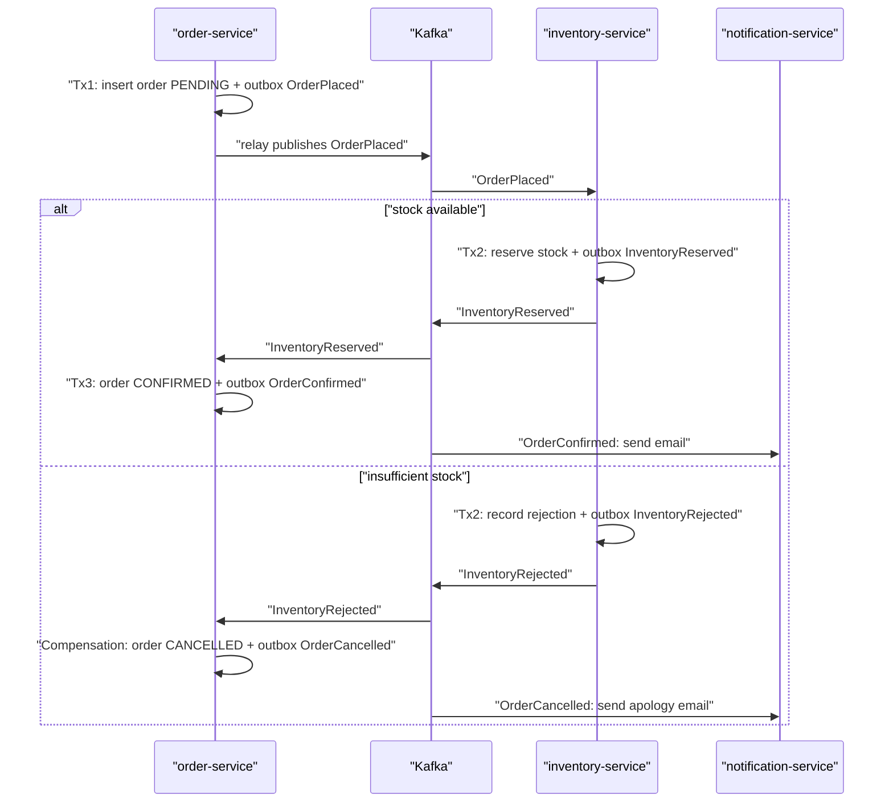

@@ 2 | MODULE | Reliability | Surviving partial failure and keeping data consistent across services | MUST
# Reliability

**Shared analogy: an electrical system in a house.** A **circuit breaker** trips when an appliance shorts, so one broken kettle does not burn the house down; you reset it after a while to test whether the fault is gone (Resilience4j circuit breaker with its half-open state). **Separate fuses per room** keep a fault in the kitchen from darkening the bedroom (bulkhead). And when a job spans several rooms, like rewiring, you cannot "undo" all rooms at once by magic; you keep a written plan with an undo step for each room (saga with compensations) and a logbook written at the same moment as the work, so nothing is forgotten if the power cuts (transactional outbox). These two topics are what turn a set of services into a system that degrades gracefully instead of collapsing.

@@ 3 | TOPIC | Resilience4j: Circuit Breaker, Retry, Rate Limiter, Bulkhead | Fault-tolerance patterns that stop cascading failures, configured with Spring Boot annotations | MUST
# Resilience4j: Circuit Breaker, Retry, Rate Limiter, Bulkhead

**Level: Advanced | Phase 20 | Priority: MUST | Since: Resilience4j 1.0 (2019), successor of Netflix Hystrix; `resilience4j-spring-boot3` for Boot 3**

> **30-second interview answer:** Resilience4j is a lightweight fault-tolerance library that decorates calls with patterns. A circuit breaker counts failures and slow calls in a sliding window and, above a threshold, opens to fail fast for a while, then half-opens to test recovery. Retry re-runs transient failures with backoff. A rate limiter caps calls per period, a bulkhead caps concurrent calls, and a time limiter caps duration. In Spring Boot I configure instances in YAML and apply them with annotations like `@CircuitBreaker(name = "inventory", fallbackMethod = "reserveFallback")`; the aspects run in a fixed order with Retry outermost, which matters for where the fallback goes.

## 1. Concept in Simple Words
### Analogy
A busy restaurant that orders from a supplier by phone.

| Restaurant | Resilience4j |
|---|---|
| The supplier keeps not answering; the manager says "stop calling for 10 minutes" | Circuit breaker opens |
| After 10 minutes, one waiter tries a single test call | Half-open state with a few permitted calls |
| The line was busy once; call again in a moment | Retry with backoff |
| "Never place more than 20 orders per minute with this supplier" | Rate limiter |
| Only 3 staff may be on the phone with suppliers at once; others keep serving guests | Bulkhead |
| Hang up if nobody answers in 20 seconds | Time limiter |
| "Sorry, the fish is off today, try the chicken" | Fallback |

### What it is
- **Cascading failure:** a slow or dead downstream holds threads in its callers, whose callers then stall, until the whole system is down.
- **Circuit breaker** states:
  - `CLOSED`: calls pass; outcomes are recorded in a sliding window (count-based: last N calls, or time-based: last N seconds).
  - `OPEN`: when the failure rate or slow-call rate exceeds the threshold (after a minimum number of calls), calls are rejected immediately with `CallNotPermittedException` for `waitDurationInOpenState`.
  - `HALF_OPEN`: a few trial calls are allowed; if they succeed the breaker closes, otherwise it opens again.
  - Also `DISABLED`, `FORCED_OPEN` and `METRICS_ONLY` for operations.
- **Retry:** repeats a failed call up to `maxAttempts` with a wait (fixed, exponential, or exponential with random jitter). Only for transient, idempotent operations.
- **Rate limiter:** allows `limitForPeriod` calls per `limitRefreshPeriod`; extra callers wait up to `timeoutDuration` then get `RequestNotPermitted`.
- **Bulkhead:** semaphore bulkhead limits concurrent calls (`maxConcurrentCalls`); thread-pool bulkhead runs calls on a dedicated bounded pool.
- **Time limiter:** cancels a `CompletableFuture` that takes longer than `timeoutDuration` (for synchronous code, rely on HTTP client timeouts).

### Why it exists
In a distributed system something is always failing. Without protection, one slow dependency eats all threads (no bulkhead, no timeout), retries from many clients hammer a struggling service (retry storm), and users wait 60 seconds for an error. Netflix Hystrix solved this first but went into maintenance in 2018; Resilience4j replaced it with a functional, modular design built for Java 8+ lambdas.

## 2. How It Works
State machine of the circuit breaker:



How the Spring annotations become decorators: `resilience4j-spring-boot3` registers aspects (needs AOP on the classpath). For a bean method carrying several annotations, the aspects nest in this default order:

```text
Retry ( CircuitBreaker ( RateLimiter ( TimeLimiter ( Bulkhead ( yourMethod ) ) ) ) )

outermost                                                         innermost
- Retry sees every failure that escapes the circuit breaker and may call again
- each retry attempt is a separate call recorded by the circuit breaker
- when the breaker is OPEN it throws CallNotPermittedException immediately
```

Consequences a senior engineer explains:
- **Put the fallback on the outermost annotation (Retry).** If the inner `@CircuitBreaker` has a fallback, it turns the exception into a normal return value and Retry never retries.
- **Do not retry `CallNotPermittedException`.** When the breaker is open, retrying just burns time; add it to the retry's `ignore-exceptions`.
- **Ignore business exceptions** (409 insufficient stock) in both retry and breaker, or a wave of legitimate "out of stock" answers will open the breaker.
- **Retry amplification:** 3 layers each retrying 3 times means up to 27 calls hit the bottom service for one user request. Retry at one layer only, with exponential backoff and jitter.
- Because these are Spring AOP proxies, self-invocation (`this.reserve()`) bypasses them, exactly like `@Transactional` (Phase 18).

## 3. Code Example
### Code
order-service protecting its inventory calls.

```xml
<!-- order-service/pom.xml -->
<dependency>
    <groupId>io.github.resilience4j</groupId>
    <artifactId>resilience4j-spring-boot3</artifactId>
    <version>2.3.0</version>
</dependency>
<dependency>
    <groupId>org.springframework.boot</groupId>
    <artifactId>spring-boot-starter-aop</artifactId>   <!-- required for the annotations -->
</dependency>
<dependency>
    <groupId>org.springframework.boot</groupId>
    <artifactId>spring-boot-starter-actuator</artifactId>
</dependency>
```

```yaml
# order-service application.yml
resilience4j:
  circuitbreaker:
    instances:
      inventory:
        sliding-window-type: COUNT_BASED
        sliding-window-size: 10                 # judge the last 10 calls
        minimum-number-of-calls: 5              # do not decide on 1 or 2 calls
        failure-rate-threshold: 50              # percent
        slow-call-duration-threshold: 1s
        slow-call-rate-threshold: 80            # percent of calls slower than 1 s
        wait-duration-in-open-state: 10s
        permitted-number-of-calls-in-half-open-state: 3
        automatic-transition-from-open-to-half-open-enabled: true
        register-health-indicator: true
        record-exceptions:
          - org.springframework.web.client.ResourceAccessException      # timeouts, connection refused
          - org.springframework.web.client.HttpServerErrorException     # 5xx
        ignore-exceptions:
          - com.orderhub.order.client.InventoryDtos$InsufficientStockException
  retry:
    instances:
      inventory:
        max-attempts: 3                         # 1 call + 2 retries
        wait-duration: 200ms
        enable-exponential-backoff: true
        exponential-backoff-multiplier: 2       # 200 ms, 400 ms
        retry-exceptions:
          - org.springframework.web.client.ResourceAccessException
          - org.springframework.web.client.HttpServerErrorException
        ignore-exceptions:
          - io.github.resilience4j.circuitbreaker.CallNotPermittedException
          - com.orderhub.order.client.InventoryDtos$InsufficientStockException
  bulkhead:
    instances:
      inventory:
        max-concurrent-calls: 20                # at most 20 threads inside inventory calls
        max-wait-duration: 0                    # reject immediately when full
  ratelimiter:
    instances:
      stock-lookup:
        limit-for-period: 50                    # 50 calls
        limit-refresh-period: 1s                # per second
        timeout-duration: 0

management:
  endpoints:
    web:
      exposure:
        include: health,circuitbreakers,circuitbreakerevents,retries
  health:
    circuitbreakers:
      enabled: true
```

```java
// order-service/src/main/java/com/orderhub/order/client/ResilientInventoryGateway.java
package com.orderhub.order.client;

import com.orderhub.order.client.InventoryDtos.InventoryUnavailableException;
import com.orderhub.order.client.InventoryDtos.ReservationResponse;
import com.orderhub.order.client.InventoryDtos.ReserveRequest;
import com.orderhub.order.client.InventoryDtos.StockView;
import io.github.resilience4j.bulkhead.annotation.Bulkhead;
import io.github.resilience4j.circuitbreaker.CallNotPermittedException;
import io.github.resilience4j.circuitbreaker.annotation.CircuitBreaker;
import io.github.resilience4j.ratelimiter.annotation.RateLimiter;
import io.github.resilience4j.retry.annotation.Retry;
import org.slf4j.Logger;
import org.slf4j.LoggerFactory;
import org.springframework.stereotype.Component;

@Component
public class ResilientInventoryGateway {
    private static final Logger log = LoggerFactory.getLogger(ResilientInventoryGateway.class);
    private final InventoryClient client;

    public ResilientInventoryGateway(InventoryClient client) { this.client = client; }

    // Fallback on the OUTERMOST aspect (Retry) so retries still happen first
    @Retry(name = "inventory", fallbackMethod = "reserveFallback")
    @CircuitBreaker(name = "inventory")
    @Bulkhead(name = "inventory")
    public ReservationResponse reserve(String idempotencyKey, ReserveRequest request) {
        log.info("Calling inventory for order {}", request.orderId());
        return client.reserve(idempotencyKey, request);
    }

    // Same parameters plus the exception as the last parameter
    private ReservationResponse reserveFallback(String idempotencyKey, ReserveRequest request,
                                                CallNotPermittedException e) {
        log.warn("Circuit open, not calling inventory for order {}", request.orderId());
        throw new InventoryUnavailableException("Inventory circuit is open", e);
    }

    private ReservationResponse reserveFallback(String idempotencyKey, ReserveRequest request,
                                                Exception e) {
        if (e instanceof InventoryDtos.InsufficientStockException business) throw business;  // pass through
        log.warn("Inventory failed after retries for order {}: {}", request.orderId(), e.toString());
        throw new InventoryUnavailableException("Inventory unavailable", e);
    }

    // Read path: degrade gracefully instead of failing
    @RateLimiter(name = "stock-lookup", fallbackMethod = "stockFallback")
    @CircuitBreaker(name = "inventory")
    public StockView stock(String sku) {
        return client.stock(sku);
    }

    private StockView stockFallback(String sku, Exception e) {
        return new StockView(sku, -1);       // -1 means "unknown", UI shows "check availability later"
    }
}
```

```java
// order-service: log every state transition (useful in demos and alerts)
package com.orderhub.order.client;

import io.github.resilience4j.circuitbreaker.CircuitBreakerRegistry;
import org.slf4j.Logger;
import org.slf4j.LoggerFactory;
import org.springframework.boot.context.event.ApplicationReadyEvent;
import org.springframework.context.event.EventListener;
import org.springframework.stereotype.Component;

@Component
class CircuitBreakerLogger {
    private static final Logger log = LoggerFactory.getLogger(CircuitBreakerLogger.class);
    private final CircuitBreakerRegistry registry;

    CircuitBreakerLogger(CircuitBreakerRegistry registry) { this.registry = registry; }

    @EventListener(ApplicationReadyEvent.class)
    void register() {
        registry.circuitBreaker("inventory").getEventPublisher()
                .onStateTransition(e -> log.warn("CircuitBreaker '{}' {}",
                        e.getCircuitBreakerName(), e.getStateTransition()));
    }
}
```

```java
// order-service: map InventoryUnavailableException to 503 for clients
package com.orderhub.order.web;

import com.orderhub.order.client.InventoryDtos.InventoryUnavailableException;
import org.springframework.http.HttpStatus;
import org.springframework.http.ProblemDetail;
import org.springframework.web.bind.annotation.ExceptionHandler;
import org.springframework.web.bind.annotation.RestControllerAdvice;

@RestControllerAdvice
class ResilienceErrorHandler {
    @ExceptionHandler(InventoryUnavailableException.class)
    ProblemDetail inventoryDown(InventoryUnavailableException e) {
        ProblemDetail pd = ProblemDetail.forStatusAndDetail(HttpStatus.SERVICE_UNAVAILABLE, e.getMessage());
        pd.setTitle("Inventory unavailable, order not placed");
        return pd;
    }
}
```

### Walkthrough
- The circuit breaker judges the last 10 calls, but only after at least 5. Half failing, or 80% slower than 1 second, opens it for 10 seconds; then 3 trial calls decide.
- `record-exceptions` lists what counts as failure (I/O and 5xx). `InsufficientStockException` is ignored: a correct "no stock" answer is not a sign of an unhealthy service.
- Retry makes up to 3 attempts with 200 ms then 400 ms waits, retries only transient errors, and does not retry when the breaker is open.
- The bulkhead lets at most 20 concurrent inventory calls; the 21st fails at once with `BulkheadFullException`, so a slow inventory cannot occupy all 200 Tomcat threads.
- Fallback methods are resolved by name and by the most specific exception type: `CallNotPermittedException` gets its own message; everything else goes to the generic one, which re-throws business exceptions unchanged.
- The read path degrades: when rate-limited or open, `stock` returns `-1` (unknown) instead of an error, so product pages still render.
- `CircuitBreakerLogger` subscribes to state transitions; in production these also appear as Micrometer metrics (`resilience4j_circuitbreaker_state`).

### Output
Stopping inventory-service and sending orders:

```text
INFO  ResilientInventoryGateway : Calling inventory for order 101
INFO  ResilientInventoryGateway : Calling inventory for order 101
INFO  ResilientInventoryGateway : Calling inventory for order 101
WARN  ResilientInventoryGateway : Inventory failed after retries for order 101: org.springframework.web.client.ResourceAccessException: I/O error on POST request for "http://inventory-service/api/inventory/reservations": Connection refused
INFO  ResilientInventoryGateway : Calling inventory for order 102
INFO  ResilientInventoryGateway : Calling inventory for order 102
WARN  CircuitBreakerLogger      : CircuitBreaker 'inventory' State transition from CLOSED to OPEN
WARN  ResilientInventoryGateway : Circuit open, not calling inventory for order 102
WARN  ResilientInventoryGateway : Circuit open, not calling inventory for order 103
WARN  CircuitBreakerLogger      : CircuitBreaker 'inventory' State transition from OPEN to HALF_OPEN
INFO  ResilientInventoryGateway : Calling inventory for order 104
```

Order 101 made 3 failed calls, order 102 two more: 5 calls, 100% failure, minimum reached, so the breaker opened on the fifth call. The client sees:

```http
HTTP/1.1 503 Service Unavailable
Content-Type: application/problem+json

{"title":"Inventory unavailable, order not placed","status":503,"detail":"Inventory circuit is open"}
```

```http
GET http://localhost:8081/actuator/circuitbreakers

{"circuitBreakers":{"inventory":{"failureRate":"100.0%","slowCallRate":"0.0%","failureRateThreshold":"50.0%","bufferedCalls":5,"failedCalls":5,"slowCalls":0,"notPermittedCalls":2,"state":"OPEN"}}}
```

### Compare
| Without resilience | With Resilience4j |
|---|---|
| 200 threads blocked on a dead inventory | 20 max (bulkhead), rest of the API keeps working |
| Each request waits for the full timeout | Open breaker fails in microseconds |
| Clients retry and hammer the recovering service | Breaker gives it 10 s of rest, half-open probes gently |
| A raw 500 with a stack trace | 503 ProblemDetail or degraded data |

## 4. Interview Questions
**Basic**
1. **What is a circuit breaker and what are its states?**
   A guard around a remote call that tracks failures. CLOSED lets calls through and records outcomes; above a failure or slow-call threshold it goes OPEN and rejects calls immediately; after a wait it goes HALF_OPEN and lets a few trial calls decide whether to close or reopen.
2. **Bulkhead vs rate limiter?**
   A bulkhead limits how many calls run concurrently (protecting the caller's threads). A rate limiter limits how many calls start per time period (protecting the callee or a quota). A service can be under its rate limit and still have its bulkhead full because calls are slow.
3. **Why is Hystrix not used anymore?**
   Netflix put Hystrix into maintenance in 2018 and Spring Cloud removed it in 2020.0. Resilience4j is the recommended replacement: lighter, functional, modular and compatible with Boot 3.

**Follow-up**
4. **In what order do Resilience4j annotations apply and why does it matter?**
   Retry wraps CircuitBreaker, which wraps RateLimiter, TimeLimiter and Bulkhead. Each retry attempt is recorded by the breaker, and if the inner breaker had a fallback, Retry would never see the exception. So the fallback goes on the outermost annotation, and `CallNotPermittedException` should not be retried.
5. **Which exceptions should open a circuit breaker?**
   Only those indicating the dependency is unhealthy: timeouts, connection errors, 5xx. Business errors (validation, not found, insufficient stock) must be ignored, otherwise normal traffic can open the breaker and cause an outage for valid requests.
6. **How do you avoid retry storms?**
   Retry at only one layer, limit attempts, use exponential backoff with random jitter so clients do not retry in sync, retry only idempotent operations, and combine with a circuit breaker so retries stop when the dependency is clearly down.

**Tricky / scenario**
7. **Inventory p99 jumped from 200 ms to 5 s but returns 200 OK. The circuit never opened. Why, and what do you configure?**
   The breaker only counted exceptions and none occurred. Configure `slow-call-duration-threshold` (for example 1 s) and `slow-call-rate-threshold`, and set a read timeout so very slow calls become failures. Slow is often worse than down.
8. **The breaker opens every night at 2 a.m. when only a few requests arrive, after a single failure. Why?**
   With few calls, one failure is 100% of a tiny window. Raise `minimum-number-of-calls` so the breaker needs enough samples, or use a time-based window that reflects real traffic.
9. **You put `@CircuitBreaker` on a private method called from the same class, and it never trips. Why?**
   Resilience4j annotations are applied by Spring AOP proxies, which intercept only external calls to public methods on the bean. Self-invocation and private methods bypass the proxy. Move the method to another bean or use the programmatic API (`circuitBreaker.executeSupplier(supplier)`).

**What the interviewer is really testing:** whether you can configure resilience patterns that actually help in production: right exceptions, slow calls, ordering, no retry storms, and graceful degradation.

## 5. Pitfalls & Best Practices
### Common mistakes
| Mistake | What goes wrong | Fix |
|---|---|---|
| Fallback on the inner `@CircuitBreaker` with `@Retry` outside | Retries never happen | Fallback on the outermost annotation |
| Counting business errors as failures | Breaker opens on valid "no stock" answers | `ignore-exceptions` for business exceptions |
| Retrying at every layer | Exponential load on the failing service | Retry at one layer with backoff and jitter |
| No slow-call threshold | Slow dependency never trips the breaker | `slow-call-duration-threshold` plus timeouts |
| Missing `spring-boot-starter-aop` | Annotations silently do nothing | Add the AOP starter |
| Fallback that hides failures silently | Wrong data, no alert | Log, emit metrics, return clearly marked degraded data |

### Best practices
- Combine: timeout (HTTP client) + circuit breaker + bulkhead on every synchronous dependency; retry only for idempotent calls.
- Tune from data: set thresholds from real latency percentiles and error rates, then load-test the failure modes (kill the dependency, add latency with Toxiproxy).
- Export Resilience4j metrics to Prometheus and alert on state `OPEN`.
- Design fallbacks with the business: cached data, a default, a queued request ("we will confirm by email"), or a clear 503.
- Keep one instance name per downstream service so dashboards are readable.

### Compare with
| Pattern | Protects | Fails with |
|---|---|---|
| Timeout | Caller from waiting forever | `ResourceAccessException` or `TimeoutException` |
| Retry | Against transient blips | The last exception after max attempts |
| Circuit breaker | Caller and callee during outages | `CallNotPermittedException` |
| Bulkhead | Caller's threads from one slow dependency | `BulkheadFullException` |
| Rate limiter | Callee or quota from overload | `RequestNotPermitted` |
| Service mesh (Istio) | Same ideas at the network layer | Envoy 503 with flags |

## 6. Hands-on Exercise
notification-service calls an external SMS provider that is flaky and rate-limited to 10 requests per second. Protect `SmsClient.send(phone, text)`:
- Rate limiter `sms`: 10 per second, wait up to 500 ms for a permit.
- Retry `sms`: 3 attempts, exponential backoff with jitter starting at 300 ms, only on `IOException`.
- Circuit breaker `sms`: time-based window of 60 s, open at 50% failures, minimum 20 calls.
- Fallback: store the message in a `pending_sms` table for a later job instead of losing it.

Acceptance criteria: YAML and code compile; jitter is configured in Java because it needs an `IntervalFunction`; the fallback never throws.

<details><summary>Solution</summary>

```yaml
resilience4j:
  ratelimiter:
    instances:
      sms:
        limit-for-period: 10
        limit-refresh-period: 1s
        timeout-duration: 500ms
  circuitbreaker:
    instances:
      sms:
        sliding-window-type: TIME_BASED
        sliding-window-size: 60            # seconds
        minimum-number-of-calls: 20
        failure-rate-threshold: 50
        wait-duration-in-open-state: 30s
  retry:
    instances:
      sms:
        max-attempts: 3
        retry-exceptions:
          - java.io.IOException
```

```java
package com.orderhub.notification.sms;

import io.github.resilience4j.common.retry.configuration.RetryConfigCustomizer;
import io.github.resilience4j.core.IntervalFunction;
import org.springframework.context.annotation.Bean;
import org.springframework.context.annotation.Configuration;

@Configuration
class SmsResilienceConfig {
    // exponential backoff with +/-50 percent random jitter: 300 ms, about 600 ms
    @Bean
    RetryConfigCustomizer smsRetryCustomizer() {
        return RetryConfigCustomizer.of("sms", builder ->
                builder.intervalFunction(IntervalFunction.ofExponentialRandomBackoff(300, 2.0, 0.5)));
    }
}
```

```java
package com.orderhub.notification.sms;

import io.github.resilience4j.circuitbreaker.annotation.CircuitBreaker;
import io.github.resilience4j.ratelimiter.annotation.RateLimiter;
import io.github.resilience4j.retry.annotation.Retry;
import java.io.IOException;
import org.slf4j.Logger;
import org.slf4j.LoggerFactory;
import org.springframework.jdbc.core.simple.JdbcClient;
import org.springframework.stereotype.Component;

@Component
public class ResilientSmsSender {
    private static final Logger log = LoggerFactory.getLogger(ResilientSmsSender.class);
    private final SmsClient sms;
    private final JdbcClient jdbc;

    public ResilientSmsSender(SmsClient sms, JdbcClient jdbc) {
        this.sms = sms;
        this.jdbc = jdbc;
    }

    @Retry(name = "sms", fallbackMethod = "storeForLater")
    @CircuitBreaker(name = "sms")
    @RateLimiter(name = "sms")
    public void send(String phone, String text) throws IOException {
        sms.send(phone, text);
    }

    private void storeForLater(String phone, String text, Throwable cause) {
        jdbc.sql("insert into pending_sms(phone, text, reason) values (?, ?, ?)")
            .params(phone, text, cause.getClass().getSimpleName())
            .update();
        log.warn("SMS to {} deferred: {}", phone, cause.toString());
    }
}
```
The fallback sits on `@Retry` (outermost), catches every `Throwable` (open circuit, rate limit, exhausted retries) and persists the message, so no notification is lost. A scheduled job later replays `pending_sms` rows.
</details>

## 7. Recall
Q: What are the three main states of a Resilience4j circuit breaker?
A: CLOSED (calls pass and are recorded), OPEN (calls rejected immediately), HALF_OPEN (a few trial calls decide whether to close or reopen).

Q: In what order are Resilience4j Spring annotations applied by default?
A: Retry outermost, then CircuitBreaker, RateLimiter, TimeLimiter and Bulkhead innermost.

Q: Why should the Resilience4j fallback be on `@Retry` rather than on `@CircuitBreaker` when both are used?
A: An inner fallback converts the exception into a return value, so the outer Retry never sees a failure and never retries.

Q: What is the difference between a bulkhead and a rate limiter in Resilience4j?
A: A bulkhead caps concurrent calls in flight; a rate limiter caps the number of calls started per time period.

Q: Why configure a slow-call threshold on a Resilience4j circuit breaker?
A: A dependency that answers successfully but very slowly ties up threads; slow-call thresholds let the breaker open on latency, not just exceptions.

**Related:** [[Service-to-Service Calls: OpenFeign and HTTP Interfaces]] · [[API Gateway with Spring Cloud Gateway]] · [[Metrics with Micrometer and Prometheus]]

@@ 3 | TOPIC | Distributed Transactions, Saga and Outbox | Why 2PC is avoided, choreography vs orchestration sagas, compensation, transactional outbox and idempotent consumers | MUST
# Distributed Transactions, Saga and Outbox

**Level: Advanced | Phase 20 | Priority: MUST | Since: Saga paper (Garcia-Molina and Salem, 1987); outbox pattern popularized with microservices around 2017**

> **30-second interview answer:** With a database per service there is no single ACID transaction across services, and two-phase commit is avoided because it blocks, needs every participant up, and most brokers and NoSQL stores do not support it. Instead I use a saga: a sequence of local transactions, each publishing an event that triggers the next step, with a compensating action to undo completed steps if a later one fails. Sagas are coordinated by choreography (services react to each other's events) or orchestration (a central coordinator sends commands). To publish events reliably I use the transactional outbox: the event is written to an outbox table in the same local transaction as the business change, and a relay publishes it to Kafka, so the database and the broker never disagree. Consumers must be idempotent because delivery is at least once.

## 1. Concept in Simple Words
### Analogy
Booking a holiday: flight, hotel and car from three different companies.

| Holiday booking | Saga |
|---|---|
| No single company can book all three atomically | No ACID transaction across service databases |
| Book the flight, then the hotel, then the car | A sequence of local transactions |
| Car unavailable: cancel the hotel, then the flight | Compensating transactions in reverse order |
| Cancellation fees, the flight seat was briefly taken | Sagas are not isolated: intermediate states are visible |
| A travel agent who calls each company in turn | Orchestration |
| Each company emails the next one when done | Choreography |
| You write "booked flight, must email hotel" in your diary in the same moment you pay | Transactional outbox |
| The hotel ignores a second identical booking email with the same reference | Idempotent consumer |

### What it is
- **Two-phase commit (2PC, XA):** a coordinator asks all participants to *prepare* (lock and promise), then tells them all to *commit*. Atomic, but blocking: if the coordinator dies after prepare, participants hold locks indefinitely. Throughput and availability suffer, and Kafka, most NoSQL stores and HTTP APIs cannot participate.
- **Saga:** a long-running business transaction split into local transactions `T1, T2, T3`, each with a compensation `C1, C2`. If `T3` fails, run `C2` then `C1`. The result is eventual consistency.
- **Compensation:** a semantic undo (cancel order, release stock, refund payment), not a database rollback. It must be idempotent and must not fail permanently (retry until it succeeds).
- **Choreography:** no coordinator; each service listens for events and publishes its own. Simple for 2 or 3 steps, hard to follow for many.
- **Orchestration:** a saga orchestrator (a state machine in one service, or a tool like Temporal or Camunda) sends commands and handles replies. Clear flow, single place for timeouts and compensation.
- **Dual-write problem:** writing to the database and publishing to Kafka are two separate systems; a crash between them leaves one done and the other not.
- **Transactional outbox:** insert the event into an `outbox` table in the same database transaction as the business change; a separate relay (polling publisher or change data capture with Debezium) publishes it and marks it sent.
- **Idempotent consumer:** a consumer that records processed message ids so redelivered messages have no extra effect.

### Why it exists
"Place order" in OrderHub now touches the orders database, the inventory database and a payment provider. Without a saga you either couple everything with 2PC (slow, fragile, often impossible) or you get silent inconsistencies: an order confirmed with no stock reserved, or stock reserved for an order that was never saved. Without an outbox, a crash right after `COMMIT` but before `kafkaTemplate.send` loses the event forever, and nobody notices until a customer complains.

## 2. How It Works
Choreographed OrderHub saga, happy and failure paths:



The outbox in detail:

```text
order-service DB, one local transaction:
  BEGIN
    INSERT INTO orders (id, customer_id, status) VALUES (42, 7, 'PENDING')
    INSERT INTO outbox_event (id, aggregate_id, type, payload) VALUES (uuid, '42', 'OrderPlaced', '{"orderId":42}')
  COMMIT                      <- both rows or neither

Outbox relay (every 500 ms, or Debezium reading the WAL):
  SELECT id, aggregate_id, payload FROM outbox_event WHERE published_at IS NULL ORDER BY created_at
         LIMIT 100 FOR UPDATE SKIP LOCKED       <- several instances never grab the same rows
  for each row: kafkaTemplate.send(topic, aggregate_id, payload).get()   <- wait for broker ack
  UPDATE outbox_event SET published_at = now() WHERE id = ?

Crash after send but before UPDATE  -> event published again later (duplicate)
=> delivery is AT LEAST ONCE => consumers deduplicate by event id
```

Sagas lack isolation (the "I" of ACID). Countermeasures: semantic locks (status `PENDING` means "do not ship yet"), commutative updates, re-reading values before acting, and putting the riskiest, most-likely-to-fail step early (pivot transaction) so fewer compensations are needed.

## 3. Code Example
### Code
order-service side of the saga with outbox, and inventory-service's idempotent consumer.

```sql
-- order-service: src/main/resources/db/migration/V5__orders_saga_outbox.sql
ALTER TABLE orders ADD COLUMN status VARCHAR(20) NOT NULL DEFAULT 'PENDING';

CREATE TABLE outbox_event (
    id            UUID PRIMARY KEY,
    aggregate_type VARCHAR(50)  NOT NULL,
    aggregate_id   VARCHAR(50)  NOT NULL,
    event_type     VARCHAR(100) NOT NULL,
    payload        JSONB        NOT NULL,
    created_at     TIMESTAMPTZ  NOT NULL DEFAULT now(),
    published_at   TIMESTAMPTZ
);
CREATE INDEX idx_outbox_unpublished ON outbox_event (created_at) WHERE published_at IS NULL;

CREATE TABLE processed_message (
    consumer   VARCHAR(100) NOT NULL,
    message_id UUID         NOT NULL,
    processed_at TIMESTAMPTZ NOT NULL DEFAULT now(),
    PRIMARY KEY (consumer, message_id)
);
```

```java
// order-service: shared event contracts (copied into each service, versioned)
package com.orderhub.order.events;

import java.math.BigDecimal;
import java.time.Instant;
import java.util.List;
import java.util.UUID;

public final class SagaEvents {
    private SagaEvents() { }

    public record Line(String sku, int quantity) { }
    public record OrderPlaced(UUID eventId, long orderId, long customerId, List<Line> lines,
                              BigDecimal total, Instant occurredAt) { }
    public record InventoryReserved(UUID eventId, long orderId, Instant occurredAt) { }
    public record InventoryRejected(UUID eventId, long orderId, String reason, Instant occurredAt) { }
    public record OrderConfirmed(UUID eventId, long orderId, long customerId, Instant occurredAt) { }
    public record OrderCancelled(UUID eventId, long orderId, long customerId, String reason, Instant occurredAt) { }
}
```

```java
// order-service: outbox entity and repository
package com.orderhub.order.outbox;

import jakarta.persistence.Column;
import jakarta.persistence.Entity;
import jakarta.persistence.Id;
import jakarta.persistence.Table;
import java.time.Instant;
import java.util.List;
import java.util.UUID;
import org.hibernate.annotations.JdbcTypeCode;
import org.hibernate.type.SqlTypes;
import org.springframework.data.jpa.repository.JpaRepository;
import org.springframework.data.jpa.repository.Query;

@Entity
@Table(name = "outbox_event")
public class OutboxEvent {
    @Id private UUID id;
    @Column(name = "aggregate_type") private String aggregateType;
    @Column(name = "aggregate_id") private String aggregateId;
    @Column(name = "event_type") private String eventType;
    @JdbcTypeCode(SqlTypes.JSON) private String payload;
    @Column(name = "created_at") private Instant createdAt;
    @Column(name = "published_at") private Instant publishedAt;

    protected OutboxEvent() { }

    public OutboxEvent(UUID id, String aggregateType, String aggregateId, String eventType, String payload) {
        this.id = id;
        this.aggregateType = aggregateType;
        this.aggregateId = aggregateId;
        this.eventType = eventType;
        this.payload = payload;
        this.createdAt = Instant.now();
    }

    public void markPublished() { this.publishedAt = Instant.now(); }
    public UUID getId() { return id; }
    public String getAggregateId() { return aggregateId; }
    public String getEventType() { return eventType; }
    public String getPayload() { return payload; }

    public interface Repository extends JpaRepository<OutboxEvent, UUID> {
        @Query(value = """
                SELECT * FROM outbox_event
                WHERE published_at IS NULL
                ORDER BY created_at
                LIMIT 100
                FOR UPDATE SKIP LOCKED
                """, nativeQuery = true)
        List<OutboxEvent> lockNextBatch();
    }
}
```

```java
// order-service: the saga's local transactions
package com.orderhub.order;

import com.fasterxml.jackson.core.JsonProcessingException;
import com.fasterxml.jackson.databind.ObjectMapper;
import com.orderhub.order.events.SagaEvents.InventoryRejected;
import com.orderhub.order.events.SagaEvents.InventoryReserved;
import com.orderhub.order.events.SagaEvents.Line;
import com.orderhub.order.events.SagaEvents.OrderCancelled;
import com.orderhub.order.events.SagaEvents.OrderConfirmed;
import com.orderhub.order.events.SagaEvents.OrderPlaced;
import com.orderhub.order.outbox.OutboxEvent;
import java.time.Instant;
import java.util.List;
import java.util.UUID;
import org.springframework.stereotype.Service;
import org.springframework.transaction.annotation.Transactional;

@Service
public class OrderSagaService {
    private final OrderRepository orders;
    private final OutboxEvent.Repository outbox;
    private final ObjectMapper json;

    public OrderSagaService(OrderRepository orders, OutboxEvent.Repository outbox, ObjectMapper json) {
        this.orders = orders;
        this.outbox = outbox;
        this.json = json;
    }

    @Transactional                                           // Tx1: order + outbox row, atomically
    public Order place(long customerId, List<Line> lines) {
        Order order = orders.save(Order.pending(customerId, lines));
        record(order.getId(), new OrderPlaced(UUID.randomUUID(), order.getId(), customerId,
                lines, order.getTotal(), Instant.now()));
        return order;
    }

    @Transactional                                           // Tx3 (happy path)
    public void onInventoryReserved(InventoryReserved event) {
        Order order = orders.findById(event.orderId()).orElseThrow();
        if (order.getStatus() != OrderStatus.PENDING) return;               // already handled
        order.confirm();
        record(order.getId(), new OrderConfirmed(UUID.randomUUID(), order.getId(),
                order.getCustomerId(), Instant.now()));
    }

    @Transactional                                           // compensation
    public void onInventoryRejected(InventoryRejected event) {
        Order order = orders.findById(event.orderId()).orElseThrow();
        if (order.getStatus() != OrderStatus.PENDING) return;
        order.cancel(event.reason());
        record(order.getId(), new OrderCancelled(UUID.randomUUID(), order.getId(),
                order.getCustomerId(), event.reason(), Instant.now()));
    }

    private void record(long orderId, Object event) {
        try {
            outbox.save(new OutboxEvent(UUID.randomUUID(), "Order", String.valueOf(orderId),
                    event.getClass().getSimpleName(), json.writeValueAsString(event)));
        } catch (JsonProcessingException e) {
            throw new IllegalStateException("Cannot serialize " + event, e);   // rolls back the business change too
        }
    }
}
```

```java
// order-service: polling outbox relay
package com.orderhub.order.outbox;

import java.util.List;
import java.util.concurrent.TimeUnit;
import org.slf4j.Logger;
import org.slf4j.LoggerFactory;
import org.springframework.kafka.core.KafkaTemplate;
import org.springframework.kafka.support.KafkaHeaders;
import org.springframework.messaging.support.MessageBuilder;
import org.springframework.scheduling.annotation.Scheduled;
import org.springframework.stereotype.Component;
import org.springframework.transaction.annotation.Transactional;

@Component
class OutboxRelay {
    private static final Logger log = LoggerFactory.getLogger(OutboxRelay.class);
    private final OutboxEvent.Repository outbox;
    private final KafkaTemplate<String, String> kafka;

    OutboxRelay(OutboxEvent.Repository outbox, KafkaTemplate<String, String> kafka) {
        this.outbox = outbox;
        this.kafka = kafka;
    }

    @Scheduled(fixedDelay = 500)                 // needs @EnableScheduling on a config class
    @Transactional
    public void publishPending() {
        List<OutboxEvent> batch = outbox.lockNextBatch();
        for (OutboxEvent e : batch) {
            try {
                kafka.send(MessageBuilder.withPayload(e.getPayload())
                        .setHeader(KafkaHeaders.TOPIC, "order-events")
                        .setHeader(KafkaHeaders.KEY, e.getAggregateId())       // same order -> same partition
                        .setHeader("eventType", e.getEventType())
                        .setHeader("eventId", e.getId().toString())
                        .build())
                     .get(5, TimeUnit.SECONDS);                                 // wait for the broker ack
                e.markPublished();
                log.info("Published {} for order {}", e.getEventType(), e.getAggregateId());
            } catch (Exception ex) {
                log.warn("Publish failed for {}, will retry: {}", e.getId(), ex.toString());
                break;                                                          // keep ordering, retry next tick
            }
        }
    }
}
```

```java
// inventory-service: idempotent consumer of OrderPlaced
package com.orderhub.inventory;

import com.orderhub.inventory.events.SagaEvents.InventoryRejected;
import com.orderhub.inventory.events.SagaEvents.InventoryReserved;
import com.orderhub.inventory.events.SagaEvents.OrderPlaced;
import java.time.Instant;
import java.util.UUID;
import org.springframework.dao.DuplicateKeyException;
import org.springframework.jdbc.core.simple.JdbcClient;
import org.springframework.kafka.annotation.KafkaListener;
import org.springframework.stereotype.Component;
import org.springframework.transaction.annotation.Transactional;

@Component
class OrderPlacedHandler {
    private final JdbcClient jdbc;
    private final StockService stock;
    private final InventoryOutbox outbox;

    OrderPlacedHandler(JdbcClient jdbc, StockService stock, InventoryOutbox outbox) {
        this.jdbc = jdbc;
        this.stock = stock;
        this.outbox = outbox;
    }

    @KafkaListener(topics = "order-events", groupId = "inventory-service",
                   filter = "orderPlacedOnly")       // RecordFilterStrategy bean skipping other event types
    @Transactional
    public void on(OrderPlaced event) {
        try {
            jdbc.sql("insert into processed_message(consumer, message_id) values ('inventory', ?)")
                .param(event.eventId())
                .update();                                   // PK violation = already processed
        } catch (DuplicateKeyException duplicate) {
            return;                                          // at-least-once delivery: ignore repeat
        }
        boolean reserved = stock.tryReserve(event.orderId(), event.lines());
        Object reply = reserved
                ? new InventoryReserved(UUID.randomUUID(), event.orderId(), Instant.now())
                : new InventoryRejected(UUID.randomUUID(), event.orderId(), "INSUFFICIENT_STOCK", Instant.now());
        outbox.record(String.valueOf(event.orderId()), reply);   // same transaction as the reservation
    }
}
```

### Walkthrough
- The migration adds the outbox table with a partial index on unpublished rows (fast polling) and a `processed_message` table whose primary key makes deduplication atomic.
- `place` saves the order as `PENDING` (a semantic lock: it is not shippable yet) and the `OrderPlaced` outbox row in one transaction. If either insert fails, neither exists. There is no Kafka call inside the business transaction.
- `onInventoryReserved` and `onInventoryRejected` are the next local transactions. The status check makes them idempotent: a duplicate reply does nothing. The rejection path is the compensation, and it also produces an event so notification-service can tell the customer.
- `OutboxRelay` locks up to 100 unpublished rows with `FOR UPDATE SKIP LOCKED`, so several order-service instances can run the relay without double-publishing the same row concurrently. It waits for the broker acknowledgement before marking a row published and stops at the first failure to preserve order.
- The Kafka key is the order id, so all events of one order go to the same partition and arrive in order.
- In inventory-service, inserting the event id into `processed_message`, reserving stock and writing the reply to inventory's own outbox all happen in one transaction. A redelivered `OrderPlaced` hits the primary key, gets `DuplicateKeyException` and is skipped. (In PostgreSQL a failed statement aborts the transaction, so production code often uses `INSERT` with `ON CONFLICT DO NOTHING` and checks the affected row count instead; same idea.)

### Output
Happy path, order-service and inventory-service logs:

```text
order-service     INFO  OutboxRelay : Published OrderPlaced for order 42
inventory-service INFO  StockService : Reserved BOOK-1 x2 for order 42
inventory-service INFO  OutboxRelay : Published InventoryReserved for order 42
order-service     INFO  OutboxRelay : Published OrderConfirmed for order 42
```

Failure path (only 1 pen in stock, order 43 wants 3):

```text
order-service     INFO  OutboxRelay : Published OrderPlaced for order 43
inventory-service INFO  StockService : Rejected order 43: INSUFFICIENT_STOCK
inventory-service INFO  OutboxRelay : Published InventoryRejected for order 43
order-service     INFO  OutboxRelay : Published OrderCancelled for order 43
```

Order state seen by the client:

```http
POST http://localhost:8080/api/orders
{"customerId":7,"lines":[{"sku":"PEN-9","quantity":3}]}

HTTP/1.1 202 Accepted
Location: /api/orders/43
{"id":43,"status":"PENDING"}

GET http://localhost:8080/api/orders/43
HTTP/1.1 200 OK
{"id":43,"status":"CANCELLED","reason":"INSUFFICIENT_STOCK"}
```

### Compare
| Approach | Consistency | Availability | Complexity | Verdict |
|---|---|---|---|---|
| 2PC / XA | Atomic | Low, blocking | Coordinator, XA drivers | Avoid across services |
| Save then `kafkaTemplate.send` (dual write) | Can lose or invent events | High | Low | Bug waiting to happen |
| Send then save | Event for an order that does not exist | High | Low | Also broken |
| Outbox + relay (polling or Debezium) | Eventual, reliable | High | Medium | Standard answer |
| Saga choreography | Eventual | High | Low for few steps | 2 to 4 steps |
| Saga orchestration | Eventual | High | Medium, central state machine | Many steps, complex compensation |

## 4. Interview Questions
**Basic**
1. **Why not use distributed transactions (2PC) between microservices?**
   2PC is blocking: participants hold locks between prepare and commit, and a coordinator failure can leave them stuck. Every participant must be available for any transaction to complete, which kills availability, and Kafka, many NoSQL databases and HTTP APIs do not support XA. It also couples services tightly.
2. **What is a saga?**
   A business transaction implemented as a sequence of local transactions, each in one service, where each step triggers the next via an event or command. If a step fails, compensating transactions undo the completed steps semantically.
3. **Choreography vs orchestration?**
   Choreography: services react to each other's events with no central controller, simple but the flow is implicit and hard to trace. Orchestration: an orchestrator sends commands and tracks state, making the flow explicit and timeouts easier, at the cost of a central component.

**Follow-up**
4. **What is the dual-write problem and how does the outbox solve it?**
   Writing to a database and publishing to a broker are two operations that cannot be committed atomically, so a crash between them loses or invents events. The outbox writes the event as a row in the same local transaction as the business data; a relay then publishes from the table, so the event exists if and only if the business change committed.
5. **Polling publisher vs change data capture for the outbox?**
   Polling is simple and needs only the application, but adds query load and latency. CDC (Debezium reading the database write-ahead log via Kafka Connect) has low latency and no polling, but needs extra infrastructure to run. Both give at-least-once delivery.
6. **How do you make a consumer idempotent?**
   Give every event a unique id, store processed ids in the consumer's database in the same transaction as the side effect, and skip events whose id is already stored. Alternatively make the operation naturally idempotent (set status to CONFIRMED rather than toggle, upsert rather than insert).

**Tricky / scenario**
7. **The compensation itself fails (refund API is down). What now?**
   Compensations must eventually succeed: retry them with backoff from a durable place (the outbox, a retry topic), alert if they exceed a threshold, and as a last resort route to a manual queue for operations. Never give up silently, and design compensations to be idempotent so retries are safe.
8. **A customer sees "order confirmed" email, then "order cancelled" email. How is that possible and how do you prevent it?**
   The saga lacks isolation: notification reacted to an intermediate state, or events for the same order were processed out of order (different keys or partitions). Notify only on final states, key all events of an order by order id so they are ordered, and keep a version or status check in consumers to drop stale events.
9. **Two order-service instances run the polling relay. How do you avoid double publishing and keep order?**
   A `SELECT` with `FOR UPDATE SKIP LOCKED` lets each instance lock different rows, so the same row is not published concurrently. Duplicates can still happen after crashes, so consumers deduplicate. For strict per-order ordering, partition by aggregate id and let only one relay process a given aggregate, or use CDC, which reads the log in commit order.

**What the interviewer is really testing:** whether you can keep data consistent across services without 2PC, and whether you know that reliable messaging needs both an outbox on the producer and idempotency on the consumer.

## 5. Pitfalls & Best Practices
### Common mistakes
| Mistake | What goes wrong | Fix |
|---|---|---|
| `kafkaTemplate.send` inside `@Transactional` business code | Event sent but transaction rolls back, or commit then send fails | Transactional outbox |
| Non-idempotent consumers | Duplicate reservations and emails on redelivery | Processed-message table or natural idempotency |
| Compensations that can fail permanently | Data stuck half-done | Retry durably, alert, manual queue |
| No correlation between saga steps | Impossible to debug | Saga id or order id in every event, plus tracing |
| Notifying customers on intermediate states | Confusing messages | Notify on final states only |
| Events keyed randomly | Out-of-order processing | Key by aggregate id |

### Best practices
- Model saga state explicitly (`PENDING`, `CONFIRMED`, `CANCELLED`) and expose it to clients (`202 Accepted` plus a status URL).
- Order steps so the step most likely to fail runs early, minimizing compensations.
- Clean up published outbox rows with a retention job, or use CDC.
- Version event schemas and keep consumers tolerant of unknown fields.
- For complex long-running flows, use an orchestrator or workflow engine (Temporal, Camunda) instead of hand-rolled choreography chains.

### Compare with
| Technique | Solves |
|---|---|
| Saga | Consistency across services over time |
| Outbox | Atomic "change data and emit event" in one service |
| Inbox / processed-message table | Exactly-once effect on the consumer side |
| Kafka transactions | Atomic consume-process-produce within Kafka only, not with your database |
| Event sourcing | Events are the source of truth, so no dual write at all (but a big design shift) |

## 6. Hands-on Exercise
Add a payment step to the OrderHub saga, after inventory is reserved: order-service sends `ChargePayment` to payment (simulated in order-service with a `PaymentGateway` bean). If payment fails, the saga must release the inventory reservation and cancel the order. Implement the order-service side: handler for `InventoryReserved` that calls payment and, on failure, records an `ReleaseInventory` command in the outbox and cancels the order.

Acceptance criteria: payment success leads to `CONFIRMED`; payment failure leads to `CANCELLED` with reason `PAYMENT_DECLINED` and exactly one `ReleaseInventory` outbox row; a duplicate `InventoryReserved` event changes nothing.

<details><summary>Solution</summary>

```java
package com.orderhub.order;

import com.fasterxml.jackson.core.JsonProcessingException;
import com.fasterxml.jackson.databind.ObjectMapper;
import com.orderhub.order.events.SagaEvents.InventoryReserved;
import com.orderhub.order.outbox.OutboxEvent;
import java.time.Instant;
import java.util.UUID;
import org.springframework.stereotype.Service;
import org.springframework.transaction.annotation.Transactional;

@Service
public class PaymentSagaStep {
    public record ReleaseInventory(UUID eventId, long orderId, String reason, Instant occurredAt) { }
    public record OrderConfirmed(UUID eventId, long orderId, Instant occurredAt) { }

    private final OrderRepository orders;
    private final OutboxEvent.Repository outbox;
    private final PaymentGateway payments;
    private final ObjectMapper json;

    public PaymentSagaStep(OrderRepository orders, OutboxEvent.Repository outbox,
                           PaymentGateway payments, ObjectMapper json) {
        this.orders = orders;
        this.outbox = outbox;
        this.payments = payments;
        this.json = json;
    }

    @Transactional
    public void onInventoryReserved(InventoryReserved event) {
        Order order = orders.findById(event.orderId()).orElseThrow();
        if (order.getStatus() != OrderStatus.PENDING) return;           // duplicate event: no-op

        boolean charged = payments.charge(order.getCustomerId(), order.getTotal(),
                "order-" + order.getId());                               // idempotency key at the provider
        if (charged) {
            order.confirm();
            record(order.getId(), new OrderConfirmed(UUID.randomUUID(), order.getId(), Instant.now()));
        } else {
            order.cancel("PAYMENT_DECLINED");
            record(order.getId(), new ReleaseInventory(UUID.randomUUID(), order.getId(),
                    "PAYMENT_DECLINED", Instant.now()));                 // compensation command
        }
    }

    private void record(long orderId, Object message) {
        try {
            outbox.save(new OutboxEvent(UUID.randomUUID(), "Order", String.valueOf(orderId),
                    message.getClass().getSimpleName(), json.writeValueAsString(message)));
        } catch (JsonProcessingException e) {
            throw new IllegalStateException(e);
        }
    }
}
```
The external payment call is not part of the database transaction, so it uses the order id as an idempotency key: if this handler crashes after charging and is re-run, the provider returns the earlier result instead of charging twice. inventory-service consumes `ReleaseInventory` with the idempotent `release(orderId)` from the DDD topic.
</details>

## 7. Recall
Q: Why is two-phase commit avoided between microservices?
A: It blocks with locks held between prepare and commit, needs all participants available, couples services, and brokers like Kafka and most NoSQL stores cannot take part.

Q: What is a compensating transaction in a saga?
A: A semantic undo of a completed local step (cancel order, release stock, refund), run in reverse order when a later step fails; it must be idempotent.

Q: What problem does the transactional outbox pattern solve?
A: The dual write: it stores the event in the same local transaction as the business change so the database and the broker cannot disagree.

Q: Why must saga consumers be idempotent?
A: Outbox relays and brokers deliver at least once, so the same event can arrive twice and must not cause a second effect.

Q: What does `FOR UPDATE SKIP LOCKED` do in an outbox relay?
A: Each relay instance locks a different batch of unpublished rows and skips rows already locked, so instances do not publish the same rows concurrently.

**Related:** [[Event-Driven Architecture with Kafka]] · [[Service Decomposition and DDD Basics]] · [[How @Transactional Really Works]]
