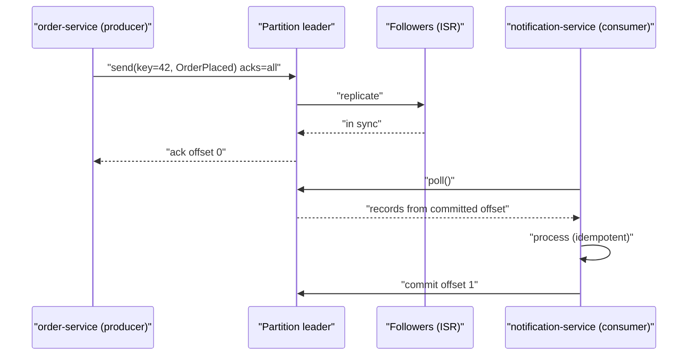
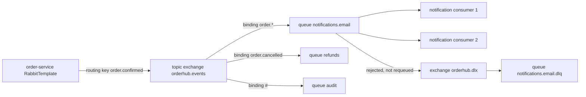

@@ 2 | MODULE | Messaging | Asynchronous events with Kafka and RabbitMQ, and securing the calls between services | MUST
# Messaging

**Shared analogy: the post office versus the newspaper archive.** RabbitMQ is like a **post office**: each letter goes into a mailbox, the postman routes it by address rules, the recipient takes it out and it is gone. Kafka is like a **newspaper archive**: every edition is printed once, kept on the shelves for weeks, and any number of readers can read it at their own pace, each with their own bookmark (offset). Both let the sender drop off a message and walk away instead of waiting on the phone (asynchronous, loosely coupled). The last topic of the group is about **sealed envelopes and ID badges**: making sure only the right services can send and read those messages and calls.

@@ 3 | TOPIC | Event-Driven Architecture with Kafka | Topics, partitions, keys, consumer groups, delivery guarantees, error handling and DLTs with Spring Kafka | MUST
# Event-Driven Architecture with Kafka

**Level: Advanced | Phase 20 | Priority: MUST | Since: Apache Kafka 0.8 (2013), KRaft without ZooKeeper production-ready in 3.3 and ZooKeeper removed in 4.0; Spring for Apache Kafka 3.3 with Boot 3.5**

> **30-second interview answer:** In event-driven architecture services publish facts ("OrderPlaced") and other services react, so the producer does not know or wait for its consumers. Kafka is a distributed, durable, append-only log: a topic is split into partitions, each an ordered sequence of records with offsets, replicated across brokers. The record key picks the partition, so events with the same key stay ordered. Consumers in the same group share partitions (each partition goes to one consumer), and different groups each get every event. Delivery is at least once by default, so consumers must be idempotent, and failed records go to a retry or dead-letter topic instead of blocking the partition.

## 1. Concept in Simple Words
### Analogy
A newspaper printing house and its archive.

| Newspaper archive | Kafka |
|---|---|
| A newspaper title (Sports Daily) | Topic |
| Separate shelves for the title, filled in parallel | Partitions |
| Page numbers on each shelf, never reused | Offsets |
| Everything about one football club goes on the same shelf | Same key, same partition, ordered |
| Copies kept in three buildings | Replication factor 3 |
| A team of readers splitting the shelves between them | Consumer group |
| Each reader's bookmark | Committed offset |
| Another team reading the same papers for a different purpose | Another consumer group |
| Old editions shredded after 7 days | Retention |
| A damaged page set aside in a "to inspect" box | Dead-letter topic |

### What it is
- **Event:** an immutable fact that happened, named in the past tense, with an id and a timestamp.
- **Broker:** a Kafka server. A **cluster** has several; metadata is managed by KRaft controllers (ZooKeeper is removed in Kafka 4.0).
- **Topic / partition / offset:** a topic is split into partitions; each partition is an append-only log; each record has an offset (its position). Ordering is guaranteed only within a partition.
- **Key:** decides the partition (hash of the key modulo partition count). Same key, same partition, same order.
- **Replication:** each partition has a leader and followers; `acks=all` waits until all in-sync replicas (ISR) have the record; `min.insync.replicas=2` with replication factor 3 tolerates one broker loss without losing acknowledged writes.
- **Consumer group:** consumers sharing a `group.id`. Each partition is assigned to exactly one consumer in the group, so parallelism is capped by the partition count. A **rebalance** reassigns partitions when consumers join or leave.
- **Committed offset:** the group's bookmark per partition. Commit after processing gives **at-least-once**; commit before processing gives **at-most-once**; **exactly-once** needs Kafka transactions and only covers Kafka-to-Kafka processing (plus idempotent consumers for external side effects).
- **Idempotent producer:** `enable.idempotence=true` (default since Kafka 3.0) stops duplicates caused by producer retries.
- **Dead-letter topic (DLT):** where records that keep failing are published so the partition can move on.

### Why it exists
Synchronous calls couple services in time: if notification-service is down, placing an order fails. With events, order-service publishes `OrderPlaced` and returns; notification, analytics and loyalty services consume it whenever they can, and new consumers can be added without touching the producer. Kafka specifically adds durability and replay: events stay on disk for days, so a new service can rebuild its state from history and a fixed bug can be reprocessed by resetting offsets.

## 2. How It Works
```text
Topic "order-events", 3 partitions, replication factor 3

key "42" -> hash % 3 = 1
                     offset: 0        1         2          3
   partition 0  [OrderPlaced 17][OrderConfirmed 17][OrderPlaced 51]
   partition 1  [OrderPlaced 42][OrderConfirmed 42][OrderPlaced 88][OrderCancelled 88]
   partition 2  [OrderPlaced 63]

Consumer group "notification-service" (2 instances)
   instance A <- partitions 0, 1        committed offsets: p0=3, p1=2
   instance B <- partition 2            committed offset:  p2=1

Consumer group "analytics" (1 instance) <- partitions 0, 1, 2 with its OWN offsets
A third notification instance would get one partition; a fourth would sit idle.
```



What Spring Kafka does behind `@KafkaListener`: `KafkaListenerAnnotationBeanPostProcessor` finds annotated methods and registers a `ConcurrentMessageListenerContainer` per listener, running `concurrency` consumer threads, each with its own `KafkaConsumer`. Each thread loops: `poll()`, convert records (deserializer, then message converter), invoke your method, then commit offsets according to `AckMode` (default `BATCH`: after all records from one poll are processed). Exceptions go to the container's `CommonErrorHandler`; Boot's default is `DefaultErrorHandler`, which retries a record 9 times with no delay and then logs and skips it, unless you configure a recoverer such as `DeadLetterPublishingRecoverer`.

## 3. Code Example
### Code
OrderHub: order-service publishes (through the outbox relay from the saga topic), notification-service consumes with retries, a DLT and idempotency.

```yaml
# docker-compose.yml (local single-node Kafka in KRaft mode)
services:
  kafka:
    image: apache/kafka:3.9.0
    ports:
      - "9092:9092"
```

```xml
<!-- order-service and notification-service pom.xml -->
<dependency>
    <groupId>org.springframework.kafka</groupId>
    <artifactId>spring-kafka</artifactId>
</dependency>
<dependency>
    <groupId>org.springframework.kafka</groupId>
    <artifactId>spring-kafka-test</artifactId>
    <scope>test</scope>
</dependency>
```

```yaml
# order-service application.yml (producer side)
spring:
  kafka:
    bootstrap-servers: localhost:9092
    producer:
      key-serializer: org.apache.kafka.common.serialization.StringSerializer
      value-serializer: org.apache.kafka.common.serialization.StringSerializer   # outbox payload is JSON text
      acks: all                       # wait for all in-sync replicas
      properties:
        enable.idempotence: true      # default since Kafka 3.0, explicit for clarity
        linger.ms: 5                  # small batching window for throughput
        delivery.timeout.ms: 30000
    template:
      observation-enabled: true       # trace context in record headers (Phase 21)
```

```java
// order-service: topic definition (created at startup by KafkaAdmin if missing)
package com.orderhub.order.config;

import org.apache.kafka.clients.admin.NewTopic;
import org.springframework.context.annotation.Bean;
import org.springframework.context.annotation.Configuration;
import org.springframework.kafka.config.TopicBuilder;

@Configuration
class KafkaTopics {
    @Bean
    NewTopic orderEvents() {
        return TopicBuilder.name("order-events")
                .partitions(6)                 // max 6 parallel consumers per group
                .replicas(1)                   // 3 in production, with min.insync.replicas=2
                .config("retention.ms", String.valueOf(7L * 24 * 60 * 60 * 1000))
                .build();
    }
}
```

```yaml
# notification-service application.yml (consumer side)
spring:
  application:
    name: notification-service
  kafka:
    bootstrap-servers: localhost:9092
    consumer:
      group-id: notification-service
      auto-offset-reset: earliest     # new group starts from the oldest retained record
      key-deserializer: org.apache.kafka.common.serialization.StringDeserializer
      value-deserializer: org.apache.kafka.common.serialization.StringDeserializer
      properties:
        max.poll.records: 100
        max.poll.interval.ms: 300000  # processing a poll batch must finish within 5 min
    producer:                         # used by the dead-letter publisher
      key-serializer: org.apache.kafka.common.serialization.StringSerializer
      value-serializer: org.apache.kafka.common.serialization.StringSerializer
    listener:
      concurrency: 3                  # 3 consumer threads in this instance
      ack-mode: record                # commit after each record
      observation-enabled: true
```

```java
// notification-service: error handling with retries and a dead-letter topic
package com.orderhub.notification.config;

import com.fasterxml.jackson.core.JsonProcessingException;
import org.springframework.context.annotation.Bean;
import org.springframework.context.annotation.Configuration;
import org.springframework.kafka.core.KafkaTemplate;
import org.springframework.kafka.listener.DeadLetterPublishingRecoverer;
import org.springframework.kafka.listener.DefaultErrorHandler;
import org.springframework.util.backoff.ExponentialBackOff;

@Configuration
class KafkaErrorConfig {

    @Bean
    DefaultErrorHandler errorHandler(KafkaTemplate<String, String> template) {
        // after retries, publish to "order-events.DLT", same partition, with exception headers
        DeadLetterPublishingRecoverer recoverer = new DeadLetterPublishingRecoverer(template);

        ExponentialBackOff backOff = new ExponentialBackOff(1000L, 2.0);   // 1 s, 2 s, 4 s
        backOff.setMaxAttempts(3);

        DefaultErrorHandler handler = new DefaultErrorHandler(recoverer, backOff);
        // poison messages: retrying will never help, send straight to the DLT
        handler.addNotRetryableExceptions(JsonProcessingException.class, IllegalArgumentException.class);
        return handler;                 // Boot wires a single CommonErrorHandler bean into the container factory
    }
}
```

```java
// notification-service: the consumer
package com.orderhub.notification;

import com.fasterxml.jackson.core.JsonProcessingException;
import com.fasterxml.jackson.databind.JsonNode;
import com.fasterxml.jackson.databind.ObjectMapper;
import java.nio.charset.StandardCharsets;
import org.apache.kafka.clients.consumer.ConsumerRecord;
import org.apache.kafka.common.header.Header;
import org.slf4j.Logger;
import org.slf4j.LoggerFactory;
import org.springframework.dao.DuplicateKeyException;
import org.springframework.jdbc.core.simple.JdbcClient;
import org.springframework.kafka.annotation.KafkaListener;
import org.springframework.stereotype.Component;
import org.springframework.transaction.annotation.Transactional;

@Component
class OrderEventsListener {
    private static final Logger log = LoggerFactory.getLogger(OrderEventsListener.class);
    private final ObjectMapper json;
    private final JdbcClient jdbc;
    private final EmailSender email;

    OrderEventsListener(ObjectMapper json, JdbcClient jdbc, EmailSender email) {
        this.json = json;
        this.jdbc = jdbc;
        this.email = email;
    }

    @KafkaListener(topics = "order-events")
    @Transactional
    public void onEvent(ConsumerRecord<String, String> record) throws JsonProcessingException {
        String type = header(record, "eventType");
        JsonNode event = json.readTree(record.value());          // bad JSON -> not retryable -> DLT
        String eventId = event.get("eventId").asText();

        if (!type.equals("OrderConfirmed") && !type.equals("OrderCancelled")) {
            return;                                              // not interesting for notifications
        }
        try {
            jdbc.sql("insert into processed_message(consumer, message_id) values ('notification', ?::uuid)")
                .param(eventId).update();
        } catch (DuplicateKeyException duplicate) {
            log.info("Skipping duplicate {} {}", type, eventId);
            return;
        }
        long orderId = event.get("orderId").asLong();
        long customerId = event.get("customerId").asLong();
        String text = type.equals("OrderConfirmed")
                ? "Your order " + orderId + " is confirmed"
                : "Sorry, order " + orderId + " was cancelled: " + event.get("reason").asText();
        email.send(customerId, text);                            // throws on SMTP failure -> retried
        log.info("partition={} offset={} key={} {} -> email sent to customer {}",
                record.partition(), record.offset(), record.key(), type, customerId);
    }

    private static String header(ConsumerRecord<?, ?> record, String name) {
        Header h = record.headers().lastHeader(name);
        if (h == null) throw new IllegalArgumentException("missing header " + name);
        return new String(h.value(), StandardCharsets.UTF_8);
    }
}
```

```java
// notification-service: inspect and replay the DLT manually
package com.orderhub.notification;

import org.apache.kafka.clients.consumer.ConsumerRecord;
import org.slf4j.Logger;
import org.slf4j.LoggerFactory;
import org.springframework.kafka.annotation.KafkaListener;
import org.springframework.kafka.support.KafkaHeaders;
import org.springframework.messaging.handler.annotation.Header;
import org.springframework.stereotype.Component;

@Component
class DeadLetterListener {
    private static final Logger log = LoggerFactory.getLogger(DeadLetterListener.class);

    @KafkaListener(topics = "order-events.DLT", groupId = "notification-dlt-monitor")
    void onDeadLetter(ConsumerRecord<String, String> record,
                      @Header(KafkaHeaders.DLT_EXCEPTION_MESSAGE) String error) {
        log.error("DLT record key={} offset={} error={}", record.key(), record.offset(), error);
        // in production: metric + alert; a replay tool republishes fixed records to order-events
    }
}
```

### Walkthrough
- The single-node `apache/kafka` image runs in KRaft mode with no ZooKeeper, enough for local development.
- The producer uses `acks=all` and idempotence: a record is acknowledged only after all in-sync replicas have it, and producer retries cannot create duplicates or reorder records within a partition.
- `NewTopic` beans are created by Boot's `KafkaAdmin` at startup. Six partitions cap parallelism at six consumers per group; choose generously because adding partitions later changes which partition a key maps to.
- The consumer uses manual-ish commits through Spring (`ack-mode: record`): the offset is committed only after the method returns normally, which gives at-least-once delivery.
- `DefaultErrorHandler` retries a failing record with exponential backoff (3 attempts), then `DeadLetterPublishingRecoverer` publishes it to `order-events.DLT` with exception headers, and the partition continues. Deserialization and validation errors skip retries entirely: a poison pill would never succeed.
- The listener reads the event type from a header (set by the outbox relay), ignores irrelevant types, deduplicates by event id in the same transaction, then sends the email. If the email fails, the exception triggers a retry; the `processed_message` insert rolls back, so the retry is not mistaken for a duplicate.
- `DeadLetterListener` is a separate consumer group watching the DLT; it reads the exception message header that the recoverer added.

### Output
```text
INFO  o.s.k.l.KafkaMessageListenerContainer : notification-service: partitions assigned: [order-events-0, order-events-1]
INFO  c.o.n.OrderEventsListener : partition=1 offset=1 key=42 OrderConfirmed -> email sent to customer 7
INFO  c.o.n.OrderEventsListener : partition=1 offset=3 key=88 OrderCancelled -> email sent to customer 9
INFO  c.o.n.OrderEventsListener : Skipping duplicate OrderConfirmed 1b9f0c2e-5d4a-4e61-9c3b-7a2d8e0f4b11
```

A malformed record (`{"eventId": ` truncated) goes to the DLT without retries:

```text
ERROR c.o.n.DeadLetterListener : DLT record key=99 offset=0 error=Unexpected end-of-input: expected close marker for Object
```

### Compare
| Synchronous HTTP | Kafka events |
|---|---|
| order-service waits for notification | order-service publishes and returns |
| notification down means orders fail | Events wait in Kafka until notification recovers |
| Adding a consumer changes the producer | New consumer group, producer untouched |
| No history | Replay from retained events |
| Simple request-response semantics | Eventual consistency, idempotency, ordering by key |

## 4. Interview Questions
**Basic**
1. **What are topics, partitions and offsets?**
   A topic is a named stream of records, split into partitions for parallelism. Each partition is an ordered, append-only log, and each record's position in it is its offset. Ordering is guaranteed only within one partition.
2. **What is a consumer group?**
   A set of consumers sharing a `group.id` that split the topic's partitions between them; each partition is read by exactly one member. Different groups read independently, each receiving every record, which is how Kafka does publish-subscribe and load balancing at once.
3. **How does Kafka keep events for one order in order?**
   Use the order id as the record key: the default partitioner hashes the key, so all events for that order go to the same partition, which is ordered. Idempotent producers keep that order even when sends are retried.

**Follow-up**
4. **At-most-once, at-least-once, exactly-once: how do you get each?**
   Commit offsets before processing for at-most-once (may lose), after processing for at-least-once (may duplicate, the usual choice). Exactly-once uses idempotent producers plus Kafka transactions for read-process-write within Kafka; with external side effects like emails or database writes, you get "effectively once" with idempotent consumers.
5. **What happens during a rebalance and why can it cause duplicates?**
   When a consumer joins, leaves or exceeds `max.poll.interval.ms`, partitions are reassigned. Records processed but not yet committed by the old owner are delivered again to the new owner. Cooperative rebalancing (default assignor in recent clients) reduces the stop-the-world pause, but consumers must still be idempotent.
6. **How do you handle a message that always fails (a poison pill)?**
   Do not retry it forever, because it blocks the partition. Classify non-retryable exceptions (deserialization, validation) and send them straight to a dead-letter topic; retry transient ones a few times with backoff, then dead-letter them. Monitor the DLT and provide a replay tool. `@RetryableTopic` offers non-blocking retries through separate retry topics.

**Tricky / scenario**
7. **Consumer lag grows constantly although consumers are up. What do you check?**
   Processing time per record versus incoming rate: slow external calls, a database bottleneck, or a single hot partition. Check that partitions are not fewer than consumers (idle consumers) and that one key is not hot. Fixes: optimize processing, batch writes, increase partitions and consumers, or move slow side effects to another topic.
8. **Consumers keep being kicked out of the group and the same records are processed over and over. Why?**
   Processing one poll batch takes longer than `max.poll.interval.ms`, so the broker considers the consumer dead, rebalances, and the uncommitted batch is redelivered, which again takes too long. Lower `max.poll.records`, speed up processing, or raise the interval.
9. **You increased partitions from 6 to 12 and some orders' events were processed out of order. Why?**
   The partition for a key is `hash(key) % partitionCount`, so changing the count moves keys to different partitions. Events published before and after the change for the same order now live in two partitions with no ordering between them. Over-provision partitions up front, or migrate to a new topic.

**What the interviewer is really testing:** whether you understand ordering, parallelism and delivery guarantees well enough to design consumers that survive duplicates, rebalances and poison messages.

## 5. Pitfalls & Best Practices
### Common mistakes
| Mistake | What goes wrong | Fix |
|---|---|---|
| Null or random keys for related events | No ordering per entity | Key by aggregate id |
| Assuming exactly-once with database side effects | Duplicates after rebalances | Idempotent consumers |
| Default error handling with no DLT | Failed records logged and lost after 10 tries | `DeadLetterPublishingRecoverer` |
| Retrying poison pills | Partition blocked | Non-retryable exceptions straight to DLT |
| More consumers than partitions | Idle consumers | Partitions at least equal to max consumers |
| `acks=1` for critical events | Lost data if the leader dies | `acks=all`, replication 3, `min.insync.replicas=2` |
| Trusting `JsonDeserializer` with any type header | Deserialization of untrusted classes | Restrict `spring.json.trusted.packages` or use explicit types |

### Best practices
- Treat event schemas as public APIs: version them, add fields compatibly, consider Avro or Protobuf with a schema registry.
- Include `eventId`, `occurredAt`, aggregate id and a type in every event.
- Monitor consumer lag per group (Burrow, Kafka exporter, Micrometer metrics) and alert on it.
- Use the outbox for producers whose events must match database state.
- Test with Testcontainers (`KafkaContainer`) or `@EmbeddedKafka` for listener behaviour.

### Compare with
| Feature | Kafka | RabbitMQ |
|---|---|---|
| Model | Distributed log, consumers pull | Message broker, pushes to consumers |
| Retention | Kept for days or forever, replayable | Removed once acknowledged |
| Ordering | Per partition | Per queue (single consumer) |
| Routing | By topic and key | Rich: direct, topic, fanout, headers exchanges |
| Throughput | Very high (millions per second) | High (tens of thousands per second per queue) |
| Best for | Event streaming, event sourcing, analytics, many consumers | Task queues, complex routing, request-reply |

## 6. Hands-on Exercise
Replace the blocking retries in notification-service with non-blocking retry topics using `@RetryableTopic`: 4 attempts with exponential backoff starting at 2 seconds, DLT handler that logs and increments a counter, and `IllegalArgumentException` excluded from retries. Write a test with `@EmbeddedKafka` that publishes a record whose email sending always fails and asserts the record reaches the DLT handler.

Acceptance criteria: while one record is retrying, later records on the same partition are processed; after the last attempt the DLT handler is invoked once.

<details><summary>Solution</summary>

```java
package com.orderhub.notification;

import java.util.concurrent.atomic.AtomicInteger;
import org.apache.kafka.clients.consumer.ConsumerRecord;
import org.slf4j.Logger;
import org.slf4j.LoggerFactory;
import org.springframework.kafka.annotation.DltHandler;
import org.springframework.kafka.annotation.KafkaListener;
import org.springframework.kafka.annotation.RetryableTopic;
import org.springframework.retry.annotation.Backoff;
import org.springframework.stereotype.Component;

@Component
class RetryingOrderEventsListener {
    private static final Logger log = LoggerFactory.getLogger(RetryingOrderEventsListener.class);
    final AtomicInteger deadLetters = new AtomicInteger();
    private final EmailSender email;

    RetryingOrderEventsListener(EmailSender email) { this.email = email; }

    // Creates order-events-retry-2000, -retry-4000, -retry-8000 and order-events-dlt topics
    @RetryableTopic(attempts = "4",
                    backoff = @Backoff(delay = 2000, multiplier = 2.0),
                    exclude = IllegalArgumentException.class)
    @KafkaListener(topics = "order-events", groupId = "notification-service")
    void on(ConsumerRecord<String, String> record) {
        email.send(Long.parseLong(record.key()), record.value());   // failure -> next retry topic
    }

    @DltHandler
    void dlt(ConsumerRecord<String, String> record) {
        deadLetters.incrementAndGet();
        log.error("Gave up on key={} from {}", record.key(), record.topic());
    }
}
```

```java
package com.orderhub.notification;

import static org.awaitility.Awaitility.await;
import static org.mockito.ArgumentMatchers.anyLong;
import static org.mockito.ArgumentMatchers.anyString;
import static org.mockito.Mockito.doThrow;

import java.time.Duration;
import org.junit.jupiter.api.Test;
import org.springframework.beans.factory.annotation.Autowired;
import org.springframework.boot.test.context.SpringBootTest;
import org.springframework.kafka.core.KafkaTemplate;
import org.springframework.kafka.test.context.EmbeddedKafka;
import org.springframework.test.context.bean.override.mockito.MockitoBean;

@SpringBootTest(properties = "spring.kafka.bootstrap-servers=${spring.embedded.kafka.brokers}")
@EmbeddedKafka(partitions = 1, topics = "order-events")
class RetryableTopicTest {

    @Autowired KafkaTemplate<String, String> template;
    @Autowired RetryingOrderEventsListener listener;
    @MockitoBean EmailSender email;

    @Test
    void failingRecordEndsInDlt() {
        doThrow(new IllegalStateException("SMTP down")).when(email).send(anyLong(), anyString());
        template.send("order-events", "42", "{\"eventId\":\"x\"}");
        await().atMost(Duration.ofSeconds(30))
               .until(() -> listener.deadLetters.get() == 1);
    }
}
```
Non-blocking retries move the failing record to delay topics, so the main partition keeps flowing; the trade-off is that ordering for that key is no longer guaranteed during retries. Use blocking `DefaultErrorHandler` retries when strict per-key ordering matters.
</details>

## 7. Recall
Q: How does Kafka guarantee ordering for events of the same order?
A: Records with the same key go to the same partition, and a partition is an ordered log; ordering is only guaranteed within a partition.

Q: In Kafka, what limits how many consumers in one group can work in parallel?
A: The number of partitions: each partition is assigned to exactly one consumer in the group, so extra consumers sit idle.

Q: What delivery guarantee does committing Kafka offsets after processing give?
A: At-least-once: nothing is lost, but records can be redelivered after a crash or rebalance, so consumers must be idempotent.

Q: What does Spring Kafka's `DeadLetterPublishingRecoverer` do?
A: After the error handler's retries are exhausted, it publishes the failed record to a dead-letter topic (by default `<topic>.DLT`) with exception headers so the partition can continue.

Q: Why is changing the partition count of a Kafka topic risky?
A: The key-to-partition mapping is hash modulo partition count, so keys move to new partitions and per-key ordering breaks across the change.

**Related:** [[Distributed Transactions, Saga and Outbox]] · [[RabbitMQ Basics]] · [[Distributed Tracing with OpenTelemetry]]

@@ 3 | TOPIC | RabbitMQ Basics | Exchanges, queues, bindings, acknowledgements, dead-letter exchanges and when to pick RabbitMQ over Kafka | NICE
# RabbitMQ Basics

**Level: Advanced | Phase 20 | Priority: NICE | Since: RabbitMQ 1.0 (2007, AMQP 0-9-1); Spring AMQP with `spring-boot-starter-amqp`**

> **30-second interview answer:** RabbitMQ is a message broker: producers publish to an exchange, the exchange routes copies to queues according to bindings (direct by exact key, topic by pattern, fanout to all, headers by attributes), and consumers receive messages from queues and acknowledge them, after which they are deleted. It shines for task queues, flexible routing, per-message TTL and priorities, and request-reply. Unlike Kafka it is not a replayable log. In Spring Boot I declare queues, exchanges and bindings as beans, send with `RabbitTemplate`, consume with `@RabbitListener`, use a JSON message converter, and route failures to a dead-letter exchange.

## 1. Concept in Simple Words
### Analogy
A post office sorting room.

| Post office | RabbitMQ |
|---|---|
| The counter where you drop letters | Exchange |
| Sorting rules: "London postcodes to bin 3" | Bindings with routing keys |
| Mailbag bins for each delivery route | Queues |
| Letter carrier taking letters from a bin | Consumer |
| Carrier signs for each letter | Acknowledgement (ack) |
| "Return to sender" shelf for undeliverable letters | Dead-letter exchange and queue |
| Each carrier carries at most 10 letters at once | Prefetch count |
| A circular sent to every household | Fanout exchange |

### What it is
- **AMQP 0-9-1:** the protocol RabbitMQ speaks natively (it also supports MQTT, STOMP and RabbitMQ Streams).
- **Exchange types:** `direct` (routing key equals binding key), `topic` (pattern match with `*` for one word and `#` for zero or more words, e.g. `order.*`), `fanout` (every bound queue), `headers` (match message headers).
- **Queue:** stores messages until consumed. **Classic** queues or **quorum** queues (replicated with Raft; the recommended durable choice).
- **Binding:** a rule linking an exchange to a queue with a key or pattern.
- **Ack / nack:** the consumer confirms success (message deleted) or failure (requeue or dead-letter). Spring AMQP acks automatically when the listener returns normally (`AUTO` mode).
- **Prefetch:** how many unacknowledged messages the broker pushes to a consumer at once (Spring default 250).
- **Dead-letter exchange (DLX):** where rejected, expired or over-length messages are republished.
- **Publisher confirms:** the broker confirms that a message was safely stored, the producer-side equivalent of acks.

### Why it exists
Many workloads are "do this job once, by any one worker": send an email, resize an image, generate a PDF invoice. A queue distributes jobs to competing consumers, retries failures and absorbs bursts. RabbitMQ adds routing so one published message can reach exactly the queues that care about it, without the producer knowing them.

## 2. How It Works


Message lifecycle:
1. The producer publishes to an exchange with a routing key; with publisher confirms the broker acks once the message is in all matching queues (and replicated for quorum queues).
2. The broker pushes messages to consumers up to the prefetch limit; competing consumers on one queue each get different messages (round robin).
3. Spring's `SimpleMessageListenerContainer` converts the message (`Jackson2JsonMessageConverter`), invokes the `@RabbitListener` method and acks on success.
4. On exception, Spring by default **requeues** the message, which can cause an infinite loop for a poison message. Set `default-requeue-rejected: false` (or throw `AmqpRejectAndDontRequeueException`) so it goes to the DLX, and use listener retry with backoff for transient errors.

## 3. Code Example
### Code
OrderHub variant where notification-service receives order notifications through RabbitMQ.

```xml
<dependency>
    <groupId>org.springframework.boot</groupId>
    <artifactId>spring-boot-starter-amqp</artifactId>
</dependency>
```

```yaml
# docker-compose.yml
services:
  rabbitmq:
    image: rabbitmq:4.0-management
    ports:
      - "5672:5672"      # AMQP
      - "15672:15672"    # management UI (guest/guest locally)
```

```yaml
# application.yml (both services)
spring:
  rabbitmq:
    host: localhost
    port: 5672
    username: guest
    password: guest
    publisher-confirm-type: correlated    # broker confirms each publish
    publisher-returns: true               # unroutable messages are returned, not dropped
    template:
      mandatory: true
    listener:
      simple:
        prefetch: 10
        concurrency: 2
        max-concurrency: 5
        default-requeue-rejected: false   # failures go to the DLX instead of looping
        retry:
          enabled: true                   # in-memory retry before rejecting
          max-attempts: 3
          initial-interval: 1s
          multiplier: 2
```

```java
// shared topology (declared in both services; declarations are idempotent)
package com.orderhub.messaging;

import org.springframework.amqp.core.Binding;
import org.springframework.amqp.core.BindingBuilder;
import org.springframework.amqp.core.DirectExchange;
import org.springframework.amqp.core.Queue;
import org.springframework.amqp.core.QueueBuilder;
import org.springframework.amqp.core.TopicExchange;
import org.springframework.amqp.support.converter.Jackson2JsonMessageConverter;
import org.springframework.amqp.support.converter.MessageConverter;
import org.springframework.context.annotation.Bean;
import org.springframework.context.annotation.Configuration;

@Configuration
public class RabbitTopology {
    public static final String EVENTS = "orderhub.events";
    public static final String EMAIL_QUEUE = "notifications.email";

    @Bean TopicExchange eventsExchange() { return new TopicExchange(EVENTS); }
    @Bean DirectExchange deadLetterExchange() { return new DirectExchange("orderhub.dlx"); }

    @Bean
    Queue emailQueue() {
        return QueueBuilder.durable(EMAIL_QUEUE)
                .quorum()                                          // replicated, recommended for durability
                .deadLetterExchange("orderhub.dlx")
                .deadLetterRoutingKey(EMAIL_QUEUE + ".dlq")
                .build();
    }

    @Bean Queue emailDlq() { return QueueBuilder.durable(EMAIL_QUEUE + ".dlq").build(); }

    @Bean
    Binding emailBinding() {
        return BindingBuilder.bind(emailQueue()).to(eventsExchange()).with("order.*");
    }

    @Bean
    Binding dlqBinding() {
        return BindingBuilder.bind(emailDlq()).to(deadLetterExchange()).with(EMAIL_QUEUE + ".dlq");
    }

    @Bean
    MessageConverter jsonConverter() { return new Jackson2JsonMessageConverter(); }   // Boot uses it automatically
}
```

```java
// order-service: publisher
package com.orderhub.order.messaging;

import com.orderhub.messaging.RabbitTopology;
import org.springframework.amqp.rabbit.core.RabbitTemplate;
import org.springframework.stereotype.Component;

@Component
public class OrderNotificationPublisher {
    public record OrderNotification(String eventId, long orderId, long customerId, String status) { }

    private final RabbitTemplate rabbit;

    public OrderNotificationPublisher(RabbitTemplate rabbit) { this.rabbit = rabbit; }

    public void confirmed(String eventId, long orderId, long customerId) {
        rabbit.convertAndSend(RabbitTopology.EVENTS, "order.confirmed",
                new OrderNotification(eventId, orderId, customerId, "CONFIRMED"));
    }

    public void cancelled(String eventId, long orderId, long customerId) {
        rabbit.convertAndSend(RabbitTopology.EVENTS, "order.cancelled",
                new OrderNotification(eventId, orderId, customerId, "CANCELLED"));
    }
}
```

```java
// notification-service: consumer
package com.orderhub.notification.messaging;

import com.orderhub.messaging.RabbitTopology;
import org.slf4j.Logger;
import org.slf4j.LoggerFactory;
import org.springframework.amqp.rabbit.annotation.RabbitListener;
import org.springframework.stereotype.Component;

@Component
class EmailNotificationListener {
    record OrderNotification(String eventId, long orderId, long customerId, String status) { }

    private static final Logger log = LoggerFactory.getLogger(EmailNotificationListener.class);

    @RabbitListener(queues = RabbitTopology.EMAIL_QUEUE)
    void on(OrderNotification n) {
        if (n.customerId() <= 0) {
            throw new IllegalArgumentException("invalid customer " + n.customerId());   // ends in DLQ
        }
        log.info("Email to customer {}: order {} is {}", n.customerId(), n.orderId(), n.status());
    }
}
```

### Walkthrough
- The topology defines a topic exchange for events, a quorum queue for email notifications bound with `order.*` (matching `order.confirmed` and `order.cancelled`), and a dead-letter exchange plus queue.
- Declaring the same topology in both services is safe: declarations are idempotent as long as the arguments match. A mismatch (for example classic vs quorum) fails with `PRECONDITION_FAILED`.
- `Jackson2JsonMessageConverter` serializes records to JSON with a `__TypeId__` header; the consumer's parameter type drives conversion, so the consumer can declare its own record with the same fields.
- Publisher confirms and `mandatory: true` mean the producer learns about lost or unroutable messages instead of silently dropping them.
- The listener's exception triggers 3 in-memory retries (1 s, 2 s); after that the message is rejected without requeue and RabbitMQ moves it to `notifications.email.dlq`.
- Prefetch 10 limits unacknowledged messages per consumer so one slow consumer does not hoard the queue.

### Output
```text
INFO  c.o.n.m.EmailNotificationListener : Email to customer 7: order 42 is CONFIRMED
INFO  c.o.n.m.EmailNotificationListener : Email to customer 9: order 88 is CANCELLED
WARN  o.s.a.r.r.RejectAndDontRequeueRecoverer : Retries exhausted for message (Body:'{"eventId":"e-5","orderId":90,"customerId":0,"status":"CONFIRMED"}')
```

Management UI (`http://localhost:15672`) afterwards:

```text
Queue                         Ready  Unacked  Total
notifications.email           0      0        0
notifications.email.dlq       1      0        1
```

### Compare
| Need | Choose |
|---|---|
| Replay history, event sourcing, many independent consumers | Kafka |
| Work queue with competing consumers, per-message ack | RabbitMQ |
| Complex routing by pattern or header | RabbitMQ |
| Millions of events per second, stream processing | Kafka |
| Per-message TTL, priorities, delayed delivery | RabbitMQ |
| Strict ordering per entity at scale | Kafka (keys and partitions) |

## 4. Interview Questions
**Basic**
1. **What are exchanges, queues and bindings?**
   Producers publish to an exchange; bindings are rules connecting exchanges to queues by routing key or pattern; queues store messages until consumers take and acknowledge them. Producers never publish directly to a queue in AMQP (the default exchange only looks like it).
2. **What exchange types exist?**
   Direct (exact routing-key match), topic (wildcard patterns with `*` and `#`), fanout (broadcast to all bound queues) and headers (match on header values).
3. **What is a dead-letter exchange?**
   An exchange where the broker republishes messages that were rejected without requeue, expired by TTL, or exceeded a queue length limit. Bound to a DLQ, it keeps failed messages for inspection and replay.

**Follow-up**
4. **Why can a failing listener cause an infinite loop, and how do you prevent it?**
   By default Spring requeues a message whose listener throws, so a poison message is redelivered forever and hogs the consumer. Set `default-requeue-rejected: false` or throw `AmqpRejectAndDontRequeueException`, add retry with backoff for transient errors, and configure a DLX.
5. **How does RabbitMQ guarantee a message is not lost?**
   Durable quorum queues, persistent messages, publisher confirms on the producer side, and manual or auto acks after successful processing on the consumer side. Each link in the chain must be configured; missing confirms is the most common gap.
6. **Classic vs quorum queues?**
   Classic queues live on one node (mirroring is removed in RabbitMQ 4.0). Quorum queues replicate with Raft across nodes, survive node loss and are the recommended durable queue type; they do not support some classic features like non-durable or exclusive queues.

**Tricky / scenario**
7. **You scaled notification consumers from 2 to 10, but throughput did not increase and one consumer is busy while others are idle. Why?**
   A high prefetch (default 250) lets the first consumer grab most messages before the others connect. Lower prefetch (for example 10) so work spreads across consumers; also check that the bottleneck is not downstream (SMTP rate limit).
8. **When would you choose RabbitMQ over Kafka in OrderHub?**
   For notification jobs: each message is a task done once by any worker, needs per-message retry and DLQ, maybe priorities (password reset before marketing). Kafka fits the order events stream that several services consume and that analytics may want to replay.
9. **Does RabbitMQ preserve message order?**
   A single queue delivers in FIFO order, but with multiple competing consumers, prefetch and requeues, processing order is not guaranteed. For strict per-entity ordering use a single active consumer per queue, consistent-hash exchange sharding, or Kafka keys.

**What the interviewer is really testing:** whether you understand broker-style messaging well enough to configure routing, acknowledgements and dead-lettering, and to choose between RabbitMQ and Kafka for a given workload.

## 5. Pitfalls & Best Practices
### Common mistakes
| Mistake | What goes wrong | Fix |
|---|---|---|
| Default requeue on exception | Poison message loops forever | `default-requeue-rejected: false` plus DLX |
| No publisher confirms | Messages silently lost on broker issues | `publisher-confirm-type: correlated` |
| Java serialization converter | Insecure and couples classpaths | `Jackson2JsonMessageConverter` |
| Very high prefetch with slow consumers | Uneven load, memory pressure | Tune prefetch to processing time |
| Non-durable queues for important work | Messages lost on restart | Durable quorum queues |

### Best practices
- Declare topology as code (beans) and keep naming consistent: `<domain>.<event>` routing keys.
- Make consumers idempotent; RabbitMQ also delivers at least once.
- Monitor queue depth and consumer count; alert on a growing DLQ.
- Use the transactional outbox when the message must match a database change.
- Use RabbitMQ Streams or Kafka if you need replay.

### Compare with
| Exchange | Routing rule | Example |
|---|---|---|
| Direct | Key equals binding key | `invoice.generate` to the invoice queue |
| Topic | Pattern with `*` and `#` | `order.*` to notifications |
| Fanout | Every bound queue | Cache invalidation broadcast |
| Headers | Header attributes | `region=eu` and `priority=high` |

## 6. Hands-on Exercise
Add a priority lane to OrderHub notifications: password-reset emails must be sent before marketing emails when both are queued. Declare a queue `notifications.email.priority` with max priority 10, publish password resets with priority 9 and marketing with priority 1, and consume with prefetch 1.

Acceptance criteria: with 100 marketing messages queued and a password reset published afterwards, the password reset is processed within the next couple of messages.

<details><summary>Solution</summary>

```java
package com.orderhub.messaging;

import org.springframework.amqp.core.Binding;
import org.springframework.amqp.core.BindingBuilder;
import org.springframework.amqp.core.DirectExchange;
import org.springframework.amqp.core.Queue;
import org.springframework.amqp.core.QueueBuilder;
import org.springframework.amqp.rabbit.core.RabbitTemplate;
import org.springframework.context.annotation.Bean;
import org.springframework.context.annotation.Configuration;
import org.springframework.stereotype.Component;

@Configuration
class PriorityTopology {
    @Bean DirectExchange emailExchange() { return new DirectExchange("orderhub.email"); }

    @Bean
    Queue priorityQueue() {
        return QueueBuilder.durable("notifications.email.priority")
                .maxPriority(10)                       // classic queue with priority support
                .build();
    }

    @Bean
    Binding priorityBinding() {
        return BindingBuilder.bind(priorityQueue()).to(emailExchange()).with("email");
    }
}

@Component
class EmailPublisher {
    record Email(long customerId, String kind, String text) { }
    private final RabbitTemplate rabbit;

    EmailPublisher(RabbitTemplate rabbit) { this.rabbit = rabbit; }

    void passwordReset(long customerId, String link) { send(new Email(customerId, "RESET", link), 9); }
    void marketing(long customerId, String text)     { send(new Email(customerId, "MARKETING", text), 1); }

    private void send(Email email, int priority) {
        rabbit.convertAndSend("orderhub.email", "email", email, message -> {
            message.getMessageProperties().setPriority(priority);
            return message;
        });
    }
}
```

```yaml
spring:
  rabbitmq:
    listener:
      simple:
        prefetch: 1        # otherwise 250 low-priority messages are already in the consumer's buffer
```
Priority only reorders messages still in the queue; messages already prefetched by a consumer are not overtaken, which is why prefetch must be small for priorities to be effective.
</details>

## 7. Recall
Q: What are the four RabbitMQ exchange types?
A: Direct (exact key), topic (wildcard pattern), fanout (broadcast) and headers (match on header values).

Q: What happens by default in Spring AMQP when a `@RabbitListener` throws an exception?
A: The message is requeued and redelivered, which loops forever for a poison message unless requeue is disabled and a dead-letter exchange is configured.

Q: What is a RabbitMQ dead-letter exchange used for?
A: Receiving messages that were rejected without requeue, expired or overflowed, so they can be inspected and replayed from a DLQ.

Q: What is the key difference between RabbitMQ and Kafka?
A: RabbitMQ is a broker that deletes messages after acknowledgement and routes flexibly; Kafka is a retained, replayable log with ordering per partition.

Q: What does the RabbitMQ prefetch count control?
A: How many unacknowledged messages the broker pushes to a consumer at once, affecting load distribution and memory.

**Related:** [[Event-Driven Architecture with Kafka]] · [[Distributed Transactions, Saga and Outbox]] · [[Securing Service-to-Service Communication]]
