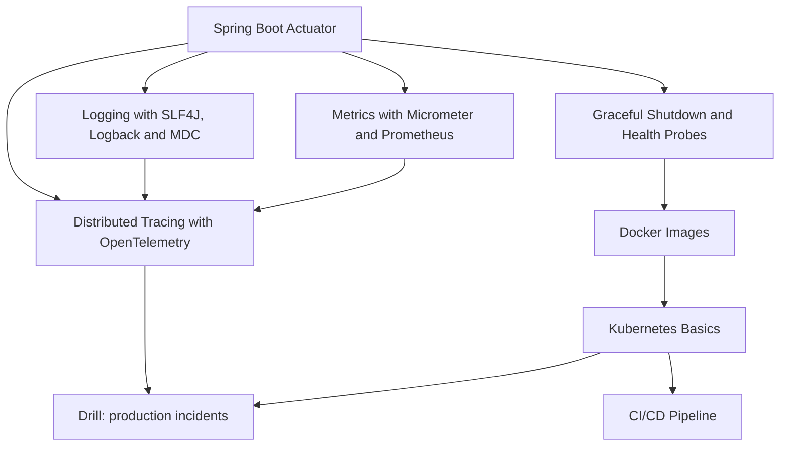
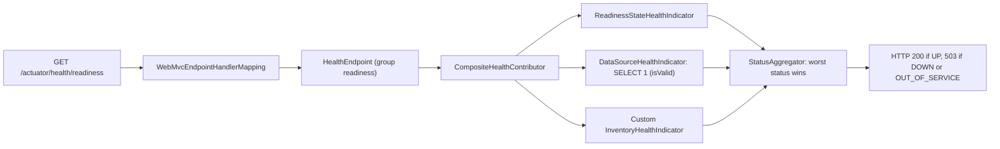
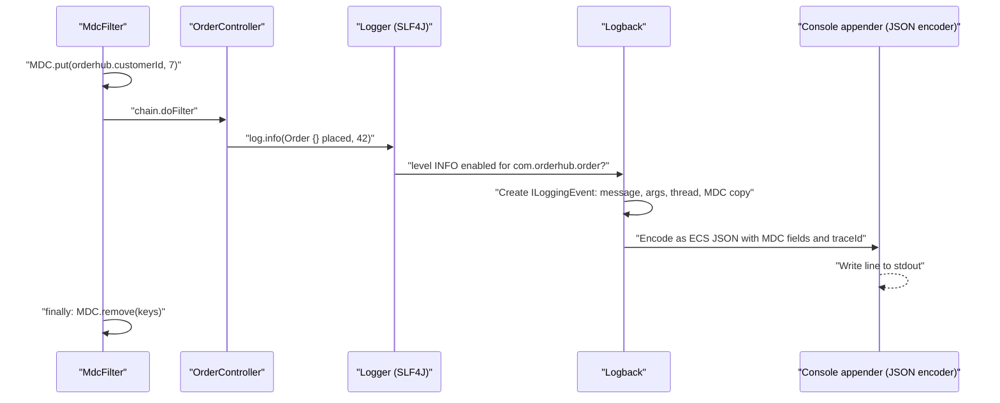

@@ 1 | MODULE | Phase 21 — Observability and Production (Advanced) | Actuator, logs, metrics, tracing, graceful shutdown, Docker images, Kubernetes and CI/CD for Spring Boot services | MUST
# Phase 21: Observability and Production (Advanced)

Phase 20 split OrderHub into services. This phase makes them **operable**: you can see what they are doing (Actuator, structured logs with MDC, Micrometer metrics in Prometheus, distributed traces with OpenTelemetry), and you can ship and run them safely (graceful shutdown, health probes, small secure Docker images, Kubernetes manifests, a CI/CD pipeline). Senior interviews always include "it is 3 a.m., checkout is slow, what do you do?" and "how do you deploy without downtime?". Interviewers listen for a method: which signal you check first, how you find the failing service, and which configuration prevents the incident from happening again.

Versions used: Spring Boot 3.5 (structured JSON logging since 3.4, graceful shutdown on by default since 3.4), Micrometer 1.15 and Micrometer Tracing 1.5 with the OpenTelemetry bridge (Spring Cloud Sleuth is dead: it does not support Boot 3), Java 21 container ergonomics, Kubernetes 1.30+.



The three pillars of observability and how they connect in OrderHub:

```text
             request enters gateway: traceId 4bf92f3577b34da6a3ce929d0e0e4736
                        |
     +------------------+-------------------+
     |                  |                   |
  LOGS (Logback JSON)  METRICS (Micrometer) TRACES (OTel spans)
  "what happened"      "how much, how fast" "where did the time go"
  traceId in every     http_server_requests gateway -> order -> inventory
  line via MDC         _seconds, exemplars  span tree with timings
     |                  |                   |
  Loki / ELK         Prometheus           Tempo / Jaeger
     +------------------+-------------------+
                        |
                    Grafana: jump from a latency spike (metric)
                    to an example trace (exemplar) to its logs (traceId)
```

**Prerequisites:** Phase 5 (Boot basics, profiles), Phase 10 (configuration properties), Phase 16 (thread pools, because MDC and trace context are thread-bound), Phase 20 (the OrderHub services and Kafka).

**The 5 questions from this phase that come up most often**
1. Liveness vs readiness probe: what should each check, and what goes wrong if liveness checks the database?
2. How do you trace a request across several microservices and correlate it with logs?
3. What metrics would you put on a dashboard for a Spring Boot service, and what is high cardinality?
4. How do you build a small, secure, fast-starting Docker image for a Spring Boot app?
5. How do you deploy a new version with zero downtime (graceful shutdown, rolling updates, backward-compatible migrations)?

@@ 2 | MODULE | Observability | Seeing inside running services with Actuator, logs, metrics and traces | MUST
# Observability

**Shared analogy: a car's dashboard, its trip recorder and a GPS route log.** Actuator is the **diagnostic port** the mechanic plugs into (health, configuration, internals). Logs are the **trip recorder**: a written diary of events, best when every entry carries the trip number (MDC and traceId). Metrics are the **dashboard gauges**: speed, temperature and fuel as numbers over time, cheap to watch and great for alarms. Traces are the **GPS route log** of one specific journey, showing which roads (services) it took and where it got stuck in traffic. You need all four: gauges tell you *that* something is wrong, the route log tells you *where*, and the diary tells you *why*.

@@ 3 | TOPIC | Spring Boot Actuator | Production endpoints for health, info, metrics, loggers and custom diagnostics, and how to secure them | MUST
# Spring Boot Actuator

**Level: Advanced | Phase 21 | Priority: MUST | Since: Spring Boot 1.0 (2014); Micrometer-based metrics since Boot 2.0; endpoint `access` model since Boot 3.4**

> **30-second interview answer:** Actuator adds production-ready endpoints to a Boot app: `health` (with components like database, disk, Kafka, plus liveness and readiness groups), `info`, `metrics` and `prometheus`, `loggers` to change log levels at runtime, `env` and `configprops`, `threaddump`, `heapdump` and more. Only `health` is exposed over HTTP by default. In production I expose what monitoring needs on a separate management port, secure the rest, add custom health indicators for critical dependencies, and keep liveness free of external checks.

## 1. Concept in Simple Words
### Analogy
The OBD diagnostic port in a car.

| Car diagnostics | Actuator |
|---|---|
| Dashboard warning lights: engine OK, oil OK | `/actuator/health` with components |
| The plate in the door: model, year, engine | `/actuator/info` (build, git, Java version) |
| Live readings: RPM, temperature | `/actuator/metrics`, `/actuator/prometheus` |
| Mechanic turns on verbose sensor logging | `POST /actuator/loggers/{name}` |
| Full engine snapshot for the workshop | `/actuator/heapdump`, `/actuator/threaddump` |
| The port is under the dashboard, not on the outside of the car | Separate management port, secured |

### What it is
- **Endpoint:** an operation exposed over HTTP or JMX under `/actuator/{id}`. Common ones: `health`, `info`, `metrics`, `prometheus`, `loggers`, `env`, `configprops`, `beans`, `conditions`, `mappings`, `threaddump`, `heapdump`, `scheduledtasks`, `httpexchanges`, `startup`, `sbom` (Boot 3.3+), `shutdown` (off by default).
- **Exposure vs access:** *exposure* (`management.endpoints.web.exposure.include`) decides whether an endpoint is reachable over HTTP; *access* (`management.endpoint.<id>.access`: `none`, `read-only`, `unrestricted`, Boot 3.4+, replacing `enabled`) decides what operations are allowed.
- **HealthIndicator:** a bean contributing a component to `/health` (`db`, `diskSpace`, `redis`, `kafka`, custom). The overall status is aggregated: `UP`, `DOWN`, `OUT_OF_SERVICE`, `UNKNOWN`.
- **Health groups:** named subsets of indicators: `liveness` and `readiness` exist when probes are enabled (automatically on Kubernetes); you can define your own.
- **InfoContributor:** adds data to `/info` (git commit, build version, Java, OS, custom).
- **Custom endpoint:** `@Endpoint(id = "orderstats")` with `@ReadOperation`, `@WriteOperation`, `@DeleteOperation`.

### Why it exists
Before Actuator, every team wrote its own `/ping`, `/version` and admin pages, inconsistently. Platforms (Kubernetes, load balancers, Prometheus) need standard ways to ask "are you alive, are you ready, what are your numbers?". Actuator gives these out of the box, integrated with auto-configuration so a new DataSource automatically adds a `db` health check and connection-pool metrics.

## 2. How It Works


Behind the scenes:
- `spring-boot-starter-actuator` brings auto-configurations that create endpoint beans, discover `@Endpoint` beans and register them with a `WebMvcEndpointHandlerMapping` (or the WebFlux or Jersey equivalent), under the base path `/actuator`.
- Each auto-configured integration (DataSource, Redis, Kafka, Mail, disk) contributes a `HealthIndicator` conditionally, only if that integration exists.
- The HTTP status of `/health` comes from the aggregated status mapping (`DOWN` and `OUT_OF_SERVICE` give 503), which is exactly what load balancers and Kubernetes probes look at.
- With `management.server.port` set, Boot starts a second embedded server (a child context) for actuator endpoints only, so they can be firewalled separately.
- Health details (`show-details`) are hidden from anonymous users by default (`never`); use `when-authorized` with roles.

## 3. Code Example
### Code
order-service actuator setup with a custom health indicator, info contributor and a custom endpoint.

```xml
<dependency>
    <groupId>org.springframework.boot</groupId>
    <artifactId>spring-boot-starter-actuator</artifactId>
</dependency>
<dependency>
    <groupId>io.micrometer</groupId>
    <artifactId>micrometer-registry-prometheus</artifactId>
</dependency>

<!-- adds META-INF/build-info.properties for /actuator/info -->
<plugin>
    <groupId>org.springframework.boot</groupId>
    <artifactId>spring-boot-maven-plugin</artifactId>
    <executions>
        <execution>
            <goals><goal>build-info</goal></goals>
        </execution>
    </executions>
</plugin>
<plugin>
    <groupId>io.github.git-commit-id</groupId>
    <artifactId>git-commit-id-maven-plugin</artifactId>   <!-- adds git.properties -->
</plugin>
```

```yaml
# order-service application.yml
management:
  server:
    port: 9081                               # actuator on its own port, not exposed via ingress
  endpoints:
    web:
      exposure:
        include: health,info,prometheus,metrics,loggers,orderstats
  endpoint:
    health:
      show-details: when-authorized
      roles: OPS
      probes:
        enabled: true                        # liveness and readiness groups (auto on Kubernetes)
      group:
        readiness:
          include: readinessState,db,inventory
    heapdump:
      access: none                           # Boot 3.4+ access model
  info:
    java:
      enabled: true
    os:
      enabled: true
    git:
      mode: simple
```

```java
// order-service: custom health indicator for the inventory dependency
package com.orderhub.order.health;

import java.time.Duration;
import java.time.Instant;
import org.springframework.boot.actuate.health.Health;
import org.springframework.boot.actuate.health.HealthIndicator;
import org.springframework.stereotype.Component;
import org.springframework.web.client.RestClient;

@Component("inventory")                       // component name in /health
class InventoryHealthIndicator implements HealthIndicator {
    private final RestClient restClient;

    InventoryHealthIndicator(RestClient.Builder lbBuilder) {
        this.restClient = lbBuilder.baseUrl("http://inventory-service").build();
    }

    @Override
    public Health health() {
        Instant start = Instant.now();
        try {
            restClient.get().uri("/actuator/health/liveness").retrieve().toBodilessEntity();
            return Health.up()
                    .withDetail("latencyMs", Duration.between(start, Instant.now()).toMillis())
                    .build();
        } catch (Exception e) {
            return Health.down(e).withDetail("target", "inventory-service").build();
        }
    }
}
```

```java
// order-service: custom info and a custom read/write endpoint
package com.orderhub.order.ops;

import java.util.Map;
import java.util.concurrent.atomic.AtomicBoolean;
import org.springframework.boot.actuate.endpoint.annotation.Endpoint;
import org.springframework.boot.actuate.endpoint.annotation.ReadOperation;
import org.springframework.boot.actuate.endpoint.annotation.WriteOperation;
import org.springframework.boot.actuate.info.InfoContributor;
import org.springframework.context.annotation.Bean;
import org.springframework.context.annotation.Configuration;
import org.springframework.jdbc.core.simple.JdbcClient;
import org.springframework.stereotype.Component;

@Configuration
class OpsConfig {
    @Bean
    InfoContributor teamInfo() {
        return builder -> builder.withDetail("team", Map.of("owner", "orders-team", "slack", "#orders-oncall"));
    }
}

@Component
@Endpoint(id = "orderstats")                  // GET and POST /actuator/orderstats
class OrderStatsEndpoint {
    private final JdbcClient jdbc;
    private final AtomicBoolean acceptingOrders = new AtomicBoolean(true);

    OrderStatsEndpoint(JdbcClient jdbc) { this.jdbc = jdbc; }

    @ReadOperation
    Map<String, Object> stats() {
        long pending = jdbc.sql("select count(*) from orders where status = 'PENDING'").query(Long.class).single();
        return Map.of("pendingOrders", pending, "acceptingOrders", acceptingOrders.get());
    }

    @WriteOperation
    Map<String, Object> setAccepting(boolean accepting) {      // POST {"accepting": false}
        acceptingOrders.set(accepting);
        return Map.of("acceptingOrders", accepting);
    }

    boolean isAcceptingOrders() { return acceptingOrders.get(); }
}
```

```java
// order-service: secure actuator endpoints (management port still needs auth for sensitive ones)
package com.orderhub.order.security;

import org.springframework.boot.actuate.autoconfigure.security.servlet.EndpointRequest;
import org.springframework.boot.actuate.health.HealthEndpoint;
import org.springframework.boot.actuate.info.InfoEndpoint;
import org.springframework.context.annotation.Bean;
import org.springframework.context.annotation.Configuration;
import org.springframework.core.annotation.Order;
import org.springframework.security.config.Customizer;
import org.springframework.security.config.annotation.web.builders.HttpSecurity;
import org.springframework.security.web.SecurityFilterChain;

@Configuration
class ActuatorSecurityConfig {

    @Bean
    @Order(1)
    SecurityFilterChain actuator(HttpSecurity http) throws Exception {
        return http.securityMatcher(EndpointRequest.toAnyEndpoint())
                .authorizeHttpRequests(auth -> auth
                        .requestMatchers(EndpointRequest.to(HealthEndpoint.class, InfoEndpoint.class)).permitAll()
                        .requestMatchers(EndpointRequest.to("prometheus")).permitAll()     // scraped inside the cluster
                        .anyRequest().hasRole("OPS"))
                .httpBasic(Customizer.withDefaults())
                .build();
    }
}
```

### Walkthrough
- `micrometer-registry-prometheus` makes the `prometheus` endpoint available; `build-info` and the git plugin feed `/info`.
- `management.server.port: 9081` moves all actuator endpoints off the public port 8081. The ingress only routes 8081, so `/actuator/env` is not reachable from the internet even if misconfigured.
- Exposure lists exactly what is reachable; `heapdump` is additionally switched off with `access: none` because a heap dump contains secrets and personal data.
- The readiness group includes the database and inventory: if either is down, the pod reports not ready and stops receiving traffic, but liveness (not listed) stays UP, so Kubernetes does not restart it pointlessly.
- `InventoryHealthIndicator` is named `inventory` via the bean name and returns latency details. It calls inventory's cheap liveness endpoint, not a deep health check, to avoid cascading health failures.
- `OrderStatsEndpoint` shows a custom endpoint: a read operation with business numbers and a write operation acting as a kill switch for new orders.
- The security chain matches only actuator requests: health, info and prometheus are open; everything else needs the `OPS` role.

### Output
```http
GET http://localhost:9081/actuator/health
Authorization: Basic b3BzOm9wcw==

HTTP/1.1 200 OK
Content-Type: application/vnd.spring-boot.actuator.v3+json

{
  "status": "UP",
  "components": {
    "db": {"status": "UP", "details": {"database": "PostgreSQL", "validationQuery": "isValid()"}},
    "diskSpace": {"status": "UP", "details": {"total": 107374182400, "free": 64424509440, "threshold": 10485760}},
    "inventory": {"status": "UP", "details": {"latencyMs": 12}},
    "livenessState": {"status": "UP"},
    "ping": {"status": "UP"},
    "readinessState": {"status": "UP"}
  },
  "groups": ["liveness", "readiness"]
}
```

With inventory stopped:

```http
GET http://localhost:9081/actuator/health/readiness
HTTP/1.1 503 Service Unavailable
{"status":"DOWN"}

GET http://localhost:9081/actuator/health/liveness
HTTP/1.1 200 OK
{"status":"UP"}
```

Changing a log level at runtime:

```http
POST http://localhost:9081/actuator/loggers/com.orderhub.order
Content-Type: application/json

{"configuredLevel": "DEBUG"}

HTTP/1.1 204 No Content
```

```http
GET http://localhost:9081/actuator/info
{"team":{"owner":"orders-team","slack":"#orders-oncall"},"git":{"branch":"main","commit":{"id":"9c1e4b7","time":"2026-11-20T10:15:02Z"}},"build":{"artifact":"order-service","version":"1.4.0","time":"2026-11-20T10:17:44.120Z"},"java":{"version":"21.0.5"}}
```

### Compare
| Default actuator setup | Production setup |
|---|---|
| Only `/health` exposed, no details | Health details for ops, probes, readiness group |
| Same port as the API | Separate management port |
| No build information | `/info` with git commit and version |
| Log levels need a redeploy | `/loggers` changes levels at runtime |
| Sensitive endpoints unprotected if exposed | Security chain with `EndpointRequest` and `access: none` for heapdump |

## 4. Interview Questions
**Basic**
1. **What is Spring Boot Actuator?**
   A module that adds production endpoints for health, info, metrics, loggers, environment, thread dumps and more, plus Micrometer metrics integration. It lets platforms and operators monitor and manage the app without custom code.
2. **Which endpoints are exposed by default?**
   Over HTTP only `health` (and it hides details from anonymous callers). Over JMX more are available. You opt in with `management.endpoints.web.exposure.include`.
3. **How do you write a custom health check?**
   Implement `HealthIndicator` (or `ReactiveHealthIndicator`) as a bean and return `Health.up()` or `Health.down()` with details. The bean name (minus the `HealthIndicator` suffix) becomes the component name.

**Follow-up**
4. **Why would you run actuator on a separate port?**
   So sensitive endpoints are not reachable through the public ingress or load balancer, and network policies can restrict who reaches them (only Prometheus and the cluster). It also isolates monitoring traffic from application traffic.
5. **What is the difference between the liveness and readiness health groups?**
   Liveness answers "is the process healthy or should it be restarted"; it should reflect internal state only. Readiness answers "can it serve traffic now"; it can include critical dependencies. Kubernetes restarts on failed liveness and removes from load balancing on failed readiness.
6. **Which actuator endpoints are dangerous to expose and why?**
   `heapdump` (memory contents including secrets and personal data), `env` and `configprops` (configuration values; Boot masks them by default since 3.0 but `show-values` can reveal them), `threaddump`, `beans`, `mappings` (reconnaissance), and `shutdown` (stops the app). Expose them only on the management port with authentication.

**Tricky / scenario**
7. **All pods restarted in a loop when the database had a short outage. What was misconfigured?**
   The database health check was part of liveness (for example a custom probe on `/actuator/health` instead of `/actuator/health/liveness`). Liveness failed, Kubernetes killed all pods, and the restarts added load when the database came back. Use the liveness group (internal state only) for liveness and put the database in readiness.
8. **Your custom health indicator calls inventory's full `/actuator/health`, which calls its database and Kafka. What can go wrong?**
   Cascading health failures: one slow downstream marks every upstream as DOWN, possibly taking the whole system out of load balancing at once. Health checks also become slow and can time out the probe. Check dependencies cheaply (their liveness, a connection check), and only in readiness when the app truly cannot work without them.
9. **Prometheus scrapes `/actuator/prometheus` but the security chain returns 401. Options?**
   Permit the prometheus endpoint on the management port and restrict that port with a network policy, or give Prometheus basic-auth or bearer credentials in its scrape config. Do not disable security for all actuator endpoints to fix it.

**What the interviewer is really testing:** whether you can configure Actuator safely for production: right exposure, separate port, meaningful health groups, and no dependency checks in liveness.

## 5. Pitfalls & Best Practices
### Common mistakes
| Mistake | What goes wrong | Fix |
|---|---|---|
| `exposure.include: "*"` on the public port | Heap dumps and config leaked | Explicit list, management port, security |
| Database check in liveness | Restart storms during DB outages | DB only in readiness |
| Expensive custom health checks | Slow probes, cascading DOWN | Cheap checks with timeouts, cache results |
| Using `/actuator/health` as the Kubernetes liveness URL | Every component affects restarts | `/actuator/health/liveness` |
| Showing health details to everyone | Reveals infrastructure | `show-details: when-authorized` |

### Best practices
- Add `build-info` and git info so you can always answer "which version is running?".
- Use `/actuator/loggers` for temporary DEBUG in production instead of redeploying, and revert it.
- Put business-relevant gauges (pending orders) into metrics as well as custom endpoints.
- Review `/actuator/conditions` when auto-configuration does not do what you expect.
- Treat custom `@WriteOperation` endpoints as admin APIs: authenticated, audited.

### Compare with
| Tool | Purpose |
|---|---|
| Actuator endpoints | Per-instance health, info, management operations |
| Micrometer + Prometheus | Time-series metrics across instances |
| Spring Boot Admin | UI on top of many apps' actuator endpoints |
| JMX / JConsole | Local JVM management, older tooling |
| APM agents (Datadog, New Relic) | Commercial all-in-one observability |

## 6. Hands-on Exercise
Add a Kafka-lag-aware readiness indicator to notification-service: it is `OUT_OF_SERVICE` when the consumer group `notification-service` has more than 10,000 records of lag on `order-events`, so the platform and dashboards show that notifications are badly delayed, while liveness stays UP. Add it to the readiness group and expose it with details for the `OPS` role.

Acceptance criteria: `/actuator/health/readiness` returns 503 with lag details when lag exceeds the threshold; liveness stays 200; the check uses a cached value refreshed at most every 15 seconds.

<details><summary>Solution</summary>

```java
package com.orderhub.notification.health;

import java.time.Duration;
import java.time.Instant;
import java.util.Map;
import java.util.stream.Collectors;
import org.apache.kafka.clients.admin.AdminClient;
import org.apache.kafka.clients.admin.ListOffsetsResult;
import org.apache.kafka.clients.admin.OffsetSpec;
import org.apache.kafka.clients.consumer.OffsetAndMetadata;
import org.apache.kafka.common.TopicPartition;
import org.springframework.boot.actuate.health.Health;
import org.springframework.boot.actuate.health.HealthIndicator;
import org.springframework.boot.actuate.health.Status;
import org.springframework.kafka.core.KafkaAdmin;
import org.springframework.stereotype.Component;

@Component("kafkaLag")
class KafkaLagHealthIndicator implements HealthIndicator {
    private static final long MAX_LAG = 10_000;
    private static final Duration CACHE = Duration.ofSeconds(15);

    private final AdminClient admin;
    private volatile Health cached = Health.unknown().build();
    private volatile Instant cachedAt = Instant.EPOCH;

    KafkaLagHealthIndicator(KafkaAdmin kafkaAdmin) {
        this.admin = AdminClient.create(kafkaAdmin.getConfigurationProperties());
    }

    @Override
    public Health health() {
        if (Duration.between(cachedAt, Instant.now()).compareTo(CACHE) < 0) return cached;
        cached = compute();
        cachedAt = Instant.now();
        return cached;
    }

    private Health compute() {
        try {
            Map<TopicPartition, OffsetAndMetadata> committed = admin
                    .listConsumerGroupOffsets("notification-service")
                    .partitionsToOffsetAndMetadata().get();
            Map<TopicPartition, OffsetSpec> latestSpec = committed.keySet().stream()
                    .collect(Collectors.toMap(tp -> tp, tp -> OffsetSpec.latest()));
            Map<TopicPartition, ListOffsetsResult.ListOffsetsResultInfo> latest =
                    admin.listOffsets(latestSpec).all().get();

            long lag = committed.entrySet().stream()
                    .mapToLong(e -> latest.get(e.getKey()).offset() - e.getValue().offset())
                    .sum();
            Health.Builder builder = lag > MAX_LAG ? Health.status(Status.OUT_OF_SERVICE) : Health.up();
            return builder.withDetail("lag", lag).withDetail("threshold", MAX_LAG).build();
        } catch (Exception e) {
            return Health.unknown().withDetail("error", e.getMessage()).build();
        }
    }
}
```

```yaml
management:
  endpoint:
    health:
      show-details: when-authorized
      roles: OPS
      group:
        readiness:
          include: readinessState,kafkaLag
```
`OUT_OF_SERVICE` maps to HTTP 503. Because the indicator is only in the readiness group, a lagging consumer is never restarted by the liveness probe (a restart would only cause a rebalance and more lag). For a consumer-only service, readiness mostly drives dashboards and alerts; consider whether removing it from a Service matters at all.
</details>

## 7. Recall
Q: Which Spring Boot Actuator endpoint is exposed over HTTP by default?
A: Only `health`, and without details for anonymous users.

Q: Why should a Kubernetes liveness probe not check the database in a Spring Boot app?
A: A database outage would fail liveness on every pod, causing restart storms that do not fix the database.

Q: How do you add a custom component to Spring Boot Actuator health?
A: Register a bean implementing `HealthIndicator` that returns `Health.up()` or `Health.down()` with details; the bean name becomes the component name.

Q: Why run Spring Boot Actuator on a separate management port?
A: So sensitive endpoints are not reachable through the public ingress and can be restricted by network policy.

Q: Which Spring Boot Actuator endpoint changes log levels at runtime?
A: `/actuator/loggers/{logger}` with a POST body like `{"configuredLevel":"DEBUG"}`.

**Related:** [[Graceful Shutdown and Health Probes]] · [[Metrics with Micrometer and Prometheus]] · [[Logging with SLF4J, Logback and MDC]]

@@ 3 | TOPIC | Logging with SLF4J, Logback and MDC | The logging facade, Logback configuration, structured JSON logs and request context with MDC | MUST
# Logging with SLF4J, Logback and MDC

**Level: Advanced | Phase 21 | Priority: MUST | Since: SLF4J 1.0 (2005), Logback default in Spring Boot since 1.0; structured logging (ECS, Logstash, GELF) built into Boot 3.4**

> **30-second interview answer:** Application code logs through SLF4J, a facade, so the backend can change; Spring Boot uses Logback by default. I use parameterized messages (`log.info("Order {} placed", id)`), the right levels, and pass exceptions as the last argument so stack traces are kept. In production I log structured JSON (Boot 3.4 has `logging.structured.format.console: ecs` built in) so a log platform can index fields. MDC, a per-thread map, adds context like `orderId` and the trace id to every line of a request; it must be cleared after the request and propagated explicitly to other threads.

## 1. Concept in Simple Words
### Analogy
A ship's logbook kept by many crew members.

| Ship's logbook | Logging |
|---|---|
| Crew write in a standard format whatever pen they use | SLF4J facade, any backend (Logback, Log4j2) |
| Entry types: routine, warning, emergency | Levels: TRACE, DEBUG, INFO, WARN, ERROR |
| The voyage number stamped on every entry of that voyage | MDC context (traceId, orderId) |
| A pre-printed form with boxes instead of free text | Structured JSON logs |
| Captain decides which entry types are worth writing today | Logger level configuration |
| Old logbooks archived after the voyage | Rolling files, retention, log shipping |

### What it is
- **SLF4J (Simple Logging Facade for Java):** an API (`Logger`, `LoggerFactory`) with pluggable backends. Spring Boot routes JUL, Commons Logging and Log4j API calls into SLF4J too, so all libraries end up in one place.
- **Logback:** Boot's default backend. Configured with `application.yml` (`logging.level.*`, `logging.file.name`, `logging.pattern.*`) or `logback-spring.xml` (supports `<springProfile>` and `<springProperty>`).
- **Logger hierarchy:** loggers named by package (`com.orderhub.order`) inherit levels from parents; `logging.level.com.orderhub=DEBUG` affects all below it.
- **Appender:** where events go (console, rolling file, socket). In containers, log to stdout and let the platform collect.
- **Parameterized logging:** `{}` placeholders are formatted only if the level is enabled, avoiding string building for disabled levels.
- **MDC (Mapped Diagnostic Context):** a `ThreadLocal` map of key-value pairs that appenders add to every event from that thread.
- **Structured logging:** each event is a JSON object with fields (`@timestamp`, `log.level`, `message`, `traceId`, MDC keys), formats ECS (Elastic), Logstash or GELF.

### Why it exists
`System.out.println` has no levels, no timestamps, no context and cannot be turned off per package. Free-text logs from 20 service instances are unsearchable: you cannot filter "all lines for order 42" without context fields. SLF4J decouples code from the backend, and MDC plus structured output turn logs into queryable data.

## 2. How It Works


Key internals:
- The level check is the first thing Logback does; with a disabled level, `log.debug("x {}", expensive())` still evaluates `expensive()` (arguments are evaluated by Java before the call), so use `log.atDebug().addArgument(() -> expensive()).log("x {}")` (SLF4J 2 fluent API) or an `isDebugEnabled()` guard for truly expensive arguments.
- MDC is thread-local. Thread pools reuse threads, so a value not removed leaks into the next request handled by that thread. Work handed to another thread (`@Async`, `CompletableFuture`, executors) does not see the MDC unless you copy it (a `TaskDecorator`, or Boot's `ContextPropagatingTaskDecorator` with Micrometer context propagation).
- With Micrometer Tracing on the classpath, the current `traceId` and `spanId` are put into the MDC automatically and Boot's default pattern prints them (Boot 3.2+ correlation id).
- Structured logging (Boot 3.4+) replaces the text encoder with a JSON formatter; MDC entries and key-value pairs (`log.atInfo().addKeyValue("orderId", 42)`) become JSON fields.

## 3. Code Example
### Code
order-service logging setup: JSON in production, readable text locally, MDC filter, async propagation.

```yaml
# order-service application.yml
spring:
  application:
    name: order-service
logging:
  level:
    root: INFO
    com.orderhub: INFO
    org.hibernate.SQL: WARN               # set to DEBUG temporarily via /actuator/loggers
  structured:
    format:
      console: ecs                         # JSON on stdout (Boot 3.4+); remove for plain text
---
spring:
  config:
    activate:
      on-profile: local
logging:
  structured:
    format:
      console: ""                          # local dev: human-readable text
  level:
    com.orderhub: DEBUG
```

```java
// order-service: put request context into the MDC and always clean it up
package com.orderhub.order.logging;

import jakarta.servlet.FilterChain;
import jakarta.servlet.ServletException;
import jakarta.servlet.http.HttpServletRequest;
import jakarta.servlet.http.HttpServletResponse;
import java.io.IOException;
import org.slf4j.MDC;
import org.springframework.core.Ordered;
import org.springframework.core.annotation.Order;
import org.springframework.stereotype.Component;
import org.springframework.web.filter.OncePerRequestFilter;

@Component
@Order(Ordered.HIGHEST_PRECEDENCE + 10)
class MdcFilter extends OncePerRequestFilter {

    @Override
    protected void doFilterInternal(HttpServletRequest request, HttpServletResponse response,
                                    FilterChain chain) throws ServletException, IOException {
        String correlationId = request.getHeader("X-Correlation-Id");
        String customerId = request.getHeader("X-Customer-Id");   // in real code: from the validated JWT
        try {
            if (correlationId != null) MDC.put("correlationId", correlationId);
            if (customerId != null) MDC.put("customerId", customerId);
            MDC.put("httpMethod", request.getMethod());
            chain.doFilter(request, response);
        } finally {
            MDC.remove("correlationId");                          // pooled threads: never leak context
            MDC.remove("customerId");
            MDC.remove("httpMethod");
        }
    }
}
```

```java
// order-service: business logging done right
package com.orderhub.order;

import org.slf4j.Logger;
import org.slf4j.LoggerFactory;
import org.slf4j.MDC;
import org.springframework.stereotype.Service;

@Service
public class OrderLoggingExample {
    private static final Logger log = LoggerFactory.getLogger(OrderLoggingExample.class);
    private final AsyncReceiptService receipts;

    public OrderLoggingExample(AsyncReceiptService receipts) { this.receipts = receipts; }

    public void place(long orderId, int lines, String cardNumber) {
        try (MDC.MDCCloseable ignored = MDC.putCloseable("orderId", String.valueOf(orderId))) {
            log.info("Placing order with {} lines", lines);                      // parameterized
            log.atInfo()                                                       // SLF4J 2 fluent API
               .addKeyValue("lineCount", lines)
               .log("Order validated");
            log.debug("Card ending {}", mask(cardNumber));                     // never log full PAN
            try {
                receipts.sendReceipt(orderId);
            } catch (IllegalStateException e) {
                log.error("Receipt failed for order {}", orderId, e);          // exception LAST: stack trace kept
            }
        }                                                                      // orderId removed here
    }

    private static String mask(String card) {
        return card.substring(card.length() - 4);
    }
}
```

```java
// order-service: MDC and trace context follow work onto @Async threads
package com.orderhub.order;

import org.slf4j.Logger;
import org.slf4j.LoggerFactory;
import org.springframework.boot.task.ThreadPoolTaskExecutorBuilder;
import org.springframework.context.annotation.Bean;
import org.springframework.context.annotation.Configuration;
import org.springframework.core.task.support.ContextPropagatingTaskDecorator;
import org.springframework.scheduling.annotation.Async;
import org.springframework.scheduling.annotation.EnableAsync;
import org.springframework.scheduling.concurrent.ThreadPoolTaskExecutor;
import org.springframework.stereotype.Service;

@Configuration
@EnableAsync
class AsyncConfig {
    @Bean
    ThreadPoolTaskExecutor applicationTaskExecutor(ThreadPoolTaskExecutorBuilder builder) {
        return builder.threadNamePrefix("async-")
                .taskDecorator(new ContextPropagatingTaskDecorator())   // copies MDC + observation context
                .build();
    }
}

@Service
class AsyncReceiptService {
    private static final Logger log = LoggerFactory.getLogger(AsyncReceiptService.class);

    @Async
    public void sendReceipt(long orderId) {
        log.info("Sending receipt");                  // still has orderId, customerId, traceId in MDC
    }
}
```

### Walkthrough
- `logging.structured.format.console: ecs` switches console output to Elastic Common Schema JSON, one object per line, ready for Loki, Elasticsearch or Cloud Logging. The `local` profile keeps readable text for developers.
- `MdcFilter` adds request-scoped keys and removes them in `finally`. Without the cleanup, Tomcat's next request on the same thread would log the previous customer's id: a correctness and privacy bug.
- `MDC.putCloseable` with try-with-resources scopes `orderId` to the block, which is neat for service-level context.
- `log.atInfo().addKeyValue("lineCount", lines)` adds a structured field without putting it in the message text; in JSON output it becomes `"lineCount": 3`.
- The card number is masked before logging. Personal and payment data in logs is a compliance problem (PCI DSS, GDPR).
- `log.error("Receipt failed for order {}", orderId, e)`: SLF4J treats a trailing `Throwable` without a matching placeholder as the exception, so the stack trace is printed.
- `ContextPropagatingTaskDecorator` (Spring 6.1) uses Micrometer context propagation to copy MDC values and the current trace into the `@Async` thread and restore the thread afterwards.

### Output
Production (ECS JSON, one object per line):

```json
{"@timestamp":"2026-11-24T09:15:02.318Z","log.level":"INFO","process.pid":1,"process.thread.name":"http-nio-8081-exec-3","service.name":"order-service","log.logger":"com.orderhub.order.OrderLoggingExample","message":"Placing order with 3 lines","traceId":"4bf92f3577b34da6a3ce929d0e0e4736","spanId":"00f067aa0ba902b7","correlationId":"3f2b8c1e","customerId":"7","httpMethod":"POST","orderId":"42","ecs":{"version":"8.11"}}
{"@timestamp":"2026-11-24T09:15:02.320Z","log.level":"INFO","process.pid":1,"process.thread.name":"http-nio-8081-exec-3","service.name":"order-service","log.logger":"com.orderhub.order.OrderLoggingExample","message":"Order validated","lineCount":3,"traceId":"4bf92f3577b34da6a3ce929d0e0e4736","spanId":"00f067aa0ba902b7","correlationId":"3f2b8c1e","customerId":"7","httpMethod":"POST","orderId":"42","ecs":{"version":"8.11"}}
{"@timestamp":"2026-11-24T09:15:02.325Z","log.level":"INFO","process.pid":1,"process.thread.name":"async-1","service.name":"order-service","log.logger":"com.orderhub.order.AsyncReceiptService","message":"Sending receipt","traceId":"4bf92f3577b34da6a3ce929d0e0e4736","spanId":"00f067aa0ba902b7","correlationId":"3f2b8c1e","customerId":"7","httpMethod":"POST","orderId":"42","ecs":{"version":"8.11"}}
```

Local profile (Boot default text pattern with correlation):

```text
2026-11-24T09:15:02.318Z  INFO 18244 --- [order-service] [nio-8081-exec-3] [4bf92f3577b34da6a3ce929d0e0e4736-00f067aa0ba902b7] c.o.order.OrderLoggingExample : Placing order with 3 lines
2026-11-24T09:15:02.319Z DEBUG 18244 --- [order-service] [nio-8081-exec-3] [4bf92f3577b34da6a3ce929d0e0e4736-00f067aa0ba902b7] c.o.order.OrderLoggingExample : Card ending 4242
```

A query in the log platform such as `orderId:42` (Elasticsearch) now returns every line about that order, on every thread and, with the trace id, in every service.

### Compare
| Bad | Good | Why |
|---|---|---|
| `log.info("Order " + id + " placed")` | `log.info("Order {} placed", id)` | No string building when the level is off |
| `log.error(e.getMessage())` | `log.error("Placing order {} failed", id, e)` | Keeps the stack trace and context |
| `e.printStackTrace()` | `log.error("Receipt failed", e)` | Goes through levels, format and appenders |
| Log and rethrow at every layer | Log once where handled | Avoids duplicate stack traces |
| Free text "user 7 order 42" | JSON fields `customerId`, `orderId` | Searchable and aggregatable |
| Log to files inside containers | Log to stdout | Platform collects, no disk filling |

## 4. Interview Questions
**Basic**
1. **Why use SLF4J instead of Logback or Log4j directly?**
   SLF4J is a facade: code depends on a stable API while the backend is chosen at deployment. Libraries can log without forcing a backend, and Boot bridges other logging APIs into it so everything ends up in one configuration.
2. **What is MDC?**
   Mapped Diagnostic Context: a per-thread map of key-value pairs that the logging backend attaches to every event from that thread. It is used for request ids, trace ids, user ids and order ids, so related lines can be found together.
3. **How do you change log levels in Spring Boot?**
   With `logging.level.<package>=LEVEL` in configuration, per profile, or at runtime through `POST /actuator/loggers/<logger>` without restarting.

**Follow-up**
4. **Why are parameterized messages better than string concatenation?**
   The message is formatted only if the level is enabled, saving CPU and garbage for disabled DEBUG logs. The arguments themselves are still evaluated, so for expensive computations use a level guard or the fluent API with a supplier.
5. **What happens to MDC with thread pools and `@Async`?**
   MDC is thread-local. Values are not copied to the worker thread, so async logs lose context, and values not removed stay on pooled threads and leak into unrelated work. Copy context with a `TaskDecorator` (`ContextPropagatingTaskDecorator`) and always clean up in `finally`.
6. **Why structured logs?**
   JSON fields can be indexed, filtered and aggregated reliably (`level:ERROR AND service:order-service AND orderId:42`), without fragile regex parsing of text. Boot 3.4 produces ECS, Logstash or GELF JSON natively.

**Tricky / scenario**
7. **Production logs show customer A's id on requests made by customer B. Explain.**
   A filter put the customer id in the MDC but did not remove it in `finally`, or an exception skipped the cleanup. The pooled Tomcat thread kept the value and the next request on that thread logged it. Always remove keys in `finally` or use `MDC.putCloseable`.
8. **After enabling DEBUG for Hibernate in production, latency doubled and the disk filled. What do you do and how do you avoid it?**
   Revert the level immediately via `/actuator/loggers`. Log volume costs I/O, CPU and storage; DEBUG for SQL with bind parameters can also leak personal data. Use targeted loggers for a short time, sampling, or tracing spans instead, and log to stdout with platform retention limits.
9. **A Logback async appender is configured and some logs are missing after a crash. Why?**
   `AsyncAppender` buffers events in a queue and by default discards TRACE, DEBUG and INFO events when the queue is 80% full; on a hard crash the queue is lost. Accept it for throughput, set `neverBlock` and `discardingThreshold` consciously, and make sure the shutdown hook flushes (Boot registers a logging shutdown hook).

**What the interviewer is really testing:** whether your logs are useful during an incident (context, structure, levels) and safe (no leaks between requests, no secrets, no performance damage).

## 5. Pitfalls & Best Practices
### Common mistakes
| Mistake | What goes wrong | Fix |
|---|---|---|
| Not clearing MDC | Context leaks into other requests | Remove in `finally` or `putCloseable` |
| Logging passwords, tokens, card numbers | Compliance breach, credential theft | Mask, never log secrets |
| Losing the stack trace | Cannot debug | Exception as the last argument |
| Logging the same exception at every layer | Noise, duplicate alerts | Log once at the handling boundary |
| Many DEBUG lines left on in production | Cost and latency | INFO by default, temporary DEBUG via actuator |
| Mixing SLF4J and a second logging config | Duplicate or missing logs | One backend, Boot bridges the rest |

### Best practices
- Log events that matter for operations: state changes, external calls failing, decisions (rejected order and why).
- Use consistent field names across services (`orderId`, `customerId`, `traceId`) so queries work everywhere.
- Log to stdout in JSON in containers; let Fluent Bit or the OTel collector ship logs.
- Include the trace id (automatic with Micrometer Tracing) and link logs from traces in Grafana.
- Set retention and sampling for noisy logs; alert on ERROR rate, not on individual lines.

### Compare with
| Backend | Notes |
|---|---|
| Logback | Boot default, mature, `logback-spring.xml` profile support |
| Log4j2 | Async loggers with LMAX Disruptor, very fast; use `spring-boot-starter-log4j2` and exclude Logback |
| java.util.logging | JDK built-in, limited; bridged into SLF4J by Boot |
| OpenTelemetry logs | Export logs via OTLP alongside traces and metrics |

## 6. Hands-on Exercise
Add Kafka consumer context to notification-service logs: every log line produced while handling a record must contain `kafkaTopic`, `kafkaPartition`, `kafkaOffset` and `orderId` (the record key) in the MDC, and the keys must be removed afterwards even when the listener throws. Use a `RecordInterceptor` so listeners stay clean.

Acceptance criteria: JSON logs from the listener include the four fields; a log line from the next record never shows the previous record's offset.

<details><summary>Solution</summary>

```java
package com.orderhub.notification.logging;

import org.apache.kafka.clients.consumer.Consumer;
import org.apache.kafka.clients.consumer.ConsumerRecord;
import org.slf4j.MDC;
import org.springframework.kafka.listener.RecordInterceptor;
import org.springframework.stereotype.Component;

@Component
class KafkaMdcInterceptor implements RecordInterceptor<String, String> {

    @Override
    public ConsumerRecord<String, String> intercept(ConsumerRecord<String, String> record,
                                                    Consumer<String, String> consumer) {
        MDC.put("kafkaTopic", record.topic());
        MDC.put("kafkaPartition", String.valueOf(record.partition()));
        MDC.put("kafkaOffset", String.valueOf(record.offset()));
        if (record.key() != null) MDC.put("orderId", record.key());
        return record;                                    // returning null would skip the record
    }

    @Override
    public void afterRecord(ConsumerRecord<String, String> record, Consumer<String, String> consumer) {
        MDC.remove("kafkaTopic");                         // called after success AND failure
        MDC.remove("kafkaPartition");
        MDC.remove("kafkaOffset");
        MDC.remove("orderId");
    }
}
```

```java
package com.orderhub.notification.logging;

import org.springframework.boot.autoconfigure.kafka.ConcurrentKafkaListenerContainerFactoryConfigurer;
import org.springframework.context.annotation.Bean;
import org.springframework.context.annotation.Configuration;
import org.springframework.kafka.config.ConcurrentKafkaListenerContainerFactory;
import org.springframework.kafka.core.ConsumerFactory;

@Configuration
class KafkaLoggingConfig {
    @Bean
    ConcurrentKafkaListenerContainerFactory<Object, Object> kafkaListenerContainerFactory(
            ConcurrentKafkaListenerContainerFactoryConfigurer configurer,
            ConsumerFactory<Object, Object> consumerFactory,
            KafkaMdcInterceptor interceptor) {
        var factory = new ConcurrentKafkaListenerContainerFactory<Object, Object>();
        configurer.configure(factory, consumerFactory);      // keep Boot's settings (error handler, observation)
        @SuppressWarnings({"unchecked", "rawtypes"})
        var raw = (org.springframework.kafka.listener.RecordInterceptor) interceptor;
        factory.setRecordInterceptor(raw);
        return factory;
    }
}
```
`afterRecord` runs whether the listener succeeded or threw, so no offset leaks into the next record's lines. With Micrometer observation enabled on the listener, `traceId` is already in the MDC as well, continuing the producer's trace.
</details>

## 7. Recall
Q: What is the role of SLF4J in Spring Boot logging?
A: It is the logging facade the code uses; Logback is the default backend, and Boot bridges other logging APIs into SLF4J.

Q: What is MDC in Java logging?
A: Mapped Diagnostic Context: a thread-local map whose key-value pairs are added to every log event from that thread.

Q: Why must MDC values be removed in a `finally` block in web filters?
A: Server threads are pooled, so leftover values leak into later requests handled by the same thread.

Q: How do you enable structured JSON logging in Spring Boot 3.4+?
A: Set `logging.structured.format.console` (or `.file`) to `ecs`, `logstash` or `gelf`.

Q: How do you keep the stack trace when logging an exception with SLF4J?
A: Pass the exception as the last argument, without a placeholder: `log.error("Failed for {}", id, e)`.

**Related:** [[Distributed Tracing with OpenTelemetry]] · [[Spring Boot Actuator]] · [[Metrics with Micrometer and Prometheus]]
