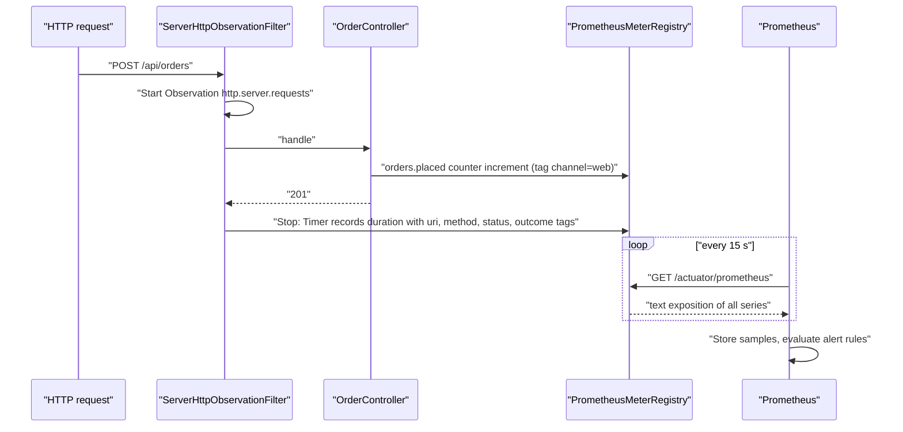
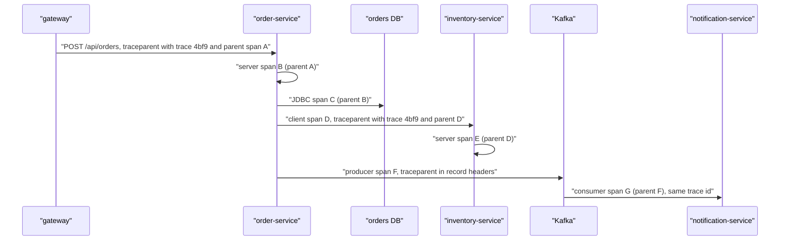

@@ 3 | TOPIC | Metrics with Micrometer and Prometheus | Counters, timers, gauges, tags, histograms and percentiles, Prometheus scraping, PromQL and cardinality | SHOULD
# Metrics with Micrometer and Prometheus

**Level: Advanced | Phase 21 | Priority: SHOULD | Since: Micrometer 1.0 with Spring Boot 2.0 (2018); Observation API in Micrometer 1.10 with Boot 3.0**

> **30-second interview answer:** Micrometer is a vendor-neutral metrics facade, "SLF4J for metrics": code records counters, timers, gauges and distribution summaries with tags, and a registry exports them to Prometheus, Datadog, CloudWatch and others. Spring Boot auto-instruments HTTP server and client requests, JVM memory and GC, thread pools, HikariCP, Kafka and caches. Prometheus scrapes `/actuator/prometheus` and stores time series that I query with PromQL for dashboards and alerts, usually following RED (rate, errors, duration) per endpoint. The main pitfall is cardinality: tags must have a small, bounded set of values, never user ids or raw URLs.

## 1. Concept in Simple Words
### Analogy
The gauges and odometer in a car, recorded by a fleet tracker.

| Car fleet | Metrics |
|---|---|
| Odometer: only goes up | Counter (orders placed total) |
| Fuel gauge: goes up and down | Gauge (pending orders, queue size) |
| Stopwatch for each trip, with average and slowest | Timer (request duration with percentiles) |
| Weighing each parcel delivered | Distribution summary (order value) |
| Labels on readings: which car, which route | Tags or labels (`uri`, `status`, `method`) |
| The fleet office polling every car every 15 seconds | Prometheus scraping |
| "Alert if any car's engine is over 110 degrees for 5 minutes" | Alerting rules on PromQL |
| Labelling each reading with the passenger's name | High cardinality: millions of series, the tracker crashes |

### What it is
- **Meter types:** `Counter` (monotonic count), `Gauge` (current value sampled from an object), `Timer` (count, total time, max, optional histogram), `DistributionSummary` (like a timer for non-time values), `LongTaskTimer` (in-flight long operations).
- **Tags (dimensions):** key-value pairs that split a metric into time series: `http.server.requests{uri="/api/orders/{id}", status="200", method="GET"}`.
- **MeterRegistry:** where meters live; Boot creates a composite with the configured exporters. `PrometheusMeterRegistry` renders the text format at `/actuator/prometheus`.
- **Naming:** Micrometer uses dot notation (`orders.placed`); the Prometheus registry converts it to `orders_placed_total` for counters and `_seconds` for timers.
- **Percentiles and histograms:** client-side percentiles are computed per instance and cannot be aggregated across instances; **percentile histograms** publish buckets (`_bucket{le="0.1"}`) that Prometheus can aggregate with `histogram_quantile`.
- **SLO buckets:** explicit bucket boundaries matching your objectives (100 ms, 500 ms).
- **Observation API:** one instrumentation (`Observation`, `@Observed`) that produces a timer metric and a trace span together.
- **RED method:** Rate, Errors, Duration for request-driven services. **USE method:** Utilization, Saturation, Errors for resources (CPU, pools).

### Why it exists
Logs tell you about individual events; metrics tell you about the whole system cheaply. "p99 latency of `/api/orders` rose from 200 ms to 2 s at 14:05 on all pods" is one PromQL query; reconstructing it from logs would mean parsing millions of lines. Metrics are the basis of alerting and SLOs. Micrometer exists so libraries (Spring, Hikari, Kafka clients) can instrument once and you choose the monitoring backend.

## 2. How It Works


What a timer with a percentile histogram exposes:

```text
http_server_requests_seconds_count{method="GET",status="200",uri="/api/orders/{id}"} 1520
http_server_requests_seconds_sum{method="GET",status="200",uri="/api/orders/{id}"} 76.4
http_server_requests_seconds_max{method="GET",status="200",uri="/api/orders/{id}"} 1.92
http_server_requests_seconds_bucket{method="GET",status="200",uri="/api/orders/{id}",le="0.1"} 1190
http_server_requests_seconds_bucket{method="GET",status="200",uri="/api/orders/{id}",le="0.5"} 1490
http_server_requests_seconds_bucket{method="GET",status="200",uri="/api/orders/{id}",le="+Inf"} 1520

Number of time series = product of distinct tag values:
  10 uris x 4 methods x 6 statuses x 70 buckets = 16,800 series per instance (fine)
  add tag customerId with 1,000,000 values => 16.8 billion (Prometheus falls over)
```

Spring Boot specifics: the `uri` tag uses the route template (`/api/orders/{id}`), not the actual path, precisely to keep cardinality bounded. Unmatched requests get `uri="UNKNOWN"` or `NOT_FOUND`. `management.metrics.tags.*` adds common tags (application, region) to every meter.

## 3. Code Example
### Code
OrderHub business metrics in order-service, plus Prometheus and alert configuration.

```yaml
# order-service application.yml
management:
  endpoints:
    web:
      exposure:
        include: health,info,prometheus
  metrics:
    tags:
      application: ${spring.application.name}     # common tag on every meter
      region: eu-west-1
    distribution:
      percentiles-histogram:
        http.server.requests: true                 # aggregatable buckets
        orders.placement: true
      slo:
        http.server.requests: 100ms,300ms,1s       # buckets aligned with SLOs
  observations:
    annotations:
      enabled: true                                # enables @Observed, @Timed, @Counted aspects (Boot 3.2+)
```

```java
// order-service: business metrics with the MeterRegistry API
package com.orderhub.order.metrics;

import io.micrometer.core.instrument.Counter;
import io.micrometer.core.instrument.DistributionSummary;
import io.micrometer.core.instrument.Gauge;
import io.micrometer.core.instrument.MeterRegistry;
import io.micrometer.core.instrument.Timer;
import java.math.BigDecimal;
import java.util.function.Supplier;
import org.springframework.jdbc.core.simple.JdbcClient;
import org.springframework.stereotype.Component;

@Component
public class OrderMetrics {
    private final MeterRegistry registry;
    private final DistributionSummary orderValue;
    private final Timer placementTimer;

    public OrderMetrics(MeterRegistry registry, JdbcClient jdbc) {
        this.registry = registry;
        this.orderValue = DistributionSummary.builder("orders.value")
                .description("Order total in EUR")
                .baseUnit("euros")
                .serviceLevelObjectives(10, 50, 100, 500)
                .register(registry);
        this.placementTimer = Timer.builder("orders.placement")
                .description("Time to place an order including inventory reservation")
                .register(registry);
        // Gauge: sampled on every scrape; keep the lambda cheap (here: an indexed count query)
        Gauge.builder("orders.pending", jdbc,
                        j -> j.sql("select count(*) from orders where status = 'PENDING'").query(Long.class).single())
                .description("Orders waiting for the saga to finish")
                .register(registry);
    }

    public <T> T timePlacement(Supplier<T> placement) {
        return placementTimer.record(placement);
    }

    public void placed(String channel, BigDecimal total) {
        // bounded tag values: web, mobile, partner
        Counter.builder("orders.placed").tag("channel", channel).register(registry).increment();
        orderValue.record(total.doubleValue());
    }

    public void rejected(String reason) {
        // reason is an enum-like code (INSUFFICIENT_STOCK, PAYMENT_DECLINED), never free text
        registry.counter("orders.rejected", "reason", reason).increment();
    }
}
```

```java
// order-service: annotation style with the Observation API (metric + span in one)
package com.orderhub.order;

import com.orderhub.order.metrics.OrderMetrics;
import io.micrometer.observation.annotation.Observed;
import java.math.BigDecimal;
import org.springframework.stereotype.Service;

@Service
public class CheckoutService {
    private final OrderMetrics metrics;

    public CheckoutService(OrderMetrics metrics) { this.metrics = metrics; }

    @Observed(name = "orderhub.checkout", contextualName = "checkout",
              lowCardinalityKeyValues = {"flow", "standard"})
    public long checkout(String channel, BigDecimal total) {
        long orderId = metrics.timePlacement(() -> 42L);   // placement logic omitted for brevity
        metrics.placed(channel, total);
        return orderId;
    }
}
```

```yaml
# prometheus.yml: scrape the management port of every order-service pod
scrape_configs:
  - job_name: order-service
    metrics_path: /actuator/prometheus
    scrape_interval: 15s
    kubernetes_sd_configs:
      - role: pod
    relabel_configs:
      - source_labels: [__meta_kubernetes_pod_label_app]
        regex: order-service
        action: keep
      - source_labels: [__address__]
        regex: (.+):\d+
        replacement: ${1}:9081
        target_label: __address__
```

```yaml
# alert-rules.yml
groups:
  - name: order-service
    rules:
      - alert: OrderServiceHighErrorRate
        expr: >
          sum(rate(http_server_requests_seconds_count{application="order-service",status=~"5.."}[5m]))
          / sum(rate(http_server_requests_seconds_count{application="order-service"}[5m])) > 0.02
        for: 5m
        labels:
          severity: page
        annotations:
          summary: "More than 2% of order-service requests fail"
      - alert: OrderServiceSlowP99
        expr: >
          histogram_quantile(0.99, sum by (le, uri)
            (rate(http_server_requests_seconds_bucket{application="order-service"}[5m]))) > 1
        for: 10m
        labels:
          severity: ticket
      - alert: OrdersStuckPending
        expr: orders_pending{application="order-service"} > 100
        for: 15m
        labels:
          severity: page
```

### Walkthrough
- `percentiles-histogram` publishes buckets for HTTP requests and order placement, so p95 and p99 can be computed across all pods in Prometheus. `slo` adds exact buckets at 100 ms, 300 ms and 1 s, which makes "percentage of requests under 300 ms" an exact query.
- Common tags `application` and `region` are added to every meter, which is how dashboards filter by service.
- `OrderMetrics` registers meters once in the constructor. `Counter.builder(name).tag(k, v).register(registry)` is idempotent: asking for the same name and tags returns the existing meter, so calling it per request is safe (but slightly slower than caching the counter).
- The gauge reads from the database on every scrape. Gauges hold a weak reference to their object; here the `JdbcClient` bean lives as long as the context, so it is safe. Keep gauge functions cheap.
- `orders.rejected` uses a `reason` tag with a closed set of codes; free-text messages would create unbounded series.
- `@Observed` (enabled by `management.observations.annotations.enabled`) creates an observation that becomes both a timer `orderhub.checkout` and a span `checkout` if tracing is present.
- The alert rules implement RED: error ratio over 5 minutes, p99 latency from histogram buckets per URI, and a business alert on stuck sagas.

### Output
```http
GET http://localhost:9081/actuator/prometheus

HTTP/1.1 200 OK
Content-Type: text/plain;version=0.0.4;charset=utf-8

# HELP orders_placed_total
# TYPE orders_placed_total counter
orders_placed_total{application="order-service",channel="web",region="eu-west-1"} 1342.0
orders_placed_total{application="order-service",channel="mobile",region="eu-west-1"} 611.0
# HELP orders_rejected_total
# TYPE orders_rejected_total counter
orders_rejected_total{application="order-service",reason="INSUFFICIENT_STOCK",region="eu-west-1"} 27.0
# HELP orders_pending Orders waiting for the saga to finish
# TYPE orders_pending gauge
orders_pending{application="order-service",region="eu-west-1"} 3.0
# HELP orders_value_euros Order total in EUR
# TYPE orders_value_euros histogram
orders_value_euros_bucket{application="order-service",region="eu-west-1",le="10.0"} 120
orders_value_euros_bucket{application="order-service",region="eu-west-1",le="50.0"} 1290
orders_value_euros_bucket{application="order-service",region="eu-west-1",le="100.0"} 1801
orders_value_euros_bucket{application="order-service",region="eu-west-1",le="500.0"} 1950
orders_value_euros_bucket{application="order-service",region="eu-west-1",le="+Inf"} 1953
orders_value_euros_count{application="order-service",region="eu-west-1"} 1953
orders_value_euros_sum{application="order-service",region="eu-west-1"} 81244.5
# HELP hikaricp_connections_active Active connections
# TYPE hikaricp_connections_active gauge
hikaricp_connections_active{application="order-service",pool="HikariPool-1",region="eu-west-1"} 4.0
# HELP jvm_memory_used_bytes The amount of used memory
# TYPE jvm_memory_used_bytes gauge
jvm_memory_used_bytes{application="order-service",area="heap",id="G1 Old Gen",region="eu-west-1"} 8.4934656E7
```

PromQL used on the Grafana dashboard:

```text
Request rate per URI:     sum by (uri) (rate(http_server_requests_seconds_count{application="order-service"}[1m]))
Error ratio:              sum(rate(http_server_requests_seconds_count{status=~"5.."}[5m])) / sum(rate(http_server_requests_seconds_count[5m]))
p99 latency per URI:      histogram_quantile(0.99, sum by (le, uri) (rate(http_server_requests_seconds_bucket[5m])))
Share under 300 ms (SLI): sum(rate(http_server_requests_seconds_bucket{le="0.3"}[5m])) / sum(rate(http_server_requests_seconds_count[5m]))
Pool saturation:          hikaricp_connections_pending > 0
```

### Compare
| Approach | Aggregatable across pods | Cost | Use |
|---|---|---|---|
| Average only (`sum / count`) | Yes | Low | Hides tail latency, avoid as main signal |
| Client-side percentiles (`publishPercentiles(0.99)`) | No | Low | Single-instance debugging |
| Percentile histogram buckets | Yes | More series | Default for key timers |
| SLO buckets | Yes | Few series | Exact SLI ratios |
| Logs-derived metrics | Yes, at query cost | High | When you cannot change code |

## 4. Interview Questions
**Basic**
1. **What is Micrometer?**
   A vendor-neutral facade for application metrics. You instrument once with counters, timers, gauges and summaries, and registries export to Prometheus, Datadog, CloudWatch, OTLP and others. Spring Boot auto-configures it and instruments common components.
2. **Counter vs gauge vs timer?**
   A counter only increases (requests served); you look at its rate. A gauge reports a current value that goes up and down (queue size). A timer records durations and counts of events, with optional histogram buckets for percentiles.
3. **How does Prometheus get metrics from a Spring Boot app?**
   It pulls: Prometheus scrapes `/actuator/prometheus` at a fixed interval, discovering targets via Kubernetes service discovery or static config. The app needs `micrometer-registry-prometheus` and the endpoint exposed.

**Follow-up**
4. **Why can't you average p99 values from several instances?**
   Percentiles are not additive: the average of each pod's p99 is not the fleet's p99, and one slow pod is hidden. Publish histogram buckets and compute the quantile in Prometheus with `histogram_quantile` over summed bucket rates.
5. **What is high cardinality and why is it dangerous?**
   Cardinality is the number of distinct tag-value combinations; each is a separate time series stored in memory by Prometheus. Tags like user id, order id, session id or raw URLs create millions of series, exploding memory and query time, and can take down the monitoring system. Keep tag values bounded; put ids in logs and traces.
6. **What would you put on a dashboard for a Spring Boot service?**
   RED per endpoint (request rate, error ratio, p50, p95, p99), JVM (heap after GC, GC pause time, threads), pools (Hikari active and pending, executor queue), downstream calls (client request latency and errors, circuit breaker states), Kafka consumer lag, and business metrics (orders per minute, rejections by reason).

**Tricky / scenario**
7. **Prometheus memory jumped after a deployment. What do you suspect and how do you find it?**
   A new high-cardinality tag: for example a custom `uri` tag built from the actual path (`/api/orders/12345`) or an exception message as a tag. Query `topk(10, count by (__name__) ({__name__=~".+"}))` to find the metric with the most series, then fix the tag or drop it with a `MeterFilter`.
8. **The gateway shows p99 of 2 s but each service's p99 is under 300 ms. How?**
   Tail latency compounds across fan-out: if a request calls several services, the chance that at least one is slow grows. Queueing in the gateway or connection pools before timers start also counts. Look at traces of slow requests to see where time goes, and check client-side timers (`http.client.requests`) and pool pending metrics.
9. **Your gauge always shows 0 or NaN after a while. Why?**
   Gauges hold a weak reference to the observed object; if nothing else references it, it is garbage-collected and the gauge reports NaN. Keep a strong reference (a field in a bean) or use `Gauge.builder(name, obj, fn).strongReference(true)`, and do not create gauges on short-lived objects.

**What the interviewer is really testing:** whether you can design useful metrics (RED, percentiles done right, business signals) without hurting the monitoring system with cardinality.

## 5. Pitfalls & Best Practices
### Common mistakes
| Mistake | What goes wrong | Fix |
|---|---|---|
| User or order ids as tags | Millions of series, Prometheus OOM | Bounded tags; ids in logs and traces |
| Averages as the latency signal | Tail latency hidden | Histograms and p95 or p99 |
| Averaging per-instance percentiles | Wrong numbers | `histogram_quantile` over buckets |
| Gauge on a short-lived object | NaN after GC | Strong reference to a long-lived object |
| Expensive work in gauge functions | Slow scrapes, timeouts | Cache or keep it cheap |
| Alerting on causes (CPU 80%) instead of symptoms | Noisy pages | Alert on SLO burn: errors and latency |

### Best practices
- Name metrics by domain (`orders.placed`), units in the name or base unit, tags for dimensions.
- Use `MeterFilter` beans to rename, deny or cap tags centrally (`MeterFilter.maximumAllowableTags`).
- Define SLOs (for example 99% of checkouts under 500 ms) and alert on error-budget burn rate.
- Enable exemplars with tracing so a latency bucket links to a sample trace.
- Keep dashboards per service with the same layout so on-call engineers read any service quickly.

### Compare with
| System | Model | Notes |
|---|---|---|
| Prometheus | Pull, local TSDB, PromQL | De facto standard on Kubernetes |
| OTLP metrics to a collector | Push | Vendor-neutral pipeline, Micrometer registry `micrometer-registry-otlp` |
| Datadog, New Relic | Agent or push, SaaS | Commercial, all-in-one |
| CloudWatch | Push, AWS-native | Costs per metric, coarse resolution |
| StatsD | Push UDP, no tags in classic form | Legacy |

## 6. Hands-on Exercise
Instrument inventory-service reservations:
1. A timer `inventory.reservation` tagged with `outcome` (`reserved`, `rejected`, `error`) that has a percentile histogram.
2. A counter `inventory.stock.depleted` tagged with `sku_category` (from a small fixed list) when stock reaches zero.
3. A `MeterFilter` that denies any meter tag called `sku` (someone keeps adding it) to protect Prometheus.
4. A PromQL query showing the rejection ratio over 10 minutes.

Acceptance criteria: `/actuator/prometheus` shows `inventory_reservation_seconds_bucket` with the outcome tag; no series contains a `sku` label.

<details><summary>Solution</summary>

```java
package com.orderhub.inventory.metrics;

import io.micrometer.core.instrument.MeterRegistry;
import io.micrometer.core.instrument.Timer;
import io.micrometer.core.instrument.config.MeterFilter;
import java.util.function.Supplier;
import org.springframework.context.annotation.Bean;
import org.springframework.context.annotation.Configuration;
import org.springframework.stereotype.Component;

@Configuration
class MetricsConfig {
    @Bean
    MeterFilter denySkuTag() {
        return MeterFilter.ignoreTags("sku");          // strips the tag from every meter
    }
}

@Component
public class ReservationMetrics {
    public enum Outcome { RESERVED, REJECTED, ERROR }

    private final MeterRegistry registry;

    public ReservationMetrics(MeterRegistry registry) { this.registry = registry; }

    public boolean timeReservation(Supplier<Boolean> reservation) {
        Timer.Sample sample = Timer.start(registry);
        Outcome outcome = Outcome.ERROR;
        try {
            boolean ok = reservation.get();
            outcome = ok ? Outcome.RESERVED : Outcome.REJECTED;
            return ok;
        } finally {
            sample.stop(Timer.builder("inventory.reservation")
                    .tag("outcome", outcome.name().toLowerCase())
                    .publishPercentileHistogram()
                    .register(registry));
        }
    }

    public void depleted(String skuCategory) {           // books, stationery, electronics
        registry.counter("inventory.stock.depleted", "sku_category", skuCategory).increment();
    }
}
```

```text
Rejection ratio over 10 minutes:
sum(rate(inventory_reservation_seconds_count{outcome="rejected"}[10m]))
  / sum(rate(inventory_reservation_seconds_count[10m]))
```
`Timer.Sample` measures the duration even when the reservation throws, and the outcome tag is decided at the end, so errors are timed too. The `MeterFilter` bean is applied by Boot to every registry, so a careless `sku` tag anywhere is dropped instead of exploding cardinality.
</details>

## 7. Recall
Q: What are the main Micrometer meter types?
A: Counter, Gauge, Timer, DistributionSummary and LongTaskTimer.

Q: Why publish percentile histograms instead of client-side percentiles in Micrometer?
A: Histogram buckets can be aggregated across instances in Prometheus with `histogram_quantile`; client-side percentiles cannot.

Q: What is metric cardinality and why must Micrometer tags be bounded?
A: The number of distinct tag-value combinations; each is a stored time series, so unbounded values like user ids explode Prometheus memory.

Q: Which Spring Boot endpoint does Prometheus scrape and which dependency enables it?
A: `/actuator/prometheus`, enabled by `micrometer-registry-prometheus`.

Q: What does the RED method measure for a service?
A: Request rate, error rate and duration (latency), usually per endpoint.

**Related:** [[Spring Boot Actuator]] · [[Distributed Tracing with OpenTelemetry]] · [[Resilience4j: Circuit Breaker, Retry, Rate Limiter, Bulkhead]]

@@ 3 | TOPIC | Distributed Tracing with OpenTelemetry | Traces, spans and context propagation across services with Micrometer Tracing, the OTel bridge and OTLP export | SHOULD
# Distributed Tracing with OpenTelemetry

**Level: Advanced | Phase 21 | Priority: SHOULD | Since: Micrometer Tracing 1.0 with Spring Boot 3.0 (2022), replacing Spring Cloud Sleuth; OpenTelemetry tracing stable since 2021**

> **30-second interview answer:** Distributed tracing follows one request across services. A trace is a tree of spans; each span is a timed operation (an HTTP call, a query, a Kafka publish) with a trace id shared by the whole request and its own span id. Context is propagated between services in headers, by default the W3C `traceparent` header. In Spring Boot 3, Micrometer Tracing (with the OpenTelemetry bridge) auto-instruments incoming and outgoing HTTP, Kafka and more through the Observation API, puts the trace id into the logs' MDC, and exports spans over OTLP to a collector and a backend like Jaeger or Grafana Tempo. Sampling controls cost; Sleuth is no longer used.

## 1. Concept in Simple Words
### Analogy
Tracking a parcel through a delivery network.

| Parcel delivery | Distributed tracing |
|---|---|
| The tracking number printed on the parcel | Trace id |
| Each scan at a depot: arrived 09:00, left 09:40 | Span with start time and duration |
| "Scanned at Leeds depot, came from Manchester hub" | Parent-child span relationship |
| The label travels with the parcel to every depot | Context propagation via `traceparent` header |
| Notes on a scan: "damaged box", "weight 2 kg" | Span attributes (tags) and events |
| Only every tenth parcel gets detailed scanning | Sampling |
| The online tracking page showing the whole route | Jaeger or Tempo trace view |

### What it is
- **Trace:** all spans for one end-to-end request, identified by a 128-bit trace id (32 hex characters).
- **Span:** one unit of work with a name, start and end time, a 64-bit span id, a parent span id, a kind (server, client, producer, consumer, internal), attributes and status.
- **Context propagation:** injecting the current trace and span ids into outgoing requests and extracting them on the receiving side. W3C Trace Context: `traceparent: 00-<trace-id>-<parent-span-id>-<flags>`; B3 (`X-B3-TraceId`) is the older Zipkin format.
- **Baggage:** user-defined key-values propagated with the context (for example `tenant-id`), optionally added to MDC; keep it small.
- **Sampling:** deciding which traces to record. Head-based (decided at the start: Boot's `management.tracing.sampling.probability`, default 0.1) or tail-based (decided in the collector after seeing the whole trace, e.g. keep all errors and slow traces).
- **Micrometer Tracing:** Spring's tracing facade (successor of Sleuth) with bridges to OpenTelemetry (`micrometer-tracing-bridge-otel`) or Brave (`micrometer-tracing-bridge-brave`).
- **OTLP:** OpenTelemetry Protocol for exporting traces, metrics and logs, usually to an **OpenTelemetry Collector** that forwards to backends.

### Why it exists
In a monolith a stack trace shows the whole path. In OrderHub a slow checkout could be the gateway, order-service, its database, the inventory call, Kafka, or notification. Logs from five services cannot be lined up by timestamp reliably. A trace shows the full call tree with timings in one picture, and the shared trace id links all logs for that request.

## 2. How It Works


```text
Trace 4bf92f3577b34da6a3ce929d0e0e4736 (total 182 ms)
gateway         POST /api/orders                      [==================================] 182 ms
order-service     http post /api/orders                [================================]  175 ms
order-service       orderhub.checkout                  [=============================]    160 ms
order-service         SELECT orders (jdbc)             [=]                                  4 ms
order-service         http post inventory-service      [=====================]            118 ms
inventory-service       http post /api/inventory/res    [==================]             110 ms
order-service         order-events send (kafka)                              [=]            3 ms
notification-service      order-events receive (kafka)                          [==]       12 ms (async, later)
```

How Spring Boot wires it:
- `spring-boot-starter-actuator` + `micrometer-tracing-bridge-otel` + `opentelemetry-exporter-otlp` auto-configure an OpenTelemetry SDK, a `Tracer`, W3C propagation and an OTLP span exporter.
- Spring MVC's `ServerHttpObservationFilter`, `RestClient`/`RestTemplate`/`WebClient` built from Boot's builders, `KafkaTemplate` and listeners (with `observation-enabled`), `@Scheduled`, and `@Observed` methods create **Observations**; a tracing handler turns each into a span, a metrics handler into a timer.
- A context-propagation library keeps the current observation in a thread local and copies it across `ContextPropagatingTaskDecorator`, Reactor operators and Kafka headers.
- `Slf4JEventListener` puts `traceId` and `spanId` into the MDC so every log line carries them; Boot's default log pattern prints them.
- JDBC spans need an extra library (`net.ttddyy.observation:datasource-micrometer-spring-boot`); the alternative is the OpenTelemetry Java agent, which instruments bytecode without code changes.

## 3. Code Example
### Code
Tracing across gateway, order-service, inventory-service and Kafka, exported to Jaeger through the OpenTelemetry Collector.

```xml
<!-- every service's pom.xml (versions managed by Spring Boot) -->
<dependency>
    <groupId>org.springframework.boot</groupId>
    <artifactId>spring-boot-starter-actuator</artifactId>
</dependency>
<dependency>
    <groupId>io.micrometer</groupId>
    <artifactId>micrometer-tracing-bridge-otel</artifactId>
</dependency>
<dependency>
    <groupId>io.opentelemetry</groupId>
    <artifactId>opentelemetry-exporter-otlp</artifactId>
</dependency>
<!-- optional: JDBC spans -->
<dependency>
    <groupId>net.ttddyy.observation</groupId>
    <artifactId>datasource-micrometer-spring-boot</artifactId>
    <version>1.1.1</version>
</dependency>
```

```yaml
# every service's application.yml
management:
  tracing:
    sampling:
      probability: 1.0                   # 100% in dev; 0.05 to 0.1 in prod, or tail sampling in the collector
    propagation:
      type: w3c                          # default; add b3 if old services still use it
    baggage:
      remote-fields: tenant-id
      correlation:
        fields: tenant-id                # also put baggage into the MDC
  otlp:
    tracing:
      endpoint: http://otel-collector:4318/v1/traces
spring:
  kafka:
    template:
      observation-enabled: true          # producer spans + traceparent header
    listener:
      observation-enabled: true          # consumer spans continue the trace
```

```yaml
# docker-compose.yml additions
services:
  otel-collector:
    image: otel/opentelemetry-collector-contrib:0.114.0
    command: ["--config=/etc/otel/config.yaml"]
    volumes:
      - ./otel-config.yaml:/etc/otel/config.yaml
    ports:
      - "4318:4318"                      # OTLP over HTTP
  jaeger:
    image: jaegertracing/all-in-one:1.62.0
    ports:
      - "16686:16686"                    # UI
```

```yaml
# otel-config.yaml: receive OTLP, keep all errors and slow traces, sample 10% of the rest
receivers:
  otlp:
    protocols:
      http:
        endpoint: 0.0.0.0:4318
processors:
  batch: {}
  tail_sampling:
    decision_wait: 10s
    policies:
      - name: errors
        type: status_code
        status_code:
          status_codes: [ERROR]
      - name: slow
        type: latency
        latency:
          threshold_ms: 1000
      - name: sample-rest
        type: probabilistic
        probabilistic:
          sampling_percentage: 10
exporters:
  otlp/jaeger:
    endpoint: jaeger:4317
    tls:
      insecure: true
service:
  pipelines:
    traces:
      receivers: [otlp]
      processors: [tail_sampling, batch]
      exporters: [otlp/jaeger]
```

```java
// order-service: a custom span with attributes and an event, via the Observation API
package com.orderhub.order;

import io.micrometer.observation.Observation;
import io.micrometer.observation.ObservationRegistry;
import io.micrometer.tracing.Tracer;
import org.slf4j.Logger;
import org.slf4j.LoggerFactory;
import org.springframework.stereotype.Service;

@Service
public class PricingService {
    private static final Logger log = LoggerFactory.getLogger(PricingService.class);
    private final ObservationRegistry observations;
    private final Tracer tracer;

    public PricingService(ObservationRegistry observations, Tracer tracer) {
        this.observations = observations;
        this.tracer = tracer;
    }

    public long priceInCents(long orderId, int lineCount) {
        return Observation.createNotStarted("orderhub.pricing", observations)
                .contextualName("calculate-price")                  // span name
                .lowCardinalityKeyValue("pricing.strategy", "standard")   // tag on metric AND span
                .highCardinalityKeyValue("order.id", String.valueOf(orderId)) // span only, never a metric tag
                .observe(() -> {
                    log.info("Pricing order with {} lines", lineCount);     // log line carries traceId
                    long cents = 1250L * lineCount;
                    if (cents > 100_000) {
                        tracer.currentSpan().event("manual-review-required");
                    }
                    return cents;
                });
    }
}
```

```java
// order-service: returning the trace id to clients helps support tickets
package com.orderhub.order.web;

import io.micrometer.tracing.Span;
import io.micrometer.tracing.Tracer;
import jakarta.servlet.FilterChain;
import jakarta.servlet.ServletException;
import jakarta.servlet.http.HttpServletRequest;
import jakarta.servlet.http.HttpServletResponse;
import java.io.IOException;
import org.springframework.stereotype.Component;
import org.springframework.web.filter.OncePerRequestFilter;

@Component
class TraceIdResponseFilter extends OncePerRequestFilter {
    private final Tracer tracer;

    TraceIdResponseFilter(Tracer tracer) { this.tracer = tracer; }

    @Override
    protected void doFilterInternal(HttpServletRequest request, HttpServletResponse response,
                                    FilterChain chain) throws ServletException, IOException {
        Span span = tracer.currentSpan();
        if (span != null) response.setHeader("X-Trace-Id", span.context().traceId());
        chain.doFilter(request, response);
    }
}
```

### Walkthrough
- Three dependencies give tracing: the actuator (observation infrastructure), the OTel bridge (Micrometer Tracing implemented by the OpenTelemetry SDK) and the OTLP exporter. No code changes are needed for HTTP and Kafka spans.
- Sampling 1.0 records every trace in development. In production, head sampling at 5 to 10% or tail sampling in the collector controls cost; the collector config keeps 100% of errors and slow traces and 10% of the rest, which is what you actually want during incidents. With tail sampling the services should send everything (probability 1.0) to the collector.
- W3C propagation sends `traceparent`; baggage `tenant-id` travels with the request and is copied into the MDC.
- Kafka observation adds `traceparent` to record headers on send and continues the trace in the consumer, so the asynchronous notification shows up in the same trace.
- `PricingService` creates a custom observation. Low-cardinality key-values go on both the metric and the span; high-cardinality ones (order id) only on the span, which is safe because spans are individual records. The span event marks a notable moment inside the span.
- `TraceIdResponseFilter` returns the trace id to the client; when a customer reports an error, support can paste the id into Jaeger.

### Output
Request through the gateway:

```http
POST http://localhost:8080/api/orders
{"customerId":7,"lines":[{"sku":"BOOK-1","quantity":2}]}

HTTP/1.1 201 Created
X-Trace-Id: 4bf92f3577b34da6a3ce929d0e0e4736
```

Headers seen by inventory-service (logged at DEBUG):

```text
traceparent: 00-4bf92f3577b34da6a3ce929d0e0e4736-7a085853722dc6d2-01
baggage: tenant-id=acme
```

Logs from three services share the trace id:

```text
gateway           INFO [gateway] [ctor-http-nio-3] [4bf92f3577b34da6a3ce929d0e0e4736-a1b2c3d4e5f60718] CorrelationIdFilter : /api/orders -> 201 CREATED in 182 ms
order-service     INFO [order-service] [nio-8081-exec-3] [4bf92f3577b34da6a3ce929d0e0e4736-3c9d0e1f2a3b4c5d] PricingService : Pricing order with 1 lines
inventory-service INFO [inventory-service] [nio-8082-exec-7] [4bf92f3577b34da6a3ce929d0e0e4736-9e8f7a6b5c4d3e2f] StockService : Reserved BOOK-1 x2 for order 42
```

Jaeger UI (`http://localhost:16686`) shows the span tree from the "How It Works" section: 8 spans across 4 services, with the inventory call taking 118 of the 182 ms.

### Compare
| Spring Cloud Sleuth (Boot 2) | Micrometer Tracing (Boot 3+) |
|---|---|
| `spring-cloud-starter-sleuth` | `micrometer-tracing-bridge-otel` or `-brave` |
| Separate tracing and metrics instrumentation | One Observation produces both |
| B3 headers by default | W3C `traceparent` by default |
| `spring.sleuth.sampler.probability` | `management.tracing.sampling.probability` |
| Not compatible with Boot 3 | Maintained, part of Micrometer |

## 4. Interview Questions
**Basic**
1. **What are traces and spans?**
   A trace represents one request's whole journey and has a trace id. Spans are the timed operations inside it (server handling, client calls, queries, message sends), each with its own id and a parent, forming a tree. Spans carry attributes, events and status.
2. **How is trace context passed between services?**
   The caller injects the trace id and its current span id into the outgoing request, by default in the W3C `traceparent` header (in Kafka, as record headers); the receiver extracts it and creates child spans. Spring Boot does this automatically for instrumented clients and servers.
3. **What replaced Spring Cloud Sleuth in Spring Boot 3?**
   Micrometer Tracing, with bridges to OpenTelemetry or Brave, built on the Micrometer Observation API. Configuration lives under `management.tracing.*`.

**Follow-up**
4. **How do logs and traces get correlated?**
   Micrometer Tracing puts `traceId` and `spanId` into the MDC for the current span; Boot's default log pattern and structured JSON include them. In Grafana or Kibana you can jump from a trace to logs with that id, and vice versa.
5. **Head-based vs tail-based sampling?**
   Head-based decides at the start of the trace (cheap, consistent across services, but may drop the interesting error traces). Tail-based decides in the collector after the trace completes, so it can keep all errors and slow traces and sample the rest, at the cost of buffering spans in the collector.
6. **Why does the trace break when work moves to another thread or a message queue?**
   The current span is stored in a thread local. A new thread or a consumer has no context unless it is propagated: use `ContextPropagatingTaskDecorator` for executors, Reactor context propagation, and observation-enabled Kafka templates and listeners that carry headers.

**Tricky / scenario**
7. **Traces show order-service calling inventory, but inventory's spans appear as a separate trace. Why?**
   The client did not propagate context: usually because the `RestClient` or `RestTemplate` was created with `new` or `RestClient.builder()` instead of Boot's auto-configured builder, so the observation interceptor is missing. Or the two services use different propagation formats (B3 vs W3C). Use Boot's builders and align `management.tracing.propagation.type`.
8. **Tracing costs 15% CPU in production. What do you change?**
   Lower head sampling (5% or less) or move to tail sampling with services sending to a nearby collector, batch exports, reduce custom span volume in tight loops, and avoid large attributes. Unsampled spans are cheap but still propagate context, so logs keep their trace id.
9. **Should you put the customer id as a span attribute? As a metric tag?**
   As a span attribute (high-cardinality key-value) it is acceptable if privacy rules allow, because spans are individual records and help find a customer's trace. As a metric tag, never: it would explode cardinality. Personal data in traces must follow the same retention and masking rules as logs.

**What the interviewer is really testing:** whether you can follow a request across services in practice: propagation, correlation with logs, sampling trade-offs and the common reasons traces break.

## 5. Pitfalls & Best Practices
### Common mistakes
| Mistake | What goes wrong | Fix |
|---|---|---|
| Creating HTTP clients with `new` or bare builders | No propagation, broken traces | Use Boot's auto-configured builders |
| Kafka observation not enabled | Async parts in separate traces | `observation-enabled: true` on template and listener |
| Using Sleuth with Boot 3 | Does not start or does nothing | Micrometer Tracing |
| 100% head sampling in high-traffic production | Cost and overhead | Low head sampling or tail sampling |
| Thread pools without context propagation | Lost trace id in async logs | `ContextPropagatingTaskDecorator` |
| Mixed propagation formats | Traces split between old and new services | Configure W3C plus B3 during migration |

### Best practices
- Send telemetry to an OpenTelemetry Collector, not directly to a vendor, so backends can change.
- Return the trace id in responses (`X-Trace-Id`) and error bodies for support.
- Name spans by operation, not by id (`calculate-price`, not `price-order-42`).
- Add business attributes sparingly (`order.channel`) to make traces searchable.
- Link metrics to traces with exemplars and traces to logs via trace id in Grafana.

### Compare with
| Option | How | Trade-off |
|---|---|---|
| Micrometer Tracing + OTel bridge | Library, Spring auto-config | Spring-native, Observation API, needs dependencies |
| OpenTelemetry Java agent | `-javaagent`, bytecode instrumentation | Zero code, broad library coverage, startup cost, less Spring-aware |
| OpenTelemetry Spring Boot starter | OTel's own starter | Pure OTel APIs, alternative to Micrometer |
| Service mesh tracing | Sidecar proxies | Sees network hops only, needs app header propagation anyway |
| Commercial APM agents | Vendor agent | Rich UI, cost and lock-in |

## 6. Hands-on Exercise
Make the OrderHub outbox relay part of the original request's trace. Today `OrderPlaced` events are published by a scheduled job, so their Kafka spans start new traces. Store the `traceparent` of the request in the outbox row when the order is placed, and when the relay publishes, send that `traceparent` as a Kafka header so notification-service's consumer span joins the original trace.

Acceptance criteria: in Jaeger, the notification consumer span appears under the same trace id as the `POST /api/orders` request; the relay's own scheduled span may stay a separate trace.

<details><summary>Solution</summary>

```sql
-- order-service: V6__outbox_trace.sql
ALTER TABLE outbox_event ADD COLUMN traceparent VARCHAR(60);
```

```java
package com.orderhub.order.outbox;

import io.micrometer.tracing.Span;
import io.micrometer.tracing.Tracer;
import org.springframework.stereotype.Component;

@Component
public class TraceparentProvider {
    private final Tracer tracer;

    public TraceparentProvider(Tracer tracer) { this.tracer = tracer; }

    /** W3C format: version-traceId-spanId-flags */
    public String current() {
        Span span = tracer.currentSpan();
        if (span == null) return null;
        var ctx = span.context();
        String flags = Boolean.TRUE.equals(ctx.sampled()) ? "01" : "00";
        return "00-" + ctx.traceId() + "-" + ctx.spanId() + "-" + flags;
    }
}
```

```java
package com.orderhub.order.outbox;

import java.nio.charset.StandardCharsets;
import java.util.List;
import java.util.UUID;
import java.util.concurrent.TimeUnit;
import org.apache.kafka.clients.producer.ProducerRecord;
import org.springframework.jdbc.core.simple.JdbcClient;
import org.springframework.kafka.core.KafkaTemplate;
import org.springframework.scheduling.annotation.Scheduled;
import org.springframework.stereotype.Component;
import org.springframework.transaction.annotation.Transactional;

@Component
class TracingOutboxRelay {
    record Row(UUID id, String aggregateId, String eventType, String payload, String traceparent) { }

    private final JdbcClient jdbc;
    private final KafkaTemplate<String, String> plainTemplate;   // a template WITHOUT observation enabled

    TracingOutboxRelay(JdbcClient jdbc, KafkaTemplate<String, String> plainTemplate) {
        this.jdbc = jdbc;
        this.plainTemplate = plainTemplate;
    }

    @Scheduled(fixedDelay = 500)
    @Transactional
    public void publish() throws Exception {
        List<Row> rows = jdbc.sql("""
                select id, aggregate_id, event_type, payload::text as payload, traceparent
                from outbox_event where published_at is null
                order by created_at limit 100 for update skip locked
                """).query(Row.class).list();
        for (Row r : rows) {
            var record = new ProducerRecord<>("order-events", r.aggregateId(), r.payload());
            record.headers().add("eventType", r.eventType().getBytes(StandardCharsets.UTF_8));
            if (r.traceparent() != null) {
                record.headers().add("traceparent", r.traceparent().getBytes(StandardCharsets.UTF_8));
            }
            plainTemplate.send(record).get(5, TimeUnit.SECONDS);
            jdbc.sql("update outbox_event set published_at = now() where id = ?").param(r.id()).update();
        }
    }
}
```
When placing the order, store `traceparentProvider.current()` in the new column next to the payload. The relay uses a `KafkaTemplate` without observation so it does not overwrite the header with its own scheduled-job trace; the consumer's observation (enabled) extracts the stored `traceparent` and its span becomes a child of the original request's span.
</details>

## 7. Recall
Q: What is the difference between a trace and a span in distributed tracing?
A: A trace is one request's full journey with a shared trace id; spans are the timed operations within it, linked by parent ids into a tree.

Q: Which header does Spring Boot 3 use by default to propagate trace context?
A: The W3C `traceparent` header (format version-traceId-spanId-flags).

Q: Which dependencies enable OpenTelemetry tracing in Spring Boot 3?
A: `spring-boot-starter-actuator`, `micrometer-tracing-bridge-otel` and an exporter such as `opentelemetry-exporter-otlp`.

Q: What does `management.tracing.sampling.probability` control in Spring Boot?
A: The head-based sampling ratio of traces that are recorded and exported; the default is 0.1.

Q: Why do traces often break at `RestClient` calls in Spring Boot?
A: The client was built without Boot's auto-configured builder, so the observation interceptor that propagates context is missing.

**Related:** [[Logging with SLF4J, Logback and MDC]] · [[Metrics with Micrometer and Prometheus]] · [[Event-Driven Architecture with Kafka]]
