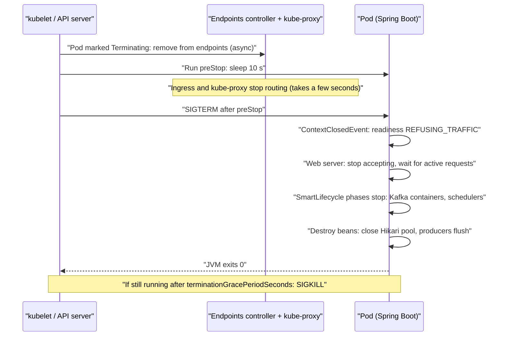
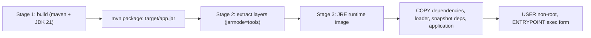

@@ 2 | MODULE | Deployment | Shipping and running Spring Boot services safely with probes, containers, Kubernetes and pipelines | MUST
# Deployment

**Shared analogy: changing the crew of a running train.** A train (your service) must keep running while crews change. **Graceful shutdown and probes** are the rules for swapping a crew member: the leaving conductor finishes checking the tickets already in hand, announces "I am off duty" so no new passengers come to them, and only then steps off; a new one says "ready" only after the briefing (readiness). The **Docker image** is the standard uniform and toolkit every crew member brings, identical on every train. **Kubernetes** is the railway operator scheduling crews, replacing anyone who collapses (liveness) and adding crews at rush hour (autoscaling). **CI/CD** is the training and certification line that every new crew member passes before boarding.

@@ 3 | TOPIC | Graceful Shutdown and Health Probes | Finishing in-flight work on SIGTERM, liveness vs readiness vs startup probes and zero-downtime rollouts | SHOULD
# Graceful Shutdown and Health Probes

**Level: Advanced | Phase 21 | Priority: SHOULD | Since: graceful shutdown in Spring Boot 2.3 (on by default since Boot 3.4); availability states and probe groups since Boot 2.3**

> **30-second interview answer:** When Kubernetes stops a pod it sends SIGTERM, waits `terminationGracePeriodSeconds`, then SIGKILL. With graceful shutdown (default since Boot 3.4) Spring stops accepting new requests, lets in-flight requests finish up to `spring.lifecycle.timeout-per-shutdown-phase`, then closes beans in order. Because removing the pod from the Service endpoints happens in parallel with SIGTERM, I add a short `preStop` sleep so the load balancer stops sending traffic first. Probes tell Kubernetes about the app: liveness says "restart me if I am broken" and must check only internal state; readiness says "send me traffic or not" and may include critical dependencies; a startup probe protects slow-starting apps from early liveness kills.

## 1. Concept in Simple Words
### Analogy
A restaurant closing for the night.

| Restaurant closing | Graceful shutdown and probes |
|---|---|
| The host stops seating new guests | Readiness goes to `REFUSING_TRAFFIC`, new connections refused |
| Guests already eating finish their meals | In-flight requests complete |
| "Last orders" deadline: after 30 minutes, the lights go off anyway | `timeout-per-shutdown-phase`, then SIGKILL after the grace period |
| The sign outside is switched to "closed" a few minutes before the doors lock | `preStop` sleep while endpoints are removed |
| A manager checks "is the chef conscious?" | Liveness probe |
| "Is the kitchen ready to cook?" (gas on, ingredients delivered) | Readiness probe |
| A new chef gets 20 minutes to set up before anyone checks on them | Startup probe |

### What it is
- **SIGTERM:** the polite stop signal. The JVM runs shutdown hooks; Spring's hook closes the application context.
- **Graceful shutdown:** `server.shutdown=graceful` (default `graceful` since Boot 3.4; `immediate` before). The embedded server (Tomcat, Jetty, Undertow, Netty) stops accepting requests and waits for active ones.
- **`spring.lifecycle.timeout-per-shutdown-phase`:** how long each `SmartLifecycle` phase may take (default 30 s).
- **Availability states:** `LivenessState` (`CORRECT`, `BROKEN`) and `ReadinessState` (`ACCEPTING_TRAFFIC`, `REFUSING_TRAFFIC`), published as `AvailabilityChangeEvent`s and exposed by `/actuator/health/liveness` and `/actuator/health/readiness`.
- **Liveness probe:** failure makes the kubelet restart the container.
- **Readiness probe:** failure removes the pod from Service endpoints (no traffic), without restarting.
- **Startup probe:** until it succeeds, liveness and readiness probes are not run; protects slow starts.
- **preStop hook:** a command or sleep run before SIGTERM is sent (Kubernetes 1.30+ supports a native `sleep` action).

### Why it exists
Without graceful shutdown every deployment kills requests mid-flight: customers get 502s, a payment may be charged without an order saved, and Kafka consumers may process records twice. Without proper probes, Kubernetes either sends traffic to a pod that is still starting (errors) or restarts healthy pods because a dependency is down (restart storms). Rolling updates are only zero-downtime if both are right.

## 2. How It Works


Timing budget that must fit:

```text
terminationGracePeriodSeconds (60)
 > preStop sleep (10)
 + web server drain (up to timeout-per-shutdown-phase, 30)
 + other lifecycle phases and bean destruction (a few seconds)
If the sum exceeds the grace period, the JVM is SIGKILLed mid-shutdown.
```

Probe design:

```text
Probe       Endpoint                        Checks                      On failure
startup     /actuator/health/liveness       app finished starting       keep waiting up to failureThreshold x period
liveness    /actuator/health/liveness       internal state only         RESTART container
readiness   /actuator/health/readiness      readiness state + critical  remove from Service, no restart
                                            dependencies (DB)
```

Spring Boot detects Kubernetes (the `KUBERNETES_SERVICE_HOST` environment variable) and enables the probe health groups automatically; elsewhere set `management.endpoint.health.probes.enabled=true`. Readiness becomes `ACCEPTING_TRAFFIC` only after `ApplicationRunner`s and `CommandLineRunner`s have finished, so warm-up code there delays traffic correctly.

## 3. Code Example
### Code
order-service shutdown and probe configuration, a warm-up runner, a maintenance switch, and the Kubernetes pieces.

```yaml
# order-service application.yml
server:
  shutdown: graceful                       # default since Boot 3.4, explicit for clarity
spring:
  lifecycle:
    timeout-per-shutdown-phase: 30s
management:
  server:
    port: 9081
  endpoint:
    health:
      probes:
        enabled: true                      # automatic on Kubernetes
        add-additional-paths: true         # also /livez and /readyz on the main port 8081
      group:
        readiness:
          include: readinessState,db
```

```java
// order-service: warm up before readiness turns ACCEPTING_TRAFFIC
package com.orderhub.order.lifecycle;

import org.slf4j.Logger;
import org.slf4j.LoggerFactory;
import org.springframework.boot.ApplicationArguments;
import org.springframework.boot.ApplicationRunner;
import org.springframework.jdbc.core.simple.JdbcClient;
import org.springframework.stereotype.Component;

@Component
class WarmUpRunner implements ApplicationRunner {
    private static final Logger log = LoggerFactory.getLogger(WarmUpRunner.class);
    private final JdbcClient jdbc;

    WarmUpRunner(JdbcClient jdbc) { this.jdbc = jdbc; }

    @Override
    public void run(ApplicationArguments args) {
        long start = System.currentTimeMillis();
        for (int i = 0; i < 50; i++) {                       // fill the pool, JIT-compile the hot path
            jdbc.sql("select count(*) from orders where status = 'PENDING'").query(Long.class).single();
        }
        log.info("Warm-up finished in {} ms", System.currentTimeMillis() - start);
    }   // readiness flips to ACCEPTING_TRAFFIC only after all runners complete
}
```

```java
// order-service: take a pod out of rotation for maintenance without killing it
package com.orderhub.order.lifecycle;

import org.slf4j.Logger;
import org.slf4j.LoggerFactory;
import org.springframework.boot.availability.AvailabilityChangeEvent;
import org.springframework.boot.availability.ReadinessState;
import org.springframework.context.ApplicationContext;
import org.springframework.context.event.EventListener;
import org.springframework.stereotype.Component;
import org.springframework.web.bind.annotation.PostMapping;
import org.springframework.web.bind.annotation.RestController;

@RestController
class MaintenanceController {
    private static final Logger log = LoggerFactory.getLogger(MaintenanceController.class);
    private final ApplicationContext context;

    MaintenanceController(ApplicationContext context) { this.context = context; }

    @PostMapping("/internal/maintenance/on")      // expose only internally
    void on() {
        AvailabilityChangeEvent.publish(context, ReadinessState.REFUSING_TRAFFIC);
    }

    @PostMapping("/internal/maintenance/off")
    void off() {
        AvailabilityChangeEvent.publish(context, ReadinessState.ACCEPTING_TRAFFIC);
    }

    @EventListener
    void onChange(AvailabilityChangeEvent<ReadinessState> event) {
        log.info("Readiness changed to {}", event.getState());
    }
}
```

```java
// order-service: a long request to observe draining during shutdown
package com.orderhub.order.lifecycle;

import java.time.Duration;
import java.util.Map;
import org.springframework.web.bind.annotation.GetMapping;
import org.springframework.web.bind.annotation.RestController;

@RestController
class SlowReportController {
    @GetMapping("/api/reports/daily")
    Map<String, Object> daily() throws InterruptedException {
        Thread.sleep(Duration.ofSeconds(8));          // simulates a slow report
        return Map.of("orders", 1953, "revenue", 81244.5);
    }
}
```

```yaml
# k8s/order-service-deployment.yaml (probe and shutdown parts)
apiVersion: apps/v1
kind: Deployment
metadata:
  name: order-service
spec:
  replicas: 3
  strategy:
    type: RollingUpdate
    rollingUpdate:
      maxUnavailable: 0                     # never go below 3 ready pods
      maxSurge: 1
  selector:
    matchLabels:
      app: order-service
  template:
    metadata:
      labels:
        app: order-service
    spec:
      terminationGracePeriodSeconds: 60     # > preStop 10 + drain 30 + cleanup
      containers:
        - name: order-service
          image: ghcr.io/orderhub/order-service:1.4.0
          ports:
            - containerPort: 8081
            - containerPort: 9081
          lifecycle:
            preStop:
              sleep:
                seconds: 10                 # Kubernetes 1.30+; older: exec ["sh","-c","sleep 10"]
          startupProbe:
            httpGet:
              path: /actuator/health/liveness
              port: 9081
            periodSeconds: 5
            failureThreshold: 24            # up to 120 s to start
          livenessProbe:
            httpGet:
              path: /actuator/health/liveness
              port: 9081
            periodSeconds: 10
            failureThreshold: 3
          readinessProbe:
            httpGet:
              path: /actuator/health/readiness
              port: 9081
            periodSeconds: 5
            failureThreshold: 2
```

### Walkthrough
- Graceful shutdown makes Tomcat stop accepting connections on SIGTERM and wait up to 30 seconds for active requests. Spring then stops `SmartLifecycle` beans (Kafka listener containers commit and stop, schedulers stop) and destroys beans (Hikari closes connections, Kafka producers flush).
- `add-additional-paths` also exposes `/livez` and `/readyz` on the main port, useful when the management port differs but you want probes to test the real serving port.
- `WarmUpRunner` runs before readiness turns `ACCEPTING_TRAFFIC`, so the first real users do not hit a cold pool and cold JIT. The startup probe gives up to 120 seconds; liveness checks start only after it succeeds.
- `MaintenanceController` flips readiness manually: Kubernetes removes the pod from the Service while the process keeps running, handy for debugging a single pod live.
- In the Deployment, `maxUnavailable: 0` and `maxSurge: 1` mean a new pod must be ready before an old one is terminated. The `preStop` sleep covers the delay between "pod terminating" and "removed from all load balancers"; without it, requests arrive after Tomcat stopped accepting and fail with connection refused or 502.
- The grace period of 60 seconds is larger than the sum of preStop, drain timeout and cleanup.

### Output
Starting a slow request, then `kubectl delete pod order-service-7d9f8-abcde`:

```text
INFO  [order-service] [main] c.o.o.lifecycle.WarmUpRunner : Warm-up finished in 412 ms
INFO  [order-service] [main] c.o.o.l.MaintenanceController : Readiness changed to ACCEPTING_TRAFFIC
(pod deleted: preStop sleeps 10 s, then SIGTERM arrives)
INFO  [order-service] [ionShutdownHook] c.o.o.l.MaintenanceController : Readiness changed to REFUSING_TRAFFIC
INFO  [order-service] [ionShutdownHook] o.s.b.w.e.tomcat.GracefulShutdown : Commencing graceful shutdown. Waiting for active requests to complete
INFO  [order-service] [tomcat-shutdown] o.s.b.w.e.tomcat.GracefulShutdown : Graceful shutdown complete
INFO  [order-service] [ionShutdownHook] o.s.k.l.KafkaMessageListenerContainer : order-service: Consumer stopped
INFO  [order-service] [ionShutdownHook] com.zaxxer.hikari.HikariDataSource : HikariPool-1 - Shutdown completed.
```

The client of the slow report still gets its answer:

```http
GET http://orderhub.example.com/api/reports/daily

HTTP/1.1 200 OK
{"orders":1953,"revenue":81244.5}
```

```text
$ kubectl rollout status deployment/order-service
Waiting for deployment "order-service" rollout to finish: 1 out of 3 new replicas have been updated...
Waiting for deployment "order-service" rollout to finish: 2 out of 3 new replicas have been updated...
deployment "order-service" successfully rolled out
```

### Compare
| Setting | Without | With |
|---|---|---|
| `server.shutdown` | `immediate` (pre-3.4 default): in-flight requests killed | `graceful`: in-flight requests finish |
| preStop sleep | New requests arrive after shutdown starts, 502s | Load balancers updated first |
| Liveness probe | Missing: hung JVM never restarted | Restarts deadlocked or broken pods |
| Liveness including DB | Restart storm during DB outage | DB only in readiness |
| Startup probe | Slow start killed by liveness | Liveness waits until startup succeeds |
| `maxUnavailable: 0` | Capacity dips during rollout | Full capacity throughout |

## 4. Interview Questions
**Basic**
1. **What is graceful shutdown in Spring Boot?**
   On SIGTERM the embedded server stops accepting new requests and waits for active ones to complete, up to `spring.lifecycle.timeout-per-shutdown-phase`, before the context closes beans. It is enabled with `server.shutdown=graceful`, the default since Boot 3.4.
2. **Liveness vs readiness probe?**
   Liveness asks whether the container should be restarted; it must reflect only the app's own health. Readiness asks whether the pod should receive traffic now; it can include critical dependencies and warm-up. Failing liveness restarts the pod; failing readiness only removes it from load balancing.
3. **What is a startup probe for?**
   Slow-starting apps: while the startup probe has not succeeded, liveness and readiness are not checked, so a long startup is not mistaken for a hung app. It replaces large `initialDelaySeconds` values.

**Follow-up**
4. **Why add a preStop sleep if Spring already shuts down gracefully?**
   Kubernetes removes the pod from endpoints and sends SIGTERM in parallel. Ingress controllers and kube-proxy on every node need a few seconds to update, during which they still route requests to the pod. If the app already stopped accepting connections, those requests fail. The sleep keeps the app serving until routing has converged.
5. **What happens to Kafka consumers and scheduled jobs during graceful shutdown?**
   They are `SmartLifecycle` beans stopped in phases: listener containers finish the current record or batch, commit offsets and leave the group (triggering a rebalance), schedulers stop scheduling. If the grace period is too short, the JVM is killed mid-batch and records are reprocessed by another consumer, which is why idempotency still matters.
6. **How does Spring Boot decide readiness?**
   `ReadinessState` becomes `ACCEPTING_TRAFFIC` after the context is refreshed and all application and command-line runners finished; it becomes `REFUSING_TRAFFIC` when the context starts closing. The readiness health group can add indicators such as `db`, and your code can publish `AvailabilityChangeEvent`s.

**Tricky / scenario**
7. **Every deployment causes a burst of 502 errors for about 5 seconds, although graceful shutdown is on. Why?**
   The race between endpoint removal and SIGTERM: the app stops accepting connections immediately while load balancers still send traffic. Add a preStop sleep (5 to 15 seconds), make sure `maxUnavailable` is 0, and check that readiness probes fail fast for terminating pods.
8. **Pods are killed with exit code 137 during shutdown. What does that mean and how do you fix it?**
   137 is 128 plus signal 9: SIGKILL after `terminationGracePeriodSeconds` expired (or the OOM killer). The preStop sleep plus drain time plus cleanup exceeded the grace period. Increase the grace period, reduce `timeout-per-shutdown-phase`, or find the bean that blocks shutdown (thread dump during shutdown).
9. **A service needs 90 seconds to start because it loads a large cache. Liveness kills it at 30 seconds. Options?**
   Add a startup probe with enough `failureThreshold` times `periodSeconds`, load the cache in an `ApplicationRunner` so readiness waits for it, or load lazily in the background while serving degraded results. Also consider CDS or AOT to speed up the framework part of startup.

**What the interviewer is really testing:** whether you can explain zero-downtime deployment end to end: signals, timing, the endpoint race, and what each probe should check.

## 5. Pitfalls & Best Practices
### Common mistakes
| Mistake | What goes wrong | Fix |
|---|---|---|
| No preStop sleep | 502s on every rollout | Sleep 5 to 15 s in preStop |
| Grace period shorter than drain | SIGKILL, exit 137, lost work | Grace period above preStop plus drain plus cleanup |
| Dependencies in liveness | Restart storms | Only internal state in liveness |
| Same endpoint for liveness and readiness | Wrong reaction to failures | Separate probe groups |
| Shell-form ENTRYPOINT in Docker | SIGTERM goes to `sh`, not Java; no graceful shutdown | Exec-form ENTRYPOINT |
| Long-running requests beyond the drain timeout | Cut off anyway | Async jobs with status polling |

### Best practices
- Treat shutdown as a feature: test it (`kubectl delete pod` under load) in staging.
- Use exec-form `ENTRYPOINT ["java", "-jar", "application.jar"]` so Java is PID 1 and receives SIGTERM.
- Keep requests short; move long work to queues.
- Add a PodDisruptionBudget so node maintenance never evicts too many pods at once.
- Warm up in an `ApplicationRunner` before readiness for latency-sensitive services.

### Compare with
| Signal or state | Who acts | Effect |
|---|---|---|
| Readiness fails | Endpoints controller | Pod removed from Service, no restart |
| Liveness fails | kubelet | Container restarted |
| Startup not yet succeeded | kubelet | Other probes paused |
| SIGTERM | JVM shutdown hook | Graceful shutdown starts |
| SIGKILL | Kernel | Immediate death, no cleanup |

## 6. Hands-on Exercise
notification-service consumes Kafka and sends emails through an SMTP server. Configure it for clean shutdown: the current email batch must finish, offsets must be committed, and the SMTP connection pool closed. Provide the YAML, a `@PreDestroy` cleanup, and the Kubernetes container spec with probes suitable for a service that receives no HTTP traffic from users.

Acceptance criteria: deleting the pod during a batch finishes the batch, logs "SMTP pool closed", and exits 0; liveness is internal only; there is a sensible readiness configuration.

<details><summary>Solution</summary>

```yaml
# notification-service application.yml
spring:
  lifecycle:
    timeout-per-shutdown-phase: 40s          # batches of up to 100 emails, about 30 s worst case
  kafka:
    listener:
      ack-mode: record                       # offsets committed per processed record
    consumer:
      properties:
        max.poll.records: 100
management:
  endpoint:
    health:
      probes:
        enabled: true
```

```java
package com.orderhub.notification.mail;

import jakarta.annotation.PreDestroy;
import org.slf4j.Logger;
import org.slf4j.LoggerFactory;
import org.springframework.stereotype.Component;

@Component
class SmtpConnectionPool {
    private static final Logger log = LoggerFactory.getLogger(SmtpConnectionPool.class);

    // destroyed AFTER the Kafka listener containers have stopped (lifecycle stop precedes bean destruction)
    @PreDestroy
    void close() {
        log.info("SMTP pool closed");
    }
}
```

```yaml
# container spec for notification-service
      terminationGracePeriodSeconds: 60
      containers:
        - name: notification-service
          image: ghcr.io/orderhub/notification-service:1.4.0
          ports:
            - containerPort: 9083                  # management only, no user traffic
          startupProbe:
            httpGet: { path: /actuator/health/liveness, port: 9083 }
            periodSeconds: 5
            failureThreshold: 24
          livenessProbe:
            httpGet: { path: /actuator/health/liveness, port: 9083 }
            periodSeconds: 10
            failureThreshold: 3
          readinessProbe:
            httpGet: { path: /actuator/health/readiness, port: 9083 }
            periodSeconds: 10
```
A pure consumer needs no preStop sleep for HTTP routing (no Service sends it user traffic), but it still needs a grace period that covers the listener's current batch. Readiness matters little for traffic here; it is mainly useful for rollouts (`maxUnavailable`) and dashboards.
</details>

## 7. Recall
Q: What does Spring Boot graceful shutdown do on SIGTERM?
A: The web server stops accepting new requests, waits for in-flight requests up to `timeout-per-shutdown-phase`, then the context stops lifecycle beans and destroys the rest.

Q: What is the difference between Kubernetes liveness and readiness probes for a Spring Boot app?
A: Failing liveness restarts the container and should check only internal state; failing readiness removes the pod from traffic and may check critical dependencies.

Q: Why add a preStop sleep to a Spring Boot pod in Kubernetes?
A: Endpoint removal and SIGTERM happen in parallel; the sleep keeps the app serving until load balancers stop routing to it, preventing 502s.

Q: What does exit code 137 during a pod shutdown mean?
A: The container got SIGKILL (128 plus 9), usually because shutdown exceeded `terminationGracePeriodSeconds` or it was OOM-killed.

Q: When does Spring Boot's readiness state become ACCEPTING_TRAFFIC?
A: After the context is refreshed and all `ApplicationRunner` and `CommandLineRunner` beans have completed.

**Related:** [[Spring Boot Actuator]] · [[Kubernetes Basics for Spring Developers]] · [[Docker Images for Spring Boot]]

@@ 3 | TOPIC | Docker Images for Spring Boot | Multi-stage Dockerfiles, layered jars, buildpacks, JVM memory in containers, non-root images and faster startup with CDS | MUST
# Docker Images for Spring Boot

**Level: Advanced | Phase 21 | Priority: MUST | Since: layered jars in Spring Boot 2.3; `jarmode=tools` extraction in Boot 3.3; JVM container awareness since Java 10 (backported to 8u191)**

> **30-second interview answer:** I build Spring Boot images with a multi-stage Dockerfile or Cloud Native Buildpacks (`mvn spring-boot:build-image`). The key ideas are: a JRE-only base image, the fat jar extracted into layers (dependencies, loader, snapshot dependencies, application) so a code change rebuilds only a small top layer, a non-root user, exec-form `ENTRYPOINT` so Java receives SIGTERM, and JVM memory sized relative to the container limit with `-XX:MaxRAMPercentage`. For faster startup I can add a CDS archive (or the Java 24+ AOT cache), and for very fast startup a GraalVM native image.

## 1. Concept in Simple Words
### Analogy
Packing a moving truck in layers.

| Moving truck | Docker image |
|---|---|
| Heavy furniture that rarely changes goes in first | Base image and dependency layers |
| Boxes you repack every move go in last, near the door | Application classes layer on top |
| Re-pack only the boxes near the door when something changes | Layer cache: rebuild only changed layers |
| The truck itself: a small van, not a bus | Slim JRE base image instead of a full JDK and OS |
| A driver with limited keys, not the building master key | Non-root user |
| "The van is 3.5 tonnes, load at most 75%" | `-XX:MaxRAMPercentage=75` of the container limit |
| A pre-filled checklist so unpacking is faster | CDS archive for faster startup |

### What it is
- **Image layers:** each Dockerfile instruction creates a layer; unchanged layers are cached and reused on build, push and pull.
- **Fat jar problem:** a 60 MB Spring Boot jar copied as one layer means every code change ships 60 MB again, though your code is 200 KB.
- **Layered extraction:** `java -Djarmode=tools -jar app.jar extract --layers --destination extracted` (Boot 3.3+; older: `-Djarmode=layertools`) splits into `dependencies`, `spring-boot-loader`, `snapshot-dependencies`, `application`.
- **Multi-stage build:** one stage builds or extracts, the final stage copies only what is needed onto a small runtime image.
- **Buildpacks:** `mvn spring-boot:build-image` uses Paketo buildpacks to build an OCI image without a Dockerfile: layered, non-root, with a memory calculator for JVM flags.
- **Container-aware JVM:** the JVM reads cgroup limits for memory and CPU. Default max heap is 25% of the limit; set `-XX:MaxRAMPercentage=75` to use more while leaving room for metaspace, thread stacks, direct buffers and code cache.
- **CDS (Class Data Sharing):** a pre-parsed archive of classes from a training run, cutting startup time; Boot 3.3 supports the training run with `-Dspring.context.exit=onRefresh`. `Java 25+`: the AOT cache (JEP 483 in Java 24, extended in 25) goes further.

### Why it exists
Containers make environments identical from laptop to production, but a careless image is slow to build and pull (800 MB with a JDK and build tools), insecure (root user, compilers and shells for attackers), and unstable (the JVM sized for the host's 64 GB instead of the container's 1 GB, then OOM-killed). A good image is small, cache-friendly, secure and correctly sized.

## 2. How It Works
```text
Final image layers (bottom to top)        changes when            typical size
+-----------------------------------+
| application/  (your classes, yml) |   every commit              0.2 MB
| snapshot-dependencies/            |   SNAPSHOT deps change      0 to 2 MB
| spring-boot-loader/               |   Boot upgrade              0.3 MB
| dependencies/  (spring, hibernate)|   dependency change         55 MB
| eclipse-temurin:21-jre-alpine     |   base image update         70 to 190 MB
+-----------------------------------+
A typical commit pushes and pulls only the 0.2 MB top layer.
```



JVM memory inside a 1 GiB container limit:

```text
container limit 1024 MiB
 heap (MaxRAMPercentage=75)            768 MiB
 metaspace + code cache                ~150 MiB
 thread stacks (200 threads x 1 MiB)   ~200 MiB reserved, less committed
 direct buffers, GC structures, libc   ~50 MiB
=> 75% is a safe upper bound for typical Spring apps; with many threads use 60 to 70%.
Exceed the limit -> kernel OOM killer -> exit code 137 (not a Java OutOfMemoryError).
```

## 3. Code Example
### Code
A production Dockerfile for order-service, the buildpacks alternative, and a CDS-enabled variant.

```text
# .dockerignore
target/
!target/*.jar
.git/
.idea/
*.iml
```

```text
# order-service/Dockerfile
# ---- Stage 1: build with Maven (cached dependency download) ----
FROM maven:3.9-eclipse-temurin-21 AS build
WORKDIR /src
COPY pom.xml .
RUN mvn -q -B dependency:go-offline
COPY src ./src
RUN mvn -q -B package -DskipTests

# ---- Stage 2: extract layers ----
FROM eclipse-temurin:21-jre-alpine AS extract
WORKDIR /extract
COPY --from=build /src/target/order-service-*.jar application.jar
RUN java -Djarmode=tools -jar application.jar extract --layers --destination extracted

# ---- Stage 3: runtime ----
FROM eclipse-temurin:21-jre-alpine
RUN addgroup -S spring && adduser -S spring -G spring
WORKDIR /app
COPY --from=extract /extract/extracted/dependencies/ ./
COPY --from=extract /extract/extracted/spring-boot-loader/ ./
COPY --from=extract /extract/extracted/snapshot-dependencies/ ./
COPY --from=extract /extract/extracted/application/ ./
USER spring:spring
EXPOSE 8081 9081
ENV JAVA_TOOL_OPTIONS="-XX:MaxRAMPercentage=75 -XX:+ExitOnOutOfMemoryError -Djava.security.egd=file:/dev/./urandom"
ENTRYPOINT ["java", "-jar", "application.jar"]
```

```xml
<!-- buildpacks alternative: no Dockerfile, run "./mvnw spring-boot:build-image" -->
<plugin>
    <groupId>org.springframework.boot</groupId>
    <artifactId>spring-boot-maven-plugin</artifactId>
    <configuration>
        <image>
            <name>ghcr.io/orderhub/${project.artifactId}:${project.version}</name>
            <env>
                <BP_JVM_VERSION>21</BP_JVM_VERSION>
                <BP_JVM_CDS_ENABLED>true</BP_JVM_CDS_ENABLED>       <!-- training run + CDS archive -->
                <BPE_DELIM_JAVA_TOOL_OPTIONS xml:space="preserve"> </BPE_DELIM_JAVA_TOOL_OPTIONS>
                <BPE_APPEND_JAVA_TOOL_OPTIONS>-XX:+ExitOnOutOfMemoryError</BPE_APPEND_JAVA_TOOL_OPTIONS>
            </env>
        </image>
    </configuration>
</plugin>
```

```text
# order-service/Dockerfile.cds : the runtime stage with a CDS archive
FROM eclipse-temurin:21-jre-alpine
RUN addgroup -S spring && adduser -S spring -G spring
WORKDIR /app
COPY --from=extract /extract/extracted/dependencies/ ./
COPY --from=extract /extract/extracted/spring-boot-loader/ ./
COPY --from=extract /extract/extracted/snapshot-dependencies/ ./
COPY --from=extract /extract/extracted/application/ ./
# Training run: start the context, then exit, writing the class archive
RUN java -XX:ArchiveClassesAtExit=app.jsa -Dspring.context.exit=onRefresh -jar application.jar
USER spring:spring
ENTRYPOINT ["java", "-XX:SharedArchiveFile=app.jsa", "-XX:MaxRAMPercentage=75", "-jar", "application.jar"]
```

```yaml
# docker-compose.yml: run the image locally with limits like production
services:
  order-service:
    image: ghcr.io/orderhub/order-service:1.4.0
    ports:
      - "8081:8081"
    environment:
      SPRING_PROFILES_ACTIVE: docker
      SPRING_DATASOURCE_URL: jdbc:postgresql://orders-db:5432/orders
    deploy:
      resources:
        limits:
          memory: 768m
          cpus: "1.0"
    depends_on:
      - orders-db
```

### Walkthrough
- `.dockerignore` keeps the build context small: only the jar matters when building from a prebuilt artifact, and `.git` never ends up in an image.
- Stage 1 copies `pom.xml` first and downloads dependencies in its own layer, so changing source code reuses the cached Maven repository. (In CI you often build the jar in the pipeline and skip this stage.)
- Stage 2 uses Boot 3.3's `jarmode=tools` to extract the jar into four layer directories plus a thin `application.jar` whose manifest points at `lib/`.
- Stage 3 starts from a JRE-only Alpine image (no compiler, no Maven), creates a non-root user, copies layers from least to most frequently changing, and runs as `spring`.
- `JAVA_TOOL_OPTIONS` is read by the JVM automatically: heap up to 75% of the container limit, and `ExitOnOutOfMemoryError` so a broken JVM dies and Kubernetes restarts it instead of limping along.
- The exec-form `ENTRYPOINT` makes `java` PID 1, so it receives SIGTERM and Spring's graceful shutdown runs. A shell-form entrypoint (`ENTRYPOINT java -jar app.jar`) would run under `sh`, which does not forward signals.
- The buildpacks configuration produces a comparable image without a Dockerfile, including a CDS training run.
- The CDS variant performs a training run at build time (the context starts and exits on refresh) and uses the archive at runtime, typically cutting startup time by 30 to 50%.

### Output
```text
$ docker build -t ghcr.io/orderhub/order-service:1.4.0 order-service
[+] Building 41.8s (19/19) FINISHED
 => CACHED [build 3/6] RUN mvn -q -B dependency:go-offline
 => [build 5/6] RUN mvn -q -B package -DskipTests                      28.4s
 => [extract 3/3] RUN java -Djarmode=tools -jar application.jar extract   1.2s
 => CACHED [stage-2 4/8] COPY --from=extract /extract/extracted/dependencies/ ./
 => [stage-2 7/8] COPY --from=extract /extract/extracted/application/ ./   0.1s
 => exporting to image                                                  0.3s

$ docker images ghcr.io/orderhub/order-service
REPOSITORY                       TAG       SIZE
ghcr.io/orderhub/order-service   1.4.0     248MB

$ docker push ghcr.io/orderhub/order-service:1.4.1
5f70bf18a086: Layer already exists
a3ed95caeb02: Layer already exists
e2f1c0b9d1aa: Pushed        (application layer, 214kB)
```

Startup comparison on the same machine:

```text
plain jar in container : Started OrderServiceApplication in 6.84 seconds (process running for 7.41)
with CDS archive       : Started OrderServiceApplication in 3.92 seconds (process running for 4.30)
```

### Compare
| Approach | Size | Rebuild after code change | Notes |
|---|---|---|---|
| `FROM openjdk` + `COPY app.jar` | 450 MB+ | Whole 60 MB jar layer | Deprecated base image, root user |
| Multi-stage + layers + JRE Alpine | about 250 MB | 0.2 MB layer | Full control |
| Buildpacks (`build-image`) | about 280 MB | Small layer | No Dockerfile, memory calculator, SBOM |
| Jib (Google) | about 250 MB | Small layer | No Docker daemon needed |
| Distroless Java base | about 230 MB | Small layer | No shell: smaller attack surface, harder debugging |
| GraalVM native image | 80 to 120 MB | Full native rebuild (minutes) | Startup in tens of ms, lower memory, build cost and reflection limits |

## 4. Interview Questions
**Basic**
1. **How do you containerize a Spring Boot application?**
   Either a multi-stage Dockerfile that extracts the jar into layers on a JRE base image, or Cloud Native Buildpacks via `mvn spring-boot:build-image`. Both give layered, cache-friendly images; I also run as non-root and use exec-form entrypoints.
2. **Why use layered jars?**
   Dependencies change rarely and your code changes often. Splitting them into separate image layers means a code change rebuilds, pushes and pulls only a small layer, making CI and deployments much faster and cheaper.
3. **Why a JRE base image instead of a JDK?**
   The runtime does not need a compiler or development tools. A JRE image is smaller and has a smaller attack surface; build tools live only in the build stage.

**Follow-up**
4. **How does the JVM size its heap in a container?**
   Since Java 10 (and 8u191) the JVM reads cgroup memory and CPU limits. By default max heap is 25% of the container limit, which wastes memory for most services, so set `-XX:MaxRAMPercentage` (around 70 to 75) and leave headroom for metaspace, threads and direct memory.
5. **Why must the ENTRYPOINT use exec form?**
   Exec form (`["java","-jar","app.jar"]`) runs Java as PID 1 so it receives SIGTERM directly and Spring shuts down gracefully. Shell form runs `/bin/sh -c`, which does not forward signals, so the app is SIGKILLed after the grace period.
6. **How can you speed up Spring Boot startup in containers?**
   CDS archives from a training run (supported since Boot 3.3), the `Java 25+` AOT cache, lazy initialization for non-critical beans, fewer auto-configurations, and for extreme cases GraalVM native images with Spring AOT. Also give enough CPU at startup, since JIT and class loading are CPU-heavy.

**Tricky / scenario**
7. **The pod restarts with exit code 137 but logs show no `OutOfMemoryError`. What happened?**
   The container exceeded its memory limit and the kernel OOM killer killed it: total process memory (heap plus metaspace, thread stacks, direct buffers) went over the limit, which Java cannot see as an OOM. Lower `MaxRAMPercentage`, cap metaspace and threads, check native memory with `-XX:NativeMemoryTracking=summary`, or raise the limit.
8. **The service runs with 2 CPUs on the node but the JVM uses a serial GC and one compiler thread. Why?**
   The container's CPU limit (for example 1 CPU or less) makes the JVM think it is on a small machine: with fewer than 2 CPUs and under 1792 MB it picks Serial GC. Give at least 2 CPUs or set `-XX:ActiveProcessorCount` and choose the GC explicitly (`-XX:+UseG1GC`).
9. **Security scanning reports critical CVEs in your image. Where do they usually come from and what do you do?**
   Mostly the base OS packages and old dependencies. Use a minimal, regularly patched base (Alpine, distroless, or the buildpacks run image), rebuild images regularly even without code changes, scan in CI (Trivy, Grype) and fail on criticals, and keep Spring Boot and dependency versions current.

**What the interviewer is really testing:** practical container knowledge: layering, signals, JVM memory in cgroups, image security and startup time.

## 5. Pitfalls & Best Practices
### Common mistakes
| Mistake | What goes wrong | Fix |
|---|---|---|
| Copying the fat jar as one layer | Every release ships the whole jar | Layered extraction or buildpacks |
| Shell-form ENTRYPOINT | No SIGTERM, no graceful shutdown | Exec-form ENTRYPOINT |
| No memory flags | Heap at 25%, or total memory over the limit | `MaxRAMPercentage` with headroom |
| Running as root | Container escape risk | Non-root `USER` |
| `latest` tag in deployments | Unknown version running, no rollback | Immutable tags (version or git SHA) |
| JDK and Maven in the runtime image | Large image, more CVEs | Multi-stage build |

### Best practices
- Tag images with the git SHA and the version; never deploy `latest`.
- Keep secrets out of images; inject them at runtime as env vars or files.
- Add `-XX:+ExitOnOutOfMemoryError` so a broken JVM is restarted by the orchestrator.
- Generate an SBOM (buildpacks do; Boot 3.3 also exposes `/actuator/sbom`) and scan images in CI.
- Rebuild regularly to pick up base image security patches.

### Compare with
| Base image | Size | Shell | Notes |
|---|---|---|---|
| `eclipse-temurin:21-jre` (Ubuntu) | about 270 MB | Yes | glibc, easy debugging |
| `eclipse-temurin:21-jre-alpine` | about 190 MB | Yes | musl libc, small |
| `gcr.io/distroless/java21-debian12` | about 220 MB | No | Minimal attack surface |
| `bellsoft/liberica-runtime-container` | about 140 MB | Yes | Small, CDS-friendly variants |
| Native image on `distroless/base` | about 80 MB | No | Requires GraalVM build |

## 6. Hands-on Exercise
Write the Dockerfile for inventory-service that: builds from a jar produced by CI (no Maven stage), uses layered extraction, runs as non-root with UID 10001, sets memory flags, adds a container `HEALTHCHECK` against the liveness endpoint on port 9082 for plain Docker use, and labels the image with the git commit passed as a build argument.

Acceptance criteria: `docker build --build-arg GIT_SHA=9c1e4b7 .` works; `docker inspect` shows the label and the health status becomes `healthy`; `docker stop` triggers graceful shutdown logs.

<details><summary>Solution</summary>

```text
# inventory-service/Dockerfile
FROM eclipse-temurin:21-jre-alpine AS extract
WORKDIR /extract
COPY target/inventory-service-*.jar application.jar
RUN java -Djarmode=tools -jar application.jar extract --layers --destination extracted

FROM eclipse-temurin:21-jre-alpine
ARG GIT_SHA=unknown
LABEL org.opencontainers.image.revision=$GIT_SHA \
      org.opencontainers.image.source="https://github.com/orderhub/orderhub" \
      org.opencontainers.image.title="inventory-service"
RUN addgroup -S -g 10001 app && adduser -S -u 10001 -G app app \
    && apk add --no-cache curl
WORKDIR /app
COPY --from=extract --chown=app:app /extract/extracted/dependencies/ ./
COPY --from=extract --chown=app:app /extract/extracted/spring-boot-loader/ ./
COPY --from=extract --chown=app:app /extract/extracted/snapshot-dependencies/ ./
COPY --from=extract --chown=app:app /extract/extracted/application/ ./
USER 10001:10001
EXPOSE 8082 9082
ENV JAVA_TOOL_OPTIONS="-XX:MaxRAMPercentage=75 -XX:+ExitOnOutOfMemoryError"
HEALTHCHECK --interval=15s --timeout=3s --start-period=60s --retries=3 \
  CMD curl -fs http://localhost:9082/actuator/health/liveness || exit 1
ENTRYPOINT ["java", "-jar", "application.jar"]
```

```bash
docker build --build-arg GIT_SHA=$(git rev-parse --short HEAD) -t ghcr.io/orderhub/inventory-service:1.4.0 inventory-service
docker inspect --format '{{ index .Config.Labels "org.opencontainers.image.revision" }}' ghcr.io/orderhub/inventory-service:1.4.0
docker run -d --name inv -m 768m ghcr.io/orderhub/inventory-service:1.4.0
docker inspect --format '{{.State.Health.Status}}' inv     # healthy after start-period
docker stop inv                                             # SIGTERM -> "Commencing graceful shutdown"
```
`HEALTHCHECK` is used by plain Docker and Compose; Kubernetes ignores it and uses its own probes. A numeric UID lets Kubernetes enforce `runAsNonRoot: true`, which cannot verify a user name.
</details>

## 7. Recall
Q: What are the four layers produced by Spring Boot's layered jar extraction?
A: `dependencies`, `spring-boot-loader`, `snapshot-dependencies` and `application`.

Q: Which command extracts a Spring Boot 3.3+ jar into layers for a Dockerfile?
A: `java -Djarmode=tools -jar app.jar extract --layers --destination extracted`.

Q: Why must a Spring Boot Dockerfile use an exec-form ENTRYPOINT?
A: So Java runs as PID 1 and receives SIGTERM, allowing graceful shutdown; shell form does not forward signals.

Q: What does `-XX:MaxRAMPercentage=75` do for a JVM in a container?
A: It sets the maximum heap to 75% of the container's memory limit instead of the default 25%.

Q: How do you build a Spring Boot image without a Dockerfile?
A: With Cloud Native Buildpacks via `mvn spring-boot:build-image` (or `gradle bootBuildImage`).

**Related:** [[Graceful Shutdown and Health Probes]] · [[Kubernetes Basics for Spring Developers]] · [[Startup Performance, AOT and GraalVM Native Images]]
