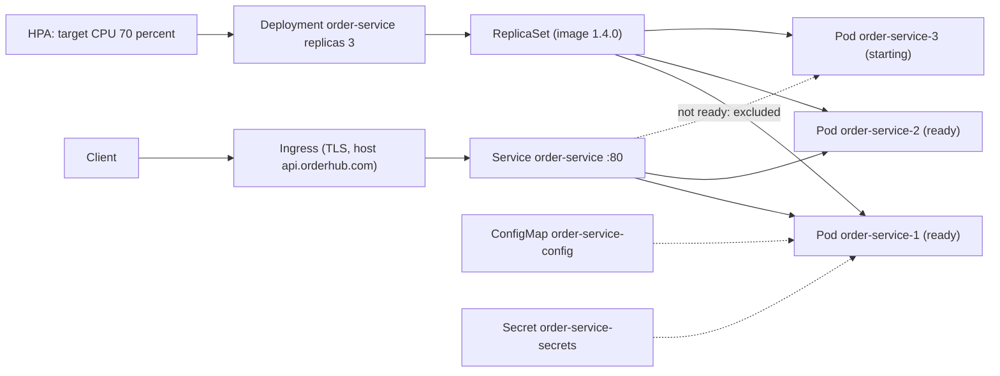

@@ 3 | TOPIC | Kubernetes Basics for Spring Developers | Pods, Deployments, Services, ConfigMaps, Secrets, resources, probes, autoscaling and Ingress for Spring Boot apps | SHOULD
# Kubernetes Basics for Spring Developers

**Level: Advanced | Phase 21 | Priority: SHOULD | Since: Kubernetes 1.0 (2015); Spring Boot Kubernetes detection and probe groups since Boot 2.3; `configtree:` imports since Boot 2.4**

> **30-second interview answer:** Kubernetes runs containers declaratively: I describe the desired state in YAML and controllers keep reality matching it. For a Spring Boot service I write a Deployment (replicas, image, resources, probes, rolling update strategy), a Service for a stable DNS name and load balancing across ready pods, a ConfigMap and a Secret for configuration (as environment variables or files imported with `spring.config.import=configtree:`), an Ingress or Gateway for external HTTP, and a HorizontalPodAutoscaler to scale on CPU or custom metrics. Spring Boot detects Kubernetes and enables liveness and readiness groups automatically.

## 1. Concept in Simple Words
### Analogy
A hotel managed by a very strict manager.

| Hotel | Kubernetes |
|---|---|
| The manager's order: "always have 3 receptionists on duty" | Deployment with `replicas: 3` |
| A receptionist on a shift | Pod (one or more containers) |
| The reception phone number that rings whichever receptionist is free | Service (stable DNS name and load balancing) |
| The hotel entrance with a doorman for outside guests | Ingress or Gateway API |
| The rules binder at the desk | ConfigMap |
| The safe with the master keys | Secret |
| "Each receptionist gets one desk and at most two chairs" | Resource requests and limits |
| Calling extra staff when the lobby is crowded | HorizontalPodAutoscaler |
| Replacing a receptionist who fainted | Liveness probe restarts |
| Building floors where staff work | Nodes |

### What it is
- **Cluster:** a control plane (API server, scheduler, controllers, etcd) and worker **nodes** running pods.
- **Pod:** the smallest deployable unit: one or more containers sharing network and volumes. Pods are disposable and get new IPs when recreated.
- **Deployment:** manages a ReplicaSet of identical pods; handles rolling updates and rollbacks.
- **Service:** a stable virtual IP and DNS name (`order-service.orderhub.svc.cluster.local`, or just `order-service` within the namespace) that load-balances to ready pods matching a label selector.
- **ConfigMap / Secret:** key-value configuration; Secrets are base64-encoded (not encrypted unless encryption at rest is enabled) and have tighter RBAC.
- **Resources:** `requests` are what the scheduler reserves (and the CPU share you get); `limits` are hard caps: exceeding memory gets the container OOM-killed, exceeding CPU gets it throttled.
- **HorizontalPodAutoscaler (HPA):** changes replicas based on CPU, memory or custom metrics.
- **Ingress / Gateway API:** HTTP routing from outside the cluster to Services, with TLS.
- **Namespace:** a scope for names, quotas and access control (`orderhub-prod`).
- **PodDisruptionBudget:** limits voluntary evictions (node drains) so a minimum number of pods stays available.

### Why it exists
Running 20 services with 3 instances each by hand means placing them on machines, restarting crashed ones, rolling out versions without downtime, routing traffic only to healthy instances and scaling with load. Kubernetes automates all of that with one declarative model, so deployments become "apply this YAML" and the platform handles the rest.

## 2. How It Works


What happens on `kubectl apply` of a new image tag:
1. The Deployment controller creates a new ReplicaSet for the new pod template.
2. With `maxSurge: 1, maxUnavailable: 0`, it starts one new pod; the scheduler places it on a node with enough requested CPU and memory.
3. The kubelet pulls the image, starts the container, runs the startup probe, then readiness. Only when ready is the pod added to the Service endpoints.
4. One old pod is terminated (preStop, SIGTERM, graceful shutdown), and the cycle repeats until all pods run the new version. `kubectl rollout undo` goes back.

JVM-specific facts:
- Memory limit is a hard wall: heap plus non-heap must fit, so pair limits with `-XX:MaxRAMPercentage` (Docker topic).
- CPU limits cause throttling under the CFS quota: a JVM with a 500m limit doing GC and JIT at startup can be throttled heavily, causing slow starts and latency spikes. Many teams set CPU requests but no CPU limit, or generous limits.
- Spring Boot reads ConfigMaps as environment variables (`SPRING_DATASOURCE_URL` maps to `spring.datasource.url` through relaxed binding) or as files via `configtree:`, where each file name is a property name and its content the value.

## 3. Code Example
### Code
Manifests for order-service in namespace `orderhub`.

```yaml
# k8s/order-service-config.yaml
apiVersion: v1
kind: ConfigMap
metadata:
  name: order-service-config
  namespace: orderhub
data:
  SPRING_PROFILES_ACTIVE: "prod"
  SPRING_DATASOURCE_URL: "jdbc:postgresql://orders-db:5432/orders"
  SPRING_KAFKA_BOOTSTRAP_SERVERS: "kafka:9092"
  INVENTORY_BASE_URL: "http://inventory-service"
  MANAGEMENT_OTLP_TRACING_ENDPOINT: "http://otel-collector.observability:4318/v1/traces"
---
apiVersion: v1
kind: Secret
metadata:
  name: order-service-secrets
  namespace: orderhub
type: Opaque
stringData:                                  # in real life created by External Secrets or sealed secrets, not committed
  spring.datasource.password: "change-me"
  spring.security.oauth2.client.registration.inventory.client-secret: "change-me-too"
```

```yaml
# k8s/order-service.yaml
apiVersion: apps/v1
kind: Deployment
metadata:
  name: order-service
  namespace: orderhub
  labels:
    app: order-service
spec:
  replicas: 3
  revisionHistoryLimit: 5
  strategy:
    type: RollingUpdate
    rollingUpdate:
      maxSurge: 1
      maxUnavailable: 0
  selector:
    matchLabels:
      app: order-service
  template:
    metadata:
      labels:
        app: order-service
        version: "1.4.0"
    spec:
      terminationGracePeriodSeconds: 60
      securityContext:
        runAsNonRoot: true
        runAsUser: 10001
      containers:
        - name: order-service
          image: ghcr.io/orderhub/order-service:1.4.0-9c1e4b7
          imagePullPolicy: IfNotPresent
          ports:
            - name: http
              containerPort: 8081
            - name: management
              containerPort: 9081
          envFrom:
            - configMapRef:
                name: order-service-config
          env:
            - name: JAVA_TOOL_OPTIONS
              value: "-XX:MaxRAMPercentage=75 -XX:+ExitOnOutOfMemoryError"
            - name: SPRING_CONFIG_IMPORT
              value: "optional:configtree:/etc/secrets/"     # each file becomes a property
          volumeMounts:
            - name: secrets
              mountPath: /etc/secrets
              readOnly: true
          resources:
            requests:
              cpu: "500m"
              memory: "768Mi"
            limits:
              memory: "768Mi"                 # memory limit = request: predictable, no overcommit
                                              # no CPU limit: avoid CFS throttling of GC and JIT
          lifecycle:
            preStop:
              sleep:
                seconds: 10
          startupProbe:
            httpGet: { path: /actuator/health/liveness, port: management }
            periodSeconds: 5
            failureThreshold: 24
          livenessProbe:
            httpGet: { path: /actuator/health/liveness, port: management }
            periodSeconds: 10
          readinessProbe:
            httpGet: { path: /actuator/health/readiness, port: management }
            periodSeconds: 5
          securityContext:
            allowPrivilegeEscalation: false
            readOnlyRootFilesystem: true
          # readOnlyRootFilesystem needs a writable /tmp for Tomcat
      volumes:
        - name: secrets
          secret:
            secretName: order-service-secrets
---
apiVersion: v1
kind: Service
metadata:
  name: order-service
  namespace: orderhub
spec:
  selector:
    app: order-service
  ports:
    - name: http
      port: 80
      targetPort: http
---
apiVersion: autoscaling/v2
kind: HorizontalPodAutoscaler
metadata:
  name: order-service
  namespace: orderhub
spec:
  scaleTargetRef:
    apiVersion: apps/v1
    kind: Deployment
    name: order-service
  minReplicas: 3
  maxReplicas: 10
  metrics:
    - type: Resource
      resource:
        name: cpu
        target:
          type: Utilization
          averageUtilization: 70            # percent of the CPU request
  behavior:
    scaleDown:
      stabilizationWindowSeconds: 300       # avoid flapping
---
apiVersion: policy/v1
kind: PodDisruptionBudget
metadata:
  name: order-service
  namespace: orderhub
spec:
  minAvailable: 2
  selector:
    matchLabels:
      app: order-service
---
apiVersion: networking.k8s.io/v1
kind: Ingress
metadata:
  name: orderhub
  namespace: orderhub
spec:
  ingressClassName: nginx
  tls:
    - hosts: [api.orderhub.example.com]
      secretName: orderhub-tls
  rules:
    - host: api.orderhub.example.com
      http:
        paths:
          - path: /
            pathType: Prefix
            backend:
              service:
                name: gateway                # only the gateway is exposed; services stay internal
                port:
                  number: 80
```

The Tomcat temp directory fix for the read-only root file system, added to the container and volumes:

```yaml
          volumeMounts:
            - name: tmp
              mountPath: /tmp
      volumes:
        - name: tmp
          emptyDir: {}
```

### Walkthrough
- The ConfigMap holds non-secret settings as environment variables; Spring's relaxed binding maps `SPRING_DATASOURCE_URL` to `spring.datasource.url` and `INVENTORY_BASE_URL` to `inventory.base-url`.
- The Secret is mounted as files under `/etc/secrets`; `SPRING_CONFIG_IMPORT=optional:configtree:/etc/secrets/` turns each file name into a property. Files are better than env vars for secrets: they can be rotated without restarting (for refreshable beans) and do not show up in `kubectl describe` or process listings.
- The Deployment runs 3 replicas with a zero-downtime rolling strategy, non-root user, no privilege escalation and a read-only root file system (with an `emptyDir` for `/tmp`).
- Memory request equals limit, so the pod gets a guaranteed amount and the JVM heap (75% of 768 MiB = 576 MiB) fits with headroom. CPU has a request for scheduling and HPA, but no limit, to avoid throttling during GC and JIT bursts.
- Probes and preStop are the ones from the graceful shutdown topic, pointed at the named `management` port.
- The Service gives the stable name `order-service`, which is exactly what `lb://` or `http://order-service` resolves to in-cluster without Eureka.
- The HPA keeps average CPU near 70% of the request, between 3 and 10 replicas, with a 5-minute scale-down stabilization. The PDB keeps at least 2 pods during node drains.
- The Ingress exposes only the gateway with TLS; order, inventory and notification services are reachable only inside the cluster.

### Output
```text
$ kubectl apply -f k8s/
configmap/order-service-config created
secret/order-service-secrets created
deployment.apps/order-service created
service/order-service created
horizontalpodautoscaler.autoscaling/order-service created
poddisruptionbudget.policy/order-service created
ingress.networking.k8s.io/orderhub created

$ kubectl get pods -n orderhub -l app=order-service
NAME                             READY   STATUS    RESTARTS   AGE
order-service-6c8d7f9b5d-4kq2x   1/1     Running   0          94s
order-service-6c8d7f9b5d-9wz7p   1/1     Running   0          94s
order-service-6c8d7f9b5d-tx5lm   1/1     Running   0          94s

$ kubectl get hpa -n orderhub
NAME            REFERENCE                  TARGETS       MINPODS   MAXPODS   REPLICAS
order-service   Deployment/order-service   cpu: 31%/70%  3         10        3

$ kubectl set image deployment/order-service order-service=ghcr.io/orderhub/order-service:1.4.1-a7d2e90 -n orderhub
deployment.apps/order-service image updated
$ kubectl rollout status deployment/order-service -n orderhub
deployment "order-service" successfully rolled out
$ kubectl rollout undo deployment/order-service -n orderhub
deployment.apps/order-service rolled back
```

The log of a new pod shows Boot detecting the platform:

```text
INFO  [order-service] [main] c.o.order.OrderServiceApplication : The following 1 profile is active: "prod"
INFO  [order-service] [main] o.s.b.a.e.web.EndpointLinksResolver : Exposing 3 endpoints beneath base path '/actuator'
INFO  [order-service] [main] c.o.order.OrderServiceApplication : Started OrderServiceApplication in 7.12 seconds (process running for 7.80)
```

### Compare
| Concern | Without Kubernetes (VMs) | With Kubernetes |
|---|---|---|
| Restart crashed instance | systemd or manual | Controller recreates pods |
| Service discovery | Eureka or static config | Service DNS |
| Config | Files on disk, Config Server | ConfigMaps and Secrets |
| Rolling deploy | Scripts | Deployment strategy, `rollout undo` |
| Scaling | Manual or cloud autoscaling groups | HPA in seconds |
| Health-based routing | Load balancer health checks | Readiness probes |

## 4. Interview Questions
**Basic**
1. **Pod vs Deployment vs Service?**
   A pod runs containers and is disposable. A Deployment keeps a desired number of identical pods running and manages rolling updates. A Service gives those pods a stable name and IP and load-balances to the ready ones.
2. **How do you pass configuration to a Spring Boot app on Kubernetes?**
   ConfigMaps for non-secret values and Secrets for credentials, injected as environment variables (relaxed binding maps them to properties) or mounted as files imported with `spring.config.import=configtree:/path/`. Profiles are selected with `SPRING_PROFILES_ACTIVE`.
3. **Requests vs limits?**
   Requests are what the scheduler reserves and what the container is guaranteed; limits are hard caps. Exceeding the memory limit gets the container OOM-killed; exceeding the CPU limit throttles it.

**Follow-up**
4. **How should a JVM app set memory requests and limits?**
   Set memory request equal to limit for predictable behaviour, size the heap as a percentage of the limit (`MaxRAMPercentage` around 70 to 75) to leave room for metaspace, threads and direct memory, and monitor container memory (`container_memory_working_set_bytes`) against the limit.
5. **Why do many teams avoid CPU limits for Java services?**
   The CFS quota throttles a container for the rest of a 100 ms period once its quota is used; JIT compilation and parallel GC are bursty, so a limited JVM gets throttled, causing slow startups and latency spikes even when the node has idle CPU. Setting requests without limits (or high limits) avoids this, while requests still drive scheduling and HPA.
6. **How does an HPA decide to scale and what are good metrics for Spring services?**
   It compares the current metric average to the target and scales replicas proportionally, with stabilization windows. CPU works for CPU-bound services; for I/O-bound services, request rate per pod, latency or Kafka consumer lag (via a custom or external metrics adapter, or KEDA) reflect load better.

**Tricky / scenario**
7. **After moving to Kubernetes, p99 latency spikes every few seconds although CPU usage looks low. What do you check?**
   CPU throttling: `container_cpu_cfs_throttled_periods_total` rising means the CPU limit is too low for bursts. Also check GC pauses with a small heap, and whether the JVM picked Serial GC because it sees fewer than 2 CPUs. Raise or remove the CPU limit, give at least 2 CPUs, and choose G1 explicitly.
8. **A Secret value changed, but the app still uses the old password. Why?**
   Environment variables are read at container start, so env-based secrets need a pod restart. Mounted files update after a delay, but Spring reads `configtree` at startup too unless the bean is refreshable. Trigger a rolling restart (`kubectl rollout restart`) or use a reloader operator.
9. **Do you still need Spring Cloud Gateway, Eureka and Config Server on Kubernetes?**
   Eureka usually not (Service DNS), Config Server often not (ConfigMaps and Secrets). A gateway is still valuable for API concerns like auth, rate limiting and routing by path, though some teams use an Ingress controller or Gateway API implementation with plugins instead. Choose by needs, not by habit.

**What the interviewer is really testing:** whether you can deploy a Spring Boot service on Kubernetes with correct configuration, resources sized for the JVM, health-based routing and safe rollouts.

## 5. Pitfalls & Best Practices
### Common mistakes
| Mistake | What goes wrong | Fix |
|---|---|---|
| Memory limit without JVM flags | Heap at 25% or OOM-kill | `MaxRAMPercentage` matched to the limit |
| Tight CPU limits | Throttling, slow starts | Requests without limits or generous limits |
| Secrets committed in YAML | Credentials in Git | External Secrets, sealed secrets, Vault |
| `latest` image tag | Unknown version, no reliable rollback | Immutable tags with git SHA |
| No PodDisruptionBudget | Node drain evicts all pods at once | PDB with `minAvailable` |
| Exposing every service via Ingress | Bigger attack surface | Expose only the gateway |

### Best practices
- Keep manifests in Git and deploy with GitOps (Argo CD, Flux) or Helm or Kustomize, with per-environment overlays.
- Run as non-root with a read-only root file system and dropped capabilities.
- Use NetworkPolicies so only expected services can talk to each other.
- Spread replicas across nodes and zones (`topologySpreadConstraints`).
- Watch restarts, OOM kills and throttling as standard alerts.

### Compare with
| Workload type | Use for |
|---|---|
| Deployment | Stateless services like OrderHub's |
| StatefulSet | Databases, Kafka brokers: stable identity and storage |
| Job and CronJob | Batch tasks (Spring Batch jobs, nightly reports) |
| DaemonSet | One pod per node (log collectors, node exporters) |

## 6. Hands-on Exercise
Deploy notification-service to Kubernetes with KEDA-style scaling on Kafka lag in mind, but using plain HPA on a custom metric: write the Deployment (2 replicas minimum, non-root, memory 512 MiB, config from a ConfigMap, SMTP password from a mounted Secret via `configtree`), and an HPA that scales on the external metric `kafka_consumergroup_lag` for group `notification-service` with a target of 1000 messages per pod, capped at 6 replicas (the topic has 6 partitions).

Acceptance criteria: manifests apply cleanly; the HPA max equals the partition count; the SMTP password is never an environment variable.

<details><summary>Solution</summary>

```yaml
apiVersion: apps/v1
kind: Deployment
metadata:
  name: notification-service
  namespace: orderhub
spec:
  replicas: 2
  selector:
    matchLabels: { app: notification-service }
  template:
    metadata:
      labels: { app: notification-service }
    spec:
      terminationGracePeriodSeconds: 60
      securityContext: { runAsNonRoot: true, runAsUser: 10001 }
      containers:
        - name: notification-service
          image: ghcr.io/orderhub/notification-service:1.4.0-9c1e4b7
          ports:
            - { name: management, containerPort: 9083 }
          envFrom:
            - configMapRef: { name: notification-service-config }
          env:
            - name: SPRING_CONFIG_IMPORT
              value: "optional:configtree:/etc/secrets/"
            - name: JAVA_TOOL_OPTIONS
              value: "-XX:MaxRAMPercentage=70 -XX:+ExitOnOutOfMemoryError"
          volumeMounts:
            - { name: smtp, mountPath: /etc/secrets, readOnly: true }
          resources:
            requests: { cpu: "250m", memory: "512Mi" }
            limits: { memory: "512Mi" }
          livenessProbe:
            httpGet: { path: /actuator/health/liveness, port: management }
          readinessProbe:
            httpGet: { path: /actuator/health/readiness, port: management }
      volumes:
        - name: smtp
          secret:
            secretName: notification-smtp
            items:
              - key: password
                path: spring.mail.password       # file name = property name
---
apiVersion: autoscaling/v2
kind: HorizontalPodAutoscaler
metadata:
  name: notification-service
  namespace: orderhub
spec:
  scaleTargetRef: { apiVersion: apps/v1, kind: Deployment, name: notification-service }
  minReplicas: 2
  maxReplicas: 6                                 # more consumers than partitions would sit idle
  metrics:
    - type: External
      external:
        metric:
          name: kafka_consumergroup_lag
          selector:
            matchLabels: { consumergroup: notification-service, topic: order-events }
        target:
          type: AverageValue
          averageValue: "1000"
```
The external metric requires a metrics adapter (Prometheus Adapter or KEDA) exposing Kafka exporter data to the HPA. The secret item's `path` makes the file name `spring.mail.password`, which `configtree` maps directly to that property.
</details>

## 7. Recall
Q: What is the difference between a Kubernetes Deployment and a Service?
A: A Deployment keeps a desired number of identical pods running and rolls out new versions; a Service gives those pods a stable DNS name and load-balances to the ready ones.

Q: How can a Spring Boot app read Kubernetes Secrets mounted as files?
A: With `spring.config.import=configtree:/mount/path/`, where each file name becomes a property name and its content the value.

Q: What happens when a container exceeds its Kubernetes memory limit versus its CPU limit?
A: Exceeding memory gets it OOM-killed (exit 137); exceeding CPU gets it throttled.

Q: Why do many teams avoid CPU limits for JVM services on Kubernetes?
A: CFS throttling punishes the bursty CPU use of JIT and GC, causing latency spikes and slow startups even with idle node CPU.

Q: What does a PodDisruptionBudget protect against?
A: Voluntary disruptions such as node drains evicting too many pods of a service at once.

**Related:** [[Graceful Shutdown and Health Probes]] · [[Docker Images for Spring Boot]] · [[Service Discovery]]

@@ 3 | TOPIC | CI/CD Pipeline for a Spring App | Build, test, scan, image, deploy and promote a Spring Boot service with GitHub Actions and GitOps | NICE
# CI/CD Pipeline for a Spring App

**Level: Advanced | Phase 21 | Priority: NICE | Since: continuous integration practice (1990s); GitHub Actions (2019); GitOps with Argo CD and Flux (around 2018)**

> **30-second interview answer:** Continuous integration builds and tests every push automatically; continuous delivery keeps every main-branch build deployable and promotes the same artifact through environments; continuous deployment releases it to production automatically. For a Spring Boot service my pipeline runs `mvn verify` with unit, slice and Testcontainers tests, static analysis and dependency scanning, builds a layered image tagged with the git SHA, scans and pushes it, then deploys to staging by updating the GitOps repository, runs smoke tests, and promotes to production with a canary or rolling update and automatic rollback on bad metrics. Database migrations must be backward compatible so old and new versions can run side by side.

## 1. Concept in Simple Words
### Analogy
A car factory assembly line with quality gates.

| Car factory | CI/CD |
|---|---|
| Every part is inspected when it arrives | Every push is built and unit-tested |
| The assembled car goes on a test track | Integration tests with Testcontainers |
| Safety inspection before leaving the factory | Security scanning (dependencies, image) |
| Each car gets a unique VIN | Image tagged with the git SHA |
| The same car goes to the showroom, not a rebuilt copy | Build once, promote the same artifact |
| First 50 cars go to one dealer to watch for problems | Canary release |
| Recall procedure ready before launch | Automated rollback |

### What it is
- **Continuous integration (CI):** merge small changes often; each push triggers build, tests and checks, and a broken main branch is fixed immediately.
- **Continuous delivery:** every successful main build produces a releasable artifact; production release is a button press.
- **Continuous deployment:** every successful build goes to production automatically.
- **Artifact immutability:** build once, deploy the same image to every environment; only configuration differs.
- **GitOps:** the desired state of each environment lives in a Git repository; an agent in the cluster (Argo CD, Flux) syncs the cluster to it. Deploying means committing a new image tag.
- **Progressive delivery:** canary (a small share of traffic first), blue-green (switch traffic between two full environments), feature flags (deploy dark, release by toggle).
- **Expand and contract migrations:** database changes split so that old and new application versions both work during a rollout (add column, backfill, switch code, drop old column later).

### Why it exists
Manual builds and deployments are slow, inconsistent and scary, so teams deploy rarely, which makes each release bigger and riskier. Automation makes releases small, frequent, repeatable and reversible. DORA research links high deployment frequency and short lead time with lower change failure rates.

## 2. How It Works


```mermaid
flowchart LR
    A["Push or PR"] --> B["Build + unit tests"]
    B --> C["Integration tests (Testcontainers)"]
    C --> D["Static analysis + dependency scan"]
    D --> E{"Main branch?"}
    E -- "no (PR)" --> R["Report status on PR"]
    E -- "yes" --> F["Build layered image, tag git SHA"]
    F --> G["Image scan (Trivy), SBOM, sign"]
    G --> H["Push to registry"]
    H --> I["Update staging tag in GitOps repo"]
    I --> J["Argo CD syncs staging"]
    J --> K["Smoke and contract tests"]
    K --> L["Manual approval or auto"]
    L --> M["Update prod tag: canary 10 percent"]
    M --> N{"Error rate and latency OK?"}
    N -- "yes" --> O["Full rollout"]
    N -- "no" --> P["Automatic rollback"]
```

Rules a senior engineer applies:
- **Fast feedback first:** compile and unit tests in a couple of minutes; slower integration tests in parallel jobs.
- **Same artifact everywhere:** never rebuild for production; promote the image digest.
- **Config outside the image:** environment differences via ConfigMaps, Secrets and profiles.
- **Backward-compatible changes:** API and event schema changes additive; database migrations in expand and contract steps; Flyway runs before the new code needs the change.
- **Observability as a gate:** canary analysis compares error rate and latency of the new version against the old (Argo Rollouts or Flagger reading Prometheus).

## 3. Code Example
### Code
GitHub Actions workflow for order-service plus the GitOps update and a Flyway expand and contract pair.

```yaml
# .github/workflows/order-service.yml
name: order-service

on:
  push:
    branches: [main]
    paths: ["order-service/**", ".github/workflows/order-service.yml"]
  pull_request:
    paths: ["order-service/**"]

permissions:
  contents: read
  packages: write

env:
  IMAGE: ghcr.io/orderhub/order-service

jobs:
  build-test:
    runs-on: ubuntu-latest
    steps:
      - uses: actions/checkout@v4

      - uses: actions/setup-java@v4
        with:
          distribution: temurin
          java-version: "21"
          cache: maven

      - name: Build and test (unit, slice, Testcontainers)
        working-directory: order-service
        run: ./mvnw -B verify          # Docker is available on ubuntu runners for Testcontainers

      - name: Dependency vulnerability scan
        working-directory: order-service
        run: ./mvnw -B org.owasp:dependency-check-maven:check -DfailBuildOnCVSS=8

      - name: Upload test reports
        if: failure()
        uses: actions/upload-artifact@v4
        with:
          name: surefire-reports
          path: order-service/target/surefire-reports

      - name: Upload jar
        if: github.ref == 'refs/heads/main'
        uses: actions/upload-artifact@v4
        with:
          name: jar
          path: order-service/target/order-service-*.jar

  image:
    needs: build-test
    if: github.ref == 'refs/heads/main'
    runs-on: ubuntu-latest
    outputs:
      tag: ${{ steps.meta.outputs.tag }}
    steps:
      - uses: actions/checkout@v4
      - uses: actions/download-artifact@v4
        with:
          name: jar
          path: order-service/target

      - id: meta
        run: echo "tag=1.4.${{ github.run_number }}-${GITHUB_SHA::7}" >> "$GITHUB_OUTPUT"

      - uses: docker/login-action@v3
        with:
          registry: ghcr.io
          username: ${{ github.actor }}
          password: ${{ secrets.GITHUB_TOKEN }}

      - uses: docker/build-push-action@v6
        with:
          context: order-service
          file: order-service/Dockerfile.ci       # extract-and-run stages only, jar from CI
          push: true
          tags: ${{ env.IMAGE }}:${{ steps.meta.outputs.tag }}
          build-args: GIT_SHA=${{ github.sha }}

      - name: Scan image
        uses: aquasecurity/trivy-action@0.28.0
        with:
          image-ref: ${{ env.IMAGE }}:${{ steps.meta.outputs.tag }}
          severity: CRITICAL
          exit-code: "1"

  deploy-staging:
    needs: image
    runs-on: ubuntu-latest
    environment: staging
    steps:
      - uses: actions/checkout@v4
        with:
          repository: orderhub/orderhub-gitops
          token: ${{ secrets.GITOPS_TOKEN }}
      - name: Bump image tag for staging
        run: |
          cd envs/staging/order-service
          kustomize edit set image ghcr.io/orderhub/order-service=ghcr.io/orderhub/order-service:${{ needs.image.outputs.tag }}
          git config user.name "orderhub-ci"
          git config user.email "ci@orderhub.example.com"
          git commit -am "order-service staging -> ${{ needs.image.outputs.tag }}"
          git push

  deploy-prod:
    needs: [image, deploy-staging]
    runs-on: ubuntu-latest
    environment: production                       # requires a manual approval in GitHub settings
    steps:
      - uses: actions/checkout@v4
        with:
          repository: orderhub/orderhub-gitops
          token: ${{ secrets.GITOPS_TOKEN }}
      - name: Bump image tag for production (Argo Rollouts canary takes over)
        run: |
          cd envs/prod/order-service
          kustomize edit set image ghcr.io/orderhub/order-service=ghcr.io/orderhub/order-service:${{ needs.image.outputs.tag }}
          git config user.name "orderhub-ci"
          git config user.email "ci@orderhub.example.com"
          git commit -am "order-service prod -> ${{ needs.image.outputs.tag }}"
          git push
```

```yaml
# orderhub-gitops/envs/prod/order-service/rollout.yaml (Argo Rollouts canary with metric analysis)
apiVersion: argoproj.io/v1alpha1
kind: Rollout
metadata:
  name: order-service
spec:
  replicas: 5
  strategy:
    canary:
      steps:
        - setWeight: 10
        - pause: { duration: 5m }
        - analysis:
            templates:
              - templateName: error-rate
        - setWeight: 50
        - pause: { duration: 5m }
        - setWeight: 100
  selector:
    matchLabels: { app: order-service }
  template:
    metadata:
      labels: { app: order-service }
    spec:
      containers:
        - name: order-service
          image: ghcr.io/orderhub/order-service:1.4.57-9c1e4b7
---
apiVersion: argoproj.io/v1alpha1
kind: AnalysisTemplate
metadata:
  name: error-rate
spec:
  metrics:
    - name: error-rate
      interval: 1m
      count: 5
      successCondition: result[0] < 0.01        # under 1 percent 5xx
      provider:
        prometheus:
          address: http://prometheus.observability:9090
          query: >
            sum(rate(http_server_requests_seconds_count{application="order-service",status=~"5.."}[2m]))
            / sum(rate(http_server_requests_seconds_count{application="order-service"}[2m]))
```

```sql
-- Expand and contract: rename orders.note to orders.customer_note without downtime
-- Release N   (V12__expand_customer_note.sql): add the new column and backfill
ALTER TABLE orders ADD COLUMN customer_note VARCHAR(500);
UPDATE orders SET customer_note = note WHERE customer_note IS NULL;
-- code in release N writes BOTH columns and reads customer_note with fallback to note

-- Release N+1 (V13__contract_customer_note.sql): old version is gone, drop the old column
ALTER TABLE orders DROP COLUMN note;
```

### Walkthrough
- The workflow triggers on changes under `order-service/` only, so a monorepo does not rebuild every service on every push. Pull requests run build and tests; only `main` builds images and deploys.
- `setup-java` with `cache: maven` caches the local repository between runs. `mvnw verify` runs unit tests, `@WebMvcTest` slices and Testcontainers integration tests (GitHub's Ubuntu runners include Docker).
- The OWASP dependency check fails the build on high-severity CVEs; test reports are uploaded when tests fail so you can read them.
- The `image` job reuses the tested jar (build once), tags the image with a version plus short SHA, pushes it to GHCR and scans it with Trivy, failing on critical vulnerabilities.
- Deployments are commits to the GitOps repository; Argo CD syncs the clusters. The `production` environment requires manual approval configured in GitHub, giving continuous delivery rather than deployment.
- The Argo Rollouts canary sends 10% of traffic to the new version, runs a Prometheus analysis of the 5xx ratio five times, and aborts and rolls back automatically if it exceeds 1%.
- The Flyway pair shows expand and contract: during the rollout both versions run, so the schema must work for both. The destructive change waits for the next release.

### Output
GitHub Actions run summary:

```text
order-service  #57  main  9c1e4b7  "Add customer note to orders"
  build-test      success   4m 12s   Tests run: 214, Failures: 0, Errors: 0, Skipped: 2
  image           success   1m 48s   pushed ghcr.io/orderhub/order-service:1.4.57-9c1e4b7, Trivy: 0 CRITICAL
  deploy-staging  success   0m 21s   orderhub-gitops@3f1a2b0
  deploy-prod     waiting   approval required (production environment)
```

Argo Rollouts after approval:

```text
$ kubectl argo rollouts get rollout order-service -n orderhub
Name:            order-service
Status:          Paused (CanaryPauseStep)
Strategy:        Canary
  Step:          2/6
  SetWeight:     10
  ActualWeight:  10
Images:          ghcr.io/orderhub/order-service:1.4.56-41be0c3 (stable)
                 ghcr.io/orderhub/order-service:1.4.57-9c1e4b7 (canary)
Replicas:        Desired 5  Current 6  Updated 1  Ready 6  Available 6
```

### Compare
| Strategy | How | Rollback | Cost |
|---|---|---|---|
| Recreate | Stop all, start new | Redeploy old | Downtime |
| Rolling update | Replace pods gradually | `rollout undo` | Cheap, both versions live briefly |
| Blue-green | Two full environments, switch traffic | Switch back instantly | Double capacity during release |
| Canary | Small traffic share, then increase with metric checks | Automatic abort | Needs traffic splitting and metrics |
| Feature flags | Code deployed dark, enabled per user | Toggle off | Flag management discipline |

## 4. Interview Questions
**Basic**
1. **What is the difference between continuous integration, delivery and deployment?**
   CI automatically builds and tests every change merged often. Continuous delivery keeps every successful build releasable, with a manual decision to deploy to production. Continuous deployment releases every successful build to production automatically.
2. **What stages does a CI pipeline for a Spring Boot service have?**
   Checkout, build, unit tests, slice and integration tests (Testcontainers), static analysis and dependency scanning, packaging an image tagged with the commit, image scanning, push, deploy to staging, smoke tests, then promotion to production.
3. **Why "build once, deploy many"?**
   Rebuilding per environment can produce different binaries (dependency drift, different build machines), so what you tested is not what you run. Promoting the same image digest guarantees identical artifacts; only configuration changes per environment.

**Follow-up**
4. **How do you deploy database migrations without downtime?**
   Make every migration backward compatible with the currently running version: expand (add nullable columns or new tables, backfill), deploy code that uses the new structure, then contract (drop old columns) in a later release. Avoid long locking operations (add indexes concurrently in PostgreSQL) and run Flyway before the new code needs the change.
5. **What is GitOps and why use it?**
   The desired state of each environment is declared in Git and an in-cluster agent continuously reconciles the cluster to it. Deployments are pull requests and commits, giving review, audit history, easy rollback (revert a commit) and no cluster credentials in the CI system.
6. **How do you keep the pipeline fast?**
   Cache dependencies, run only affected services in a monorepo, parallelize test jobs, keep unit tests fast and push slow end-to-end tests to fewer places, reuse Testcontainers containers within a run, and build images from the already-built jar with layer caching.

**Tricky / scenario**
7. **A release passed all tests but caused errors in production for 20% of users. How should the pipeline have caught or limited it?**
   A canary with automated metric analysis would have exposed it to a small share of traffic and rolled back on the error rate. Also add contract tests for consumers, production-like data in staging, and feature flags so risky code can be switched off without a deploy.
8. **Rolling update succeeded, but the old pods started failing during the rollout. Why?**
   The new version ran a non-backward-compatible migration (dropped or renamed a column, added a NOT NULL column without default) that the old version still needed. Use expand and contract so both versions work against the schema during the overlap.
9. **Integration tests with Testcontainers are flaky in CI. What do you look at?**
   Waiting strategies (use readiness checks, not sleeps), port collisions (use mapped random ports via `@ServiceConnection`), shared state between tests (reset data), resource limits on the runner, and image pulls (pin versions, use a registry mirror). Flaky tests must be fixed or quarantined, not retried forever.

**What the interviewer is really testing:** whether you can design a pipeline that is fast, safe and reversible, and you understand that compatibility (schemas, APIs, events) is what makes zero-downtime delivery possible.

## 5. Pitfalls & Best Practices
### Common mistakes
| Mistake | What goes wrong | Fix |
|---|---|---|
| Rebuilding the image per environment | Untested binary in production | Promote one image digest |
| Breaking database migrations | Old pods fail during rollout | Expand and contract |
| Skipping tests to ship faster | Broken main, fear of deploying | Fast test pyramid, parallel jobs |
| Cluster admin credentials in CI | Large blast radius if CI is compromised | GitOps pull model, least privilege |
| No rollback plan | Long outages | Canary with automatic abort, `rollout undo` |
| Secrets printed in logs | Credential leaks | Masked secrets, OIDC to cloud providers |

### Best practices
- Trunk-based development with short-lived branches and required checks on pull requests.
- Use OIDC federation from GitHub Actions to cloud registries instead of long-lived keys.
- Sign images and generate SBOMs; verify signatures at admission time.
- Track DORA metrics: deployment frequency, lead time, change failure rate, time to restore.
- Make the pipeline definition part of the service repository and review it like code.

### Compare with
| Tool | Role |
|---|---|
| GitHub Actions, GitLab CI, Jenkins | Run build, test and image jobs |
| Argo CD, Flux | GitOps continuous delivery to Kubernetes |
| Argo Rollouts, Flagger | Canary and blue-green with metric analysis |
| Helm, Kustomize | Templating or overlays for manifests |
| Trivy, Grype, OWASP Dependency-Check | Vulnerability scanning |

## 6. Hands-on Exercise
Add a pull-request quality gate to the OrderHub pipeline: a job that fails if line coverage of order-service drops below 80% (JaCoCo) and posts nothing else; plus a nightly scheduled workflow that rebuilds the latest released image on the current base image and scans it, so OS patches are picked up even without code changes.

Acceptance criteria: a PR lowering coverage below 80% fails; the nightly workflow runs at 02:00 UTC and fails on critical CVEs.

<details><summary>Solution</summary>

```xml
<!-- order-service/pom.xml -->
<plugin>
    <groupId>org.jacoco</groupId>
    <artifactId>jacoco-maven-plugin</artifactId>
    <version>0.8.12</version>
    <executions>
        <execution>
            <goals><goal>prepare-agent</goal></goals>
        </execution>
        <execution>
            <id>report</id>
            <phase>verify</phase>
            <goals><goal>report</goal></goals>
        </execution>
        <execution>
            <id>check</id>
            <phase>verify</phase>
            <goals><goal>check</goal></goals>
            <configuration>
                <rules>
                    <rule>
                        <element>BUNDLE</element>
                        <limits>
                            <limit>
                                <counter>LINE</counter>
                                <value>COVEREDRATIO</value>
                                <minimum>0.80</minimum>
                            </limit>
                        </limits>
                    </rule>
                </rules>
            </configuration>
        </execution>
    </executions>
</plugin>
```

```yaml
# .github/workflows/nightly-rebuild.yml
name: nightly-rebuild
on:
  schedule:
    - cron: "0 2 * * *"          # 02:00 UTC
  workflow_dispatch: {}
permissions:
  contents: read
  packages: write
jobs:
  rebuild:
    runs-on: ubuntu-latest
    steps:
      - uses: actions/checkout@v4
        with:
          ref: main
      - uses: actions/setup-java@v4
        with:
          distribution: temurin
          java-version: "21"
          cache: maven
      - working-directory: order-service
        run: ./mvnw -B -DskipTests package
      - uses: docker/login-action@v3
        with:
          registry: ghcr.io
          username: ${{ github.actor }}
          password: ${{ secrets.GITHUB_TOKEN }}
      - uses: docker/build-push-action@v6
        with:
          context: order-service
          file: order-service/Dockerfile.ci
          pull: true                                   # always fetch the newest base image
          push: true
          tags: ghcr.io/orderhub/order-service:nightly-${{ github.run_number }}
      - uses: aquasecurity/trivy-action@0.28.0
        with:
          image-ref: ghcr.io/orderhub/order-service:nightly-${{ github.run_number }}
          severity: CRITICAL
          exit-code: "1"
```
The JaCoCo `check` goal runs in `verify`, which the existing PR job already executes, so no workflow change is needed for the gate. The nightly job uses `pull: true` so the base image layer is refreshed; a passing nightly image can then be promoted through the normal GitOps flow.
</details>

## 7. Recall
Q: What is the difference between continuous delivery and continuous deployment?
A: Continuous delivery keeps every build releasable with a manual production decision; continuous deployment releases every successful build automatically.

Q: Why should a CI/CD pipeline build a Docker image once and promote it?
A: So the exact tested artifact runs in every environment; only configuration differs.

Q: How do you change a database schema without breaking a rolling deployment?
A: Expand and contract: add compatible structures and backfill first, switch the code, and remove old structures in a later release.

Q: What is GitOps?
A: Declaring each environment's desired state in Git and letting an in-cluster agent like Argo CD or Flux reconcile the cluster to it.

Q: What does a canary release with metric analysis do?
A: It sends a small share of traffic to the new version, compares error and latency metrics, and promotes or rolls back automatically.

**Related:** [[Docker Images for Spring Boot]] · [[Kubernetes Basics for Spring Developers]] · [[Testcontainers]]
