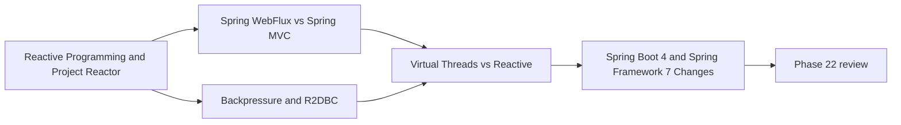
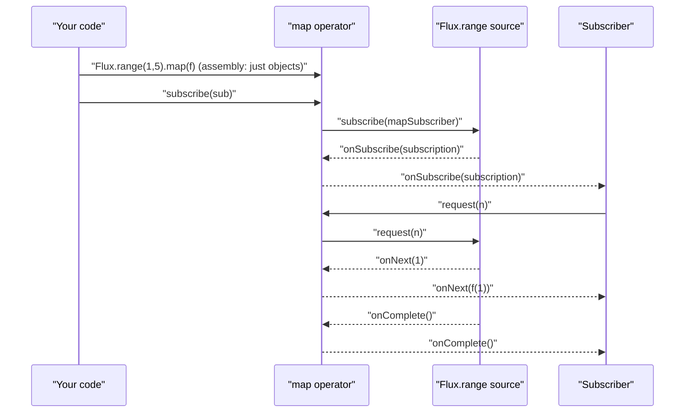
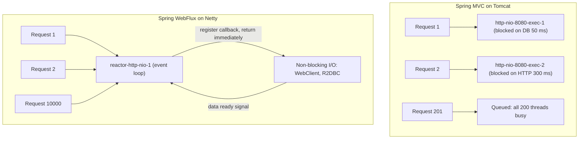

@@ 1 | MODULE | Phase 22 — Reactive and What's New (Advanced) | Project Reactor, WebFlux vs MVC, backpressure, R2DBC, virtual threads vs reactive, Spring Boot 4 and Framework 7 | MUST
# Phase 22: Reactive and What's New (Advanced)

This phase covers the non-blocking side of Spring and what changed in the newest generation of the platform. You learn Project Reactor (`Mono`, `Flux`, operators, schedulers), how Spring WebFlux differs from Spring MVC, how backpressure and R2DBC keep a reactive pipeline non-blocking end to end, and how Java 21 virtual threads changed the "should we go reactive?" decision. The last topic summarizes Spring Boot 4 and Spring Framework 7 (released November 2025), which interviewers now ask about to see whether you keep up.

Why interviewers care: senior candidates are expected to choose a concurrency model on purpose. "We used WebFlux because it is faster" is a weak answer; "our service fans out to five slow APIs per request, so we needed non-blocking I/O, and we kept JDBC on a bounded scheduler" is a strong one. Since Java 21, the best answer is often "virtual threads with plain Spring MVC", and you must be able to explain why.

## How the topics connect



## Prerequisites
- [[Future and CompletableFuture]] and [[CompletableFuture Composition and Error Handling]]: asynchronous composition before Reactor.
- [[Virtual Threads]]: how the JVM mounts virtual threads on carrier threads.
- [[DispatcherServlet Request Lifecycle]]: the thread-per-request model that WebFlux replaces.
- [[RestClient, WebClient and HTTP Interfaces]]: you met `WebClient` there; here you learn what it returns.

## The 5 questions from this phase that come up most often
1. What is the difference between `Mono` and `Flux`, and why does nothing happen until you subscribe?
2. When would you choose WebFlux over Spring MVC, and when is it a mistake?
3. What is backpressure, and how does Reactor implement it?
4. Do virtual threads make reactive programming obsolete?
5. What changed in Spring Boot 4 and Spring Framework 7?

@@ 2 | MODULE | Reactive | Non-blocking streams with Reactor, WebFlux, backpressure, R2DBC and the virtual-thread alternative | MUST
# Reactive

**Shared analogy: a restaurant with a few very fast waiters instead of one waiter per table.**

In a classic restaurant (Spring MVC), every table gets its own waiter who stands beside the table while the kitchen cooks. That is simple, but with 1,000 tables you need 1,000 waiters, and most of them are just waiting. A reactive restaurant (WebFlux) has a handful of waiters who take an order, hand it to the kitchen, and immediately serve another table; when the dish is ready, the kitchen rings a bell and any free waiter carries it out. Project Reactor is the bell-and-ticket system, backpressure is the kitchen saying "do not send me more orders than I can cook", R2DBC is a kitchen that also rings a bell instead of making waiters stand at the stove, and virtual threads are the modern trick of giving every table a "waiter" who costs almost nothing while idle.

Topics: [[Reactive Programming and Project Reactor]] · [[Spring WebFlux vs Spring MVC]] · [[Backpressure and R2DBC]] · [[Virtual Threads vs Reactive]]

@@ 3 | TOPIC | Reactive Programming and Project Reactor | Mono, Flux, assembly vs subscription, operators, schedulers, error handling and testing with StepVerifier | SHOULD
# Reactive Programming and Project Reactor

**Level: Advanced | Phase 22 | Priority: SHOULD | Since: Reactive Streams 1.0 (2015), Java 9 Flow API, Reactor 3 (2016), Spring Framework 5 (2017)**

> **30-second interview answer:** Reactive programming models data as asynchronous streams that push values to subscribers, with backpressure so a slow consumer is never flooded. Project Reactor is the library Spring uses: `Mono` is a stream of zero or one value, `Flux` is zero to many. You build a lazy pipeline of operators (assembly) and nothing runs until someone subscribes; then values flow through without blocking threads, which lets a few event-loop threads serve thousands of concurrent requests.

## 1. Concept in Simple Words
### Analogy
A newspaper subscription with a delivery person who never waits at your door.

| Newspaper subscription | Reactor |
|---|---|
| The newspaper company | `Publisher` (`Mono` or `Flux`) |
| You, the reader | `Subscriber` |
| Signing the subscription form | `subscribe()` |
| "Send me at most 2 papers a week" | Backpressure: `request(n)` |
| One special edition | `Mono` (0 or 1 item) |
| A daily paper that may run for years | `Flux` (0 to N items, maybe infinite) |
| "We have stopped printing" letter | `onComplete` signal |
| "The printing press exploded" letter | `onError` signal |
| Writing down the delivery route before anyone subscribes | Assembly: building the operator chain, nothing is delivered yet |

### What it is
- **Reactive Streams:** a small specification (four interfaces: `Publisher`, `Subscriber`, `Subscription`, `Processor`) for asynchronous stream processing with non-blocking backpressure. Java 9 copied it as `java.util.concurrent.Flow`.
- **Project Reactor:** a Reactive Streams implementation by the Spring team. Main types: `Mono<T>` and `Flux<T>`.
- **Signals:** a subscriber receives `onSubscribe` once, then any number of `onNext`, then at most one terminal signal: `onComplete` or `onError`. After a terminal signal nothing else arrives.
- **Operator:** a method such as `map`, `filter`, `flatMap`, `zip` that returns a new publisher wrapping the previous one.
- **Assembly time vs subscription time:** calling operators only builds a chain of objects. Work happens when `subscribe()` is called (directly, by `block()`, or by Spring WebFlux writing the HTTP response).
- **Cold publisher:** starts fresh for each subscriber (an HTTP call, a database query). **Hot publisher:** emits regardless of subscribers, and late subscribers miss earlier values (a stock ticker, `Sinks.many().multicast()`).
- **Scheduler:** Reactor's thread-pool abstraction. `Schedulers.parallel()` (CPU work, one thread per core), `Schedulers.boundedElastic()` (blocking work, bounded pool), `Schedulers.single()`.

### Why it exists
In the thread-per-request model, a thread blocked on a 300 ms remote call does nothing but hold about 1 MB of stack (platform thread) and a slot in a pool of maybe 200 threads. Under heavy I/O, the pool runs out before the CPU is busy. Callbacks solved this but produced "callback hell" and no standard way to handle errors or slow consumers. `CompletableFuture` handles one value but not streams or backpressure. Reactor gives a composable, declarative way to describe asynchronous streams with consistent error handling and flow control.

## 2. How It Works

**Assembly, subscription, then data flow**



Subscription travels **upstream** (from the subscriber back to the source), data travels **downstream**. Each operator is both a subscriber (to the one above) and a publisher (to the one below).

**The operators you must know**

| Need | Operator | Note |
|---|---|---|
| Transform each value synchronously | `map` | Never put blocking calls here |
| Transform each value into another publisher | `flatMap` | Subscribes eagerly and concurrently, order not guaranteed |
| Same, but keep order and one at a time | `concatMap` | Sequential |
| Same, concurrent but output in source order | `flatMapSequential` | Buffers out-of-order results |
| Combine independent results | `Mono.zip`, `zipWith` | Waits for all |
| Side effect for logging | `doOnNext`, `doOnError`, `doOnSubscribe` | Do not change data here |
| Default on empty | `defaultIfEmpty`, `switchIfEmpty` | `switchIfEmpty(Mono.defer(...))` to stay lazy |
| Recover from error | `onErrorResume`, `onErrorReturn`, `onErrorMap` | Like catch blocks |
| Retry | `retryWhen(Retry.backoff(3, Duration.ofMillis(100)))` | Re-subscribes to the source |
| Timeout | `timeout(Duration)` | Emits `TimeoutException` |
| Collect | `collectList`, `collectMap`, `reduce` | Turns `Flux` into `Mono` |
| Leave the reactive world | `block()`, `blockFirst()` | Only in tests, `main` or at a blocking boundary |

**Threads: where does code run?**

By default, Reactor runs on whatever thread called `subscribe()` or emitted the signal. Reactor is "concurrency agnostic": operators do not create threads unless you ask.

```text
publishOn(scheduler)   -> everything BELOW this line runs on the scheduler
subscribeOn(scheduler) -> the subscription (and the source's work) runs on the scheduler,
                          no matter where you put it in the chain

Flux.fromIterable(ids)          main thread (or the subscribeOn thread)
    .subscribeOn(boundedElastic) ---------------------------------------+
    .map(this::parse)            boundedElastic-1                        |
    .publishOn(parallel)         ---- hop ----                            |
    .map(this::cpuHeavy)         parallel-3                               |
    .subscribe(...)              parallel-3                               |
```

Timers (`delayElement`, `interval`, `timeout`) run on `Schedulers.parallel()` by default, which is why the demo below prints `parallel-1`.

**Errors are signals, not exceptions thrown at you.** An exception inside `map` is caught by Reactor and turned into `onError`, which travels downstream, skipping normal operators until an error operator (`onErrorResume`) or the subscriber's error callback handles it. If nobody handles it, Reactor logs `ErrorCallbackNotImplemented`.

**Context instead of ThreadLocal.** Because one request may hop between threads, `ThreadLocal` (for example MDC or the security context) does not follow the request. Reactor has a `Context` (an immutable map attached to the subscription), written with `contextWrite` and read with `Mono.deferContextual`. Spring Security's `ReactiveSecurityContextHolder` and Micrometer's context propagation use it.

## 3. Code Example
### Code
```java
// Dependency: org.springframework.boot:spring-boot-starter-webflux (brings io.projectreactor:reactor-core)
import java.time.Duration;
import java.util.List;
import reactor.core.publisher.Flux;
import reactor.core.publisher.Mono;

public class ReactorBasicsDemo {

    record Product(long id, String name, int priceCents) { }

    // Simulates a non-blocking repository call that may fail
    static Mono<Product> findProduct(long id) {
        if (id == 3) {
            return Mono.error(new IllegalStateException("product 3 is broken"));
        }
        return Mono.just(new Product(id, "Product-" + id, (int) id * 1000));
    }

    public static void main(String[] args) {
        // 1. Assembly: building the pipeline emits nothing
        Flux<Integer> numbers = Flux.range(1, 5)
                .doOnNext(n -> System.out.println("emit " + n));
        System.out.println("pipeline built, nothing emitted yet");

        // 2. Subscription: data flows through the operators one element at a time
        numbers.filter(n -> n % 2 == 1)
               .map(n -> n * 10)
               .subscribe(
                       n -> System.out.println("got " + n),
                       err -> System.out.println("error " + err.getMessage()),
                       () -> System.out.println("complete"));

        // 3. Async composition with per-element error recovery
        List<String> names = Flux.just(1L, 2L, 3L, 4L)
                .concatMap(id -> findProduct(id)
                        .map(Product::name)
                        .onErrorResume(e -> Mono.just("fallback-" + id)))
                .collectList()
                .block();                       // block only in main() or tests
        System.out.println(names);

        // 4. Combine two independent calls
        String combined = Mono.zip(findProduct(1), findProduct(2))
                .map(t -> t.getT1().name() + " + " + t.getT2().name() + " = "
                        + (t.getT1().priceCents() + t.getT2().priceCents()))
                .block();
        System.out.println(combined);

        // 5. Cold publisher: every subscriber re-runs the work
        Mono<Integer> lazy = Mono.fromSupplier(() -> {
            System.out.println("supplier called");
            return 42;
        });
        lazy.subscribe(v -> System.out.println("first " + v));
        lazy.subscribe(v -> System.out.println("second " + v));

        // 6. Time-based operators move work to a Reactor scheduler thread
        String slow = Mono.just("slow")
                .delayElement(Duration.ofMillis(100))
                .doOnNext(v -> System.out.println("delayed value on " + Thread.currentThread().getName()))
                .map(String::toUpperCase)
                .block();
        System.out.println(slow + " received on " + Thread.currentThread().getName());
    }
}
```

### Walkthrough
- **Block 1 (assembly):** `Flux.range(1, 5).doOnNext(...)` creates two operator objects. The first printed line proves nothing has been emitted yet.
- **Block 2 (subscription):** `subscribe` with three lambdas (value, error, completion) triggers the flow. Elements travel one by one: `emit 1` then `got 10`, then `emit 2` is filtered out, and so on. This is "push, one at a time", not "compute a whole list then pass it on".
- **Block 3 (error recovery):** `concatMap` calls `findProduct` for each id in order. The `onErrorResume` is attached to each inner `Mono`, so the failure for id 3 is replaced by a fallback and the outer stream continues. If `onErrorResume` were on the outer `Flux`, the whole stream would stop at id 3.
- **Block 4 (zip):** combines two independent `Mono`s into a `Tuple2`. In a real service these would be two concurrent HTTP calls; total latency is the slower of the two, not the sum.
- **Block 5 (cold):** `Mono.fromSupplier` defers the work until subscription, and each subscription runs it again. `Mono.just(compute())` would run `compute()` once at assembly time, even with zero subscribers. That difference is a classic interview trap.
- **Block 6 (threads):** `delayElement` schedules the value on `Schedulers.parallel()`, so the `doOnNext` runs on `parallel-1`. `block()` parks the `main` thread until the value arrives, then returns on `main`.

### Output
```text
pipeline built, nothing emitted yet
emit 1
got 10
emit 2
emit 3
got 30
emit 4
emit 5
got 50
complete
[Product-1, Product-2, fallback-3, Product-4]
Product-1 + Product-2 = 3000
supplier called
first 42
supplier called
second 42
delayed value on parallel-1
SLOW received on main
```

### Compare
| CompletableFuture | Reactor |
|---|---|
| One value | `Mono` for one, `Flux` for many |
| Eager: starts when created | Lazy: starts on subscribe |
| No backpressure | `request(n)` backpressure built in |
| `thenCompose`, `thenCombine`, `exceptionally` | `flatMap`, `zip`, `onErrorResume` |
| Cancel is advisory | Cancel propagates upstream and stops the source |
| Runs on ForkJoinPool common pool unless told otherwise | Runs on the subscribing thread unless told otherwise |

## 4. Interview Questions
**Basic**
1. **What is the difference between `Mono` and `Flux`?**
   `Mono<T>` emits zero or one value and then completes or errors; it fits a single HTTP response or `findById`. `Flux<T>` emits zero to N values, possibly infinite, like a query result stream or server-sent events. Both implement `Publisher<T>` from Reactive Streams, and you can convert between them with `collectList()`, `next()` or `flux()`.
2. **What does "nothing happens until you subscribe" mean?**
   Operators only assemble a description of the pipeline. The source starts producing only when a subscriber calls `subscribe()`, which sends a subscription upstream and then a `request(n)`. In WebFlux you rarely call `subscribe()` yourself: you return the `Mono` from the controller and the framework subscribes when writing the response.
3. **What are the four Reactive Streams interfaces?**
   `Publisher` (has `subscribe`), `Subscriber` (has `onSubscribe`, `onNext`, `onError`, `onComplete`), `Subscription` (has `request(n)` and `cancel`) and `Processor` (both subscriber and publisher). The spec guarantees signals are serial and that a publisher never sends more `onNext` calls than requested.

**Follow-up**
4. **What is the difference between `map` and `flatMap` in Reactor?**
   `map` applies a synchronous function `T -> R`. `flatMap` applies an asynchronous function `T -> Publisher<R>`, subscribes to the inner publishers eagerly (up to a concurrency limit, 256 by default) and merges their results as they arrive, so order is not preserved. Use `concatMap` for strict order or `flatMapSequential` for concurrency with ordered output.
5. **`publishOn` vs `subscribeOn`?**
   `publishOn` switches the thread for all operators after it in the chain. `subscribeOn` changes the thread on which the subscription happens, which affects the source and everything up to the first `publishOn`, regardless of where it appears in the chain. Use `subscribeOn(Schedulers.boundedElastic())` to wrap a blocking source, and `publishOn` to move downstream CPU work off an event loop.
6. **How do you handle errors in a reactive pipeline?**
   Errors are terminal signals. You can replace them (`onErrorReturn`, `onErrorResume`), translate them (`onErrorMap`), retry (`retryWhen` with backoff), or observe them (`doOnError`). Placement matters: an error operator only handles errors from operators above it, and putting `onErrorResume` on an inner publisher lets the outer stream continue.

**Tricky / scenario**
7. **What is wrong with `Mono.just(repository.findSomething())`?**
   `findSomething()` runs immediately at assembly time on the calling thread, even if nobody subscribes, and if it blocks, it blocks the event loop. Use `Mono.fromCallable(() -> repository.findSomething()).subscribeOn(Schedulers.boundedElastic())` for a blocking call, or `Mono.defer(...)` to delay creation until subscription.
8. **A developer calls `.block()` inside a WebFlux controller and gets `IllegalStateException: block()/blockFirst()/blockLast() are blocking, which is not supported in thread reactor-http-nio-2`. Why?**
   Reactor marks Netty event-loop threads as non-blocking and refuses to park them, because blocking one event loop stalls every connection it serves. Fix it by composing (`flatMap`) instead of blocking, or by moving genuinely blocking work to `boundedElastic`.
9. **Why does MDC logging lose the trace id in a reactive app?**
   MDC is `ThreadLocal`-based and a reactive request hops between threads. Use Reactor `Context` with Micrometer context propagation (`Hooks.enableAutomaticContextPropagation()`, which Spring Boot can enable with `spring.reactor.context-propagation=auto`) so the observation and MDC values are restored on each thread.

**What the interviewer is really testing:** whether you understand laziness, threading and error placement well enough to debug a reactive pipeline, rather than having only memorized operator names.

## 5. Pitfalls & Best Practices
### Common mistakes
| Mistake | What goes wrong | Fix |
|---|---|---|
| Calling `subscribe()` inside a service and returning nothing | Fire-and-forget: errors lost, no backpressure, request may finish first | Return the `Mono` or `Flux` and let the caller compose it |
| Blocking calls (JDBC, `Thread.sleep`, `RestTemplate`) in `map` | Event loop stalls, throughput collapses | `Mono.fromCallable(...).subscribeOn(Schedulers.boundedElastic())` or a non-blocking client |
| `Mono.just(expensiveCall())` | Runs eagerly, even without subscribers | `Mono.fromSupplier` or `Mono.defer` |
| `switchIfEmpty(fallback())` where `fallback()` does work | Fallback runs every time at assembly | `switchIfEmpty(Mono.defer(this::fallback))` |
| `flatMap` when order matters | Results arrive out of order | `concatMap` or `flatMapSequential` |
| Subscribing twice to a cold HTTP `Mono` | Two HTTP calls | `cache()` or `share()` if the result should be reused |

### Best practices
- Keep the whole chain non-blocking; detect accidental blocking in tests with BlockHound.
- Test with `StepVerifier` (from `reactor-test`) instead of `block()`; use virtual time (`StepVerifier.withVirtualTime`) for delays.
- Name and tag pipelines with `.name("orders").tap(Micrometer.observation(registry))` for metrics in production.
- Add `checkpoint("descriptive text")` or enable `Hooks.onOperatorDebug()` only in development, because assembly stack traces are expensive. Reactor's `ReactorDebugAgent` is the cheaper production option.
- Put timeouts on every remote call (`timeout(Duration.ofSeconds(2))`), because a reactive chain with no timeout can wait forever without holding a thread, which makes the hang invisible.

### Compare with
| Model | Unit of work | Backpressure | Debugging | Best for |
|---|---|---|---|---|
| Blocking + platform threads | Thread per task | Thread pool queue | Easy stack traces | Simple CRUD, moderate load |
| `CompletableFuture` | Future per value | None | Medium | A few parallel calls |
| Reactor | Signal per element | Built in | Hard (async stack traces) | Streams, high fan-out I/O |
| Virtual threads | Cheap thread per task | Use semaphores | Easy stack traces | High-concurrency blocking code |

## 6. Hands-on Exercise
In OrderHub's notification service (Phase 20), write a `PriceAggregator` that, for a list of product ids, calls two non-blocking sources per id: `catalogPrice(id)` returning `Mono<Integer>` and `discountPercent(id)` returning `Mono<Integer>`. Combine them into a `Flux<String>` like `"p1 -> 900"`. Acceptance criteria: the two calls per product run concurrently (use `zip`); output keeps the input order; if the discount call fails, use 0 percent; the whole thing times out per product after 1 second; write a `StepVerifier` test.

<details><summary>Solution</summary>

```java
// File: notification-service/src/main/java/com/orderhub/notification/pricing/PriceAggregator.java
package com.orderhub.notification.pricing;

import java.time.Duration;
import java.util.List;
import org.springframework.stereotype.Component;
import reactor.core.publisher.Flux;
import reactor.core.publisher.Mono;

@Component
public class PriceAggregator {

    private final PriceSources sources;

    public PriceAggregator(PriceSources sources) {
        this.sources = sources;
    }

    public Flux<String> finalPrices(List<String> productIds) {
        return Flux.fromIterable(productIds)
                .flatMapSequential(id ->                       // concurrent, ordered output
                        Mono.zip(
                                sources.catalogPrice(id),
                                sources.discountPercent(id).onErrorReturn(0))
                            .map(t -> id + " -> " + (t.getT1() * (100 - t.getT2()) / 100))
                            .timeout(Duration.ofSeconds(1)));
    }
}

interface PriceSources {
    Mono<Integer> catalogPrice(String id);
    Mono<Integer> discountPercent(String id);
}
```

```java
// File: notification-service/src/test/java/com/orderhub/notification/pricing/PriceAggregatorTest.java
// Test dependencies: org.springframework.boot:spring-boot-starter-test, io.projectreactor:reactor-test
package com.orderhub.notification.pricing;

import java.util.List;
import org.junit.jupiter.api.Test;
import reactor.core.publisher.Mono;
import reactor.test.StepVerifier;

class PriceAggregatorTest {

    @Test
    void combinesPricesAndFallsBackOnDiscountError() {
        PriceSources fake = new PriceSources() {
            public Mono<Integer> catalogPrice(String id) { return Mono.just(1000); }
            public Mono<Integer> discountPercent(String id) {
                return id.equals("p2") ? Mono.error(new RuntimeException("down")) : Mono.just(10);
            }
        };

        StepVerifier.create(new PriceAggregator(fake).finalPrices(List.of("p1", "p2")))
                .expectNext("p1 -> 900")
                .expectNext("p2 -> 1000")
                .verifyComplete();
    }
}
```
`flatMapSequential` subscribes to both products at once but emits results in input order. `onErrorReturn(0)` is attached only to the discount call, so a discount outage never fails the price.
</details>

## 7. Recall
Q: In Project Reactor, what is the difference between `Mono` and `Flux`?
A: `Mono` emits zero or one value; `Flux` emits zero to many values. Both then signal complete or error.

Q: In Reactor, what happens at assembly time versus subscription time?
A: Assembly only builds the operator chain; the source starts producing only when something subscribes.

Q: In Reactor, how do `publishOn` and `subscribeOn` differ?
A: `publishOn` moves everything after it to another scheduler; `subscribeOn` moves the subscription and source work, wherever it is placed.

Q: In Reactor, why is `Mono.just(blockingCall())` a bug?
A: The call runs eagerly at assembly on the current thread, possibly blocking an event loop; use `fromCallable` plus `boundedElastic`.

Q: In Reactor, which operator keeps order when mapping each element to an async call?
A: `concatMap` (sequential) or `flatMapSequential` (concurrent but ordered output); plain `flatMap` does not keep order.

**Related:** [[Spring WebFlux vs Spring MVC]] · [[Backpressure and R2DBC]] · [[CompletableFuture Composition and Error Handling]] · [[Virtual Threads vs Reactive]]

@@ 3 | TOPIC | Spring WebFlux vs Spring MVC | Event loop vs thread per request, annotated and functional endpoints, WebClient, when to choose which | SHOULD
# Spring WebFlux vs Spring MVC

**Level: Advanced | Phase 22 | Priority: SHOULD | Since: Spring MVC 2.5 annotations (2007), WebFlux in Spring Framework 5.0 (2017)**

> **30-second interview answer:** Spring MVC is built on the Servlet API and uses one thread per request, which blocks while waiting for I/O. Spring WebFlux is a non-blocking stack, usually on Netty, where a few event-loop threads handle many connections and controllers return `Mono` or `Flux`. WebFlux shines for high-concurrency, I/O-heavy work such as gateways, streaming and fan-out to many services, but only if the whole chain is non-blocking. For typical CRUD with JDBC and JPA, Spring MVC (now with virtual threads) is simpler and just as fast.

## 1. Concept in Simple Words
### Analogy
A bank with tellers versus a bank with a ticket machine.

| Bank | Spring |
|---|---|
| One teller per customer who waits while the vault is opened | Spring MVC: one servlet thread per request, blocked on I/O |
| Bank runs out of tellers, customers queue outside | Tomcat thread pool exhausted (200 threads by default) |
| Ticket machine: a few clerks take requests and are notified when the vault is ready | WebFlux event loop on Netty |
| A clerk who personally waits at the vault | A blocking call on an event loop: it freezes everyone behind it |
| Same counter forms in both banks | Same `@RestController` annotations in both stacks |

### What it is
- **Spring MVC:** the web framework on the Servlet API (`spring-boot-starter-web`, Tomcat by default). Request handling runs on a container thread from start to finish.
- **Spring WebFlux:** the reactive web framework (`spring-boot-starter-webflux`, Reactor Netty by default). It can also run on Tomcat or Jetty in non-blocking mode through the Servlet 3.1+ async API.
- **Event loop:** a thread that runs a loop selecting ready network events (using `epoll` or NIO selectors) and dispatching callbacks. Netty creates about one event-loop thread per CPU core (`reactor-http-nio-N`).
- **Two programming models in WebFlux:** annotated controllers (`@RestController` returning `Mono` or `Flux`) and functional endpoints (`RouterFunction` plus `HandlerFunction`).
- **`WebClient`:** the non-blocking HTTP client from WebFlux. It is also usable from Spring MVC apps; `RestClient` is the blocking modern client.

### Why it exists
Around 2015 microservices made backends call many other services per request. With thread-per-request, threads spend most of their life waiting on sockets. Netty-style servers showed that a few threads can handle tens of thousands of connections. Spring added WebFlux so Spring developers could get that model with familiar annotations, plus first-class streaming (server-sent events, WebSocket, NDJSON).

## 2. How It Works



**Request path in WebFlux**

```text
Netty channel read
  -> HttpHandler (adapter from Reactor Netty to Spring)
  -> WebHttpHandlerBuilder chain: WebFilter(s) (security, CORS, tracing)
  -> DispatcherHandler                (the reactive DispatcherServlet)
       HandlerMapping   -> finds @GetMapping method or RouterFunction
       HandlerAdapter   -> invokes it, gets Mono<ResponseEntity<...>> or Flux<T>
       HandlerResultHandler -> subscribes and encodes with Jackson, writes to the channel
  <- response bytes written as each element arrives (streaming)
```

What Spring does behind the annotations is the same idea as MVC (mapping, argument resolution, message conversion), but every component returns a publisher instead of a value, and the framework does the subscribing.

**Side by side**

| Aspect | Spring MVC | Spring WebFlux |
|---|---|---|
| API base | Servlet API (blocking) | Reactive Streams |
| Default server | Tomcat | Reactor Netty |
| Threads | Pool of ~200 request threads | ~1 event loop per core |
| Return types | `T`, `ResponseEntity<T>` | `Mono<T>`, `Flux<T>`, also plain `T` |
| Data access | JDBC, JPA, `JdbcClient` | R2DBC, reactive MongoDB, reactive Redis |
| Security | `SecurityFilterChain`, `SecurityContextHolder` (ThreadLocal) | `SecurityWebFilterChain`, `ReactiveSecurityContextHolder` (Reactor Context) |
| Testing | `MockMvc` | `WebTestClient` |
| Filters | `Filter`, `HandlerInterceptor` | `WebFilter` |
| Streaming | `SseEmitter`, `StreamingResponseBody` | `Flux` with `text/event-stream` or NDJSON |

**You cannot have both as the active web stack.** If both starters are on the classpath, Spring Boot picks MVC. Force WebFlux with `spring.main.web-application-type=reactive`. Using `WebClient` inside an MVC app is fine and common.

## 3. Code Example
### Code
The same OrderHub "order summary" endpoint in both stacks. It loads an order and calls a slow shipping service.

```xml
<!-- pom.xml (reactive version) -->
<dependency>
    <groupId>org.springframework.boot</groupId>
    <artifactId>spring-boot-starter-webflux</artifactId>
</dependency>
<dependency>
    <groupId>io.projectreactor</groupId>
    <artifactId>reactor-test</artifactId>
    <scope>test</scope>
</dependency>
```

```yaml
# application.yml
server:
  port: 8080
orderhub:
  shipping-base-url: http://localhost:9090
logging:
  level:
    reactor.netty.http.client: info
```

```java
// File: com/orderhub/summary/OrderSummary.java
package com.orderhub.summary;

public record OrderSummary(long orderId, String customer, String shippingStatus) { }
```

```java
// File: com/orderhub/summary/ReactiveOrderSummaryController.java  (WebFlux, annotated)
package com.orderhub.summary;

import java.time.Duration;
import org.springframework.beans.factory.annotation.Value;
import org.springframework.http.MediaType;
import org.springframework.http.ResponseEntity;
import org.springframework.web.bind.annotation.GetMapping;
import org.springframework.web.bind.annotation.PathVariable;
import org.springframework.web.bind.annotation.RestController;
import org.springframework.web.reactive.function.client.WebClient;
import reactor.core.publisher.Flux;
import reactor.core.publisher.Mono;

@RestController
public class ReactiveOrderSummaryController {

    private final WebClient shipping;
    private final ReactiveOrderRepository orders;   // R2DBC repository, see Backpressure and R2DBC

    public ReactiveOrderSummaryController(WebClient.Builder builder,
                                          @Value("${orderhub.shipping-base-url}") String baseUrl,
                                          ReactiveOrderRepository orders) {
        this.shipping = builder.baseUrl(baseUrl).build();
        this.orders = orders;
    }

    @GetMapping("/api/orders/{id}/summary")
    public Mono<ResponseEntity<OrderSummary>> summary(@PathVariable long id) {
        Mono<String> status = shipping.get().uri("/shipments/{id}/status", id)
                .retrieve()
                .bodyToMono(String.class)
                .timeout(Duration.ofSeconds(2))
                .onErrorReturn("UNKNOWN");               // degrade, do not fail

        return orders.findById(id)                        // Mono<OrderRow>, empty if missing
                .zipWith(status, (o, s) -> new OrderSummary(o.id(), o.customerName(), s))
                .map(ResponseEntity::ok)
                .defaultIfEmpty(ResponseEntity.notFound().build());
    }

    // Streaming: each order is written to the socket as soon as it is read
    @GetMapping(value = "/api/orders/stream", produces = MediaType.APPLICATION_NDJSON_VALUE)
    public Flux<OrderRow> stream() {
        return orders.findAll();
    }
}
```

```java
// File: com/orderhub/summary/OrderSummaryRouter.java  (WebFlux, functional style)
package com.orderhub.summary;

import static org.springframework.web.reactive.function.server.RequestPredicates.GET;
import static org.springframework.web.reactive.function.server.RouterFunctions.route;

import org.springframework.context.annotation.Bean;
import org.springframework.context.annotation.Configuration;
import org.springframework.web.reactive.function.server.RouterFunction;
import org.springframework.web.reactive.function.server.ServerResponse;

@Configuration
public class OrderSummaryRouter {

    @Bean
    RouterFunction<ServerResponse> healthRoutes() {
        return route(GET("/api/ping"), request -> ServerResponse.ok().bodyValue("pong"));
    }
}
```

```java
// File: com/orderhub/summary/MvcOrderSummaryController.java  (Spring MVC equivalent, blocking)
package com.orderhub.summary;

import java.util.Optional;
import org.springframework.http.ResponseEntity;
import org.springframework.web.bind.annotation.GetMapping;
import org.springframework.web.bind.annotation.PathVariable;
import org.springframework.web.bind.annotation.RestController;
import org.springframework.web.client.RestClient;
import org.springframework.web.client.RestClientException;

@RestController
public class MvcOrderSummaryController {

    private final RestClient shipping;
    private final OrderJpaRepository orders;

    public MvcOrderSummaryController(RestClient.Builder builder, OrderJpaRepository orders) {
        this.shipping = builder.baseUrl("http://localhost:9090").build();
        this.orders = orders;
    }

    @GetMapping("/api/orders/{id}/summary")
    public ResponseEntity<OrderSummary> summary(@PathVariable long id) {
        Optional<OrderEntity> order = orders.findById(id);          // thread waits for the DB
        if (order.isEmpty()) return ResponseEntity.notFound().build();
        String status;
        try {
            status = shipping.get().uri("/shipments/{id}/status", id)
                    .retrieve().body(String.class);                // thread waits for HTTP
        } catch (RestClientException e) {
            status = "UNKNOWN";
        }
        OrderEntity o = order.get();
        return ResponseEntity.ok(new OrderSummary(o.getId(), o.getCustomerName(), status));
    }
}
```

```java
// File: src/test/java/com/orderhub/summary/OrderSummaryRouterTest.java
package com.orderhub.summary;

import org.junit.jupiter.api.Test;
import org.springframework.test.web.reactive.server.WebTestClient;

class OrderSummaryRouterTest {

    @Test
    void ping() {
        WebTestClient client = WebTestClient
                .bindToRouterFunction(new OrderSummaryRouter().healthRoutes())
                .build();
        client.get().uri("/api/ping").exchange()
              .expectStatus().isOk()
              .expectBody(String.class).isEqualTo("pong");
    }
}
```

### Walkthrough
- **pom and yml:** only `spring-boot-starter-webflux` is present, so Boot starts Reactor Netty. `reactor-test` gives `StepVerifier`.
- **Reactive controller:** the method returns immediately with a `Mono` describing the work. The order lookup and the shipping call run concurrently because `zipWith` subscribes to both. `timeout` and `onErrorReturn` make the slow dependency non-fatal. `defaultIfEmpty` turns "order not found" (an empty `Mono`) into 404.
- **NDJSON streaming:** with `application/x-ndjson`, WebFlux writes each `OrderRow` as one JSON line as soon as R2DBC emits it, so the client starts receiving before the query finishes and memory stays flat.
- **Functional router:** the same stack without annotations; useful for small, explicit route tables and fully programmatic setups.
- **MVC controller:** the same logic written top-down. It is easier to read and debug, and the DB and HTTP calls run one after another (you would need `CompletableFuture` or structured concurrency to run them concurrently).
- **WebTestClient:** the reactive equivalent of MockMvc; it can bind to a router, a controller or a running server.

### Output
```http
GET /api/orders/42/summary HTTP/1.1
Host: localhost:8080

HTTP/1.1 200 OK
Content-Type: application/json

{"orderId":42,"customer":"Asha Rahman","shippingStatus":"IN_TRANSIT"}
```

```http
GET /api/orders/stream HTTP/1.1
Accept: application/x-ndjson

HTTP/1.1 200 OK
Content-Type: application/x-ndjson
transfer-encoding: chunked

{"id":41,"customerName":"Lee Chen","status":"PAID"}
{"id":42,"customerName":"Asha Rahman","status":"SHIPPED"}
```

When the shipping service is down, the first request still returns 200 with `"shippingStatus":"UNKNOWN"` after at most 2 seconds.

### Compare
| Situation | Pick | Why |
|---|---|---|
| CRUD service on PostgreSQL with JPA | MVC (plus virtual threads) | JPA is blocking; WebFlux would add complexity for no gain |
| API gateway proxying thousands of slow connections | WebFlux | Spring Cloud Gateway is built on it; connections are cheap |
| Server-sent events to 50,000 browsers | WebFlux | Long-lived connections without a thread each |
| Team new to reactive, tight deadline | MVC | Debuggability and hiring |
| Fan-out to 10 services per request | Either: WebFlux, or MVC with virtual threads and structured concurrency | Both avoid wasting platform threads |

## 4. Interview Questions
**Basic**
1. **What is the main difference between Spring MVC and Spring WebFlux?**
   MVC uses the blocking Servlet API with a thread per request; WebFlux is non-blocking, built on Reactive Streams, and uses a small number of event-loop threads. WebFlux controllers return `Mono` or `Flux`, and the framework subscribes and writes the response asynchronously. The annotations look the same, but the execution model is completely different.
2. **Which server does WebFlux use by default?**
   Reactor Netty. It can also run on Tomcat, Jetty or Undertow (Boot 3) using the Servlet non-blocking I/O API, but Netty is the natural fit and the default in `spring-boot-starter-webflux`.
3. **Can you use `WebClient` in a Spring MVC application?**
   Yes. You add `spring-boot-starter-webflux` for the client, and Boot still runs MVC because MVC wins when both are present. In MVC, though, `RestClient` (Spring 6.1) is usually simpler unless you need streaming or many concurrent calls.

**Follow-up**
4. **Is WebFlux faster than MVC?**
   Not per request: a single request is often slightly slower because of the reactive overhead. WebFlux gives better scalability under high concurrency with I/O waits, meaning stable latency and lower memory with tens of thousands of concurrent connections. For CPU-bound work it gives no advantage at all.
5. **What happens if you call a JDBC repository from a WebFlux controller?**
   The JDBC call blocks the Netty event-loop thread, so every other connection on that loop waits too. With 8 event loops, 8 slow queries can freeze the whole service. Either use R2DBC, or wrap the call with `Mono.fromCallable(...).subscribeOn(Schedulers.boundedElastic())` and accept that you are back to a thread pool.
6. **How does security differ in WebFlux?**
   You configure a `SecurityWebFilterChain` with `ServerHttpSecurity`, and the security context lives in the Reactor `Context` (`ReactiveSecurityContextHolder`) instead of a `ThreadLocal`. Method security uses `@EnableReactiveMethodSecurity`, and the secured methods must return `Mono` or `Flux`.

**Tricky / scenario**
7. **Your team migrated a JPA-based service to WebFlux and throughput dropped. Why?**
   JPA is blocking, so they either blocked event loops (catastrophic) or wrapped every call in `boundedElastic` (a thread pool with extra overhead). They paid the reactive complexity cost without getting non-blocking I/O. The fix is to go back to MVC with virtual threads, or to move fully to R2DBC.
8. **When would you still choose WebFlux in 2026, now that virtual threads exist?**
   For streaming (SSE, WebSocket, NDJSON), for backpressure between producer and consumer, for gateways and proxies (Spring Cloud Gateway), and when the team already uses a reactive data stack. For request-response CRUD, virtual threads give similar scalability with simpler code.
9. **How do you test a WebFlux controller?**
   With `@WebFluxTest(Controller.class)` plus `WebTestClient`, mocking collaborators with `@MockitoBean`. For pipelines below the controller, use `StepVerifier` and virtual time instead of `block()`.

**What the interviewer is really testing:** whether you choose a stack from requirements (I/O pattern, data access, team skills), not from hype, and whether you know the blocking-call trap.

## 5. Pitfalls & Best Practices
### Common mistakes
| Mistake | What goes wrong | Fix |
|---|---|---|
| Both starters added "just in case" | App silently runs MVC; reactive code still works but blocking assumptions differ | Pick one; set `spring.main.web-application-type` explicitly |
| Blocking call on the event loop | Whole service stalls under load | Non-blocking client or `boundedElastic` |
| `ThreadLocal` used for tenant or user id | Value missing after a thread hop | Reactor `Context` and context propagation |
| Returning `Flux<T>` to a client expecting a JSON array, then switching to NDJSON | Client breaks | Choose the media type deliberately and document it |
| No timeouts on `WebClient` | Hung connections pile up invisibly | Response timeout on the `HttpClient` plus `timeout()` on the chain |

### Best practices
- Default to MVC for business services; choose WebFlux for gateways, streaming and fully reactive stacks.
- Configure `WebClient` once as a bean with connection pool, connect timeout and response timeout on the Reactor Netty `HttpClient`.
- Run BlockHound in integration tests of WebFlux services.
- Keep reactive types at the edges you need them; do not leak `Mono` into domain objects.

### Compare with
| Feature | Spring MVC | Spring MVC + virtual threads | Spring WebFlux |
|---|---|---|---|
| Code style | Imperative | Imperative | Functional, declarative |
| Concurrency limit | Thread pool size | Memory and downstream limits | Memory and downstream limits |
| JDBC and JPA | Yes | Yes | No (blocking) |
| Streaming and backpressure | Limited | Limited | Native |
| Stack traces | Clear | Clear | Fragmented |

## 6. Hands-on Exercise
Add a live order-status feed to OrderHub's order service. Create `GET /api/orders/{id}/events` producing `text/event-stream` that emits the current status, then a new event every time the status changes, and finishes when the status becomes `DELIVERED`. Acceptance criteria: uses `Flux` and `ServerSentEvent`; each event has `id`, `event` name `status` and the status as data; a `WebTestClient` test reads the first two events. Files: `OrderEventsController.java`, `OrderStatusPublisher.java`, `OrderEventsControllerTest.java`.

<details><summary>Solution</summary>

```java
// File: order-service/src/main/java/com/orderhub/order/events/OrderStatusPublisher.java
package com.orderhub.order.events;

import java.util.concurrent.ConcurrentHashMap;
import java.util.Map;
import org.springframework.stereotype.Component;
import reactor.core.publisher.Flux;
import reactor.core.publisher.Sinks;

@Component
public class OrderStatusPublisher {

    // One replaying sink per order: late subscribers get the latest status first
    private final Map<Long, Sinks.Many<String>> sinks = new ConcurrentHashMap<>();

    public void publish(long orderId, String status) {
        Sinks.Many<String> sink = sinks.computeIfAbsent(orderId, id -> Sinks.many().replay().latest());
        sink.tryEmitNext(status);
        if ("DELIVERED".equals(status)) {
            sink.tryEmitComplete();
            sinks.remove(orderId);
        }
    }

    public Flux<String> statuses(long orderId) {
        return sinks.computeIfAbsent(orderId, id -> Sinks.many().replay().latest()).asFlux();
    }
}
```

```java
// File: order-service/src/main/java/com/orderhub/order/events/OrderEventsController.java
package com.orderhub.order.events;

import java.util.concurrent.atomic.AtomicLong;
import org.springframework.http.MediaType;
import org.springframework.http.codec.ServerSentEvent;
import org.springframework.web.bind.annotation.GetMapping;
import org.springframework.web.bind.annotation.PathVariable;
import org.springframework.web.bind.annotation.RestController;
import reactor.core.publisher.Flux;

@RestController
public class OrderEventsController {

    private final OrderStatusPublisher publisher;

    public OrderEventsController(OrderStatusPublisher publisher) {
        this.publisher = publisher;
    }

    @GetMapping(value = "/api/orders/{id}/events", produces = MediaType.TEXT_EVENT_STREAM_VALUE)
    public Flux<ServerSentEvent<String>> events(@PathVariable long id) {
        AtomicLong seq = new AtomicLong();
        return publisher.statuses(id)
                .map(status -> ServerSentEvent.<String>builder()
                        .id(String.valueOf(seq.incrementAndGet()))
                        .event("status")
                        .data(status)
                        .build());
    }
}
```

```java
// File: order-service/src/test/java/com/orderhub/order/events/OrderEventsControllerTest.java
package com.orderhub.order.events;

import org.junit.jupiter.api.Test;
import org.springframework.core.ParameterizedTypeReference;
import org.springframework.http.codec.ServerSentEvent;
import org.springframework.test.web.reactive.server.WebTestClient;
import reactor.test.StepVerifier;

class OrderEventsControllerTest {

    @Test
    void streamsStatusChanges() {
        OrderStatusPublisher publisher = new OrderStatusPublisher();
        publisher.publish(7L, "PAID");
        WebTestClient client = WebTestClient.bindToController(new OrderEventsController(publisher)).build();

        var body = client.get().uri("/api/orders/7/events").exchange()
                .expectStatus().isOk()
                .returnResult(new ParameterizedTypeReference<ServerSentEvent<String>>() { })
                .getResponseBody();

        StepVerifier.create(body.map(ServerSentEvent::data))
                .expectNext("PAID")
                .then(() -> publisher.publish(7L, "SHIPPED"))
                .expectNext("SHIPPED")
                .then(() -> publisher.publish(7L, "DELIVERED"))
                .expectNext("DELIVERED")
                .verifyComplete();
    }
}
```
`Sinks.many().replay().latest()` is a hot publisher that remembers the last value, so a browser that connects late immediately sees the current status. Completing the sink ends the HTTP stream cleanly.
</details>

## 7. Recall
Q: What is the core difference between Spring MVC and Spring WebFlux?
A: MVC is blocking with a thread per request on the Servlet API; WebFlux is non-blocking on Reactive Streams with a few event-loop threads.

Q: Which server and test client does Spring WebFlux use by default?
A: Reactor Netty as the server and `WebTestClient` for tests.

Q: What happens if both spring-boot-starter-web and spring-boot-starter-webflux are on the classpath?
A: Spring Boot runs Spring MVC; WebFlux classes such as `WebClient` are still usable.

Q: Why is calling JPA from a Spring WebFlux controller a problem?
A: JPA blocks the event-loop thread, which stalls every connection served by that loop.

Q: When is Spring WebFlux a better choice than Spring MVC?
A: For gateways, streaming (SSE, WebSocket, NDJSON), backpressure and fully non-blocking stacks with many concurrent slow connections.

**Related:** [[Reactive Programming and Project Reactor]] · [[Virtual Threads vs Reactive]] · [[DispatcherServlet Request Lifecycle]] · [[API Gateway with Spring Cloud Gateway]]

