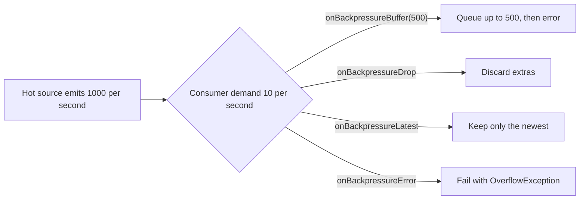

@@ 3 | TOPIC | Backpressure and R2DBC | request(n) flow control, overflow strategies, limitRate, and non-blocking SQL with R2DBC repositories and transactions | NICE
# Backpressure and R2DBC

**Level: Advanced | Phase 22 | Priority: NICE | Since: Reactive Streams 1.0 (2015), R2DBC 1.0 (2022), Spring Data R2DBC 1.0 (2019)**

> **30-second interview answer:** Backpressure is a consumer telling a producer how much it can handle: in Reactive Streams the subscriber calls `request(n)` and the publisher must never send more. When a source cannot slow down (like user clicks or a hot Kafka feed), you pick an overflow strategy: buffer, drop, keep latest or error. R2DBC is the reactive replacement for JDBC, so database rows flow as a `Flux` without blocking threads, and backpressure reaches all the way to the database cursor. It has no lazy loading or JPA-style relationships, so you model aggregates explicitly.

## 1. Concept in Simple Words
### Analogy
A water tap filling buckets carried by a person.

| Water and buckets | Backpressure |
|---|---|
| The tap | Publisher |
| The person carrying buckets | Subscriber |
| "Give me two buckets' worth now" | `request(2)` |
| A tap you can turn down | A cold source that respects demand (database cursor, `Flux.range`) |
| Rain you cannot turn off | A hot source (UI events, a sensor) |
| A big barrel to catch extra rain | `onBackpressureBuffer` |
| Letting extra rain run off | `onBackpressureDrop` |
| Only keeping the latest bucket | `onBackpressureLatest` |
| Shouting "too much water!" | `onBackpressureError` |

R2DBC is a well that only pumps water when the person asks for a bucket, instead of a pump that fills the whole yard (JDBC loading a full result set while a thread waits).

### What it is
- **Demand:** the number of items a subscriber has requested and not yet received. `request(Long.MAX_VALUE)` means unbounded (no backpressure); the simple `subscribe(lambda)` does exactly that.
- **Prefetch:** many operators (`flatMap`, `publishOn`, `concatMap`) request a batch ahead (often 256 or 32) and replenish at 75 percent consumption. `limitRate(n)` sets this explicitly.
- **Overflow strategy:** what to do when a source emits faster than demand and cannot be paused.
- **R2DBC (Reactive Relational Database Connectivity):** an SPI specification for non-blocking SQL drivers (PostgreSQL, MySQL, MariaDB, SQL Server, Oracle, H2). Rows are emitted as a `Publisher`.
- **Spring Data R2DBC:** repositories (`ReactiveCrudRepository`), `R2dbcEntityTemplate` and `DatabaseClient` on top of R2DBC. It is a simple object mapper, not an ORM: no lazy loading, no dirty checking, no `@OneToMany`.

### Why it exists
Without backpressure, a fast producer either overwhelms memory (unbounded queues and `OutOfMemoryError`) or forces blocking. Reactive Streams made flow control part of the protocol. But a reactive web layer over JDBC still blocks at the database, which breaks the model; R2DBC closes that gap so a WebFlux service can be non-blocking end to end.

## 2. How It Works

**Demand flows up, data flows down**

```text
Subscriber            limitRate(4)                     Source (DB cursor / Flux.range)
    | request(MAX) ->     | request(4) ----------------->   |
    |                     |   <- onNext 1,2,3 ------------- |
    |   <- onNext 1,2,3 - |  (75% of 4 consumed)            |
    |                     | request(3) ----------------->   |  replenish
    |                     |   <- onNext 4,5,6 ------------- |
```

**Overflow strategies for hot sources**



**How R2DBC executes a query**

```text
repository.findByStatus("PAID")                 assembly: nothing sent
  WebFlux subscribes, requests N
    -> ConnectionFactory (r2dbc-pool) hands out a connection, non-blocking
    -> driver writes the query bytes on a Netty channel, returns immediately
    -> rows arrive from PostgreSQL in chunks; driver decodes each into a Row
    -> Spring Data maps Row -> OrderRow (record) and calls onNext
    -> when demand is exhausted the driver stops reading from the socket;
       TCP flow control slows the database (true end-to-end backpressure,
       driver-dependent: the PostgreSQL driver uses cursors/fetch size for this)
    -> onComplete, connection returned to the pool
```

**Transactions in R2DBC.** There is no `ThreadLocal`, so the transaction is bound to the Reactor `Context`. Spring Boot auto-configures an `R2dbcTransactionManager` (a `ReactiveTransactionManager`), and `@Transactional` works on methods that return `Mono` or `Flux`: the transaction starts on subscription and commits on completion. `TransactionalOperator` is the programmatic version.

**What you give up compared with JPA.** No entity relationships or lazy loading (load children with a second query and combine with `zip` or `collectList`), no persistence context or dirty checking (call `save` explicitly), and Flyway and Liquibase still need a JDBC driver for migrations at startup.

## 3. Code Example
### Code
Part A: backpressure mechanics with plain Reactor.

```java
// Dependency: org.springframework.boot:spring-boot-starter-webflux (brings io.projectreactor:reactor-core)
import java.util.ArrayList;
import java.util.List;
import org.reactivestreams.Subscription;
import reactor.core.publisher.BaseSubscriber;
import reactor.core.publisher.Flux;

public class BackpressureDemo {

    public static void main(String[] args) {
        // 1. A subscriber that asks for 2 items at a time
        Flux.range(1, 5)
            .doOnRequest(n -> System.out.println("request(" + n + ")"))
            .subscribe(new BaseSubscriber<Integer>() {
                private int received;

                @Override
                protected void hookOnSubscribe(Subscription subscription) {
                    request(2);                       // initial demand
                }

                @Override
                protected void hookOnNext(Integer value) {
                    System.out.println("onNext " + value);
                    received++;
                    if (received % 2 == 0) {
                        request(2);                   // ask for the next batch
                    }
                }

                @Override
                protected void hookOnComplete() {
                    System.out.println("complete");
                }
            });

        // 2. limitRate: the operator re-requests in batches for you
        Flux.range(1, 10)
            .doOnRequest(n -> System.out.println("upstream request(" + n + ")"))
            .limitRate(4)
            .subscribe();

        // 3. Overflow strategy: drop items the slow consumer did not ask for
        List<Integer> kept = new ArrayList<>();
        Flux.range(1, 10)
            .onBackpressureDrop(dropped -> System.out.println("dropped " + dropped))
            .subscribe(new BaseSubscriber<Integer>() {
                @Override
                protected void hookOnSubscribe(Subscription subscription) {
                    request(3);                       // consumer only ever wants 3
                }

                @Override
                protected void hookOnNext(Integer value) {
                    kept.add(value);
                }
            });
        System.out.println("kept " + kept);
    }
}
```

Part B: a reactive OrderHub order repository with R2DBC.

```xml
<!-- pom.xml -->
<dependency>
    <groupId>org.springframework.boot</groupId>
    <artifactId>spring-boot-starter-data-r2dbc</artifactId>
</dependency>
<dependency>
    <groupId>org.springframework.boot</groupId>
    <artifactId>spring-boot-starter-webflux</artifactId>
</dependency>
<dependency>
    <groupId>org.postgresql</groupId>
    <artifactId>r2dbc-postgresql</artifactId>
    <scope>runtime</scope>
</dependency>
<!-- Flyway still migrates over JDBC at startup -->
<dependency>
    <groupId>org.flywaydb</groupId>
    <artifactId>flyway-database-postgresql</artifactId>
</dependency>
<dependency>
    <groupId>org.postgresql</groupId>
    <artifactId>postgresql</artifactId>
    <scope>runtime</scope>
</dependency>
```

```yaml
# application.yml
spring:
  r2dbc:
    url: r2dbc:postgresql://localhost:5432/orderhub
    username: orderhub
    password: secret
    pool:
      initial-size: 5
      max-size: 20
      max-idle-time: 30m
  flyway:
    url: jdbc:postgresql://localhost:5432/orderhub
    user: orderhub
    password: secret
logging:
  level:
    io.r2dbc.postgresql.QUERY: debug     # logs SQL sent by the driver
```

```sql
-- src/main/resources/db/migration/V1__orders.sql
CREATE TABLE orders (
    id            BIGSERIAL PRIMARY KEY,
    customer_name VARCHAR(100) NOT NULL,
    status        VARCHAR(20)  NOT NULL,
    total_cents   BIGINT       NOT NULL,
    version       BIGINT       NOT NULL DEFAULT 0
);
CREATE TABLE order_lines (
    id         BIGSERIAL PRIMARY KEY,
    order_id   BIGINT NOT NULL REFERENCES orders(id),
    product    VARCHAR(100) NOT NULL,
    quantity   INT NOT NULL
);
```

```java
// File: com/orderhub/order/r2dbc/OrderRow.java
package com.orderhub.order.r2dbc;

import org.springframework.data.annotation.Id;
import org.springframework.data.annotation.Version;
import org.springframework.data.relational.core.mapping.Column;
import org.springframework.data.relational.core.mapping.Table;

@Table("orders")
public record OrderRow(
        @Id Long id,
        @Column("customer_name") String customerName,
        String status,
        @Column("total_cents") long totalCents,
        @Version Long version) {          // optimistic locking works in R2DBC too

    public OrderRow withStatus(String newStatus) {
        return new OrderRow(id, customerName, newStatus, totalCents, version);
    }
}
```

```java
// File: com/orderhub/order/r2dbc/OrderLineRow.java
package com.orderhub.order.r2dbc;

import org.springframework.data.annotation.Id;
import org.springframework.data.relational.core.mapping.Column;
import org.springframework.data.relational.core.mapping.Table;

@Table("order_lines")
public record OrderLineRow(@Id Long id, @Column("order_id") Long orderId, String product, int quantity) { }
```

```java
// File: com/orderhub/order/r2dbc/ReactiveOrderRepository.java
package com.orderhub.order.r2dbc;

import org.springframework.data.r2dbc.repository.Modifying;
import org.springframework.data.r2dbc.repository.Query;
import org.springframework.data.repository.reactive.ReactiveCrudRepository;
import reactor.core.publisher.Flux;
import reactor.core.publisher.Mono;

public interface ReactiveOrderRepository extends ReactiveCrudRepository<OrderRow, Long> {

    Flux<OrderRow> findByStatusOrderByIdAsc(String status);      // derived query

    @Modifying
    @Query("UPDATE orders SET status = :status WHERE id = :id")
    Mono<Integer> updateStatus(Long id, String status);
}

interface ReactiveOrderLineRepository extends ReactiveCrudRepository<OrderLineRow, Long> {
    Flux<OrderLineRow> findByOrderId(Long orderId);
}
```

```java
// File: com/orderhub/order/r2dbc/ReactiveOrderService.java
package com.orderhub.order.r2dbc;

import java.util.List;
import org.springframework.stereotype.Service;
import org.springframework.transaction.annotation.Transactional;
import reactor.core.publisher.Flux;
import reactor.core.publisher.Mono;

@Service
public class ReactiveOrderService {

    public record OrderWithLines(OrderRow order, List<OrderLineRow> lines) { }

    private final ReactiveOrderRepository orders;
    private final ReactiveOrderLineRepository lines;

    public ReactiveOrderService(ReactiveOrderRepository orders, ReactiveOrderLineRepository lines) {
        this.orders = orders;
        this.lines = lines;
    }

    // No relationships in R2DBC: compose the aggregate explicitly
    public Mono<OrderWithLines> findWithLines(long id) {
        return orders.findById(id)
                .zipWhen(o -> lines.findByOrderId(o.id()).collectList(),
                         OrderWithLines::new);
    }

    // Transaction bound to the Reactor Context; commits when the Mono completes
    @Transactional
    public Mono<OrderRow> placeOrder(String customer, List<OrderLineRow> newLines, long totalCents) {
        return orders.save(new OrderRow(null, customer, "NEW", totalCents, null))
                .flatMap(saved -> Flux.fromIterable(newLines)
                        .map(l -> new OrderLineRow(null, saved.id(), l.product(), l.quantity()))
                        .concatMap(lines::save)
                        .then(Mono.just(saved)));
    }

    // Stream PAID orders with bounded demand to the database
    public Flux<OrderRow> paidOrders() {
        return orders.findByStatusOrderByIdAsc("PAID").limitRate(100);
    }
}
```

### Walkthrough
- **Demo 1:** the custom subscriber requests 2, receives 2, then requests 2 more. `Flux.range` respects demand exactly, which is backpressure at its simplest.
- **Demo 2:** `limitRate(4)` requests 4 from upstream, then replenishes 3 (75 percent of 4) each time 3 items have been passed downstream. This is the same mechanism `flatMap` and `publishOn` use with their prefetch.
- **Demo 3:** `onBackpressureDrop` requests unbounded from upstream (it accepts everything) and discards items the downstream did not ask for. The consumer wanted only 3, so 4 to 10 are dropped and reported.
- **pom and yml:** `r2dbc-postgresql` is the reactive driver; the JDBC driver plus Flyway are only for migrations. `spring.r2dbc.pool` configures `r2dbc-pool` (the reactive equivalent of HikariCP).
- **Records as entities:** Spring Data R2DBC maps immutable records; `@Version` gives optimistic locking (an `OptimisticLockingFailureException` signal on conflict).
- **Repository:** derived queries and `@Query` look like Spring Data JPA, but return `Mono` and `Flux`. Updates need `@Modifying`.
- **Service:** `zipWhen` loads the order, then its lines, building the aggregate by hand. `placeOrder` is `@Transactional`: the reactive transaction manager opens the transaction when WebFlux subscribes and commits when the returned `Mono` completes, rolling back on an error signal.

### Output
Demo output:
```text
request(2)
onNext 1
onNext 2
request(2)
onNext 3
onNext 4
request(2)
onNext 5
complete
upstream request(4)
upstream request(3)
upstream request(3)
upstream request(3)
dropped 4
dropped 5
dropped 6
dropped 7
dropped 8
dropped 9
dropped 10
kept [1, 2, 3]
```

SQL logged when `placeOrder("Asha", two lines, 2500)` runs (driver debug log, abbreviated to the statements):
```sql
BEGIN;
INSERT INTO orders (customer_name, status, total_cents, version) VALUES ($1, $2, $3, $4) RETURNING *;
INSERT INTO order_lines (order_id, product, quantity) VALUES ($1, $2, $3) RETURNING *;
INSERT INTO order_lines (order_id, product, quantity) VALUES ($1, $2, $3) RETURNING *;
COMMIT;
```

### Compare
| JDBC + JPA | R2DBC + Spring Data R2DBC |
|---|---|
| Blocking, thread waits for rows | Non-blocking, rows pushed as signals |
| HikariCP | r2dbc-pool |
| Relationships, lazy loading, dirty checking | None: explicit queries and `save` |
| `@Transactional` via ThreadLocal | `@Transactional` via Reactor Context |
| Huge ecosystem, mature | Smaller ecosystem, fewer tools |
| Fits Spring MVC and virtual threads | Fits WebFlux |

## 4. Interview Questions
**Basic**
1. **What is backpressure?**
   It is flow control from consumer to producer: the subscriber states how many items it can take with `request(n)`, and the publisher must not emit more. It prevents a fast producer from overwhelming a slow consumer's memory or CPU. In Reactor it is built into every operator.
2. **What is R2DBC?**
   A specification for reactive, non-blocking relational database drivers, the reactive counterpart of JDBC. Spring Data R2DBC adds repositories and templates on top. Queries return `Mono` and `Flux`, so a WebFlux app can stay non-blocking down to the database.
3. **Name the backpressure overflow strategies in Reactor.**
   Buffer (`onBackpressureBuffer`, optionally bounded with an overflow action), drop (`onBackpressureDrop`), latest (`onBackpressureLatest`) and error (`onBackpressureError`). `Flux.create` takes an `OverflowStrategy` with the same choices plus `IGNORE`.

**Follow-up**
4. **Does `subscribe(System.out::println)` use backpressure?**
   It requests `Long.MAX_VALUE`, which means unbounded demand, so effectively no backpressure from that subscriber. Operators in between (like `publishOn` or `limitRate`) can still bound upstream demand with their prefetch.
5. **Why can't Spring Data R2DBC do lazy loading?**
   Lazy loading means a getter triggers a query when you touch it, which is a blocking, hidden I/O call; in a reactive pipeline every I/O must be an explicit publisher. So R2DBC has no proxies or persistence context, and you load related data with explicit queries and combine them.
6. **How do transactions work with R2DBC?**
   The `R2dbcTransactionManager` binds the connection to the Reactor `Context` of the subscription instead of a `ThreadLocal`. `@Transactional` on a method returning `Mono` or `Flux` starts the transaction on subscribe and commits on completion or rolls back on error. Calling `.subscribe()` inside the method breaks this, because that inner subscription has its own context.

**Tricky / scenario**
7. **A Kafka consumer pushes 10,000 events per second into a reactive pipeline that writes to a slow API. Memory grows until OOM. What do you do?**
   An unbounded buffer is absorbing the difference. Use a source that supports demand (Reactor Kafka's `KafkaReceiver` fetches based on demand), bound concurrency with `flatMap(call, 16)`, and choose an explicit strategy for overflow: bounded buffer with error, drop with a metric, or slow the consumer by pausing partitions. Also scale out consumers if the API can take more.
8. **Your team wants to use R2DBC with WebFlux for a reporting service with complex joins and JPA entity graphs. Good idea?**
   Probably not. Complex object graphs, lazy loading and the JPA ecosystem (entity graphs, second-level cache, Envers) are not available. For a reporting service, Spring MVC with JDBC or jOOQ on virtual threads is simpler; choose R2DBC only when the rest of the stack is reactive and the data model is simple.
9. **What does `flatMap(f, 8)` have to do with backpressure?**
   The second argument is the concurrency: `flatMap` subscribes to at most 8 inner publishers at once and requests from upstream only as slots free up. It is the most common way to stop a reactive service from opening thousands of simultaneous downstream calls.

**What the interviewer is really testing:** whether you can keep a streaming system stable under load, and whether you know the trade-offs of going reactive at the database layer.

## 5. Pitfalls & Best Practices
### Common mistakes
| Mistake | What goes wrong | Fix |
|---|---|---|
| Unbounded `onBackpressureBuffer()` on a hot source | Memory grows until OOM | Bound the buffer and decide the overflow action |
| `flatMap` without a concurrency limit over thousands of items | Thousands of concurrent DB or HTTP calls | `flatMap(f, n)` or `concatMap` |
| Expecting `@OneToMany` in R2DBC | Mapping errors or missing data | Separate queries combined with `zip` or `collectList` |
| Forgetting the JDBC driver for Flyway | Migrations do not run | Add the JDBC driver and `spring.flyway.url` |
| `subscribe()` inside a `@Transactional` method | Work runs outside the transaction | Return the publisher and compose |

### Best practices
- Treat every unbounded buffer as a production incident waiting to happen; expose buffer sizes and drop counts as metrics.
- Use `limitRate` or a concurrency argument wherever a fast source meets slow I/O.
- Size `r2dbc-pool` like HikariCP: a small pool (10 to 20) is usually enough because connections are not held while waiting.
- Prefer `DatabaseClient` for complex SQL; keep repositories for simple CRUD.

### Compare with
| Flow control technique | Where | Mechanism |
|---|---|---|
| Reactive Streams backpressure | In-process pipelines | `request(n)` |
| `BlockingQueue` with fixed capacity | Thread-based producer and consumer | Producer blocks on `put` |
| Semaphore | Virtual-thread code | Limits concurrent permits |
| Kafka consumer lag | Between services | Consumer pulls at its own pace |
| HTTP 429 and rate limiters | Between services | Reject and let the client retry |

## 6. Hands-on Exercise
In OrderHub's inventory service, add a reactive endpoint `GET /api/stock/export` that streams every stock row as NDJSON from PostgreSQL using R2DBC. Acceptance criteria: `StockRow` record mapped with `@Table("stock")`; a repository method returning `Flux<StockRow>` ordered by product id; the stream is bounded with `limitRate(200)`; a reactive `@Transactional(readOnly = true)` service method; the controller produces `application/x-ndjson`; a `StepVerifier` test of the service with a mocked repository proves three rows are emitted in order.

<details><summary>Solution</summary>

```java
// File: inventory-service/src/main/java/com/orderhub/inventory/export/StockRow.java
package com.orderhub.inventory.export;

import org.springframework.data.annotation.Id;
import org.springframework.data.relational.core.mapping.Column;
import org.springframework.data.relational.core.mapping.Table;

@Table("stock")
public record StockRow(@Id Long id, @Column("product_id") String productId, int available) { }
```

```java
// File: inventory-service/src/main/java/com/orderhub/inventory/export/StockExportService.java
package com.orderhub.inventory.export;

import org.springframework.data.repository.reactive.ReactiveCrudRepository;
import org.springframework.stereotype.Service;
import org.springframework.transaction.annotation.Transactional;
import reactor.core.publisher.Flux;

interface StockRepository extends ReactiveCrudRepository<StockRow, Long> {
    Flux<StockRow> findAllByOrderByProductIdAsc();
}

@Service
public class StockExportService {

    private final StockRepository repository;

    public StockExportService(StockRepository repository) {
        this.repository = repository;
    }

    @Transactional(readOnly = true)
    public Flux<StockRow> exportAll() {
        return repository.findAllByOrderByProductIdAsc().limitRate(200);
    }
}
```

```java
// File: inventory-service/src/main/java/com/orderhub/inventory/export/StockExportController.java
package com.orderhub.inventory.export;

import org.springframework.http.MediaType;
import org.springframework.web.bind.annotation.GetMapping;
import org.springframework.web.bind.annotation.RestController;
import reactor.core.publisher.Flux;

@RestController
public class StockExportController {

    private final StockExportService service;

    public StockExportController(StockExportService service) {
        this.service = service;
    }

    @GetMapping(value = "/api/stock/export", produces = MediaType.APPLICATION_NDJSON_VALUE)
    public Flux<StockRow> export() {
        return service.exportAll();
    }
}
```

```java
// File: inventory-service/src/test/java/com/orderhub/inventory/export/StockExportServiceTest.java
// Test dependencies: org.springframework.boot:spring-boot-starter-test, io.projectreactor:reactor-test
package com.orderhub.inventory.export;

import static org.mockito.Mockito.mock;
import static org.mockito.Mockito.when;

import org.junit.jupiter.api.Test;
import reactor.core.publisher.Flux;
import reactor.test.StepVerifier;

class StockExportServiceTest {

    @Test
    void streamsRowsInOrder() {
        StockRepository repo = mock(StockRepository.class);
        when(repo.findAllByOrderByProductIdAsc()).thenReturn(Flux.just(
                new StockRow(1L, "P-1", 5), new StockRow(2L, "P-2", 0), new StockRow(3L, "P-3", 12)));

        StepVerifier.create(new StockExportService(repo).exportAll())
                .expectNextMatches(r -> r.productId().equals("P-1"))
                .expectNextMatches(r -> r.productId().equals("P-2"))
                .expectNextMatches(r -> r.productId().equals("P-3"))
                .verifyComplete();
    }
}
```
The NDJSON response lets a client process a million rows with constant memory on both sides, and `limitRate(200)` keeps the driver reading in bounded chunks.
</details>

## 7. Recall
Q: What is backpressure in Reactive Streams?
A: Consumer-driven flow control: the subscriber calls `request(n)` and the publisher never emits more than requested.

Q: Which Reactor operators handle backpressure overflow from a hot source?
A: `onBackpressureBuffer`, `onBackpressureDrop`, `onBackpressureLatest` and `onBackpressureError`.

Q: What does `limitRate(4)` do in Reactor?
A: It requests 4 items from upstream and then replenishes in batches of 3 (75 percent) as items are consumed downstream.

Q: What is R2DBC and what does it replace?
A: A reactive, non-blocking SQL driver specification that replaces JDBC in fully reactive stacks.

Q: What JPA features are missing in Spring Data R2DBC?
A: Relationships, lazy loading, persistence context and dirty checking; you write explicit queries and call `save`.

**Related:** [[Reactive Programming and Project Reactor]] · [[Spring WebFlux vs Spring MVC]] · [[Concurrent Collections and BlockingQueue]] · [[Event-Driven Architecture with Kafka]]
