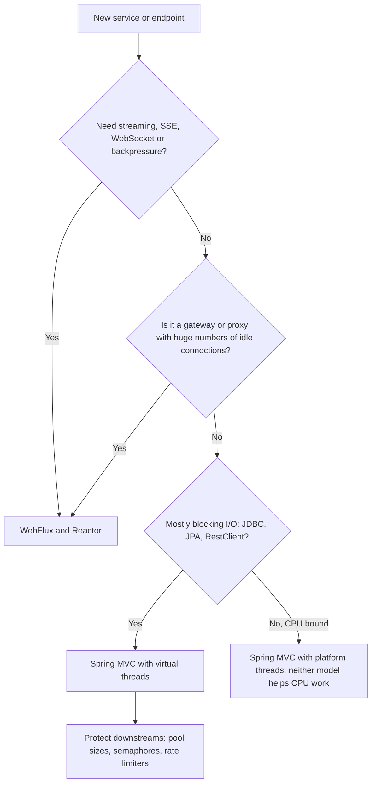

@@ 3 | TOPIC | Virtual Threads vs Reactive | How Java 21 virtual threads change the WebFlux decision, pinning, limits, and a decision framework | SHOULD
# Virtual Threads vs Reactive

**Level: Advanced | Phase 22 | Priority: SHOULD | Since: Virtual threads final in Java 21 (JEP 444), Spring Boot 3.2 support (`spring.threads.virtual.enabled`), synchronized pinning fixed in Java 24 (JEP 491)**

> **30-second interview answer:** Both solve the same problem: threads wasted while waiting on I/O. Reactive programming avoids blocking by turning code into asynchronous pipelines on a few event-loop threads. Virtual threads keep plain blocking code but make threads so cheap that the JVM unmounts a waiting virtual thread from its carrier, so you can have one thread per request even at 100,000 requests. For typical request-response services, Spring MVC on virtual threads gives similar scalability with far simpler code; reactive still wins for streaming, backpressure and event-loop based gateways.

## 1. Concept in Simple Words
### Analogy
Two ways to run a busy restaurant with only 8 chefs at the stove.

| Restaurant | Concurrency model |
|---|---|
| Reactive: chefs never wait; every dish is a ticket on a rail, and a chef picks whichever ticket is ready next | Event loop plus callbacks or Reactor operators |
| Ticket rail rules everyone must learn | `Mono`, `Flux`, operators, schedulers |
| Virtual threads: every order gets its own notebook; when it must wait for the oven, the chef puts the notebook on a shelf and picks up another | Virtual thread unmounts from the carrier while blocked |
| The shelf of paused notebooks | Virtual thread stacks stored on the heap |
| Chefs read the notebook top to bottom like normal | Plain imperative, blocking-style code |
| A chef who holds a notebook while welded to the stove | Pinning: blocking inside `synchronized` (before Java 24) or native code |
| Only 8 ovens however many notebooks | Downstream limits still exist: DB pool, rate limits |

### What it is
- **Virtual thread:** a `java.lang.Thread` managed by the JVM, not the OS. Millions can exist; each costs a few hundred bytes to a few KB of heap while parked.
- **Carrier thread:** a platform (OS) thread from a dedicated `ForkJoinPool` (size = number of cores by default) that runs virtual threads.
- **Mount and unmount:** when a virtual thread blocks on I/O, `sleep`, a lock or a `BlockingQueue`, the JVM saves its stack to the heap and frees the carrier to run another virtual thread.
- **Pinning:** a situation where the virtual thread cannot unmount, so it blocks the carrier too. In Java 21 to 23 this happened when blocking inside a `synchronized` block or method, and it still happens inside native calls. Java 24 (JEP 491) removed the `synchronized` case.
- **Reactive:** non-blocking I/O plus a programming model (Reactor) that expresses work as asynchronous signals.
- **Spring support:** `spring.threads.virtual.enabled=true` (Boot 3.2+) makes Tomcat or Jetty run each request on a virtual thread, and also switches `@Async`, `@Scheduled` task executors, Kafka and RabbitMQ listener containers and others to virtual threads.

### Why it exists
Reactive programming solved the scalability problem around 2015 but at a large cost: hard-to-read code, broken stack traces, a separate ecosystem (R2DBC, reactive drivers), and `ThreadLocal` problems. Project Loom set out to give the same scalability to ordinary blocking code, so the existing ecosystem (JDBC, JPA, `RestClient`, Spring MVC) could scale without rewriting. It shipped as final in Java 21.

## 2. How It Works

**Where the waiting goes**

```text
PLATFORM THREAD PER REQUEST (classic MVC)
  OS thread T1: [parse][-------- wait DB 50 ms --------][render]
  OS thread T2: [parse][------------ wait HTTP 300 ms ------------][render]
  200 threads max -> request 201 queues, even though the CPU is idle

VIRTUAL THREAD PER REQUEST (MVC + spring.threads.virtual.enabled)
  carrier C1: [VT1 parse][VT2 parse][VT3 parse][VT1 render][VT4 parse]...
  heap:        VT1 stack parked (waiting DB)  VT2 stack parked (waiting HTTP)
  10,000 waiting requests = 10,000 small heap objects, 8 carriers busy only when there is CPU work

REACTIVE (WebFlux)
  event loop E1: [req1: send DB query, register callback][req2: send HTTP...][req1 callback: render]
  no stacks parked at all: state lives in operator objects and closures
```

**Decision flow**



**What virtual threads do NOT solve**
1. **Downstream limits.** HikariCP may have 10 connections. With 10,000 virtual threads, 9,990 wait for a connection (with `connectionTimeout` failures). Before, the 200-thread pool acted as an accidental limiter; now you must limit on purpose (semaphores, bulkheads, pool sizes).
2. **CPU-bound work.** Virtual threads only help while waiting. Parallel computation still needs platform threads or `ForkJoinPool`.
3. **Backpressure and streaming.** A virtual thread per request has no protocol for "send me fewer items"; you would build it with bounded queues.
4. **Pinning.** On Java 21 to 23, a `synchronized` block that does I/O (some older JDBC drivers and libraries did this) pins the carrier. Detect with `-Djdk.tracePinnedThreads=full` (Java 21 to 23) or the JFR event `jdk.VirtualThreadPinned`. Java 24+ removes most of this problem.
5. **ThreadLocal-heavy code.** It works, but a million threads each holding a large `ThreadLocal` cache uses a lot of memory. Prefer scoped values (final in Java 25) for request context.

**Do not pool virtual threads.** They are cheap to create; a pool of virtual threads adds nothing. Use `Executors.newVirtualThreadPerTaskExecutor()` and limit concurrency with a `Semaphore` where needed.

**Numbers worth quoting (order of magnitude).** A platform thread reserves about 1 MB of stack (virtual memory) and costs microseconds to create; a virtual thread starts at a few hundred bytes and costs well under a microsecond to create. A typical Tomcat pool is 200 threads; the same JVM can park hundreds of thousands of virtual threads.

## 3. Code Example
### Code
Part A: plain Java 21, the throughput difference for blocking calls.

```java
import java.time.Duration;
import java.util.ArrayList;
import java.util.List;
import java.util.concurrent.ExecutorService;
import java.util.concurrent.Executors;
import java.util.concurrent.Future;
import java.util.concurrent.Semaphore;

public class VirtualVsPoolDemo {

    // Simulates a blocking call to a slow downstream service (200 ms)
    static String callInventory(int orderId) throws InterruptedException {
        Thread.sleep(Duration.ofMillis(200));
        return "stock-ok-" + orderId;
    }

    static long run(ExecutorService executor, int tasks) throws Exception {
        long start = System.nanoTime();
        try (executor) {                                    // ExecutorService is AutoCloseable since Java 19
            List<Future<String>> futures = new ArrayList<>();
            for (int i = 0; i < tasks; i++) {
                int id = i;
                futures.add(executor.submit(() -> callInventory(id)));
            }
            for (Future<String> f : futures) f.get();       // wait for all results
        }
        return Duration.ofNanos(System.nanoTime() - start).toMillis();
    }

    public static void main(String[] args) throws Exception {
        int tasks = 2_000;

        long pooled = run(Executors.newFixedThreadPool(100), tasks);
        System.out.println("platform pool of 100: " + tasks + " calls, about " + Math.round(pooled / 1000.0) + " s");

        long virtual = run(Executors.newVirtualThreadPerTaskExecutor(), tasks);
        System.out.println("virtual threads:      " + tasks + " calls, under 1 s: " + (virtual < 1000));

        // Virtual threads remove the thread limit, so protect the downstream yourself
        Semaphore inventoryPermits = new Semaphore(50);
        long limited = run(Executors.newVirtualThreadPerTaskExecutor(), tasks, inventoryPermits);
        System.out.println("virtual + semaphore(50): about " + Math.round(limited / 1000.0) + " s");
    }

    static long run(ExecutorService executor, int tasks, Semaphore permits) throws Exception {
        long start = System.nanoTime();
        try (executor) {
            for (int i = 0; i < tasks; i++) {
                int id = i;
                executor.submit(() -> {
                    permits.acquire();                      // virtual thread parks cheaply while waiting
                    try {
                        return callInventory(id);
                    } finally {
                        permits.release();
                    }
                });
            }
        }                                                   // close() waits for all tasks
        return Duration.ofNanos(System.nanoTime() - start).toMillis();
    }
}
```

Part B: the same OrderHub "checkout" in Spring MVC on virtual threads and in WebFlux.

```yaml
# application.yml (MVC version)
spring:
  threads:
    virtual:
      enabled: true          # Boot 3.2+: Tomcat request threads, @Async, @Scheduled, listeners
  datasource:
    hikari:
      maximum-pool-size: 20  # the real concurrency limit for DB work now
      connection-timeout: 2000
server:
  tomcat:
    threads:
      max: 200               # ignored for request handling once virtual threads are on
```

```java
// File: order-service/src/main/java/com/orderhub/order/checkout/CheckoutService.java  (MVC + virtual threads)
package com.orderhub.order.checkout;

import java.util.concurrent.ExecutorService;
import java.util.concurrent.Executors;
import java.util.concurrent.Future;
import java.util.concurrent.Semaphore;
import org.springframework.stereotype.Service;
import org.springframework.web.client.RestClient;

@Service
public class CheckoutService {

    public record CheckoutResult(String stock, String fraud, String quote) { }

    private final RestClient http;
    private final Semaphore fraudPermits = new Semaphore(20);   // fraud API allows 20 concurrent calls

    public CheckoutService(RestClient.Builder builder) {
        this.http = builder.baseUrl("http://platform-apis").build();
    }

    public CheckoutResult check(long orderId) throws Exception {
        // Three blocking calls in parallel, each on its own cheap virtual thread
        try (ExecutorService vts = Executors.newVirtualThreadPerTaskExecutor()) {
            Future<String> stock = vts.submit(() -> get("/inventory/check/" + orderId));
            Future<String> fraud = vts.submit(() -> limited(() -> get("/fraud/score/" + orderId)));
            Future<String> quote = vts.submit(() -> get("/shipping/quote/" + orderId));
            return new CheckoutResult(stock.get(), fraud.get(), quote.get());
        }
    }

    private String get(String path) {
        return http.get().uri(path).retrieve().body(String.class);      // plain blocking call
    }

    private String limited(java.util.concurrent.Callable<String> call) throws Exception {
        fraudPermits.acquire();
        try {
            return call.call();
        } finally {
            fraudPermits.release();
        }
    }
}
```

```java
// File: order-service-reactive/src/main/java/com/orderhub/order/checkout/ReactiveCheckoutService.java  (WebFlux)
package com.orderhub.order.checkout;

import java.time.Duration;
import org.springframework.stereotype.Service;
import org.springframework.web.reactive.function.client.WebClient;
import reactor.core.publisher.Mono;

@Service
public class ReactiveCheckoutService {

    public record CheckoutResult(String stock, String fraud, String quote) { }

    private final WebClient http;

    public ReactiveCheckoutService(WebClient.Builder builder) {
        this.http = builder.baseUrl("http://platform-apis").build();
    }

    public Mono<CheckoutResult> check(long orderId) {
        return Mono.zip(
                        get("/inventory/check/" + orderId),
                        get("/fraud/score/" + orderId),
                        get("/shipping/quote/" + orderId))
                .map(t -> new CheckoutResult(t.getT1(), t.getT2(), t.getT3()));
    }

    private Mono<String> get(String path) {
        return http.get().uri(path).retrieve().bodyToMono(String.class).timeout(Duration.ofSeconds(2));
    }
}
```

```java
// File: order-service/src/main/java/com/orderhub/order/checkout/CheckoutController.java
package com.orderhub.order.checkout;

import org.springframework.web.bind.annotation.GetMapping;
import org.springframework.web.bind.annotation.PathVariable;
import org.springframework.web.bind.annotation.RestController;

@RestController
public class CheckoutController {

    private final CheckoutService service;

    public CheckoutController(CheckoutService service) {
        this.service = service;
    }

    @GetMapping("/api/orders/{id}/checkout-check")
    public CheckoutService.CheckoutResult check(@PathVariable long id) throws Exception {
        return service.check(id);
    }
}
```

### Walkthrough
- **Part A, platform pool:** 2,000 tasks, 100 threads, 200 ms each: the pool processes 100 at a time, so 20 rounds of 200 ms is about 4 seconds.
- **Part A, virtual threads:** every task gets its own virtual thread; all 2,000 sleep at the same time and the carriers are free during the sleep, so the whole batch finishes in roughly 200 to 400 ms.
- **Part A, semaphore:** shows the new responsibility. With 50 permits the downstream sees at most 50 concurrent calls, so 2,000 calls take 40 rounds, about 8 seconds. The virtual threads waiting for a permit cost almost nothing.
- **Part B, yml:** one property moves request handling to virtual threads. The Hikari pool and its `connection-timeout` become the real throttle for database work.
- **Part B, MVC service:** reads top to bottom, uses blocking `RestClient`, and still runs three calls concurrently with a virtual-thread-per-task executor. Exceptions surface as normal stack traces from `Future.get()` (wrapped in `ExecutionException`). In Java 25+ the preview structured concurrency API (`StructuredTaskScope`) would also cancel siblings on failure.
- **Part B, reactive service:** the same result with `Mono.zip`. It is concise, but every helper, error path and test must be reactive too.

### Output
Part A (timings vary slightly by machine):
```text
platform pool of 100: 2000 calls, about 4 s
virtual threads:      2000 calls, under 1 s: true
virtual + semaphore(50): about 8 s
```

Part B, both versions return the same response:
```http
GET /api/orders/42/checkout-check HTTP/1.1
Host: localhost:8080

HTTP/1.1 200 OK
Content-Type: application/json

{"stock":"IN_STOCK","fraud":"LOW","quote":"4.99"}
```

A thread dump (`jcmd <pid> Thread.dump_to_file -format=json dump.json`) of the MVC version under load shows thousands of virtual threads parked in `SocketInputStream.read` and only a handful of carrier threads, which is the healthy pattern.

### Compare
| Question | Virtual threads (MVC) | Reactive (WebFlux) |
|---|---|---|
| Code style | Imperative, blocking calls | Declarative pipelines |
| Learning curve | Low | High |
| Stack traces and debugging | Normal | Fragmented across operators |
| Ecosystem | All of JDBC, JPA, existing libraries | Reactive drivers only (R2DBC, reactive Mongo and Redis) |
| Backpressure | Manual (semaphores, bounded queues) | Built in |
| Streaming responses | Possible but awkward | Natural |
| Memory per waiting request | Small heap stack chunk | Small operator state |
| Context propagation | `ThreadLocal` works, scoped values better | Reactor `Context` |
| Main risk | Overwhelming downstreams, pinning on Java 21 to 23 | Accidental blocking on event loops |

## 4. Interview Questions
**Basic**
1. **Do virtual threads make reactive programming obsolete?**
   Not entirely. For request-response services that block on I/O, virtual threads deliver comparable scalability with simpler code, so new CRUD services rarely need WebFlux. Reactive still has unique strengths: backpressure, streaming, and an event-loop model for gateways and proxies. Many teams now default to MVC with virtual threads and use reactive only where those strengths matter.
2. **How do you enable virtual threads in Spring Boot?**
   Set `spring.threads.virtual.enabled=true` (Boot 3.2+, Java 21+). Boot then configures Tomcat or Jetty to run each request on a virtual thread and uses virtual threads for `@Async`, `@Scheduled`, and messaging listener containers. No code changes are required.
3. **What is pinning?**
   Pinning is when a virtual thread cannot unmount from its carrier while blocked, so the carrier OS thread is blocked too. On Java 21 to 23 it happened when blocking inside `synchronized`; it still happens in native frames. Java 24 (JEP 491) lets virtual threads unmount inside `synchronized`, which removed the most common cause.

**Follow-up**
4. **After switching to virtual threads, the database starts timing out under load. Why?**
   The 200-thread Tomcat pool used to cap concurrent requests, which capped concurrent DB use. With virtual threads, thousands of requests reach Hikari at once, wait for one of the 10 to 20 connections, and hit `connectionTimeout`. Fix it with explicit limits: a bulkhead or semaphore in front of DB-heavy endpoints, rate limiting at the gateway, and query optimization; do not just grow the pool, because the database has its own limits.
5. **Why should you not pool virtual threads?**
   Pools exist to amortize expensive creation and to limit concurrency. Virtual threads are cheap to create, and limiting concurrency is better done with a semaphore around the scarce resource. A fixed pool of virtual threads just reintroduces the queueing you wanted to remove.
6. **Do virtual threads help a CPU-bound workload such as image resizing?**
   No. Virtual threads run on a carrier pool sized to the core count, so CPU work gets the same parallelism as a platform pool of that size. Their benefit appears only when threads spend time waiting.

**Tricky / scenario**
7. **You enable virtual threads on Java 21 and throughput gets worse; thread dumps show carriers blocked in a JDBC driver. What happened?**
   The driver (or a connection pool) blocked on I/O inside a `synchronized` block, pinning carriers. With only as many carriers as cores, a few pinned threads stall everything. Upgrade the driver (most major drivers replaced `synchronized` with `ReentrantLock`), move to Java 24+, and confirm with the `jdk.VirtualThreadPinned` JFR event.
8. **A team proposes rewriting a stable Spring MVC service in WebFlux for scalability. What do you advise?**
   First measure where time goes. If the bottleneck is threads blocked on I/O, enabling virtual threads is a one-line change that gets most of the benefit; if it is the database or CPU, neither model fixes it. A rewrite to WebFlux makes sense only for streaming or backpressure needs, and it changes the data layer too (R2DBC instead of JPA).
9. **How does `ThreadLocal` behave with virtual threads and with Reactor?**
   With virtual threads, each request has its own thread, so `ThreadLocal` works as in classic MVC, but values are not inherited by child virtual threads unless you use `InheritableThreadLocal`, and memory adds up with millions of threads. Scoped values (final in Java 25) are the better fit. With Reactor, `ThreadLocal` breaks because work hops threads, so you use Reactor `Context` and context propagation.

**What the interviewer is really testing:** whether you can compare two concurrency models on real criteria (I/O pattern, ecosystem, limits, team skill) and know the new failure modes virtual threads introduce.

## 5. Pitfalls & Best Practices
### Common mistakes
| Mistake | What goes wrong | Fix |
|---|---|---|
| Enabling virtual threads and removing all limits | Downstream DB or APIs overwhelmed, timeouts | Semaphores, bulkheads, rate limits, right-sized pools |
| Pooling virtual threads in a fixed executor | Queueing comes back | `newVirtualThreadPerTaskExecutor` plus a semaphore |
| Blocking in `synchronized` on Java 21 to 23 | Carrier pinning, throughput collapse | `ReentrantLock`, upgraded libraries, Java 24+ |
| Large per-thread `ThreadLocal` caches | Memory explosion with many threads | Scoped values or shared caches |
| Using WebFlux with JPA "for scalability" | Blocking event loops or thread-pool wrapping | MVC with virtual threads |
| Expecting virtual threads to speed up CPU work | No gain | Parallel streams or a platform pool |

### Best practices
- Default new I/O-bound Spring MVC services to Java 21+ with `spring.threads.virtual.enabled=true`; prefer Java 25 (LTS) to avoid `synchronized` pinning.
- Load test after enabling: watch Hikari pending connections, downstream error rates and the JFR pinning event.
- Keep reactive for SSE and WebSocket streams, gateways, and pipelines that need backpressure.
- Do not mix models casually in one call path; if a reactive app must call blocking code, isolate it on `boundedElastic` or, since Reactor 3.6, on a virtual-thread-backed `boundedElastic` (Reactor can use virtual threads for it on Java 21+).

### Compare with
| Model | Scales waiting I/O | Simple code | Backpressure | Best fit |
|---|---|---|---|---|
| Platform threads | Up to pool size | Yes | Queue only | Low or moderate concurrency |
| Virtual threads | Yes | Yes | Manual | Request-response services |
| Reactor and WebFlux | Yes | No | Yes | Streaming, gateways |
| Kotlin coroutines | Yes | Fairly | Via Flow | Kotlin codebases |

## 6. Hands-on Exercise
Turn on virtual threads in OrderHub's order service and make it safe. Acceptance criteria: `application.yml` enables virtual threads; a `Bulkhead` from Resilience4j (semaphore type) limits the `/api/reports/**` endpoints to 10 concurrent calls with a 500 ms max wait and returns 503 with a `ProblemDetail` when full; a startup log line prints whether the current thread is virtual; an integration test proves a request runs on a virtual thread. Files: `application.yml`, `ReportController.java`, `ReportService.java`, `VirtualThreadCheckTest.java`.

<details><summary>Solution</summary>

```yaml
# order-service/src/main/resources/application.yml
spring:
  threads:
    virtual:
      enabled: true
resilience4j:
  bulkhead:
    instances:
      reports:
        max-concurrent-calls: 10
        max-wait-duration: 500ms
```

```java
// File: order-service/src/main/java/com/orderhub/order/report/ReportService.java
package com.orderhub.order.report;

import io.github.resilience4j.bulkhead.annotation.Bulkhead;
import org.springframework.stereotype.Service;

@Service
public class ReportService {

    @Bulkhead(name = "reports", type = Bulkhead.Type.SEMAPHORE)
    public String monthlyRevenue(int month) {
        // heavy JDBC aggregation here; the bulkhead protects the connection pool
        return "revenue-for-" + month;
    }
}
```

```java
// File: order-service/src/main/java/com/orderhub/order/report/ReportController.java
package com.orderhub.order.report;

import io.github.resilience4j.bulkhead.BulkheadFullException;
import org.springframework.http.HttpStatus;
import org.springframework.http.ProblemDetail;
import org.springframework.web.bind.annotation.ExceptionHandler;
import org.springframework.web.bind.annotation.GetMapping;
import org.springframework.web.bind.annotation.PathVariable;
import org.springframework.web.bind.annotation.RestController;

@RestController
public class ReportController {

    private final ReportService service;

    public ReportController(ReportService service) {
        this.service = service;
    }

    @GetMapping("/api/reports/revenue/{month}")
    public String revenue(@PathVariable int month) {
        return service.monthlyRevenue(month);
    }

    @GetMapping("/api/debug/thread")
    public String thread() {
        return "virtual=" + Thread.currentThread().isVirtual();
    }

    @ExceptionHandler(BulkheadFullException.class)
    public ProblemDetail busy(BulkheadFullException e) {
        ProblemDetail pd = ProblemDetail.forStatusAndDetail(HttpStatus.SERVICE_UNAVAILABLE,
                "Report capacity reached, retry shortly");
        pd.setTitle("Too many concurrent reports");
        return pd;
    }
}
```

```java
// File: order-service/src/test/java/com/orderhub/order/report/VirtualThreadCheckTest.java
package com.orderhub.order.report;

import static org.assertj.core.api.Assertions.assertThat;

import org.junit.jupiter.api.Test;
import org.springframework.beans.factory.annotation.Autowired;
import org.springframework.boot.test.context.SpringBootTest;
import org.springframework.boot.test.web.client.TestRestTemplate;

@SpringBootTest(webEnvironment = SpringBootTest.WebEnvironment.RANDOM_PORT,
        properties = "spring.threads.virtual.enabled=true")
class VirtualThreadCheckTest {

    @Autowired
    TestRestTemplate rest;

    @Test
    void requestsRunOnVirtualThreads() {
        assertThat(rest.getForObject("/api/debug/thread", String.class)).isEqualTo("virtual=true");
    }
}
```
The test needs a real server (`RANDOM_PORT`) because MockMvc runs the controller on the test thread, not on a Tomcat request thread. The bulkhead restores the explicit concurrency limit that the old thread pool used to provide by accident. (In Boot 4, `TestRestTemplate` moved to a separate test module and `RestTestClient` is the newer option; check the Boot 4 notes.)
</details>

## 7. Recall
Q: What problem do both virtual threads and reactive programming solve?
A: Wasting scarce threads while they wait on I/O, which limits how many concurrent requests a service can handle.

Q: How do you enable virtual threads for request handling in Spring Boot?
A: Set `spring.threads.virtual.enabled=true` on Java 21+ with Boot 3.2 or later.

Q: What is virtual thread pinning and when did Java fix the main cause?
A: A blocked virtual thread that cannot unmount and so blocks its carrier; blocking inside `synchronized` stopped pinning in Java 24 (JEP 491).

Q: What new risk appears after enabling virtual threads in a Spring MVC service?
A: Unlimited concurrency floods downstream resources such as the connection pool, so you need explicit limits like semaphores or bulkheads.

Q: When is reactive WebFlux still the better choice than virtual threads?
A: For streaming (SSE, WebSocket, NDJSON), built-in backpressure, and event-loop gateways or proxies.

**Related:** [[Virtual Threads]] · [[Spring WebFlux vs Spring MVC]] · [[Structured Concurrency and Scoped Values]] · [[Resilience4j: Circuit Breaker, Retry, Rate Limiter, Bulkhead]]
