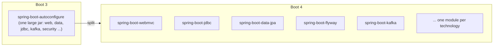

@@ 2 | MODULE | What's new | Spring Boot 4 and Spring Framework 7: the new baseline, features and migration path | MUST
# What's new

**Shared analogy: a city switching to a new building code.**

Every few years the city (the Spring team) publishes a new building code (a major release). Old buildings keep standing for a while (Boot 3.5 support), but new construction must follow the new code: stronger foundations (Java 17 minimum, Java 25 recommended, Jakarta EE 11), modular wiring so each room only gets the cables it needs (modularized auto-configuration), clear labels on every pipe saying whether it can be empty (JSpecify null-safety), standard signs for which version of a road you are on (API versioning), and prefabricated connectors between buildings (HTTP service clients). Interviewers ask about it because it shows whether you follow the platform you work on, and because migrations are real work that seniors are expected to plan.

Topic: [[Spring Boot 4 and Spring Framework 7 Changes]]

@@ 3 | TOPIC | Spring Boot 4 and Spring Framework 7 Changes | Baselines, modular auto-configuration, JSpecify, API versioning, HTTP service clients, Jackson 3, resilience annotations and migration | SHOULD
# Spring Boot 4 and Spring Framework 7 Changes

**Level: Advanced | Phase 22 | Priority: SHOULD | Since: Spring Framework 7.0 (November 2025), Spring Boot 4.0 (November 2025)**

> **30-second interview answer:** Spring Boot 4.0 and Spring Framework 7.0 shipped in November 2025. They keep Java 17 as the minimum but are built for Java 25, move to Jakarta EE 11 (Servlet 6.1, Tomcat 11, Hibernate 7), and modularize Boot's auto-configuration into smaller per-technology modules. New features include JSpecify null-safety annotations across the portfolio, first-class API versioning in MVC and WebFlux, declarative HTTP service clients configured in groups, Jackson 3 as the default JSON library, and built-in `@Retryable` and `@ConcurrencyLimit`. Migration is mostly dependency and package renames if you are already clean on Boot 3.5 with no deprecation warnings.

**A note on certainty.** This note describes what is publicly documented for the 4.0 and 7.0 GA releases as far as this guide knows. Items marked **(verify)** are details (exact property names, attribute names, module names) that changed during milestones or that the guide is less sure about; check the official Spring Boot 4.0 release notes and migration guide before relying on them in production. Later minor releases (4.1 and beyond) may add or adjust features.

## 1. Concept in Simple Words
### Analogy
Moving house to a newer, better-organized apartment building.

| Moving house | Boot 4 and Framework 7 |
|---|---|
| The building requires newer wiring standards | Jakarta EE 11 baseline (Servlet 6.1) |
| Minimum tenant age stays the same, but the building is designed for younger tenants | Java 17 minimum, Java 25 recommended and fully supported |
| One giant fuse box replaced by a small fuse box per room | `spring-boot-autoconfigure` split into focused modules |
| Labels on every socket saying "may be empty" | JSpecify `@Nullable` and `@NullMarked` |
| Signs on doors: "Version 1 entrance, Version 2 entrance" | API versioning with `version` on mappings |
| Pre-installed intercoms to the neighbours | HTTP service client groups |
| New moving company with a different address format | Jackson 3 with the `tools.jackson` package |
| A built-in fire escape instead of a ladder you buy separately | `@Retryable` and `@ConcurrencyLimit` in core Spring |

### What it is
- **Spring Framework 7.0:** the core container, MVC, WebFlux, data access and test framework underneath Boot 4.
- **Spring Boot 4.0:** the opinionated layer: starters, auto-configuration, Actuator, build plugins. The rest of the portfolio moved with it (Spring Security 7, Spring Data 2025.1, Spring Cloud 2025.1, Micrometer 1.16).
- **Baselines:** Java 17+ (Java 25 is the current LTS and recommended), Jakarta EE 11, Kotlin 2.2+, GraalVM 25 for native images. Servlet containers: Tomcat 11 and Jetty 12.1; **Undertow support was dropped** because it does not yet support Servlet 6.1.
- **JSpecify:** a standard set of nullness annotations (`org.jspecify.annotations.Nullable`, `NonNull`, `NullMarked`, `NullUnmarked`) agreed by Google, JetBrains, Oracle, Uber and others. Spring's own `org.springframework.lang.Nullable` family is deprecated in favour of it.
- **API versioning:** built-in support for resolving a version from a header, query parameter, path segment or media-type parameter, and routing to handler methods by a `version` attribute.
- **HTTP service clients:** interfaces annotated with `@HttpExchange` (introduced in Framework 6) can now be registered in groups with `@ImportHttpServices`, with per-group configuration and Boot properties, instead of hand-writing a `HttpServiceProxyFactory` bean per client.

### Why it exists
Boot 3 (2022) did the big `javax` to `jakarta` jump. Since then Java moved from 17 to 25 (virtual threads, records everywhere, pattern matching), Jakarta EE moved to 11, and Jackson 3 arrived. Spring also accumulated pain points: a monolithic auto-configure jar that dragged in classes and metadata for every technology, ad-hoc nullness annotations that Kotlin and tools interpreted inconsistently, home-grown API versioning in every company, and boilerplate for HTTP interface clients. Boot 4 and Framework 7 address those and set the platform up for the next several years.

## 2. How It Works

**Generations at a glance**

| | Boot 2.7 / Framework 5.3 | Boot 3.x / Framework 6.x | Boot 4.x / Framework 7.x |
|---|---|---|---|
| Released | 2022 (last 2.x) | Nov 2022 (3.0) to 2025 (3.5) | Nov 2025 (4.0) |
| Java minimum | 8 | 17 | 17 (Java 25 recommended) |
| Enterprise API | Java EE 8 (`javax.*`) | Jakarta EE 9 and 10 (`jakarta.*`) | Jakarta EE 11 (`jakarta.*`) |
| Servlet | 4 | 6.0 | 6.1 |
| Hibernate | 5.6 | 6.x | 7.x |
| JSON | Jackson 2 | Jackson 2 | Jackson 3 (Jackson 2 kept as deprecated option) |
| Null-safety | Spring `@Nullable` | Spring `@Nullable` | JSpecify |
| Observability | Sleuth | Micrometer Observation and Tracing | Micrometer plus a dedicated OpenTelemetry starter **(verify)** |

**Modularized auto-configuration**



In Boot 4, each technology's auto-configuration, `@ConfigurationProperties` classes and metadata live in their own module, and each starter pulls in the matching module. Effects you will notice:
- **Smaller footprint and faster startup analysis:** the app only carries auto-configurations for what it uses, which also helps AOT and native images.
- **Package moves:** auto-configuration classes moved to technology-specific packages. Code that imports Boot's auto-configuration classes directly (for example in `@ImportAutoConfiguration` or `exclude =`) may need new imports **(verify exact packages with your IDE)**.
- **Starters matter more:** some features that used to activate when a library was merely on the classpath now need the dedicated starter (for example Flyway and Liquibase need their Boot starter rather than just the library) **(verify)**.
- **Migration aid:** "classic" starters (`spring-boot-starter-classic`, `spring-boot-starter-test-classic`) bring back the old all-in-one behaviour while you migrate **(verify names)**.
- **Test starters per technology:** for example a web MVC test starter alongside the MVC starter, so test slices for a technology come with that technology **(verify names)**.

**API versioning flow (Framework 7)**

```text
GET /api/orders/42   API-Version: 2.0
  -> ApiVersionResolver   (header "API-Version" configured)      -> "2.0"
  -> ApiVersionParser     (semantic versions: major.minor.patch) -> 2.0.0
  -> validate against supported versions (else 400 InvalidApiVersionException)
  -> RequestMappingHandlerMapping matches @GetMapping(version = "2.0")
       version = "1.1+"  means "1.1 and any later version" (baseline versions)
  -> optional deprecation handler adds Deprecation / Sunset / Link headers
```

**HTTP service client groups**

```text
@ImportHttpServices(group = "inventory", types = InventoryClient.class)
  -> registers an HttpServiceProxyRegistry with group "inventory"
  -> one RestClient (or WebClient) per group, configured by
       Boot properties: spring.http.serviceclient.inventory.base-url  (verify)
       or a RestClientHttpServiceGroupConfigurer bean
  -> each interface in the group becomes a bean (a JDK proxy)
  -> calling client.getStock("P-1") = RestClient GET {base}/stock/P-1
```

**Other Framework 7 changes worth naming**
- **Resilience in core:** `@Retryable` and `@ConcurrencyLimit` (package `org.springframework.resilience.annotation`), enabled with `@EnableResilientMethods`, plus a programmatic `RetryTemplate` in core. This replaces the separate Spring Retry project for common cases. Attribute names such as `maxRetries`, `delay`, `multiplier` changed during milestones **(verify against the javadoc)**.
- **Programmatic bean registration:** a `BeanRegistrar` interface for registering beans in code with conditions and loops, friendly to AOT **(verify details)**.
- **Testing:** `RestTestClient` (a `RestClient`-style test client that can bind to MockMvc or a live server), context caching improvements (pausing unused cached contexts), and support for JUnit Jupiter 6 **(verify)**. Boot 4 removed `@MockBean` and `@SpyBean` (deprecated in 3.4); use `@MockitoBean` and `@MockitoSpyBean`.
- **Removals:** long-deprecated APIs are gone, such as `ListenableFuture` (use `CompletableFuture`), suffix pattern matching and trailing-slash matching in MVC, and the `spring-jcl` bridge (Spring uses Apache Commons Logging 1.3 directly) **(verify the full list in the "removed" section of the release notes)**.
- **Kotlin:** Kotlin 2.2 baseline, JSpecify nullness maps directly to Kotlin nullable types, and better coroutines support.

**Jackson 3 in one minute**
- New Maven group `tools.jackson.core` and Java packages `tools.jackson.databind`, `tools.jackson.core`. Annotations stay in `com.fasterxml.jackson.annotation`, so `@JsonProperty` and `@JsonIgnore` imports do not change.
- `JsonMapper` is immutable and built with `JsonMapper.builder()`; `ObjectMapper` instances are no longer mutated after construction.
- `JacksonException` is unchecked, so no more `throws JsonProcessingException` everywhere.
- Some defaults changed, for example dates are written as ISO strings by default instead of timestamps **(verify other default changes before upgrading APIs with strict contracts)**.
- Boot 4 auto-configures a `JsonMapper`; customize it with a `JsonMapperBuilderCustomizer` bean and `spring.jackson.*` properties. A Jackson 2 compatibility module exists but is deprecated **(verify names)**.

## 3. Code Example
### Code
OrderHub's order service on Boot 4, using the new features. Lines marked **(verify)** in comments are the less certain API details.

```xml
<!-- pom.xml -->
<parent>
    <groupId>org.springframework.boot</groupId>
    <artifactId>spring-boot-starter-parent</artifactId>
    <version>4.0.0</version>
</parent>

<properties>
    <java.version>25</java.version>
</properties>

<dependencies>
    <dependency>
        <groupId>org.springframework.boot</groupId>
        <artifactId>spring-boot-starter-webmvc</artifactId>   <!-- Boot 4 name for the MVC starter (verify; starter-web may still work, deprecated) -->
    </dependency>
    <dependency>
        <groupId>org.springframework.boot</groupId>
        <artifactId>spring-boot-starter-data-jpa</artifactId>
    </dependency>
    <dependency>
        <groupId>org.springframework.boot</groupId>
        <artifactId>spring-boot-starter-flyway</artifactId>   <!-- dedicated starter needed in Boot 4 (verify) -->
    </dependency>
    <dependency>
        <groupId>org.springframework.boot</groupId>
        <artifactId>spring-boot-starter-test</artifactId>
        <scope>test</scope>
    </dependency>
</dependencies>
```

```yaml
# application.yml
spring:
  threads:
    virtual:
      enabled: true
  mvc:
    apiversion:                 # Boot 4 API versioning properties (verify exact names)
      use:
        header: API-Version
      default: 1.0
      supported: 1.0,2.0
  http:
    serviceclient:              # HTTP service client group properties (verify exact names)
      inventory:
        base-url: http://inventory-service:8080
        read-timeout: 2s
```

```java
// File: order-service/src/main/java/com/orderhub/order/api/package-info.java
// JSpecify: everything in this package is non-null unless annotated @Nullable
@NullMarked
package com.orderhub.order.api;

import org.jspecify.annotations.NullMarked;
```

```java
// File: order-service/src/main/java/com/orderhub/order/api/OrderController.java
package com.orderhub.order.api;

import org.jspecify.annotations.Nullable;
import org.springframework.web.bind.annotation.GetMapping;
import org.springframework.web.bind.annotation.PathVariable;
import org.springframework.web.bind.annotation.RequestMapping;
import org.springframework.web.bind.annotation.RestController;

@RestController
@RequestMapping("/api/orders")
public class OrderController {

    public record OrderV1(long id, String status) { }
    public record OrderV2(long id, String status, long totalCents, @Nullable String couponCode) { }

    private final OrderQueries queries;

    public OrderController(OrderQueries queries) {
        this.queries = queries;
    }

    @GetMapping(path = "/{id}", version = "1.0")         // Framework 7: version attribute on mappings
    public OrderV1 getV1(@PathVariable long id) {
        var o = queries.find(id);
        return new OrderV1(o.id(), o.status());
    }

    @GetMapping(path = "/{id}", version = "2.0+")        // "2.0 and later" baseline version
    public OrderV2 getV2(@PathVariable long id) {
        var o = queries.find(id);
        return new OrderV2(o.id(), o.status(), o.totalCents(), o.couponCode());
    }
}
```

```java
// File: order-service/src/main/java/com/orderhub/order/api/OrderQueries.java
package com.orderhub.order.api;

import org.jspecify.annotations.Nullable;
import org.springframework.stereotype.Component;

@Component
public class OrderQueries {

    public record OrderView(long id, String status, long totalCents, @Nullable String couponCode) { }

    public OrderView find(long id) {
        return new OrderView(id, "PAID", 2500, id == 42 ? "WELCOME10" : null);
    }
}
```

```java
// File: order-service/src/main/java/com/orderhub/order/config/ApiVersionConfig.java
// Programmatic alternative to the spring.mvc.apiversion.* properties
package com.orderhub.order.config;

import org.springframework.context.annotation.Configuration;
import org.springframework.web.servlet.config.annotation.ApiVersionConfigurer;
import org.springframework.web.servlet.config.annotation.WebMvcConfigurer;

@Configuration
public class ApiVersionConfig implements WebMvcConfigurer {

    @Override
    public void configureApiVersioning(ApiVersionConfigurer configurer) {
        configurer.useRequestHeader("API-Version")
                  .addSupportedVersions("1.0", "2.0")
                  .setDefaultVersion("1.0");
    }
}
```

```java
// File: order-service/src/main/java/com/orderhub/order/inventory/InventoryClient.java
package com.orderhub.order.inventory;

import org.springframework.web.bind.annotation.PathVariable;
import org.springframework.web.service.annotation.GetExchange;
import org.springframework.web.service.annotation.HttpExchange;

@HttpExchange("/api/stock")
public interface InventoryClient {

    record Stock(String productId, int available) { }

    @GetExchange("/{productId}")
    Stock getStock(@PathVariable String productId);
}
```

```java
// File: order-service/src/main/java/com/orderhub/order/config/HttpClientsConfig.java
package com.orderhub.order.config;

import com.orderhub.order.inventory.InventoryClient;
import org.springframework.context.annotation.Bean;
import org.springframework.context.annotation.Configuration;
import org.springframework.web.client.support.RestClientHttpServiceGroupConfigurer;
import org.springframework.web.service.registry.ImportHttpServices;

@Configuration
@ImportHttpServices(group = "inventory", types = InventoryClient.class)   // Framework 7
public class HttpClientsConfig {

    // Optional: code-level customization of every client in the group (headers, interceptors)
    @Bean
    RestClientHttpServiceGroupConfigurer inventoryGroupConfigurer() {
        return groups -> groups.filterByName("inventory")
                .forEachClient((group, builder) -> builder.defaultHeader("X-Caller", "order-service"));
    }
}
```

```java
// File: order-service/src/main/java/com/orderhub/order/inventory/StockChecker.java
package com.orderhub.order.inventory;

import org.springframework.resilience.annotation.ConcurrencyLimit;
import org.springframework.resilience.annotation.Retryable;
import org.springframework.stereotype.Service;
import org.springframework.web.client.ResourceAccessException;

@Service
public class StockChecker {

    private final InventoryClient inventory;

    public StockChecker(InventoryClient inventory) {
        this.inventory = inventory;
    }

    // Framework 7 core resilience: retry I/O failures with backoff (attribute names: verify)
    @Retryable(includes = ResourceAccessException.class, maxRetries = 3, delay = 200, multiplier = 2)
    @ConcurrencyLimit(20)                                   // at most 20 concurrent calls, useful with virtual threads
    public boolean inStock(String productId, int quantity) {
        return inventory.getStock(productId).available() >= quantity;
    }
}
```

```java
// File: order-service/src/main/java/com/orderhub/order/OrderServiceApplication.java
package com.orderhub.order;

import org.springframework.boot.SpringApplication;
import org.springframework.boot.autoconfigure.SpringBootApplication;
import org.springframework.resilience.annotation.EnableResilientMethods;

@SpringBootApplication
@EnableResilientMethods                                     // activates @Retryable and @ConcurrencyLimit
public class OrderServiceApplication {
    public static void main(String[] args) {
        SpringApplication.run(OrderServiceApplication.class, args);
    }
}
```

```java
// File: order-service/src/main/java/com/orderhub/order/config/JsonConfig.java
// Jackson 3: new packages, immutable JsonMapper, unchecked exceptions
package com.orderhub.order.config;

import org.springframework.boot.jackson.autoconfigure.JsonMapperBuilderCustomizer;   // package and name: verify
import org.springframework.context.annotation.Bean;
import org.springframework.context.annotation.Configuration;
import tools.jackson.databind.SerializationFeature;

@Configuration
public class JsonConfig {

    @Bean
    JsonMapperBuilderCustomizer orderHubJson() {
        return builder -> builder.enable(SerializationFeature.INDENT_OUTPUT);
    }
}
```

### Walkthrough
- **pom:** the parent version is the whole upgrade for most dependencies. `java.version` 25 uses the current LTS; 17 would still work. Starter names follow the modular layout.
- **yml:** virtual threads are unchanged from Boot 3.2. The `spring.mvc.apiversion.*` block configures header-based versioning without code, and `spring.http.serviceclient.inventory.*` sets the base URL and timeout for the HTTP client group named `inventory`.
- **package-info with `@NullMarked`:** in this package every type is non-null by default. Only `couponCode` is explicitly `@Nullable`. IntelliJ, NullAway and the Kotlin compiler read these annotations, so a missing null check becomes a build-time warning or error instead of a production NPE.
- **Controller:** two handler methods share one path; the `version` attribute decides which runs. `"2.0+"` also serves 2.1, 2.2 and so on until a newer mapping appears, so you add a method only when the contract actually changes.
- **ApiVersionConfig:** the programmatic equivalent of the properties; it is also where you would choose path-segment or query-parameter versioning and plug in a deprecation handler.
- **InventoryClient and HttpClientsConfig:** the interface is a declarative client. `@ImportHttpServices` registers it as a bean in the `inventory` group, backed by a `RestClient` built from the group's properties. The configurer bean adds a default header to every client in the group.
- **StockChecker:** `@Retryable` retries `ResourceAccessException` (connection problems) with exponential backoff, and `@ConcurrencyLimit` caps concurrent invocations, which is exactly the downstream protection virtual threads require. Both work through Spring AOP proxies, so the usual self-invocation rule applies.
- **JsonConfig:** Jackson 3 types come from `tools.jackson.*`; the customizer tweaks the auto-configured `JsonMapper` without replacing it.

### Output
```http
GET /api/orders/42 HTTP/1.1
Host: localhost:8080

HTTP/1.1 200 OK
Content-Type: application/json

{"id":42,"status":"PAID"}
```

```http
GET /api/orders/42 HTTP/1.1
Host: localhost:8080
API-Version: 2.0

HTTP/1.1 200 OK
Content-Type: application/json

{"id":42,"status":"PAID","totalCents":2500,"couponCode":"WELCOME10"}
```

```http
GET /api/orders/42 HTTP/1.1
Host: localhost:8080
API-Version: 3.0

HTTP/1.1 400 Bad Request
Content-Type: application/problem+json

{"type":"about:blank","title":"Bad Request","status":400,"detail":"Invalid API version: '3.0.0'.","instance":"/api/orders/42"}
```

The first request has no header, so the default version 1.0 applies. The third uses a version that is not in the supported list. (The exact `detail` text of the 400 response may differ; the status code and problem-details format are the point.)

### Compare
| Task | Boot 3.5 way | Boot 4 way |
|---|---|---|
| API versioning | Custom: `/v1/` paths, custom `RequestCondition`, or a library | `version` attribute plus `ApiVersionConfigurer` or properties |
| Declarative HTTP client | `HttpServiceProxyFactory` bean per interface | `@ImportHttpServices` groups plus properties |
| Retry and concurrency limit | Spring Retry or Resilience4j | Core `@Retryable` and `@ConcurrencyLimit` (Resilience4j still for circuit breakers) |
| Nullness | `org.springframework.lang.Nullable` | `org.jspecify.annotations.Nullable` plus `@NullMarked` |
| JSON | Jackson 2 `ObjectMapper` (`com.fasterxml.jackson.databind`) | Jackson 3 `JsonMapper` (`tools.jackson.databind`) |
| Mocking beans in tests | `@MockBean` (deprecated in 3.4) | `@MockitoBean` |
| Servlet container | Tomcat, Jetty or Undertow | Tomcat or Jetty |

**Migration checklist (Boot 3.5 to 4.0)**
1. Upgrade to the latest Boot 3.5.x first, fix every deprecation warning (they are the removals of 4.0).
2. Move to Java 21 or 25 if you are on 17 (not required, but you want the features and support).
3. Bump the parent to 4.0.x; run the build; fix starter names and package moves (OpenRewrite recipes for Boot 4 automate much of this).
4. Replace `@MockBean` and `@SpyBean`; switch Undertow to Tomcat or Jetty.
5. Decide on Jackson 3 now or the deprecated Jackson 2 module temporarily; compare JSON output of key endpoints with contract tests.
6. Upgrade Hibernate-related code for Hibernate 7 (stricter query validation, removed legacy APIs) and run the full integration test suite against Testcontainers.
7. Update Spring Cloud to the matching release train and check third-party libraries (springdoc, Resilience4j, Testcontainers) for Boot 4-compatible versions.

## 4. Interview Questions
**Basic**
1. **What are the headline changes in Spring Boot 4 and Spring Framework 7?**
   Released in November 2025, they keep Java 17 as the minimum while targeting Java 25, move to Jakarta EE 11 and Hibernate 7, and split Boot's auto-configuration into technology-specific modules. New features include JSpecify null-safety, built-in API versioning, HTTP service client groups, Jackson 3 by default, and core `@Retryable` and `@ConcurrencyLimit`. Undertow support and many long-deprecated APIs were removed.
2. **What Java version does Spring Boot 4 require?**
   Java 17 is still the minimum, the same as Boot 3, and Java 25 (the LTS released in September 2025) is fully supported and recommended. That made the upgrade easier for teams stuck on 17, while letting the framework take advantage of newer JVMs.
3. **What is JSpecify and why did Spring adopt it?**
   JSpecify is an industry-standard set of nullness annotations (`@Nullable`, `@NonNull`, `@NullMarked`) with precise semantics, including generics and arrays. Spring replaced its own annotations so that IDEs, static checkers like NullAway, and Kotlin all interpret Spring's APIs the same way. `@NullMarked` on a package makes non-null the default, so you only annotate the exceptions.

**Follow-up**
4. **How does API versioning work in Framework 7?**
   You configure how a version is resolved (header, query parameter, path segment or media-type parameter), which versions are supported and a default, either via `ApiVersionConfigurer` or Boot properties. Handler methods declare `version = "1.0"` or a baseline like `"1.2+"` on their mapping, and the handler mapping routes accordingly, returning 400 for unsupported versions. Clients such as `RestClient` can insert the version automatically, and deprecation headers can be added for old versions.
5. **What problem does modularized auto-configuration solve?**
   Boot 3's single `spring-boot-autoconfigure` jar contained auto-configuration and properties for every supported technology, so every app carried code and metadata it did not use. Splitting it per technology gives smaller classpaths, clearer dependencies, faster startup evaluation and better AOT and native-image results. The cost is migration work: some imports move and some features need their dedicated starter.
6. **What changes when moving from Jackson 2 to Jackson 3?**
   Group ids and packages change to `tools.jackson`, while annotations stay in `com.fasterxml.jackson.annotation`. The mapper is immutable and built with a builder, exceptions are unchecked, and some defaults changed (such as writing dates as ISO strings). Public JSON contracts should be protected with contract or snapshot tests during the upgrade.

**Tricky / scenario**
7. **Your company is on Boot 3.3 with Undertow, Spring Retry, `@MockBean` everywhere and custom `/v1` path versioning. Plan the Boot 4 migration.**
   First upgrade to 3.5 and clear deprecations, including replacing `@MockBean` with `@MockitoBean`. Switch Undertow to Tomcat or Jetty and load test. Then move to Boot 4 with OpenRewrite, fix starter and package changes, and run contract tests for Jackson 3 output. Spring Retry can be migrated gradually to core `@Retryable`; existing `/v1` paths can stay (path versioning is still valid) or be mapped with path-segment version resolution later. Roll out service by service behind canary deployments.
8. **Should you adopt Boot 4 for a new service today?**
   For a greenfield service, yes in most cases: it is the current generation, Boot 3.x open-source support ends (Boot 3.5 was announced as the last 3.x line with an extended support window) **(verify current support dates on spring.io)**, and you avoid a migration later. Check that your critical libraries (springdoc, Spring Cloud, observability agents) have Boot 4-compatible releases first.
9. **An interviewer asks a detail you are not sure about, like the exact property name for HTTP service client base URLs. How do you answer?**
   Say what you know confidently (the feature exists, it groups `@HttpExchange` interfaces and is configured per group via properties or a configurer bean), then say you would confirm the exact property in the reference documentation or IDE auto-completion. Interviewers value accurate confidence levels far more than a guessed detail.

**What the interviewer is really testing:** whether you track the platform you use, understand why the changes were made, and can plan a safe migration rather than only listing features.

## 5. Pitfalls & Best Practices
### Common mistakes
| Mistake | What goes wrong | Fix |
|---|---|---|
| Jumping from Boot 3.0 straight to 4.0 | Hundreds of errors at once | Upgrade to 3.5 first and clear deprecations |
| Upgrading Jackson silently | API JSON changes (dates, null handling), clients break | Contract tests and explicit configuration of key features |
| Excluding auto-configuration classes with old package names | Compile errors or exclusions silently ignored | Update imports; prefer `spring.autoconfigure.exclude` with the new class names |
| Relying on a library on the classpath to trigger auto-config | Feature (for example Flyway) no longer starts | Add the dedicated Boot 4 starter |
| Keeping Undertow | App fails to start | Tomcat or Jetty |
| Adding JSpecify annotations without a checker | False sense of safety | Enable NullAway or IDE inspections in CI |

### Best practices
- Use OpenRewrite's Spring Boot 4 migration recipe, then review the diff by hand.
- Adopt `@NullMarked` package by package in new code; enforce it with NullAway in CI.
- Use built-in API versioning for new APIs, choose one resolution strategy for the whole company and document it.
- Prefer HTTP service client groups for internal service calls; put timeouts in the group configuration.
- Keep Resilience4j for circuit breakers and bulkheads with metrics; use core `@Retryable` for simple retries.
- Read the official release notes and migration guide for each minor release; the details evolve.

### Compare with
| Release | Year | Big theme |
|---|---|---|
| Boot 1 / Framework 4 | 2014 | Auto-configuration and starters |
| Boot 2 / Framework 5 | 2018 | Java 8 baseline, WebFlux, Micrometer |
| Boot 3 / Framework 6 | 2022 | Java 17, `jakarta.*`, AOT and native images, observability |
| Boot 4 / Framework 7 | 2025 | Java 25 ready, Jakarta EE 11, modularization, null-safety, API versioning, HTTP service clients, Jackson 3 |

## 6. Hands-on Exercise
Plan and apply the Boot 4 upgrade of OrderHub's notification service on a branch. Acceptance criteria: `pom.xml` uses the Boot 4 parent and Java 25; the `com.orderhub.notification.api` package is `@NullMarked`; the `NotificationController` exposes `GET /api/notifications/{id}` in version 1.0 (plain text body) and 2.0+ (adds `channel`) via the header `API-Version`; the email-provider client is an `@HttpExchange` interface registered with `@ImportHttpServices(group = "email")`; sending is protected by `@Retryable` and `@ConcurrencyLimit(10)`; a test class uses `@MockitoBean`, not `@MockBean`. Write a `MIGRATION-NOTES` section in the pull request description listing what changed.

<details><summary>Solution</summary>

```java
// File: notification-service/src/main/java/com/orderhub/notification/api/package-info.java
@NullMarked
package com.orderhub.notification.api;

import org.jspecify.annotations.NullMarked;
```

```java
// File: notification-service/src/main/java/com/orderhub/notification/api/NotificationController.java
package com.orderhub.notification.api;

import org.springframework.web.bind.annotation.GetMapping;
import org.springframework.web.bind.annotation.PathVariable;
import org.springframework.web.bind.annotation.RestController;

@RestController
public class NotificationController {

    public record NotificationV1(long id, String message) { }
    public record NotificationV2(long id, String message, String channel) { }

    @GetMapping(path = "/api/notifications/{id}", version = "1.0")
    public NotificationV1 v1(@PathVariable long id) {
        return new NotificationV1(id, "Order shipped");
    }

    @GetMapping(path = "/api/notifications/{id}", version = "2.0+")
    public NotificationV2 v2(@PathVariable long id) {
        return new NotificationV2(id, "Order shipped", "EMAIL");
    }
}
```

```java
// File: notification-service/src/main/java/com/orderhub/notification/email/EmailProviderClient.java
package com.orderhub.notification.email;

import org.springframework.web.bind.annotation.RequestBody;
import org.springframework.web.service.annotation.HttpExchange;
import org.springframework.web.service.annotation.PostExchange;

@HttpExchange("/v3/mail")
public interface EmailProviderClient {
    record Mail(String to, String subject, String body) { }

    @PostExchange("/send")
    void send(@RequestBody Mail mail);
}
```

```java
// File: notification-service/src/main/java/com/orderhub/notification/email/EmailSender.java
package com.orderhub.notification.email;

import org.springframework.context.annotation.Configuration;
import org.springframework.resilience.annotation.ConcurrencyLimit;
import org.springframework.resilience.annotation.EnableResilientMethods;
import org.springframework.resilience.annotation.Retryable;
import org.springframework.stereotype.Service;
import org.springframework.web.client.ResourceAccessException;
import org.springframework.web.service.registry.ImportHttpServices;

@Configuration
@EnableResilientMethods
@ImportHttpServices(group = "email", types = EmailProviderClient.class)
class EmailClientConfig { }

@Service
public class EmailSender {

    private final EmailProviderClient client;

    public EmailSender(EmailProviderClient client) {
        this.client = client;
    }

    @Retryable(includes = ResourceAccessException.class, maxRetries = 3, delay = 500, multiplier = 2)
    @ConcurrencyLimit(10)
    public void send(String to, String subject, String body) {
        client.send(new EmailProviderClient.Mail(to, subject, body));
    }
}
```

```yaml
# notification-service/src/main/resources/application.yml
spring:
  mvc:
    apiversion:
      use:
        header: API-Version
      default: 1.0
      supported: 1.0,2.0
  http:
    serviceclient:
      email:
        base-url: https://mail-provider.example.com
        read-timeout: 3s
```

```java
// File: notification-service/src/test/java/com/orderhub/notification/email/EmailSenderTest.java
package com.orderhub.notification.email;

import static org.mockito.ArgumentMatchers.any;
import static org.mockito.Mockito.verify;

import org.junit.jupiter.api.Test;
import org.springframework.beans.factory.annotation.Autowired;
import org.springframework.boot.test.context.SpringBootTest;
import org.springframework.test.context.bean.override.mockito.MockitoBean;

@SpringBootTest
class EmailSenderTest {

    @MockitoBean                      // replaces @MockBean, removed in Boot 4
    EmailProviderClient client;

    @Autowired
    EmailSender sender;

    @Test
    void sendsThroughTheProviderClient() {
        sender.send("asha@example.com", "Shipped", "Your order is on the way");
        verify(client).send(any());
    }
}
```

Migration notes for the pull request: parent 3.5.x to 4.0.x; Java 21 to 25; `@MockBean` to `@MockitoBean`; Spring Retry dependency removed in favour of core `@Retryable` and `@EnableResilientMethods`; hand-written `HttpServiceProxyFactory` bean replaced by `@ImportHttpServices`; `/v1` path prefix replaced by header versioning for new endpoints; JSON output of all endpoints compared before and after the Jackson 3 switch with snapshot tests. Property and attribute names marked "verify" in the note were checked against the 4.0 reference documentation before merging.
</details>

## 7. Recall
Q: When were Spring Boot 4.0 and Spring Framework 7.0 released, and what is their Java baseline?
A: November 2025; Java 17 minimum with Java 25 recommended and supported.

Q: What enterprise Java baseline do Spring Boot 4 and Spring Framework 7 use?
A: Jakarta EE 11 (Servlet 6.1, Tomcat 11, Jetty 12.1, Hibernate 7); Undertow is no longer supported.

Q: What does `@NullMarked` from JSpecify do in a Spring Boot 4 codebase?
A: Makes every type in the annotated package non-null by default, so only nullable elements need `@Nullable`.

Q: How do you version an endpoint with Spring Framework 7 API versioning?
A: Configure a version resolver (header, query, path or media type) and put `version = "1.0"` or a baseline like `"2.0+"` on the request mapping.

Q: What do `@ImportHttpServices` and HTTP service groups provide in Spring Framework 7?
A: Registration of `@HttpExchange` client interfaces as beans in named groups, each backed by a configured `RestClient` or `WebClient`.

Q: Which JSON library and package does Spring Boot 4 use by default?
A: Jackson 3, with packages under `tools.jackson` (annotations remain in `com.fasterxml.jackson.annotation`).

**Related:** [[API Versioning]] · [[RestClient, WebClient and HTTP Interfaces]] · [[Auto-Configuration Internals]] · [[Java Version Features: 8 to 25]]

@@ 3 | TOPIC | Practice — Phase 22 review: Reactive and What's New | Cheat sheet, key snippets, top 10 questions and rapid-fire flashcards for reactive Spring and Boot 4 | MUST
# Phase 22 review: Reactive and What's New

## Cheat sheet

| Idea | Remember |
|---|---|
| Reactive Streams | `Publisher`, `Subscriber`, `Subscription`, `Processor`; signals onSubscribe, onNext*, then onComplete or onError |
| `Mono` vs `Flux` | 0..1 vs 0..N |
| Laziness | Assembly builds the chain; nothing runs until subscribe |
| Cold vs hot | Cold re-runs per subscriber; hot emits regardless (`Sinks`, `share()`) |
| `map` vs `flatMap` | Sync transform vs async, concurrent, unordered |
| Ordered async | `concatMap` (sequential) or `flatMapSequential` |
| `publishOn` vs `subscribeOn` | Switch downstream thread vs switch subscription and source thread |
| Blocking in reactive | `Mono.fromCallable(...).subscribeOn(Schedulers.boundedElastic())` |
| Errors | `onErrorResume`, `onErrorReturn`, `onErrorMap`, `retryWhen(Retry.backoff(...))`, `timeout` |
| Testing | `StepVerifier`, virtual time, `WebTestClient` |
| MVC vs WebFlux | Thread per request on Servlet vs event loop on Netty |
| Both starters present | MVC wins; force with `spring.main.web-application-type=reactive` |
| Backpressure | `request(n)`; overflow: buffer, drop, latest, error; `limitRate(n)` replenishes at 75 percent |
| `flatMap(f, n)` | Concurrency limit for inner subscriptions |
| R2DBC | Reactive SQL; no relationships, no lazy loading; `@Transactional` via Reactor Context; Flyway still JDBC |
| Virtual threads | Cheap JVM threads, unmount when blocked; `spring.threads.virtual.enabled=true` |
| Pinning | Blocking in `synchronized` (fixed in Java 24) or native code |
| New VT risk | Unlimited concurrency floods downstreams: add semaphores and bulkheads |
| When reactive | Streaming, backpressure, gateways |
| Boot 4 / Framework 7 | Nov 2025; Java 17 min, Java 25 ready; Jakarta EE 11; modular auto-config; JSpecify; API versioning; HTTP service groups; Jackson 3; core `@Retryable` |

### Key code snippets
```java
// Reactor: concurrent calls, timeout, fallback
Mono<OrderSummary> summary = Mono.zip(
        orders.findById(id),
        shipping.status(id).timeout(Duration.ofSeconds(2)).onErrorReturn("UNKNOWN"))
    .map(t -> new OrderSummary(t.getT1().id(), t.getT1().customerName(), t.getT2()));
```

```java
// Wrapping a blocking call inside a reactive app
Mono<Report> report = Mono.fromCallable(() -> legacyJdbcDao.load(id))
        .subscribeOn(Schedulers.boundedElastic());
```

```java
// WebFlux streaming endpoint
@GetMapping(value = "/api/orders/stream", produces = MediaType.APPLICATION_NDJSON_VALUE)
public Flux<OrderRow> stream() {
    return orders.findAll().limitRate(100);
}
```

```java
// StepVerifier test
StepVerifier.create(service.finalPrices(List.of("p1", "p2")))
        .expectNext("p1 -> 900", "p2 -> 1000")
        .verifyComplete();
```

```yaml
# Virtual threads plus an explicit downstream limit
spring:
  threads:
    virtual:
      enabled: true
resilience4j:
  bulkhead:
    instances:
      reports:
        max-concurrent-calls: 10
```

```java
// Boot 4 / Framework 7: API versioning and HTTP service clients
// imports: org.springframework.web.bind.annotation.*, org.springframework.web.service.registry.ImportHttpServices
@GetMapping(path = "/api/orders/{id}", version = "2.0+")
public OrderV2 getV2(@PathVariable long id) { return queries.v2(id); }

@Configuration
@ImportHttpServices(group = "inventory", types = InventoryClient.class)
class HttpClientsConfig { }
```

## The 10 most likely interview questions

1. **`Mono` vs `Flux`?** Zero-or-one vs zero-to-many asynchronous values, both Reactive Streams publishers.
2. **Why does nothing happen until subscribe?** Operators only assemble a pipeline; subscription triggers demand and the source.
3. **`map` vs `flatMap` vs `concatMap`?** Sync transform; async concurrent unordered; async sequential ordered.
4. **`publishOn` vs `subscribeOn`?** Downstream thread switch vs subscription-side thread switch regardless of position.
5. **When choose WebFlux?** Streaming, backpressure, gateways, fully reactive stacks; not for JPA CRUD.
6. **What is backpressure?** Consumer-driven flow control via `request(n)`, with overflow strategies for hot sources.
7. **What is R2DBC and its limits?** Reactive SQL drivers; no ORM features like relationships or lazy loading.
8. **Do virtual threads replace reactive?** For request-response I/O mostly yes; reactive remains for streaming and backpressure.
9. **What is pinning and the main risk after enabling virtual threads?** Carrier blocked by a pinned virtual thread; flooding downstream resources without explicit limits.
10. **What is new in Boot 4 and Framework 7?** Java 25 ready on a Java 17 baseline, Jakarta EE 11, modular auto-config, JSpecify, API versioning, HTTP service clients, Jackson 3, core resilience annotations.

## Rapid-fire flashcards

Q: Which Reactor scheduler should wrap blocking calls?
A: `Schedulers.boundedElastic()`.

Q: What exception do you get when calling `block()` on a Netty event-loop thread?
A: `IllegalStateException` saying blocking is not supported in that thread.

Q: What does `Mono.defer` give you over `Mono.just`?
A: It creates the value lazily at subscription time, per subscriber, instead of eagerly at assembly.

Q: What is the default concurrency of Reactor `flatMap`?
A: 256 inner subscriptions (`Queues.SMALL_BUFFER_SIZE`).

Q: What is the WebFlux equivalent of `DispatcherServlet`?
A: `DispatcherHandler`.

Q: What replaces `ThreadLocal` for request context in Reactor?
A: The Reactor `Context`, written with `contextWrite` and read with `deferContextual`.

Q: What does `onBackpressureLatest` do?
A: Keeps only the most recent item when the consumer has no outstanding demand, dropping older ones.

Q: Which Java release removed virtual-thread pinning inside `synchronized`?
A: Java 24 (JEP 491).

Q: Which servlet container did Spring Boot 4 drop?
A: Undertow.

Q: Which annotation replaces `@MockBean` in Spring Boot 4 tests?
A: `@MockitoBean` (and `@MockitoSpyBean` replaces `@SpyBean`).
