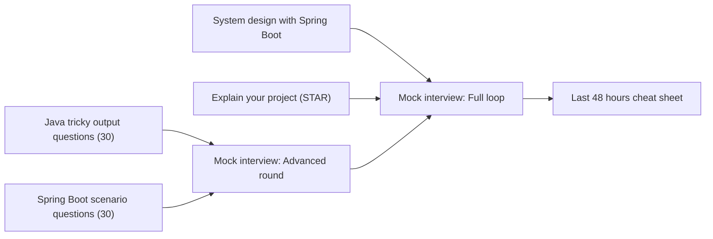

@@ 1 | MODULE | Phase 23 — Interview Mastery (Advanced) | Tricky output questions, Spring Boot scenarios, system design, project storytelling, mock interviews and the final cheat sheet | MUST
# Phase 23: Interview Mastery (Advanced)

This phase turns everything from Phases 1 to 22 into interview performance. There are no new concepts here; instead you practise the formats interviewers actually use: predicting the output of tricky Java snippets, answering "in production we saw X, what do you do?" Spring Boot scenarios, designing a system on a whiteboard with Spring Boot as the implementation, telling the story of your own project with STAR, and sitting full mock interviews with rubrics. It ends with the "Last 48 hours" cheat sheet that compresses the whole guide.

Why interviewers care: knowing a topic and performing under time pressure are different skills. Output questions test precise mental models of the JVM. Scenario questions test whether you have operated real services. System design tests whether you can make and defend trade-offs. The project round tests ownership and communication. Each round has a recognizable pattern, and practising the pattern is what turns a "maybe" into a "strong hire".

## How the rounds connect



## Prerequisites
- All earlier phases, especially [[Methods and Pass-by-Value]], [[String Immutability and the String Pool]], [[HashMap Internals]], [[How @Transactional Really Works]], [[Fetch Types and the N+1 Problem]] and [[Distributed Transactions, Saga and Outbox]].
- The OrderHub project as it stands after Phase 21: order, inventory and notification services behind a gateway, PostgreSQL, Redis, Kafka, Resilience4j, observability, Docker and Kubernetes.

## How to use this phase
1. Do the two coding drills (output and scenarios) with a timer: 2 minutes per output question, 4 minutes per scenario, answering aloud before opening the solution.
2. Draw each system design on paper before reading the walkthrough.
3. Write your own STAR stories using the OrderHub template, then record yourself telling them in under 3 minutes each.
4. Run the two mock interviews with a friend (or alone with a timer) and score yourself with the rubrics.
5. Read the cheat sheet the evening before and the morning of the interview.

## The 5 questions from this phase that come up most often
1. "What does this code print?" (string pool, Integer cache, overloading, finally, initialization order)
2. "Your `@Transactional` method does not roll back / your endpoint is slow / your service runs out of connections. Walk me through how you diagnose it."
3. "Design a URL shortener (or order system, or notification system). How would you build it with Spring Boot?"
4. "Tell me about a project you are proud of and a hard problem you solved in it."
5. "What would you do differently if you built it again?"

@@ 2 | MODULE | Rounds | The interview formats: output prediction, scenarios, system design, project storytelling, mock loops and the final review | MUST
# Rounds

**Shared analogy: a driving test.**

Knowing the highway code is not the same as passing the driving test. The examiner checks reflexes on tricky junctions (output questions), reactions to an emergency (production scenarios), route planning across the city (system design), how you describe the car you drive every day (your project), and a full drive from start to finish (the mock loop). The night before, you do not reread the whole code book; you glance at a one-page summary of the rules you tend to forget (the last 48 hours cheat sheet). Each note in this group is one part of that test, with model answers and scoring rubrics so you can grade your own drive.

Rounds: [[Practice — Coding drill: Java tricky output questions (30)]] · [[Practice — Coding drill: Spring Boot scenario questions (30)]] · [[Practice — Coding drill: System design with Spring Boot (URL shortener, order service, notification service)]] · [[Practice — Coding drill: Explain your project (STAR and architecture walkthrough)]] · [[Practice — Mock interview: Advanced round]] · [[Practice — Mock interview: Full loop (Java, Spring, coding, design)]] · [[Practice — Phase 23 review: Last 48 hours cheat sheet]]

@@ 3 | TOPIC | Practice — Coding drill: Java tricky output questions (30) | Thirty predict-the-output snippets on strings, caching, overloading, initialization, exceptions, collections, streams and threads | MUST
# Coding drill: Java tricky output questions (30)

Thirty "what does this print?" questions of the kind used in screening rounds and online tests. Every output below was produced by running the code on Java 21. For each one: read the snippet, write your answer, say **why** aloud, then open the solution. The "why" is what the interviewer is scoring.

**How to attack an output question**
1. Identify the trap category: caching, pooling, promotion, overloading resolution, dispatch (static vs dynamic), initialization order, exception flow, collection semantics, laziness, threads.
2. Trace line by line; write intermediate values.
3. Check compile errors first: some questions are "it does not compile".
4. Say the rule, not just the answer: "Integer caches -128 to 127, so..."

## 1. Integer cache
```java
Integer a = 127, b = 127;
Integer c = 128, d = 128;
System.out.println(a == b);
System.out.println(c == d);
```
Hint: autoboxing calls `Integer.valueOf`.

<details><summary>Solution</summary>

```text
true
false
```
Autoboxing uses `Integer.valueOf`, which returns cached instances for -128 to 127. 127 comes from the cache, so `a` and `b` are the same object; 128 creates two different objects, and `==` compares references. Always compare wrappers with `equals` (or unbox). The cache upper bound can be raised with `-XX:AutoBoxCacheMax`, which is one more reason never to rely on `==`.
</details>

## 2. String pool and intern
```java
String s1 = "java";
String s2 = new String("java");
System.out.println(s1 == s2);
System.out.println(s1 == s2.intern());
```

<details><summary>Solution</summary>

```text
false
true
```
The literal `"java"` lives in the string pool. `new String("java")` always creates a new heap object, so the references differ. `intern()` returns the pooled instance for that content, which is `s1`.
</details>

## 3. Compile-time constants
```java
final String fa = "ja";
String nf = "ja";
System.out.println((fa + "va") == "java");
System.out.println((nf + "va") == "java");
```

<details><summary>Solution</summary>

```text
true
false
```
`fa` is a `final` local initialized with a constant, so `fa + "va"` is a compile-time constant expression; the compiler folds it to `"java"` and it refers to the pooled literal. `nf` is not final, so the concatenation happens at runtime (via `StringConcatFactory` since Java 9) and creates a new object.
</details>

## 4. Adding characters
```java
System.out.println('a' + 'b');
System.out.println("" + 'a' + 'b');
```

<details><summary>Solution</summary>

```text
195
ab
```
`char + char` is numeric addition after promotion to `int`: 97 + 98 = 195. Once a `String` is the left operand, `+` becomes concatenation and evaluation is left to right.
</details>

## 5. Mixed concatenation order
```java
System.out.println(1 + 2 + "3" + 4 + 5);
```

<details><summary>Solution</summary>

```text
3345
```
Left to right: `1 + 2 = 3` (numeric), `3 + "3" = "33"` (string), then `"33" + 4 = "334"`, `"334" + 5 = "3345"`. Parentheses `(4 + 5)` would give `"339"`.
</details>

## 6. return inside finally
```java
static int q6() {
    try {
        return 1;
    } finally {
        return 2;
    }
}
// System.out.println(q6());
```

<details><summary>Solution</summary>

```text
2
```
The `finally` block runs after the `try` has computed its return value, and a `return` in `finally` replaces it. It would also swallow any exception thrown from `try`, which is why returning from `finally` is a well-known anti-pattern (compilers and linters warn about it).
</details>

## 7. finally mutating the returned object
```java
static StringBuilder q7() {
    StringBuilder sb = new StringBuilder("a");
    try {
        return sb;
    } finally {
        sb.append("b");
    }
}
// System.out.println(q7());
```

<details><summary>Solution</summary>

```text
ab
```
The `try` saves the value to return, which is a **reference** to the `StringBuilder`. `finally` cannot change which reference is returned, but it can mutate the object it points to. Compare with a primitive `int x` changed in `finally`: the saved value is unaffected.
</details>

## 8. Pass-by-value with references
```java
static void reassign(StringBuilder sb) { sb = new StringBuilder("new"); }
static void mutate(StringBuilder sb)   { sb.append("!"); }

// in main:
StringBuilder sb = new StringBuilder("old");
reassign(sb);
mutate(sb);
System.out.println(sb);
```

<details><summary>Solution</summary>

```text
old!
```
Java is always pass-by-value; for objects, the value is a copy of the reference. `reassign` points its local copy at a new object and the caller never sees it. `mutate` uses the copied reference to change the shared object, which the caller does see.
</details>

## 9. Overloading with null
```java
static void print(Object o) { System.out.println("Object"); }
static void print(String s) { System.out.println("String"); }

// in main:
print(null);
```

<details><summary>Solution</summary>

```text
String
```
`null` matches both, and the compiler picks the **most specific** applicable overload: `String` is a subtype of `Object`. If you added `print(Integer i)`, the call would not compile (ambiguous), because neither `String` nor `Integer` is more specific than the other.
</details>

## 10. Widening vs boxing vs varargs
```java
static void m(long x)    { System.out.println("long"); }
static void m(Integer x) { System.out.println("Integer"); }
static void m(int... x)  { System.out.println("varargs"); }

// in main:
m(5);
```

<details><summary>Solution</summary>

```text
long
```
Overload resolution runs in three phases: (1) exact match or primitive widening without boxing or varargs, (2) allow boxing and unboxing, (3) allow varargs. `int` to `long` widening succeeds in phase 1, so boxing to `Integer` is never considered. This preserved behaviour from before Java 5 when boxing was added.
</details>

## 11. Static methods and fields do not override
```java
public class HidingDemo {
    static class P {
        String name = "P";
        static String s() { return "P.static"; }
        String i() { return "P.instance"; }
    }
    static class C extends P {
        String name = "C";
        static String s() { return "C.static"; }
        @Override String i() { return "C.instance"; }
    }

    public static void main(String[] args) {
        P p = new C();
        System.out.println(p.s());
        System.out.println(p.i());
        System.out.println(p.name);
        System.out.println(((C) p).name);
    }
}
```

<details><summary>Solution</summary>

```text
P.static
C.instance
P
C
```
Only instance methods are dispatched dynamically by the runtime type. Static methods are bound at compile time by the **declared** type (`P`): this is method hiding, and calling a static method through an instance is legal but misleading. Fields are never polymorphic either: `p.name` uses the declared type `P`, and the cast to `C` reads `C`'s separate field.
</details>

## 12. switch fall-through
```java
int sw = 2;
switch (sw) {
    case 1: System.out.print("1");
    case 2: System.out.print("2");
    case 3: System.out.print("3");
    default: System.out.println("d");
}
```

<details><summary>Solution</summary>

```text
23d
```
Classic `case X:` labels fall through until a `break`. Execution jumps to `case 2` and continues through `case 3` and `default`. Arrow labels (`case 2 ->`, Java 14) never fall through, which is one reason to prefer switch expressions.
</details>

## 13. Overridden method called from a constructor
```java
public class CtorDispatchDemo {
    static class P {
        P() { show(); }
        void show() { System.out.println("P.show"); }
    }
    static class C extends P {
        int x = 10;
        @Override void show() { System.out.println("C.show x=" + x); }
    }

    public static void main(String[] args) {
        new C();
    }
}
```

<details><summary>Solution</summary>

```text
C.show x=0
```
The superclass constructor runs first, and the call to `show()` is dispatched to `C`'s override (the object is already a `C`). But `C`'s field initializers run only after `super()` returns, so `x` still has its default value 0. Lesson: never call overridable methods from a constructor (Effective Java item 19).
</details>

## 14. Initialization order with inheritance
```java
public class InitOrderDemo {
    static class A {
        static { System.out.println("A static"); }
        { System.out.println("A instance"); }
        A() { System.out.println("A ctor"); }
    }
    static class B extends A {
        static { System.out.println("B static"); }
        { System.out.println("B instance"); }
        B() { System.out.println("B ctor"); }
    }

    public static void main(String[] args) {
        new B();
    }
}
```

<details><summary>Solution</summary>

```text
A static
B static
A instance
A ctor
B instance
B ctor
```
Class initialization happens once, parent first: A's static block, then B's. Then for the object: `B()` calls `super()`, which runs A's instance initializers then A's constructor body; then B's instance initializers and B's constructor body. Creating a second `B` would print only the last four lines.
</details>

## 15. Math.round with negatives
```java
System.out.println(Math.round(-2.5));
System.out.println(Math.round(2.5));
System.out.println(Math.round(-2.6));
```

<details><summary>Solution</summary>

```text
-2
3
-3
```
`Math.round(x)` is defined as `floor(x + 0.5)`: -2.5 + 0.5 = -2.0, floor is -2; 2.5 + 0.5 = 3.0; -2.6 + 0.5 = -2.1, floor is -3. So ties round toward positive infinity, not "away from zero". For money use `BigDecimal` with an explicit `RoundingMode`.
</details>

## 16. Floating point equality
```java
System.out.println(0.1 + 0.2 == 0.3);
System.out.println(0.1 + 0.2);
```

<details><summary>Solution</summary>

```text
false
0.30000000000000004
```
0.1 and 0.2 have no exact binary representation, so their `double` sum is slightly above 0.3. Compare doubles with a tolerance (`Math.abs(a - b) < 1e-9`) and use `BigDecimal` (created from strings) for money.
</details>

## 17. Integer overflow and abs
```java
System.out.println(Integer.MAX_VALUE + 1);
System.out.println(Math.abs(Integer.MIN_VALUE));
```

<details><summary>Solution</summary>

```text
-2147483648
-2147483648
```
`int` arithmetic wraps silently in two's complement. `MIN_VALUE` has no positive counterpart in `int`, so `Math.abs` returns it unchanged. Use `Math.addExact` or `Math.absExact` (Java 15) to get an `ArithmeticException` instead. This bug appears in real code as `Math.abs(hashCode()) % n` producing a negative index; use `Math.floorMod`.
</details>

## 18. Compound assignment and narrowing casts
```java
byte by = 10;
by += 5;
System.out.println(by);
System.out.println((byte) 200);
// by = by + 5;   // what about this line?
```

<details><summary>Solution</summary>

```text
15
-56
```
Compound assignment `+=` includes an implicit cast back to the left type, so `by += 5` compiles. `by = by + 5` does **not** compile, because `by + 5` is an `int` and narrowing needs an explicit cast. `(byte) 200` keeps the low 8 bits: 200 - 256 = -56.
</details>

## 19. i = i++
```java
int i = 5;
i = i++;
System.out.println(i);
```

<details><summary>Solution</summary>

```text
5
```
`i++` evaluates to the old value (5), then increments `i` to 6, then the assignment stores the saved old value 5 back into `i`. The increment is lost.
</details>

## 20. Ternary numeric promotion
```java
System.out.println(true ? 1 : 2.0);
Object o = true ? Integer.valueOf(1) : "s";
System.out.println(o);
```

<details><summary>Solution</summary>

```text
1.0
1
```
When both branches are numeric, the conditional expression has the promoted type (`double`), so `1` becomes `1.0` even though the `false` branch never runs. With unrelated reference types (`Integer` and `String`) there is no numeric promotion, so the result is the `Integer` 1. Related trap: `Integer x = null; int y = flag ? x : 0;` throws `NullPointerException` because the expression unboxes `x`.
</details>

## 21. Mutating a key inside a HashSet
```java
public class MutableKeyDemo {
    static class Pt {
        int x;
        Pt(int x) { this.x = x; }
        @Override public boolean equals(Object o) { return o instanceof Pt p && p.x == x; }
        @Override public int hashCode() { return x; }
    }

    public static void main(String[] args) {
        java.util.Set<Pt> set = new java.util.HashSet<>();
        Pt pt = new Pt(1);
        set.add(pt);
        pt.x = 2;
        System.out.println(set.contains(pt));
        System.out.println(set.size());
    }
}
```

<details><summary>Solution</summary>

```text
false
1
```
The element was stored in the bucket for hash 1. After mutation its hash is 2, so `contains` looks in a different bucket and does not find it, although the object is still inside (size 1). It is now unreachable by lookup and can never be removed by `remove(pt)`: a memory-leak pattern. Keys of hash-based collections must be immutable (records are ideal).
</details>

## 22. equals without hashCode
```java
public class EqualsOnlyDemo {
    static class Pe {
        int x;
        Pe(int x) { this.x = x; }
        @Override public boolean equals(Object o) { return o instanceof Pe p && p.x == x; }
        // no hashCode override
    }

    public static void main(String[] args) {
        java.util.Set<Pe> set = new java.util.HashSet<>();
        set.add(new Pe(1));
        set.add(new Pe(1));
        System.out.println(set.size());
        System.out.println(new Pe(1).equals(new Pe(1)));
    }
}
```

<details><summary>Solution</summary>

```text
2
true
```
The two objects are equal but use `Object.hashCode` (identity-based), so they almost certainly land in different buckets and `equals` is never even called. This breaks the contract "equal objects must have equal hash codes". Always override both, or use a record.
</details>

## 23. List.remove(int) vs remove(Object)
```java
List<Integer> list = new ArrayList<>(List.of(1, 2, 3));
list.remove(1);
System.out.println(list);
list.remove(Integer.valueOf(1));
System.out.println(list);
```

<details><summary>Solution</summary>

```text
[1, 3]
[3]
```
`remove(1)` with an `int` argument picks `remove(int index)` (exact primitive match beats boxing), removing the element at index 1, which is the value 2. `remove(Integer.valueOf(1))` picks `remove(Object)` and removes the value 1.
</details>

## 24. Removing inside for-each
```java
List<String> ls = new ArrayList<>(List.of("a", "b", "c"));
for (String s : ls) {
    if (s.equals("b")) ls.remove(s);
}
System.out.println(ls);

List<String> l2 = new ArrayList<>(List.of("a", "b", "c"));
try {
    for (String s : l2) {
        if (s.equals("a")) l2.remove(s);
    }
} catch (ConcurrentModificationException e) {
    System.out.println("CME");
}
```

<details><summary>Solution</summary>

```text
[a, c]
CME
```
The famous exception to the rule. Removing `"b"` (second to last) shrinks the size to 2 while the iterator's cursor is 2, so `hasNext()` returns false and the loop ends before `next()` can check `modCount`: no exception, and `"c"` is never visited. Removing `"a"` leaves a further `next()` call, which detects the modification and throws. Fail-fast is best-effort; use `removeIf` or `Iterator.remove`.
</details>

## 25. Arrays.asList surprises
```java
System.out.println(Arrays.asList(new int[]{1, 2, 3}).size());
System.out.println(Arrays.asList(new Integer[]{1, 2, 3}).size());
try {
    Arrays.asList(1, 2, 3).add(4);
} catch (UnsupportedOperationException e) {
    System.out.println("UOE");
}
```

<details><summary>Solution</summary>

```text
1
3
UOE
```
`asList(T...)` needs objects; an `int[]` is a single object, so you get a `List<int[]>` with one element. An `Integer[]` spreads into three elements. The returned list is a fixed-size view over the array: `set` works, `add` and `remove` throw `UnsupportedOperationException`.
</details>

## 26. Stream laziness and short-circuiting
```java
Optional<String> first = Stream.of("a", "b", "c")
        .filter(s -> { System.out.println("filter " + s); return true; })
        .map(s -> { System.out.println("map " + s); return s.toUpperCase(); })
        .findFirst();
System.out.println(first.get());

Stream.of(1, 2, 3).peek(System.out::println);
```

<details><summary>Solution</summary>

```text
filter a
map a
A
```
Streams process elements one at a time through the whole pipeline (vertical, not horizontal), and `findFirst` short-circuits after the first match, so `b` and `c` are never touched. The second pipeline has no terminal operation, so nothing runs and `peek` prints nothing.
</details>

## 27. Reusing a stream
```java
Stream<Integer> st = Stream.of(1, 2, 3);
System.out.println(st.count());
try {
    st.count();
} catch (IllegalStateException e) {
    System.out.println("ISE: " + e.getMessage());
}
```

<details><summary>Solution</summary>

```text
3
ISE: stream has already been operated upon or closed
```
A stream is single-use: after a terminal operation it is consumed. Keep a `Supplier<Stream<T>>` or the source collection if you need to traverse twice.
</details>

## 28. Concatenating null
```java
String ns = null;
System.out.println(ns + "x");
System.out.println(ns.length());
```

<details><summary>Solution</summary>

```text
nullx
Exception in thread "main" java.lang.NullPointerException: Cannot invoke "String.length()" because "<local1>" is null
```
String concatenation converts `null` to the text `"null"`. Calling a method on `null` throws an NPE. Since Java 14 (JEP 358) the message says exactly what was null; with `-g` debug info (the default for Maven and Gradle builds) it shows the variable name `"ns"` instead of `"<local1>"`.
</details>

## 29. Long equals Integer
```java
Long l = 127L;
System.out.println(l.equals(127));
System.out.println(l.equals(127L));
System.out.println(l == 127);
```

<details><summary>Solution</summary>

```text
false
true
true
```
`equals(127)` boxes the `int` literal to an `Integer`, and `Long.equals` returns false for any non-`Long`. `l == 127` mixes a wrapper with a primitive, so `l` is unboxed and compared numerically. A real bug: `map.get(5)` on a `Map<Long, V>` always returns `null`.
</details>

## 30. run() vs start()
```java
Thread t = new Thread(() -> System.out.println(Thread.currentThread().getName()), "worker");
t.run();
t.start();
t.join();
```

<details><summary>Solution</summary>

```text
main
worker
```
`run()` is an ordinary method call that executes the lambda on the current thread (`main`). `start()` creates a new thread that then calls `run()`, so the second line prints `worker`. Calling `start()` twice throws `IllegalThreadStateException`.
</details>

## Score yourself
| Score | Meaning |
|---|---|
| 27 to 30 with correct reasons | Ready for any screening test |
| 22 to 26 | Review the categories you missed in Phases 1 to 4 and 7 |
| Below 22 | Redo the Phase 1 to 4 coding drills before attempting again |
