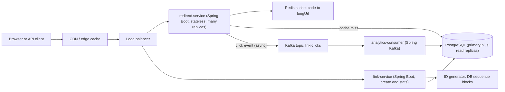
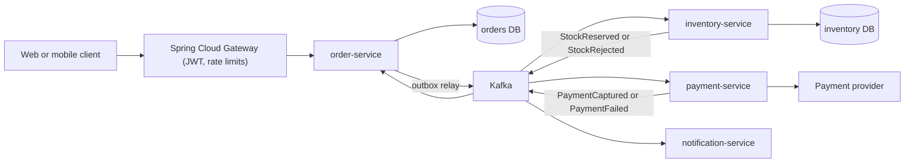
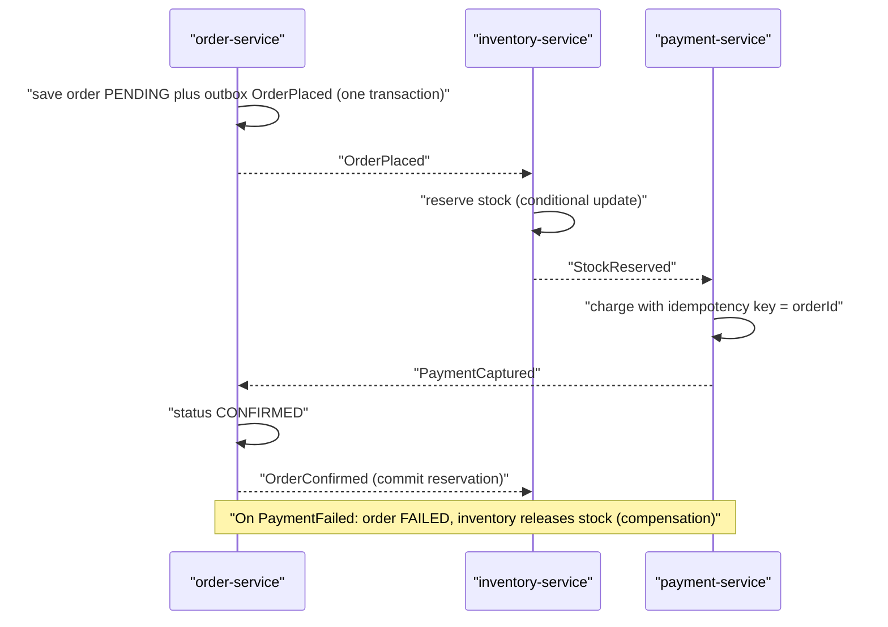
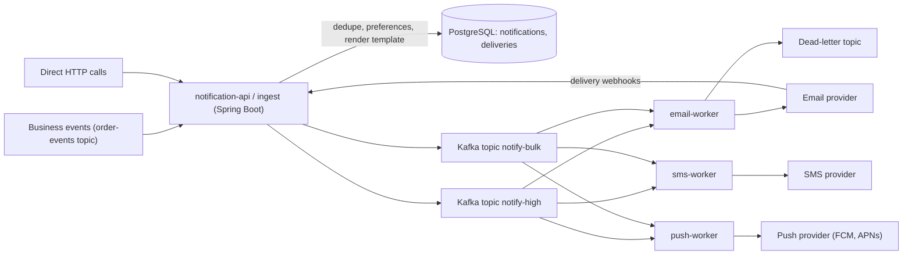

@@ 3 | TOPIC | Practice — Coding drill: System design with Spring Boot (URL shortener, order service, notification service) | Three full design walkthroughs with requirements, estimates, API, data model, diagrams, scaling, trade-offs and Spring Boot code | MUST
# Coding drill: System design with Spring Boot (URL shortener, order service, notification service)

Three complete system design walkthroughs at the depth expected from a senior Java backend candidate. Backend-focused design rounds differ from pure architecture rounds: interviewers expect boxes and arrows **and** a credible Spring Boot implementation (which starters, which annotations, where transactions start, how you would test it).

## The framework to use in every design round (45 minutes)

| Step | Time | What you do |
|---|---|---|
| 1. Requirements | 5 min | Functional (what it does), non-functional (scale, latency, availability, consistency), out of scope |
| 2. Estimates | 3 min | Requests per second, storage, read/write ratio; round numbers aloud |
| 3. API | 5 min | Endpoints with methods, bodies, status codes, idempotency |
| 4. Data model | 5 min | Tables or documents, keys, indexes, why this database |
| 5. High-level design | 10 min | Diagram: clients, gateway, services, DB, cache, queue |
| 6. Deep dives | 12 min | The 2 or 3 hardest parts: hot paths, consistency, failure handling |
| 7. Trade-offs and wrap-up | 5 min | What you chose, what you gave up, what you would do next |

Useful numbers: 1 day is about 86,400 s (round to 100,000); 1 million requests per day is about 12 per second; a single well-tuned Spring Boot instance handles roughly 1,000 to 5,000 simple requests per second; a single PostgreSQL primary handles thousands of simple writes per second; Redis handles around 100,000 operations per second per node.

---

## Design 1: URL shortener

### 1. Requirements
**Functional**
- Create a short URL for a long URL (`POST`), optionally with a custom alias and expiry.
- Redirect a short code to the long URL (`GET /{code}` returns 302).
- Basic click analytics per link (count, by day).

**Non-functional**
- 100 million new links per month; reads are 100 times writes.
- Redirect latency p99 under 50 ms; availability 99.99 percent for redirects.
- Short codes must be unique, hard to enumerate is a bonus, and links live 5 years by default.

**Out of scope:** user accounts beyond an API key, link preview pages, malware scanning (mention as a later addition).

### 2. Estimates
- Writes: 100M per month divided by about 2.6M seconds is about 40 per second average, 400 per second peak.
- Reads: 4,000 per second average, 40,000 per second peak (viral links).
- Storage: 100M times 12 months times 5 years = 6 billion links; at about 500 bytes each that is about 3 TB.
- Code length: base62 with 7 characters gives 62 to the power 7 = 3.5 trillion codes, plenty for 6 billion.

### 3. API
```http
POST /api/links
Authorization: Bearer <api-key-token>
Content-Type: application/json
Idempotency-Key: 6f1c2b8e-...

{"longUrl":"https://shop.orderhub.com/products/42?utm_source=mail","customAlias":null,"expiresAt":null}

HTTP/1.1 201 Created
Location: https://oh.to/4c92
{"code":"4c92","shortUrl":"https://oh.to/4c92","longUrl":"https://shop.orderhub.com/products/42?utm_source=mail","expiresAt":"2031-11-24T00:00:00Z"}
```

```http
GET /4c92 HTTP/1.1
Host: oh.to

HTTP/1.1 302 Found
Location: https://shop.orderhub.com/products/42?utm_source=mail
Cache-Control: private, max-age=90
```

```http
GET /api/links/4c92/stats

HTTP/1.1 200 OK
{"code":"4c92","totalClicks":1532,"byDay":[{"date":"2026-11-23","clicks":1200},{"date":"2026-11-24","clicks":332}]}
```

302 (temporary) instead of 301 (permanent): browsers cache 301 forever, which would hide clicks from analytics and prevent changing or expiring the link. Use 301 only if analytics do not matter and you want to save load.

### 4. Data model
```sql
CREATE TABLE links (
    id          BIGINT PRIMARY KEY,            -- from the ID generator; code = base62(id)
    code        VARCHAR(16) NOT NULL UNIQUE,   -- custom aliases also live here
    long_url    TEXT NOT NULL,
    owner_id    BIGINT NOT NULL,
    created_at  TIMESTAMPTZ NOT NULL DEFAULT now(),
    expires_at  TIMESTAMPTZ
);
CREATE INDEX idx_links_owner ON links (owner_id, created_at DESC);

CREATE TABLE link_clicks_daily (
    code   VARCHAR(16) NOT NULL,
    day    DATE NOT NULL,
    clicks BIGINT NOT NULL,
    PRIMARY KEY (code, day)
);
```

Database choice: the access pattern is a key-value lookup by code. PostgreSQL works well up to billions of rows with partitioning by id range; at 3 TB you would either partition or choose a key-value store like DynamoDB or Cassandra. Say this trade-off aloud: start with PostgreSQL (transactions, simple operations, the team knows it), move redirect reads to a KV store only if needed.

### 5. High-level design


Why two services: redirects are read-heavy, latency-critical and must stay up even if creation or analytics are down. They scale independently.

### 6. Deep dives

**a) Generating unique short codes.** Options:

| Approach | How | Pros | Cons |
|---|---|---|---|
| Hash (MD5 or SHA-256 of URL, take 7 chars) | Deterministic | Same URL gives same code | Collisions must be checked and retried |
| Random 7 chars | `SecureRandom` | Not enumerable | Collision check on insert (unique constraint, retry) |
| Counter plus base62 | Sequence id encoded | No collisions, short | Enumerable (sequential); needs a distributed counter |
| Pre-generated key pool | Batch job fills a table of unused codes | Fast, no collision at request time | Extra moving part |

Chosen: **counter plus base62 with block allocation**. Each link-service instance reserves a block of 1,000 ids from a database sequence (one round trip per 1,000 links), so there is no hot row and no collision. To avoid enumerable codes, the id can be scrambled with a reversible bijection (for example multiply by a large odd number modulo 62 to the power 7) before encoding.

**b) The redirect hot path.** Target under 50 ms p99 at 40,000 requests per second:
- Cache-aside in Redis: lookup code, on miss read from a replica and populate with a TTL (24 h). With an 80/20 popularity distribution, a cache of the hottest 20 percent gives a hit ratio above 90 percent.
- Negative caching of unknown codes (short TTL) to stop scans hammering the database.
- CDN caching of the 302 for a short `max-age` absorbs viral spikes.
- Click tracking must never slow the redirect: publish a small event to Kafka asynchronously (fire and forget with a bounded buffer), or increment a Redis counter and flush periodically.

**c) Analytics.** A Kafka consumer aggregates clicks in memory per minute and upserts into `link_clicks_daily` (`INSERT ... ON CONFLICT DO UPDATE SET clicks = clicks + excluded.clicks`). At-least-once delivery may double count after a crash; acceptable for analytics, or use per-partition offsets stored with the aggregates for exactness.

**d) Expiry and cleanup.** Check `expires_at` on redirect (return 410 Gone); a nightly Spring Batch job deletes expired links in chunks.

### 7. Code sketch (Spring Boot 3.5)
```java
// Base62 codec: plain Java, unit-testable
import java.util.Objects;

public class Base62 {

    private static final String ALPHABET = "0123456789abcdefghijklmnopqrstuvwxyzABCDEFGHIJKLMNOPQRSTUVWXYZ";

    static String encode(long id) {
        if (id == 0) return "0";
        StringBuilder sb = new StringBuilder();
        while (id > 0) {
            sb.append(ALPHABET.charAt((int) (id % 62)));
            id /= 62;
        }
        return sb.reverse().toString();
    }

    static long decode(String code) {
        Objects.requireNonNull(code);
        long id = 0;
        for (char c : code.toCharArray()) {
            id = id * 62 + ALPHABET.indexOf(c);
        }
        return id;
    }

    public static void main(String[] args) {
        long[] ids = {1, 61, 62, 125, 1_000_000L, 56_800_235_583L};
        for (long id : ids) {
            String code = encode(id);
            System.out.println(id + " -> " + code + " -> " + decode(code));
        }
        System.out.println("7 chars hold " + (long) Math.pow(62, 7) + " ids");
    }
}
```

Output:
```text
1 -> 1 -> 1
61 -> Z -> 61
62 -> 10 -> 62
125 -> 21 -> 125
1000000 -> 4c92 -> 1000000
56800235583 -> ZZZZZZ -> 56800235583
7 chars hold 3521614606208 ids
```

```java
// File: link-service/src/main/java/com/orderhub/links/IdBlockAllocator.java
package com.orderhub.links;

import org.springframework.jdbc.core.simple.JdbcClient;
import org.springframework.stereotype.Component;

@Component
public class IdBlockAllocator {

    private static final int BLOCK = 1000;
    private final JdbcClient jdbc;
    private long next = 0;
    private long end = 0;

    public IdBlockAllocator(JdbcClient jdbc) {
        this.jdbc = jdbc;
    }

    // Sequence created with: CREATE SEQUENCE link_id_block_seq INCREMENT BY 1000;
    public synchronized long nextId() {
        if (next == end) {
            long start = jdbc.sql("select nextval('link_id_block_seq')").query(Long.class).single();
            next = start;
            end = start + BLOCK;
        }
        return next++;
    }
}
```

```java
// File: link-service/src/main/java/com/orderhub/links/LinkService.java
package com.orderhub.links;

import java.time.Duration;
import java.time.Instant;
import org.springframework.dao.DuplicateKeyException;
import org.springframework.http.HttpStatus;
import org.springframework.jdbc.core.simple.JdbcClient;
import org.springframework.stereotype.Service;
import org.springframework.transaction.annotation.Transactional;
import org.springframework.web.server.ResponseStatusException;

@Service
public class LinkService {

    public record CreateLink(String longUrl, String customAlias, Instant expiresAt) { }
    public record LinkView(String code, String shortUrl, String longUrl, Instant expiresAt) { }

    private final IdBlockAllocator ids;
    private final JdbcClient jdbc;

    public LinkService(IdBlockAllocator ids, JdbcClient jdbc) {
        this.ids = ids;
        this.jdbc = jdbc;
    }

    @Transactional
    public LinkView create(CreateLink req, long ownerId) {
        long id = ids.nextId();
        String code = req.customAlias() != null ? req.customAlias() : Base62.encode(id);
        Instant expires = req.expiresAt() != null ? req.expiresAt() : Instant.now().plus(Duration.ofDays(5 * 365));
        try {
            jdbc.sql("insert into links (id, code, long_url, owner_id, expires_at) values (?, ?, ?, ?, ?)")
                .params(id, code, req.longUrl(), ownerId, java.sql.Timestamp.from(expires))
                .update();
        } catch (DuplicateKeyException e) {
            throw new ResponseStatusException(HttpStatus.CONFLICT, "alias already taken");
        }
        return new LinkView(code, "https://oh.to/" + code, req.longUrl(), expires);
    }
}
```

```java
// File: redirect-service/src/main/java/com/orderhub/redirect/RedirectController.java
package com.orderhub.redirect;

import java.net.URI;
import java.time.Duration;
import java.util.Optional;
import org.springframework.data.redis.core.StringRedisTemplate;
import org.springframework.http.CacheControl;
import org.springframework.http.HttpStatus;
import org.springframework.http.ResponseEntity;
import org.springframework.jdbc.core.simple.JdbcClient;
import org.springframework.kafka.core.KafkaTemplate;
import org.springframework.web.bind.annotation.GetMapping;
import org.springframework.web.bind.annotation.PathVariable;
import org.springframework.web.bind.annotation.RestController;

@RestController
public class RedirectController {

    private static final String MISSING = "__none__";
    private final StringRedisTemplate redis;
    private final JdbcClient replicaJdbc;              // bound to a read-replica DataSource
    private final KafkaTemplate<String, String> kafka;

    public RedirectController(StringRedisTemplate redis, JdbcClient replicaJdbc, KafkaTemplate<String, String> kafka) {
        this.redis = redis;
        this.replicaJdbc = replicaJdbc;
        this.kafka = kafka;
    }

    @GetMapping("/{code:[0-9a-zA-Z]{1,16}}")
    public ResponseEntity<Void> redirect(@PathVariable String code) {
        String key = "link:" + code;
        String url = redis.opsForValue().get(key);
        if (url == null) {                                                   // cache miss
            url = replicaJdbc.sql("select long_url from links where code = ? and (expires_at is null or expires_at > now())")
                    .param(code).query(String.class).optional().orElse(MISSING);
            redis.opsForValue().set(key, url, MISSING.equals(url) ? Duration.ofMinutes(1) : Duration.ofHours(24));
        }
        if (MISSING.equals(url)) {
            return ResponseEntity.notFound().build();
        }
        kafka.send("link-clicks", code, code);                               // async, does not block the redirect
        return ResponseEntity.status(HttpStatus.FOUND)
                .location(URI.create(url))
                .cacheControl(CacheControl.maxAge(Duration.ofSeconds(90)).cachePrivate())
                .build();
    }
}
```

### 8. Scaling and trade-offs
| Decision | Chosen | Alternative | Why |
|---|---|---|---|
| Code generation | Sequence blocks plus base62 | Random plus collision retry | No collisions, one DB round trip per 1,000 links |
| Redirect status | 302 | 301 | Keeps analytics and lets links change or expire |
| Storage | PostgreSQL partitioned by id | Cassandra or DynamoDB | Simpler operations until billions of rows strain it |
| Click tracking | Async via Kafka | Synchronous DB increment | Redirect latency and availability first |
| Cache | Redis cache-aside plus CDN | Local Caffeine only | Shared across many replicas; local cache can be added as L1 |

Failure modes: Redis down means read from replicas (with a circuit breaker and local Caffeine L1 to absorb load); Kafka down means drop click events (analytics are best-effort) rather than failing redirects. Abuse: rate-limit creation per API key at the gateway, scan long URLs against a malware list asynchronously.

---

## Design 2: Order service (OrderHub checkout)

### 1. Requirements
**Functional**
- Place an order with several lines; reserve stock; take payment; confirm or fail the order.
- View order status and history; cancel before shipping.
- Notify customers on status changes (handled by Design 3).

**Non-functional**
- 1 million orders per day, flash-sale peaks of 1,000 orders per second.
- Never oversell stock; never charge twice; never lose a paid order.
- Place-order p99 under 500 ms for the synchronous part; availability 99.95 percent.

### 2. Estimates
- 1M per day is about 12 orders per second average; peaks are 100 times that during sales.
- Each order has about 3 lines; order plus lines is about 2 KB, so 2 GB per day, about 700 GB per year (archive after 2 years).
- Reads (status and history) are about 10 times writes, mostly by customer id.

### 3. API
```http
POST /api/orders
Authorization: Bearer <jwt>
Idempotency-Key: 3b0e4a52-...
Content-Type: application/json

{"lines":[{"productId":"P-100","quantity":2},{"productId":"P-205","quantity":1}],"paymentMethodId":"pm_123","shippingAddressId":77}

HTTP/1.1 202 Accepted
Location: /api/orders/9182
{"orderId":9182,"status":"PENDING","totalCents":5497}
```

```http
GET /api/orders/9182

HTTP/1.1 200 OK
ETag: "4"
{"orderId":9182,"status":"CONFIRMED","lines":[{"productId":"P-100","quantity":2,"priceCents":1999},{"productId":"P-205","quantity":1,"priceCents":1499}],"totalCents":5497}
```

```http
POST /api/orders/9182/cancel
If-Match: "4"

HTTP/1.1 200 OK
{"orderId":9182,"status":"CANCELLED"}
```

202 Accepted signals that the order is accepted but the saga (stock and payment) is still running; the client polls or receives a notification. A synchronous 201 with everything done is possible for simple systems but couples the request to every downstream.

### 4. Data model
```sql
-- order-service database
CREATE TABLE orders (
    id              BIGSERIAL PRIMARY KEY,
    customer_id     BIGINT NOT NULL,
    status          VARCHAR(20) NOT NULL,       -- PENDING, STOCK_RESERVED, CONFIRMED, FAILED, CANCELLED, SHIPPED
    total_cents     BIGINT NOT NULL,
    idempotency_key UUID NOT NULL UNIQUE,
    version         BIGINT NOT NULL DEFAULT 0,
    created_at      TIMESTAMPTZ NOT NULL DEFAULT now()
);
CREATE INDEX idx_orders_customer ON orders (customer_id, created_at DESC);

CREATE TABLE order_lines (
    order_id    BIGINT NOT NULL REFERENCES orders(id),
    product_id  VARCHAR(20) NOT NULL,
    quantity    INT NOT NULL CHECK (quantity > 0),
    price_cents BIGINT NOT NULL,                 -- price captured at order time
    PRIMARY KEY (order_id, product_id)
);

CREATE TABLE outbox (
    id           UUID PRIMARY KEY,
    aggregate_id BIGINT NOT NULL,
    type         VARCHAR(50) NOT NULL,
    payload      JSONB NOT NULL,
    created_at   TIMESTAMPTZ NOT NULL DEFAULT now(),
    published_at TIMESTAMPTZ
);

-- inventory-service database (separate service, separate schema)
CREATE TABLE stock (
    product_id VARCHAR(20) PRIMARY KEY,
    available  INT NOT NULL CHECK (available >= 0),   -- the database refuses to oversell
    reserved   INT NOT NULL DEFAULT 0
);
CREATE TABLE reservations (
    order_id   BIGINT NOT NULL,
    product_id VARCHAR(20) NOT NULL,
    quantity   INT NOT NULL,
    status     VARCHAR(20) NOT NULL,                  -- RESERVED, COMMITTED, RELEASED
    PRIMARY KEY (order_id, product_id)
);
```

### 5. High-level design


### 6. Deep dives

**a) The saga (choreography).**

Choreography is fine with three participants. With more steps or complex branching, an orchestrator (a state machine in the order service, or a workflow engine such as Temporal) makes the flow visible in one place.

**b) Never oversell.** Reserve with an atomic conditional update instead of read-check-write:

```sql
UPDATE stock SET available = available - :qty, reserved = reserved + :qty
WHERE product_id = :pid AND available >= :qty;     -- 0 rows updated = not enough stock
```

For a flash sale on one hot product, that single row becomes a contention point. Options: pre-split stock into N buckets (rows) and pick one at random; or hold the counter in Redis with an atomic Lua script (`DECRBY` if enough) and persist asynchronously, accepting more complexity for throughput.

**c) Never charge twice, never lose an order.** Idempotency key on `POST /api/orders` (unique column); payment-service passes `orderId` as the provider's idempotency key; every consumer stores processed event ids; the outbox guarantees the `OrderPlaced` event is published if and only if the order committed.

**d) Read side.** Order history by customer uses the `(customer_id, created_at DESC)` index with keyset pagination. If reads grow, serve them from read replicas, or build a denormalized read model (CQRS) updated from events.

### 7. Code sketch
```java
// File: order-service/src/main/java/com/orderhub/order/PlaceOrderService.java
package com.orderhub.order;

import java.util.List;
import java.util.UUID;
import org.springframework.stereotype.Service;
import org.springframework.transaction.annotation.Transactional;
import tools.jackson.databind.json.JsonMapper;   // Boot 4 / Jackson 3; on Boot 3.5 use com.fasterxml.jackson.databind.ObjectMapper

@Service
public class PlaceOrderService {

    public record LineCmd(String productId, int quantity) { }
    public record PlaceOrderCmd(long customerId, UUID idempotencyKey, List<LineCmd> lines) { }
    public record OrderPlaced(long orderId, long customerId, List<LineCmd> lines) { }

    private final OrderRepository orders;
    private final OutboxRepository outbox;
    private final PriceCatalog prices;
    private final JsonMapper json;

    public PlaceOrderService(OrderRepository orders, OutboxRepository outbox, PriceCatalog prices, JsonMapper json) {
        this.orders = orders;
        this.outbox = outbox;
        this.prices = prices;
        this.json = json;
    }

    @Transactional
    public Order place(PlaceOrderCmd cmd) {
        return orders.findByIdempotencyKey(cmd.idempotencyKey())          // replay: return the same order
                .orElseGet(() -> {
                    Order order = Order.pending(cmd.customerId(), cmd.idempotencyKey());
                    cmd.lines().forEach(l -> order.addLine(l.productId(), l.quantity(), prices.priceOf(l.productId())));
                    Order saved = orders.save(order);
                    outbox.save(OutboxEvent.of(saved.getId(), "OrderPlaced",
                            json.writeValueAsString(new OrderPlaced(saved.getId(), cmd.customerId(), cmd.lines()))));
                    return saved;                                          // order and event commit together
                });
    }
}
```

```java
// File: inventory-service/src/main/java/com/orderhub/inventory/ReservationListener.java
package com.orderhub.inventory;

import org.springframework.jdbc.core.simple.JdbcClient;
import org.springframework.kafka.annotation.KafkaListener;
import org.springframework.stereotype.Component;
import org.springframework.transaction.annotation.Transactional;

@Component
public class ReservationListener {

    private final JdbcClient jdbc;
    private final InventoryOutbox outbox;

    public ReservationListener(JdbcClient jdbc, InventoryOutbox outbox) {
        this.jdbc = jdbc;
        this.outbox = outbox;
    }

    @KafkaListener(topics = "order-events", groupId = "inventory")
    @Transactional
    public void onOrderPlaced(OrderPlaced event) {
        boolean already = jdbc.sql("select count(*) from reservations where order_id = ?")
                .param(event.orderId()).query(Integer.class).single() > 0;
        if (already) return;                                            // idempotent consumer

        for (OrderPlaced.Line line : event.lines()) {
            int updated = jdbc.sql("""
                    update stock set available = available - :qty, reserved = reserved + :qty
                    where product_id = :pid and available >= :qty
                    """).param("qty", line.quantity()).param("pid", line.productId()).update();
            if (updated == 0) {
                // throw to roll back this transaction's earlier reservations, then publish the rejection
                throw new OutOfStockException(event.orderId(), line.productId());
            }
            jdbc.sql("insert into reservations (order_id, product_id, quantity, status) values (?, ?, ?, 'RESERVED')")
                .params(event.orderId(), line.productId(), line.quantity()).update();
        }
        outbox.publish("StockReserved", event.orderId());
    }
}
```

`OutOfStockException` is handled by the listener container's error handler (configured not to retry this exception type), which publishes `StockRejected` in a new transaction so the order service can fail the order.

### 8. Scaling and trade-offs
| Decision | Chosen | Alternative | Trade-off |
|---|---|---|---|
| Consistency across services | Saga plus outbox (eventual) | 2PC / XA | Availability and loose coupling over immediate consistency |
| Saga style | Choreography | Orchestration | Simple for 3 steps; harder to see the flow as it grows |
| Stock reservation | Conditional SQL update | Redis counter | Correct and simple; Redis only for extreme hot items |
| API response | 202 plus status polling or notifications | Synchronous 201 | Survives slow payments; slightly more complex client |
| Database | One PostgreSQL per service | Shared database | Independent deploys and scaling; no cross-service joins |

Scaling: stateless services scale horizontally behind the gateway; Kafka partitions keyed by `orderId` keep per-order ordering while spreading load; the orders table partitions by month once it grows; flash sales add a queue in front (virtual waiting room) and rate limiting at the gateway.

---

## Design 3: Notification service

### 1. Requirements
**Functional**
- Send notifications by email, SMS and push in response to business events (order confirmed, shipped) and direct API calls.
- Templates with localization; user preferences (channels, quiet hours, opt-out).
- Delivery status tracking and retries.

**Non-functional**
- 10 million notifications per day; marketing campaigns burst to 5,000 per second.
- Transactional messages (password reset, order confirmation) delivered within 30 seconds even during campaigns.
- At-least-once delivery, with deduplication so users rarely get duplicates.
- Respect provider rate limits (for example SMS provider 100 per second).

### 2. Estimates
- 10M per day is about 115 per second average; bursts of 5,000 per second need buffering, since providers cannot take that rate.
- Storage: notification log of about 1 KB each, 10 GB per day; keep 90 days hot (about 1 TB), archive the rest.

### 3. API
```http
POST /api/notifications
Authorization: Bearer <service-token>
Content-Type: application/json
Idempotency-Key: order-9182-confirmed

{"userId":501,"type":"ORDER_CONFIRMED","priority":"HIGH","data":{"orderId":9182,"totalCents":5497}}

HTTP/1.1 202 Accepted
{"notificationId":"01JD7Q4X8Z","status":"QUEUED"}
```

```http
GET /api/notifications/01JD7Q4X8Z

HTTP/1.1 200 OK
{"notificationId":"01JD7Q4X8Z","deliveries":[{"channel":"EMAIL","status":"DELIVERED","attempts":1},{"channel":"PUSH","status":"FAILED","attempts":3,"lastError":"device token expired"}]}
```

Most traffic arrives as Kafka events rather than HTTP; the HTTP API exists for services that need a direct request.

### 4. Data model
```sql
CREATE TABLE notifications (
    id              VARCHAR(26) PRIMARY KEY,        -- ULID: sortable by time
    dedup_key       VARCHAR(100) NOT NULL UNIQUE,   -- idempotency key or eventId plus type
    user_id         BIGINT NOT NULL,
    type            VARCHAR(50) NOT NULL,
    priority        VARCHAR(10) NOT NULL,
    payload         JSONB NOT NULL,
    created_at      TIMESTAMPTZ NOT NULL DEFAULT now()
);

CREATE TABLE deliveries (
    notification_id VARCHAR(26) NOT NULL REFERENCES notifications(id),
    channel         VARCHAR(10) NOT NULL,           -- EMAIL, SMS, PUSH
    status          VARCHAR(15) NOT NULL,           -- QUEUED, SENT, DELIVERED, FAILED, SKIPPED
    attempts        INT NOT NULL DEFAULT 0,
    provider_msg_id VARCHAR(100),
    last_error      TEXT,
    updated_at      TIMESTAMPTZ NOT NULL DEFAULT now(),
    PRIMARY KEY (notification_id, channel)
);

CREATE TABLE user_preferences (
    user_id     BIGINT PRIMARY KEY,
    channels    VARCHAR(50) NOT NULL,               -- e.g. EMAIL,PUSH
    locale      VARCHAR(10) NOT NULL DEFAULT 'en',
    quiet_start TIME,
    quiet_end   TIME,
    marketing_opt_in BOOLEAN NOT NULL DEFAULT false
);
```

### 5. High-level design


### 6. Deep dives

**a) Priority isolation.** Separate topics (`notify-high`, `notify-bulk`) with separate consumer groups and worker capacity, so a 5-million-message campaign never delays a password reset. Workers consume high priority with dedicated threads; bulk workers are rate limited and can be scaled to zero.

**b) Rate limits per provider.** Each channel worker wraps its provider client in a Resilience4j `RateLimiter` (for example 100 permits per second for SMS) and a circuit breaker. When the limiter is saturated, the Kafka consumer naturally slows (backpressure through consumer lag) instead of hammering the provider and getting blocked.

**c) Retries and dead letters.** Transient errors (timeouts, 429, 5xx) retry with exponential backoff using Spring Kafka retry topics (`@RetryableTopic`), which do not block the partition. Permanent errors (invalid address, expired device token) are marked `FAILED` immediately and, for push tokens, the token is removed. After the last attempt, messages go to a dead-letter topic with an alert.

**d) Deduplication.** The ingest step inserts into `notifications` with a unique `dedup_key`; a duplicate event fails the insert and is skipped. Workers check `deliveries.status` before sending, and pass a provider idempotency key where supported. Exactly-once delivery to a phone is impossible; aim for at-least-once with very rare duplicates.

**e) Preferences and quiet hours.** Evaluated at ingest: skip opted-out channels (status `SKIPPED`), delay non-urgent messages during quiet hours by scheduling them (a `scheduled_at` column plus a poller, or a delay topic).

### 7. Code sketch
```java
// File: notification-service/src/main/java/com/orderhub/notification/ingest/NotificationIngest.java
package com.orderhub.notification.ingest;

import org.springframework.dao.DuplicateKeyException;
import org.springframework.kafka.annotation.KafkaListener;
import org.springframework.kafka.core.KafkaTemplate;
import org.springframework.stereotype.Component;
import org.springframework.transaction.annotation.Transactional;

@Component
public class NotificationIngest {

    private final NotificationRepository repo;
    private final PreferenceService preferences;
    private final TemplateRenderer templates;
    private final KafkaTemplate<String, ChannelMessage> kafka;

    public NotificationIngest(NotificationRepository repo, PreferenceService preferences,
                              TemplateRenderer templates, KafkaTemplate<String, ChannelMessage> kafka) {
        this.repo = repo;
        this.preferences = preferences;
        this.templates = templates;
        this.kafka = kafka;
    }

    @KafkaListener(topics = "order-events", groupId = "notification-ingest")
    @Transactional
    public void onOrderEvent(OrderEvent event) {
        String dedupKey = event.eventId() + ":" + event.type();
        Notification n;
        try {
            n = repo.insert(Notification.from(event, dedupKey));        // unique dedup_key
        } catch (DuplicateKeyException duplicate) {
            return;                                                      // already processed
        }
        var prefs = preferences.forUser(event.userId());
        String topic = event.isTransactional() ? "notify-high" : "notify-bulk";
        for (Channel channel : prefs.channelsFor(event.type())) {
            ChannelMessage msg = templates.render(n, channel, prefs.locale());
            repo.addDelivery(n.id(), channel, "QUEUED");
            kafka.send(topic, n.userId().toString(), msg);   // in production, via the outbox for atomicity
        }
    }
}
```

```java
// File: notification-service/src/main/java/com/orderhub/notification/sms/SmsWorker.java
package com.orderhub.notification.sms;

import io.github.resilience4j.ratelimiter.annotation.RateLimiter;
import org.springframework.kafka.annotation.DltHandler;
import org.springframework.kafka.annotation.KafkaListener;
import org.springframework.kafka.annotation.RetryableTopic;
import org.springframework.retry.annotation.Backoff;
import org.springframework.stereotype.Component;

@Component
public class SmsWorker {

    private final SmsProvider provider;
    private final DeliveryRepository deliveries;

    public SmsWorker(SmsProvider provider, DeliveryRepository deliveries) {
        this.provider = provider;
        this.deliveries = deliveries;
    }

    @RetryableTopic(attempts = "5", backoff = @Backoff(delay = 2000, multiplier = 2.0),
            exclude = InvalidPhoneNumberException.class)               // permanent errors skip retries
    @KafkaListener(topics = {"notify-high", "notify-bulk"}, groupId = "sms-worker",
            filter = "smsOnlyFilter")
    public void send(ChannelMessage msg) {
        if (deliveries.isSent(msg.notificationId(), "SMS")) return;     // idempotent worker
        String providerId = sendLimited(msg);
        deliveries.markSent(msg.notificationId(), "SMS", providerId);
    }

    @RateLimiter(name = "sms-provider")                                 // 100 per second, configured in yml
    String sendLimited(ChannelMessage msg) {
        return provider.send(msg.to(), msg.body(), msg.notificationId()); // id doubles as provider idempotency key
    }

    @DltHandler
    public void dead(ChannelMessage msg) {
        deliveries.markFailed(msg.notificationId(), "SMS", "retries exhausted");
    }
}
```

Note the self-invocation trap in this sketch: `sendLimited` is called from inside the same bean, so the `@RateLimiter` annotation would be bypassed. In the real code, move `sendLimited` into a separate `RateLimitedSmsClient` bean. Pointing this out yourself in an interview is a strong signal.

```yaml
# notification-service/src/main/resources/application.yml
resilience4j:
  ratelimiter:
    instances:
      sms-provider:
        limit-for-period: 100
        limit-refresh-period: 1s
        timeout-duration: 5s        # wait up to 5 s for a permit, then fail and retry later
spring:
  kafka:
    listener:
      concurrency: 4
    consumer:
      max-poll-records: 50
```

### 8. Scaling and trade-offs
| Decision | Chosen | Alternative | Trade-off |
|---|---|---|---|
| Transport | Kafka topics per priority | One queue with priority field | Real isolation; more topics to operate |
| Retries | Retry topics with backoff | Blocking retries in the listener | Partition keeps flowing; messages may reorder (fine for notifications) |
| Delivery guarantee | At-least-once plus dedup | Exactly-once | Exactly-once is impossible end to end with external providers |
| Rate limiting | Per-provider limiter in workers | Rely on provider 429s | Fewer bans, predictable throughput |
| Storage | PostgreSQL with 90-day retention | Cassandra | Simple until write volume demands a wide-column store |

Scaling: workers scale horizontally up to the partition count; increase partitions ahead of campaigns; campaign sends are generated in batches by a Spring Batch job that writes to `notify-bulk` at a controlled pace.

## Score yourself (for each design)
| Area | Weak | Good | Strong |
|---|---|---|---|
| Requirements | Jumps to boxes | Lists functional and non-functional | Quantifies, states out-of-scope, confirms with interviewer |
| Data and API | Vague endpoints | Correct REST and tables | Idempotency, status codes, indexes tied to queries |
| Deep dives | Generic "add cache" | Handles the main bottleneck | Failure modes, consistency, concrete Spring features and numbers |
| Trade-offs | None stated | Mentions alternatives | Explains why, when the choice would change, and the next step |
