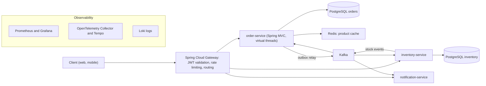

@@ 3 | TOPIC | Practice — Coding drill: Explain your project (STAR and architecture walkthrough) | A 2-minute project pitch, architecture walkthrough and six STAR stories built on OrderHub, with follow-ups and code | MUST
# Coding drill: Explain your project (STAR and architecture walkthrough)

Almost every loop includes "Tell me about a project you worked on." It looks easy and is where many technically strong candidates lose points: they ramble, say "we" for everything, give no numbers, and cannot defend decisions under follow-up. This drill gives you templates and complete model answers built on OrderHub, the project you have been building through this guide. Replace the details with your real project, but keep the structure.

**Honesty rule:** only claim what you did and can defend in depth. If OrderHub is a learning project, say so: "This is a project I built to learn microservices properly; here is what I implemented and measured." Interviewers respect that far more than an inflated story that collapses at the second follow-up.

## Part 1: The 2-minute project pitch

Use this five-part template. Practise until it takes 90 to 120 seconds.

| Part | Content | Time |
|---|---|---|
| Context | What the system does, for whom, scale | 15 s |
| Architecture | Main components and technologies | 30 s |
| My role | What you personally owned | 20 s |
| One hard problem | Problem, your solution, measurable result | 40 s |
| Reflection | What you learned or would change | 15 s |

**Model pitch (OrderHub):**

> "OrderHub is an order management backend for an online shop: products, customers, orders, payments and notifications. It started as a single Spring Boot application and I split it into three services, order, inventory and notification, behind Spring Cloud Gateway, each with its own PostgreSQL schema, communicating through Kafka events, with Redis for caching. It runs as Docker images on Kubernetes with Prometheus, Grafana and OpenTelemetry tracing.
>
> I owned the order service end to end and the event flow between services: the data model, the REST API, security with JWT, and the integration tests with Testcontainers.
>
> The hardest problem was keeping orders and stock consistent without distributed transactions. Early on, we published Kafka events directly inside the `@Transactional` method, and under failure tests we got phantom reservations for orders that had rolled back. I introduced the transactional outbox pattern with a relay, made every consumer idempotent with a processed-events table, and wrote chaos tests that kill the service mid-transaction. After that, the consistency checker found zero mismatches across 200,000 test orders, and we could replay events safely.
>
> If I started again, I would design the events and their schemas first, with a schema registry, because changing event formats later was the most painful part."

Why it works: concrete scope, clear ownership ("I owned"), one problem with cause, fix and a number, and a reflection that shows judgement.

## Part 2: The architecture walkthrough (whiteboard)

When asked "Draw the architecture", go outside-in and narrate one request end to end.



**Narration script for "place an order":**
1. The client sends `POST /api/orders` with a JWT and an `Idempotency-Key`. The gateway validates the token signature against the identity provider's JWKS, applies a per-user rate limit (Redis), and routes to order-service.
2. Order-service validates the request (`@Valid` records), checks idempotency, prices lines from the Redis-cached catalog, and in one transaction saves the order as `PENDING` plus an `OrderPlaced` outbox row. It returns 202.
3. The outbox relay publishes the event to Kafka keyed by order id. Inventory reserves stock with a conditional update and publishes `StockReserved` or `StockRejected`.
4. Order-service consumes the result, updates the status, and notification-service emails the customer.
5. Every hop carries a W3C `traceparent` header, so one trace in Tempo shows the whole flow, and logs include the trace id.

**Be ready to justify each box:**

| Choice | Why | Alternative considered |
|---|---|---|
| Three services, not ten | Split along real boundaries (ordering, stock, messaging) with different scaling needs | Modular monolith first (and honestly, the right start) |
| Kafka | Durable, replayable events, partition ordering per order | RabbitMQ (simpler routing, no replay) |
| PostgreSQL per service | Independent schema changes and deploys | Shared DB (faster to build, couples teams) |
| Spring MVC plus virtual threads | Blocking JPA code stays simple and scales | WebFlux (no streaming need, JPA is blocking) |
| Outbox | Atomic state change plus event | `@TransactionalEventListener` after commit (can lose events on crash) |

## Part 3: STAR stories

STAR = **Situation** (context, 1 to 2 sentences), **Task** (your responsibility), **Action** (what *you* did, the longest part, with technical detail), **Result** (measurable outcome plus what you learned). Prepare one story for each of these common prompts; many behavioural questions map onto them.

### Story 1: A hard production bug (connection pool exhaustion)
**Prompt:** "Tell me about the hardest bug you have fixed."

- **Situation:** During a load test before a sales event, order-service p99 latency jumped from 150 ms to 30 s and requests began failing with `SQLTransientConnectionException: Connection is not available, request timed out after 30000ms`. Database CPU was only 20 percent.
- **Task:** I was on call for order-service and had two days before the event.
- **Action:** I checked Hikari metrics in Grafana: `active` was pinned at the maximum of 10 while `pending` climbed, and the connection usage time was over 2 seconds, although our queries took 5 ms. A thread dump showed request threads holding connections while waiting on HTTP calls to the shipping-quote API. The cause was a `@Transactional` method that called the external API in the middle of the transaction. I moved the remote call before the transaction, put a 2-second timeout and a circuit breaker on it, set `open-in-view` to false, and lowered `connection-timeout` to 2 s so failures were fast and visible. I also added Hikari leak detection and an alert on pending connections.
- **Result:** Under the same load, connection usage time fell to 8 ms, p99 went back to 160 ms, and the service handled 3 times the previous peak with the same pool. I wrote a short internal note, "No remote calls inside transactions", and added an ArchUnit rule that flags it.

```java
// Before: connection held for the whole remote call
@Transactional
public Order place(PlaceOrderCmd cmd) {
    Order order = orders.save(Order.pending(cmd));
    Quote quote = shippingClient.quote(order.getId());       // 300 ms to 20 s, holding a DB connection
    order.applyShipping(quote);
    return order;
}

// After: remote call outside, short transaction, timeout plus circuit breaker on the client
public Order place(PlaceOrderCmd cmd) {
    Quote quote = shippingQuotes.quoteFor(cmd.addressId(), cmd.lines());   // @CircuitBreaker, 2 s timeout
    return transactionTemplate.execute(status -> {
        Order order = Order.pending(cmd);
        order.applyShipping(quote);
        return orders.save(order);
    });
}
```

**Likely follow-ups and answers**
- *"Why not just increase the pool size?"* The database was idle; connections were held, not used. A bigger pool would delay the failure and could overload the database once the remote API recovered.
- *"How did you prove it was fixed?"* Repeated the load test with the same profile and compared Hikari usage time, p99 and error rate; then watched the same metrics during the real event.

### Story 2: A design decision (outbox instead of direct publishing)
**Prompt:** "Tell me about a technical decision you made and how you made it."

- **Situation:** Orders and stock lived in different services. Our first version published Kafka events inside the database transaction, and fault-injection tests produced phantom stock reservations and occasionally lost events.
- **Task:** I had to make order placement reliable without distributed transactions, and convince the team.
- **Action:** I wrote a one-page decision record comparing four options: XA two-phase commit (rejected: Kafka does not take part in XA, and it hurts availability), publishing after commit with `@TransactionalEventListener` (simple but loses events if the JVM dies between commit and send), Kafka transactions alone (do not cover the database), and the transactional outbox (an `outbox` table written in the same transaction, published by a relay). I built a prototype of the outbox with a polling relay using `FOR UPDATE SKIP LOCKED` so multiple instances could relay without duplicates, measured its overhead (one extra insert, about 1 ms), and showed the team a chaos test killing the process between commit and publish.
- **Result:** The team adopted it for all three services. Consistency checks found zero mismatches over 200,000 test orders, and the relay added about 200 ms of end-to-end event latency, which was acceptable. We later documented Debezium CDC as the next step if polling became a bottleneck.

```sql
-- Relay query: each instance claims a batch without blocking the others
SELECT id, aggregate_id, type, payload
FROM outbox
WHERE published_at IS NULL
ORDER BY created_at
LIMIT 100
FOR UPDATE SKIP LOCKED;
```

```java
@Scheduled(fixedDelay = 200)
@Transactional
public void relay() {
    List<OutboxRow> batch = outboxDao.claimBatch(100);          // the SKIP LOCKED query above
    for (OutboxRow row : batch) {
        kafka.send("order-events", row.aggregateId().toString(), row.payload()).join();  // wait for the ack
        outboxDao.markPublished(row.id());
    }
}
```

**Follow-ups**
- *"What if Kafka is down?"* Rows stay unpublished; orders still succeed; the relay catches up later. We alert on the age of the oldest unpublished row.
- *"Ordering?"* Events for one order use the order id as the key, so they stay ordered within a partition, and the relay processes rows in creation order.

### Story 3: Disagreement with a colleague (WebFlux vs MVC)
**Prompt:** "Tell me about a time you disagreed with a teammate."

- **Situation:** A senior colleague proposed rewriting the inventory service in WebFlux "for scalability" before the sales season.
- **Task:** I thought the rewrite was risky and wanted the decision based on data, while keeping a good working relationship.
- **Action:** I agreed the scalability concern was real and suggested we measure first. We ran a load test together: the service was limited by Tomcat threads blocked on JDBC calls, and the database still had headroom. I proposed a one-day experiment: enable `spring.threads.virtual.enabled`, add a bulkhead to protect the connection pool, and rerun the test. I also listed what a WebFlux migration would require: R2DBC instead of JPA, new tests, and team training.
- **Result:** With virtual threads, throughput at the same latency rose by about 2.5 times, enough for the season with margin, and the change shipped in a week instead of an estimated two months. My colleague later led an SSE-based stock dashboard where WebFlux genuinely fit, and we wrote a short guideline together on when to use each model.

```yaml
spring:
  threads:
    virtual:
      enabled: true
resilience4j:
  bulkhead:
    instances:
      stock-db:
        max-concurrent-calls: 30   # protects a 30-connection Hikari pool now that threads are unlimited
```

**What this story shows:** you disagree with data, not ego; you look for the cheapest experiment; you give credit and find the place where the other idea is right.

### Story 4: A mistake you made
**Prompt:** "Tell me about a time you made a mistake."

- **Situation:** I wrote a Flyway migration that renamed a column (`cust_name` to `customer_name`) in a single step.
- **Task:** It was my change, deployed through a rolling update to four pods.
- **Action:** During the rollout, old pods still querying `cust_name` started failing with SQL errors. I rolled forward quickly with a migration that re-added the old column as a copy and redeployed, which stopped the errors within 12 minutes. Afterwards I wrote the incident review: the root cause was a migration that was not backward compatible with the previous app version. I introduced the expand and contract rule (add, dual-write, backfill, switch reads, drop in a later release), added a CI check that runs the previous app version's integration tests against the new schema, and presented it at our engineering meeting.
- **Result:** About 3 percent of order-status requests failed for 12 minutes; no data was lost. In the following year we had zero schema-related incidents across dozens of migrations.

```sql
-- Expand (release N): additive only, old code keeps working
ALTER TABLE orders ADD COLUMN customer_name VARCHAR(100);
UPDATE orders SET customer_name = cust_name WHERE customer_name IS NULL;
-- Contract (release N+2, after no code reads the old column)
ALTER TABLE orders DROP COLUMN cust_name;
```

**What this story shows:** ownership without excuses, a fast and calm fix, and a systemic prevention instead of "I will be more careful".

### Story 5: Improving something nobody asked you to (observability)
**Prompt:** "Tell me about a time you took initiative."

- **Situation:** Debugging cross-service issues took hours because logs were not correlated and there were no traces.
- **Task:** Not assigned to anyone; I proposed to fix it.
- **Action:** I added Micrometer Tracing with the OpenTelemetry bridge to all services, a shared logging pattern with `traceId`, structured JSON logs, and a Grafana dashboard with RED metrics (rate, errors, duration) per endpoint. I wrapped the setup in a small internal starter so every service got it with one dependency.
- **Result:** Median time to diagnose production issues dropped from about two hours to 15 minutes (measured from incident tickets over the next quarter). The starter is now used by every new service.

```java
// Inside the internal observability starter
// imports: io.micrometer.common.KeyValue, io.micrometer.observation.*, org.springframework.boot.autoconfigure.*, org.springframework.context.annotation.Bean
@AutoConfiguration
@ConditionalOnClass(ObservationRegistry.class)
public class OrderHubObservabilityAutoConfiguration {

    @Bean
    ObservationFilter commonTags(@Value("${spring.application.name}") String app) {
        return context -> context.addLowCardinalityKeyValue(KeyValue.of("service", app));
    }
}
```

### Story 6: Performance improvement with numbers
**Prompt:** "Tell me about a time you improved performance."

- **Situation:** The order history endpoint took 1.2 s for customers with many orders.
- **Task:** Bring p95 under 200 ms without a big redesign.
- **Action:** Hibernate statistics showed 101 queries per page (N+1 on customer and lines) and an `OFFSET`-based query reading tens of thousands of rows for deep pages. I replaced entity loading with a DTO projection using a join, added a composite index `(customer_id, created_at DESC, id DESC)`, switched infinite scroll to keyset pagination, and cached product names in Redis.
- **Result:** p95 fell from 1.2 s to 45 ms, database CPU for that endpoint fell by about 80 percent, and I added a test that fails if the endpoint runs more than 3 queries.

```java
@Query("""
    select new com.orderhub.order.api.OrderRow(o.id, o.status, o.totalCents, o.createdAt)
    from Order o
    where o.customerId = :customerId
      and (o.createdAt < :afterCreatedAt or (o.createdAt = :afterCreatedAt and o.id < :afterId))
    order by o.createdAt desc, o.id desc
    """)
List<OrderRow> history(long customerId, Instant afterCreatedAt, long afterId, Limit limit);
```

## Part 4: The follow-up questions interviewers always ask about your project

| Question | What a strong answer includes |
|---|---|
| "What was your exact contribution?" | Specific components, decisions and code you owned; "I" not "we" |
| "What would you do differently?" | A real regret with reasoning (start as a modular monolith; design event schemas first) |
| "How did you test it?" | Unit, slice, Testcontainers integration, contract tests, load tests, chaos tests, with what each caught |
| "How did it behave in production?" | SLOs, dashboards, an incident and how it was handled |
| "How does it scale? What breaks first?" | The first bottleneck (database writes, hot stock rows) and the plan |
| "How did you handle security?" | JWT validation at the gateway and in services, method security, secrets management, OWASP basics |
| "Why this technology?" | Requirements-based reasoning plus an alternative you rejected |
| "What was the biggest risk?" | The risk, how you reduced it, and what remained |

## Part 5: Practice tasks
1. Write your own 2-minute pitch using the five-part template; time it.
2. Write six STAR stories (bug, decision, disagreement, mistake, initiative, performance) on one page each, with at least one number in each Result.
3. Draw your architecture from memory in 3 minutes and narrate one request end to end.
4. Answer the eight follow-up questions aloud for your project and record yourself.

<details><summary>Self-review checklist</summary>

```text
[ ] Pitch under 2 minutes, includes scale, my role, one problem, one number, one reflection
[ ] Every STAR story: Situation and Task under 20 seconds, Action is the longest part
[ ] Actions are things I did, in first person, with technical detail (annotations, metrics, tools)
[ ] Every Result has a number (latency, error rate, time saved, incidents) and a learning
[ ] I can go two levels deeper on every technology I mention
[ ] I have one honest mistake story with a systemic fix
[ ] No confidential details from employers (names, internal numbers I am not allowed to share)
```
</details>

## Rubric
| Area | Weak | Good | Strong |
|---|---|---|---|
| Structure | Rambling chronology | Clear STAR | Tight STAR, Action-heavy, ends with learning |
| Ownership | "We did everything" | Some "I" | Clear personal contribution and decisions |
| Technical depth | Buzzwords | Correct explanations | Survives three levels of "why" with metrics and code |
| Impact | No numbers | Some numbers | Before and after metrics tied to business outcome |
| Judgement | Everything was perfect | Mentions trade-offs | Honest regrets, alternatives, what changes at 10 times the scale |

@@ 3 | TOPIC | Practice — Mock interview: Advanced round | A 45-minute senior Java and Spring script with JVM, concurrency and Spring internals questions, a rate limiter coding task, a production scenario and a design question with rubrics | MUST
# Mock interview: Advanced round

A 45-minute script for a senior Java and Spring Boot technical round. Run it with a friend playing the interviewer, or alone: read the question, answer aloud with a timer, then compare with the model answer and score yourself on the rubric. Interviewers at this level care less about definitions and more about **why**, **what breaks** and **how you know**.

| Segment | Time |
|---|---|
| 1. Warm-up | 5 min |
| 2. Concept questions (JVM, concurrency, Spring internals) | 15 min |
| 3. Coding task: thread-safe rate limiter | 15 min |
| 4. Production scenario | 5 min |
| 5. Design question | 5 min |

## 1. Warm-up (5 minutes)
**Interviewer:** "Walk me through the most complex Spring Boot system you have worked on, and your role in it."

**Model answer:** Use the 2-minute pitch from [[Practice — Coding drill: Explain your project (STAR and architecture walkthrough)]]: context, architecture, your ownership, one hard problem with a number, one reflection. Stop at two minutes and let the interviewer choose where to dig.

| Weak | Good | Strong |
|---|---|---|
| Lists technologies, no structure, over 4 minutes | Clear architecture and role | Under 2 minutes, one problem with measured impact, invites follow-up |

## 2. Concept questions (15 minutes)

### Q1. "What does `volatile` guarantee, and why is double-checked locking broken without it?"
**Model answer:** `volatile` guarantees visibility and ordering: a write to a volatile field happens-before every subsequent read of that field, so all writes made before the volatile write become visible to a thread that reads it. It does not make compound actions like `count++` atomic. In double-checked locking, `instance = new Singleton()` is three steps (allocate, run the constructor, publish the reference), and without `volatile` the JIT or CPU may publish the reference before the constructor finishes, so another thread passing the first null check can see a half-built object. Declaring `instance` as `volatile` forbids that reordering. The holder-class idiom or an enum avoids the problem entirely.

```java
class Config {
    private static volatile Config instance;           // volatile is essential
    static Config get() {
        Config local = instance;                        // one volatile read on the fast path
        if (local == null) {
            synchronized (Config.class) {
                local = instance;
                if (local == null) instance = local = new Config();
            }
        }
        return local;
    }
}
```

| Weak | Good | Strong |
|---|---|---|
| "volatile makes it thread-safe" | Visibility, not atomicity; reordering explained | Happens-before rule, publication of a partially constructed object, holder idiom as the better option |

### Q2. "Explain exactly how `@Transactional` works, and three ways it silently does nothing."
**Model answer:** At startup, an infrastructure bean post-processor (the auto-proxy creator registered by `@EnableTransactionManagement`, auto-configured by Boot) wraps beans that have `@Transactional` methods in a proxy (CGLIB by default in Boot). A call through the proxy reaches `TransactionInterceptor`, which reads the attributes, asks the `PlatformTransactionManager` (for JPA, `JpaTransactionManager`) to begin or join a transaction according to propagation, binds the connection and `EntityManager` to the thread via `TransactionSynchronizationManager`, invokes the method, then commits, or rolls back on `RuntimeException` and `Error`. It silently does nothing on self-invocation (`this.method()` bypasses the proxy), on `private` methods (and `final` methods with CGLIB), on objects not managed by Spring (created with `new`), and it commits on checked exceptions unless `rollbackFor` is set. Catching an exception inside the method also prevents the rollback.

| Weak | Good | Strong |
|---|---|---|
| "It opens a transaction" | Proxy plus self-invocation trap | Interceptor, transaction manager, thread binding, propagation, rollback rules, three or more traps with fixes |

### Q3. "Your service uses G1 with a 4 GB heap and you see 800 ms pauses. How do you approach it?"
**Model answer:** First get data: GC logs (`-Xlog:gc*:file=gc.log:time,uptime`) or JFR, to see which phase pauses (young evacuation, mixed collections or a full GC). A full GC usually means allocation outran concurrent marking or humongous objects (larger than half a region) fragment the heap: fixes include more heap headroom, an earlier `-XX:InitiatingHeapOccupancyPercent`, larger regions (`-XX:G1HeapRegionSize`), or removing the huge allocations (for example, streaming instead of building giant byte arrays). Long young pauses point to a large live set copied each time or a very high allocation rate; reduce allocation (profile with JFR allocation events) or tune `MaxGCPauseMillis`. In containers, check that the heap fits the memory limit and that CPU throttling is not stretching pauses. If low latency matters more than throughput, Generational ZGC (default ZGC mode since Java 23) gives sub-millisecond pauses at the cost of some CPU and memory overhead.

| Weak | Good | Strong |
|---|---|---|
| "Increase the heap" | Reads GC logs, knows G1 phases | Diagnoses by phase, names humongous allocations, container limits, allocation profiling, ZGC trade-off |

### Q4. "When would you use virtual threads, and what can go wrong?"
**Model answer:** For high-concurrency, I/O-bound request handling with blocking code: `spring.threads.virtual.enabled=true` lets each request run on a cheap virtual thread that unmounts from its carrier while blocked. Things that go wrong: downstream overload because the thread pool no longer limits concurrency (add bulkheads or semaphores and right-size pools); pinning when blocking inside `synchronized` on Java 21 to 23 or in native code (use `ReentrantLock`, upgrade to Java 24+, check the `jdk.VirtualThreadPinned` JFR event); heavy `ThreadLocal` caches multiplied by millions of threads; and no benefit for CPU-bound work. Never pool virtual threads.

| Weak | Good | Strong |
|---|---|---|
| "They are faster threads" | Unmounting on blocking I/O, Boot property | Downstream limits, pinning and the Java 24 fix, ThreadLocal cost, CPU-bound caveat |

### Q5. "How does Spring Boot auto-configuration decide what to create?"
**Model answer:** `@SpringBootApplication` includes `@EnableAutoConfiguration`, which imports `AutoConfigurationImportSelector`. It loads candidate classes listed in `META-INF/spring/org.springframework.boot.autoconfigure.AutoConfiguration.imports` from every jar, filters them early with conditions evaluated from metadata (`@ConditionalOnClass`), then processes each `@AutoConfiguration` class after user configuration, so `@ConditionalOnMissingBean` backs off when you define your own bean. Ordering uses `before` and `after` attributes. You can see the decisions with `--debug` (the conditions evaluation report) or the `/actuator/conditions` endpoint, and exclude with `exclude` or `spring.autoconfigure.exclude`.

| Weak | Good | Strong |
|---|---|---|
| "Boot configures things automatically" | Conditions and imports file | Deferred import after user config, back-off via missing-bean, debugging with the conditions report |

## 3. Coding task (15 minutes)
**Interviewer:** "Implement a per-client rate limiter for an API: each client may make bursts of up to N requests, refilled at R requests per second. It must be thread-safe and testable. Then tell me how you would use it in Spring and in a cluster."

**What the interviewer expects:** clarify (per client, burst, refill), choose an algorithm (token bucket), write thread-safe code with low contention, make time injectable, and discuss distribution.

```java
import java.util.Map;
import java.util.concurrent.ConcurrentHashMap;
import java.util.concurrent.atomic.AtomicLong;
import java.util.function.LongSupplier;

public class TokenBucketRateLimiter {

    // One bucket per client; synchronized per bucket so different clients never contend
    static final class Bucket {
        private final long capacity;
        private final double refillPerNano;
        private double tokens;
        private long lastRefill;

        Bucket(long capacity, double refillPerSecond, long now) {
            this.capacity = capacity;
            this.refillPerNano = refillPerSecond / 1_000_000_000.0;
            this.tokens = capacity;                 // start full: allows an initial burst
            this.lastRefill = now;
        }

        synchronized boolean tryConsume(long now) {
            double elapsed = now - lastRefill;
            tokens = Math.min(capacity, tokens + elapsed * refillPerNano);
            lastRefill = now;
            if (tokens >= 1.0) {
                tokens -= 1.0;
                return true;
            }
            return false;
        }
    }

    private final Map<String, Bucket> buckets = new ConcurrentHashMap<>();
    private final long capacity;
    private final double refillPerSecond;
    private final LongSupplier clock;               // injectable for deterministic tests

    TokenBucketRateLimiter(long capacity, double refillPerSecond, LongSupplier clock) {
        this.capacity = capacity;
        this.refillPerSecond = refillPerSecond;
        this.clock = clock;
    }

    boolean allow(String clientId) {
        long now = clock.getAsLong();
        return buckets.computeIfAbsent(clientId, id -> new Bucket(capacity, refillPerSecond, now))
                      .tryConsume(now);
    }

    public static void main(String[] args) {
        AtomicLong fakeNanos = new AtomicLong();
        TokenBucketRateLimiter limiter = new TokenBucketRateLimiter(3, 1.0, fakeNanos::get);   // burst 3, 1 per second

        StringBuilder burst = new StringBuilder();
        for (int i = 0; i < 5; i++) burst.append(limiter.allow("alice") ? "Y" : "N");
        System.out.println("t=0.0s alice x5: " + burst);

        fakeNanos.addAndGet(500_000_000L);           // +0.5 s: half a token
        System.out.println("t=0.5s alice: " + limiter.allow("alice"));

        fakeNanos.addAndGet(500_000_000L);           // +0.5 s: one full token
        System.out.println("t=1.0s alice: " + limiter.allow("alice"));
        System.out.println("t=1.0s bob:   " + limiter.allow("bob"));

        fakeNanos.addAndGet(10_000_000_000L);        // +10 s: refills only up to capacity
        StringBuilder later = new StringBuilder();
        for (int i = 0; i < 5; i++) later.append(limiter.allow("alice") ? "Y" : "N");
        System.out.println("t=11s alice x5: " + later);
    }
}
```

Output:
```text
t=0.0s alice x5: YYYNN
t=0.5s alice: false
t=1.0s alice: true
t=1.0s bob:   true
t=11s alice x5: YYYNN
```

**Walkthrough to say aloud:**
- Token bucket: tokens refill continuously up to capacity; each request takes one. It allows bursts (capacity) and enforces an average rate (refill), unlike a fixed window counter, which allows double bursts at window edges.
- Lazy refill: no background thread; the bucket computes refilled tokens from elapsed time on each call.
- Thread safety: `ConcurrentHashMap.computeIfAbsent` creates exactly one bucket per client atomically; each bucket's `synchronized` method protects its two fields, which must change together. Contention is per client only. A lock-free version would pack state into an `AtomicLong` with CAS, but the synchronized version is simpler and fast enough.
- Testability: the clock is a `LongSupplier`, so tests control time with no sleeps.
- Memory: buckets for inactive clients should be evicted (Caffeine with `expireAfterAccess`) or the map grows forever.

**Spring and cluster follow-up:** in Spring, apply it in a `OncePerRequestFilter` keyed by the authenticated user or API key, returning 429 with a `Retry-After` header. In a cluster of N instances, a local limiter allows N times the rate; use a shared store: Redis with an atomic Lua script implementing the same token bucket (Spring Cloud Gateway's `RequestRateLimiter` with `RedisRateLimiter` does exactly this), or Bucket4j with a Redis or JCache backend.

```java
@Component
class RateLimitFilter extends OncePerRequestFilter {
    private final TokenBucketRateLimiter limiter = new TokenBucketRateLimiter(20, 5.0, System::nanoTime);

    @Override
    protected void doFilterInternal(HttpServletRequest req, HttpServletResponse res, FilterChain chain)
            throws ServletException, IOException {
        String client = req.getUserPrincipal() != null ? req.getUserPrincipal().getName() : req.getRemoteAddr();
        if (!limiter.allow(client)) {
            res.setStatus(429);
            res.setHeader("Retry-After", "1");
            return;
        }
        chain.doFilter(req, res);
    }
}
```

| Weak | Good | Strong |
|---|---|---|
| Fixed counter with a race condition, or uses `Thread.sleep` | Correct token bucket, thread-safe | Per-client low contention, injectable clock and deterministic test, eviction, 429 with Retry-After, Redis or Gateway for clusters |

## 4. Production scenario (5 minutes)
**Interviewer:** "After a release, the order service's CPU goes to 100 percent on all pods and latency explodes, but traffic is normal. What do you do?"

**Model answer:**
1. **Mitigate first:** roll back the release (or shift traffic to the previous version) because the timing points to the release. Customer impact comes before root cause.
2. **Collect evidence before the pods disappear:** several thread dumps a few seconds apart (`jcmd <pid> Thread.print`) and a short JFR recording. Threads that are `RUNNABLE` in the same frames across dumps are the hot spots. Also check GC logs: 100 percent CPU can be the GC thrashing near a full heap.
3. **Typical culprits:** an accidental infinite loop or a pathological regex (catastrophic backtracking on user input); a new N+1 causing massive object mapping; a cache disabled by a config change so every request recomputes; excessive logging (debug level with string building in hot paths); a busy-spin retry loop without backoff; GC thrashing from a memory leak.
4. **Diff the release** for the frames found in the dumps; reproduce with a load test; fix; add a guard (regex timeouts or pre-validated input, alerts on CPU and GC time).

| Weak | Good | Strong |
|---|---|---|
| Starts reading code at random | Thread dumps and JFR, checks GC | Rolls back first, captures evidence, correlates dumps over time, lists concrete culprits, adds prevention |

## 5. Design question (5 minutes)
**Interviewer:** "Design how OrderHub prevents overselling during a flash sale: 10,000 units of one product, 200,000 users trying to buy in the first minute."

**Model answer:**
- **Admission control:** a virtual waiting room or token queue at the gateway, plus per-user rate limits, so only a manageable flow reaches checkout; static content and stock counts are served from CDN or cache.
- **Atomic decrement in Redis:** keep the sale stock in Redis and reserve with a Lua script (`if stock >= qty then DECRBY`) for about 100,000 operations per second on one key; a failed reservation returns "sold out" immediately.
- **Durable record:** a successful reservation publishes an event (or writes to the outbox) that creates the order and reservation in PostgreSQL asynchronously; the database row keeps the `CHECK (available >= 0)` constraint as the final safety net.
- **Expiry:** unpaid reservations expire after 10 minutes and return stock to Redis (a delayed job or Redis key expiry plus reconciliation).
- **Consistency:** a reconciliation job compares Redis counts with database reservations; Redis persistence (AOF) and replication reduce the loss window.
- **Trade-off:** Redis gives throughput at the cost of a second source of truth; for normal traffic the conditional SQL update is simpler and enough.

```java
// Atomic reservation with a Lua script via Spring Data Redis
private static final RedisScript<Long> RESERVE = RedisScript.of("""
        local stock = tonumber(redis.call('GET', KEYS[1]) or '0')
        local qty = tonumber(ARGV[1])
        if stock >= qty then
          return redis.call('DECRBY', KEYS[1], qty)
        end
        return -1
        """, Long.class);

boolean reserve(String productId, int qty) {
    Long left = redis.execute(RESERVE, List.of("sale:stock:" + productId), String.valueOf(qty));
    return left != null && left >= 0;
}
```

| Weak | Good | Strong |
|---|---|---|
| `SELECT` then `UPDATE` (race) or "use synchronized" | Atomic conditional update in the DB | Admission control, atomic Redis Lua, durable async order creation, expiry, reconciliation, explicit trade-offs |

## Overall scoring
| Result | Typical pattern |
|---|---|
| No hire | Definitions only, misses the self-invocation and visibility traps, rate limiter not thread-safe |
| Lean hire | Correct answers, limited production reasoning, needs hints on clusters and diagnostics |
| Hire | Correct, explains internals, sound code, reasonable diagnosis order |
| Strong hire | Leads with trade-offs and evidence, mitigates before debugging, writes testable concurrent code, quantifies |
