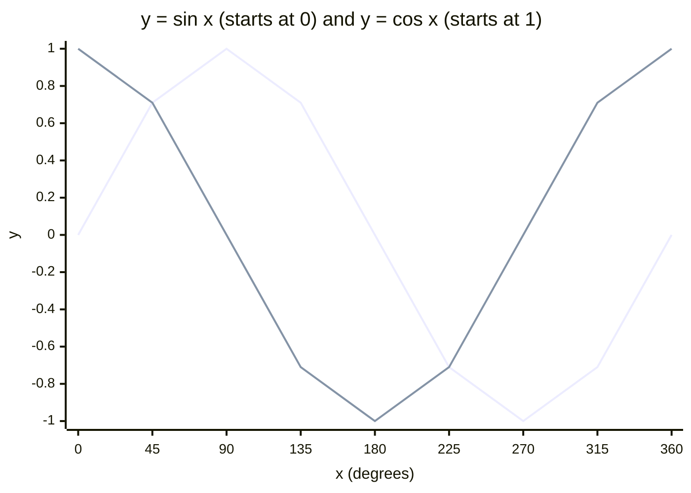
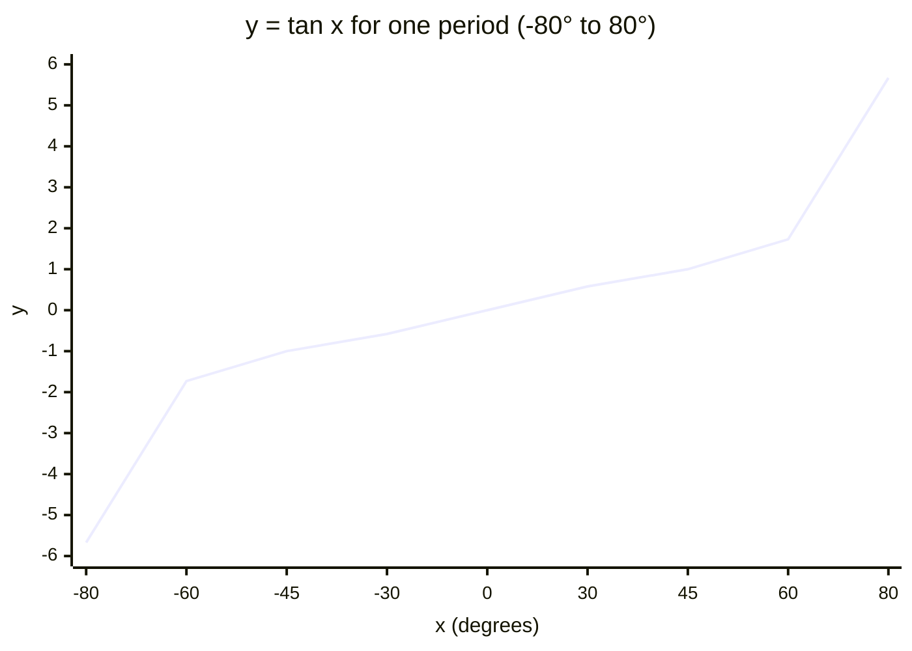

@@ 1 | MODULE | Phase 2 — Trigonometric Functions (Core) | Radians, the unit circle, trig of any angle, graphs, transformations, inverse functions, periodic models | MUST
# Phase 2: Trigonometric functions

In Phase 1, angles lived inside right triangles, so they were always between $0^\circ$ and $90^\circ$. Now we free them: angles can be $150^\circ$, $-45^\circ$ or $1000^\circ$. The tool that makes this possible is the **unit circle**. Once sine and cosine are defined for every angle, they become **functions** whose graphs are waves, and waves describe sound, light, tides, AC power and anything else that repeats.

**What you need first:** Phase 1, plus the coordinate plane and the idea of a function $y = f(x)$.

@@ 2 | MODULE | Radians and the unit circle | Radian measure, arc length, the unit circle, any-angle trig, exact values everywhere | MUST
The unit circle turns trigonometry from "triangle ratios" into "coordinates on a circle".

@@ 3 | TOPIC | Radians and degree conversion | What a radian is, converting degrees ⇄ radians, why programming uses radians | MUST
# Radians and degree conversion

## 1. What it covers
- What a **radian** is: the angle where the arc length equals the radius.
- Converting between degrees and radians.
- The common angles in both units, and why calculus and code use radians.

## 2. Where it is used
- **Every programming language:** `Math.sin`, `math.cos`, `numpy.sin`, CSS `rotate(1.57rad)` and GPU shaders all take radians.
- **Calculus:** the neat rule "the derivative of $\sin x$ is $\cos x$" is only true when $x$ is in radians.
- **Physics:** angular speed (rad/s), rotating machinery, wheels, orbits.
- **Engineering:** motor controllers, robot joints, signal processing ($\omega = 2\pi f$).

## 3. What it means
Degrees are a human choice: someone decided a full turn is 360. Radians come from the circle itself.

Take a circle of radius $r$. Lay a piece of string of length $r$ along the edge. The angle at the centre that this string covers is **1 radian** (about $57.3^\circ$).

How many radii fit around the whole circle? The circumference is $2\pi r$, so exactly $2\pi$ of them. So:
$$
360^\circ = 2\pi \text{ rad} \qquad 180^\circ = \pi \text{ rad}
$$

**Analogy:** degrees are like measuring distance in "steps" (depends who walks); radians are like measuring in "radius lengths" (built into the circle).

A radian has no units really: it is length ÷ length. When an angle has no degree symbol, assume radians.

## 4. Formula & worked example
$$
\text{radians} = \text{degrees} \times \frac{\pi}{180} \qquad \text{degrees} = \text{radians} \times \frac{180}{\pi}
$$

| degrees | $0^\circ$ | $30^\circ$ | $45^\circ$ | $60^\circ$ | $90^\circ$ | $180^\circ$ | $270^\circ$ | $360^\circ$ |
|---|---|---|---|---|---|---|---|---|
| radians | $0$ | $\frac{\pi}{6}$ | $\frac{\pi}{4}$ | $\frac{\pi}{3}$ | $\frac{\pi}{2}$ | $\pi$ | $\frac{3\pi}{2}$ | $2\pi$ |

**Example 1.** Convert $150^\circ$ to radians.
- $150 \times \frac{\pi}{180} = \frac{150\pi}{180} = \frac{5\pi}{6}$

**Example 2.** Convert $\frac{7\pi}{4}$ to degrees.
- $\frac{7\pi}{4} \times \frac{180}{\pi} = \frac{7 \times 180}{4} = 315^\circ$

**Example 3.** Convert 2 radians to degrees.
- $2 \times \frac{180}{\pi} \approx 114.6^\circ$

**Shortcut:** think of $\pi$ as $180^\circ$. Then $\frac{\pi}{6} = \frac{180^\circ}{6} = 30^\circ$ and $\frac{2\pi}{3} = \frac{360^\circ}{3} = 120^\circ$.

**In code:**
```python
import math
print(math.sin(30))                 # -0.988  wrong! 30 radians, not 30 degrees
print(math.sin(math.radians(30)))   # 0.5     correct
print(math.degrees(math.pi / 3))    # 60.0
```
The first line is a classic bug: the function silently treats 30 as radians. Always convert degrees with `math.radians` (or multiply by $\pi/180$) before calling trig functions in code.

## 5. Common mistakes
- Multiplying by $\frac{180}{\pi}$ when going **to** radians. To get radians, $\pi$ goes on top.
- Calculator in degree mode when the problem is in radians (or the reverse).
- Thinking $\pi$ is $180$. $\pi \approx 3.14159$ radians, which happens to **equal** $180^\circ$ as an angle.

## 6. Practice
Q: Convert $240^\circ$ to radians.
A: $\frac{240\pi}{180} = \frac{4\pi}{3}$.

Q: Convert $\frac{5\pi}{3}$ to degrees.
A: $300^\circ$.

Q: How many degrees is 1 radian, approximately?
A: About $57.3^\circ$.

Q: What is the definition of 1 radian?
A: The angle at the centre of a circle where the arc length equals the radius.

Q: Why does `Math.sin(90)` in JavaScript not return 1?
A: It treats 90 as radians. Use `Math.sin(Math.PI / 2)` or convert: `90 * Math.PI / 180`.

@@ 3 | TOPIC | Arc length, sector area and angular speed | s = rθ, A = ½r²θ, v = rω | MUST
# Arc length, sector area and angular speed

## 1. What it covers
- **Arc length** $s = r\theta$: the distance along a circle's edge.
- **Sector area** $A = \frac{1}{2}r^2\theta$: the area of a "pizza slice".
- **Angular speed** $\omega$ and **linear speed** $v = r\omega$.

## 2. Where it is used
- **Mechanical engineering:** belt and gear drives, wheel speed vs car speed.
- **Robotics:** a wheeled robot turning by angle $\theta$ moves its wheels a distance $r\theta$ (odometry).
- **UI design:** progress rings and pie charts draw arcs and sectors (the SVG and Canvas `arc` functions take radians).
- **Astronomy and GPS:** distance along the Earth's surface between two places at the same longitude.
- **Hard disks and turntables:** a point near the edge moves faster than one near the centre at the same rpm.

## 3. What it means
A radian is defined so that, on a circle of radius $r$, an angle of $\theta$ radians covers an arc of exactly $r\theta$. That is why radians make circle formulas so short.

The sector area is the fraction $\frac{\theta}{2\pi}$ of the whole circle's area $\pi r^2$:
$$
\frac{\theta}{2\pi} \times \pi r^2 = \frac{1}{2}r^2\theta
$$

**Angular speed** $\omega$ is how fast the angle changes (radians per second). A point at distance $r$ from the centre moves along its arc at linear speed $v = r\omega$.

**Analogy:** on a merry-go-round, everyone turns at the same angular speed, but the child on the outer edge travels much further each second than the one near the middle.

## 4. Formula & worked example
$$
s = r\theta \qquad A = \tfrac{1}{2}r^2\theta \qquad v = r\omega \qquad (\theta, \omega \text{ in radians})
$$
In degrees you need the extra factor: $s = 2\pi r \cdot \frac{\theta^\circ}{360}$.
Revolutions per minute to rad/s: $\omega = \text{rpm} \times \frac{2\pi}{60}$.

**Example 1.** Arc length of a $60^\circ$ arc on a circle of radius 9 cm.
- $\theta = \frac{\pi}{3}$, so $s = 9 \cdot \frac{\pi}{3} = 3\pi \approx 9.42$ cm

**Example 2.** Area of a pizza slice with radius 15 cm and angle $\frac{\pi}{4}$.
- $A = \frac{1}{2}(15)^2\left(\frac{\pi}{4}\right) = \frac{225\pi}{8} \approx 88.4$ cm²

**Example 3.** A car's wheel has radius 0.3 m and spins at 800 rpm. How fast is the car?
- $\omega = 800 \times \frac{2\pi}{60} \approx 83.78$ rad/s
- $v = 0.3 \times 83.78 \approx 25.1$ m/s $\approx 90.5$ km/h

**Example 4.** Dhaka and another city lie on the same meridian, $5^\circ$ of latitude apart. Earth's radius is about 6371 km. Distance between them?
- $\theta = 5 \times \frac{\pi}{180} \approx 0.08727$ rad; $s \approx 6371 \times 0.08727 \approx 556$ km

## 5. Common mistakes
- Using degrees in $s = r\theta$. With $\theta = 60$ you get an arc of $540$ cm on a 9 cm circle, which is impossible.
- Mixing up $\frac{1}{2}r^2\theta$ with $\frac{1}{2}r\theta$.
- Forgetting to convert rpm to rad/s (one revolution is $2\pi$ radians, not 1).

## 6. Practice
Q: Arc length for $r = 4$, $\theta = 2.5$ rad?
A: $s = 10$.

Q: Sector area for $r = 6$, $\theta = \frac{\pi}{3}$?
A: $\frac{1}{2}(36)\frac{\pi}{3} = 6\pi \approx 18.85$.

Q: An arc of length 12 sits on a circle of radius 8. What is the angle?
A: $\theta = \frac{12}{8} = 1.5$ rad $\approx 85.9^\circ$.

Q: Convert 60 rpm to rad/s.
A: $60 \times \frac{2\pi}{60} = 2\pi \approx 6.28$ rad/s.

Q: A fan blade tip is 0.5 m from the centre, turning at 10 rad/s. Linear speed?
A: $v = 0.5 \times 10 = 5$ m/s.

@@ 3 | TOPIC | The unit circle | Defining sin and cos as coordinates (cos θ, sin θ) for any angle | MUST
# The unit circle

## 1. What it covers
- The **unit circle**: radius 1, centred at the origin.
- The key definition: the point at angle $\theta$ is $(\cos\theta, \sin\theta)$.
- Positive and negative angles, angles beyond $360^\circ$, and **coterminal** angles.

## 2. Where it is used
- **Computer graphics:** to place points on a circle (clock faces, radial menus, circular particle effects): $x = c_x + r\cos\theta$, $y = c_y + r\sin\theta$.
- **Rotation:** rotating a point in 2D and 3D uses the unit-circle idea (rotation matrices, Phase 4 and Linear Algebra).
- **Signal processing and electronics:** phasors and complex numbers $e^{i\theta} = \cos\theta + i\sin\theta$.
- **Physics:** anything spinning or orbiting.

## 3. What it means
Draw a circle of radius 1 around the origin. Start at the point $(1, 0)$ on the positive x-axis and turn **anticlockwise** by angle $\theta$. You land on a point $(x, y)$. **By definition:**
$$
\cos\theta = x \qquad \sin\theta = y
$$

Why does this match SOH-CAH-TOA? Drop a line from the point to the x-axis. You get a right triangle with hypotenuse $1$, so $\cos\theta = \frac{x}{1} = x$ and $\sin\theta = \frac{y}{1} = y$. Same answer, but now it works for **any** angle, even ones no triangle could hold.

**Analogy:** imagine the tip of a clock hand of length 1, but turning anticlockwise from 3 o'clock. Cosine is how far right (or left) the tip is; sine is how high (or low) it is.

- **Negative angles** turn **clockwise**: $-90^\circ$ points straight down.
- **Angles over $360^\circ$** go round more than once: $450^\circ$ lands where $90^\circ$ does.
- **Coterminal angles** land on the same point; they differ by full turns: $\theta + 360^\circ k$ (or $\theta + 2\pi k$).

**Tangent** on the unit circle: $\tan\theta = \frac{y}{x} = \frac{\sin\theta}{\cos\theta}$, which is the slope of the line from the origin to the point.

## 4. Formula & worked example
$$
P(\theta) = (\cos\theta,\ \sin\theta) \qquad x^2 + y^2 = 1 \;\Rightarrow\; \cos^2\theta + \sin^2\theta = 1
$$
A circle of radius $r$ centred at $(c_x, c_y)$: $\big(c_x + r\cos\theta,\ c_y + r\sin\theta\big)$.

**Example 1.** The four quarter points:
- $0$: $(1, 0)$, so $\cos 0 = 1$, $\sin 0 = 0$
- $\frac{\pi}{2}$: $(0, 1)$, so $\cos\frac{\pi}{2} = 0$, $\sin\frac{\pi}{2} = 1$
- $\pi$: $(-1, 0)$, so $\cos\pi = -1$, $\sin\pi = 0$
- $\frac{3\pi}{2}$: $(0, -1)$, so $\cos\frac{3\pi}{2} = 0$, $\sin\frac{3\pi}{2} = -1$

**Example 2.** Find a positive and a negative angle coterminal with $50^\circ$.
- $50^\circ + 360^\circ = 410^\circ$; $50^\circ - 360^\circ = -310^\circ$

**Example 3.** Where does $\frac{17\pi}{6}$ land?
- Subtract $2\pi = \frac{12\pi}{6}$: $\frac{17\pi}{6} - \frac{12\pi}{6} = \frac{5\pi}{6}$ ($150^\circ$), in quadrant II.

**Example 4: code.** Place 12 hour marks on a clock face of radius 100 centred at $(200, 200)$.
```python
import math
for h in range(12):
    theta = math.pi / 2 - h * (2 * math.pi / 12)   # 12 o'clock is at 90°, clockwise
    x = 200 + 100 * math.cos(theta)
    y = 200 - 100 * math.sin(theta)                 # screen y grows downward, so subtract
    print(h or 12, round(x), round(y))
```
Each mark is $\frac{2\pi}{12}$ apart. Because a clock goes clockwise, the angle *decreases*. Screen coordinates have y pointing down, so we subtract the sine.

## 5. Common mistakes
- Swapping the coordinates: it is $(\cos, \sin)$, x first. "C before S, X before Y."
- Turning clockwise for positive angles. Positive is **anticlockwise**.
- Forgetting that on a screen the y-axis points down, which flips the direction of rotation.

## 6. Practice
Q: On the unit circle, which coordinate is $\sin\theta$?
A: The y-coordinate.

Q: What are $\cos\pi$ and $\sin\pi$?
A: $\cos\pi = -1$, $\sin\pi = 0$.

Q: Find an angle between $0^\circ$ and $360^\circ$ coterminal with $-120^\circ$.
A: $240^\circ$.

Q: Where does $\frac{9\pi}{4}$ land?
A: Same place as $\frac{\pi}{4}$, at $\left(\frac{\sqrt{2}}{2}, \frac{\sqrt{2}}{2}\right)$.

Q: Why is $\cos^2\theta + \sin^2\theta = 1$?
A: The point $(\cos\theta, \sin\theta)$ lies on the unit circle $x^2 + y^2 = 1$.

@@ 3 | TOPIC | Trig of any angle: reference angles and signs | Quadrants, ASTC sign rule, reference angles, evaluating trig beyond 90° | MUST
# Trig of any angle: reference angles and signs

## 1. What it covers
- The four **quadrants** and which trig functions are positive in each (**ASTC**).
- The **reference angle**: the acute angle to the x-axis.
- Evaluating sin, cos and tan of any angle using reference angle + sign.
- Finding all trig values from one given value and a quadrant.

## 2. Where it is used
- **Physics:** a force pointing down-left has negative x and y components; signs matter.
- **Games:** when an object moves at $210^\circ$, both $dx$ and $dy$ are negative.
- **Solving trig equations** (Phase 4): $\sin x = 0.5$ has a solution in quadrant I **and** quadrant II.
- **Electrical engineering:** phase angles beyond $90^\circ$.

## 3. What it means
Every angle's point on the unit circle is a "mirror image" of a point in quadrant I. The **reference angle** is the acute angle between the terminal side and the **x-axis**. The trig values have the same size as the reference angle's; only the **sign** changes, depending on the quadrant.

Signs follow from the coordinates: $\cos = x$, $\sin = y$.
- **Quadrant I** ($0$–$90^\circ$): $x > 0$, $y > 0$: **All** positive.
- **Quadrant II** ($90$–$180^\circ$): $x < 0$, $y > 0$: only **Sine** positive.
- **Quadrant III** ($180$–$270^\circ$): $x < 0$, $y < 0$: only **Tangent** positive (negative ÷ negative).
- **Quadrant IV** ($270$–$360^\circ$): $x > 0$, $y < 0$: only **Cosine** positive.

Memory aid: **A**ll **S**tudents **T**ake **C**alculus, going anticlockwise from quadrant I.

**Analogy:** four rooms built as mirror copies of each other. The furniture is the same size in every room; only its direction (sign) is flipped.

## 4. Formula & worked example
**Reference angle** $\theta'$ for $\theta$ between $0^\circ$ and $360^\circ$:
| Quadrant | $\theta'$ |
|---|---|
| I | $\theta$ |
| II | $180^\circ - \theta$ |
| III | $\theta - 180^\circ$ |
| IV | $360^\circ - \theta$ |
Then: $\text{trig}(\theta) = \pm\,\text{trig}(\theta')$, with the sign from ASTC.

**Example 1.** Find $\sin 150^\circ$.
- Quadrant II, reference angle $30^\circ$, sine positive in QII.
- $\sin 150^\circ = +\sin 30^\circ = \frac{1}{2}$

**Example 2.** Find $\cos 225^\circ$.
- Quadrant III, reference $45^\circ$, cosine negative in QIII.
- $\cos 225^\circ = -\frac{\sqrt{2}}{2}$

**Example 3.** Find $\tan\frac{5\pi}{3}$.
- $\frac{5\pi}{3} = 300^\circ$, quadrant IV, reference $60^\circ$, tangent negative in QIV.
- $\tan 300^\circ = -\sqrt{3}$

**Example 4.** $\cos\theta = -\frac{3}{5}$ and $\theta$ is in quadrant III. Find $\sin\theta$ and $\tan\theta$.
- Reference triangle: adj $3$, hyp $5$, so opp $4$.
- In QIII, sine is negative and tangent positive: $\sin\theta = -\frac{4}{5}$, $\tan\theta = \frac{4}{3}$.

**Example 5.** Find $\sin(-30^\circ)$.
- $-30^\circ$ is in quadrant IV (coterminal with $330^\circ$), reference $30^\circ$, sine negative.
- $\sin(-30^\circ) = -\frac{1}{2}$

## 5. Common mistakes
- Measuring the reference angle to the **y-axis**. It is always to the **x-axis**.
- Getting the size right but forgetting the sign.
- Giving a reference angle larger than $90^\circ$. It is always between $0^\circ$ and $90^\circ$.

## 6. Practice
Q: Reference angle of $200^\circ$?
A: $20^\circ$.

Q: Which trig functions are positive in quadrant II?
A: Sine (and its reciprocal cosecant).

Q: $\cos 120^\circ = ?$
A: $-\frac{1}{2}$.

Q: $\tan 135^\circ = ?$
A: $-1$.

Q: $\sin\theta = \frac{5}{13}$, $\theta$ in QII. Find $\cos\theta$.
A: $-\frac{12}{13}$.

@@ 3 | TOPIC | Exact values all around the unit circle | All 16 special points, building them from 30°, 45°, 60° and the quadrant signs | MUST
# Exact values all around the unit circle

## 1. What it covers
- The coordinates of all 16 standard points: multiples of $\frac{\pi}{6}$ and $\frac{\pi}{4}$.
- Evaluating any trig function at these angles without a calculator, in degrees or radians.
- Reciprocal functions (csc, sec, cot) at special angles.

## 2. Where it is used
- **Exams:** most unit-circle questions are "evaluate exactly".
- **Phase 4 equations:** solutions of $2\sin x = 1$ come straight from this circle.
- **Calculus:** limits, derivatives and integrals constantly evaluate at $\frac{\pi}{6}$, $\frac{\pi}{4}$, $\frac{\pi}{3}$, $\frac{\pi}{2}$, $\pi$.
- **Graphics:** hexagonal grids ($60^\circ$), 8-direction movement ($45^\circ$), and rotations by $90^\circ$.

## 3. What it means
There's nothing new to memorise. You only need:
1. The quadrant I values: $\left(\frac{\sqrt{3}}{2}, \frac{1}{2}\right)$ at $30^\circ$, $\left(\frac{\sqrt{2}}{2}, \frac{\sqrt{2}}{2}\right)$ at $45^\circ$, $\left(\frac{1}{2}, \frac{\sqrt{3}}{2}\right)$ at $60^\circ$.
2. Mirror them into the other quadrants and attach signs.

**Analogy:** you only need to know one quarter of a symmetric pattern (like one quarter of a snowflake) to draw the whole thing.

**Radian pattern trick:** in each quadrant, the special angles have the same denominators.
- Over 6 ($\frac{\pi}{6}, \frac{5\pi}{6}, \frac{7\pi}{6}, \frac{11\pi}{6}$): reference $30^\circ$, so the coordinates are $\frac{\sqrt{3}}{2}$ and $\frac{1}{2}$ (x is the bigger one).
- Over 4 ($\frac{\pi}{4}, \frac{3\pi}{4}, \frac{5\pi}{4}, \frac{7\pi}{4}$): reference $45^\circ$, both coordinates $\frac{\sqrt{2}}{2}$.
- Over 3 ($\frac{\pi}{3}, \frac{2\pi}{3}, \frac{4\pi}{3}, \frac{5\pi}{3}$): reference $60^\circ$, so the coordinates are $\frac{1}{2}$ and $\frac{\sqrt{3}}{2}$ (y is the bigger one).

## 4. Formula & worked example
| $\theta$ | $\frac{2\pi}{3}$ ($120^\circ$) | $\frac{3\pi}{4}$ ($135^\circ$) | $\frac{5\pi}{6}$ ($150^\circ$) | $\frac{7\pi}{6}$ ($210^\circ$) | $\frac{5\pi}{4}$ ($225^\circ$) | $\frac{4\pi}{3}$ ($240^\circ$) | $\frac{5\pi}{3}$ ($300^\circ$) | $\frac{7\pi}{4}$ ($315^\circ$) | $\frac{11\pi}{6}$ ($330^\circ$) |
|---|---|---|---|---|---|---|---|---|---|
| $\cos$ | $-\frac{1}{2}$ | $-\frac{\sqrt{2}}{2}$ | $-\frac{\sqrt{3}}{2}$ | $-\frac{\sqrt{3}}{2}$ | $-\frac{\sqrt{2}}{2}$ | $-\frac{1}{2}$ | $\frac{1}{2}$ | $\frac{\sqrt{2}}{2}$ | $\frac{\sqrt{3}}{2}$ |
| $\sin$ | $\frac{\sqrt{3}}{2}$ | $\frac{\sqrt{2}}{2}$ | $\frac{1}{2}$ | $-\frac{1}{2}$ | $-\frac{\sqrt{2}}{2}$ | $-\frac{\sqrt{3}}{2}$ | $-\frac{\sqrt{3}}{2}$ | $-\frac{\sqrt{2}}{2}$ | $-\frac{1}{2}$ |

**Example 1.** $\sin\frac{4\pi}{3}$
- Over 3 → reference $60^\circ$, quadrant III (between $\pi$ and $\frac{3\pi}{2}$), sine negative.
- $= -\frac{\sqrt{3}}{2}$

**Example 2.** $\sec\frac{3\pi}{4}$
- $\cos\frac{3\pi}{4} = -\frac{\sqrt{2}}{2}$, so $\sec = \frac{1}{-\sqrt{2}/2} = -\frac{2}{\sqrt{2}} = -\sqrt{2}$

**Example 3.** $\cot\frac{11\pi}{6}$
- $\cos = \frac{\sqrt{3}}{2}$, $\sin = -\frac{1}{2}$, so $\cot = \frac{\cos}{\sin} = -\sqrt{3}$

**Example 4.** Evaluate $\cos\frac{\pi}{3} + \sin\frac{7\pi}{6} + \tan\frac{5\pi}{4}$.
- $= \frac{1}{2} + \left(-\frac{1}{2}\right) + 1 = 1$

**Example 5.** Find $\sin\left(-\frac{3\pi}{4}\right)$.
- Coterminal with $\frac{5\pi}{4}$ (QIII), reference $45^\circ$: $-\frac{\sqrt{2}}{2}$

## 5. Common mistakes
- Giving $\frac{\sqrt{3}}{2}$ to the wrong coordinate. For **"over 6"** angles, x (cos) is the big one; for **"over 3"**, y (sin) is the big one.
- Guessing the quadrant for radian angles. Compare with $\frac{\pi}{2} = \frac{3\pi}{6} = \frac{2\pi}{4}$ and $\pi = \frac{6\pi}{6} = \frac{4\pi}{4}$ to place it.
- Leaving $\frac{2}{\sqrt{2}}$ unsimplified; it is $\sqrt{2}$.

## 6. Practice
Q: $\cos\frac{5\pi}{6}$?
A: $-\frac{\sqrt{3}}{2}$.

Q: $\sin\frac{5\pi}{3}$?
A: $-\frac{\sqrt{3}}{2}$.

Q: $\tan\frac{2\pi}{3}$?
A: $\frac{\sqrt{3}/2}{-1/2} = -\sqrt{3}$.

Q: $\csc\frac{7\pi}{6}$?
A: $\frac{1}{-1/2} = -2$.

Q: In which quadrant is $\frac{7\pi}{4}$, and what is its reference angle?
A: Quadrant IV; reference angle $\frac{\pi}{4}$.

@@ 3 | TOPIC | Practice & review: Radians and the unit circle | Mixed problem set with worked answers | MUST
# Practice & review: Radians and the unit circle

**How to use this:** 40 minutes, no calculator except for problems 3–4. Log every miss.

## Problems
1. Convert $210^\circ$ to radians and $\frac{11\pi}{12}$ to degrees.
2. Find the arc length and sector area for $r = 10$, $\theta = 72^\circ$.
3. A bicycle wheel of radius 35 cm turns at 3 revolutions per second. How fast does the bike go, in km/h?
4. Find two angles (one positive, one negative) coterminal with $\frac{2\pi}{5}$.
5. Evaluate exactly: $\sin\frac{2\pi}{3}$, $\cos\frac{7\pi}{4}$, $\tan\frac{7\pi}{6}$.
6. $\tan\theta = -\frac{8}{15}$ and $\theta$ is in quadrant II. Find $\sin\theta$ and $\cos\theta$.
7. Evaluate exactly: $\sin^2\frac{\pi}{6} + \cos\frac{\pi}{3} \cdot \sec\frac{5\pi}{3}$.
8. Find $\cos(-480^\circ)$.

## Answers
1. $\frac{7\pi}{6}$; $165^\circ$.
2. $\theta = \frac{2\pi}{5}$; $s = 4\pi \approx 12.57$; $A = \frac{1}{2}(100)\frac{2\pi}{5} = 20\pi \approx 62.83$.
3. $\omega = 6\pi$ rad/s; $v = 0.35 \times 6\pi \approx 6.60$ m/s $\approx 23.8$ km/h.
4. $\frac{12\pi}{5}$ and $-\frac{8\pi}{5}$.
5. $\frac{\sqrt{3}}{2}$; $\frac{\sqrt{2}}{2}$; $\frac{\sqrt{3}}{3}$.
6. Reference triangle 8-15-17. In QII: $\sin\theta = \frac{8}{17}$, $\cos\theta = -\frac{15}{17}$.
7. $\frac{1}{4} + \frac{1}{2}\cdot 2 = \frac{5}{4}$.
8. $-480^\circ + 720^\circ = 240^\circ$, so $\cos = -\frac{1}{2}$.

## Flashcards
Q: Unit-circle definition of $\cos\theta$ and $\sin\theta$?
A: The point at angle $\theta$ on the unit circle is $(\cos\theta, \sin\theta)$.

Q: ASTC stands for?
A: All (QI), Sine (QII), Tangent (QIII), Cosine (QIV): the positive functions in each quadrant.

Q: Arc length formula (radians)?
A: $s = r\theta$.

Q: The point at $\frac{\pi}{3}$ on the unit circle?
A: $\left(\frac{1}{2}, \frac{\sqrt{3}}{2}\right)$.

@@ 2 | MODULE | Graphs of trigonometric functions | Sine and cosine waves, amplitude, period, shifts, tangent and reciprocal graphs, inverse functions, modeling | MUST
Unwrap the unit circle onto a straight line and you get a wave. This module is about reading, drawing and building those waves.

@@ 3 | TOPIC | Graphs of sine and cosine | The basic wave shapes, key points, domain, range, period, symmetry | MUST
# Graphs of sine and cosine

## 1. What it covers
- The graphs of $y = \sin x$ and $y = \cos x$.
- Their five key points per cycle, domain, range and period.
- Symmetry: sine is **odd**, cosine is **even**; and cosine is sine shifted by $\frac{\pi}{2}$.

## 2. Where it is used
- **Sound and music:** a pure tone is a sine wave; every sound is a sum of sine waves (Fourier analysis, MP3 compression, equalisers).
- **Electricity:** household AC voltage is a sine wave (50 Hz in Bangladesh).
- **Animation:** smooth bobbing, pulsing and breathing effects: `y = base + 5 * sin(time)`.
- **Radio, Wi-Fi and phones:** carrier waves are sinusoids.
- **Physics:** springs, pendulums and waves.

## 3. What it means
Walk round the unit circle at a steady pace and record your **height** ($y = \sin x$) at each moment. Plot height against angle and you get the sine wave. Record your **left-right position** ($x = \cos x$) instead and you get the cosine wave.

Because you come back to the start after $2\pi$, the pattern repeats every $2\pi$: the **period** is $2\pi$. Because the circle has radius 1, the values never go above 1 or below $-1$: the **range** is $[-1, 1]$.

**Analogy:** a Ferris wheel. Your height above the hub goes up and down smoothly in a sine pattern, again and again.

**Five key points** for one cycle on $[0, 2\pi]$ (split into quarters):
- $\sin$: $0 \to 1 \to 0 \to -1 \to 0$ (starts in the **middle**, going up)
- $\cos$: $1 \to 0 \to -1 \to 0 \to 1$ (starts at the **top**)



## 4. Formula & worked example
| | $y = \sin x$ | $y = \cos x$ |
|---|---|---|
| Domain | all real numbers | all real numbers |
| Range | $[-1, 1]$ | $[-1, 1]$ |
| Period | $2\pi$ | $2\pi$ |
| Zeros | $x = k\pi$ | $x = \frac{\pi}{2} + k\pi$ |
| Maximum $1$ at | $\frac{\pi}{2} + 2k\pi$ | $2k\pi$ |
| Symmetry | odd: $\sin(-x) = -\sin x$ | even: $\cos(-x) = \cos x$ |

Shift relation:
$$
\cos x = \sin\!\left(x + \frac{\pi}{2}\right)
$$

**Example 1.** Where does $\sin x = 0$ on $[0, 4\pi]$?
- $x = 0, \pi, 2\pi, 3\pi, 4\pi$

**Example 2.** Is $\cos(-\frac{\pi}{3})$ equal to $\cos\frac{\pi}{3}$?
- Yes, cosine is even: both are $\frac{1}{2}$.

**Example 3.** Without a calculator, which is larger: $\sin 2$ or $\sin 3$ (radians)?
- The peak is at $\frac{\pi}{2} \approx 1.57$, after which sine decreases until $\pi \approx 3.14$. Both 2 and 3 are in that decreasing part, so $\sin 2 > \sin 3$. (Check: $0.909 > 0.141$.)

**Example 4: animation.** Make a ball bob up and down by 20 pixels, once every 2 seconds.
```python
import math
def ball_y(t, base=300):
    return base + 20 * math.sin(math.pi * t)   # period = 2π / π = 2 seconds
```
At $t = 0$ the ball is at the base, at $t = 0.5$ s it is at $\text{base} + 20$, at $t = 1.5$ s at $\text{base} - 20$. The number 20 sets the height of the bob (amplitude) and $\pi$ sets the speed (period); the next topic explains both.

## 5. Common mistakes
- Starting the cosine graph at 0. Cosine starts at its **maximum**, $(0, 1)$.
- Thinking the period is $360$ when the x-axis is in radians. In radians it is $2\pi \approx 6.28$.
- Expecting $\sin x$ to reach 2 or more. Without a multiplier, the range is $[-1, 1]$.

## 6. Practice
Q: Period and range of $y = \cos x$?
A: Period $2\pi$; range $[-1, 1]$.

Q: The five key y-values of $\sin x$ over one period?
A: $0, 1, 0, -1, 0$.

Q: Is sine even or odd?
A: Odd: $\sin(-x) = -\sin x$.

Q: Where on $[0, 2\pi]$ does $\cos x$ reach its minimum?
A: At $x = \pi$, value $-1$.

Q: How is the cosine graph related to the sine graph?
A: It is the sine graph shifted left by $\frac{\pi}{2}$: $\cos x = \sin(x + \frac{\pi}{2})$.

@@ 3 | TOPIC | Amplitude, period and midline | y = A sin(Bx) + D: stretching and lifting the wave | MUST
# Amplitude, period and midline

## 1. What it covers
- The **amplitude** $\lvert A\rvert$: how tall the wave is.
- The **period** $\frac{2\pi}{B}$: how long one cycle lasts.
- The **midline** $y = D$: the centre line the wave moves around.
- Reading these from an equation, and writing an equation from a graph.

## 2. Where it is used
- **Audio:** amplitude is loudness, period sets pitch (frequency $= \frac{1}{\text{period}}$). Concert A is 440 Hz.
- **Electricity:** Bangladesh mains is 220–230 V at 50 Hz; the period is $\frac{1}{50} = 0.02$ s.
- **Weather and climate:** daily temperature swings around an average (the midline).
- **Game feel:** screen shake, "breathing" UI buttons, hovering items: you choose height (A), speed (B) and position (D).

## 3. What it means
Start from $y = \sin x$ and change three dials:
- **$A$ (amplitude):** stretches the wave vertically. $y = 3\sin x$ goes from $-3$ to $3$. If $A$ is negative, the wave is also flipped upside down.
- **$B$ (frequency):** squeezes the wave horizontally. A bigger $B$ means more cycles in the same space, so a **shorter** period: $\frac{2\pi}{B}$.
- **$D$ (vertical shift):** lifts the whole wave up or down. The midline becomes $y = D$.

**Analogy:** a music equaliser: A is the volume knob, B is the pitch knob, D raises the baseline.

Max $= D + \lvert A\rvert$ and min $= D - \lvert A\rvert$. Going the other way: amplitude $= \frac{\max - \min}{2}$ and midline $= \frac{\max + \min}{2}$.

## 4. Formula & worked example
$$
y = A\sin(Bx) + D \qquad y = A\cos(Bx) + D
$$
$$
\text{amplitude} = \lvert A\rvert \qquad \text{period} = \frac{2\pi}{\lvert B\rvert} \qquad \text{midline}: y = D \qquad \text{frequency} = \frac{\lvert B\rvert}{2\pi}
$$

**Example 1.** Describe $y = 4\cos(3x) - 1$.
- Amplitude $4$; period $\frac{2\pi}{3}$; midline $y = -1$; max $3$, min $-5$.

**Example 2.** Describe $y = -2\sin\left(\frac{x}{2}\right)$.
- Amplitude $2$ (the minus sign flips it); period $\frac{2\pi}{1/2} = 4\pi$; midline $y = 0$.
- It starts at 0 and goes **down** first.

**Example 3: from a graph.** A wave has max 7, min $-1$, starts at its max at $x = 0$, and repeats every $\pi$. Write its equation.
- Amplitude $= \frac{7 - (-1)}{2} = 4$; midline $= \frac{7 + (-1)}{2} = 3$
- Period $\pi$ → $B = \frac{2\pi}{\pi} = 2$
- Starts at max → cosine: $y = 4\cos(2x) + 3$

**Example 4: electricity.** Mains voltage of 220 V (RMS) has a peak of $220\sqrt{2} \approx 311$ V and a frequency of 50 Hz.
- Period $= 0.02$ s → $B = \frac{2\pi}{0.02} = 100\pi$
- $V(t) = 311\sin(100\pi t)$

## 5. Common mistakes
- Thinking the period is $B$. The period is $\frac{2\pi}{B}$; a **larger** $B$ means a **shorter** period.
- Taking amplitude as max − min. That is the full height; amplitude is **half** of it.
- Saying the amplitude is negative. Amplitude is always $\lvert A\rvert$; the sign only flips the wave.

## 6. Practice
Q: Amplitude, period and midline of $y = 5\sin(4x) + 2$?
A: Amplitude 5, period $\frac{\pi}{2}$, midline $y = 2$.

Q: Max and min of $y = -3\cos x + 1$?
A: Max $4$, min $-2$.

Q: A sine wave has period $6$. What is $B$?
A: $B = \frac{2\pi}{6} = \frac{\pi}{3}$.

Q: Max 10, min 2, starts at the midline going up, period $2\pi$. Equation?
A: $y = 4\sin x + 6$.

Q: A sound wave has frequency 440 Hz. What is its period?
A: $\frac{1}{440} \approx 0.00227$ s.

@@ 3 | TOPIC | Phase shift and full transformations | y = A sin(B(x − C)) + D, graphing from key points | MUST
# Phase shift and full transformations

## 1. What it covers
- The **phase shift** $C$: sliding the wave left or right.
- The full form $y = A\sin(B(x - C)) + D$ and the factoring trap in $\sin(Bx - c)$.
- Graphing a transformed wave from its five key points.

## 2. Where it is used
- **Electrical engineering:** voltage and current in AC circuits are out of phase; the shift tells you about the load (capacitive or inductive).
- **Noise-cancelling headphones:** they play the same sound shifted by half a period, so the waves cancel.
- **Seasonal modelling:** the warmest day isn't January 1; the phase shift moves the peak to the right month.
- **Animation:** several objects with the same wave but different phase shifts create a "wave" effect (like a crowd doing a stadium wave, or a loading spinner).

## 3. What it means
$C$ slides the whole wave horizontally: **right** if $C > 0$, **left** if $C < 0$. Inside the bracket the sign looks backwards: $\sin(x - 2)$ moves **right** by 2.

Why backwards? $y = \sin(x - 2)$ reaches the value $\sin 0$ when $x - 2 = 0$, that is at $x = 2$. Everything happens 2 units **later**.

**The factoring trap:** in $y = \sin(2x - \pi)$, the shift is **not** $\pi$. Factor out $B$ first: $\sin\left(2\left(x - \frac{\pi}{2}\right)\right)$, so the shift is $\frac{\pi}{2}$.

**Analogy:** two runners on the same circular track at the same speed, one starting a few seconds later. Same motion, shifted in time: that's phase.

**Graphing recipe:**
1. Write it as $A\sin(B(x - C)) + D$.
2. The cycle starts at $x = C$ and ends at $x = C + \frac{2\pi}{B}$.
3. Split that interval into 4 equal steps (each $\frac{\text{period}}{4}$).
4. Place the key points: for sine, midline → max → midline → min → midline (flipped if $A < 0$). Then add $D$ to all y-values.

## 4. Formula & worked example
$$
y = A\sin\big(B(x - C)\big) + D \qquad \text{phase shift} = C = \frac{c}{B} \text{ for } \sin(Bx - c)
$$

**Example 1.** Describe $y = 3\sin\left(2x - \frac{\pi}{2}\right) + 1$.
- Factor: $3\sin\left(2\left(x - \frac{\pi}{4}\right)\right) + 1$
- Amplitude 3, period $\pi$, shift $\frac{\pi}{4}$ right, midline $y = 1$.
- Key x-values: $\frac{\pi}{4}$, $\frac{\pi}{2}$, $\frac{3\pi}{4}$, $\pi$, $\frac{5\pi}{4}$ (steps of $\frac{\pi}{4}$).
- Key y-values: $1, 4, 1, -2, 1$.

**Example 2.** Describe $y = \cos\left(x + \frac{\pi}{3}\right)$.
- $x + \frac{\pi}{3} = x - \left(-\frac{\pi}{3}\right)$: shift $\frac{\pi}{3}$ **left**.

**Example 3: model temperature.** In a city the average daily temperature ranges from $12^\circ$C (mid-January) to $30^\circ$C (mid-July). Model it with $t$ in months ($t = 0$ is January 1).
- Amplitude $= 9$, midline $= 21$, period $= 12$ → $B = \frac{2\pi}{12} = \frac{\pi}{6}$
- The minimum is around $t = 0.5$ (mid-January). Use a negative cosine, which starts at its minimum: $T(t) = -9\cos\left(\frac{\pi}{6}(t - 0.5)\right) + 21$
- Check mid-July ($t = 6.5$): $-9\cos(\pi) + 21 = 9 + 21 = 30$ ✓

**Example 4: the same wave written two ways.** Show that $\sin\left(x + \frac{\pi}{2}\right) = \cos x$.
- A sine wave starts at the midline; moving it left by a quarter period ($\frac{\pi}{2}$) makes it start at its peak, exactly like cosine. (Phase 4 proves this with the sum identity.)

## 5. Common mistakes
- Reading $\sin(3x - \pi)$ as a shift of $\pi$. Factor first: the shift is $\frac{\pi}{3}$.
- Shifting the wrong way: $x + 2$ means **left** 2.
- Doing the vertical shift before the stretch when plotting points. Multiply by $A$ first, then add $D$.

## 6. Practice
Q: Phase shift of $y = \sin(x - \frac{\pi}{6})$?
A: $\frac{\pi}{6}$ to the right.

Q: Phase shift of $y = 2\cos(4x + \pi)$?
A: $4\left(x + \frac{\pi}{4}\right)$, so $\frac{\pi}{4}$ to the left.

Q: First key point (start of cycle) of $y = \sin\left(2\left(x - 1\right)\right)$?
A: $x = 1$, on the midline going up.

Q: Write a cosine with amplitude 2, period $\pi$, shifted right $\frac{\pi}{8}$, midline $y = -1$.
A: $y = 2\cos\left(2\left(x - \frac{\pi}{8}\right)\right) - 1$.

Q: Why do noise-cancelling headphones work?
A: They add a copy of the sound shifted by half a period ($\pi$). $\sin(x + \pi) = -\sin x$, so the two waves add to zero.

@@ 3 | TOPIC | Graph of tangent | Period π, vertical asymptotes, zeros, transformations of y = tan x | MUST
# Graph of tangent

## 1. What it covers
- The graph of $y = \tan x$: shape, period $\pi$, asymptotes and zeros.
- Why tangent has **vertical asymptotes** where cosine is zero.
- Transformations: $y = A\tan(B(x - C)) + D$.

## 2. Where it is used
- **Slopes:** $\tan\theta$ is the slope of a line at angle $\theta$; as $\theta \to 90^\circ$ the slope blows up.
- **Cameras and 3D graphics:** the field-of-view in a perspective projection uses $\tan\left(\frac{\text{fov}}{2}\right)$; a field of view near $180^\circ$ breaks because of the asymptote.
- **Rotating searchlight:** a lighthouse beam hitting a straight wall: the spot's position is $d\tan\theta$, and it races off to infinity as the beam turns parallel to the wall.
- **Machine learning:** the related $\tanh$ function is a common activation function.

## 3. What it means
$\tan x = \frac{\sin x}{\cos x}$. Whenever $\cos x = 0$ (at $x = \pm\frac{\pi}{2}, \pm\frac{3\pi}{2}, \ldots$), we're dividing by zero, so the graph shoots up to $+\infty$ on one side and comes from $-\infty$ on the other: a **vertical asymptote**.

Between asymptotes the graph rises steadily from $-\infty$ to $+\infty$, crossing zero where $\sin x = 0$ (at $0, \pm\pi, \ldots$).

Unlike sine and cosine, tangent repeats every $\pi$, not $2\pi$: the point opposite on the unit circle, $(-x, -y)$, gives the same ratio $\frac{-y}{-x} = \frac{y}{x}$.

**Analogy:** shining a torch from the centre of a room onto a wall. As you rotate it towards being parallel to the wall, the spot on the wall runs away faster and faster, off to infinity.



## 4. Formula & worked example
| $y = \tan x$ | |
|---|---|
| Period | $\pi$ |
| Domain | $x \ne \frac{\pi}{2} + k\pi$ |
| Range | all real numbers |
| Zeros | $x = k\pi$ |
| Asymptotes | $x = \frac{\pi}{2} + k\pi$ |
| Symmetry | odd: $\tan(-x) = -\tan x$ |

For $y = A\tan(B(x - C)) + D$: period $= \frac{\pi}{\lvert B\rvert}$ (note $\pi$, not $2\pi$). There is no amplitude, since tangent has no max or min; $A$ is a vertical stretch.

**Example 1.** Period and asymptotes of $y = \tan(2x)$.
- Period $\frac{\pi}{2}$.
- Asymptotes where $2x = \frac{\pi}{2} + k\pi$ → $x = \frac{\pi}{4} + \frac{k\pi}{2}$.

**Example 2.** Describe $y = 3\tan\left(x - \frac{\pi}{4}\right)$.
- Period $\pi$; shifted right $\frac{\pi}{4}$; it crosses zero at $x = \frac{\pi}{4}$.
- Asymptotes at $x - \frac{\pi}{4} = \pm\frac{\pi}{2}$ → $x = -\frac{\pi}{4}$ and $x = \frac{3\pi}{4}$ (for the central cycle).
- At $x = \frac{\pi}{2}$: $y = 3\tan\frac{\pi}{4} = 3$.

**Example 3: searchlight.** A light 50 m from a straight wall rotates. Where does the beam hit the wall at $\theta = 60^\circ$ from the perpendicular?
- Position $= 50\tan 60^\circ = 50\sqrt{3} \approx 86.6$ m from the nearest point.

## 5. Common mistakes
- Using $\frac{2\pi}{B}$ for the tangent period. It is $\frac{\pi}{B}$.
- Talking about the "amplitude" of tangent. It has none.
- Drawing the curve crossing an asymptote, or connecting the pieces across it.

## 6. Practice
Q: Period of $y = \tan x$?
A: $\pi$.

Q: Where are the asymptotes of $y = \tan x$?
A: $x = \frac{\pi}{2} + k\pi$, where $\cos x = 0$.

Q: Period of $y = \tan\left(\frac{x}{3}\right)$?
A: $\frac{\pi}{1/3} = 3\pi$.

Q: Zeros of $y = \tan(x - \pi/6)$ in $[0, \pi)$?
A: $x = \frac{\pi}{6}$.

Q: Why does tangent repeat every $\pi$ and not $2\pi$?
A: Opposite points on the unit circle $(x, y)$ and $(-x, -y)$ give the same ratio $\frac{y}{x}$.

@@ 3 | TOPIC | Graphs of csc, sec and cot | Reciprocal graphs drawn from sine, cosine and tangent, with asymptotes | SHOULD
# Graphs of csc, sec and cot

## 1. What it covers
- The graphs of $y = \csc x$, $y = \sec x$ and $y = \cot x$.
- The trick: draw the reciprocal from the "parent" graph (sin, cos, tan).
- Domains, ranges and asymptotes.

## 2. Where it is used
- **Calculus:** derivatives such as $\frac{d}{dx}\tan x = \sec^2 x$ and integrals of $\sec x$ appear constantly.
- **Optics and physics:** $\sec\theta$ appears in path-length calculations (light going through a slab at an angle travels $t\sec\theta$).
- **Surveying and navigation:** older formulas use these reciprocal functions.
- **Exam questions:** graph recognition and domain/range.

## 3. What it means
$\csc x = \frac{1}{\sin x}$, so:
- Where $\sin x = 0$, $\csc x$ has a **vertical asymptote**.
- Where $\sin x = \pm 1$ (peaks and troughs), $\csc x = \pm 1$ too: the graphs **touch**.
- Where $\lvert\sin x\rvert$ is small, $\lvert\csc x\rvert$ is huge.

So the csc graph is a series of U-shapes: opening **up** above each sine hump and opening **down** below each sine trough. $\sec x$ does the same with cosine. $\cot x = \frac{\cos x}{\sin x}$ looks like tangent reflected: it **falls** between asymptotes at $x = k\pi$.

**Analogy:** a see-saw. When the parent function goes low, the reciprocal goes high, and when the parent hits zero the reciprocal flies off to infinity.

## 4. Formula & worked example
| | $\csc x$ | $\sec x$ | $\cot x$ |
|---|---|---|---|
| Asymptotes | $x = k\pi$ | $x = \frac{\pi}{2} + k\pi$ | $x = k\pi$ |
| Range | $y \le -1$ or $y \ge 1$ | $y \le -1$ or $y \ge 1$ | all reals |
| Period | $2\pi$ | $2\pi$ | $\pi$ |
| Parent | $\sin x$ | $\cos x$ | $\tan x$ (reciprocal) |

**Example 1.** Find the range of $y = 3\sec x$.
- $\sec x$ is $\le -1$ or $\ge 1$, so $3\sec x$ is $\le -3$ or $\ge 3$.

**Example 2.** Sketch plan for $y = \csc(2x)$ on $[0, \pi]$.
- Parent: $y = \sin(2x)$, period $\pi$. Zeros at $0, \frac{\pi}{2}, \pi$ → asymptotes there.
- Peak of $\sin 2x$ at $\frac{\pi}{4}$ ($y = 1$) → an upward U with its lowest point at $\left(\frac{\pi}{4}, 1\right)$.
- Trough at $\frac{3\pi}{4}$ ($y = -1$) → a downward U with its highest point at $\left(\frac{3\pi}{4}, -1\right)$.

**Example 3.** Is $\sec x = 0.5$ possible?
- No: $\sec x = 0.5$ would need $\cos x = 2$, which is impossible. The range of $\sec$ skips $(-1, 1)$.

## 5. Common mistakes
- Thinking reciprocal means inverse: $\csc x \ne \sin^{-1} x$.
- Putting asymptotes of $\sec x$ where **sine** is zero. Sec goes with **cosine**.
- Giving $\cot x$ asymptotes at $\frac{\pi}{2} + k\pi$; that's where $\cot x = 0$. Its asymptotes are at $k\pi$.

## 6. Practice
Q: Where are the asymptotes of $y = \sec x$?
A: Where $\cos x = 0$: $x = \frac{\pi}{2} + k\pi$.

Q: Range of $y = \csc x$?
A: $(-\infty, -1] \cup [1, \infty)$.

Q: At $x = \frac{\pi}{2}$, what is $\csc x$?
A: $\frac{1}{\sin(\pi/2)} = 1$.

Q: Can $\csc x = -0.3$?
A: No, $\lvert\csc x\rvert$ is always at least 1.

Q: Period of $y = \cot(2x)$?
A: $\frac{\pi}{2}$.

@@ 3 | TOPIC | Inverse trig functions: domains and ranges | arcsin, arccos, arctan as functions, restricted domains, principal values, compositions | MUST
# Inverse trig functions: domains and ranges

## 1. What it covers
- Why sine must be **restricted** before it can have an inverse.
- The principal ranges: $\arcsin$ and $\arctan$ in $\left[-\frac{\pi}{2}, \frac{\pi}{2}\right]$, $\arccos$ in $[0, \pi]$.
- Evaluating exactly, and compositions like $\sin(\arccos x)$ and $\arcsin(\sin x)$.

## 2. Where it is used
- **Programming:** `asin`, `acos`, `atan` and `atan2` return principal values; knowing the range explains "why did I get $-30^\circ$ and not $330^\circ$?"
- **Calculus:** $\int \frac{dx}{1 + x^2} = \arctan x + C$; inverse trig appears in many integrals.
- **Machine learning and stats:** the angle between two vectors (cosine similarity) is $\arccos\left(\frac{a \cdot b}{\lvert a\rvert\lvert b\rvert}\right)$.
- **Robotics:** inverse kinematics.

## 3. What it means
A function has an inverse only if each output comes from **one** input. But sine gives $0.5$ at $30^\circ$, $150^\circ$, $390^\circ$, and so on, so "undoing" $0.5$ is ambiguous.

The fix: use only one piece of the sine wave where every value from $-1$ to $1$ appears **exactly once**. For sine that piece is $\left[-\frac{\pi}{2}, \frac{\pi}{2}\right]$. The inverse then always returns an angle from that piece: the **principal value**.

**Analogy:** asking "who has the name Rahim?" in a whole city gives many people. Restrict to one classroom where names are unique, and you get one answer.

- $\arcsin$: input $[-1, 1]$, output $\left[-\frac{\pi}{2}, \frac{\pi}{2}\right]$ (QIV and QI)
- $\arccos$: input $[-1, 1]$, output $[0, \pi]$ (QI and QII), because cosine is one-to-one there.
- $\arctan$: input any real number, output $\left(-\frac{\pi}{2}, \frac{\pi}{2}\right)$.

## 4. Formula & worked example
$$
y = \arcsin x \iff \sin y = x,\ -\tfrac{\pi}{2} \le y \le \tfrac{\pi}{2}
$$
$$
y = \arccos x \iff \cos y = x,\ 0 \le y \le \pi
$$
$$
y = \arctan x \iff \tan y = x,\ -\tfrac{\pi}{2} < y < \tfrac{\pi}{2}
$$

**Example 1.** $\arcsin\left(-\frac{1}{2}\right)$
- Which angle in $\left[-\frac{\pi}{2}, \frac{\pi}{2}\right]$ has sine $-\frac{1}{2}$? $-\frac{\pi}{6}$.

**Example 2.** $\arccos\left(-\frac{\sqrt{2}}{2}\right)$
- Which angle in $[0, \pi]$ has cosine $-\frac{\sqrt{2}}{2}$? $\frac{3\pi}{4}$.

**Example 3.** $\arcsin\left(\sin\frac{5\pi}{6}\right)$
- $\sin\frac{5\pi}{6} = \frac{1}{2}$, and $\arcsin\frac{1}{2} = \frac{\pi}{6}$. **Not** $\frac{5\pi}{6}$, because that is outside the principal range.

**Example 4.** $\sin\left(\arccos\frac{3}{5}\right)$
- Let $\theta = \arccos\frac{3}{5}$, so $\cos\theta = \frac{3}{5}$ with $\theta$ in $[0, \pi]$.
- Triangle: adj 3, hyp 5, opp 4. Sine is positive on $[0, \pi]$, so $\sin\theta = \frac{4}{5}$.

**Example 5: angle between vectors.** $a = (1, 0)$, $b = (1, 1)$.
- $\cos\theta = \frac{a \cdot b}{\lvert a\rvert\lvert b\rvert} = \frac{1}{1 \cdot \sqrt{2}}$ → $\theta = \arccos\frac{\sqrt{2}}{2} = \frac{\pi}{4}$

## 5. Common mistakes
- Giving an answer outside the principal range, such as $\arccos(-1/2) = -\frac{2\pi}{3}$. It must be in $[0, \pi]$: $\frac{2\pi}{3}$.
- Assuming $\arcsin(\sin x) = x$ always. That's true only when $x$ is in $\left[-\frac{\pi}{2}, \frac{\pi}{2}\right]$.
- Using different ranges for arcsin and arccos. Arcsin uses quadrants I and IV; arccos uses I and II.

## 6. Practice
Q: Range of $\arccos x$?
A: $[0, \pi]$.

Q: $\arctan(-1)$?
A: $-\frac{\pi}{4}$.

Q: $\arccos\left(-\frac{1}{2}\right)$?
A: $\frac{2\pi}{3}$.

Q: $\cos\left(\arcsin\frac{5}{13}\right)$?
A: $\frac{12}{13}$ (cosine is positive in the arcsin range).

Q: $\arccos\left(\cos\frac{7\pi}{6}\right)$?
A: $\cos\frac{7\pi}{6} = -\frac{\sqrt{3}}{2}$, so the answer is $\frac{5\pi}{6}$.

@@ 3 | TOPIC | Modeling periodic phenomena | Building sinusoidal models for tides, daylight, Ferris wheels and circular motion | MUST
# Modeling periodic phenomena

## 1. What it covers
- Turning a word description or data into $y = A\sin(B(t - C)) + D$ or a cosine model.
- Choosing sine or cosine based on where the cycle starts.
- Using the model to predict and to answer "when" questions.

## 2. Where it is used
- **Oceanography:** tide tables and harbour planning.
- **Energy:** solar panel output over a day; electricity demand over a year.
- **Biology and health:** circadian rhythms, breathing, heartbeat models.
- **Business analytics:** seasonal sales patterns in time-series forecasting (sine and cosine "seasonality features" in machine learning models).
- **Engineering:** vibration and rotating-machinery analysis.

## 3. What it means
Anything that repeats regularly can be approximated by a sine wave. You need four facts:
1. **Max and min** → amplitude $A = \frac{\max - \min}{2}$ and midline $D = \frac{\max + \min}{2}$.
2. **Period** → $B = \frac{2\pi}{\text{period}}$.
3. **A starting reference** → the phase shift $C$.

**Choosing the function** (it makes $C$ easier):
- Starts at the **max** → $A\cos(\ldots)$.
- Starts at the **min** → $-A\cos(\ldots)$.
- Starts at the **midline going up** → $A\sin(\ldots)$.
- Starts at the **midline going down** → $-A\sin(\ldots)$.

**Analogy:** fitting a sine wave is like tuning a guitar string to match a note: adjust the volume (A), pitch (B), timing (C) and baseline (D) until it matches.

## 4. Formula & worked example
$$
y = A\cos\big(B(t - C)\big) + D, \quad A = \frac{\max - \min}{2},\ D = \frac{\max + \min}{2},\ B = \frac{2\pi}{\text{period}}
$$

**Example 1: Ferris wheel.** A wheel of diameter 40 m has its centre 22 m above the ground and turns once every 8 minutes. You board at the bottom at $t = 0$. Model your height.
- Max $42$, min $2$ → $A = 20$, $D = 22$. Period 8 → $B = \frac{\pi}{4}$.
- Start at the min → $h(t) = -20\cos\left(\frac{\pi}{4}t\right) + 22$
- After 2 minutes: $h(2) = -20\cos\frac{\pi}{2} + 22 = 22$ m (level with the centre) ✓

**Example 2: tides.** High tide of 5 m at 3:00 am, low tide of 1 m at 9:15 am. Model the depth and find the depth at noon.
- $A = 2$, $D = 3$. High-to-low is half a period: 6.25 h → period $12.5$ h → $B = \frac{2\pi}{12.5} \approx 0.5027$.
- Starts at max at $t = 3$: $d(t) = 2\cos\big(0.5027(t - 3)\big) + 3$
- At noon ($t = 12$): $d = 2\cos(0.5027 \times 9) + 3 = 2\cos(4.524) + 3 \approx 2(-0.187) + 3 \approx 2.63$ m

**Example 3: "when" question.** On the Ferris wheel, when are you first 32 m high?
- $-20\cos\left(\frac{\pi}{4}t\right) + 22 = 32$ → $\cos\left(\frac{\pi}{4}t\right) = -\frac{1}{2}$
- $\frac{\pi}{4}t = \frac{2\pi}{3}$ → $t = \frac{8}{3} \approx 2.67$ minutes.

**Example 4: seasonality feature in ML.** To let a model know that December is next to January, encode the month $m$ (1–12) as two features:
```python
import math
month_sin = math.sin(2 * math.pi * m / 12)
month_cos = math.cos(2 * math.pi * m / 12)
```
This places the 12 months on a circle (period 12), so month 12 and month 1 end up close together, which a plain number 1–12 cannot show. Both features are needed: sine alone gives the same value for mirror-image months (months 2 and 4 both give $\sin 60^\circ = \sin 120^\circ \approx 0.866$), and cosine tells them apart ($+0.5$ vs $-0.5$).

## 5. Common mistakes
- Using the time from high to low as the full period. High → low is **half** a period.
- Forgetting the phase shift when the cycle doesn't start at $t = 0$.
- Mixing degree and radian mode when evaluating the model on a calculator. Use radians with $B = \frac{2\pi}{\text{period}}$.

## 6. Practice
Q: Max 18, min 6, period 24. Find $A$, $D$, $B$.
A: $A = 6$, $D = 12$, $B = \frac{\pi}{12}$.

Q: A model starts at its minimum at $t = 0$. Which function form should you use?
A: $y = -A\cos(Bt) + D$.

Q: High tide at 1 pm, next low tide at 7 pm. What is the period?
A: 12 hours.

Q: Daylight in a city varies from 10.5 h (Dec 21) to 13.5 h (Jun 21). Amplitude and midline?
A: $A = 1.5$ h, midline $12$ h.

Q: Why is a month encoded as both sine and cosine in machine-learning features?
A: Together they place the months on a circle, so December and January are close, and each month gets a unique point.

@@ 3 | TOPIC | Practice & review: Trigonometric graphs | Mixed problem set with worked answers | MUST
# Practice & review: Trigonometric graphs

**How to use this:** 45 minutes. Sketch every graph by hand from key points. Log every miss.

## Problems
1. State the amplitude, period, phase shift and midline of $y = -2\sin\left(3x + \frac{\pi}{2}\right) + 4$.
2. List the five key points of one cycle of $y = 3\cos\left(\frac{x}{2}\right) - 1$, starting at $x = 0$.
3. Write a sine equation: amplitude 5, period $\frac{2\pi}{3}$, shift $\frac{\pi}{6}$ right, midline $y = 2$.
4. Find the period and the asymptotes in $[0, \pi]$ of $y = \tan(3x)$.
5. Give the range of $y = 2\csc x + 1$.
6. Evaluate exactly: $\arcsin\left(\frac{\sqrt{3}}{2}\right)$, $\arccos(0)$, $\arctan(\sqrt{3})$.
7. Evaluate: $\tan\left(\arcsin\left(-\frac{3}{5}\right)\right)$.
8. A pendulum swings so its horizontal displacement varies between $-12$ cm and $12$ cm, completing one swing (there and back) every 1.6 s. It starts at the far right. Write a model.
9. Daylight hours: max 13.4 h on day 172, min 10.9 h, period 365 days. Model the daylight $L(d)$.

## Answers
1. $-2\sin\left(3\left(x + \frac{\pi}{6}\right)\right) + 4$: amplitude 2 (flipped), period $\frac{2\pi}{3}$, shift $\frac{\pi}{6}$ left, midline $y = 4$.
2. Period $4\pi$, step $\pi$: $(0, 2)$, $(\pi, -1)$, $(2\pi, -4)$, $(3\pi, -1)$, $(4\pi, 2)$.
3. $y = 5\sin\left(3\left(x - \frac{\pi}{6}\right)\right) + 2$.
4. Period $\frac{\pi}{3}$; asymptotes where $3x = \frac{\pi}{2} + k\pi$ → $x = \frac{\pi}{6}, \frac{\pi}{2}, \frac{5\pi}{6}$.
5. $2\csc x \le -2$ or $\ge 2$ → $y \le -1$ or $y \ge 3$.
6. $\frac{\pi}{3}$; $\frac{\pi}{2}$; $\frac{\pi}{3}$.
7. $\theta$ in QIV with $\sin\theta = -\frac{3}{5}$, $\cos\theta = \frac{4}{5}$ → $\tan\theta = -\frac{3}{4}$.
8. $x(t) = 12\cos\left(\frac{2\pi}{1.6}t\right) = 12\cos(1.25\pi t)$.
9. $A = 1.25$, $D = 12.15$, $B = \frac{2\pi}{365}$, max at day 172: $L(d) = 1.25\cos\left(\frac{2\pi}{365}(d - 172)\right) + 12.15$.

## Flashcards
Q: Period of $A\sin(Bx)$ and of $A\tan(Bx)$?
A: $\frac{2\pi}{\lvert B\rvert}$ and $\frac{\pi}{\lvert B\rvert}$.

Q: Phase shift of $\sin(Bx - c)$?
A: $\frac{c}{B}$ (factor out $B$ first).

Q: Principal range of $\arcsin$?
A: $\left[-\frac{\pi}{2}, \frac{\pi}{2}\right]$.

Q: Where does $\csc x$ have asymptotes?
A: Where $\sin x = 0$: $x = k\pi$.
